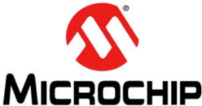

Microchip

## Section 1. Introduction

## HIGHLIGHTS

This section of the manual contains the following topics:

|   1.1 | Introduction ....................................................................................................................1-2   |
|-------|----------------------------------------------------------------------------------------------------------------------------------------|
|   1.2 | Family Reference Manual Sections ...............................................................................1-2                    |
|   1.3 | Device Structure.............................................................................................................1-2       |
|   1.4 | Development Support ....................................................................................................1-3            |
|   1.5 | Style and Symbol Conventions ......................................................................................1-4                 |
|   1.6 | Related Documentation .................................................................................................1-5             |
|   1.7 | Revision History.............................................................................................................1-6       |

Note: This family reference manual section is meant to serve as a complement to device data sheets. Depending on the device variant, this manual section may not apply to all PIC32 devices.

Please consult the note at the beginning of the 'Device Overview' chapter in the current device data sheet to check whether this document supports the device you are using.

Device  data  sheets  and  family  reference  manual  sections  are  available  for download from the Microchip Worldwide Web site at: http://www.microchip.com

## 1.1 INTRODUCTION

Microchip's  PIC32  series  of  32-bit  microcontrollers  are  designed  to  fulfill  a  customer's requirements for enhanced features and performance for their MCU-based applications.

Common attributes among all devices in the PIC32 series are:

- Pin, peripheral and source code compatibility
- Common software and hardware development tools

## 1.2 FAMILY REFERENCE MANUAL SECTIONS

The collective PIC32 family reference manual sections describe the PIC32 family series of 32-bit microcontrollers. All sections that comprise the PIC32 Family Reference Manual are available from the Microchip web site: www.microchip.com. These individual sections explain the PIC32 family architecture and operation of the peripheral modules, but do not cover the specifics of each device in a particular family. Users should refer to the respective product data sheet for device-specific details, such as:

- Pinout and packaging details
- Memory map
- List of peripherals included on the device, including multiple instances of peripherals
- Device-specific electrical specifications and characteristics

## 1.3 DEVICE STRUCTURE

The PIC32 architecture has been broken down into the following functional blocks:

- MCU Core
- System Memory
- System Integration
- Peripherals

## 1.3.1 MCU Core

The PIC32 MCU core is discussed in Section 2. 'CPU' (DS61113).

## 1.3.2 System Memory

The system memory provides on-chip nonvolatile Flash memory and volatile SRAM memory, featuring user and protected kernel-segment-partitioning for real-time operating systems.

Refer to the specific device data sheet for the list of applicable family reference manual sections for this topic.

## 1.3.3 System Integration

System integration consists of a comprehensive set of modules and features that connect the MCU core and peripheral modules into a single operational unit. System integration features also provide these advantages:

- Decreased system cost, by bringing traditionally off-chip functions into the microcontroller
- Increased design flexibility, by adding a wider range of operating modes
- Increased system reliability, by enhancing the ability to recover from unexpected events

Refer to the specific device data sheet for the list of applicable family reference manual sections for this topic.

## 1.3.4 Peripherals

The PIC32 devices have many peripherals that allow it to interface with the external world.

Refer to the specific device data sheet for the list of applicable family reference manual sections for this topic.

## 1.4 DEVELOPMENT SUPPORT

Microchip offers a wide range of development tools that allow users to efficiently develop and debug application code. Microchip's development tools can be divided into four categories:

- Code generation
- Hardware/software debug
- Device programmer
- Product evaluation boards

As new tools are developed, the latest product briefs and user guides can be obtained from the Microchip web site (www.microchip.com) or from your local Microchip Sales office.

Microchip offers other references and support to speed the development cycle. These include:

- Application notes
- Reference designs
- Local sales offices with field application support
- Corporate applications support line
- Getting started guides
- 'How to' brochures
- MASTERs conferences
- Webinars
- Design centers

These can all be found on the Microchip web site (www.microchip.com). Also, the Microchip web site lists other sites that may provide useful references.

## 1.5 STYLE AND SYMBOL CONVENTIONS

Throughout  the  individual  family  reference  manual  sections,  certain  style,  format,  and  font conventions are used to signal particular distinctions for the affected text. Table 1-1 lists these conventions, specific symbols, and non-conventional word definitions and abbreviations.

## 1.5.1 Document Conventions

Table 1-1 defines some of the symbols, terms and typographic conventions used in this manual.

Table 1-1: Document Conventions

| Symbol or Term                 | Description                                                                                                                                                                                                                                                                                          |
|--------------------------------|------------------------------------------------------------------------------------------------------------------------------------------------------------------------------------------------------------------------------------------------------------------------------------------------------|
| Set                            | To force a bit or register to a value of logic ' 1 '.                                                                                                                                                                                                                                                |
| Clear                          | To force a bit or register to a value of logic ' 0 '.                                                                                                                                                                                                                                                |
| Reset                          | 1) To force a register/bit to its default state. 2) A condition in which the device places itself after a device Reset occurs. Some bits will be set to ' 0 ' (such as interrupt enable bits), while others will be set to ' 1 ' (such as the I/O data direction bits).                              |
| 0xnn or nnh                    | Designates the number 'nn' in the hexadecimal number system. These conventions are used in the code examples. For example, the designation 0x13F or 13Fh may be used.                                                                                                                                |
| B ' bbbbbbbb '                 | Designates the number ' bbbbbbbb ' in the binary number system. This convention is used in the text, figures and tables. For example, the desig- nation B ' 10100000 ' may be used.                                                                                                                  |
| R-M-W                          | Read-Modify-Write. This occurs when a register or port is read, the value is modified, and that value is then written back to the register or port. This action can occur from a single instruction (such as bit set, BSET ) or a sequence of instructions.                                          |
| : (colon)                      | Used to specify a range or the concatenation of registers/bits/pins. One example is TMR3:TMR2, which is the concatenation of two 16-bit registers to form a 32-bit timer value. Concatenation order (left-right) usually specifies a positional relationship (MSb to LSb, higher to lower).          |
| < >                            | Specifies bit(s) locations in a particular register. One example is SRxMPT (SPIxSTAT<5>), which specifies the abbreviation of bit and the register name, and associated bits or bit positions.                                                                                                       |
| MSb, LSb                       | Indicates the Least/Most Significant bit in a field.                                                                                                                                                                                                                                                 |
| MSB, LSB                       | Indicates the Least/Most Significant Byte in a field of bits.                                                                                                                                                                                                                                        |
| mshw, lshw                     | Most Significant half-word and lease significant half-word. A half-word is 16 bits wide.                                                                                                                                                                                                             |
| msw, lsw                       | Indicates the least/most significant word in a field of bits.                                                                                                                                                                                                                                        |
| Courier New Font               | Used for code examples, binary numbers and for instruction mnemonics that appear in the text.                                                                                                                                                                                                        |
| Times New Roman Font (Italics) | Used for equations.                                                                                                                                                                                                                                                                                  |
| Note                           | A Note presents information that we want to re-emphasize, either to help you avoid a common pitfall or to make you aware of operating differences between some device family members. A Note can be in a box, or when used in a table or figure, it is located at the bottom of the table or figure. |
| Register cells                 | A bit reference that appears in a gray shaded cell of a register, signifies that the bit is either unimplemented (instead of a name an EM dash (-) is present) or is not relevant to the particular peripheral module.                                                                               |

## 1.5.2 Electrical Specifications

The individual family reference manual sections contain references to electrical specifications and their parameter numbers. Table 1-2 shows the parameter numbering convention for PIC32 devices. A parameter number represents a unique set of characteristics and conditions that is consistent between every data sheet, although the actual parameter value may vary from device to device.

To determine the parameter values for a specific device, users should refer to the 'Electrical Specifications' section of the specific device data sheet.

Table 1-2: Electrical Specification Parameter Numbering Convention

| Parameter Number Format   | Comment                                      |
|---------------------------|----------------------------------------------|
| Dxxx                      | DC Specification                             |
| Axxx                      | DC Specification for Analog Peripherals      |
| xxx                       | Timing (AC) Specification                    |
| PDxxx                     | Device Programming DC Specification          |
| Pxxx                      | Device Programming Timing (AC) Specification |

Legend:

'xxx' represents a parameter number.

## 1.6 RELATED DOCUMENTATION

Microchip, as well as other sources, offers additional documentation to aid you as you develop PIC32-based applications. The list below contains the most common documentation, but other documents may also be available. Please check the Microchip web site (www.microchip.com) for the latest published technical documentation.

## 1.6.1 Microchip Documentation

The  following  PIC32  documentation  is  available  from  Microchip.  These  documents  provide application-specific information that gives actual examples of using, programming, and designing with PIC32 microcontrollers.

- PIC32 Family Reference Manual Sections

The individual family reference manual sections describe the PIC32 family architecture and operation of the peripheral modules, but do not cover the specifics of each device in the family.

- PIC32MX Product Data Sheets

These  data  sheets  contain  device-specific  information,  such  as  pinout  and  packaging details, electrical specifications and memory maps.

- PIC32MX Programming Specification (DS61145)

The programming specification contains detailed descriptions of, and electrical and timing specifications for, the programming process. Both In-Circuit Serial Programming™ (ICSP™) and Enhanced ICSP are described in detail.

## 1.6.2 Third-Party Documentation

Microchip  does  not  review  third-party  documentation  for  technical  accuracy;  however,  these references may be helpful to understand operation of the devices. Refer to the Microchip web site for available information on third-party documentation.

## PIC32 Family Reference Manual

## 1.7 REVISION HISTORY

## Revision A (September 2007)

This is the initial version of this document.

## Revision B (October 2007)

Updated document to remove Confidential status.

## Revision C (April 2008)

Revised status to Preliminary; Revised Section 1.1.

## Revision D (September 2011)

This revision includes the following updates:

- Removed the Preliminary status in the footer
- Added a note box with information on related family reference manual sections
- Updated the bulleted list in 1.1 'Introduction'
- Removed the feature list from 1.3.1 'MCU Core'
- Updated the family reference manual section information in these sections:
- -1.3.2 'System Memory'
- -1.3.3 'System Integration'
- -1.3.4 'Peripherals'
- Updated the Document Conventions in Table 1-1
- In addition, updates to formatting and minor text edits were incorporated throughout the document

## Note the following details of the code protection feature on Microchip devices:

- Microchip products meet the specification contained in their particular Microchip Data Sheet.
- Microchip believes that its family of products is one of the most secure families of its kind on the market today, when used in the intended manner and under normal conditions.
- There are dishonest and possibly illegal methods used to breach the code protection feature. All of these methods, to our knowledge, require using the Microchip products in a manner outside the operating specifications contained in Microchip's Data Sheets. Most likely, the person doing so is engaged in theft of intellectual property.
- Microchip is willing to work with the customer who is concerned about the integrity of their code.
- Neither Microchip nor any other semiconductor manufacturer can guarantee the security of their code. Code protection does not mean that we are guaranteeing the product as 'unbreakable.'

Code protection is constantly evolving. We at Microchip are committed to continuously improving the code protection features of our products. Attempts to break Microchip's code protection feature may be a violation of the Digital Millennium Copyright Act. If such acts allow unauthorized access to your software or other copyrighted work, you may have a right to sue for relief under that Act.

Information  contained  in  this  publication  regarding  device applications and the like is provided only for your convenience and may be superseded by updates. It is your responsibility to ensure  that  your  application  meets  with  your  specifications. MICROCHIP MAKES NO REPRESENTATIONS OR WARRANTIES  OF  ANY  KIND  WHETHER  EXPRESS  OR IMPLIED, WRITTEN OR ORAL, STATUTORY OR OTHERWISE, RELATED TO THE INFORMATION, INCLUDING  BUT  NOT  LIMITED  TO  ITS  CONDITION, QUALITY, PERFORMANCE, MERCHANTABILITY OR FITNESS  FOR  PURPOSE . Microchip  disclaims  all  liability arising  from  this  information  and  its  use.  Use  of  Microchip devices in life support and/or safety applications is entirely at the buyer's risk, and the buyer agrees to defend, indemnify and hold  harmless  Microchip  from  any  and  all  damages,  claims, suits,  or  expenses  resulting  from  such  use.  No  licenses  are conveyed, implicitly or otherwise, under any Microchip intellectual property rights.

## QUALITY MANAGEMENT SYSTEM CERTIFIED BY DNV

ISO/TS 16949.2009=

## Trademarks

The Microchip name and logo, the Microchip logo, dsPIC, KEELOQ, KEELOQ logo, MPLAB, PIC, PICmicro, PICSTART, PIC 32  logo, rfPIC and UNI/O are registered trademarks of Microchip Technology Incorporated in the U.S.A. and other countries.

FilterLab, Hampshire, HI-TECH C, Linear Active Thermistor, MXDEV, MXLAB, SEEVAL and The Embedded Control Solutions Company are registered trademarks of Microchip Technology Incorporated in the U.S.A.

Analog-for-the-Digital Age, Application Maestro, chipKIT, chipKIT logo, CodeGuard, dsPICDEM, dsPICDEM.net, dsPICworks, dsSPEAK, ECAN, ECONOMONITOR, FanSense, HI-TIDE, In-Circuit Serial Programming, ICSP, Mindi, MiWi, MPASM, MPLAB Certified logo, MPLIB, MPLINK, mTouch, Omniscient Code Generation, PICC, PICC-18, PICDEM, PICDEM.net, PICkit, PICtail, REAL ICE, rfLAB, Select Mode, Total Endurance, TSHARC, UniWinDriver, WiperLock and ZENA are trademarks of Microchip Technology Incorporated in the U.S.A. and other countries.

SQTP is a service mark of Microchip Technology Incorporated in the U.S.A.

All other trademarks mentioned herein are property of their respective companies.

© 2007-2011, Microchip Technology Incorporated, Printed in the U.S.A., All Rights Reserved.

Printed on recycled paper.

ISBN: 978-1-61341-599-3

Microchip received ISO/TS-16949:2009 certification for its worldwide headquarters, design and wafer fabrication facilities in Chandler and Tempe, Arizona; Gresham, Oregon and design centers in California and India. The Company's quality system processes and procedures are for its PIC ®  MCUs and dsPIC ®  DSCs, KEELOQ ®  code hopping devices, Serial EEPROMs, microperipherals, nonvolatile memory and analog products. In addition, Microchip's quality system for the design and manufacture of development systems is ISO 9001:2000 certified.

## Worldwide Sales and Service

## ASIA/PACIFIC

Asia Pacific Office Suites 3707-14, 37th Floor Tower 6, The Gateway Harbour City, Kowloon Hong Kong Tel: 852-2401-1200 Fax: 852-2401-3431

Australia - Sydney Tel: 61-2-9868-6733 Fax: 61-2-9868-6755

China - Beijing Tel: 86-10-8569-7000 Fax: 86-10-8528-2104

China - Chengdu Tel: 86-28-8665-5511 Fax: 86-28-8665-7889

China - Chongqing Tel: 86-23-8980-9588 Fax: 86-23-8980-9500

China - Hangzhou Tel: 86-571-2819-3187 Fax: 86-571-2819-3189

China - Hong Kong SAR Tel: 852-2401-1200 Fax: 852-2401-3431

China - Nanjing Tel: 86-25-8473-2460 Fax: 86-25-8473-2470

China - Qingdao Tel: 86-532-8502-7355 Fax: 86-532-8502-7205

China - Shanghai Tel: 86-21-5407-5533 Fax: 86-21-5407-5066

China - Shenyang Tel: 86-24-2334-2829 Fax: 86-24-2334-2393

China - Shenzhen Tel: 86-755-8203-2660 Fax: 86-755-8203-1760

China - Wuhan Tel: 86-27-5980-5300 Fax: 86-27-5980-5118

China - Xian Tel: 86-29-8833-7252 Fax: 86-29-8833-7256

China - Xiamen Tel: 86-592-2388138 Fax: 86-592-2388130

China - Zhuhai Tel: 86-756-3210040 Fax: 86-756-3210049

## ASIA/PACIFIC

India - Bangalore Tel: 91-80-3090-4444 Fax: 91-80-3090-4123

India - New Delhi Tel: 91-11-4160-8631 Fax: 91-11-4160-8632

India - Pune Tel: 91-20-2566-1512 Fax: 91-20-2566-1513

Japan - Yokohama Tel: 81-45-471- 6166 Fax: 81-45-471-6122

Korea - Daegu Tel: 82-53-744-4301 Fax: 82-53-744-4302

Korea - Seoul Tel: 82-2-554-7200 Fax: 82-2-558-5932 or 82-2-558-5934

Malaysia - Kuala Lumpur Tel: 60-3-6201-9857 Fax: 60-3-6201-9859

Malaysia - Penang Tel: 60-4-227-8870 Fax: 60-4-227-4068

Philippines - Manila Tel: 63-2-634-9065 Fax: 63-2-634-9069

Singapore Tel: 65-6334-8870 Fax: 65-6334-8850

Taiwan - Hsin Chu Tel: 886-3-5778-366 Fax: 886-3-5770-955

Taiwan - Kaohsiung Tel: 886-7-536-4818 Fax: 886-7-330-9305

Taiwan - Taipei Tel: 886-2-2500-6610 Fax: 886-2-2508-0102

Thailand - Bangkok Tel: 66-2-694-1351 Fax: 66-2-694-1350

## AMERICAS

Corporate Office 2355 West Chandler Blvd. Chandler, AZ 85224-6199 Tel: 480-792-7200 Fax: 480-792-7277 Technical Support:

http://www.microchip.com/ support

Web Address:

www.microchip.com

Atlanta Duluth, GA Tel: 678-957-9614 Fax: 678-957-1455

Boston

Westborough, MA Tel: 774-760-0087 Fax: 774-760-0088

## Chicago

Itasca, IL Tel: 630-285-0071 Fax: 630-285-0075

Cleveland Independence, OH Tel: 216-447-0464 Fax: 216-447-0643

Dallas

Addison, TX Tel: 972-818-7423 Fax: 972-818-2924

Detroit

Farmington Hills, MI Tel: 248-538-2250 Fax: 248-538-2260

Indianapolis Noblesville, IN Tel: 317-773-8323 Fax: 317-773-5453

Los Angeles Mission Viejo, CA Tel: 949-462-9523 Fax: 949-462-9608

Santa Clara Santa Clara, CA Tel: 408-961-6444 Fax: 408-961-6445

Toronto Mississauga, Ontario, Canada Tel: 905-673-0699 Fax: 905-673-6509

## EUROPE

Austria - Wels Tel: 43-7242-2244-39 Fax: 43-7242-2244-393

Denmark - Copenhagen Tel: 45-4450-2828 Fax: 45-4485-2829

France - Paris Tel: 33-1-69-53-63-20 Fax: 33-1-69-30-90-79

Germany - Munich Tel: 49-89-627-144-0 Fax: 49-89-627-144-44

Italy - Milan Tel: 39-0331-742611 Fax: 39-0331-466781

Netherlands - Drunen Tel: 31-416-690399 Fax: 31-416-690340

Spain - Madrid Tel: 34-91-708-08-90 Fax: 34-91-708-08-91

UK - Wokingham Tel: 44-118-921-5869 Fax: 44-118-921-5820

08/02/11