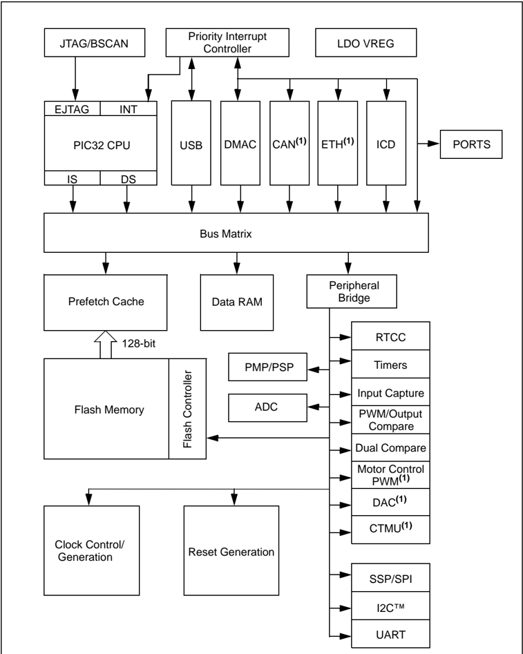
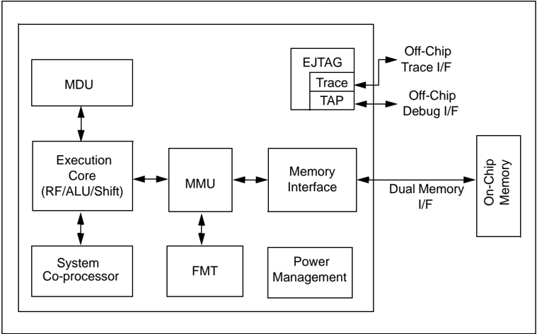
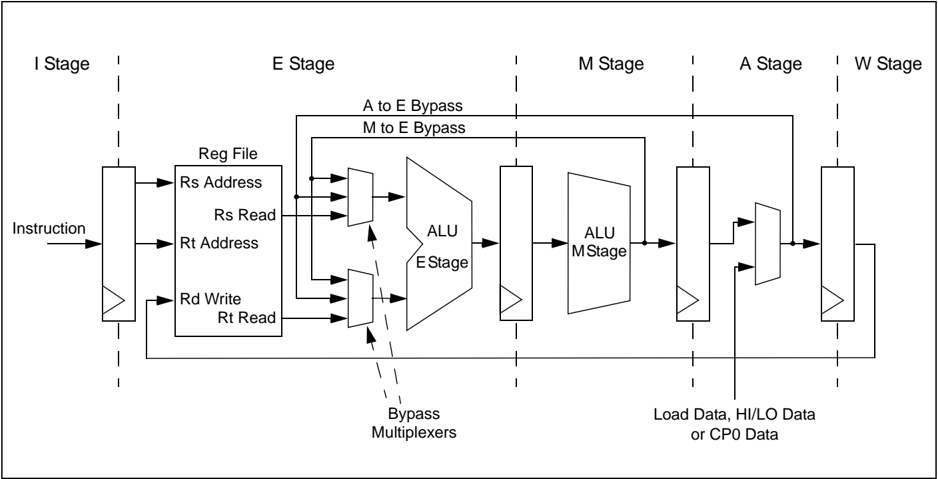
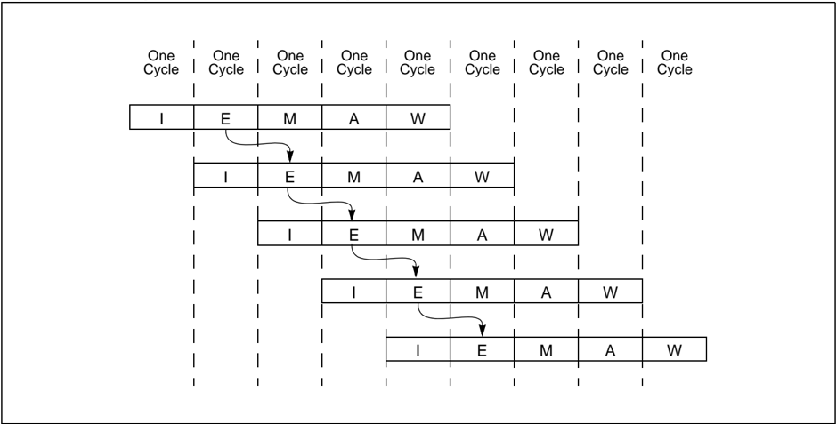
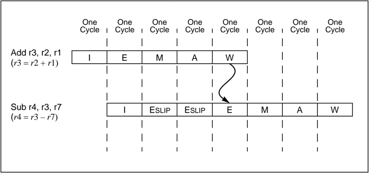
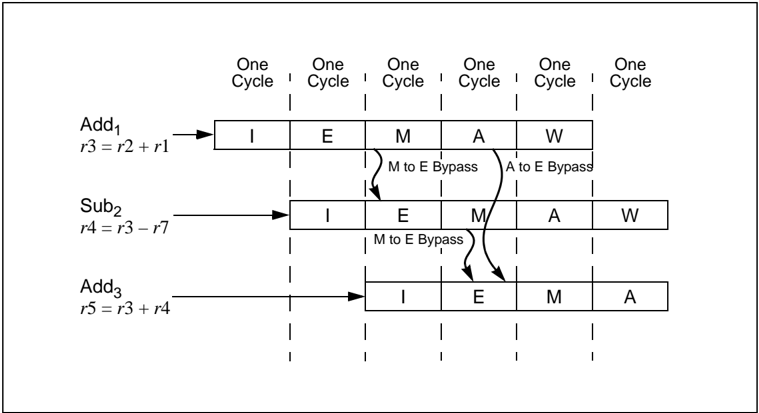
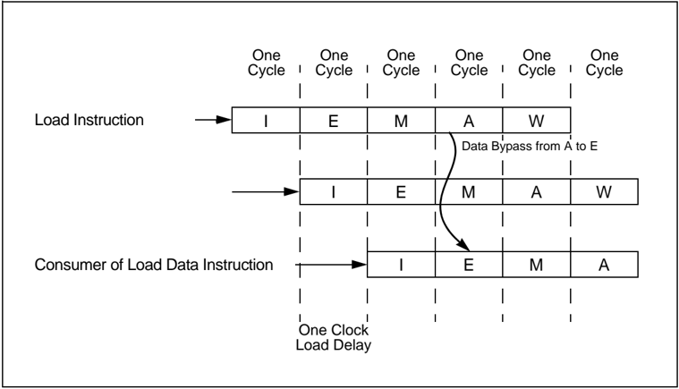
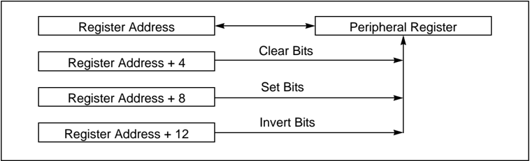
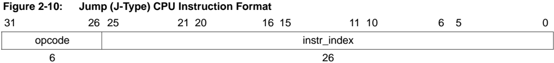
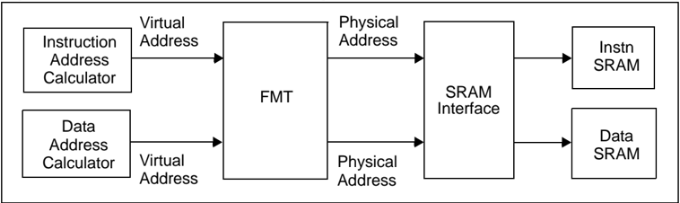

Microchip

## Section 2. CPU for Devices with M4K ®  Core

## HIGHLIGHTS

This section of the manual contains the following topics:

|   2.1 | Introduction................................................................................................................2-2   |
|-------|-----------------------------------------------------------------------------------------------------------------------------------|
|   2.2 | Architecture Overview ...............................................................................................2-3          |
|   2.3 | PIC32 CPU Details ....................................................................................................2-6         |
|   2.4 | Special Considerations When Writing to CP0 Registers ......................................... 2-11                               |
|   2.5 | Architecture Release 2 Details ................................................................................2-12               |
|   2.6 | Split CPU bus ..........................................................................................................2-12      |
|   2.7 | Internal System Busses...........................................................................................2-13             |
|   2.8 | Set/Clear/Invert........................................................................................................2-13      |
|   2.9 | ALU Status Bits........................................................................................................2-14       |
|  2.10 | Interrupt and Exception Mechanism........................................................................2-14                     |
|  2.11 | Programming Model ................................................................................................2-14            |
|  2.12 | Coprocessor 0 (CP0) Registers...............................................................................2-21                  |
|  2.13 | MIPS16e ® Execution...............................................................................................2-55            |
|  2.14 | Memory Model.........................................................................................................2-55         |
|  2.15 | CPU Instructions, Grouped By Function..................................................................2-56                       |
|  2.16 | CPU Initialization .....................................................................................................2-59      |
|  2.17 | Effects of a Reset ....................................................................................................2-60       |
|  2.18 | Related Application Notes .......................................................................................2-61             |
|  2.19 | Revision History.......................................................................................................2-62       |

Note: This family reference manual section is meant to serve as a complement to device data sheets. Depending on the device variant, this manual section may not apply to all PIC32 devices.

Please consult the note at the beginning of the 'CPU' chapter in the current device data sheet to check whether this document supports the device you are using.

Device  data  sheets  and  family  reference  manual  sections  are  available  for download from the Microchip Worldwide Web site at: http://www.microchip.com

## 2.1 INTRODUCTION

The PIC32 MCU is a complex system-on-chip (SoC) that is based on the M4K ®  Microprocessor core from MIPS ®  Technologies. The M4K ®  is a state-of-the-art, 32-bit, low-power, RISC processor core with the enhanced MIPS32 ®  Release 2 Instruction Set Architecture (ISA).

This chapter provides an overview of the CPU features and system architecture of the PIC32 family of microcontrollers that are based on the M4K ®  processor core.

## 2.1.1 Key Features

- Up to 1.5 DMIPS/MHz of performance
- Programmable prefetch cache memory to enhance execution from Flash memory (not available on all devices; refer to the specific device data sheet to determine availability)
- 16-bit Instruction mode (MIPS16e ® ) for compact code
- Vectored interrupt controller with up to 96 interrupt sources
- Programmable User and Kernel modes of operation
- Atomic bit manipulations on peripheral registers (Single cycle)
- Multiply-Divide unit with a maximum issue rate of one 32 x 16 multiply per clock
- High-speed Microchip ICD port with hardware-based non-intrusive data monitoring and application data streaming functions
- EJTAG debug port allows extensive third party debug, programming and test tools support
- Instruction controlled power management modes
- Five-stage pipelined instruction execution
- Internal code protection to help protect intellectual property

## 2.1.2 Related MIPS ®  Documentation

- MIPS32 ®  M4K ®  Processor Core Software User's Manual - MD00249-2B-M4K-SUM
- MIPS ®  Instruction Set - MD00086-2B-MIPS32BIS-AFP
- MIPS16e ®  - MD00076-2B-MIPS1632-AFP
- MIPS32 ®  Privileged Resource Architecture - MD00090-2B-MIPS32PRA-AFP

## 2.2 ARCHITECTURE OVERVIEW

The  PIC32  family  of  devices  are  complex  systems-on-a-chip  that  contain  many  features. Included in all processors of the PIC32 family is a high-performance RISC CPU, which can be programmed in  32-bit  and  16-bit  modes,  and  even  mixed  modes.  PIC32  devices  contain  a high-performance  interrupt  controller,  DMA  controller,  USB  controller,  in-circuit  debugger, high-performance switching matrix for high-speed data accesses to the peripherals, and on-chip data RAM memory that holds data and programs. The unique prefetch cache and prefetch buffer for the Flash memory, which hides the latency of the Flash, provides zero Wait state equivalent performance.

Figure 2-1: PIC32 Block Diagram



Note 1: This peripheral is not available on all devices. Refer to the specific device data sheet for availability.

There are two internal  busses  in  PIC32  devices  for  connection  to  all  peripherals.  The  main peripheral  bus  connects  most  of  the  peripheral  units  to  the  bus  matrix  through  a  peripheral bridge. There is also a high-speed peripheral bridge that connects the interrupt controller, DMA controller, in-circuit debugger, and USB peripherals.

The M4K ®  CPU core is the heart of some PIC32 MCUs. The CPU performs operations under program control. Instructions are fetched by the CPU, decoded and executed synchronously. Instructions exist in either Program Flash memory or Data RAM memory.

The PIC32 CPU is based on a load/store architecture and performs most operations on a set of internal registers.  Specific load and store instructions are used to move data between these internal registers and the outside world.

Figure 2-2: M4K ®  Microprocessor Core Block Diagram



## 2.2.1 Busses

There are two separate busses on PIC32 devices. One bus is responsible for the fetching of instructions to the CPU, and the other is the data path for load and store instructions. Both the instruction, or I-side bus, and the data, or D-side bus, are connected to the bus matrix unit. The bus matrix is a switch that allows multiple accesses to occur concurrently in a system. The bus matrix  allows  simultaneous  accesses  between  different  bus  masters  that  are  not  attempting accesses to the same target. The bus matrix serializes accesses between different masters to the same target through an arbitration algorithm.

Since the CPU has two different data paths to the bus matrix, the CPU is effectively two different bus masters to the system. When running from Flash memory, load and store operations to SRAM and the internal peripherals will occur in parallel to instruction fetches from Flash memory.

In addition to the CPU, and depending on the device variant, there are other bus masters in PIC32 devices:

- DMA controller
- In-Circuit Debugger (ICD) unit
- USB controller
- CAN controller
- Ethernet controller

## 2.2.2 Introduction to the Programming Model

The PIC32 processor has the following features:

- 5-stage pipeline
- 32-bit Address and Data Paths
- DSP-like Multiply-add and multiply-subtract instructions ( MADD , MADDU , MSUB , MSUBU )
- Targeted multiply instruction ( MUL )
- Zero and One detect instructions ( CLZ , CLO )
- Wait instruction ( WAIT )
- Conditional move instructions ( MOVZ , MOVN )
- Implements MIPS32 ®  Enhanced Architecture (Release 2)
- Vectored interrupts
- Programmable exception vector base
- Atomic interrupt enable/disable
- General Purpose Register (GPR) shadow sets
- Bit field manipulation instructions
- MIPS16e ®  Application Specific Extension improves code density
- Special PC-relative instructions for efficient loading of addresses and constants
- Data type conversion instructions ( ZEB , SEB , ZEH , SEH )
- Compact jumps
- Stack frame set-up and tear-down SAVE and RESTORE macro instructions
- Memory Management Unit with simple Fixed Mapping Translation (FMT)
- Processor to/from Coprocessor register data transfers
- Direct memory to/from Coprocessor register data transfers
- Performance-optimized Multiply-Divide Unit (High-performance build-time option)
- Maximum issue rate of one 32 x 16 multiply per clock
- Maximum issue rate of one 32 x 32 multiply every other clock
- Early-in divide control - 11 to 34 clock latency
- Low-Power mode (triggered by WAIT instruction)
- Software breakpoints via the SDBBP instruction

## 2.2.3 Core Timer

The PIC32 architecture includes a core timer  that  is  available  to  application  programs.  This timer  is  implemented  in  the  form  of  two  co-processor  registers:  the  Count  register,  and  the Compare register. The Count register is incremented every two system clock (SYSCLK) cycles. The incrementing of Count can be optionally suspended during Debug mode. The Compare register  is  used  to  cause  a  timer  interrupt  if  desired.  An  interrupt  is  generated  when  the Compare register matches the Count register. An interrupt is taken only if it is enabled in the Interrupt Controller module.

For  more  information  on  the  core  timer,  see 2.12 'Coprocessor  0  (CP0)  Registers' and Section 8. 'Interrupts.' (DS61108) in the 'PIC32 Family Reference Manual' .

## PIC32 Family Reference Manual

## 2.3 PIC32 CPU DETAILS

## 2.3.1 Pipeline Stages

The pipeline consists of five stages:

- Instruction (I) Stage
- Execution (E) Stage
- Memory (M) Stage
- Align (A) Stage
- Writeback (W) Stage

## 2.3.1.1 I STAGE - INSTRUCTION FETCH

## During I stage:

- An instruction is fetched from the instruction SRAM
- MIPS16e ®  instructions are converted into instructions that are similar to MIPS32 ® instructions

## 2.3.1.2 E STAGE - EXECUTION

## During E stage:

- Operands are fetched from the register file
- Operands from the M and A stage are bypassed to this stage
- The Arithmetic Logic Unit (ALU) begins the arithmetic or logical operation for register-to-register instructions
- The ALU calculates the data virtual address for load and store instructions and the MMU performs the fixed virtual-to-physical address translation
- The ALU determines whether the branch condition is true and calculates the virtual branch target address for branch instructions
- Instruction logic selects an instruction address and the MMU performs the fixed virtual-to-physical address translation
- All multiply divide operations begin in this stage

## 2.3.1.3 M STAGE - MEMORY FETCH

## During M stage:

- The arithmetic or logic ALU operation completes
- The data SRAM access is performed for load and store instructions
- A 16 x 16 or 32 x 16 MUL operation completes in the array and stalls for one clock in the M stage to complete the carry-propagate-add in the M stage
- A 32 x 32 MUL operation stalls for two clocks in the M stage to complete the second cycle of the array and the carry-propagate-add in the M stage
- Multiply and divide calculations proceed in the MDU. If the calculation completes before the IU moves the instruction past the M stage, then the MDU holds the result in a temporary register until the IU moves the instructions to the A stage (and it is consequently known that it will not be killed).

## 2.3.1.4 A STAGE - ALIGN

## During A stage:

- A separate aligner aligns loaded data with its word boundary
- A MUL operation makes the result available for writeback. The actual register writeback is performed in the W stage
- From this stage, load data or a result from the MDU are available in the E stage for bypassing

## 2.3.1.5 W STAGE - WRITEBACK

During W stage:

For register-to-register or load instructions, the result is written back to the register file.

The M4K ®  Microprocessor core implements a 'bypass' mechanism that allows the result of an operation to be sent directly to the instruction that needs it without having to write the result to the register, and then read it back.

Figure 2-3: Simplified PIC32 CPU Pipeline



The results of using instruction pipelining in the PIC32 core is a fast, single-cycle instruction execution environment.

Figure 2-4: Single-Cycle Execution Throughput



## 2.3.2 Execution Unit

The PIC32 Execution Unit is responsible for carrying out the processing of most of the instructions of the MIPS ® instruction set. The Execution Unit provides single-cycle throughput for most instructions  by  means  of  pipelined  execution.  Pipelined  execution,  sometimes  referred  to  as 'pipelining', is where complex operations are broken into smaller pieces called stages. Operation stages are executed over multiple clock cycles.

The Execution Unit contains the following features:

- 32-bit adder used for calculating the data address
- Address unit for calculating the next instruction address
- Logic for branch determination and branch target address calculation
- Load aligner
- Bypass multiplexers used to avoid stalls when executing instructions streams where data producing instructions are followed closely by consumers of their results
- Leading Zero/One detect unit for implementing the CLZ and CLO instructions
- Arithmetic Logic Unit (ALU) for performing bit-wise logical operations
- Shifter and Store Aligner

## 2.3.3 MDU

The Multiply/Divide unit performs multiply and divide operations. The MDU consists of a 32 x 16 multiplier, result-accumulation registers (HI and LO), multiply and divide state machines, and all multiplexers and control logic required to perform these functions. The high-performance, pipelined  MDU supports execution of a 16 x 16 or 32 x 16 multiply operation every clock cycle; 32 × 32 multiply operations can be issued every other clock cycle. Appropriate interlocks are implemented to stall the issue of back-to-back 32 x 32 multiply operations. Divide operations are implemented with a simple 1 bit per clock iterative algorithm and require 35 clock cycles in worst case to complete. Early-in to the algorithm detects sign extension of the dividend, if it is actual size is 24, 16, or 8 bit. the divider will skip 7, 15, or 23 of the 32 iterations. An attempt to issue a subsequent MDU instruction while a divide is still active causes a pipeline stall until the divide operation is completed.

The  M4K ®   Microprocessor  core  implements  an  additional  multiply  instruction, MUL ,  which specifies that lower 32-bits of the multiply result be placed in the register file instead of the HI/LO register pair. By avoiding the explicit move from LO ( MFLO ) instruction, required when using the LO register, and by supporting multiple destination registers, the throughput of multiply-intensive operations  is  increased.  Two  instructions,  multiply-add  ( MADD/MADDU )  and  multiply-subtract ( MSUB / MSUBU ), are used to perform the multiply-add and multiply-subtract operations. The MADD instruction multiplies two numbers and then adds the product to the current contents of the HI and LO registers. Similarly, the MSUB instruction multiplies two operands and then subtracts the product  from  the  HI  and  LO  registers.  The MADD / MADDU and MSUB / MSUBU operations  are commonly used in Digital Signal Processor (DSP) algorithms.

## 2.3.4 Shadow Register Sets

The PIC32 processor implements a copy of the General Purpose Registers (GPR) for use by high-priority interrupts. This extra bank of registers is known as a shadow register set. When a high-priority interrupt occurs the processor automatically switches to the shadow register set without  software  intervention.  This  reduces  overhead  in  the  interrupt  handler  and  reduces effective latency.

The shadow register set is controlled by registers located in the System Coprocessor (CP0) as well as the interrupt controller hardware located outside of the CPU core.

For more information on shadow register sets, see Section 8. 'Interrupts' (DS61108).

## 2.3.5 Pipeline Interlock Handling

Smooth pipeline flow is interrupted when an instruction in a pipeline stage can not advance due to a data dependency or a similar external condition. Pipeline interruptions are handled entirely in  hardware.  These  dependencies,  are  referred  to  as  'interlocks'.  At  each  cycle,  interlock conditions are checked for all active instructions. An instruction that depends on the result of a previous instruction is an example of an interlock condition.

In general, MIPS ®  processors support two types of hardware interlocks:

- Stalls - These interlocks are resolved by halting the entire pipeline. All instructions currently executing in each pipeline stage are affected by a stall
- Slips - These interlocks allow one part of the pipeline to advance while another part of the pipeline is held static

In the PIC32 processor core, all interlocks are handled as slips. These slips are minimized by grabbing results from other pipeline stages by using a method called register bypassing, which is described below.

Note: To  illustrate  the  concept  of  a  pipeline  slip,  the  following  example  is  what  would happen if the PIC32 core did not implement register bypassing.

As shown in Figure 2-5, the sub instruction has a source operand dependency on register r3 with the previous add instruction. The sub instruction slips by two clocks waiting until the result of the add is written back to register r3. This slipping does not occur on the PIC32 family of processors.

Figure 2-5: Pipeline Slip (If Bypassing Was Not Implemented)



## 2.3.6 Register Bypassing

As mentioned previously, the PIC32 processor implements a mechanism called register bypassing that helps reduce pipeline slips during execution. When an instruction is in the E stage of the pipeline, the operands must be available for that instruction to continue. If an instruction has a source  operand  that  is  computed  from  another  instruction  in  the  execution  pipeline,  register bypassing allows a shortcut to get the source operands directly from the pipeline. An instruction in the E stage can retrieve a source operand from another instruction that is executing in either the M stage or the A stage of the pipeline. As seen in Figure 2-6, a sequence of three instructions with interdependencies does not slip at all during execution. This example uses both A to E, and M to E register bypassing. Figure 2-7 shows the operation of a load instruction utilizing A to E bypassing. Since the result of load instructions are not available until the A pipeline stage, M to E bypassing is not needed.

The performance benefit of register bypassing is that instruction throughput is increased to the rate  of  one  instruction  per  clock  for  ALU  operations,  even  in  the  presence  of  register dependencies.

Figure 2-6: IU Pipeline M to E Bypass



Figure 2-7: IU Pipeline A to E Data Bypass



## 2.4 SPECIAL CONSIDERATIONS WHEN WRITING TO CP0 REGISTERS

In general, the PIC32 core ensures that instructions are executed following a fully sequential program model. Each instruction in the program sees the results of the previous instruction. There are some deviations to this model. These deviations are referred to as 'hazards'.

In privileged software, there are two different types of hazards:

- Execution Hazards
- Instruction Hazards

## 2.4.0.1 EXECUTION HAZARDS

Execution  hazards  are  those  created  by  the  execution  of  one  instruction,  and  seen  by  the execution of another instruction. Table 2-1 lists execution hazards.

Table 2-1: Execution Hazards

| Created By    | Seen By                                                                                | Hazard On                                       |   Spacing (Instructions) |
|---------------|----------------------------------------------------------------------------------------|-------------------------------------------------|--------------------------|
| MTC0          | Coprocessor instruction execution depends on the new value of the CU0 bit (Status<28>) | CU0 bit (Status<28>)                            |                        1 |
| MTC0          | ERET                                                                                   | EPC, DEPC, ErrorEPC                             |                        1 |
| MTC0          | ERET                                                                                   | Status                                          |                        0 |
| MTC0 , EI, DI | Interrupted Instruction                                                                | IE bit (Status<0>)                              |                        1 |
| MTC0          | Interrupted Instruction                                                                | IP1 and IP0 bits (Cause<1> and <0>)             |                        3 |
| MTC0          | RDPGPR, WRPGPR                                                                         | PSS<3:0> bits (SRSCtl<9:6>)                     |                        1 |
| MTC0          | Instruction is not seeing a Core Timer interrupt                                       | Compare update that clears Core Timer Interrupt |                        4 |
| MTC0          | Instruction affected by change                                                         | Any other CP0 register                          |                        2 |

## 2.4.0.2 INSTRUCTION HAZARDS

Instruction  hazards  are  those  created  by  the  execution  of  one  instruction,  and  seen  by  the instruction fetch of another instruction. Table 2-2 lists the instruction hazard.

Table 2-2: Instruction Hazards

| Created By   | Seen By                                                                                                                   | Hazard On   |
|--------------|---------------------------------------------------------------------------------------------------------------------------|-------------|
| MTC0         | Instruction fetch seeing the new value (including a change to ERL followed by an instruction fetch from the useg segment) | Status      |

## 2.5 ARCHITECTURE RELEASE 2 DETAILS

The PIC32 CPU utilizes Release 2 of the MIPS ®  32-bit processor architecture, and implements the following Release 2 features:

- Vectored interrupts using and external-to-core interrupt controller:

Provide the ability to vector interrupts directly to a handler for that interrupt.

- Programmable exception vector base:

Allows the base address of the exception vectors to be moved for exceptions that occur when Status BEV  is ' 0 '. This allows any system to place the exception vectors in memory that is appropriate to the system environment.

- Atomic interrupt enable/disable:

Two instructions have been added to atomically enable or disable interrupts, and return the previous value of the Status register.

- The ability to disable the Count register for highly power-sensitive applications
- GPR shadow registers:

Provides the addition of GPR shadow registers and the ability to bind these registers to a vectored interrupt or exception.

- Field, Rotate and Shuffle instructions:

Add additional capability in processing bit fields in registers.

- Explicit hazard management:

Provides a  set  of  instructions  to  explicitly  manage  hazards,  in  place  of  the  cycle-based SSNOP method of dealing with hazards.

## 2.6 SPLIT CPU BUS

The PIC32 CPU core has two distinct busses to help improve system performance over a single-bus system. This improvement is achieved through parallelism. Load and store operations occur at the same time as instruction fetches. The two busses are known as the I-side bus which is used for feeding instructions into the CPU, and the D-side bus used for data transfers.

The CPU fetches instructions during the I pipeline stage. A fetch is issued to the I-side bus and is handled by the bus matrix unit. Depending on the address, the BMX will do one of the following:

- Forward the fetch request to the Prefetch Cache unit
- Forward the fetch request to the DRM unit or
- Cause an exception

Instruction fetches always use the I-side bus independent of the addresses being fetched. The BMX decides what action to perform for each fetch request based on the address and the values in the BMX registers. See 3.5 'Bus Matrix' in Section 3. 'Memory Organization' (DS61115).

The D-side bus processes all load and store operations executed by the CPU. When a load or store instruction is executed the request is routed to the BMX by the D-side bus. This operation occurs during the M pipeline stage and is routed to one of several targets devices:

- Data Ram
- Prefetch Cache/Flash Memory
- Fast Peripheral Bus (Interrupt controller, DMA, Debug unit, USB, Ethernet, GPIO Ports)
- General Peripheral Bus (UART, SPI, Flash Controller, EPMP/EPSP, RTCC Timers, Input Capture, PWM/Output Compare, ADC, Dual Compare, I 2 C, Clock, and Reset)

## 2.7 INTERNAL SYSTEM BUSSES

The internal busses of the PIC32 processor connect the peripherals to the bus matrix unit. The bus matrix routes bus accesses from different initiators to a set of targets utilizing several data paths throughout the device to help eliminate performance bottlenecks.

Some of the paths that the bus matrix uses serve a dedicated purpose, while others are shared between several targets.

The data RAM and Flash memory read paths are dedicated paths, allowing low-latency access to the memory resources without being delayed by peripheral bus activity. The high-bandwidth peripherals are placed on a high-speed bus. These include the Interrupt controller, debug unit, DMA engine, the USB host/peripheral unit, and other high-bandwidth peripherals (i.e., CAN, Ethernet engines).

Peripherals that do not require high-bandwidth are located on a separate peripheral bus to save power.

## 2.8 SET/CLEAR/INVERT

To provide single-cycle bit operations on peripherals, the registers in the peripheral units can be accessed in three different ways depending on peripheral addresses. Each register has four different addresses. Although the four different addresses appear as different registers, they are really just four different methods to address the same physical register.

Figure 2-8: Four Addresses for a Single Physical Register



The base register address provides normal Read/Write access, while the other three provide special write-only functions.

- Normal access
- Set bit atomic RMW access
- Clear bit atomic RMW access
- Invert bit atomic RMW access

Peripheral reads must occur from the base address of each peripheral register. Reading from a Set/Clear/Invert address has an undefined meaning, and may be different for each peripheral.

Writing to the base address writes an entire value to the peripheral register. All bits are written. For example, assume a register contains 0xAAAA5555 before a write of 0x000000FF. After the write, the register will contain 0x000000FF (assuming that all bits are R/W bits).

Writing to the Set address for any peripheral register causes only the bits written as ' 1 's to be set in the destination register. For example, assume that a register contains 0xAAAA5555 before a write of 0x000000FF to the set register address. After the write to the Set register address, the value of the peripheral register will contain 0xAAAA55FF.

Writing to the Clear address for any peripheral register causes only the bits written as ' 1 's to be cleared  to  ' 0 's  in  the  destination  register.  For  example,  assume  that  a  register  contains 0xAAAA5555 before a write of 0x000000FF to the Clear register address. After the write to the Clear register address, the value of the peripheral register will contain 0xAAAA5500.

Writing to the Invert address for any peripheral register causes only the bits written as ' 1 's to be inverted, or toggled, in the destination register. For example, assume that a register contains 0xAAAA5555 before a write of 0x000000FF to the invert register address. After the write to the Invert register, the value of the peripheral register will contain 0xAAAA55AA.

## 2.9 ALU STATUS BITS

Unlike most other PIC ®  microcontrollers, the PIC32 processor does not use Status register flags. Condition flags are used on many processors to help perform decision making operations during program execution. Flags are set based on the results of comparison operations or some arithmetic operations. Conditional branch instructions on these machines then make decisions based on the values of the single set of condition codes.

Instead, the PIC32 processor uses instructions that perform a comparison and stores a flag or value into a General Purpose Register. A conditional branch is then executed with this general purpose register used as an operand.

## 2.10 INTERRUPT AND EXCEPTION MECHANISM

Note:

Throughout this document, the terms 'precise' and 'imprecise' are used to describe exceptions. A precise exception is one in which the EPC (CP0, Register 14, Select 0) can be used to identify the instruction that caused the exception. For imprecise exceptions, the instruction  that  caused  the  exception  cannot  be  identified.  Most exceptions are precise. Bus error exceptions may be imprecise.

The PIC32 family of processors implement an efficient and flexible interrupt and exception handling mechanism. Interrupts and exceptions both behave similarly in that the current instruction flow is changed temporarily to execute special procedures to handle an interrupt or exception. The difference between the two is that interrupts are usually a result of normal operation, and exceptions are a result of error conditions such as bus errors.

When an interrupt or exception occurs, the processor does the following:

1. The  PC  of  the  next  instruction  to  execute  after  the  handler  returns  is  saved  into  a co-processor register.
2. Cause register is updated to reflect the reason for exception or interrupt.
3. Status register EXL or ERL bit is set to cause Kernel mode execution.
4. Handler PC is calculated from Ebase and SPACING values.
5. Processor starts execution from new PC.

This  is  a  simplified  overview  of  the  interrupt  and  exception  mechanism.  See Section  8. 'Interrupts' (DS61108) for more information regarding interrupt and exception handling.

## 2.11 PROGRAMMING MODEL

The PIC32 family of processors is designed to be used with a high-level language such as the C programming language. It supports several data types and uses simple but flexible addressing modes needed for a high-level language. There are 32 General Purpose Registers and two special registers for multiplying and dividing.

There are three different formats for the machine language instructions on the PIC32 processor:

- Immediate or I-type CPU instructions
- Jump or J-type CPU instructions and
- Registered or R-type CPU instructions

Most  operations  are  performed  in  registers.  The  register  type  CPU  instructions  have  three operands; two source operands and a destination operand.

Having three operands and a large register set allows assembly language programmers and compilers to use the CPU resources efficiently. This creates faster and smaller programs by allowing intermediate results to stay in registers rather than constantly moving data to and from memory.

The  immediate  format  instructions  have  an  immediate  operand,  a  source  operand  and  a destination operand. The jump instructions have a 26-bit relative instruction offset field that is used to calculate the jump destination.

## 2.11.1 CPU Instruction Formats

A CPU instruction is a single 32-bit aligned word. The CPU instruction formats are:

- Immediate (see Figure 2-9)
- Jump (see Figure 2-10)
- Register (see Figure 2-11)

Table 2-3 describes the fields used in these instructions.

Table 2-3: CPU Instruction Format Fields

| Field       | Description                                                                                                                                                             |
|-------------|-------------------------------------------------------------------------------------------------------------------------------------------------------------------------|
| opcode      | 6-bit primary operation code.                                                                                                                                           |
| rd          | 5-bit specifier for the destination register.                                                                                                                           |
| rs          | 5-bit specifier for the source register.                                                                                                                                |
| rt          | 5-bit specifier for the target (source/destination) register or used to specify functions within the primary opcode REGIMM.                                             |
| immediate   | 16-bit signed immediate used for logical operands, arithmetic signed operands, load/store address byte offsets, and PC-relative branch signed instruction displacement. |
| instr_index | 26-bit index shifted left two bits to supply the low-order 28 bits of the jump target address.                                                                          |
| sa          | 5-bit shift amount.                                                                                                                                                     |
| function    | 6-bit function field used to specify functions within the primary opcode SPECIAL.                                                                                       |

| 31     | 26 25   | 21 20   | 16 15     |
|--------|---------|---------|-----------|
| opcode | rs      | rt      | immediate |
| 6      | 5       | 5       | 16        |

Figure 2-9: Immediate (I-Type) CPU Instruction Format



Figure 2-11: Register (R-Type) CPU Instruction Format

| 31     | 26 25   | 21 20   | 16 15   | 11 10   | 6 5   | 0        |
|--------|---------|---------|---------|---------|-------|----------|
| opcode | rs      | rt      | rd      | sa      |       | function |
| 6      | 5       | 5       | 5       | 5       |       | 6        |

## 2.11.2 CPU Registers

The PIC32 architecture defines the following CPU registers:

- Thirty-two 32-bit General Purpose Registers (GPRs)
- Two special purpose registers to hold the results of integer multiply, divide, and multiply-accumulate operations (HI and LO)
- A special purpose program counter (PC), which is affected only indirectly by certain instructions; it is not an architecturally visible register

2

## 2.11.2.1 CPU GENERAL PURPOSE REGISTERS

Two of the CPU General Purpose Registers have assigned functions:

- r0 - This register is hard-wired to a value of ' 0 ', and can be used as the target register for any instruction the result of which will be discarded. r0 can also be used as a source when a ' 0 ' value is needed.
- r31 - This is the destination register used by JAL, BLTZAL, BLTZALL, BGEZAL, and BGEZALL, without being explicitly specified in the instruction word; otherwise, r31 is used as a normal register

The remaining registers are available for general purpose use.

## 2.11.2.2 REGISTER CONVENTIONS

Although most of the registers in the PIC32 architecture are designated as General Purpose Registers, as shown in Table 2-4, there are some recommended uses of the registers for correct software operation with high-level languages such as the Microchip C compiler.

Table 2-4: Register Conventions

| CPU Register   | Symbolic Register   | Usage                                                                                                  |
|----------------|---------------------|--------------------------------------------------------------------------------------------------------|
| r0             | zero                | Always ' 0 ' (1)                                                                                       |
| r1             | at                  | Assembler Temporary                                                                                    |
| r2 - r3        | v0-v1               | Function Return Values                                                                                 |
| r4 - r7        | a0-a3               | Function Arguments                                                                                     |
| r8 - r15       | t0-t7               | Temporary - Caller does not need to preserve contents                                                  |
| r16 - r23      | s0-s7               | Saved Temporary - Caller must preserve contents                                                        |
| r24 - r25      | t8-t9               | Temporary - Caller does not need to preserve contents                                                  |
| r26 - r27      | k0-k1               | Kernel temporary - Used for interrupt and exception handling                                           |
| r28            | gp                  | Global Pointer - Used for fast-access common data                                                      |
| r29            | sp                  | Stack Pointer - Software stack                                                                         |
| r30            | s8 or fp            | Saved Temporary - Caller must preserve contents OR Frame Pointer - Pointer to procedure frame on stack |
| r31            | ra                  | Return Address (1)                                                                                     |

Note 1: Hardware enforced, not just convention.

## 2.11.2.3 CPU SPECIAL PURPOSE REGISTERS

The CPU contains three special purpose registers:

- PC - Program Counter register
- HI - Multiply and Divide register higher result
- LO - Multiply and Divide register lower result:
- -During a multiply operation, the HI and LO registers store the product of integer multiply
- -During a multiply-add or multiply-subtract operation, the HI and LO registers store the result of the integer multiply-add or multiply-subtract
- -During a division, the HI and LO registers store the quotient (in LO) and remainder (in HI) of integer divide
- -During a multiply-accumulate, the HI and LO registers store the accumulated result of the operation

Figure 2-12 shows the layout of the CPU registers.

Figure 2-12: CPU Registers

|                           |                           | 0                         |
|---------------------------|---------------------------|---------------------------|
| r0 (zero)                 | HI                        | HI                        |
| r1 (at)                   | LO                        |                           |
| r2 (v0)                   |                           |                           |
| r3 (v1)                   |                           |                           |
| r4 (a0)                   |                           |                           |
| r5 (a1)                   |                           |                           |
| r6 (a2)                   |                           |                           |
| r7 (a3)                   |                           |                           |
| r8 (t0)                   |                           |                           |
| r9 (t1)                   |                           |                           |
| r10 (t2)                  |                           |                           |
| r11 (t3)                  |                           |                           |
| r12 (t4)                  |                           |                           |
| r13 (t5)                  |                           |                           |
| r14 (t6)                  |                           |                           |
| r15 (t7)                  |                           |                           |
| r16 (s0)                  |                           |                           |
| r17 (s1)                  |                           |                           |
| r18 (s2)                  |                           |                           |
| r19 (s3)                  |                           |                           |
| r20 (s4)                  |                           |                           |
| r21 (s5)                  |                           |                           |
| r22 (s6)                  |                           |                           |
| r23 (s7)                  |                           |                           |
| r24 (t8)                  |                           |                           |
| r25 (t9)                  |                           |                           |
| r26 (k0)                  |                           |                           |
| r27 (k1)                  |                           |                           |
| r28 (gp)                  |                           |                           |
| r29 (sp)                  | 31                        | 31                        |
| r31 (ra)                  | PC                        | PC                        |
| r30 (s8 or fp)            |                           | 0                         |
| General Purpose Registers | Special Purpose Registers | Special Purpose Registers |

2

Table 2-5: MIPS16e ®  Register Usage

| MIPS16e ® Register Encoding   |   32-bit MIPS ® Register Encoding | Symbolic Name   | Description                                                                                                                               |
|-------------------------------|-----------------------------------|-----------------|-------------------------------------------------------------------------------------------------------------------------------------------|
| 0                             |                                16 | s0              | General Purpose Register                                                                                                                  |
| 1                             |                                17 | s1              | General Purpose Register                                                                                                                  |
| 2                             |                                 2 | v0              | General Purpose Register                                                                                                                  |
| 3                             |                                 3 | v1              | General Purpose Register                                                                                                                  |
| 4                             |                                 4 | a0              | General Purpose Register                                                                                                                  |
| 5                             |                                 5 | a1              | General Purpose Register                                                                                                                  |
| 6                             |                                 6 | a2              | General Purpose Register                                                                                                                  |
| 7                             |                                 7 | a3              | General Purpose Register                                                                                                                  |
| N/A                           |                                24 | t8              | MIPS16e ® Condition Code register; implic- itly referenced by the BTEQZ , BTNEZ , CMP , CMPI , SLT , SLTU , SLTI , and SLTIU instructions |
| N/A                           |                                29 | sp              | Stack Pointer register                                                                                                                    |
| N/A                           |                                31 | ra              | Return Address register                                                                                                                   |

## Table 2-6: MIPS16e ®  Special Registers

| Symbolic Name   | Purpose                                                                               |
|-----------------|---------------------------------------------------------------------------------------|
| PC              | Program counter. The PC-relative instructions can access this register as an operand. |
| HI              | Contains high-order word of multiply or divide result.                                |
| LO              | Contains low-order word of multiply or divide result.                                 |

## 2.11.3 How to Implement Stack/MIPS ®  Calling Conventions

The PIC32 CPU does not have hardware stacks. Instead, the processor relies on software to provide this functionality. Since the hardware does not perform stack operations itself, a convention must exist for all software within a system to use the same mechanism. For example, a stack can grow either toward lower address, or grow toward higher addresses. If one piece of software assumes that the stack grows toward lower address, and calls a routine that assumes that the stack grows toward higher address, the stack would become corrupted.

Using a system-wide calling convention prevents this problem from occurring. The Microchip C compiler assumes the stack grows toward lower addresses.

## 2.11.4 Processor Modes

There are two operational modes and one special mode of execution in the PIC32 family CPUs; User mode, Kernel mode, and Debug mode. The processor starts execution in Kernel mode, and if desired, can stay in Kernel mode for normal operation. User mode is an optional mode that allows a system designer to partition code between privileged and unprivileged software. Debug mode is normally only used by a debugger or monitor.

One of the main differences between the modes of operation is the memory addresses that software is allowed to access. Peripherals are not accessible in User mode. Figure 2-13 shows the different memory maps for each mode. For more information on the processor's memory map, see Section 3. 'Memory Organization' (DS61115).

Figure 2-13: CPU Modes

| Virtual Address                     | User Mode   | Kernel Mode   | Debug Mode   |
|-------------------------------------|-------------|---------------|--------------|
| 0xFFFF_FFFF                         |             |               | kseg3        |
| 0xFF3F_FFFF 0xFF40_0000             |             | kseg3         | kseg3 dseg   |
| 0xFF1F_FFFF 0xE000_0000 0xFF20_0000 |             | kseg2         | kseg2        |
| 0xBFFF_FFFF 0xC000_0000             |             | kseg1         | kseg1        |
| 0x9FFF_FFFF 0xA000_0000             |             | kseg0         | kseg0        |
| 0x0000_0000                         | useg        | kuseg         | kuseg        |

## 2.11.4.1 KERNEL MODE

In order to access many of the hardware resources, the processor must be operating in Kernel mode. Kernel mode gives software access to the entire address space of the processor as well as access to privileged instructions.

The processor operates in Kernel mode when the DM bit in the Debug register is ' 0 '  and the Status register contains one, or more, of the following values:

- UM = 0
- ERL = 1
- EXL = 1

When a non-debug exception is detected, EXL or ERL will be set and the processor will enter Kernel mode. At the end of the exception handler routine, an Exception Return ( ERET ) instruction is  generally  executed.  The ERET instruction  jumps  to  the  Exception  PC  ( EPC or ErrorPC depending on the exception), clears ERL, and clears EXL if ERL= 0 .

If UM = 1 the processor will return to User mode after returning from the exception when ERL and EXL are cleared back to ' 0 '.

## 2.11.4.2 USER MODE

When  executing  in  User  mode,  software  is  restricted  to  use  a  subset  of  the  processor's resources. In many cases it is desirable to keep application-level code running in User mode where if an error occurs it can be contained and not be allowed to affect the Kernel mode code.

Applications  can  access  Kernel  mode  functions  through  controlled  interfaces  such  as  the SYSCALL mechanism.

As seen in Figure 2-13, User mode software has access to the USEG memory area.

To operate in User mode, the Status register must contain each the following bit values:

- UM = 1
- EXL = 0
- ERL = 0

## 2.11.4.3 DEBUG MODE

Debug mode is a special mode of the processor normally only used by debuggers and system monitors. Debug mode is entered through a debug exception and has access to all the Kernel mode resources as well as special hardware resources used to debug applications.

The processor is in Debug mode when the DM bit in the Debug register is ' 1 '.

Debug mode is normally exited by executing a DERET instruction from the debug handler.

## 2.12 COPROCESSOR 0 (CP0) REGISTERS

The  PIC32  uses  a  special  register  interface  to  communicate  status  and  control  information between system software and the CPU. This interface is called Coprocessor 0, or CP0. The features of the CPU that are visible through Coprocessor 0 are:

- Core timer
- Interrupt and exception control
- Virtual memory configuration
- Shadow register set control
- Processor identification
- Debugger control
- Performance counters

System software accesses the registers in CP0 using coprocessor instructions such as MFC0 and MTC0. Table 2-7 describes the CP0 registers found on PIC32 devices.

Table 2-7: CP0 Registers

| Register Number   | Register Name   | Function                                                                                        |
|-------------------|-----------------|-------------------------------------------------------------------------------------------------|
| 0-6               | Reserved        | Reserved in the M4K ® Microprocessor core.                                                      |
| 7                 | HWREna          | Enables access via the RDHWR instruction to selected hardware registers in Non-privileged mode. |
| 8                 | BadVAddr        | Reports the address for the most recent address-related exception.                              |
| 9                 | Count           | Processor cycle count.                                                                          |
| 10                | Reserved        | Reserved in the M4K ® Microprocessor core.                                                      |
| 11                | Compare         | Core timer interrupt control.                                                                   |
| 12                | Status          | Processor status and control.                                                                   |
| 12                | IntCtl          | Interrupt control of vector spacing.                                                            |
| 12                | SRSCtl          | Shadow register set control.                                                                    |
| 12                | SRSMap          | Shadow register mapping control.                                                                |
| 13                | Cause           | Describes the cause of the last exception.                                                      |
| 14                | EPC             | Program counter at last exception.                                                              |
| 15                | PRID            | Processor identification and revision                                                           |
| 15                | Ebase           | Exception base address of exception vectors.                                                    |
| 16                | Config          | Configuration register.                                                                         |
| 16                | Config1         | Configuration register 1.                                                                       |
| 16                | Config2         | Configuration register 2.                                                                       |
| 16                | Config3         | Configuration register 3.                                                                       |
| 17-22             | Reserved        | Reserved in the M4K ® Microprocessor core.                                                      |
| 23                | Debug           | Debug control/exception status.                                                                 |
| 23                | TraceControl    | EJTAG trace control.                                                                            |
| 23                | TraceControl2   | EJTAG trace control 2.                                                                          |
| 23                | UserTraceData   | User format type trace record trigger.                                                          |
| 23                | TraceBPC        | Control tracing using an EJTAG Hardware breakpoint.                                             |
| 23                | Debug2          | Debug control/exception status 1.                                                               |
| 24                | DEPC            | Program counter at last debug exception.                                                        |
| 25-29             | Reserved        | Reserved in the M4K ® Microprocessor core.                                                      |
| 30                | ErrorEPC        | Program counter at last error.                                                                  |
| 31                | DeSAVE          | Debug handler scratchpad register.                                                              |

## 2.12.1 HWREna Register (CP0 Register 7, Select 0)

The  HWREna  register  contains  a  bit  mask  that  determines  which  hardware  registers  are accessible via the RDHWR instruction.

Register 2-1: HWREna: Hardware Accessibility Register; CP0 Register 7, Select 0

| Bit Range   | Bit 31/23/15/7   | Bit 30/22/14/6   | Bit 29/21/13/5   | Bit 28/20/12/4   | Bit 27/19/11/3   | Bit 26/18/10/2   | Bit 25/17/9/1   | Bit 24/16/8/0   |
|-------------|------------------|------------------|------------------|------------------|------------------|------------------|-----------------|-----------------|
| 31:24       | U-0              | U-0              | U-0              | U-0              | U-0              | U-0              | U-0             | U-0             |
| 31:24       | -                | -                | -                | -                | -                | -                | -               | -               |
| 23:16       | U-0              | U-0              | U-0              | U-0              | U-0              | U-0              | U-0             | U-0             |
| 23:16       | -                | -                | -                | -                | -                | -                | -               | -               |
| 15:8        | U-0              | U-0              | U-0              | U-0              | U-0              | U-0              | U-0             | U-0             |
| 15:8        | -                | -                | -                | -                | -                | -                | -               | -               |
| 7:0         | U-0              | U-0              | U-0              | U-0              | R/W-0            | R/W-0            | R/W-0           | R/W-0           |
| 7:0         | -                | -                | -                | -                | MASK<3:0>        | MASK<3:0>        | MASK<3:0>       | MASK<3:0>       |

## Legend:

R = Readable bit

W = Writable bit

U = Unimplemented bit, read as '0'

-n = Value at POR

'1' = Bit is set

'0' = Bit is cleared

x = Bit is unknown

bit 31-4 Unimplemented:

Read as ' 0 '

bit 3-0 MASK&lt;3:0&gt;:

Bit Mask bits

1 = Access is enabled to corresponding hardware register

0 = Access is disabled

Each of these bits enables access by the RDHWR instruction to a particular hardware register (which may not be an actual register). See the RDHWR instruction for a list of valid hardware registers.

## 2.12.2 BadVAddr Register (CP0 Register 8, Select 0)

BadVAddr is a read-only register that captures the most recent virtual address that caused an address error exception. Address errors are caused by executing load, store, or fetch operations from unaligned addresses, and also by trying to access Kernel mode addresses from User mode. BadVAddr does not capture address information for bus errors, because they are not addressing errors.

Register 2-2: BadVAddr: Bad Virtual Address Register; CP0 Register 8, Select 0

| Bit Range   | Bit 31/23/15/7   | Bit 30/22/14/6   | Bit 29/21/13/5   | Bit 28/20/12/4   | Bit 27/19/11/3   | Bit 26/18/10/2   | Bit 25/17/9/1   | Bit 24/16/8/0   |
|-------------|------------------|------------------|------------------|------------------|------------------|------------------|-----------------|-----------------|
| 31:24       | R-x              | R-x              | R-x              | R-x              | R-x              | R-x              | R-x             | R-x             |
| 31:24       | BadVAddr<31:24>  | BadVAddr<31:24>  | BadVAddr<31:24>  | BadVAddr<31:24>  | BadVAddr<31:24>  | BadVAddr<31:24>  | BadVAddr<31:24> | BadVAddr<31:24> |
| 23:16       | R-x              | R-x              | R-x              | R-x              | R-x              | R-x              | R-x             | R-x             |
| 23:16       | BadVAddr<23:16>  | BadVAddr<23:16>  | BadVAddr<23:16>  | BadVAddr<23:16>  | BadVAddr<23:16>  | BadVAddr<23:16>  | BadVAddr<23:16> | BadVAddr<23:16> |
| 15:8        | R-x              | R-x              | R-x              | R-x              | R-x              | R-x              | R-x             | R-x             |
| 15:8        | BadVAddr<15:8>   | BadVAddr<15:8>   | BadVAddr<15:8>   | BadVAddr<15:8>   | BadVAddr<15:8>   | BadVAddr<15:8>   | BadVAddr<15:8>  | BadVAddr<15:8>  |
| 7:0         | R-x              | R-x              | R-x              | R-x              | R-x              | R-x              | R-x             | R-x             |
| 7:0         | BadVAddr<7:0>    | BadVAddr<7:0>    | BadVAddr<7:0>    | BadVAddr<7:0>    | BadVAddr<7:0>    | BadVAddr<7:0>    | BadVAddr<7:0>   | BadVAddr<7:0>   |

| Legend: R = Readable bit   | W = Writable     | U = Unimplemented bit, read   | as '0'             |
|----------------------------|------------------|-------------------------------|--------------------|
| -n = Value at POR          | '1' = Bit is set | '0' = Bit is cleared          | x = Bit is unknown |

bit 31-0 BadVAddr&lt;31:0&gt;: Bad Virtual Address bits

Captures the virtual address that caused the most recent address error exception.

2

## 2.12.3 Count Register (CP0 Register 9, Select 0)

The Count register acts as a timer, incrementing at a constant rate, whether or not an instruction is  executed,  retired,  or  any  forward  progress  is  made  through  the  pipeline.  The  counter increments every other clock, if the DC bit in the Cause register is ' 0 '.

Count can be written for functional or diagnostic purposes, including at Reset or to synchronize processors.

By  writing  the  COUNTDM  bit  in  the  Debug  register,  it  is  possible  to  control  whether  Count continues to increment while the processor is in Debug mode.

Register 2-3: Count: Interval Counter Register; CP0 Register 9, Select 0

| Bit Range   | Bit 31/23/15/7   | Bit 30/22/14/6   | Bit 29/21/13/5   | Bit 28/20/12/4   | Bit 27/19/11/3   | Bit 26/18/10/2   | Bit 25/17/9/1   | Bit 24/16/8/0   |
|-------------|------------------|------------------|------------------|------------------|------------------|------------------|-----------------|-----------------|
| 31:24       | R/W-x            | R/W-x            | R/W-x            | R/W-x            | R/W-x            | R/W-x            | R/W-x           | R/W-x           |
| 31:24       | COUNT<31:24>     | COUNT<31:24>     | COUNT<31:24>     | COUNT<31:24>     | COUNT<31:24>     | COUNT<31:24>     | COUNT<31:24>    | COUNT<31:24>    |
| 23:16       | R/W-x            | R/W-x            | R/W-x            | R/W-x            | R/W-x            | R/W-x            | R/W-x           | R/W-x           |
| 23:16       | COUNT<23:16>     | COUNT<23:16>     | COUNT<23:16>     | COUNT<23:16>     | COUNT<23:16>     | COUNT<23:16>     | COUNT<23:16>    | COUNT<23:16>    |
| 15:8        | R/W-x            | R/W-x            | R/W-x            | R/W-x            | R/W-x            | R/W-x            | R/W-x           | R/W-x           |
| 15:8        | COUNT<15:8>      | COUNT<15:8>      | COUNT<15:8>      | COUNT<15:8>      | COUNT<15:8>      | COUNT<15:8>      | COUNT<15:8>     | COUNT<15:8>     |
| 7:0         | R/W-x            | R/W-x            | R/W-x            | R/W-x            | R/W-x            | R/W-x            | R/W-x           | R/W-x           |
| 7:0         | COUNT<7:0>       | COUNT<7:0>       | COUNT<7:0>       | COUNT<7:0>       | COUNT<7:0>       | COUNT<7:0>       | COUNT<7:0>      | COUNT<7:0>      |

bit 31-0 COUNT&lt;31:0&gt;: Interval Counter bits

| Legend: R = Readable bit   | W = Writable     | U = Unimplemented bit, read   | as '0'             |
|----------------------------|------------------|-------------------------------|--------------------|
| -n = Value at POR          | '1' = Bit is set | '0' = Bit is cleared          | x = Bit is unknown |

This value is incremented every other clock cycle.

## 2.12.4 Compare Register (CP0 Register 11, Select 0)

The Compare register acts in conjunction with the Count register to implement a timer and timer interrupt function. Compare maintains a stable value and does not change on its own.

When the value of Count equals the value of Compare, the CPU asserts an interrupt signal to the system interrupt controller. This signal will remain asserted until Compare is written.

Register 2-4: Compare: Interval Count Compare Register; CP0 Register 11, Select 0

| Bit Range   | Bit 31/23/15/7   | Bit 30/22/14/6   | Bit 29/21/13/5   | Bit 28/20/12/4   | Bit 27/19/11/3   | Bit 26/18/10/2   | Bit 25/17/9/1   | Bit 24/16/8/0   |
|-------------|------------------|------------------|------------------|------------------|------------------|------------------|-----------------|-----------------|
| 31:24       | R/W-x            | R/W-x            | R/W-x            | R/W-x            | R/W-x            | R/W-x            | R/W-x           | R/W-x           |
| 31:24       | COMPARE<31:24>   | COMPARE<31:24>   | COMPARE<31:24>   | COMPARE<31:24>   | COMPARE<31:24>   | COMPARE<31:24>   | COMPARE<31:24>  | COMPARE<31:24>  |
| 23:16       | R/W-x            | R/W-x            | R/W-x            | R/W-x            | R/W-x            | R/W-x            | R/W-x           | R/W-x           |
| 23:16       | COMPARE<23:16>   | COMPARE<23:16>   | COMPARE<23:16>   | COMPARE<23:16>   | COMPARE<23:16>   | COMPARE<23:16>   | COMPARE<23:16>  | COMPARE<23:16>  |
| 15:8        | R/W-x            | R/W-x            | R/W-x            | R/W-x            | R/W-x            | R/W-x            | R/W-x           | R/W-x           |
| 15:8        | COMPARE<15:8>    | COMPARE<15:8>    | COMPARE<15:8>    | COMPARE<15:8>    | COMPARE<15:8>    | COMPARE<15:8>    | COMPARE<15:8>   | COMPARE<15:8>   |
| 7:0         | R/W-x            | R/W-x            | R/W-x            | R/W-x            | R/W-x            | R/W-x            | R/W-x           | R/W-x           |
| 7:0         | COMPARE<7:0>     | COMPARE<7:0>     | COMPARE<7:0>     | COMPARE<7:0>     | COMPARE<7:0>     | COMPARE<7:0>     | COMPARE<7:0>    | COMPARE<7:0>    |

| Legend: R = Readable bit   | W = Writable     | U = Unimplemented bit, read   | as '0'             |
|----------------------------|------------------|-------------------------------|--------------------|
| -n = Value at POR          | '1' = Bit is set | '0' = Bit is cleared          | x = Bit is unknown |

bit 31-0 COMPARE&lt;31:0&gt;:

Interval Count Compare Value bits

## 2.12.5 Status Register (CP0 Register 12, Select 0)

The read/write Status register contains the operating mode, interrupt enabling, and the diagnostic states  of  the  processor.  The  bits  of  this  register  combine  to  create  operating  modes  for  the processor.

## 2.12.5.1 INTERRUPT ENABLE

Interrupts are enabled when all of the following conditions are true:

- IE = 1
- EXL = 0
- ERL = 0
- DM = 0

If these conditions are met, the settings of the IPL bits enable the interrupts.

## 2.12.5.2 OPERATING MODES

If  the  DM  bit  in  the  Debug  register  is  ' 1 ',  the  processor  is  in  Debug  mode;  otherwise,  the processor is in either Kernel mode or User mode.

The CPU Status register bit settings shown in table determine User or Kernel mode:

Table 2-8: CPU Status Register Bits That Determine Processor Mode

| Mode                                                      | Bit/Setting   | Bit/Setting   | Bit/Setting   |
|-----------------------------------------------------------|---------------|---------------|---------------|
| User (requires all of the following bits and values)      | UM = 1        | EXL = 0       | ERL = 0       |
| Kernel (requires one or more of the following bit values) | UM = 0        | EXL = 1       | ERL = 1       |

Note: The Status register CU0 bit (Status&lt;28&gt;) control coprocessor accessibility. If any coprocessor is unusable, an instruction that accesses it generates an exception.

Register 2-5: Status: Status Register; CP0 Register 12, Select 0

| Bit Range   | Bit 31/23/15/7   | Bit 30/22/14/6   | Bit 29/21/13/5   | Bit 28/20/12/4   | Bit 27/19/11/3   | Bit 26/18/10/2   | Bit 25/17/9/1   | Bit 24/16/8/0   |
|-------------|------------------|------------------|------------------|------------------|------------------|------------------|-----------------|-----------------|
| 31:24       | U-0              | U-0              | U-0              | R/W-x            | R/W-0 (1)        | U-0              | R/W-x           | U-0             |
| 31:24       | -                | -                | -                | CU0              | RP               | -                | RE              | -               |
| 23:16       | U-0              | R/W-1            | U-0              | R/W-1            | R/W-0            | U-0              | U-0             | U-0             |
| 23:16       | -                | BEV              | -                | SR               | NMI              | -                | -               | -               |
| 15:8        | U-0              | U-0              | U-0              | R/W-x            | R/W-x            | R/W-x            | U-0             | U-0             |
| 15:8        | -                | -                | -                | IPL<2:0>         | IPL<2:0>         | IPL<2:0>         | -               | -               |
| 7:0         | U-0              | U-0              | U-0              | R/W-x            | U-0              | R/W-x            | R/W-x           | R/W-x           |
| 7:0         | -                | -                | -                | UM               | -                | ERL              | EXL             | IE              |

| Legend:           | Legend:          | Legend:                            | Legend:                            |
|-------------------|------------------|------------------------------------|------------------------------------|
| R = Readable bit  | W = Writable bit | U = Unimplemented bit, read as '0' | U = Unimplemented bit, read as '0' |
| -n = Value at POR | '1' = Bit is set | '0' = Bit is cleared               | x = Bit is unknown                 |

bit 31-29

## Unimplemented: Read as ' 0 '

bit 28 CU0: Coprocessor 0 Usable bit

Controls access to Coprocessor 0

1 = Access allowed

0 = Access not allowed

Coprocessor 0 is always usable when the processor is running in Kernel mode, independent of the state of the CU0 bit.

## Register 2-5: Status: Status Register; CP0 Register 12, Select 0 (Continued)

## bit 27 RP: Reduced Power bit

- 1 = Enables Reduced Power mode
- 0 = Disables Reduced Power mode
- bit 26 Unimplemented: Read as ' 0 '
- bit 25 RE: Reverse-endian Memory Reference Enable bit

Used to enable reverse-endian memory references while the processor is running in User mode

- 1 = User mode uses reversed endianness
- 0 = User mode uses configured endianness

Debug, Kernel, or Supervisor mode references are not affected by the state of this bit.

bit 24-23 Unimplemented: Read as ' 0 '

## bit 22 BEV: Bootstrap Exception Vector Control bit

Controls the location of exception vectors.

- 1 = Bootstrap
- 0 = Normal

## bit 21 Unimplemented: Read as ' 0 '

## bit 20 SR: Soft Reset bit

Indicates that the entry through the Reset exception vector was due to a Soft Reset.

- 1 = Soft Reset; this bit is always set for any type of reset on the PIC32 core
- 0 = Not used on PIC32

Software can only write a ' 0 ' to this bit to clear it and cannot force a ' 0 ' to ' 1 ' transition.

## bit 19 NMI: Non-Maskable Interrupt bit

Indicates that the entry through the reset exception vector was due to a NMI.

1 = NMI

0 = Not NMI (Soft Reset or Reset)

Software can only write a ' 0 ' to this bit to clear it and cannot force a ' 0 ' to ' 1 ' transition.

bit 18-13 Unimplemented: Read as ' 0 '

- bit 12-10 IPL&lt;2:0&gt;: Interrupt Priority Level bits

This bit is the encoded (0-7) value of the current IPL. An interrupt will be signaled only if the requested IPL is higher than this value.

## bit 9-5 Unimplemented: Read as ' 0 '

## bit 4 UM: User Mode bit

This bit denotes the base operating mode of the processor. On the encoding of this bit is:

- 1 = Base mode is User mode
- 0 = Base mode in Kernel mode

The processor can also be in Kernel mode if ERL or EXL is set, regardless of the state of the UM bit.

## bit 3 Unimplemented: Read as ' 0 '

## bit 2 ERL: Error Level bit

Set by the processor when a Reset, Soft Reset, NMI or Cache Error exception are taken.

- 1 = Error level
- 0 = Normal level

## When ERL is set:

- Processor is running in Kernel mode
- Interrupts are disabled
- ERET instruction will use the return address held in the ErrorEPC register instead of the EPC register
- Lower 2 29  bytes of kuseg are treated as an unmapped and uncached region. This allows main memory to be accessed in the presence of cache errors. The operation of the processor is undefined if the ERL bit is set while the processor is executing instructions from kuseg.

2

## PIC32 Family Reference Manual

## Register 2-5: Status: Status Register; CP0 Register 12, Select 0 (Continued)

bit 1

EXL: Exception Level bit

Set by the processor when any exception other than Reset, Soft Reset, or NMI exceptions is taken.

1 = Exception level

- 0 = Normal level

## When EXL is set:

- Processor is running in Kernel mode
- Interrupts are disabled
- EPC, BD, and SRSCtl will not be updated if another exception is taken.

## bit 0 IE:

Interrupt Enable bit

Acts as the master enable for software and hardware interrupts:

- 1 = Interrupts are enabled
- 0 = Interrupts are disabled

This bit may be modified separately via the DI and EI instructions

## 2.12.6 IntCtl: Interrupt Control Register (CP0 Register 12, Select 1)

The IntCtl register controls the vector spacing of the PIC32 architecture.

Register 2-6: IntCtl: Interrupt Control Register; CP0 Register 12, Select 1

| Bit Range   | Bit 31/23/15/7   | Bit 30/22/14/6   | Bit 29/21/13/5   | Bit 28/20/12/4   | Bit 27/19/11/3   | Bit 26/18/10/2   | Bit 25/17/9/1   | Bit 24/16/8/0   |
|-------------|------------------|------------------|------------------|------------------|------------------|------------------|-----------------|-----------------|
| 31:24       | U-0              | U-0              | U-0              | U-0              | U-0              | U-0              | U-0             | U-0             |
| 31:24       | -                | -                | -                | -                | -                | -                | -               | -               |
| 23:16       | U=0              | U-0              | U-0              | U-0              | U-0              | U-0              | U-0             | U-0             |
| 23:16       | -                | -                | -                | -                | -                | -                | -               | -               |
| 15:8        | U-0              | U-0              | U-0              | U-0              | U-0              | U-0              | R/W-0           | R/W-0           |
| 15:8        | -                | -                | -                | -                | -                | -                | VS<4:4>         | VS<4:4>         |
| 7:0         | R/W-0            | R/W-0            | R/W-0            | U-0              | U-0              | U-0              | U-0             | U-0             |
| 7:0         | VS<2:0>          | VS<2:0>          | VS<2:0>          | -                | -                | -                | -               | -               |

Legend:

R = Readable bit

-n = Value at POR

W = Writable bit

'1' = Bit is set U = Unimplemented bit, read as '0'

'0' = Bit is cleared

bit 31-10 Unimplemented:

Read as ' 0 '

bit 9-5 VS&lt;4:0&gt;:

Vector Spacing bits

These bits specify the spacing between each interrupt vector.

| Encoding   | Spacing Between Vectors (hex)   |   Spacing Between Vectors (decimal) |
|------------|---------------------------------|-------------------------------------|
| 0x00       | 0x000 0x                        |                                   0 |
| 0x01       | 0x020                           |                                  32 |
| 0x02       | 0x040                           |                                  64 |
| 0x04       | 0x080                           |                                 128 |
| 0x08       | 0x100                           |                                 256 |
| 0x10       | 0x200                           |                                 512 |

All other values are reserved. The operation of the processor is undefined if a reserved value is written to these bits.

bit 4-0 Unimplemented:

Read as ' 0 '

x = Bit is unknown

## 2.12.7 SRSCtl Register (CP0 Register 12, Select 2)

The SRSCtl register controls the operation of GPR shadow sets in the processor.

Table 2-9: Sources for New CSS on an Exception or Interrupt

| Exception Type         | Bit Source   | Condition                                             | Comment                                  |
|------------------------|--------------|-------------------------------------------------------|------------------------------------------|
| Exception              | ESS          | All                                                   | -                                        |
| Non-Vectored Interrupt | ESS          | IV bit = 0 (Cause<23>)                                | Treat as exception                       |
| Vectored EIC Interrupt | EICSS        | IV bit = 1 (Cause<23>) and, VEIC bit = 1 (Config3<6>) | Source is external interrupt controller. |

Register 2-7: SRSCtl: Shadow Register Set Register; CP0 Register 12, Select 2

| Bit Range   | Bit 31/23/15/7   | Bit 30/22/14/6   | Bit 29/21/13/5   | Bit 28/20/12/4   | Bit 27/19/11/3   | Bit 26/18/10/2   | Bit 25/17/9/1   | Bit 24/16/8/0   |
|-------------|------------------|------------------|------------------|------------------|------------------|------------------|-----------------|-----------------|
| 31:24       | U-0              | U-0              | R-0              | R-0              | R-0              | R-1              | U-0             | U-0             |
| 31:24       | -                | -                | HSS<3:0>         | HSS<3:0>         | HSS<3:0>         | HSS<3:0>         | -               | -               |
| 23:16       | U-0              | U-0              | R-x              | R-x              | R-x              | R-x              | U-0             | U-0             |
| 23:16       | -                | -                | EICSS<3:0>       | EICSS<3:0>       | EICSS<3:0>       | EICSS<3:0>       | -               | -               |
| 15:8        | R/W-0            | R/W-0            | R/W-0            | R/W-0            | U-0              | U-0              | R/W-0           | R/W-0           |
| 15:8        | ESS<3:0>         | ESS<3:0>         | ESS<3:0>         | ESS<3:0>         | -                | -                | PSS<3:2>        | PSS<3:2>        |
| 7:0         | R/W-0            | R/W-0            | U-0              | U-0              | R-0              | R-0              | R-0             | R-0             |
| 7:0         | PSS<1:0>         | PSS<1:0>         | -                | -                | CSS<3:0>         | CSS<3:0>         | CSS<3:0>        | CSS<3:0>        |

## Legend:

R = Readable bit

W = Writable bit

U = Unimplemented bit, read as '0'

-n = Value at POR

'1' = Bit is set

'0' = Bit is cleared

x = Bit is unknown

## bit 31-30 Unimplemented: Read as ' 0 '

## bit 29-26 HSS&lt;3:0&gt;: High Shadow Set bits

This bit contains the highest shadow set number that is implemented by this processor. A value of ' 0000 ' in these bits indicates that only the normal GPRs are implemented.

1111

·

·

·

0100 = Reserved

0011 = Four shadow sets are present

0010 = Reserved

0001 = Two shadow sets are present

0000 = One shadow set (normal GPR set) is present

The value in this bit also represents the highest value that can be written to the ESS&lt;3:0&gt;, EICSS&lt;3:0&gt;, PSS&lt;3:0&gt;, and CSS&lt;3:0&gt; bits of this register, or to any of the bits of the SRSMap register. The operation of the processor is undefined if a value larger than the one in this bit is written to any of these other bits.

bit 25-22 Unimplemented: Read as ' 0 '

## bit 21-18 EICSS&lt;3:0&gt;: External Interrupt Controller Shadow Set bits

EIC Interrupt mode shadow set. This bit is loaded from the external interrupt controller for each interrupt request and is used in place of the SRSMap register to select the current shadow set for the interrupt.

bit 17-16 Unimplemented: Read as ' 0 '

= Reserved

## Register 2-7: SRSCtl: Shadow Register Set Register; CP0 Register 12, Select 2 (Continued)

bit 15-12 ESS&lt;3:0&gt;: Exception Shadow Set bits

This bit specifies the shadow set to use on entry to Kernel mode caused by any exception other than a vectored interrupt. The operation of the processor is undefined if software writes a value into this bit that is greater than the value in the HSS&lt;3:0&gt; bits.

bit 11-10 Unimplemented: Read as ' 0 '

- bit 9-6 PSS&lt;3:0&gt;: Previous Shadow Set bits

Since GPR shadow registers are implemented, this bit is copied from the CSS bit when an exception or interrupt occurs. An ERET instruction copies this value back into the CSS bit if the BEV bit (Status&lt;22&gt;) = 0 .

This bit is not updated on any exception which sets the ERL bit (Status&lt;2&gt;) to ' 1 ' (i.e., Reset, Soft Reset, NMI, cache error), an entry into EJTAG Debug mode, or any exception or interrupt that occurs with the EXL bit (Status&lt;1&gt;) = 1 , or BEV = 1 . This bit is not updated on an exception that occurs while ERL = 1 .

The operation of the processor is undefined if software writes a value into this bit that is greater than the value in the HSS&lt;3:0&gt; bits.

- bit 5-4 Unimplemented: Read as ' 0 '
- bit 3-0 CSS&lt;3:0&gt;: Current Shadow Set bits

Since GPR shadow registers are implemented, this bit is the number of the current GPR set. This bit is updated with a new value on any interrupt or exception, and restored from the PSS bit on an ERET.

Table 2-9 describes the various sources from which the CSS&lt;3:0&gt; bits are updated on an exception or interrupt.

This bit is not updated on any exception which sets the ERL bit (Status&lt;2&gt;) to ' 1 ' (i.e., Reset, Soft Reset, NMI, cache error), an entry into EJTAG Debug mode, or any exception or interrupt that occurs with EXL bit (Status&lt;1&gt;) = 1 , or BEV = 1 . Neither is it updated on an ERET with ERL = 1 or BEV = 1 . This bit is not updated on an exception that occurs while ERL = 1 .

The value of the CSS&lt;3:0&gt; bits can be changed directly by software only by writing the PSS&lt;3:0&gt; bits and executing an ERET instruction.

## 2.12.8 SRSMap: Register (CP0 Register 12, Select 3)

The SRSMap register contains eight 4-bit bits that provide the mapping from an vector number to the shadow set number to use when servicing such an interrupt. The values from this register are not used for a non-interrupt exception, or a non-vectored interrupt (IV bit = 0 , Cause&lt;23&gt; or VS&lt;4:0&gt; bit = 0 , IntCtl&lt;9:5&gt;). In such cases, the shadow set number comes from the ESS&lt;3:0&gt; bits (SRSCtl&lt;15:12&gt;).

If the HSS&lt;3:0&gt; bits (SRSCTL29:26) are ' 0 ', the results of a software read or write of this register are unpredictable.

The operation of the processor is undefined if a value is written to any bit in this register that is greater than the value of the HSS&lt;3:0&gt; bits.

The SRSMap register contains the shadow register set numbers for vector numbers 7-0. The same  shadow  set  number  can  be  established  for  multiple  interrupt  vectors,  creating  a many-to-one mapping from a vector to a single shadow register set number.

Register 2-8: SRSMap: Shadow Register Set Map Register; CP0 Register 12, Select 3

| Bit Range   | Bit 31/23/15/7   | Bit 30/22/14/6   | Bit 29/21/13/5   | Bit 28/20/12/4   | Bit 27/19/11/3   | Bit 26/18/10/2   | Bit 25/17/9/1   | Bit 24/16/8/0   |
|-------------|------------------|------------------|------------------|------------------|------------------|------------------|-----------------|-----------------|
| 31:24       | R/W-0            | R/W-0            | R/W-0            | R/W-0            | R/W-0            | R/W-0            | R/W-0           | R/W-0           |
| 31:24       | SSV7<3:0>        | SSV7<3:0>        | SSV7<3:0>        | SSV7<3:0>        | SSV6<3:0>        | SSV6<3:0>        | SSV6<3:0>       | SSV6<3:0>       |
| 23:16       | R/W-0            | R/W-0            | R/W-0            | R/W-0            | R/W-0            | R/W-0            | R/W-0           | R/W-0           |
| 23:16       | SSV5<3:0>        | SSV5<3:0>        | SSV5<3:0>        | SSV5<3:0>        | SSV4<3:0>        | SSV4<3:0>        | SSV4<3:0>       | SSV4<3:0>       |
| 15:8        | R/W-0            | R/W-0            | R/W-0            | R/W-0            | R/W-0            | R/W-0            | R/W-0           | R/W-0           |
| 15:8        | SSV3<3:0>        | SSV3<3:0>        | SSV3<3:0>        | SSV3<3:0>        | SSV2<3:0>        | SSV2<3:0>        | SSV2<3:0>       | SSV2<3:0>       |
| 7:0         | R/W-0            | R/W-0            | R/W-0            | R/W-0            | R/W-0            | R/W-0            | R/W-0           | R/W-0           |
| 7:0         | SSV1<3:0>        | SSV1<3:0>        | SSV1<3:0>        | SSV1<3:0>        | SSV0<3:0>        | SSV0<3:0>        | SSV0<3:0>       | SSV0<3:0>       |

| Legend:                            |                               |                                        |                                |
|------------------------------------|-------------------------------|----------------------------------------|--------------------------------|
| R = Readable bit -n = Value at POR | W = Writable '1' = Bit is set | U = Unimplemented '0' = Bit is cleared | read as '0' x = Bit is unknown |

| bit 31-28   | SSV7<3:0>: Shadow Set Vector 7 bits Shadow register set number for Vector Number 7   |
|-------------|--------------------------------------------------------------------------------------|
| bit 27-24   | SSV6<3:0>: Shadow Set Vector 6 bits Shadow register set number for Vector Number 6   |
| bit 23-20   | SSV5<3:0>: Shadow Set Vector 5 bits Shadow register set number for Vector Number 5   |
| bit 19-16   | SSV4<3:0>: Shadow Set Vector 4 bits Shadow register set number for Vector Number 4   |
| bit 15-12   | SSV3<3:0>: Shadow Set Vector 3 bits Shadow register set number for Vector Number 3   |
| bit 11-8    | SSV2<3:0>: Shadow Set Vector 2 bits Shadow register set number for Vector Number 2   |
| bit 7-4     | SSV1<3:0>: Shadow Set Vector 1 bits Shadow register set number for Vector Number 1   |
| bit 3-0     | SSV0<3:0>: Shadow Set Vector 0 bit Shadow register set number for Vector Number 0    |

## 2.12.9 Cause Register (CP0 Register 13, Select 0)

The Cause register primarily describes the cause of the most recent exception. In addition, bits also control software interrupt requests and the vector through which interrupts are dispatched. With the exception of the IP1, IP0, DC, and IV bits, all bits in the Cause register are read-only.

Table 2-10: Cause Register EXCCODE&lt;4:0&gt; Bits

| Exception Code Value   | Exception Code Value   | Mnemonic   | Description                                         |
|------------------------|------------------------|------------|-----------------------------------------------------|
| Decimal                | Hex                    | Mnemonic   | Description                                         |
| 0                      | 0x00                   | Int        | Interrupt                                           |
| 1-3                    | 0x01                   | -          | Reserved                                            |
| 4                      | 0x04                   | AdEL       | Address error exception (load or instruction fetch) |
| 5                      | 0x05                   | AdES       | Address error exception (store)                     |
| 6                      | 0x06                   | IBE        | Bus error exception (instruction fetch)             |
| 7                      | 0x07                   | DBE        | Bus error exception (data reference: load or store) |
| 8                      | 0x08                   | Sys        | Syscall exception                                   |
| 9                      | 0x09                   | Bp         | Breakpoint exception                                |
| 10                     | 0x0A                   | RI         | Reserved instruction exception                      |
| 11                     | 0x0B                   | CPU        | Coprocessor Unusable exception                      |
| 12                     | 0x0C                   | Ov         | Arithmetic Overflow exception                       |
| 13                     | 0x0D                   | Tr         | Trap exception                                      |
| 14-31                  | 0x0E-0x1F              | -          | Reserved                                            |

Register 2-9: Cause: Exception Cause Register; CP0 Register 13, Select 0

| Bit Range   | Bit 31/23/15/7   | Bit 30/22/14/6   | Bit 29/21/13/5   | Bit 28/20/12/4   | Bit 27/19/11/3   | Bit 26/18/10/2   | Bit 25/17/9/1   | Bit 24/16/8/0   |
|-------------|------------------|------------------|------------------|------------------|------------------|------------------|-----------------|-----------------|
| 31:24       | R-x              | R-x              | R-x              | R-x              | R/W-0            | U-0              | U-0             | U-0             |
| 31:24       | BD               | TI               | CE<1:0>          | CE<1:0>          | DC               | -                | -               | -               |
| 23:16       | R/W-x            | U-0              | U-0              | U-0              | U-0              | U-0              | U-0             | U-0             |
| 23:16       | IV               | -                | -                | -                | -                | -                | -               | -               |
| 15:8        | U-0              | U-0              | U-0              | R-x              | R-x              | R-x              | R/W-x           | R/W-x           |
| 15:8        | -                | -                | -                | RIPL<2:0>        | RIPL<2:0>        | RIPL<2:0>        | IP1             | IP0             |
| 7:0         | U-0              | R-x              | R-x              | R-x              | R-x              | R-x              | U-0             | U-0             |
| 7:0         | -                | EXCCODE<4:0>     | EXCCODE<4:0>     | EXCCODE<4:0>     | EXCCODE<4:0>     | EXCCODE<4:0>     | -               | -               |

| Legend:           | Legend:          | Legend:                            | Legend:                            |
|-------------------|------------------|------------------------------------|------------------------------------|
| R = Readable bit  | W = Writable bit | U = Unimplemented bit, read as '0' | U = Unimplemented bit, read as '0' |
| -n = Value at POR | '1' = Bit is set | '0' = Bit is cleared               | x = Bit is unknown                 |

## bit 31 BD: Branch Delay bit

Indicates whether the last exception taken occurred in a branch delay slot:

- 1 = In delay slot
- 0 = Not in delay slot

The processor updates BD only if the EXL bit (Status&lt;1&gt;) was ' 0 ' when the exception occurred.

## bit 30 TI: Timer Interrupt bit

Timer Interrupt. This bit denotes whether a timer interrupt is pending (analogous to the IP bits for other interrupt types):

- 1 = Timer interrupt is pending
- 0 = No timer interrupt is pending

## bit 29-28 CE&lt;1:0&gt;: Coprocessor Exception bits

Coprocessor unit number referenced when a Coprocessor Unusable exception is taken. This bit is loaded by hardware on every exception, but is unpredictable for all exceptions except for Coprocessor Unusable.

## PIC32 Family Reference Manual

## Register 2-9: Cause: Exception Cause Register; CP0 Register 13, Select 0 (Continued)

bit 27 DC: Disable Count Register bit

In  some  power-sensitive  applications,  the  Count  register  is  not  used  and  can  be  stopped  to  avoid unnecessary toggling.

- 1 = Disable counting of Count register
- 0 = Enable counting of Count register

bit 26-24 Unimplemented: Read as ' 0 '

bit 23 IV: Interrupt Vector bit

Indicates whether an interrupt exception uses the general exception vector or a special interrupt vector

- 1 = Use the special interrupt vector (0x200)
- 0 = Use the general exception vector (0x180)

If the IV bit (Cause&lt;23&gt;) is ' 1 ' and the BEV bit (Status&lt;22&gt;) is ' 0 ', the special interrupt vector represents the base of the vectored interrupt table.

bit 22-13 Unimplemented: Read as ' 0 '

## bit 12-10 RIPL&lt;2:0&gt;: Requested Interrupt Priority Level bits

This bit is the encoded (7-0) value of the requested interrupt. A value of ' 0 ' indicates that no interrupt is requested.

bit 9-8 IP&lt;1:0&gt;: Software Interrupt Request Control bits

Controls the request for software interrupts

- 1 = Request software interrupt
- 0 = No interrupt requested

These bits are exported to the system interrupt controller for prioritization in EIC Interrupt mode with other interrupt sources.

bit 7 Unimplemented: Read as ' 0

'

## bit 6-2 EXCCODE&lt;4:0&gt;: Exception Code bits

See Table 2-10 for the list of Exception codes.

bit 1-0 Unimplemented: Read as ' 0 '

## 2.12.10 EPC Register (CP0 Register 14, Select 0)

The Exception Program Counter (EPC) is a read/write register that contains the address at which processing  resumes  after  an  exception  has  been  serviced.  All  bits  of  the  EPC  register  are significant and are writable.

For synchronous (precise) exceptions, the EPC contains one of the following:

- The virtual address of the instruction that was the direct cause of the exception
- The virtual address of the immediately preceding BRANCH or JUMP instruction, when the exception causing instruction is in a branch delay slot and the Branch Delay bit in the Cause register is set

On new exceptions, the processor does not write to the EPC register when the EXL bit in the Status register is set, however, the register can still be written via the MTC0 instruction.

Since the PIC32 family implements MIPS16e ®  or microMIPS™ ASE, a read of the EPC register (via MFC0) returns the following value in the destination GPR:

```
GPR[rt]  ExceptionPC31..1  || ISAMode 0
```

That is, the upper 31 bits of the exception PC are combined with the lower bit of the ISA&lt;1:0&gt; bits (Config3&lt;15:14&gt;) and are written to the GPR.

Similarly, a write to the EPC register (via MTC0) takes the value from the GPR and distributes that value to the exception PC and the ISA&lt;1:0&gt; bits (Config3&lt;15:14&gt;), as follows:

```
ExceptionPC  GPR[rt]31..1  || 0 ISAMode  2#0 || GPR[rt]0
```

That is, the upper 31 bits of the GPR are written to the upper 31 bits of the exception PC, and the lower bit of the exception PC is cleared. The upper bit of the ISA&lt;1:0&gt; bits (Config3&lt;15:14&gt;) is cleared and the lower bit is loaded from the lower bit of the GPR.

Register 2-10: EPC: Exception Program Counter Register; CP0 Register 14, Select 0

| Bit Range   | Bit 31/23/15/7   | Bit 30/22/14/6   | Bit 29/21/13/5   | Bit 28/20/12/4   | Bit 27/19/11/3   | Bit 26/18/10/2   | Bit 25/17/9/1   | Bit 24/16/8/0   |
|-------------|------------------|------------------|------------------|------------------|------------------|------------------|-----------------|-----------------|
| 31:24       | R/W-x            | R/W-x            | R/W-x            | R/W-x            | R/W-x            | R/W-x            | R/W-x           | R/W-x           |
| 31:24       | EPC<31:24>       | EPC<31:24>       | EPC<31:24>       | EPC<31:24>       | EPC<31:24>       | EPC<31:24>       | EPC<31:24>      | EPC<31:24>      |
| 23:16       | R/W-x            | R/W-x            | R/W-x            | R/W-x            | R/W-x            | R/W-x            | R/W-x           | R/W-x           |
| 23:16       | EPC<23:16>       | EPC<23:16>       | EPC<23:16>       | EPC<23:16>       | EPC<23:16>       | EPC<23:16>       | EPC<23:16>      | EPC<23:16>      |
| 15:8        | R/W-x            | R/W-x            | R/W-x            | R/W-x            | R/W-x            | R/W-x            | R/W-x           | R/W-x           |
| 15:8        | EPC<15:8>        | EPC<15:8>        | EPC<15:8>        | EPC<15:8>        | EPC<15:8>        | EPC<15:8>        | EPC<15:8>       | EPC<15:8>       |
| 7:0         | R/W-x            | R/W-x            | R/W-x            | R/W-x            | R/W-x            | R/W-x            | R/W-x           | R/W-x           |
| 7:0         | EPC<7:0>         | EPC<7:0>         | EPC<7:0>         | EPC<7:0>         | EPC<7:0>         | EPC<7:0>         | EPC<7:0>        | EPC<7:0>        |

## Legend:

R = Readable bit

W = Writable bit

U = Unimplemented bit, read as '0'

-n = Value at POR

'1' = Bit is set

'0' = Bit is cleared

x = Bit is unknown

bit 31-0 EPC&lt;31:0&gt;:

Exception Program Counter bits

## 2.12.11 PRID Register (CP0 Register 15, Select 0)

The  Processor  Identification  (PRID)  register  is  a  32-bit  read-only  register  that  contains information  identifying  the  manufacturer,  manufacturer  options,  processor  identification,  and revision level of the processor.

Register 2-11: PRID: Processor Identification Register; CP0 Register 15, Select 0

| Bit Range   | Bit 31/23/15/7    | Bit 30/22/14/6    | Bit 29/21/13/5    | Bit 28/20/12/4    | Bit 27/19/11/3    | Bit 26/18/10/2    | Bit 25/17/9/1     | Bit 24/16/8/0     |
|-------------|-------------------|-------------------|-------------------|-------------------|-------------------|-------------------|-------------------|-------------------|
| 31:24       | U-0               | U-0               | R-0               | U-0               | U-0               | U-0               | U-0               | U-0               |
| 31:24       | -                 | -                 | -                 | -                 | -                 | -                 | -                 | -                 |
| 23:16       | R-0               | R-0               | R-0               | R-0               | R-0               | R-0               | R-0               | R-1               |
| 23:16       | COMPANYID<23:16>  | COMPANYID<23:16>  | COMPANYID<23:16>  | COMPANYID<23:16>  | COMPANYID<23:16>  | COMPANYID<23:16>  | COMPANYID<23:16>  | COMPANYID<23:16>  |
| 15:8        | R-x               | R-x               | R-x               | R-x               | R-x               | R-x               | R-x               | R-x               |
| 15:8        | PROCESSORID<15:8> | PROCESSORID<15:8> | PROCESSORID<15:8> | PROCESSORID<15:8> | PROCESSORID<15:8> | PROCESSORID<15:8> | PROCESSORID<15:8> | PROCESSORID<15:8> |
| 7:0         | R-x               | R-x               | R-x               | R-x               | R-x               | R-x               | R-x               | R-x               |
| 7:0         | MAJORREV<2:0>     | MAJORREV<2:0>     | MAJORREV<2:0>     | MINORREV<2:0>     | MINORREV<2:0>     | MINORREV<2:0>     | PATCHREV<1:0>     | PATCHREV<1:0>     |

| Legend: Legend:                                                       |
|-----------------------------------------------------------------------|
| R = Readable bit W=Writable bit P = Programmable bit r = Reserved bit |
| U = Unimplemented bit n = Bit Value at POR: ('0', '1', x = Unknown)   |

- bit 31-24 Unimplemented: Read as ' 0 '
- bit 23-16 COMPANYID&lt;7:0&gt;: Company Identification bits In PIC32 devices, these bits contain a value of ' ' to indicate MIPS ®  Technologies, Inc. as the processor

1 manufacturer/designer.

- bit 15-8 PROCESSORID&lt;7:0&gt;: Processor Identification bits These bits allow software to distinguish between the various types of MIPS ®  Technologies processors. For

PIC32 devices with the M4K ®  core, this value is 0x87.

- bit 7-5 MAJORREV&lt;2:0&gt;: Processor Major Revision Identification bits

These bits allow software to distinguish between one revision and another of the same processor type. This number is increased on major revisions of the processor core.

- bit 4-2 MINORREV&lt;2:0&gt;: Processor Minor Revision Identification bits

This number is increased on each incremental revision of the processor and reset on each new major revision.

- bit 1-0 PATCHREV&lt;1:0&gt;: Processor Patch Level Identification bits If a patch is made to modify an older revision of the processor, the value of these bits will be incremented.

## 2.12.12 Ebase Register (CP0 Register 15, Select 1)

The Ebase register is a read/write register containing the base address of the exception vectors used when the BEV bit (Status&lt;22&gt;) equals ' 0 ', and a read-only CPU number value that may be used by software to distinguish different processors in a multi-processor system.

The Ebase register provides the ability for software to identify the specific processor within a multi-processor system, and allows the exception vectors for each processor to be different, especially in systems composed of heterogeneous processors. Bits 31-12 of the Ebase register are concatenated with zeros to form the base of the exception vectors when the BEV bit is ' 0 '. The exception vector base address comes from the fixed defaults when the BEV bit is ' 1 ', or for any EJTAG Debug exception. The Reset state of bits 31-12 of the Ebase register initialize the exception base register to 0x80000000.

Bits 31 and 30 of the Ebase Register are fixed with the value 2#10 to force the exception base address to be in the kseg0 or kseg1 unmapped virtual address segments.

If the value of the exception base register is to be changed, this must be done with the BEV bit equal to ' 1 '. The operation of the processor is undefined if the Ebase&lt;17:0&gt; bits are written with a different value when the BEV bit (Status&lt;22&gt;) is ' 0 '.

Combining bits 31-20 of the Ebase register allows the base address of the exception vectors to be placed at any 4 KB page boundary.

Register 2-12: Ebase: Exception Base Register; CP0 Register 15, Select 1

| Bit Range   | Bit 31/23/15/7   | Bit 30/22/14/6   | Bit 29/21/13/5   | Bit 28/20/12/4   | Bit 27/19/11/3   | Bit 26/18/10/2   | Bit 25/17/9/1   | Bit 24/16/8/0   |
|-------------|------------------|------------------|------------------|------------------|------------------|------------------|-----------------|-----------------|
| 31:24       | U-1              | U-0              | R/W-0            | R/W-0            | R/W-0            | R/W-0            | R/W-0           | R/W-0           |
| 31:24       | -                | -                | EBASE<17:12>     | EBASE<17:12>     | EBASE<17:12>     | EBASE<17:12>     | EBASE<17:12>    | EBASE<17:12>    |
| 23:16       | R/W-0            | R/W-0            | R/W-0            | R/W-0            | R/W-0            | R/W-0            | R/W-0           | R/W-0           |
| 23:16       | EBASE<11:4>      | EBASE<11:4>      | EBASE<11:4>      | EBASE<11:4>      | EBASE<11:4>      | EBASE<11:4>      | EBASE<11:4>     | EBASE<11:4>     |
| 15:8        | R/W-0            | R/W-0            | R/W-0            | R/W-0            | U-0              | U-0              | R-0             | R-0             |
| 15:8        | EBASE<3:0>       | EBASE<3:0>       | EBASE<3:0>       | EBASE<3:0>       | -                | -                | CPUNUM<9:8>     | CPUNUM<9:8>     |
| 7:0         | R-0              | R-0              | R-0              | R-0              | R-0              | R-0              | R-0             | R-0             |
| 7:0         | CPUNUM<7:0>      | CPUNUM<7:0>      | CPUNUM<7:0>      | CPUNUM<7:0>      | CPUNUM<7:0>      | CPUNUM<7:0>      | CPUNUM<7:0>     | CPUNUM<7:0>     |

## Legend:

R = Readable bit

W = Writable bit

U = Unimplemented bit, read as '0'

-n = Value at POR

'1' = Bit is set

'0' = Bit is cleared

x = Bit is unknown

bit 31

Unimplemented: Read as ' 1 '

bit 30

Unimplemented: Read as ' 0 '

bit 29-12 EBASE&lt;17:0&gt;: Exception Vector Base Address bits

In conjunction with bits 31-30, these bits specify the base address of the exception vectors when the BEV bit (Status&lt;22&gt;) is ' 0 '.

bit 11-10 Unimplemented: Read as ' 0 '

bit 9-0 CPUNUM&lt;9:0&gt;: CPU Number bits These  bits  specify  the  number  of  CPUs  in  a  multi-processor  system  and  can  be  used  by  software  to distinguish a particular processor from others. In a single processor system, this value is set to ' 0 '.

bit 21

## 2.12.13 Config Register (CP0 Register 16, Select 0)

The Config register specifies various configuration and capabilities information. Most of the fields in  the  Config  register  are  initialized  by  hardware  during  the  Reset  exception process, or are constant.

Table 2-11: Cache Coherency Attributes

|   K0<2:0> Value | Cache Coherency Attribute   |
|-----------------|-----------------------------|
|               2 | Uncached                    |
|               3 | Cacheable                   |

Register 2-13: Config: Configuration Register; CP0 Register 16, Select 0

| Bit Range   | Bit 31/23/15/7   | Bit 30/22/14/6   | Bit 29/21/13/5   | Bit 28/20/12/4   | Bit 27/19/11/3   | Bit 26/18/10/2   | Bit 25/17/9/1   | Bit 24/16/8/0   |
|-------------|------------------|------------------|------------------|------------------|------------------|------------------|-----------------|-----------------|
| 31:24       | r-1              | R-0              | R-1              | R-0              | R/W-0            | R/W-1            | R/W-0           | U-0             |
| 31:24       | -                | K23<2:0>         | K23<2:0>         | K23<2:0>         | KU<2:0>          | KU<2:0>          | KU<2:0>         | -               |
| 23:16       | U-0              | R-0              | R-0              | r-0              | U-0              | U-0              | U-0             | R-1             |
| 23:16       | -                | UDI              | SB               | -                | -                | -                | -               | DS              |
| 15:8        | R-0              | R-0              | R-0              | R-0              | R-0              | R-1              | R-0             | R-1             |
| 15:8        | BE               | AT<1:0>          | AT<1:0>          | AT<1:0>          | AR<2:0>          | AR<2:0>          | MT<2:1>         | MT<2:1>         |
| 7:0         | R-1              | U-0              | U-0              | U-0              | U-0              | R/W-0            | R/W-1           | R/W-0           |
| 7:0         | MT<1>            | -                | -                | -                | -                | K0<2:0>          | K0<2:0>         | K0<2:0>         |

| Legend:           | r = Reserved bit   |                                    |                                    |
|-------------------|--------------------|------------------------------------|------------------------------------|
| R = Readable bit  | W = Writable bit   | U = Unimplemented bit, read as '0' | U = Unimplemented bit, read as '0' |
| -n = Value at POR | '1' = Bit is set   | '0' = Bit is cleared               | x = Bit is unknown                 |

bit 31 Reserved: This bit is hardwired to ' 1 ' to indicate the presence of the Config1 register.

bit 30-28 K23&lt;2:0&gt;: kseg2 and kseg3 bits

These bits control the cacheability of the kseg2 and kseg3 address segments.

Refer to Table 2-11 for the bit encoding.

## bit 27-25 KU&lt;2:0&gt;: kuseg and useg bits

These bits control the cacheability of the kuseg and useg address segments.

Refer to Table 2-11 for the bit encoding.

## bit 24-23 Unimplemented: Read as ' 0 '

## bit 22 UDI: User-Defined bit

This bit indicates that CorExtend User-Defined Instructions have been implemented.

- 1 = User-defined Instructions are implemented
- 0 = No User-defined Instructions are implemented

SB:

SimpleBE bit

This bit indicates whether SimpleBE Bus mode is enabled.

- 1 = Only simple byte enables allowed on internal bus interface
- 0 = No reserved byte enables on internal bus interface

bit 20 Reserved: This bit is hardwired to ' 0 ' to indicate the Fast, High-Performance Multiply/Divide Unit (MDU)

## bit 19-17 Unimplemented: Read as ' 0 '

## bit 16 DS: Dual SRAM bit

- 1 = Dual instruction/data SRAM internal bus interfaces
- 0 = Unified instruction/data SRAM internal bus interface

PIC32 devices based on the M4K ®  core use Dual SRAM-style interfaces internally.

## Register 2-13: Config: Configuration Register; CP0 Register 16, Select 0 (Continued)

## bit 15 BE: Big-Endian bit

Indicates the endian mode in which the processor is running, PIC32 is always little-endian.

1 = Big-endian

0 = Little-endian

## bit 14-13 AT&lt;1:0&gt;: Architecture Type bits

Architecture type implemented by the processor. This bit is always ' 00 ' to indicate the MIPS32 ® architecture.

bit 12-10 AR&lt;2:0&gt;: Architecture Revision Level bits

Architecture revision level. This bit is always ' 001 ' to indicate MIPS32 ®  Release 2.

111 = Reserved

110 = Reserved

101 = Reserved

100 = Reserved

011 = Reserved

010 = Reserved

001 = Release 2

000 = Release 1

## bit 9-7 MT&lt;2:0&gt;: MMU Type bits

111 = Reserved

110 = Reserved

101 = Reserved

100 = Reserved

011 = Fixed mapping

010 = Reserved

001 = Reserved

000 = Reserved

## bit 6-3 Unimplemented: Read as ' 0 '

## bit 2-0 K0&lt;2:0&gt;: Kseg0 bits

Kseg0 coherency algorithm. Refer to Table 2-11 for the bit encoding.

2

## 2.12.14 Config1 Register (CP0 Register 16, Select 1)

The Config1 register is an adjunct to the Config register and encodes additional information about capabilities present on the core. All fields in the Config1 register are read-only.

Register 2-14: Config1: Configuration Register 1; CP0 Register 16, Select 1

| Bit Range   | Bit 31/23/15/7   | Bit 30/22/14/6   | Bit 29/21/13/5   | Bit 28/20/12/4   | Bit 27/19/11/3   | Bit 26/18/10/2   | Bit 25/17/9/1   | Bit 24/16/8/0   |
|-------------|------------------|------------------|------------------|------------------|------------------|------------------|-----------------|-----------------|
| 31:24       | r-1              | U-0              | U-0              | U-0              | U-0              | U-0              | U-0             | U-0             |
| 31:24       | -                | -                | -                | -                | -                | -                | -               | -               |
| 23:16       | U-0              | U-0              | U-0              | U-0              | U-0              | U-0              | U-0             | U-0             |
| 23:16       | -                | -                | -                | -                | -                | -                | -               | -               |
| 15:8        | U-0              | U-0              | U-0              | U-0              | U-0              | U-0              | U-0             | U-0             |
| 15:8        | -                | -                | -                | -                | -                | -                | -               | -               |
| 7:0         | U-0              | U-0              | U-0              | U-0              | U-0              | R-1              | R-x             | U-0             |
| 7:0         | -                | -                | -                | -                | -                | CA               | EP              | -               |

| Legend:           | r = Reserved bit   |                                    |                                    |
|-------------------|--------------------|------------------------------------|------------------------------------|
| R = Readable bit  | W = Writable bit   | U = Unimplemented bit, read as '0' | U = Unimplemented bit, read as '0' |
| -n = Value at POR | '1' = Bit is set   | '0' = Bit is cleared               | x = Bit is unknown                 |

bit 31

Reserved: This bit is hardwired to a ' 1 ' to indicate the presence of the Config2 register.

bit 30-3

Unimplemented: Read as ' 0 '

bit 2

CA: Code Compression Implemented bit

1 = MIPS16e ®  is implemented

0 = No MIPS16e ®  present

bit 1

EP: EJTAG Present bit

This bit is always set to ' 1 ' indicate that the core implements EJTAG.

bit 0 Unimplemented:

Read as ' 0 '

## 2.12.15 Config2 (CP0 Register 16, Select 2)

The Config2 register is an adjunct to the Config register and is reserved to encode additional capabilities information. Config2 is allocated for showing the configuration of level 2/3 caches. These bits are reset to ' 0 ' because L2/L3 caches are not supported by the PIC32 core. All bits in the Config2 register are read-only.

Register 2-15: Config2: Configuration Register 2; CP0 Register 16, Select 2

| Bit Range   | Bit 31/23/15/7   | Bit 30/22/14/6   | Bit 29/21/13/5   | Bit 28/20/12/4   | Bit 27/19/11/3   | Bit 26/18/10/2   | Bit 25/17/9/1   | Bit 24/16/8/0   |
|-------------|------------------|------------------|------------------|------------------|------------------|------------------|-----------------|-----------------|
| 31:24       | r-1              | U-0              | U-0              | U-0              | U-0              | U-0              | U-0             | U-0             |
| 31:24       | -                | -                | -                | -                | -                | -                | -               | -               |
| 23:16       | U-0              | U-0              | U-0              | U-0              | U-0              | U-0              | U-0             | U-0             |
| 23:16       | -                | -                | -                | -                | -                | -                | -               | -               |
| 15:8        | U-0              | U-0              | U-0              | U-0              | U-0              | U-0              | U-0             | U-0             |
| 15:8        | -                | -                | -                | -                | -                | -                | -               | -               |
| 7:0         | U-0              | U-0              | U-0              | U-0              | U-0              | U-0              | U-0             | U-0             |
| 7:0         | -                | -                | -                | -                | -                | -                | -               | -               |

| Legend:           | r = Reserved bit   |                                    |                                    |
|-------------------|--------------------|------------------------------------|------------------------------------|
| R = Readable bit  | W = Writable bit   | U = Unimplemented bit, read as '0' | U = Unimplemented bit, read as '0' |
| -n = Value at POR | '1' = Bit is set   | '0' = Bit is cleared               | x = Bit is unknown                 |

bit 31 Reserved: This bit is hardwired to a ' 1 ' to indicate the presence of the Config3 register.

bit 30-0 Unimplemented: Read as ' 0 '

## 2.12.16 Config3 Register (CP0 Register 16, Select 3)

The  Config3  register  encodes  additional  capabilities.  All  fields  in  the  Config3  register  are read-only.

Register 2-16: Config3: Configuration Register 3; CP0 Register 16, Select 3

| Bit Range   | Bit 31/23/15/7   | Bit 30/22/14/6   | Bit 29/21/13/5   | Bit 28/20/12/4   | Bit 27/19/11/3   | Bit 26/18/10/2   | Bit 25/17/9/1   | Bit 24/16/8/0   |
|-------------|------------------|------------------|------------------|------------------|------------------|------------------|-----------------|-----------------|
| 31:24       | U-0              | U-0              | U-0              | U-0              | U-0              | U-0              | U-0             | U-0             |
| 31:24       | -                | -                | -                | -                | -                | -                | -               | -               |
| 23:16       | U-0              | U-0              | U-0              | U-0              | U-0              | U-0              | U-0             | U-0             |
| 23:16       | -                | -                | -                | -                | -                | -                | -               | -               |
| 15:8        | U-0              | U-0              | U-0              | U-0              | U-0              | U-0              | U-0             | R-0             |
| 15:8        | -                | -                | -                | -                | -                | -                | -               | ITL             |
| 7:0         | U-0              | R-1              | R-1              | U-0              | U-0              | U-0              | U-0             | U-0             |
| 7:0         | -                | VEIC             | VINT             | -                | -                | -                | -               | -               |

## Legend:

R = Readable bit

W = Writable bit

U = Unimplemented bit, read as '0'

-n = Value at POR

'1' = Bit is set

'0' = Bit is cleared

x = Bit is unknown

## bit 31-9 Unimplemented: Read as ' 0 '

bit 8

ITL: Indicates that iFlowTrace hardware is present

1 = The iFlowTrace is implemented in the core

0 = The iFlowTrace is not implemented in the core

## bit 7 Unimplemented: Read as ' 0 '

bit 6

VEIC: External Vectored Interrupt Controller bit

Support for an external interrupt controller is implemented.

1 = Support for EIC Interrupt mode is implemented

0 = Support for EIC Interrupt mode is not implemented

PIC32 devices internally implement a MIPS ®  'external interrupt controller'; therefore, this bit reads ' 1 '.

## bit 5 VINT: Vector Interrupt bit

Vectored interrupts implemented. This bit indicates whether vectored interrupts are implemented.

- 1 = Vector interrupts are implemented
- 0 = Vector interrupts are not implemented

On the PIC32 core, this bit is always a ' 1 ' since vectored interrupts are implemented.

bit 4-0 Unimplemented: Read as ' 0 '

## 2.12.17 Debug Register (CP0 Register 23, Select 0)

The Debug register is used to control the debug exception and provide information about the cause of the debug exception and when re-entering at the debug exception vector due to a normal exception in Debug mode. The read-only information bits are updated every time the debug exception is taken or when a normal exception is taken when already in Debug mode.

Only the DM bit and the VER&lt;2:0&gt; bits are valid when read from non-Debug mode; the values of all other bits and fields are unpredictable. Operation of the processor is undefined if the Debug register is written from non-Debug mode.

Some of the bits and fields are only updated on debug exceptions and/or exceptions in Debug mode, as follows:

- DSS, DBP, DDBL, DDBS, DIB, DINT are updated on both debug exceptions and on exceptions in debug modes
- DEXCCODE&lt;4:0&gt; are updated on exceptions in Debug mode, and are undefined after a debug exception
- HALT and DOZE are updated on a debug exception, and are undefined after an exception in Debug mode
- DBD is updated on both debug and on exceptions in debug modes

All bits are undefined when read from Normal mode, except VER&lt;2:0&gt; and DM.

Register 2-17: Debug: Debug Exception Register; CP0 Register 23, Select 0

| Bit Range   | Bit 31/23/15/7   | Bit 30/22/14/6   | Bit 29/21/13/5   | Bit 28/20/12/4   | Bit 27/19/11/3   | Bit 26/18/10/2   | Bit 25/17/9/1   | Bit 24/16/8/0   |
|-------------|------------------|------------------|------------------|------------------|------------------|------------------|-----------------|-----------------|
| 31:24       | R-0              | R-0              | R-0              | R/W-0            | U-0              | U-0              | R/W-1           | R/W-0           |
| 31:24       | DBD              | DM               | NODCR            | LSNM             | DOZE             | HALT             | COUNTDM         | IBUSEP          |
| 23:16       | R-0              | R-0              | R/W-0            | R/W-0            | R-0              | R-0              | R-0             | R-1             |
| 23:16       | MCHECKP          | CACHEEP          | DBUSEP           | IEXI             | DDBSIMPR         | DDBLIMPR         | VER<2:1>        | VER<2:1>        |
| 15:8        | R-0              | U-0              | U-0              | U-0              | U-0              | U-0              | R-0             | R/W-0           |
| 15:8        | VER              | DEXCCODE<4:0>    | DEXCCODE<4:0>    | DEXCCODE<4:0>    | DEXCCODE<4:0>    | DEXCCODE<4:0>    | NOSST           | SST             |
| 7:0         | U-0              | R-x              | R-x              | R-x              | R-x              | R-x              | R-x             | R-x             |
| 7:0         | -                | DIBIMPR          | DINT             | DIB              | DDBS             | DDBL             | DBP             | DSS             |

| Legend: R = Readable bit   | W = Writable     | U = Unimplemented bit, read   | as '0'             |
|----------------------------|------------------|-------------------------------|--------------------|
| -n = Value at POR          | '1' = Bit is set | '0' = Bit is cleared          | x = Bit is unknown |

## bit 31 DBD: Branch Delay Debug Exception bit

Indicates whether the last debug exception or exception in Debug mode, occurred in a branch delay slot:

1 = In delay slot

0 = Not in delay slot

## bit 30 DM: Debug Mode bit

Indicates that the processor is operating in Debug mode:

1 = Processor is operating in Debug mode

0 = Processor is operating in non-Debug mode

## bit 29 NODCR: Debug Control Register bit

Indicates whether the dseg memory segment is present and the Debug Control Register is accessible:

1 = No dseg present

0 = dseg is present

## PIC32 Family Reference Manual

## Register 2-17: Debug: Debug Exception Register; CP0 Register 23, Select 0 (Continued)

## bit 28 LSNM: Load Store Access Control bit

Controls access of load/store between dseg and main memory:

- 1 = Load/stores in dseg address range goes to main memory
- 0 = Load/stores in dseg address range goes to dseg

## bit 27 DOZE: Low-Power Mode Debug Exception bit

Indicates that the processor was in any kind of low-power mode when a debug exception occurred.

- 1 = Processor was in a low-power mode when a debug exception occurred
- 0 = Processor was not in a low-power mode when debug exception occurred

## bit 26 HALT: System Bus Clock Stop bit

Indicates that the internal system bus clock was stopped when the debug exception occurred.

- 1 = Internal system bus clock running
- 0 = Internal system bus clock stopped

## bit 25 COUNTDM: Count Register Behavior bit

Indicates the Count register behavior in Debug mode.

- 1 = Count register is running in Debug mode
- 0 = Count register stopped in Debug mode

## bit 24 IBUSEP: Instruction Fetch Bus Error Exception Pending bit

Set when an instruction fetch bus error event occurs or if a ' 1 ' is written to the bit by software. Cleared when a Bus Error exception on instruction fetch is taken by the processor, and by Reset. If IBUSEP is set when IEXI is cleared, a Bus Error exception on instruction fetch is taken by the processor, and IBUSEP is cleared.

## bit 23 MCHECKP: Machine Check Exception Pending bit

All Machine Check exceptions are precise on the PIC32 processor so this bit will always read as ' 0 '.

## bit 22 CACHEEP: Cache Error Pending bit

Cache Errors cannot be taken by the PIC32 core so this bit will always read as ' 0 '.

## bit 21 DBUSEP: Data Access Bus Error Exception Pending bit

Covers imprecise bus errors on data access, similar to behavior of IBUSEP for imprecise bus errors on an instruction fetch.

## bit 20 IEXI: Imprecise Error Exception Inhibit Control bit

Controls exceptions taken due to imprecise error indications. Set when the processor takes a debug exception or exception in Debug mode. Cleared by execution of the DERET instruction; otherwise modifiable by Debug mode software. When IEXI is set, the imprecise error exception from a bus error on an instruction fetch or data access, cache error, or machine check is inhibited and deferred until the bit is cleared.

## bit 19 DDBSIMPR: Debug Data Break Store Exception bit

Indicates that an imprecise Debug Data Break Store exception was taken. All data breaks are precise on the PIC32 core, so this bit will always read as ' 0 '.

## bit 18 DDBLIMPR: Debug Data Break Load Exception bit

Indicates that an imprecise Debug Data Break Load exception was taken. All data breaks are precise on the PIC32 core, so this bit will always read as ' 0 '.

## bit 17-15 VER&lt;2:0&gt;: EJTAG Version bit

Contains the EJTAG version number.

## bit 14-10 DEXCCODE&lt;4:0&gt;: Latest Exception in Debug Mode bit

Indicates the cause of the latest exception in Debug mode. The bit is encoded as the EXCCODE&lt;4:0&gt; bits in the Cause register for those normal exceptions that may occur in Debug mode. Value is undefined after a debug exception.

## bit 9 NOSST: Singe-step Feature Control bit

Indicates whether the single-step feature controllable by the SST bit is available in this implementation.

- 1 = No single-step feature available
- 0 = Single-step feature available

## bit 8 SST: Debug Single-step Control bit

Controls if debug single-step exception is enabled.

- 1 = Debug single step exception enabled
- 0 = No debug single-step exception enabled

## Register 2-17: Debug: Debug Exception Register; CP0 Register 23, Select 0 (Continued)

bit 7 Unimplemented: Read as ' 0 '

- bit 6 DIBImpr: Imprecise Debug Instruction Break Exception bit Indicates that an imprecise debug instruction break exception occurred (due to a complex breakpoint).

Cleared on exception in Debug mode.

- bit 5 DINT: Debug Interrupt Exception bit

Indicates that a debug interrupt exception occurred. Cleared on exception in Debug mode.

- 1 = Debug interrupt exception

- 0 = No debug interrupt exception

## bit 4 DIB: Debug Instruction Break Exception bit

- Indicates that a debug instruction break exception occurred. Cleared on exception in Debug mode.

- 1 = Debug instruction exception

- 0 = No debug instruction exception

## bit 3 DDBS: Debug Data Break Exception on Store bit

- Indicates that a debug data break exception occurred on a store. Cleared on exception in Debug mode. 1 = Debug instruction exception on a store

- 0 = No debug data exception on a store

## bit 2 DDBL: Debug Data Break Exception on Load bit

- Indicates that a debug data break exception occurred on a load. Cleared on exception in Debug mode.

- 1 = Debug instruction exception on a load

- 0 = No debug data exception on a load

## bit 1 DBP: Debug Software Breakpoint Exception bit

- Indicates that a debug software breakpoint exception occurred. Cleared on exception in Debug mode.

- 1 = Debug software breakpoint exception

- 0 = No debug software breakpoint exception

## bit 0 DSS: Debug Single-step Exception bit

Indicates that a debug single-step exception occurred. Cleared on exception in Debug mode.

- 1 = Debug single-step exception

- 0 = No debug single-step exception

2

bit 30

bit 22

## 2.12.18 TraceControl Register (CP0 Register 23, Select 1)

The TraceControl register enables software trace control and is only implemented on devices with the EJTAG trace capability.

Register 2-18: TraceControl: Trace Control Register; CP0 Register 23, Select 1

| Bit Range   | Bit 31/23/15/7   | Bit 30/22/14/6   | Bit 29/21/13/5   | Bit 28/20/12/4   | Bit 27/19/11/3   | Bit 26/18/10/2   | Bit 25/17/9/1   | Bit 24/16/8/0   |
|-------------|------------------|------------------|------------------|------------------|------------------|------------------|-----------------|-----------------|
| 31:24       | R/W-0            | R/W-0            | U-0              | U-0              | R/W-0            | R/W-0            | R/W-0           | R/W-0           |
| 31:24       | TS               | UT               | -                | -                | TB               | IO               | D (1)           | E (1)           |
| 23:16       | R/W-0            | U-0              | R/W-0            | U-0              | U-0              | U-0              | U-0             | U-0             |
| 23:16       | K (1)            | -                | U (1)            | -                | -                | -                | -               | -               |
| 15:8        | U-0              | U-0              | U-0              | U-0              | U-0              | U-0              | U-0             | U-0             |
| 15:8        | -                | -                | -                | -                | -                | -                | -               | -               |
| 7:0         | U-0              | U-0              | U-0              | U-1              | R/W-0            | R/W-0            | R/W-0           | R/W-0           |
| 7:0         | -                | -                | -                | -                | MODE<2:0>        | MODE<2:0>        | MODE<2:0>       | IB              |

| Legend: R = Readable bit   | W = Writable bit   | U = Unimplemented bit, read   | as '0'             |
|----------------------------|--------------------|-------------------------------|--------------------|
| -n = Value at POR          | '1' = Bit is set   | '0' = Bit is cleared          | x = Bit is unknown |

bit 31 TS: Trace Select bit

This bit is used to select between the hardware and the software trace control bits.

1 = Selects the trace control bits

0 = Selects the external hardware trace block signals

UT: User Type Select bit

This bit is used to indicate the type of user-triggered trace record.

1 = User type 2

0 = User type 1

bit 29-28 Unimplemented: Read as ' 0 '

bit 27 TB: Trace Branch bit

1 = Trace the PC value for all taken branches

0 = Trace the PC value for branch targets with unpredictable static addresses

bit 26 IO: Inhibit Overflow bit

This signal is used to indicate to the core trace logic that slow but complete tracing is desired.

1 = Inhibit FIFO overflow or discard of trace data

0 = Allow FIFO overflow or discard of trace data

bit 25 D: Debug Mode Trace Enable bit (1)

1 = Enable tracing in Debug mode

0 = Disable tracing in Debug mode

bit 24 E: Exception Mode Trace Enable bit (1)

1 = Enable tracing in Exception mode

0 = Disable tracing in Exception mode

bit 23 K: Kernel Mode Trace Enable bit (1)

1 = Enable tracing in Kernel mode

0 = Disable tracing in Kernel mode

Unimplemented: Read as ' 0 '

Note 1: The ON bit must be set to ' 1 ' to enable tracing.

## Section 2. CPU for Devices with M4K ®  Core

bit 21

U: User Mode Trace Enable bit (1)

1 = Enable tracing in User mode

0 = Disable tracing in User mode

bit 20-5 Unimplemented: Read as ' 0

'

bit 4 Unimplemented: Read as ' 1 '

bit 3-1 MODE&lt;2:0&gt;: Trace Mode Control bits

111 = Trace PC and both load and store address and data

110 = Trace PC and store address and data

101 = Trace PC and load address and data

100 = Trace PC and load data

011 = Trace PC and both load and store addresses

010 = Trace PC and store address

001 = Trace PC and load address

000 = Trace PC

bit 0 ON: Master Trace Enable bit

1 = Tracing is enabled when another trace enable bit is set to ' 1 '

0 = Tracing is disabled

## Register 2-18: TraceControl: Trace Control Register; CP0 Register 23, Select 1 (Continued)

Note 1: The ON bit must be set to ' 1 ' to enable tracing.

2

## 2.12.19 TraceControl2 Register (CP0 Register 23, Select 2)

The TraceControl2 register provides additional control and status information. Note that some fields in the TraceControl2 register are read-only, but have a reset state of 'Undefined'. This is because these values are loaded from the Trace Control Block (TCB). As such, these fields in the TraceControl2 register will not have valid values until the TCB asserts these values.

Register 2-19: TraceControl2: Trace Control Register 2; CP0 Register 23, Select 2

| Bit Range   | Bit 31/23/15/7   | Bit 30/22/14/6   | Bit 29/21/13/5   | Bit 28/20/12/4   | Bit 27/19/11/3   | Bit 26/18/10/2   | Bit 25/17/9/1   | Bit 24/16/8/0   |
|-------------|------------------|------------------|------------------|------------------|------------------|------------------|-----------------|-----------------|
| 31:24       | U-0              | U-0              | U-0              | U-0              | U-0              | U-0              | U-0             | U-0             |
| 31:24       | -                | -                | -                | -                | -                | -                | -               | -               |
| 23:16       | U-0              | U-0              | U-0              | U-0              | U-0              | U-0              | U-0             | U-0             |
| 23:16       | -                | -                | -                | -                | -                | -                | -               | -               |
| 15:8        | U-0              | U-0              | U-0              | U-0              | U-0              | U-0              | U-0             | U-0             |
| 15:8        | -                | -                | -                | -                | -                | -                | -               | -               |
| 7:0         | U-0              | R-1              | R-0              | R-x              | R-x              | R-x              | R-x             | R-x             |
| 7:0         | -                | VALIDMODES<1:0>  | VALIDMODES<1:0>  | TBI              | TBU              | SYP<2:0>         | SYP<2:0>        | SYP<2:0>        |

| Legend: R = Readable bit   | W = Writable     | U = Unimplemented bit, read   | as '0'             |
|----------------------------|------------------|-------------------------------|--------------------|
| -n = Value at POR          | '1' = Bit is set | '0' = Bit is cleared          | x = Bit is unknown |

bit 31-7 Unimplemented: Read as ' 0 '

bit 6-5 VALIDMODES&lt;1:0&gt;: Valid Trace Mode Select bits

11 = Reserved

10 = PC, load and store address, and load and store data

01 = PC and load and store address tracing only

00 = PC tracing only

## bit 4

TBI: Trace Buffers Implemented bit

1 = On-chip and off-chip trace buffers are implemented by the TCB

0 = Only one trace buffer is implemented

bit 3 TBU: Trace Buffers Used bit

1 = Trace data is being sent to an off-chip trace buffer

0 = Trace data is being sent to an on-chip trace buffer

## bit 2-0 SYP&lt;2:0&gt;: Synchronization Period bits

The 'On-chip' column value is used when the trace data is being written to an on-chip trace buffer (e.g, TraceControl2 TBU  = 0 ). Conversely, the 'Off-chip' column is used when the trace data is being written to an off-chip trace buffer (e.g, TraceControl2 TBU  = 1 ).

| Bit Setting   | On-chip   | Off-chip   |
|---------------|-----------|------------|
| 111 =         | 2 2       | 2 7        |
| 110 =         | 2 3       | 2 8        |
| 101 =         | 2 4       | 2 9        |
| 100 =         | 2 5       | 2 10       |
| 011 =         | 2 6       | 2 11       |
| 010 =         | 2 7       | 2 12       |
| 001 =         | 2 8       | 2 13       |
| 000 =         | 2 9       | 2 14       |

## 2.12.20 UserTraceData Register (CP0 Register 23, Select 3)

A software write to any bits in the UserTraceData register will trigger a trace record to be written indicating a type 1 or type 2 user format. The type is based on the UT bit in the TraceControl register.  This  register  cannot  be  written  in  consecutive  cycles.  The  trace  output  data  is unpredictable if this register is written in consecutive cycles.

This register is only implemented on devices with the EJTAG trace capability.

Register 2-20: UserTraceData: User Trace Data Control Register; CP0 Register 23, Select 3

| Bit Range   | Bit 31/23/15/7   | Bit 30/22/14/6   | Bit 29/21/13/5   | Bit 28/20/12/4   | Bit 27/19/11/3   | Bit 26/18/10/2   | Bit 25/17/9/1   | Bit 24/16/8/0   |
|-------------|------------------|------------------|------------------|------------------|------------------|------------------|-----------------|-----------------|
| 31:24       | R/W-0            | R/W-0            | R/W-0            | R/W-0            | R/W-0            | R/W-0            | R/W-0           | R/W-0           |
| 31:24       | DATA<31:24>      | DATA<31:24>      | DATA<31:24>      | DATA<31:24>      | DATA<31:24>      | DATA<31:24>      | DATA<31:24>     | DATA<31:24>     |
| 23:16       | R/W-0            | R/W-0            | R/W-0            | R/W-0            | R/W-0            | R/W-0            | R/W-0           | R/W-0           |
| 23:16       | DATA<23:10>      | DATA<23:10>      | DATA<23:10>      | DATA<23:10>      | DATA<23:10>      | DATA<23:10>      | DATA<23:10>     | DATA<23:10>     |
| 15:8        | R/W-0            | R/W-0            | R/W-0            | R/W-0            | R/W-0            | R/W-0            | R/W-0           | R/W-0           |
| 15:8        | DATA<15:6>       | DATA<15:6>       | DATA<15:6>       | DATA<15:6>       | DATA<15:6>       | DATA<15:6>       | DATA<15:6>      | DATA<15:6>      |
| 7:0         | R/W-0            | R/W-0            | R/W-0            | R/W-0            | R/W-0            | R/W-0            | R/W-0           | R/W-0           |
| 7:0         | DATA<7:0>        | DATA<7:0>        | DATA<7:0>        | DATA<7:0>        | DATA<7:0>        | DATA<7:0>        | DATA<7:0>       | DATA<7:0>       |

| Legend:           | Legend:          | Legend:                            | Legend:                            |
|-------------------|------------------|------------------------------------|------------------------------------|
| R = Readable bit  | W = Writable bit | U = Unimplemented bit, read as '0' | U = Unimplemented bit, read as '0' |
| -n = Value at POR | '1' = Bit is set | '0' = Bit is cleared               | x = Bit is unknown                 |

bit 31-0 DATA: Software Readable/Writable Data bits

When written, this register triggers a user format trace record out of the PDtrace interface that transmits the Data bit to trace memory.

## 2.12.21 TraceBPC Register (CP0 Register 23, Select 4)

This register is used to control start and stop of tracing using an EJTAG Hardware breakpoint. The Hardware breakpoint would then be set as a trigger source and optionally also as a Debug exception breakpoint.

This register is only implemented on devices with both Hardware breakpoints and the EJTAG trace capability.

Register 2-21: TraceBPC: Trace Breakpoint Control Register; CP0 Register 23, Select 4

| Bit Range   | Bit 31/23/15/7   | Bit 30/22/14/6   | Bit 29/21/13/5   | Bit 28/20/12/4   | Bit 27/19/11/3   | Bit 26/18/10/2   | Bit 25/17/9/1   | Bit 24/16/8/0   |
|-------------|------------------|------------------|------------------|------------------|------------------|------------------|-----------------|-----------------|
| 31:24       | R/W-0            | U-0              | U-0              | U-0              | U-0              | U-0              | U-0             | U-0             |
| 31:24       | DE               | -                | -                | -                | -                | -                | -               | -               |
| 23:16       | U-0              | U-0              | U-0              | U-0              | U-0              | U-0              | R/W-0           | R/W-0           |
| 23:16       | -                | -                | -                | -                | -                | -                | DBPO1           | DBPO0           |
| 15:8        | R/W-0            | U-0              | U-0              | U-0              | U-0              | U-0              | U-0             | U-0             |
| 15:8        | IE               | -                | -                | -                | -                | -                | -               | -               |
| 7:0         | U-0              | U-0              | R/W-0            | R/W-0            | R/W-0            | R/W-0            | R/W-0           | R/W-0           |
| 7:0         | -                | -                | IBPO5            | IBPO4            | IBPO3            | IBPO2            | IBPO1           | IBPO0           |

| Legend:           | Legend:          | Legend:                            | Legend:                            |
|-------------------|------------------|------------------------------------|------------------------------------|
| R = Readable bit  | W = Writable bit | U = Unimplemented bit, read as '0' | U = Unimplemented bit, read as '0' |
| -n = Value at POR | '1' = Bit is set | '0' = Bit is cleared               | x = Bit is unknown                 |

bit 31 DE:

EJTAG Data Breakpoint Trigger Select bit

1 = Enable trigger signals from data breakpoints

0 = Disable trigger signals from data breakpoints

bit 15 IE:

EJTAG Instruction Breakpoint Select bit

1 = Enable trigger signals from instruction breakpoints

0 = Disable trigger signals from instruction breakpoints

bit 14-6

Unimplemented:

Read as ' 0 '

bit 5 IBPO5: Instruction Breakpoint 6 bit

1 = Enable corresponding instruction breakpoint trigger to start tracing

0 = Disable tracing with the trigger signal

bit 4 IBPO4:

Instruction Breakpoint 5 bit

1 = Enable corresponding instruction breakpoint trigger to start tracing

0 = Disable tracing with the trigger signal

bit 3 IBPO3:

Instruction Breakpoint 4 bit

1 = Enable corresponding instruction breakpoint trigger to start tracing

0 = Disable tracing with the trigger signal

bit 2 IBPO2:

Instruction Breakpoint 3 bit

1 = Enable corresponding instruction breakpoint trigger to start tracing

0 = Disable tracing with the trigger signal

bit 1

IBPO1:

Instruction Breakpoint 2 bit

1 = Enable corresponding instruction breakpoint trigger to start tracing

0 = Disable tracing with the trigger signal

bit 0

IBPO0: Instruction Breakpoint 1 bit

1 = Enable corresponding instruction breakpoint trigger to start tracing

0 = Disable tracing with the trigger signal

Note 1: Refer to the specific device data sheet for the list of available trigger sources.

## 2.12.22 Debug2 Register (CP0 Register 23, Select 5)

This register holds additional information about Complex Breakpoint exceptions. This register is only implemented if complex hardware breakpoints are present.

Register 2-22: Debug2: Debug Breakpoint Exceptions Register; CP0 Register 23, Select 5

| Bit Range   | Bit 31/23/15/7   | Bit 30/22/14/6   | Bit 29/21/13/5   | Bit 28/20/12/4   | Bit 27/19/11/3   | Bit 26/18/10/2   | Bit 25/17/9/1   | Bit 24/16/8/0   |
|-------------|------------------|------------------|------------------|------------------|------------------|------------------|-----------------|-----------------|
| 31:24       | r-1              | U-0              | U-0              | U-0              | U-0              | U-0              | U-0             | U-0             |
| 31:24       | -                | -                | -                | -                | -                | -                | -               | -               |
| 23:16       | U-0              | U-0              | U-0              | U-0              | U-0              | U-0              | U-0             | U-0             |
| 23:16       | -                | -                | -                | -                | -                | -                | -               | -               |
| 15:8        | U-0              | U-0              | U-0              | U-0              | U-0              | U-0              | U-0             | U-0             |
| 15:8        | -                | -                | -                | -                | -                | -                | -               | -               |
| 7:0         | U-0              | U-0              | U-0              | U-0              | R-x              | R-x              | R-x             | R-x             |
| 7:0         | -                | -                | -                | -                | PRM              | DQ               | TUP             | PACO            |

## Legend:

r = Reserved bit

R = Readable bit

W = Writable bit

U = Unimplemented bit, read as '0'

-n = Value at POR

'1' = Bit is set

'0' = Bit is cleared

x = Bit is unknown

bit 31

Reserved:

Read as ' 1 '

bit 30-4 Unimplemented: Read as ' 0 '

bit 3 PRM:

Primed bit

Indicates whether a complex breakpoint with an active priming condition was seen on the last debug exception.

bit 2 DQ: Data Qualified bit

Indicates whether a complex breakpoint with an active data qualifier was seen on the last debug exception.

bit 1 TUP: Tuple Breakpoint bit

Indicates whether a tuple breakpoint was seen on the last debug exception.

bit 0 PACO: Pass Counter bit

Indicates whether a complex breakpoint with an active pass counter was seen on the last debug exception.

## 2.12.23 DEPC Register (CP0 Register 24, Select 0)

The Debug Exception Program Counter (DEPC) register is a read/write register that contains the address at which processing resumes after a debug exception or Debug mode exception has been serviced.

For  synchronous  (precise)  debug  and  Debug  mode  exceptions,  the  DEPC  register  contains either:

- The virtual address of the instruction that was the direct cause of the debug exception, or
- The virtual address of the immediately preceding branch or jump instruction, when the debug exception causing instruction is in a branch delay slot, and the Debug Branch Delay (DBD) bit in the Debug register is set.

For asynchronous debug exceptions (debug interrupt), the DEPC register contains the virtual address  of  the  instruction  where  execution  should  resume  after  the  debug  handler  code  is executed.

Since some of the devices in the PIC32 family implement the MIPS16e ®  ASE, a read of the DEPC register (via MFC0) returns the following value in the destination GPR:

```
GPR[rt] = DebugExceptionPC 31..1 || ISAMode 0
```

That is, the upper 31 bits of the debug exception PC are combined with the lower bit of the ISA&lt;1:0&gt; bits (Config3&lt;15:14&gt;)and are written to the GPR.

Similarly, a write to the DEPC register (via MTC0 ) takes the value from the GPR and distributes that value to the debug exception PC and the ISA&lt;1:0&gt; bits (Config3&lt;15:14&gt;), as follows:

```
DebugExceptionPC = GPR[rt] 31..1 || 0 ISAMode = 2#0 || GPR[rt] 0
```

That is, the upper 31 bits of the GPR are written to the upper 31 bits of the debug exception PC, and the lower  bit  of  the  debug  exception  PC  is  cleared.  The  upper  bit  of  the  ISA&lt;1:0&gt;  bits (Config3&lt;15:14&gt;) is cleared and the lower bit is loaded from the lower bit of the GPR.

Register 2-23: DEPC: Debug Exception Program Counter Register; CP0 Register 24, Select 0

| Bit Range   | Bit 31/23/15/7   | Bit 30/22/14/6   | Bit 29/21/13/5   | Bit 28/20/12/4   | Bit 27/19/11/3   | Bit 26/18/10/2   | Bit 25/17/9/1   | Bit 24/16/8/0   |
|-------------|------------------|------------------|------------------|------------------|------------------|------------------|-----------------|-----------------|
| 31:24       | R/W-x            | R/W-x            | R/W-x            | R/W-x            | R/W-x            | R/W-x            | R/W-x           | R/W-x           |
| 31:24       | DEPC<31:24>      | DEPC<31:24>      | DEPC<31:24>      | DEPC<31:24>      | DEPC<31:24>      | DEPC<31:24>      | DEPC<31:24>     | DEPC<31:24>     |
| 23:16       | R/W-x            | R/W-x            | R/W-x            | R/W-x            | R/W-x            | R/W-x            | R/W-x           | R/W-x           |
| 23:16       | DEPC<23:16>      | DEPC<23:16>      | DEPC<23:16>      | DEPC<23:16>      | DEPC<23:16>      | DEPC<23:16>      | DEPC<23:16>     | DEPC<23:16>     |
| 15:8        | R/W-x            | R/W-x            | R/W-x            | R/W-x            | R/W-x            | R/W-x            | R/W-x           | R/W-x           |
| 15:8        | DEPC<15:8>       | DEPC<15:8>       | DEPC<15:8>       | DEPC<15:8>       | DEPC<15:8>       | DEPC<15:8>       | DEPC<15:8>      | DEPC<15:8>      |
| 7:0         | R/W-x            | R/W-x            | R/W-x            | R/W-x            | R/W-x            | R/W-x            | R/W-x           | R/W-x           |
| 7:0         | DEPC<7:0>        | DEPC<7:0>        | DEPC<7:0>        | DEPC<7:0>        | DEPC<7:0>        | DEPC<7:0>        | DEPC<7:0>       | DEPC<7:0>       |

| Legend:           | Legend:          | Legend:                            | Legend:                            |
|-------------------|------------------|------------------------------------|------------------------------------|
| R = Readable bit  | W = Writable bit | U = Unimplemented bit, read as '0' | U = Unimplemented bit, read as '0' |
| -n = Value at POR | '1' = Bit is set | '0' = Bit is cleared               | x = Bit is unknown                 |

## bit 31-0 DEPC&lt;31:0&gt;: Debug Exception Program Counter bits

The DEPC register is updated with the virtual address of the instruction that caused the debug exception. If the instruction is in the branch delay slot, then the virtual address of the immediately preceding branch or jump instruction is placed in this register.

Execution of the DERET instruction causes a jump to the address in the DEPC register.

## 2.12.24 ErrorEPC (CP0 Register 30, Select 0)

The ErrorEPC register is a read/write register, similar to the EPC register, except that ErrorEPC is used on error exceptions. All bits of the ErrorEPC register are significant and must be writable. It is also used to store the program counter on Reset, Soft Reset, and non-maskable interrupt (NMI) exceptions.

The ErrorEPC register contains the virtual address at which instruction processing can resume after servicing an error. This address can be:

- The virtual address of the instruction that caused the exception
- The virtual address of the immediately preceding branch or jump instruction when the error causing instruction is in a branch delay slot

Unlike the EPC register, there is no corresponding branch delay slot indication for the ErrorEPC register.

Since some of the devices in the PIC32 family implement the MIPS16e ®  ASE, a read of the ErrorEPC register (via MFC0) returns the following value in the destination GPR:

```
GPR[rt] = ErrorExceptionPC 31..1 || ISAMode 0
```

That  is,  the  upper  31  bits  of  the  error  exception  PC  are  combined  with  the  lower  bit  of  the ISA&lt;1:0&gt; bits (Config3&lt;15:14&gt;) and are written to the GPR.

Similarly,  a  write  to  the  ErrorEPC  register  (via MTC0 )  takes  the  value  from  the  GPR  and distributes  that  value  to  the  error  exception  PC  and  the  ISA&lt;1:0&gt;  bits  (Config3&lt;15:14&gt;),  as follows:

```
ErrprExceptionPC = GPR[rt] 31..1 || 0 ISAMode = 2#0 || GPR[rt] 0
```

That is, the upper 31 bits of the GPR are written to the upper 31 bits of the error exception PC, and  the  lower  bit  of  the  error  exception  PC  is  cleared.  The  upper  bit  of  the  ISA&lt;1:0&gt;  bits (Config3&lt;15:14&gt;) is cleared and the lower bit is loaded from the lower bit of the GPR.

Register 2-24: ErrorEPC: Error Exception Program Counter Register; CP0 Register 30, Select 0

| Bit Range   | Bit 31/23/15/7   | Bit 30/22/14/6   | Bit 29/21/13/5   | Bit 28/20/12/4   | Bit 27/19/11/3   | Bit 26/18/10/2   | Bit 25/17/9/1   | Bit 24/16/8/0   |
|-------------|------------------|------------------|------------------|------------------|------------------|------------------|-----------------|-----------------|
| 31:24       | R/W-x            | R/W-x            | R/W-x            | R/W-x            | R/W-x            | R/W-x            | R/W-x           | R/W-x           |
| 31:24       | ErrorEPC<31:24>  | ErrorEPC<31:24>  | ErrorEPC<31:24>  | ErrorEPC<31:24>  | ErrorEPC<31:24>  | ErrorEPC<31:24>  | ErrorEPC<31:24> | ErrorEPC<31:24> |
| 23:16       | R/W-x            | R/W-x            | R/W-x            | R/W-x            | R/W-x            | R/W-x            | R/W-x           | R/W-x           |
| 23:16       | ErrorEPC<23:16>  | ErrorEPC<23:16>  | ErrorEPC<23:16>  | ErrorEPC<23:16>  | ErrorEPC<23:16>  | ErrorEPC<23:16>  | ErrorEPC<23:16> | ErrorEPC<23:16> |
| 15:8        | R/W-x            | R/W-x            | R/W-x            | R/W-x            | R/W-x            | R/W-x            | R/W-x           | R/W-x           |
| 15:8        | ErrorEPC<15:8>   | ErrorEPC<15:8>   | ErrorEPC<15:8>   | ErrorEPC<15:8>   | ErrorEPC<15:8>   | ErrorEPC<15:8>   | ErrorEPC<15:8>  | ErrorEPC<15:8>  |
| 7:0         | R/W-x            | R/W-x            | R/W-x            | R/W-x            | R/W-x            | R/W-x            | R/W-x           | R/W-x           |
| 7:0         | ErrorEPC<7:0>    | ErrorEPC<7:0>    | ErrorEPC<7:0>    | ErrorEPC<7:0>    | ErrorEPC<7:0>    | ErrorEPC<7:0>    | ErrorEPC<7:0>   | ErrorEPC<7:0>   |

| Legend:           | Legend:          | Legend:                            | Legend:                            |
|-------------------|------------------|------------------------------------|------------------------------------|
| R = Readable bit  | W = Writable bit | U = Unimplemented bit, read as '0' | U = Unimplemented bit, read as '0' |
| -n = Value at POR | '1' = Bit is set | '0' = Bit is cleared               | x = Bit is unknown                 |

bit 31-0 ErrorEPC&lt;31:0&gt;:

Error Exception Program Counter bits

## 2.12.25 DeSAVE Register (CP0 Register 31, Select 0)

The DeSAVE register is a read/write register that functions as a simple memory location. This register is used by the debug exception handler to save one of the GPRs that is then used to save the rest of the context to a predetermined memory area (such as in the EJTAG Probe). This register allows the safe debugging of exception handlers and other types of code where the existence of a valid stack for context saving cannot be assumed.

Register 2-25: DeSAVE: Debug Exception Save Register; CP0 Register 31, Select 0

| Bit Range   | Bit 31/23/15/7   | Bit 30/22/14/6   | Bit 29/21/13/5   | Bit 28/20/12/4   | Bit 27/19/11/3   | Bit 26/18/10/2   | Bit 25/17/9/1   | Bit 24/16/8/0   |
|-------------|------------------|------------------|------------------|------------------|------------------|------------------|-----------------|-----------------|
| 31:24       | R/W-x            | R/W-x            | R/W-x            | R/W-x            | R/W-x            | R/W-x            | R/W-x           | R/W-x           |
| 31:24       | DESAVE<31:24>    | DESAVE<31:24>    | DESAVE<31:24>    | DESAVE<31:24>    | DESAVE<31:24>    | DESAVE<31:24>    | DESAVE<31:24>   | DESAVE<31:24>   |
| 23:16       | R/W-x            | R/W-x            | R/W-x            | R/W-x            | R/W-x            | R/W-x            | R/W-x           | R/W-x           |
| 23:16       | DESAVE<23:16>    | DESAVE<23:16>    | DESAVE<23:16>    | DESAVE<23:16>    | DESAVE<23:16>    | DESAVE<23:16>    | DESAVE<23:16>   | DESAVE<23:16>   |
| 15:8        | R/W-x            | R/W-x            | R/W-x            | R/W-x            | R/W-x            | R/W-x            | R/W-x           | R/W-x           |
| 15:8        | DESAVE<15:8>     | DESAVE<15:8>     | DESAVE<15:8>     | DESAVE<15:8>     | DESAVE<15:8>     | DESAVE<15:8>     | DESAVE<15:8>    | DESAVE<15:8>    |
| 7:0         | R/W-x            | R/W-x            | R/W-x            | R/W-x            | R/W-x            | R/W-x            | R/W-x           | R/W-x           |
| 7:0         | DESAVE<7:0>      | DESAVE<7:0>      | DESAVE<7:0>      | DESAVE<7:0>      | DESAVE<7:0>      | DESAVE<7:0>      | DESAVE<7:0>     | DESAVE<7:0>     |

bit 31-0 DESAVE&lt;31:0&gt;: Debug Exception Save bits

| Legend: R = Readable bit   | W = Writable     | U = Unimplemented bit, read   | as '0'             |
|----------------------------|------------------|-------------------------------|--------------------|
| -n = Value at POR          | '1' = Bit is set | '0' = Bit is cleared          | x = Bit is unknown |

Scratch Pad register used by Debug Exception code.

## 2.13 MIPS16e ®  EXECUTION

When the core is operating in MIPS16e ®  mode, instruction fetches only require 16-bits of data to be returned. However, for improved efficiency, the core will fetch 32-bits of instruction data whenever the address is word-aligned. Therefore, for sequential MIPS16e ®  code, fetches only occur for every other instruction, resulting in better performance and reduced system power.

## 2.14 MEMORY MODEL

Virtual  addresses  used  by  software  are  converted  to  physical  addresses  by  the  memory management unit (MMU) before being sent to the CPU busses. The PIC32 CPU uses a fixed mapping for this conversion. For more information regarding the system memory model, see Section 3. 'Memory Organization' (DS61115).

Figure 2-14: Address Translation During SRAM Access



## 2.14.1 Cacheability

The CPU uses the virtual address of an instruction fetch, load or store to determine whether to access the cache or not. Memory accesses within kseg0, or useg/kuseg can be cached, while accesses within kseg1 are non-cacheable. The CPU uses the CCA bits in the Config register to determine  the  cacheability  of  a  memory  segment.  A  memory  access  is  cacheable  if  its corresponding CCA = 011 2 . For more information on cache operation, see Section 4. 'Prefetch Cache Module' (DS61119).

## 2.14.1.1 LITTLE ENDIAN BYTE ORDERING

On CPUs that address memory with byte resolution, there is a convention for multi-byte data items that specify the order of high-order to low-order bytes. Big-endian byte-ordering is where the lowest address has the MSB. Little-endian ordering is where the lowest address has the LSB of a multi-byte datum. The PIC32 CPU supports little-endian byte ordering.

Figure 2-15: Big-Endian Byte Ordering

| Higher Address   | Word Address   | Bit #    | Bit #    | Bit #    | Bit #    | Bit #   |
|------------------|----------------|----------|----------|----------|----------|---------|
| Higher Address   | Word Address   | 31 24 23 | 31 24 23 | 1615 8 7 | 1615 8 7 |         |
| Higher Address   | 12             | 12       | 13       | 14       | 15 0     |         |
| Higher Address   | 8              | 8        | 9        | 10       | 15 0     |         |
|                  | 4              | 4        | 5        | 6        | 15 0     |         |
| Lower Address    | 0              | 0        | 1        | 2        | 15 0     |         |

Figure 2-16: Little-Endian Byte Ordering

| Higher Address   | Word Address   | Bit #   | Bit #   | Bit #   | Bit #   | Bit #   |
|------------------|----------------|---------|---------|---------|---------|---------|
| Higher Address   | Word Address   | 31 24   | 23 1615 | 8 7     | 8 7     |         |
| Higher Address   | 12             | 15      | 14      | 13      | 12      |         |
| Higher Address   | 8              | 11      | 10      | 9       | 8       |         |
|                  | 4              | 7       | 6       | 5       | 4       |         |
| Lower Address    | 0              | 3       | 2       | 1       | 0       |         |

## 2.15 CPU INSTRUCTIONS, GROUPED BY FUNCTION

CPU instructions are organized into the following functional groups:

- Load and store
- Computational
- Jump and branch
- Miscellaneous
- Coprocessor

Each instruction is 32 bits long.

## 2.15.1 CPU Load and Store Instructions

MIPS ®  processors use a load/store architecture; all operations are performed on operands held in processor registers and main memory is accessed only through load and store instructions.

## 2.15.1.1 TYPES OF LOADS AND STORES

There are several different types of load and store instructions, each designed for a different purpose:

- Transferring variously-sized fields (for example, LB, SW)
- Trading transferred data as signed or unsigned integers (for example, LHU)
- Accessing unaligned fields (for example, LWR, SWL)
- Atomic memory update (read-modify-write: for instance, LL/SC)

## 2.15.1.2 LIST OF CPU LOAD AND STORE INSTRUCTIONS

The following data sizes (as defined in the AccessLength field) are transferred by CPU load and store instructions:

- Byte
- Half-word
- Word

Signed and unsigned integers of different sizes are supported by loads that either sign-extend or zero-extend the data loaded into the register.

Unaligned words and double words can be loaded or stored in just two instructions by using a pair of special instructions. For loads a LWL instruction is paired with a LWR instruction. The load instructions read the left-side or right-side bytes (left or right side of register) from an aligned word and merge them into the correct bytes of the destination register.

## 2.15.1.3 LOADS AND STORES USED FOR ATOMIC UPDATES

The paired instructions, Load Linked and Store Conditional, can be used to perform an atomic read-modify-write of word or double word cached memory locations. These instructions are used in  carefully  coded  sequences  to  provide  one  of  several  synchronization  primitives,  including test-and-set, bit-level locks, semaphores, and sequencers and event counts.

## 2.15.1.4 COPROCESSOR LOADS AND STORES

If a particular coprocessor is not enabled, loads and stores to that processor cannot execute and the attempted load or store causes a Coprocessor Unusable exception. Enabling a coprocessor is a privileged operation provided by the System Control Coprocessor, CP0.

## 2.15.2 Computational Instructions

Two's complement arithmetic is performed on integers represented in 2s complement notation. These are signed versions of the following operations:

- Add
- Subtract
- Multiply
- Divide

The  add  and  subtract  operations  labelled  'unsigned'  are  actually  modulo  arithmetic  without overflow detection.

There are also unsigned versions of multiply and divide, as well as a full complement of shift and logical operations. Logical operations are not sensitive to the width of the register.

MIPS32 ®  provides 32-bit integers and 32-bit arithmetic.

## 2.15.2.1 SHIFT INSTRUCTIONS

The ISA defines two types of shift instructions:

- Those that take a fixed shift amount from a 5-bit field in the instruction word (for instance, SLL, SRL)
- Those that take a shift amount from the low-order bits of a general register (for instance, SRAV, SRLV)

## 2.15.2.2 MULTIPLY AND DIVIDE INSTRUCTIONS

The multiply instruction performs 32-bit by 32-bit multiplication and creates either 64-bit or 32-bit results. Divide instructions divide a 64-bit value by a 32-bit value and create 32-bit results. With one exception, they deliver their results into the HI and LO special registers. The MUL instruction delivers the lower half of the result directly to a GPR.

- Multiply produces a full-width product twice the width of the input operands; the low half is loaded into LO and the high half is loaded into HI
- Multiply-Add and Multiply-Subtract produce a full-width product twice the width of the input operations and adds or subtracts the product from the concatenated value of HI and LO. The low half of the addition is loaded into LO and the high half is loaded into HI.
- Divide produces a quotient that is loaded into LO and a remainder that is loaded into HI

The  results  are  accessed  by  instructions  that  transfer  data  between  HI/LO  and  the  general registers.

## 2.15.3 Jump and Branch Instructions

## 2.15.3.1 TYPES OF JUMP AND BRANCH INSTRUCTIONS DEFINED BY THE ISA

The architecture defines the following jump and branch instructions:

- PC-relative conditional branch
- PC-region unconditional jump
- Absolute (register) unconditional jump
- A set of procedure calls that record a return link address in a general register

## 2.15.3.2 BRANCH DELAYS AND THE BRANCH DELAY SLOT

All branches have an architectural delay of one instruction. The instruction immediately following a branch is said to be in the 'branch delay slot'. If a branch or jump instruction is placed in the branch delay slot, the operation of both instructions is undefined.

By convention, if an exception or interrupt prevents the completion of an instruction in the branch delay slot, the instruction stream is continued by re-executing the branch instruction. To permit this, branches must be restartable; procedure calls may not use the register in which the return link is stored (usually GPR 3 1) to determine the branch target address.


## 2.15.3.3 BRANCH AND BRANCH LIKELY

There are two versions of conditional branches; they differ in the manner in which they handle the instruction in the delay slot when the branch is not taken and execution falls through.

- Branch instructions execute the instruction in the delay slot
- Branch likely instructions do not execute the instruction in the delay slot if the branch is not taken (they are said to nullify the instruction in the delay slot)

Although the Branch Likely instructions are included in this specification, software is strongly encouraged to avoid the use of the Branch Likely instructions, as they will be removed from a future revision of the MIPS ®  architecture.

## 2.15.4 Miscellaneous Instructions

## 2.15.4.1 INSTRUCTION SERIALIZATION (SYNC AND SYNCI)

In normal operation, the order in which load and store memory accesses appear to a viewer outside the executing processor (for instance, in a multiprocessor system) is not specified by the architecture.

The SYNC instruction can be used to create a point in the executing instruction stream at which the relative order of some loads and stores can be determined: loads and stores executed before the SYNC are completed before loads and stores after the SYNC can start.

The SYNCI instruction synchronizes the processor caches with previous writes or other modifications to the instruction stream.

## 2.15.4.2 EXCEPTION INSTRUCTIONS

Exception instructions transfer control to a software exception handler in the kernel. There are two types of exceptions, conditional and unconditional. Conditional exceptions are generated by the trap instruction, based on the result of a comparison. Unconditional exceptions are generated using the syscall and break instructions.

## 2.15.4.3 CONDITIONAL MOVE INSTRUCTIONS

MIPS32 ®  includes instructions to conditionally move one CPU general register to another, based on the value in a third general register.

## 2.15.4.4 NOP INSTRUCTIONS

The NOP instruction is actually  encoded  as  an  all-zero  instruction.  MIPS ®   processors special-case this encoding as performing no operation, and optimize execution of the instruction. In addition, SSNOP instruction, takes up one issue cycle on any processor, including super-scalar implementations of the architecture.

## 2.15.5 Coprocessor Instructions

## 2.15.5.1 WHAT COPROCESSORS DO

Coprocessors are alternate execution units, with register files separate from the CPU. In abstraction, the MIPS ®  architecture provides for up to four coprocessor units, numbered 0 to 3. Each level of the ISA defines a number of these coprocessors. Coprocessor 0 is always used for system  control  and  coprocessor  1  and  3  are  used  for  the  floating  point  unit.  Coprocessor  2  is reserved for implementation-specific use.

A coprocessor may have two different register sets:

- Coprocessor general registers
- Coprocessor control registers

Each set contains up to  32  registers.  Coprocessor  computational  instructions  may  use  the registers in either set.

## 2.15.5.2 SYSTEM CONTROL COPROCESSOR 0 (CP0)

The system controller for all MIPS ®  processors is implemented as coprocessor 0 (CP0), the System  Control  Coprocessor.  It  provides  the  processor  control,  memory  management,  and exception handling functions.

## 2.15.5.3 COPROCESSOR LOAD AND STORE INSTRUCTIONS

Explicit load and store instructions are not defined for CP0; for CP0 only, the move to and from coprocessor instructions must be used to write and read the CP0 registers. The loads and stores for the remaining coprocessors are summarized in 2.15.1.4 'Coprocessor Loads and Stores' .

## 2.16 CPU INITIALIZATION

Software is required to initialize the following parts of the device after a Reset event.

## 2.16.1 General Purpose Registers

The CPU register file powers up in an unknown state with the exception of r0 which is always ' 0 '. Initializing the rest of the register file is not required for proper operation in hardware. However, depending on the software environment, several registers may need to be initialized. Some of these are:

- sp - Stack pointer
- gp - Global pointer
- fp - Frame pointer

## 2.16.2 Coprocessor 0 State

Miscellaneous CP0 states need to be initialized prior to leaving the boot code. There are various exceptions that are blocked by ERL = 1 or EXL = 1 , and which are not cleared by Reset. These can be cleared to avoid taking spurious exceptions when leaving the boot code.

## Table 2-12: CPU Initialization

Note 1: When the Count register is equal to the Compare register a timer interrupt is signaled. There is a mask bit in the interrupt controller to disable passing this interrupt to the CPU if desired.

| CP0 Register    | Action                                                                                                                                                                                                                                                         |
|-----------------|----------------------------------------------------------------------------------------------------------------------------------------------------------------------------------------------------------------------------------------------------------------|
| Cause           | WP (Watch Pending), SW0/1 (Software Interrupts) should be cleared.                                                                                                                                                                                             |
| Config          | Typically, the K0, KU and K23 fields should be set to the desired Cache Coherency Algorithm (CCA) value prior to accessing the corresponding memory regions.                                                                                                   |
| Count (1)       | Should be set to a known value if Timer Interrupts are used.                                                                                                                                                                                                   |
| Compare (1)     | Should be set to a known value if Timer Interrupts are used. The write to Compare will also clear any pending Timer Interrupts (Thus, Count should be set before Compare to avoid any unexpected interrupts).                                                  |
| Status          | Desired state of the device should be set.                                                                                                                                                                                                                     |
| Other CP0 state | Other registers should be written before they are read. Some registers are not explicitly writable, and are only updated as a by-product of instruction execution or a taken exception. Uninitialized bits should be masked off after reading these registers. |

## 2.16.3 Bus Matrix

The BMX should be initialized before switching to User mode or before executing from DRM. The values written to the bus matrix are based on the memory layout of the application to be run.

## 2.17 EFFECTS OF A RESET

## 2.17.1 Master Clear Reset

The  PIC32  core  is  not  fully  initialized  by  a  hardware  Reset.  Only  a  minimal  subset  of  the processor state is cleared. This is enough to bring the core up while running in unmapped and uncached code space. All other processor state can then be initialized by software. Power-up Reset brings the device into a known state. A Soft Reset can be forced by asserting the MCLR pin.  This  distinction  is  made  for  compatibility  with  other  MIPS ®   processors.  In  practice,  both resets are handled identically.

## 2.17.1.1 COPROCESSOR 0 STATE

Much of the hardware initialization occurs in Coprocessor 0, which are described in Table 2-13.

Table 2-13: Bits Cleared or Set by Reset

| Register Name                                               | Bit Name                                      | Cleared or Set   | Value          | Cleared or Set By       |
|-------------------------------------------------------------|-----------------------------------------------|------------------|----------------|-------------------------|
| Status                                                      | BEV                                           | Cleared          | 1              | Reset or Soft Reset     |
| Status                                                      | TS                                            | Cleared          | 0              | Reset or Soft Reset     |
| Status                                                      | SR                                            | Set              | 1              | Reset or Soft Reset     |
| Status                                                      | NMI                                           | Cleared          | 0              | Reset or Soft Reset     |
| Status                                                      | ERL                                           | Set              | 1              | Reset or Soft Reset     |
| Status                                                      | RP                                            | Cleared          | 0              | Reset or Soft Reset     |
| All Configuration Registers: Config Config1 Config2 Config3 | Configuration fields related to static inputs | Set              | Input value    | Reset or Soft Reset     |
| Config                                                      | K0                                            | Set              | 010 (uncached) | Reset or Soft Reset     |
| Config                                                      | KU                                            | Set              | 010 (uncached) | Reset or Soft Reset     |
| Config                                                      | K23                                           | Set              | 010 (uncached) | Reset or Soft Reset     |
| Debug                                                       | DM                                            | Cleared          | 0              | Reset or Soft Reset (1) |
| Debug                                                       | LSNM                                          | Cleared          | 0              | Reset or Soft Reset     |
| Debug                                                       | IBUSEP                                        | Cleared          | 0              | Reset or Soft Reset     |
| Debug                                                       | IEXI                                          | Cleared          | 0              | Reset or Soft Reset     |
| Debug                                                       | SSt                                           | Cleared          | 0              | Reset or Soft Reset     |

Note 1: Unless EJTAGBOOT option is used to boot into Debug mode.

## 2.17.1.2 BUS STATE MACHINES

All pending bus transactions are aborted and the state machines in the SRAM interface unit are reset when a Reset or Soft Reset exception is taken.

## 2.17.2 Fetch Address

Upon Reset/Soft Reset, unless the EJTAGBOOT option is used, the fetch is directed to VA 0xBFC00000 (PA 0x1FC00000). This address is in kseg1, which is unmapped and uncached.

## 2.17.3 Watchdog Timer Reset

The status of the CPU registers after a Watchdog Timer (WDT) event depends on the operational mode of the CPU prior to the WDT event.

If the device was not in Sleep a WDT event will force registers to a Reset value.

## 2.18 RELATED APPLICATION NOTES

This  section  lists  application  notes  that  are  related  to  this  section  of  the  manual.  These application notes may not be written specifically for the PIC32 device family, but the concepts are pertinent and could be used with modification and possible limitations. The current application notes related to the PIC32 CPU for Devices with M4K ®  Core include the following:

## Title

No related application notes at this time.

Note:

Application Note #

N/A

Please visit the Microchip web site (www.microchip.com) for additional application notes and code examples for the PIC32 family of devices.

## PIC32 Family Reference Manual

## 2.19 REVISION HISTORY

## Revision A (October 2007)

This is the initial released version of this document.

## Revision B (April 2008)

Revised status to Preliminary; Revised Section 2.1 (Key Features); Revised Figure 2-1; Revised U-0 to r-x.

## Revision C (May 2008)

Revise Figure 2-1; Added Section 2.2.3, Core Timer; Change Reserved bits from 'Maintain as' to 'Write'.

## Revision D (August 2011)

This revision includes the following updates:

The document was updated as follows to reflect the addition of the M14K™ Microprocessor core to certain variants of the PIC32 device family:

- Sections:
- -Updated 2.1.1 'Key Features'
- -Updated 2.1.2 'Related MIPS ®  Documentation'
- -Updated 2.2.2 'Introduction to the Programming Model'
- -Updated 2.3.1.1 'I Stage - Instruction Fetch'
- -Updated 2.10 'Interrupt and Exception Mechanism'
- -Added 2.14 'microMIPS™ EXECUTION (M14K™ only)'
- -Added 2.15 'MCU™ ASE EXTENSION (M14K™ only)'
- Figures:
- -Updated Figure 2-1: PIC32 Block Diagram
- -Updated Figure 2-2: M4K ®  and M14K™ Microprocessor Core Block Diagram
- Tables:
- -Added Table 2-6: microMIPS™ 16-bit Instruction Register Usage (M14K™ Only)
- -Updated Table 2-8: CP0 Registers
- -Added Table 2-14: Performance Countable Events
- -Added Table 2-15: Event Description
- -Updated Table 2-17: Bits Cleared or Set by Reset
- Registers:
- -Added Register 2-1, Register 2-10, Register 2-11, Register 2-13, Register 2-22, Register 2-24, Register 2-25, Register 2-26, Register 2-27, Register 2-28, Register 2-30, and Register 2-31
- -Updated existing registers to reflect only those bits that are implemented for PIC32 devices with either the M4K ®  or M14K™ Microprocessor core
- Updates to formatting and minor text updates have been incorporated throughout the document

## Revision E (September 2012)

This revision includes the following updates:

- Document title has been changed
- All references to the M14K™ Microprocessor core were removed throughout the document. This content will be available in a separate family reference manual section.
- Updates to formatting and minor text updates have been incorporated throughout the document

## Note the following details of the code protection feature on Microchip devices:

- Microchip products meet the specification contained in their particular Microchip Data Sheet.
- Microchip believes that its family of products is one of the most secure families of its kind on the market today, when used in the intended manner and under normal conditions.
- There are dishonest and possibly illegal methods used to breach the code protection feature. All of these methods, to our knowledge, require using the Microchip products in a manner outside the operating specifications contained in Microchip's Data Sheets. Most likely, the person doing so is engaged in theft of intellectual property.
- Microchip is willing to work with the customer who is concerned about the integrity of their code.
- Neither Microchip nor any other semiconductor manufacturer can guarantee the security of their code. Code protection does not mean that we are guaranteeing the product as 'unbreakable.'

Code protection is constantly evolving. We at Microchip are committed to continuously improving the code protection features of our products. Attempts to break Microchip's code protection feature may be a violation of the Digital Millennium Copyright Act. If such acts allow unauthorized access to your software or other copyrighted work, you may have a right to sue for relief under that Act.

Information  contained  in  this  publication  regarding  device applications and the like is provided only for your convenience and may be superseded by updates. It is your responsibility to ensure  that  your  application  meets  with  your  specifications. MICROCHIP MAKES NO REPRESENTATIONS OR WARRANTIES  OF  ANY  KIND  WHETHER  EXPRESS  OR IMPLIED, WRITTEN OR ORAL, STATUTORY OR OTHERWISE, RELATED TO THE INFORMATION, INCLUDING  BUT  NOT  LIMITED  TO  ITS  CONDITION, QUALITY, PERFORMANCE, MERCHANTABILITY OR FITNESS  FOR  PURPOSE . Microchip  disclaims  all  liability arising  from  this  information  and  its  use.  Use  of  Microchip devices in life support and/or safety applications is entirely at the buyer's risk, and the buyer agrees to defend, indemnify and hold  harmless  Microchip  from  any  and  all  damages,  claims, suits,  or  expenses  resulting  from  such  use.  No  licenses  are conveyed, implicitly or otherwise, under any Microchip intellectual property rights.

## QUALITY MANAGEMENT  SYSTEM CERTIFIED BY DNV


== ISO/TS 16949 ==

## Trademarks

The Microchip name and logo, the Microchip logo, dsPIC, KEELOQ, KEELOQ logo, MPLAB, PIC, PICmicro, PICSTART, PIC 32  logo, rfPIC and UNI/O are registered trademarks of Microchip Technology Incorporated in the U.S.A. and other countries.

FilterLab, Hampshire, HI-TECH C, Linear Active Thermistor, MXDEV, MXLAB, SEEVAL and The Embedded Control Solutions Company are registered trademarks of Microchip Technology Incorporated in the U.S.A.

Analog-for-the-Digital Age, Application Maestro, BodyCom, chipKIT, chipKIT logo, CodeGuard, dsPICDEM, dsPICDEM.net, dsPICworks, dsSPEAK, ECAN, ECONOMONITOR, FanSense, HI-TIDE, In-Circuit Serial Programming, ICSP, Mindi, MiWi, MPASM, MPLAB Certified logo, MPLIB, MPLINK, mTouch, Omniscient Code Generation, PICC, PICC-18, PICDEM, PICDEM.net, PICkit, PICtail, REAL ICE, rfLAB, Select Mode, Total Endurance, TSHARC, UniWinDriver, WiperLock and ZENA are trademarks of Microchip Technology Incorporated in the U.S.A. and other countries.

SQTP is a service mark of Microchip Technology Incorporated in the U.S.A.

All other trademarks mentioned herein are property of their respective companies.

© 2007-2012, Microchip Technology Incorporated, Printed in the U.S.A., All Rights Reserved.

Printed on recycled paper.


ISBN: 978-1-62076-539-5

Microchip received ISO/TS-16949:2009 certification for its worldwide headquarters, design and wafer fabrication facilities in Chandler and Tempe, Arizona; Gresham, Oregon and design centers in California and India. The Company's quality system processes and procedures are for its PIC ®  MCUs and dsPIC ®  DSCs, KEELOQ ®  code hopping devices, Serial EEPROMs, microperipherals, nonvolatile memory and analog products. In addition, Microchip's quality system for the design and manufacture of development systems is ISO 9001:2000 certified.


Microchip

## Worldwide Sales and Service

## ASIA/PACIFIC

Asia Pacific Office Suites 3707-14, 37th Floor Tower 6, The Gateway Harbour City, Kowloon Hong Kong Tel: 852-2401-1200 Fax: 852-2401-3431

Australia - Sydney Tel: 61-2-9868-6733 Fax: 61-2-9868-6755

China - Beijing Tel: 86-10-8569-7000 Fax: 86-10-8528-2104

China - Chengdu Tel: 86-28-8665-5511 Fax: 86-28-8665-7889

China - Chongqing Tel: 86-23-8980-9588 Fax: 86-23-8980-9500

China - Hangzhou Tel: 86-571-2819-3187 Fax: 86-571-2819-3189

China - Hong Kong SAR Tel: 852-2401-1200 Fax: 852-2401-3431

China - Nanjing Tel: 86-25-8473-2460 Fax: 86-25-8473-2470

China - Qingdao Tel: 86-532-8502-7355 Fax: 86-532-8502-7205

China - Shanghai Tel: 86-21-5407-5533 Fax: 86-21-5407-5066

China - Shenyang Tel: 86-24-2334-2829 Fax: 86-24-2334-2393

China - Shenzhen Tel: 86-755-8203-2660 Fax: 86-755-8203-1760

China - Wuhan Tel: 86-27-5980-5300 Fax: 86-27-5980-5118

China - Xian Tel: 86-29-8833-7252 Fax: 86-29-8833-7256

China - Xiamen Tel: 86-592-2388138 Fax: 86-592-2388130

China - Zhuhai Tel: 86-756-3210040 Fax: 86-756-3210049

## ASIA/PACIFIC

India - Bangalore Tel: 91-80-3090-4444 Fax: 91-80-3090-4123

India - New Delhi Tel: 91-11-4160-8631 Fax: 91-11-4160-8632

India - Pune Tel: 91-20-2566-1512 Fax: 91-20-2566-1513

Japan - Osaka Tel: 81-66-152-7160 Fax: 81-66-152-9310

Japan - Yokohama Tel: 81-45-471- 6166 Fax: 81-45-471-6122

Korea - Daegu Tel: 82-53-744-4301 Fax: 82-53-744-4302

Korea - Seoul Tel: 82-2-554-7200 Fax: 82-2-558-5932 or 82-2-558-5934

Malaysia - Kuala Lumpur Tel: 60-3-6201-9857 Fax: 60-3-6201-9859

Malaysia - Penang Tel: 60-4-227-8870 Fax: 60-4-227-4068

Philippines - Manila Tel: 63-2-634-9065 Fax: 63-2-634-9069

Singapore Tel: 65-6334-8870 Fax: 65-6334-8850

Taiwan - Hsin Chu Tel: 886-3-5778-366 Fax: 886-3-5770-955

Taiwan - Kaohsiung Tel: 886-7-536-4818 Fax: 886-7-330-9305

Taiwan - Taipei Tel: 886-2-2500-6610 Fax: 886-2-2508-0102

Thailand - Bangkok Tel: 66-2-694-1351 Fax: 66-2-694-1350

## AMERICAS

Corporate Office 2355 West Chandler Blvd. Chandler, AZ 85224-6199 Tel: 480-792-7200 Fax: 480-792-7277 Technical Support:

http://www.microchip.com/ support

Web Address:

www.microchip.com

Atlanta Duluth, GA Tel: 678-957-9614 Fax: 678-957-1455

Boston

Westborough, MA Tel: 774-760-0087 Fax: 774-760-0088

## Chicago

Itasca, IL Tel: 630-285-0071 Fax: 630-285-0075

## Cleveland

Independence, OH Tel: 216-447-0464 Fax: 216-447-0643

Dallas

Addison, TX Tel: 972-818-7423 Fax: 972-818-2924

Detroit

Farmington Hills, MI Tel: 248-538-2250 Fax: 248-538-2260

Indianapolis Noblesville, IN Tel: 317-773-8323 Fax: 317-773-5453

## Los Angeles

Mission Viejo, CA Tel: 949-462-9523 Fax: 949-462-9608

## Santa Clara

Santa Clara, CA Tel: 408-961-6444 Fax: 408-961-6445

Toronto Mississauga, Ontario, Canada Tel: 905-673-0699 Fax: 905-673-6509

## EUROPE

Austria - Wels Tel: 43-7242-2244-39 Fax: 43-7242-2244-393

Denmark - Copenhagen Tel: 45-4450-2828 Fax: 45-4485-2829

France - Paris Tel: 33-1-69-53-63-20 Fax: 33-1-69-30-90-79

Germany - Munich Tel: 49-89-627-144-0 Fax: 49-89-627-144-44

Italy - Milan Tel: 39-0331-742611 Fax: 39-0331-466781

Netherlands - Drunen Tel: 31-416-690399 Fax: 31-416-690340

Spain - Madrid Tel: 34-91-708-08-90 Fax: 34-91-708-08-91

UK - Wokingham Tel: 44-118-921-5869 Fax: 44-118-921-5820

11/29/11