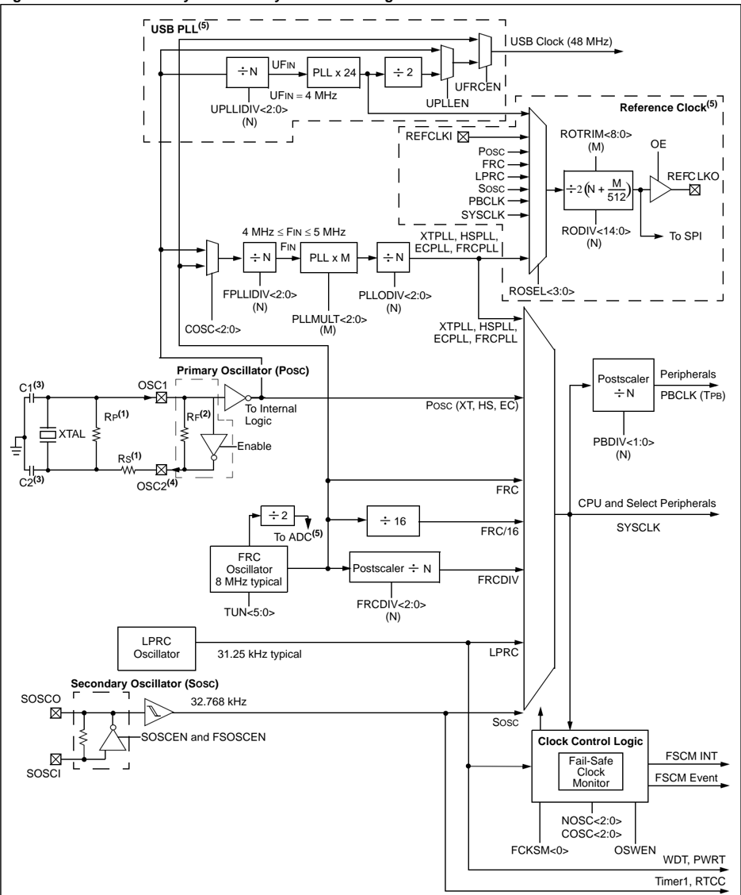
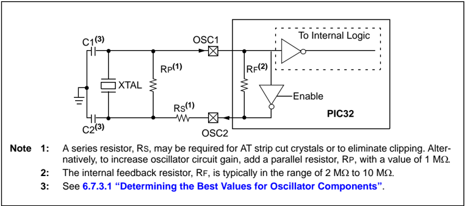
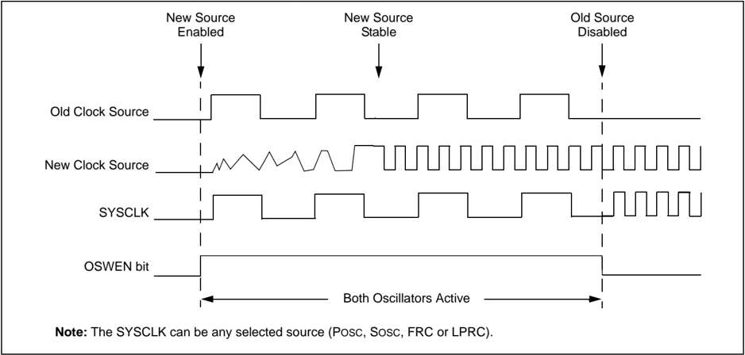
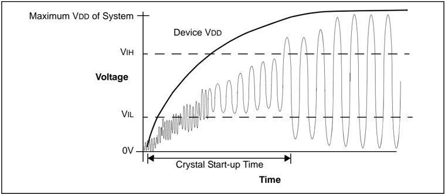

Microchip

## Section 6. Oscillators

## HIGHLIGHTS

This section of the manual contains the following major topics:

|   6.1 | Introduction ....................................................................................................................6-2   |
|-------|----------------------------------------------------------------------------------------------------------------------------------------|
|   6.2 | Control Registers ...........................................................................................................6-4       |
|   6.3 | Operation: Clock Generation and Clock Sources ........................................................6-12                             |
|   6.4 | Interrupts......................................................................................................................6-26   |
|   6.5 | Operation in Power-Saving Modes..............................................................................6-27                      |
|   6.6 | Effects of Various Resets.............................................................................................6-27             |
|   6.7 | Clocking Guidelines .....................................................................................................6-28          |
|   6.8 | Related Application Notes............................................................................................6-31              |
|   6.9 | Revision History...........................................................................................................6-32        |

## PIC32 Family Reference Manual

Note: This family reference manual section is meant to serve as a complement to device data sheets. Depending on the device variant, this manual section may not apply to all PIC32 devices.

Please consult the note at the beginning of the 'Oscillator' chapter in the current device data sheet to check whether this document supports the device you are using.

Device  data  sheets  and  family  reference  manual  sections  are  available  for download from the Microchip Worldwide Web site at: http://www.microchip.com

## 6.1 INTRODUCTION

This section describes the PIC32 oscillator system and its operation. The PIC32 oscillator system has the following modules and features:

- Four external and internal oscillator options as clock sources
- On-chip Phase-Locked Loop (PLL) with a user-selectable input divider and multiplier, as well as an output divider, to boost operating frequency on select internal and external oscillator sources
- On-chip user-selectable divisor postscaler on select oscillator sources
- Software-controllable switching between various clock sources
- A Fail-Safe Clock Monitor (FSCM) that detects clock failure and permits safe application recovery or shutdown

A block diagram of the PIC32 oscillator system is shown in Figure 6-1.

Figure 6-1: PIC32 Family Oscillator System Block Diagram



Note 1: A series resistor, RS, may be required for AT strip cut crystals or to eliminate clipping. Alternatively, to increase oscillator circuit gain, add a parallel resistor, RP, with a value of 1 M  .

- 2: The internal feedback resistor, RF, is typically in the range of 2 to 10 M 
- 3: See 6.7.3.1 'Determining the Best Values for Oscillator Components' .
- 4: PBCLK is available on the OSC2 pin in certain clock modes.
- 5: This feature is not available on all PIC32 devices. Refer to the 'Oscillator Configuration' chapter in the specific device data sheet for more information.

## 6.2 CONTROL REGISTERS

The Oscillator module consists of the following Special Function Registers (SFRs):

- OSCCON: Oscillator Control Register(1,2)

This register controls clock switching and provides status information that allows current clock source, PLL lock, and clock fail conditions to be monitored.

- OSCTUN: FRC Tuning Register

This register is used to tune the Internal FRC oscillator frequency in software. It allows the FRC oscillator frequency to be adjusted over a range of ±12%.

- REFOCON: Reference Oscillator Control Register

This register controls the reference oscillator output.

- REFOTRIM: Reference Oscillator Trim Register

This  register  provides  trim  control  of  the  Reference  Clock  Divider  bits,  RODIV&lt;14:0&gt; (REFOCON&lt;30:16&gt;).

Two  Device  Configuration  Word  registers,  DEVCFG1  and  DEVCFG2,  are  also  available  to provide additional configuration settings that are related to the Oscillator module. Refer to the 'Special Features' chapter in the specific device data sheet and Section 32. 'Configuration' (DS61124) for information on the Configuration registers, DEVCFG1 and DEVCFG2.

## 6.2.1 Special Function Register Summary

Table 6-1 provides a brief summary of the related Oscillator module registers. Corresponding registers appear after the summaries, followed by a detailed description of each register.

Table 6-1: Oscillators SFR Summary

| Name         | Bit Range   | Bit 31/23/15/7   | Bit 30/22/14/6   | Bit 29/21/13/5   | Bit 28/20/12/4   | Bit 27/19/11/3   | Bit 26/18/10/2   | Bit 25/17/9/1   | Bit 24/16/8/0   |
|--------------|-------------|------------------|------------------|------------------|------------------|------------------|------------------|-----------------|-----------------|
| OSCCON (1)   | 31:24       | -                | -                | PLLODIV<2:0>     | PLLODIV<2:0>     | PLLODIV<2:0>     | FRCDIV<2:0>      | FRCDIV<2:0>     | FRCDIV<2:0>     |
| OSCCON (1)   | 23:16       | -                | SOSCRDY          | PBDIVRDY         | PBDIV<1:0>       | PBDIV<1:0>       | PLLMULT<2:0>     | PLLMULT<2:0>    | PLLMULT<2:0>    |
| OSCCON (1)   | 15:8        | -                | COSC<2:0>        | COSC<2:0>        | COSC<2:0>        | -                | NOSC<2:0>        | NOSC<2:0>       | NOSC<2:0>       |
| OSCCON (1)   | 7:0         | CLKLOCK          | ULOCK            | SLOCK            | SLPEN            | CF               | UFRCEN           | SOSCEN          | OSWEN           |
| OSCTUN (1)   | 31:24       | -                | -                | -                | -                | -                | -                | -               | -               |
| OSCTUN (1)   | 23:16       | -                | -                | -                | -                | -                | -                | -               | -               |
| OSCTUN (1)   | 15:8        | -                | -                | -                | -                | -                | -                | -               | -               |
| OSCTUN (1)   | 7:0         | -                | -                | TUN<5:0>         | TUN<5:0>         | TUN<5:0>         | TUN<5:0>         | TUN<5:0>        | TUN<5:0>        |
| REFOCON (1)  | 31:24       | -                | RODIV<14:8>      | RODIV<14:8>      | RODIV<14:8>      | RODIV<14:8>      | RODIV<14:8>      | RODIV<14:8>     | RODIV<14:8>     |
| REFOCON (1)  | 23:16       | RODIV<7:0>       | RODIV<7:0>       | RODIV<7:0>       | RODIV<7:0>       | RODIV<7:0>       | RODIV<7:0>       | RODIV<7:0>      | RODIV<7:0>      |
| REFOCON (1)  | 15:8        | ON               | -                | SIDL             | OE               | RSLP             | -                | DIVSWEN         | ACTIVE          |
| REFOCON (1)  | 7:0         | -                | -                | -                | -                | ROSEL<3:0>       | ROSEL<3:0>       | ROSEL<3:0>      | ROSEL<3:0>      |
| REFOTRIM (1) | 31:24       | ROTRIM<8:1>      | ROTRIM<8:1>      | ROTRIM<8:1>      | ROTRIM<8:1>      | ROTRIM<8:1>      | ROTRIM<8:1>      | ROTRIM<8:1>     | ROTRIM<8:1>     |
| REFOTRIM (1) | 23:16       | ROTRIM<0>        | -                | -                | -                | -                | -                | -               | -               |
| REFOTRIM (1) | 15:8        | -                | -                | -                | -                | -                | -                | -               | -               |
| REFOTRIM (1) | 7:0         | -                | -                | -                | -                | -                | -                | -               | -               |

Note 1: This register has an associated Clear, Set, and Invert register at an offset of 0x4, 0x8, and 0xC bytes, respectively. These registers have the same name, with CLR, SET, or INV appended to the end of the register name (e.g., OSCCONCLR). Writing a ' 1 ' to any bit position in these registers will clear, set, or invert valid bits in the associated register. Reads from the these registers should be ignored.

## Register 6-1: OSCCON: Oscillator Control Register (1,2)

| Bit Range   | Bit 31/23/15/7   | Bit 30/22/14/6   | Bit 29/21/13/5   | Bit 28/20/12/4   | Bit 27/19/11/3   | Bit 26/18/10/2   | Bit 25/17/9/1   | Bit 24/16/8/0   |
|-------------|------------------|------------------|------------------|------------------|------------------|------------------|-----------------|-----------------|
| 31:24       | U-0              | U-0              | R/W-y            | R/W-y            | R/W-y            | R/W-0            | R/W-0           | R/W-1           |
| 31:24       | -                | -                | PLLODIV<2:0>     | PLLODIV<2:0>     | PLLODIV<2:0>     | FRCDIV<2:0>      | FRCDIV<2:0>     | FRCDIV<2:0>     |
| 23:16       | U-0              | R-0              | R-1              | R/W-y            | R/W-y            | R/W-y            | R/W-y           | R/W-y           |
| 23:16       | -                | SOSCRDY          | PBDIVRDY         | PBDIV<1:0>       | PBDIV<1:0>       | PLLMULT<2:0>     | PLLMULT<2:0>    | PLLMULT<2:0>    |
| 15:8        | U-0              | R-0              | R-0              | R-0              | U-0              | R/W-y            | R/W-y           | R/W-y           |
| 15:8        | -                | COSC<2:0>        | COSC<2:0>        | COSC<2:0>        | -                | NOSC<2:0>        | NOSC<2:0>       | NOSC<2:0>       |
| 7:0         | R/W-0            | R-0              | R-0              | R/W-0            | R/W-0            | R/W-0            | R/W-y           | R/W-0           |
| 7:0         | CLKLOCK          | ULOCK (1)        | SLOCK            | SLPEN            | CF (2)           | UFRCEN (1)       | SOSCEN          | OSWEN           |

## Legend:

y = Value set from Configuration bits on POR

R = Readable bit

W = Writable bit

U = Unimplemented bit, read as '0'

-n = Value at POR

'1' = Bit is set

'0' = Bit is cleared

x = Bit is unknown

bit 31-30 Unimplemented:

Read as ' 0 '

bit 29-27 PLLODIV&lt;2:0&gt;:

Output Divider for PLL

The POR default is set by the FPLLODIV&lt;2:0&gt; bits (DEVCFG2&lt;18:16&gt;). Do not change these bits if the PLL is enabled. Refer to the 'Special Features' chapter in the specific device data sheet for details.

111 = PLL output divided by 256

110 = PLL output divided by 64

101 = PLL output divided by 32

100 = PLL output divided by 16

011 = PLL output divided by 8

010 = PLL output divided by 4

001 = PLL output divided by 2

000 = PLL output divided by 1

bit 26-24 FRCDIV&lt;2:0&gt;: Internal Fast RC (FRC) Oscillator Clock Divider bits

111 = FRC divided by 256

110 = FRC divided by 64

101 = FRC divided by 32

100 = FRC divided by 16

011 = FRC divided by 8

010 = FRC divided by 4

001 = FRC divided by 2 (default setting)

000 = FRC divided by 1

bit 23 Unimplemented: Read as ' 0 '

bit 22

SOSCRDY: Secondary Oscillator (SOSC) Ready Status bit

1 = Indicates that the Secondary Oscillator is running and is stable

0 = Secondary Oscillator is still warming up or is turned off

bit 21

PBDIVRDY: Peripheral Bus Clock (PBCLK) Divisor Ready bit

1 = PBDIV&lt;1:0&gt; bits can be written

0 = PBDIV&lt;1:0&gt; bits cannot be written

- Note 1: This bit is not available on all devices. Refer to the 'Oscillator Configuration' chapter in the specific device data sheet for availability.
- 2: This bit is cleared during read operation.

## PIC32 Family Reference Manual

## Register 6-1: OSCCON: Oscillator Control Register (1,2)   (Continued)

bit 20-19 PBDIV&lt;1:0&gt;: Peripheral Bus Clock (PBCLK) Divisor bits

The POR default is set by the FPBDIV&lt;1:0&gt; bits (DEVCFG1&lt;13:12&gt;). Refer to the 'Special Features' chapter in the specific device data sheet for details.

11 = PBCLK is SYSCLK divided by 8 (default)

10 = PBCLK is SYSCLK divided by 4

01 = PBCLK is SYSCLK divided by 2

00 = PBCLK is SYSCLK divided by 1

## bit 18-16 PLLMULT&lt;2:0&gt;: Phase-Locked Loop (PLL) Multiplier bits

The POR default is set by the FPLLMUL&lt;2:0&gt; bits (DEVCFG2&lt;6:4&gt;). Do not change these bits if the PLL is enabled. Refer to the 'Special Features' chapter in the specific device data sheet for details.

111 = Clock is multiplied by 24 110 = Clock is multiplied by 21 101 = Clock is multiplied by 20 100 = Clock is multiplied by 19 011 = Clock is multiplied by 18 010 = Clock is multiplied by 17 001 = Clock is multiplied by 16 000 = Clock is multiplied by 15

## bit 15 Unimplemented: Read as ' 0 '

## bit 14-12 COSC&lt;2:0&gt;: Current Oscillator Selection bits

111 = Internal Fast RC (FRC) Oscillator divided by OSCCON&lt;FRCDIV&gt; bits

110 = Internal Fast RC (FRC) Oscillator divided by 16

101 = Internal Low-Power RC (LPRC) Oscillator

100 = Secondary Oscillator (SOSC)

011 = Primary Oscillator (POSC) with PLL module (XTPLL, HSPLL or ECPLL)

010 = Primary Oscillator (POSC) (XT, HS or EC)

001 = Internal Fast RC Oscillator with PLL module via Postscaler (FRCPLL)

000 = Internal Fast RC (FRC) Oscillator

## bit 11 Unimplemented: Read as ' 0 '

## bit 10-8 NOSC&lt;2:0&gt;: New Oscillator Selection bits

111 = Internal Fast RC Oscillator (FRC) divided by OSCCON&lt;FRCDIV&gt; bits

110 = Internal Fast RC Oscillator (FRC) divided by 16

101 = Internal Low-Power RC (LPRC) Oscillator

100 = Secondary Oscillator (SOSC)

011 = Primary Oscillator with PLL module (XTPLL, HSPLL or ECPLL)

010 = Primary Oscillator (XT, HS or EC)

001 = Internal Fast Internal RC Oscillator with PLL module via Postscaler (FRCPLL)

000 = Internal Fast Internal RC Oscillator (FRC)

On Reset, these bits are set to the value of the FNOSC Configuration bits (DEVCFG1&lt;2:0&gt;).

## bit 7 CLKLOCK: Clock Selection Lock Enable bit

If clock switching and monitoring is enabled (FCKSM&lt;1:0&gt; = 1x ):

1 = Clock and PLL selections are locked

0 = Clock and PLL selections are not locked and may be modified

If clock switching and monitoring is enabled (FCKSM&lt;1:0&gt; = 0x ):

Clock and PLL selections are never locked and may be modified.

## bit 6 ULOCK: USB PLL Lock Status bit (1)

- 1 = Indicates that the USB PLL module is in lock or USB PLL module start-up timer is satisfied
- 0 = Indicates that the USB PLL module is out of lock or USB PLL module start-up timer is in progress or USB PLL is disabled
- Note 1: This bit is not available on all devices. Refer to the 'Oscillator Configuration' chapter in the specific device data sheet for availability.
- 2: This bit is cleared during read operation.

## Register 6-1: OSCCON: Oscillator Control Register (1,2)   (Continued)

bit 5

SLOCK: PLL Lock Status bit

1 = PLL module is in lock or PLL module start-up timer is satisfied

0 = PLL module is out of lock, PLL start-up timer is running or PLL is disabled

bit 4

SLPEN: Sleep Mode Enable bit

1 = Device will enter Sleep mode when a WAIT instruction is executed

0 = Device will enter Idle mode when a WAIT instruction is executed

bit 3 CF: Clock Fail Detect bit

(2)

1 = FSCM has detected a clock failure

0 = No clock failure has been detected

bit 2 UFRCEN: USB FRC Clock Enable bit

(1)

1 = Enable FRC as the clock source for the USB clock source

0 = Use the Primary Oscillator or USB PLL as the USB clock source

bit 1 SOSCEN:

Secondary Oscillator (SOSC) Enable bit

1 = Enable Secondary Oscillator

0 = Disable Secondary Oscillator

bit 0 OSWEN: Oscillator Switch Enable bit

1 = Initiate an oscillator switch to selection specified by NOSC&lt;2:0&gt; bits

0 = Oscillator switch is complete

- Note 1: This bit is not available on all devices. Refer to the 'Oscillator Configuration' chapter in the specific device data sheet for availability.
- 2: This bit is cleared during read operation.

Note:

Writes  to  this  register  require  an  unlock  sequence.  Refer  to 6.3.7.2 'Oscillator Switching Sequence' for details.

## PIC32 Family Reference Manual

## Register 6-2: OSCTUN: FRC Tuning Register

| Bit Range   | Bit 31/23/15/7   | Bit 30/22/14/6   | Bit 29/21/13/5   | Bit 28/20/12/4   | Bit 27/19/11/3   | Bit 26/18/10/2   | Bit 25/17/9/1   | Bit 24/16/8/0   |
|-------------|------------------|------------------|------------------|------------------|------------------|------------------|-----------------|-----------------|
| 31:24       | U-0              | U-0              | U-0              | U-0              | U-0              | U-0              | U-0             | U-0             |
| 31:24       | -                | -                | -                | -                | -                | -                | -               | -               |
| 23:16       | U-0              | U-0              | U-0              | U-0              | U-0              | U-0              | U-0             | U-0             |
| 23:16       | -                | -                | -                | -                | -                | -                | -               | -               |
| 15:8        | U-0              | U-0              | U-0              | U-0              | U-0              | U-0              | U-0             | U-0             |
| 15:8        | -                | -                | -                | -                | -                | -                | -               | -               |
| 7:0         | U-0              | U-0              | R/W-0            | R/W-0            | R/W-0            | R/W-0            | R/W-0           | R/W-0           |
| 7:0         | -                | -                | TUN<5:0> (1)     | TUN<5:0> (1)     | TUN<5:0> (1)     | TUN<5:0> (1)     | TUN<5:0> (1)    | TUN<5:0> (1)    |

## Legend:

y = Value set from Configuration bits on POR

R = Readable bit

W = Writable bit

U = Unimplemented bit, read as '0'

-n = Value at POR

'1' = Bit is set

'0' = Bit is cleared

x = Bit is unknown

bit 31-6 Unimplemented: Read as ' 0 '

bit 5-0

```
TUN<5:0>: FRC Oscillator Tuning bits (1) 100000 = Center frequency -12.5% 100001 = · · · 111111 = 000000 = Center frequency. Oscillator runs at minimal frequency (8 MHz) 000001 = · · · 011110 = 011111 = Center frequency +12.5%
```

Note 1: OSCTUN functionality has been provided to help customers compensate for temperature effects on the FRC frequency over a wide range of temperatures. The tuning step size is an approximation, and is neither characterized nor tested.

Note: Writes  to  this  register  require  an  unlock  sequence.  Refer  to 6.3.7.2 'Oscillator Switching Sequence' for more information.

## Register 6-3: REFOCON: Reference Oscillator Control Register

| Bit Range   | Bit 31/23/15/7   | Bit 30/22/14/6   | Bit 29/21/13/5   | Bit 28/20/12/4   | Bit 27/19/11/3   | Bit 26/18/10/2   | Bit 25/17/9/1   | Bit 24/16/8/0   |
|-------------|------------------|------------------|------------------|------------------|------------------|------------------|-----------------|-----------------|
| 31:24       | U-0              | R/W-0            | R/W-0            | R/W-0            | R/W-0            | R/W-0            | R/W-0           | R/W-0           |
| 31:24       | -                | RODIV<14:8> (1)  | RODIV<14:8> (1)  | RODIV<14:8> (1)  | RODIV<14:8> (1)  | RODIV<14:8> (1)  | RODIV<14:8> (1) | RODIV<14:8> (1) |
| 23:16       | R/W-0            | R/W-0            | R/W-0            | R/W-0            | R/W-0            | R/W-0            | R/W-0           | R/W-0           |
| 23:16       | RODIV<7:0> (1)   | RODIV<7:0> (1)   | RODIV<7:0> (1)   | RODIV<7:0> (1)   | RODIV<7:0> (1)   | RODIV<7:0> (1)   | RODIV<7:0> (1)  | RODIV<7:0> (1)  |
| 15:8        | R/W-0            | U-0              | R/W-0            | R/W-0            | R/W-0            | U-0              | R/W-0, HC       | R-0, HS, HC     |
| 15:8        | ON               | -                | SIDL             | OE               | RSLP (2)         | -                | DIVSWEN         | ACTIVE          |
| 7:0         | U-0              | U-0              | U-0              | U-0              | R/W-0            | R/W-0            | R/W-0           | R/W-0           |
| 7:0         | -                | -                | -                | -                | ROSEL<3:0> (3)   | ROSEL<3:0> (3)   | ROSEL<3:0> (3)  | ROSEL<3:0> (3)  |

## Legend:

HC = Hardware Clearable

HS = Hardware Settable

R = Readable bit

W = Writable bit

U = Unimplemented bit, read as '0'

-n = Value at POR

'1' = Bit is set

'0' = Bit is cleared

x = Bit is unknown

bit 31 Unimplemented: Read as ' 0 '

bit 30-16 RODIV&lt;14:0&gt; Reference Clock Divider bits (1)

These bits select the reference clock divider bits. See Figure 6-1 for more information.

bit 15 ON:

Output Enable bit

1 = Reference Oscillator Module enabled

0 = Reference Oscillator Module disabled

bit 14 Unimplemented: Read as ' 0 '

bit 13 SIDL:

Peripheral Stop in Idle Mode bit

1 = Discontinue module operation when device enters Idle mode

0 = Continue module operation in Idle mode

bit 12

OE: Reference Clock Output Enable bit

1 = Reference clock is driven out on REFCLKO pin

0 = Reference clock is not driven out on REFCLKO pin

bit 11 RSLP: Reference Oscillator Module Run in Sleep bit (2)

1 = Reference Oscillator Module output continues to run in Sleep

0 = Reference Oscillator Module output is disabled in Sleep

bit 10

Unimplemented:

Read as ' 0 '

bit 9

DIVSWEN: Divider Switch Enable bit

1 = Divider switch is in progress

0 = Divider switch is complete

bit 8

ACTIVE: Reference Clock Request Status bit

1 = Reference clock request is active

0 = Reference clock request is not active

bit 7-4 Unimplemented: Read as ' 0 '

- Note 1: While the ON bit (REFOCON&lt;15&gt;) is ' 1 ', writes to these bits do not take effect until the DIVSWEN bit is set to ' 1 '.
- 2: This bit is ignored when the ROSEL&lt;3:0&gt; bits = 0000 or 0001 .
- 3: The ROSEL&lt;3:0&gt; bits should not be written while the ACTIVE bit is ' 1 ', as undefined behavior may result.

## PIC32 Family Reference Manual

## Register 6-3: REFOCON: Reference Oscillator Control Register  (Continued)

```
bit 3-0 ROSEL<3:0>: Reference Clock Source Select bits (3) 1111 = Reserved; do not use · · · 1001 = Reserved; do not use 1000 = REFCLKI 0111 = System PLL 0110 = USB PLL output 0101 = SOSC 0100 = LPRC 0011 = FRC 0010 = POSC 0001 = PBCLK 0000 = SYSCLK
```

- Note 1: While the ON bit (REFOCON&lt;15&gt;) is ' 1 ', writes to these bits do not take effect until the DIVSWEN bit is set to ' 1 '.
- 2: This bit is ignored when the ROSEL&lt;3:0&gt; bits = 0000 or 0001 .
- 3: The ROSEL&lt;3:0&gt; bits should not be written while the ACTIVE bit is ' 1 ', as undefined behavior may result.

Note: This register is not available on all devices. Refer to the 'Oscillator Configuration' chapter in the specific device data sheet for availability.

Register 6-4:

REFOTRIM: Reference Oscillator Trim Register

| Bit Range   | Bit 31/23/15/7   | Bit 30/22/14/6   | Bit 29/21/13/5   | Bit 28/20/12/4   | Bit 27/19/11/3   | Bit 26/18/10/2   | Bit 25/17/9/1   | Bit 24/16/8/0   |
|-------------|------------------|------------------|------------------|------------------|------------------|------------------|-----------------|-----------------|
| 31:24       | R/W-0            | R/W-0            | R/W-0            | R/W-0            | R/W-0            | R/W-0            | R/W-0           | R/W-0           |
| 31:24       | ROTRIM<8:1>      | ROTRIM<8:1>      | ROTRIM<8:1>      | ROTRIM<8:1>      | ROTRIM<8:1>      | ROTRIM<8:1>      | ROTRIM<8:1>     | ROTRIM<8:1>     |
| 23:16       | R/W-0            | U-0              | U-0              | U-0              | U-0              | U-0              | U-0             | U-0             |
| 23:16       | ROTRIM<0>        | -                | -                | -                | -                | -                | -               | -               |
| 15:8        | U-0              | U-0              | U-0              | U-0              | U-0              | U-0              | U-0             | U-0             |
| 15:8        | -                | -                | -                | -                | -                | -                | -               | -               |
| 7:0         | U-0              | U-0              | U-0              | U-0              | U-0              | U-0              | U-0             | U-0             |
| 7:0         | -                | -                | -                | -                | -                | -                | -               | -               |

## Legend:

y = Value set from Configuration bits on POR

R = Readable bit

W = Writable bit

U = Unimplemented bit, read as '0'

-n = Value at POR

'1' = Bit is set

'0' = Bit is cleared

x = Bit is unknown

bit 31-23 ROTRIM&lt;8:0&gt;:

Reference Oscillator Trim bits

111111111 = 511/512 divisor added to RODIV value

111111110 = 510/512 divisor added to RODIV value

•

•

•

100000000 = 256/512 divisor added to RODIV value

•

•

•

000000010 = 2/512 divisor added to RODIV value

000000001 = 1/512 divisor added to RODIV value

000000000 = 0/512 divisor added to RODIV value

bit 22-0 Unimplemented: Read as ' 0 '

- Note 1: While the ON bit (REFOCON&lt;15&gt;) is ' 1 ', writes to this register do not take effect until the DIVSWEN bit is set to ' 1 '.
- 2: This register is not available on all devices. Refer to the 'Oscillator Configuration' chapter in the specific device data sheet for availability.

## 6.3 OPERATION: CLOCK GENERATION AND CLOCK SOURCES

The PIC32 family of devices has multiple internal clocks that are derived from internal or external clock sources. Some of these clock sources have Phase-Locked Loops (PLLs), a programmable output divider, or an input divider, to scale the input frequency to suit the application. The clock source  can  be  changed  on-the-fly  by  software.  The  oscillator  control  register  is  locked  by hardware, it must be unlocked by a series of writes before software can perform a clock switch.

There are three main clocks in a PIC32 device:

- System Clock (SYSCLK), used by the CPU and some peripherals
- Peripheral Bus Clock (PBCLK), used by most peripherals
- USB Clock (USBCLK), used by the USB peripheral

The PIC32 clocks are derived from one of the following sources:

- Primary Oscillator (POSC) on the OSC1 and OSC2 pins
- Secondary Oscillator (SOSC) on the SOSCI and SOSCO pins
- Internal Fast RC (FRC) Oscillator
- Internal Low-Power RC (LPRC) Oscillator

Each of the clock sources has unique configurable options, such as a PLL, an input divider and/or output divider, which are detailed in their respective sections.

There are up to four internal clocks depending on the specific device. The clocks are derived from the currently selected oscillator source.

Note: Clock sources for peripherals that use external clocks, such as the Real-Time Clock and Calendar (RTC) and Timer1, are covered in their respective family reference manual sections.

## 6.3.1 System Clock (SYSCLK) Generation

The  SYSCLK  is  primarily  used  by  the  CPU  and  select  peripherals  such  as  DMA,  Interrupt Controller and Prefetch Cache. The SYSCLK is derived from one of the four clock sources:

- POSC
- SOSC
- Internal FRC Oscillator
- LPRC Oscillator

Some of the clock sources have specific clock multipliers and/or divider options.

No clock scaling is applied, other than the user-specified values.

The SYSCLK source is selected by the device configuration and can be changed by software during operation. The ability to switch clock sources during operation allows the application to reduce power consumption by reducing the clock speed.

Refer to Table 6-2 for a list of SYSCLK sources.

Table 6-2: Clock Selection Configuration Bit Values

| Oscillator Mode                                  | Oscillator Source   | POSCMOD<1:0>   |   FNOSC<2:0> (See Note 4) | See Note   |
|--------------------------------------------------|---------------------|----------------|---------------------------|------------|
| FRC Oscillator with Postscaler (FRCDIV)          | Internal            | xx             |                       111 | 1, 2       |
| FRC Oscillator divided by 16 (FRCDIV16)          | Internal            | xx             |                       110 | 1          |
| LPRC Oscillator                                  | Internal            | xx             |                       101 | 1          |
| SOSC (Timer1/RTCC)                               | Secondary           | xx             |                       100 | 1          |
| POSC in HS mode with PLL Module (HSPLL)          | Primary             | 10             |                       011 | 3          |
| POSC in XT mode with PLL Module (XTPLL)          | Primary             | 01             |                       011 | 3          |
| POSC in EC mode with PLL Module (ECPLL)          | Primary             | 00             |                       011 | 3          |
| POSC in HS mode                                  | Primary             | 10             |                       010 | -          |
| POSC in XT mode                                  | Primary             | 01             |                       010 | -          |
| POSC in EC mode                                  | Primary             | 00             |                       010 | -          |
| Internal FRC Oscillator with PLL Module (FRCPLL) | Internal            | 10             |                       001 | 1          |
| Internal FRC Oscillator                          | Internal            | xx             |                       000 | 1          |

Note 1: OSC2 pin function, as PBCLK out or digital I/O, is determined by the OSCIOFNC Configuration bit (DEVCFG1&lt;9&gt;). When the pin is not required by the oscillator mode, it may be configured for one of these options.

- 2: Default oscillator mode for an unprogrammed (erased) device.
- 3: When using the PLL modes, the input divider must be chosen such that the resulting frequency applied to the PLL is in the range of 4-5 MHz.
- 4: Refer to the 'Special Features' chapter in the specific device data sheet and Section 32. 'Configuration' (DS61124) for information on the Configuration registers, DEVCFG1 and DEVCFG2.

## 6.3.1.1 PRIMARY OSCILLATOR (POSC)

The Primary Oscillator (POSC) has six operating modes, as summarized in Table 6-3. Figure 6-2, Figure 6-3, and Figure 6-4 show various configurations of the POSC.

Table 6-3: Primary Oscillator Operating Modes

| Oscillator Mode   | Description                       |
|-------------------|-----------------------------------|
| HS                | High-speed crystal                |
| XT                | Resonator, crystal or resonator   |
| EC                | External clock input              |
| HSPLL             | Crystal, PLL enabled              |
| XTPLL             | Crystal resonator, PLL enabled    |
| ECPLL             | External clock input, PLL enabled |

Note: The clock applied to the CPU, after applicable prescalers, postscalers, and PLL multipliers, must not exceed the maximum allowable processor frequency. Refer to the 'Electrical Characteristics' chapter in the specific device data sheet for details.

Figure 6-2: Crystal or Ceramic Resonator Operation (XT, XTPLL, HS, or HSPLL Oscillator Mode)



The POSC is connected to the OSC1 and OSC2 pins in this device family. The POSC can be configured for an external clock input, or an external crystal or resonator.

The XT, XTPLL, HS, and HSPLL modes are external crystal or resonator controller oscillator modes. The XT and HS modes are functionally very similar. The primary difference is the gain of the internal inverter of the oscillator circuit. The XT mode is a medium power, medium frequency mode  and  has  medium  inverter  gain.  HS  mode  is  higher  power  and  provides  the  highest oscillator  frequencies  and  has  the  highest  inverter  gain.  OSC2  provides  crystal/resonator feedback in both XT and HS Oscillator modes and hence is not available for use as a input or output in these modes. The XTPLL and HSPLL modes have a Phase-Locked Loop (PLL) with a user-selectable input divider and multiplier, and an output divider, to provide a wide range of output frequencies. The oscillator circuit will consume more current when the PLL is enabled.

The External Clock modes, EC and ECPLL, allow the system clock to be derived from an external clock source. The EC/ECPLL modes configure the OSC1 pin as a high-impedance input that can be driven by a CMOS driver. The external clock can be used to drive the system clock directly (EC) or the ECPLL module with prescaler and postscaler can be used to change the input clock frequency (ECPLL). The External Clock mode also disables the internal feedback buffer allowing the OSC2 pin to be used for other functions. In the External Clock mode, the OSC2 pin can be used as an additional device I/O pin (see Figure 6-4) or a PBCLK output pin (see Figure 6-3).

Note: When using the PLL modes, the input divider must be chosen such that the resulting frequency applied to the PLL is in the range of 4 MHz to 5 MHz.

Figure 6-3: External Clock Input Operation with Clock-Out (EC, ECPLL Mode)


Figure 6-4: External Clock Input Operation with No Clock-Out (EC, ECPLL Mode)


## 6.3.1.1.1 Primary Oscillator (POSC) Configuration

To configure the POSC, perform the following steps:

1. Select the POSC as the default oscillator in the device Configuration register DEVCFG1 by setting FNOSC&lt;2:0&gt; = 010 (without PLL) or to ' 011 ' (with PLL).
2. Select the desired mode: HS, XT, or EC, using POSCMOD&lt;1:0&gt; in DEVCFG1.
3. If the PLL is to be used:
- a) Select the appropriate Configuration bits for the PLL input divider to scale the input frequency to be between 4 MHz and 5 MHz using FPLLIDIV&lt;2:0&gt; in DEVCFG2.
- b) Select the desired PLL multiplier ratio using FPLLMUL&lt;2:0&gt; in DEVCFG2.
- c) At runtime, select the desired PLL output divider using PLLODIV (OSCCON&lt;29:27&gt;) to provide the desired clock frequency. The default value is set by DEVCFG1.

## 6.3.1.1.2 Oscillator Start-up Timer (OST)

To ensure that a crystal oscillator (or ceramic resonator) has started and stabilized, an Oscillator Start-up Timer (OST) is provided. The OST is a simple 10-bit counter that counts 1024 TOSC cycles before releasing the oscillator clock to the rest of the system. This time-out period is designated as TOST. The amplitude of the oscillator signal must reach the VIL and VIH thresholds for the oscillator pins before the OST can begin to count cycles.

The TOST interval is required every time the oscillator has to restart (i.e., on a Power-on Reset (POR), Brown-out Reset (BOR) or a wake-up from Sleep mode). The OST is applied to the XT and HS modes for the POSC, as well as the SOSC (see 6.3.1.2 'Secondary Oscillator (SOSC)' ).

Note: The oscillator start-up timer is disabled when POSC is configured for EC or ECPLL mode.

## 6.3.1.1.3 Primary Oscillator Start-up from Sleep Mode

To ensure reliable wake-up from Sleep mode, care must be taken to properly design the Primary Oscillator  circuit.  This  is  because  the  load  capacitors  have  both  partially  charged  to  some quiescent value and phase differential at wake-up is minimal. Thus, more time is required to achieve stable oscillation. Remember also that low voltage, high temperatures and the lower frequency clock modes also impose limitations on loop gain, which in turn, affects start-up.

Each of the following factors increases the start-up time:

- Low-frequency design (with a Low Gain Clock mode)
- Quiet environment (such as a battery operated device)
- Operating in a shielded box (away from the noisy RF area)
- Low voltage
- High temperature
- Wake-up from Sleep mode

## 6.3.1.1.4 Primary Oscillator Pin Functionality

The Primary Oscillator pins (OSCI/OSCO) can be used for other functions when the oscillator is not being used.

The POSCMD Configuration bits in the Oscillator Configuration (FOSC&lt;1:0&gt;) register determine the oscillator pin function.

The OSCIOFNC bit determines the OSC2 pin function. Refer to the 'Oscillator Configuration' chapter in the specific device data sheet for OSCIOFNC functionality.

## 6.3.1.2 SECONDARY OSCILLATOR (SOSC)

The  Secondary  Oscillator  (SOSC)  is  designed  specifically  for  low-power  operation  with  an external 32.768 kHz crystal. The oscillator is located on the SOSCO and SOSCI device pins and serves as a secondary crystal clock source for low-power operation. It can also drive Timer1 and/or  the  Real-Time  Clock  and  Calendar  (RTCC)  module  for  Real-Time  Clock  (RTC) applications.

## 6.3.1.2.1 Enabling the SOSC

The  SOSC  is  hardware  enabled  by  the  FSOSCEN  Configuration  bit  (DEVCFG1&lt;5&gt;).  The software can control the SOSC by modifying the SOSCEN bit (OSCCON&lt;1&gt;). Setting SOSCEN enables the oscillator; the SOSCO and SOSCI pins are controlled by the oscillator and cannot be used for port I/O or other functions.

```
Note: An unlock sequence is required before a write to OSCCON can occur. Refer to
```

6.3.7.2 'Oscillator Switching Sequence' for more information.

The SOSC requires a warm-up period before it can be used as a clock source. When the oscillator is enabled, a warm-up counter increments to 1024. When the counter expires the SOSCRDY bit (OSCCON&lt;22&gt;) is set to ' 1 '. Refer to 6.3.1.1.2 'Oscillator Start-up Timer (OST)' .

## 6.3.1.2.2 SOSC Continuous Operation

The SOSC is always enabled when SOSCEN bit (OSCCON&lt;1&gt;) is set. Leaving the oscillator running at all times allows a fast switch to the 32 kHz system clock for lower power operation. Returning to the faster main oscillator will still require an oscillator start-up time if it is a crystal type source and/or uses the PLL (see 6.3.1.1.2 'Oscillator Start-up Timer (OST)' ).

In addition, the oscillator will need to remain running at all times for Real-Time Clock applications and may be required for Timer1. Refer to Section 14. 'Timers' (DS61105) and Section 29. 'Real-Time Clock and Calendar' (DS61125) for further details.

## Example 6-1: Enabling the SOSC

```
SYSKEY = 0x0; // ensure OSCCON is locked SYSKEY = 0xAA996655; // Write Key1 to SYSKEY SYSKEY = 0x556699AA; // Write Key2 to SYSKEY // OSCCON is now unlocked // make the desired change OSCCONSET = 2; // enable Secondary Oscillator // Relock the SYSKEY SYSKEY = 0x0; // Write any value other than Key1 or Key2 // OSCCON is relocked
```

## 6.3.1.3 INTERNAL FAST RC (FRC) OSCILLATOR

The  FRC  Oscillator  is  a  fast  (8 MHz  nominal),  user-trimmable,  internal  RC  oscillator  with  a user-selectable input divider, PLL multiplier, and output divider. Refer to the specific device data sheet for more information about the FRC Oscillator.

## 6.3.1.3.1 FRC Postscaler Mode (FRCDIV)

Users are not limited to the nominal 8 MHz FRC output if they want to use the fast internal oscillator as a clock source. An additional FRC mode, FRCDIV, implements a selectable output divider that allows the choice of a lower clock frequency from seven different options, plus the direct 8 MHz output. The output divider is configured using the FRCDIV&lt;2:0&gt; bits (OSCCON&lt;26:24&gt;). Assuming a nominal 8 MHz output, available lower frequency options range from 4 MHz (divide-by-2) to 31 kHz (divide-by-256). The range of frequencies allows users the ability to save power at any time in an application by simply changing the FRCDIV&lt;2:0&gt; bits. The FRCDIV mode is selected whenever the COSC bits (OSCCON&lt;14:12&gt;) are ' 111 '.

## 6.3.1.3.2 FRC Oscillator with PLL Mode (FRCPLL)

The output of the FRC may also be combined with a user-selectable PLL multiplier and output divider  to  produce  a  SYSCLK  across  a  wide  range  of  frequencies.  The  FRC  PLL  mode  is selected whenever the COSC bits (OSCCON&lt;14:12&gt;) are ' 001 '.  In  this  mode, the PLL input divider is forced to '2' to provide a 4 MHz input to the PLL. The desired PLL multiplier and output divider values can be chosen to provide the desired device frequency.

## 6.3.1.3.3 Oscillator Tune Register (OSCTUN)

The FRC Oscillator Tuning register, OSCTUN, allows the user to fine tune the FRC Oscillator over a range of approximately ±12% (typical). Each bit increment or decrement changes the factory calibrated frequency of the FRC Oscillator by a fixed amount. Refer to the 'Electrical Characteristics' chapter  of  the  specific  device  data  sheet  for  additional  information  on  the available tuning range.

Note: An unlock sequence is required before a write to the OSCTUN register can occur. Refer to 6.3.7.2 'Oscillator Switching Sequence' for more information.

## 6.3.1.4 INTERNAL LOW-POWER RC (LPRC) OSCILLATOR

The LPRC Oscillator is separate from the FRC. It oscillates at a nominal frequency of 31.25 kHz. The  LPRC  Oscillator  is  the  clock  source  for  the  Power-up  Timer  (PWRT),  Watchdog  Timer (WDT), Fail-Safe Clock Monitor (FSCM) and Phase-Locked Loop (PLL) reference circuits. It may also be used to provide a low-frequency clock source option for the device in those applications where power consumption is critical, and timing accuracy is not required.

## 6.3.1.4.1 Enabling the LPRC Oscillator

Since it serves the PWRT clock source, the LPRC Oscillator is enabled at a POR whenever the on-board voltage regulator is enabled. After the PWRT expires, the LPRC Oscillator will remain ON if one of the following is true:

- The Fail-Safe Clock Monitor is enabled
- The WDT is enabled
- The LPRC Oscillator is selected as the system clock (COSC2:COSC0 = 100 )

If none of the above is true, the LPRC will shut off after the PWRT expires.

## 6.3.2 PLL Clock Generator

## 6.3.2.1 SYSTEM CLOCK PHASE-LOCKED LOOP (PLL)

The  system  clock  PLL  provides  a  user-configurable  input  divider  and  multiplier,  and  output divider, which can be used with the XT, HS and EC POSC modes and with the Internal FRC Oscillator mode to create a variety of clock frequencies from a single clock source.

The  input  divider,  multiplier,  and  output  divider  control  initial  value  bits  are  contained  in  the DEVCFG2 Device Configuration register. The multiplier and output divider bits are also contained in the OSCCON register. As part of a device Reset, values from the device configuration register DEVCFG2 are copied to the OSCCON register. This allows the user to preset the input divider to  provide  the  appropriate  input  frequency  to  the  PLL  and  set  an  initial  PLL  multiplier  when programming  the  device.  At  runtime,  the  multiplier  and  output  divider  can  be  changed  by software to scale the clock frequency to suit the application. The PLL input divider cannot be changed at run time. This is to prevent applying an input frequency outside the specified limits to the PLL.

To configure the PLL, use the following steps:

1. Calculate the PLL input divider, PLL multiplier, and PLL output divider values.
2. Set the PLL input divider and the initial PLL multiplier value in the DEVCFG2 register when programming the part.
3. At  runtime,  the  PLL  multiplier  and  PLL  output  divider  can  be  changed  to  suit  the application.

Combinations of the PLL input divider, multiplier, and output divider provide a combined multiplier of approximately 0.006 to 24 times the input frequency. For reliable operation, the output of the PLL module must not exceed the maximum clock frequency of the device. The PLL input divider value should be chosen to limit the input frequency to the PLL to the range of 4 MHz to 5 MHz.

Due  to  the  time  required  for  the  PLL  to  provide  a  stable  output,  the  SLOCK  Status  bit (OSCCON&lt;5&gt;) is provided. When the clock input to the PLL is changed, this bit is driven low (' 0 '). After the PLL has achieved a lock or the PLL start-up timer has expired, the bit is set. The bit will be set upon the expiration of the timer even if the PLL has not achieved a lock.

## 6.3.2.2 PLL LOCK STATUS

The PLL Lock Status indicates the lock status of the PLL. It is set automatically after a typical time delay for the PLL to achieve lock, also designated as TLOCK. If the PLL does not stabilize properly during start-up, SLOCK may not reflect the actual status of the PLL lock, nor does it detect when the PLL loses lock during normal operation. The SLOCK bit is cleared at a POR and on clock switches when the PLL is selected as a destination clock source. It remains clear when any clock source is not using the PLL is selected. Refer to the 'Electrical Characteristics' chapter in the specific device data sheet for more information on the PLL lock interval.

## 6.3.3 Peripheral Bus Clock (PBCLK) Generation

The PBCLK  is derived from the System Clock (SYSCLK) divided by PBDIV&lt;1:0&gt; (OSCCON&lt;20:19&gt;). The PBCLK Divisor bits PBDIV&lt;1:0&gt; allow postscalers of 1:1, 1:2, 1:4, and 1:8. Refer to the individual peripheral module section of the 'PIC32 Family Reference Manual' for information regarding which bus a specific peripheral uses.

- Note 1: When the PBDIV divisor is  set  to  a  ratio  of  1:1,  the  SYSCLK  and  PBCLK  are equivalent in frequency. The PBCLK frequency is never greater than the processor clock frequency.

The effect of changing the PBCLK frequency on individual peripherals should be considered when selecting or changing the PBDIV value.

Performing back-to-back operations on PBCLK peripheral registers when the PB divisor is not set at 1:1 will cause the CPU to stall for a number of cycles. This stall occurs  to  prevent  an  operation  from  occurring  before  the  pervious  one  has completed. The length of the stall is determined by the ratio of the CPU and PBCLK and synchronizing time between the two busses.

Changing  the  PBCLK  frequency  has  no  effect  on  the  SYSCLK  peripherals operation.

- 2: The peripheral bus frequency can be changed on the fly by writing a new value to the PBDIV&lt;1:0&gt; bits in the OSCCON register. A state machine is used to control the changing of the PB frequency. This state machine requires up to 60 CPU clocks to perform a switch and be ready to receive a new PBDIV value. If a new value is written to the PBDIV bits before the state machine has completed the operation, the new value will be ignored and the PBDIV&lt;1:0&gt; bits will reflect the previous value. The  PBDIVRDY  bit  (OSCCON&lt;21&gt;)  indicates  whether  a  divisor  switch  is  in progress during which time the PBDIV&lt;1:0&gt; bits should not be written. Rewriting the current value to the PBDIV&lt;1:0&gt; bits is ignored and has no effect.

## 6.3.4 USB Clock (USBCLK) Generation

The USBCLK can be derived from the 8 MHz internal FRC Oscillator, 48 MHz POSC, or the 96 MHz PLL from the POSC. For normal operation, the USB module requires exact 48 MHz clock. When using 96 MHz PLL, the output is internally divided to obtain 48 MHz clock. The FRC clock source is used to detect USB activity and bring USB module out of Suspend mode. Once USB module is out of Suspend mode, it must use a 48 MHz clock to perform the USB transactions. The internal FRC Oscillator is not used for normal USB module operation.

## 6.3.4.1 USB CLOCK PHASE-LOCKED LOOP (UPLL)

The USB Clock Phase-Locked Loop (UPLL) provides a user-configurable input divider, which can be used with the XT, HS, and EC Primary Oscillator modes to create a variety of clock frequencies from a clock source. The actual source must be able to provide a stable clock as required by the USB specifications.

The UPLL Enable and Input Divider bits are contained in the DEVCFG2 register. The input to the UPLL must be limited to 4 MHz only. An appropriate input divider must be selected to ensure that the UPLL input is 4 MHz.

To configure the UPLL, the following steps are required:

1. Enable the USB PLL by setting the UPLLEN bit in the DEVCFG2 register.
2. Based on the source clock, calculate the UPLL input divider value so that the PLL input is 4 MHz.
3. Set  the  USB  PLL  Input  Divider  (UPLLIDIV&lt;2:0&gt;)  bits  in  the  DEVCFG2  register  when programming the device.

Note: Refer to Section 32. 'Configuration' (DS61124) for detailed information on the DEVCFG2 register.

## 6.3.4.2 USB PLL LOCK STATUS

The ULOCK bit (OSCCON&lt;6&gt;) is a read-only Status bit that indicates the lock status of the USB PLL. It is automatically set after the typical time delay for the PLL to achieve lock, also designated as TULOCK. If the PLL does not stabilize during start-up, ULOCK may not reflect the status of PLL lock, nor does it detect when the PLL loses lock during normal operation.

The ULOCK bit is cleared at a POR. It remains clear when any clock source that is not using the PLL is selected.

Refer to the 'Electrical Characteristics' chapter in the specific device data sheet for more information on the USB PLL lock interval.

## 6.3.4.3 USING INTERNAL FRC OSCILLATOR WITH USB

The internal 8 MHz FRC Oscillator is available as a clock source to detect any USB activity during USB Suspend mode and bring the module out of the Suspend mode. To enable FRC for USB usage, the UFRCEN bit (OSCCON&lt;2&gt;) must be set to ' 1 ' before putting the USB module in Suspend mode.

## 6.3.5 Two-Speed Start-up

Two-Speed Start-up mode can be used to reduce the device start-up latency when using all external crystal  POSC modes including PLL. Two-Speed Start-up uses the FRC clock as the SYSCLK  source  until  the  Primary  Oscillator  (POSC)  has  stabilized.  After  the  user  selected oscillator  has  stabilized,  the  clock  source  will  switch  to  POSC.  This  allows  the  CPU  to  begin running code, at a lower speed, while the oscillator is stabilizing. When the POSC has met the start-up criteria, an automatic clock switch occurs to switch to POSC. This mode is enabled by the Device Configuration bits FCKSM&lt;1:0&gt; (DEVCFG1&lt;15:14&gt;). Two-Speed Start-up operates after a POR or on exit from Sleep. Software can determine the oscillator source currently in use by reading the COSC&lt;2:0&gt; bits in the OSCCON register.

Note: The Watchdog Timer (WDT), if enabled, will continue to count at the same rate regardless  of  the  SYSCLK  frequency.  Care  must  be  taken  to  service  the  WDT during Two-Speed Start-up, taking into account the change in SYSCLK.

## 6.3.6 Fail-Safe Clock Monitor (FSCM) Operation

The  Fail-Safe  Clock  Monitor  (FSCM)  is  designed  to  allow  continued  device  operation  if  the current oscillator fails. It is intended for use with the Primary Oscillator (POSC) and automatically switches to the FRC Oscillator if a POSC failure is detected. The switch to the Fast Internal RC Oscillator (FRC) allows continued device operation and the ability to retry the POSC or to execute code appropriate for a clock failure.

The FSCM mode is controlled by the FCKSM&lt;1:0&gt; bits in the DEVCFG1 register. Any of the POSC modes can be used with FSCM.

When a clock failure is detected with FSCM enabled and the FSCM Interrupt Enable (FSCMIE) bit (IEC1&lt;14&gt;) set, the clock source will be switched from the POSC to the FRC. An oscillator fail interrupt will be generated, with the CF bit (OSCCON&lt;3&gt;) set. This interrupt has a user-settable Priority bits FSCMIP&lt;2:0&gt; (IPC8&lt;12:10&gt;) and Subpriority bits FSCMIS&lt;1:0&gt; (IPC8&lt;9:8&gt;). The clock source will remain in FRC until a device Reset or a clock switch is performed. Failure to enable the FSCM interrupt will not inhibit the actual clock switch.

The FSCM module takes the following actions when switching to the FRC Oscillator:

1. The COSC bits (OSCCON&lt;14:12&gt;) are loaded with ' 000 '.
2. The CF bit (OSCCON&lt;3&gt;) is set to indicate the clock failure.
3. The OSWEN control bit (OSCCON&lt;0&gt;) is cleared to cancel any pending clock switches.

To enable the FSCM, perform the following steps:

1. Enable the FSCM in the DEVCFG1 register by configuring the FCKSM&lt;1:0&gt; bits:
- 01 = Clock Switching is enabled, FSCM is disabled
- 00 = Clock Switching and FSCM are enabled
2. Select the desired mode HS, XT, or EC using FNOSC&lt;2:0&gt; in DEVCFG1.
3. Select  the  POSC  as  the  default  oscillator  in  the  device  configuration  DEVCFG1  by configuring FNOSC&lt;2:0&gt; = 010 without PLL or ' 011 ' with PLL.

If the PLL is to be used:

1. Select  the  appropriate  Configuration  bits  for  the  PLL  input  divider  to  scale  the  input frequency to be between 4 MHz and 5 MHz using FPLLIDIV&lt;2:0&gt; (DEVCFG2&lt;2:0&gt;).
2. Select the desired PLL multiplier using FPLLMUL&lt;2:0&gt; (DEVCFG2&lt;6:4&gt;).
3. Select the desired PLL output divider using FPLLODIV&lt;2:0&gt; (DEVCFG2&lt;18:16&gt;).

Note: Refer to Section 32. 'Configuration' (DS61124) for detailed information on the DEVCFG1 and DEVCFG2 registers.

If  an  FSCM  interrupt  is  desired  when  a  FSCM  event  occurs,  the  following  steps  should  be performed during start-up code:

1. Clear the FSCM Interrupt bit FSCMIF (IFS1&lt;14&gt;).
2. Set  the  Interrupt  Priority  bits  FSCMIP&lt;2:0&gt;  (IPC8&lt;12:10&gt;)  and  the  Subpriority  bits FSCMIS&lt;1:0&gt; (IPC8&lt;9:8&gt;).
3. Set the FSCM Interrupt Enable bit FSCMIE (IEC1&lt;14&gt;).

Note: The Watchdog Timer (WDT), if enabled, will continue to count at the same rate regardless of the SYSCLK frequency. Care must be taken to service the WDT after a Fail-Safe Clock Monitor event, taking into account the change in SYSCLK.

## 6.3.6.1 FSCM DELAY

On a POR, BOR, or wake from Sleep mode event, a nominal delay (TFSCM) may be inserted before the FSCM begins to monitor the system clock source. The purpose of the FSCM delay is to provide time for the oscillator and/or PLL to stabilize when the Power-up Timer (PWRT) is not utilized. The FSCM delay will be generated after the internal System Reset signal, SYSRST, has been released. Refer to Section 7. 'Resets' (DS61118) for FSCM delay timing information.

The TFSCM interval is applied whenever the FSCM is enabled and the HS, HSPLL, XT, XTPLL, or Secondary Oscillator modes are selected as the system clock.

Note: Refer to the 'Electrical Characteristics' chapter of the specific device data sheet for TFSCM specification values.

## 6.3.6.2 FSCM AND SLOW OSCILLATOR START-UP

If the chosen device oscillator has a slow start-up time coming out of POR, BOR or Sleep mode, it is possible that the FSCM delay will expire before the oscillator has started. In this case, the FSCM will initiate a clock failure trap. As this happens, the COSC bits (OSCCON&lt;14:12&gt;) are loaded with the FRC Oscillator selection. This will effectively shut off the original oscillator that was trying to start. Software can detect a clock failure using a Interrupt Service Routine (SFR) or by polling the clock fail interrupt flag, FSCMIF (IFS1&lt;14&gt;).

## 6.3.6.3 FSCM AND WDT

The FSCM and the WDT both use the LPRC Oscillator as their time base. In the event of a clock failure, the WDT is unaffected and continues to run.

## 6.3.7 Clock Switching Operation

With few limitations, applications are free to switch between any of the four clock sources (POSC, SOSC, FRC, and LPRC) under software control and at any time. To limit the possible side effects that could result from this flexibility, PIC32 devices have a safeguard lock built into the switch process.

| Note 1:   | Primary Oscillator mode has three different submodes (XT, HS, and EC) which are determined by the POSCMOD Configuration bits in DEVCFG1. While an application can switch to and from Primary Oscillator mode in software, it cannot switch between the different primary submodes without reprogramming the device.                                                                                                                                                                     |
|-----------|-----------------------------------------------------------------------------------------------------------------------------------------------------------------------------------------------------------------------------------------------------------------------------------------------------------------------------------------------------------------------------------------------------------------------------------------------------------------------------------------|
| 2:        | The device will not permit direct switching between PLL clock sources. The user should not change the PLL multiplier values or postscaler values when running from the affected PLL source. To perform either of the above clock switching functions, the clock switch should be performed in two steps. The clock source should first be switched to a non-PLL source, such as FRC, and then switched to the desired source. This requirement only applies to PLL-based clock sources. |

## 6.3.7.1 ENABLING CLOCK SWITCHING

To enable clock switching, the FCKSM1  Configuration bit  (DEVCFG1&lt;15&gt;)  must  be programmed  to  ' 0 '.  See Section  32. 'Configuration' (DS61124)  for  further  details.  If  the FCKSM1 Configuration bit is unprogrammed (= 1 ), the clock switching function and Fail-Safe Clock Monitor (FSCM) function are disabled. This is the default setting.

The NOSC&lt;2:0&gt; Control bits (OSCCON&lt;10:8&gt;) do not control the clock selection when clock switching is disabled. However, the COSC&lt;2:0&gt; bits (OSCCON&lt;14:12&gt;) will reflect the clock source selected by the FNOSC&lt;2:0&gt; Configuration bits.

The OSWEN Control bit (OSCCON&lt;0&gt;) has no effect when clock switching is disabled. It is held at ' 0 ' at all times.

## 6.3.7.2 OSCILLATOR SWITCHING SEQUENCE

At a minimum, performing a clock switch requires the following sequence:

1. If  desired,  read  the  COSC&lt;2:0&gt;  bits  (OSCCON&lt;14:12&gt;)  to  determine  the  current oscillator source.
2. Perform  the  unlock  sequence  to  allow  a  write  to  the  OSCCON  register.  The  unlock sequence has critical timing requirements and should be performed with interrupts and DMA disabled.
3. Write the appropriate value to the NOSC&lt;2:0&gt; control bits (OSCCON&lt;10:8&gt;) for the new oscillator source.
4. Set the OSWEN bit (OSCCON&lt;0&gt;) to initiate the oscillator switch.
5. Optionally, perform the lock sequence to lock the OSCCON register. The lock sequence must be performed separately from any other operation.

Once the basic sequence is completed, the system clock hardware responds automatically as follows:

1. The clock switching hardware compares the COSC&lt;2:0&gt; Status bits with the new value of  the  NOSC  control  bits.  If  they  are  the  same,  then  the  clock  switch  is  a  redundant operation. In this case, the OSWEN bit is cleared automatically and the clock switch is aborted.
2. The new oscillator is turned on by the hardware if it is not currently running. If a crystal oscillator must be turned on, the hardware will wait until the Oscillator Start-up timer (OST) expires. If the new source is using the PLL, then the hardware waits until a PLL lock is detected (SLOCK = 1 ).
3. The hardware clears the OSWEN bit to indicate a successful clock transition. In addition, the NOSC&lt;2:0&gt; bit values are transferred to the COSC&lt;2:0&gt; Status bits.
4. The old clock source is turned off at this time if the clock is not being used by any modules.

The transition timing between the clock sources is shown in Figure 6-5.

Note: The  processor  will  continue  to  execute  code  throughout  the  clock  switching sequence. Timing-sensitive code should not be executed during this time.

Figure 6-5: Clock Transition Timing Diagram

Note: The SYSCLK can be any selected source (POSC, SOSC, FRC or LPRC).



The following is a recommended code sequence for a clock switch:

1. Disable interrupts and DMA prior to the system unlock sequence.
2. Execute  the  system  unlock  sequence  by  writing  the  Key  values  of  0xAA996655  and 0x556699AA to the SYSKEY register in two back-to-back Assembly or 'C' instructions.
3. Write the new oscillator source value to the NOSC control bits.
4. Set the OSWEN bit in the OSCCON register to initiate the clock switch.
5. Write a non-key value (such as, 0x33333333) to the SYSKEY register to perform a lock. Continue to execute code that is not clock-sensitive (optional).
6. Check to see if the OSWEN bit is ' 0 '. If it is, the switch was successful. Loop until the bit is ' 0 '.
7. Re-enable interrupts and DMA.

Note: There are no timing requirements for the steps other than the initial back-to-back writing of the Key values to perform the unlock sequence.

The unlock sequence unlocks all registers that are secured by the lock function. It is  recommended  that  the  amount  of  time  the  system  is  unlocked  is  kept  to  a minimum.  For  example  code  for  unlocking  the  OSCCON  register,  refer  to Example 6-1.

## 6.3.7.3 CLOCK SWITCHING CONSIDERATIONS

When incorporating  clock  switching  into  an  application,  users  should  consider  the  following issues when designing their code:

- The SYSLOCK unlock sequence is timing critical. The two key values must be written back-to-back with no in-between peripheral register access. Prevent unintended peripheral register accesses by disabling all interrupts and DMA transfers.
- The system will not relock automatically. Perform the relock sequence as soon as possible after the clock switch
- The unlock sequence unlocks other registers such as the those related to Real-Time Clock control
- If the destination clock source is a crystal oscillator, the clock switch time is dictated by the oscillator start-up time
- If the new clock source does not start, or is not present, the OSWEN bit remains set
- A clock switch to a different frequency affects the clocks to peripherals. Peripherals may require reconfiguration to continue operation at the same rate as they did before the clock switch occurred
- If the new clock source uses the PLL, a clock switch does not occur until lock has been achieved
- If the WDT is used, care must be taken to ensure it can be serviced in a timely manner at the new clock rate

Note 1: When the Fail-Safe Clock Monitor is enabled, the application should not attempt to switch to a clock that has a frequency lower than 100 kHz. Clock switching in these instances may generate a false oscillator fail event and result in a switch to the Internal Fast RC (FRC) oscillator.

- 2: The device will not permit direct switching between PLL clock sources. The user should not change the PLL multiplier values or postscaler values when running from  the  affected  PLL  source.  To  perform  either  of  the  above  clock  switching functions, the clock switch should be performed in two steps. The clock source should first be switched to a non-PLL source, such as FRC; and then, switched to the desired source. This requirement only applies to PLL-based clock sources.

## 6.3.7.4 ENTERING SLEEP MODE DURING A CLOCK SWITCH

If, during a clock switch operation, the device enters Sleep mode, the clock switch operation is not aborted. If the clock switch does not complete before the device enters Sleep mode, the device will perform the switch when it exits Sleep; then, the WAIT instruction executes normally.

## 6.3.8 Real-Time Clock Oscillator

To provide accurate timekeeping, the Real-Time Clock and Calendar (RTCC) requires a precise time base. To achieve this, the SOSC is used as the time base for the RTCC. The SOSC uses an external 32.768 kHz crystal connected to the SOSCI and SOSCO pins.

## 6.3.8.1 SOSC CONTROL

The SOSC can be used by modules other than the RTCC, therefore, the SOSC is controlled by a combination of software and hardware. Setting the SOSCEN bit (OSCCON&lt;1&gt;) to ' 1 ' enables the SOSC. The SOSC is disabled when it is not being used by the CPU module and the SOSCEN bit is ' 0 '. If the SOSC is being used as SYSCLK, such as after a clock switch, it cannot be disabled by writing to the SOSCEN bit. If the SOSC is enabled by the SOSCEN bit, it will continue to operate  when  the  device  is  in  Sleep.  To  prevent  inadvertent  clock  changes,  the  OSCCON register is locked. It must be unlocked prior to software enabling or disabling the SOSC.

| Note:   | If the RTCC is to be used when the CPU clock source is to be switched between SOSC and another clock source, the SOSCEN bit should be set to ' 1 ' in software. Failure to set the bit will cause the SOSC to be disabled when the CPU is switched to another clock source.   |
|---------|-------------------------------------------------------------------------------------------------------------------------------------------------------------------------------------------------------------------------------------------------------------------------------|

## 6.3.9 Timer1 External Oscillator

The Timer1 module has the ability to use the SOSC as a clock source to increment Timer1. The SOSC is designed to use an external 32.768 kHz crystal connected to the SOSCI and SOSCO pins.

## 6.3.9.1 SOSC CONTROL

The SOSC can be used by modules other than Timer1, therefore, the SOSC is controlled by a combination of software and hardware. Setting the SOSCEN bit (OSCCON&lt;1&gt;) to ' 1 ' enables the SOSC. The SOSC is disabled when it is not being used by the CPU module and the SOSCEN bit is ' 0 '. If the SOSC is being used as SYSCLK, such as after a clock switch, it cannot be disabled by writing to the SOSCEN bit. If the SOSC is enabled by the SOSCEN bit, it will continue to operate when the device is in Sleep. To prevent inadvertent clock changes the OSCCON register is locked. It must be unlocked prior to software enabling or disabling the SOSC.

Note: If the TIMER1 is to be used when the CPU clock source is to be switched between SOSC and another clock source, the SOSCEN bit should be set to ' 1 ' in software. Failure to set the bit will cause the SOSC to be disabled when the CPU is switched to another clock source.

Due  to  the  start-up  time  for  an  external  crystal  the  user  should  wait  for  stable SOCSC  oscillator output before attempting to use Timer1 for accurate measurements. This typically requires a 10 ms delay between enabling the SOSC and use of Timer1. The actual time required will depend on the crystal in use and the application.

There are numerous system and peripheral registers that are protected from inadvertent writes by the SYSREG lock. Performing a lock or unlock affects all registers protected by SYSREG including the OSCCON register.

## 6.3.10 Reference Clock Output

The reference clock output provides a clock signal on the REFCLKO pin. The reference clock can be selected from various clock sources.

The ROSEL&lt;3:0&gt; bits (REFOCON&lt;3:0&gt;) select between these sources. The RODIV&lt;14:0&gt; bits (REFOCON&lt;30:16&gt;) and the ROTRIM&lt;8:0&gt; bits (REFOTRIM&lt;31:23&gt;) are used to scale the reference clock to the desired clock output. The DIVSWEN bit (REFOCON&lt;9&gt;) must be set to initiate a clock switch to the new divider and trim values.

Refer  to  Figure 6-1  for  a  block  diagram  of  the  reference  clock.  See  the  REFOCON  register (Register 6-3) for the bits associated with the reference clock output.

Note: This feature is not available on all devices. See the 'Oscillator Configuration'

chapter in the specific device data sheet for availability.

## 6.4 INTERRUPTS

The only interrupt generated by the Oscillator module is the FSCM event interrupt. When the FSCM mode is enabled and the corresponding interrupts have been configured, a FSCM event will  generate  an  interrupt.  This  interrupt  has  both  priority  and  subpriorities  that  must  be configured.

## 6.4.1 Interrupt Operation

The FSCM has a dedicated Interrupt bit, FSCMIF, and a corresponding Interrupt Enable/Mask bit, FSCMIE, in the corresponding IFSx and IECx registers. These bits are used to determine the source of an interrupt and to enable or disable an individual interrupt source. The priority level of the FSCM can be set independently of other interrupt sources.

The FSCMIF bit is set when a FSCM detects a POSC clock failure. The FSCMIF bit will then be set without regard to the state of the corresponding FSCMIE bit. The FSCMIF bit can be polled by software if desired.

The FSCMIE bit controls the interrupt generation. If the FSCMIE bit is set, the CPU will be interrupted whenever an FSCM event occurs (subject to the priority and subpriority as outlined below). The FSCMIF bit will be set regardless of interrupt priority.

It is the responsibility of the routine that services a particular interrupt to clear the appropriate Interrupt Flag bit before the service routine is complete.

The priority of the FSCM interrupt can be set independently via the FSCMIP&lt;2:0&gt; bits in the corresponding IPCx register. This priority defines the priority group that interrupt source will be assigned to. The priority groups range from a value of 7, the highest priority, to a value of 0, which does not generate an interrupt. An interrupt being serviced will be preempted by an interrupt in a higher priority group.

The subpriority bits allow setting the priority of a interrupt source within a priority group. The values of the subpriority bits, FSCMIS&lt;1:0&gt;, range from 3, the highest priority, to 0 the lowest priority.  An  interrupt  with  the  same  priority  group  but  having  a  higher  subpriority  value  will preempt a lower subpriority interrupt that is in progress.

The priority group and subpriority bits allow more than one interrupt source to share the same priority and subpriority. If simultaneous interrupts occur in this configuration, the natural order of the  interrupt  sources  within  a  priority/subgroup  pair  determine  the  interrupt  generated.  The natural priority is based on the vector numbers of the interrupt sources. The lower the vector number the higher the natural priority of the interrupt. Any interrupts that were overridden by natural  order  will  then  generate  their  respective  interrupts  based  on  priority,  subpriority,  and natural order after the interrupt flag for the current interrupt is cleared.

After an enabled interrupt is generated, the CPU will jump to the vector assigned to that interrupt. The vector number for the interrupt is the same as the natural order number. The IRQ number is not always the same as the vector number due to some interrupts sharing a single vector. The CPU will then begin executing code at the vector address. The users code at this vector address should perform an operations required, such as reloading the duty cycle, clear the interrupt flag, and then exit. Refer to the 'Interrupts' chapter in the specific device data sheet and Section 8. 'Interrupts' (DS61108)  for  the  vector  address  table  details  and  for  more  information  on interrupts.

## Example 6-2: FSCM Interrupt Configuration

```
// FSCM must be enabled in the device configuration // Set up the FSCM interrupt located in the users start-up code if (OSCCON & 0x0008) // check for a FSCM during start-up { // user handler for a FSCM event occurred during start-up } else { // normal start-up IPC8CLR = 0x1F << 8; // clear the FSCM priority bits IPC8SET = 7 << 10; // set the FSCM interrupt priority IPC8SET = 3 << 8; // set the FSCM interrupt subpriority IFS1CLR = 1 << 14; // clear the FSCM interrupt bit IEC1SET = 1 << 14; // enable the FSCM interrupt } void __ISR(_FAIL_SAFE_MONITOR_VECTOR, ipl7) FSCM_HANDLER(void) { // interrupt handler // insert user code here IFS1CLR = 1 << 4; // clear the CMP2 interrupt flag }
```

## 6.5 OPERATION IN POWER-SAVING MODES

## 6.5.1 Oscillator Operation in Sleep Mode

Clock sources are disabled in Sleep unless they are being used by a peripheral. The following sections outline the behavior of each of the clock sources in Sleep.

## 6.5.1.1 PRIMARY OSCILLATOR IN SLEEP MODE

The POSC is always disabled in Sleep. Start-up delays apply when exiting Sleep.

## 6.5.1.2 SECONDARY OSCILLATOR IN SLEEP MODE

The SOSC is disabled in Sleep unless the SOSCEN bit is set or it is in use by an enabled module that  operates  in  Sleep.  Start-up  delays  apply  when  exiting  Sleep  if  the  SOSC  is  not  already running.

## 6.5.1.3 FAST RC OSCILLATOR IN SLEEP MODE

The FRC oscillator is disabled in Sleep.

## 6.5.1.4 LOW-POWER OSCILLATOR IN SLEEP MODE

The LPRC Oscillator is disabled in Sleep if the WDT is disabled.

## 6.5.2 Oscillator Operation in Idle Mode

Clock sources are not disabled in Idle mode. Start-up delays do not apply when exiting Idle mode.

## 6.5.3 Oscillator Operation in Debug Mode

The Oscillator module continues to operate while the device is in Debug mode.

## 6.6 EFFECTS OF VARIOUS RESETS

On  all  forms  of  device  Reset,  OSCCON  is  set  to  the  default  value,  and  the  COSC&lt;2:0&gt;, PLLIDIV&lt;2:0&gt;, PLLMULT&lt;2:0&gt;, and UPLLIDIV&lt;2:0&gt; values are forced to the values defined in the DEVCFG1 and DEVCFG2 registers. The oscillator source is transferred to the source as defined in the DEVCFG1 register. Oscillator start-up delays will apply.

## 6.7 CLOCKING GUIDELINES

## 6.7.1 Crystal Oscillators and Ceramic Resonators

In HS and XT modes, a crystal or ceramic resonator is connected to the OSC1 and OSC2 pins to establish oscillation. The PIC32 oscillator design requires the use of a parallel cut crystal. Using a series cut crystal may give a frequency out of the crystal manufacturer's specifications.

In general, users should select the oscillator option with the lowest possible gain that still meets their specifications. This will result in lower dynamic currents (IDD). The frequency range of each oscillator mode is the recommended frequency cut-off, but the selection of a different gain mode is  acceptable  as  long  as  a  thorough  validation  is  performed  (voltage,  temperature  and component variations, such as resistor, capacitor and internal oscillator circuitry).

## 6.7.2 Oscillator/Resonator Start-up

As  the  device  voltage  increases  from  VSS,  the  oscillator  will  start  its  oscillations.  The  time required for the oscillator to start oscillating depends on many factors, including the following:

- Crystal/resonator frequency
- Capacitor values used
- Series resistor, if used, and its value and type
- Device VDD rise time
- System temperature
- Oscillator mode selection of device (selects the gain of the internal oscillator inverter)
- Crystal quality
- Oscillator circuit layout
- System noise

The course of a typical crystal or resonator start-up is shown in Figure 6-6. Notice that the time to  achieve  stable  oscillation  is  not  instantaneous.  Refer  to  the 'Electrical  Characteristics' chapter in the specific device data sheet for further information regarding frequency range for each crystal mode.

Figure 6-6: Example of Oscillator/Resonator Start-up Characteristics



## 6.7.3 Tuning the Oscillator Circuit

Since  Microchip  devices  have  wide  operating  ranges  (frequency,  voltage  and  temperature; depending on the part and version ordered) and external components (crystals, capacitors, etc.) of varying quality and manufacture, validation of operation needs to be performed to ensure that the component selection will comply with the requirements of the application. There are many factors that go into the selection and arrangement of these external components. Depending on the application, these may include one of the following:

- Amplifier gain
- Desired frequency
- Resonant frequency of the crystal
- Temperature of operation
- Supply voltage range
- Start-up time
- Stability
- Crystal life
- Power consumption
- Simplification of the circuit
- Use of standard components
- Component count

## 6.7.3.1 DETERMINING THE BEST VALUES FOR OSCILLATOR COMPONENTS

The  best  method  for  selecting  components  is  to  apply  a  little  knowledge  and  a  lot  of  trial measurement and testing. Crystals are usually selected by their parallel resonant frequency only; however, other parameters may be important to your design, such as temperature or frequency tolerance. The Microchip application note, AN588 'PIC ® Microcontroller Oscillator Design Guide' (DS00588),  is  an  excellent  reference  from  which  to  learn  more  about  crystal  operation  and ordering information.

The  PIC32  internal  oscillator  circuit  is  a  parallel  oscillator  circuit  which  requires  a  parallel resonant crystal be selected. The load capacitance is usually specified in the 22 pF to 33 pF range. The crystal will oscillate closest to the desired frequency with a load capacitance in this range. It may be necessary to alter these values, as described later, to achieve other benefits.

The Clock mode is primarily chosen based on the desired frequency of the crystal oscillator. The main difference between the XT and HS Oscillator modes is the gain of the internal inverter of the oscillator circuit which allows the different frequency ranges. In general, use the oscillator option  with  the  lowest  possible  gain  that  still  meets  specifications.  This  will  result  in  lower dynamic  currents  (IDD).  The  frequency  range  of  each  Oscillator  mode  is  the  recommended frequency cutoff, but the selection of a different gain mode is acceptable as long as a thorough validation  is  performed  (voltage,  temperature  and  component  variations,  such  as  resistor, capacitor and internal oscillator circuitry). C1 and C2 should also be initially selected based on the load capacitance, as suggested by the crystal manufacturer, and the tables supplied in the device data sheet. The values given in the device data sheet can only be used as a starting point since the crystal manufacturer, supply voltage, PCB layout and other factors already mentioned may cause your circuit to differ from the one used in the factory characterization process.

Ideally, the capacitance is chosen so that it will oscillate at the highest temperature and the lowest VDD that the circuit will be expected to perform under. High-temperature and low VDD both have a limiting effect on the loop gain, such that if the circuit functions at these extremes, the designer can  be  more  assured  of  proper  operation  at other  temperatures  and  supply  voltage combinations.  The  output  sine  wave  should  not  be  clipped  in  the  highest  gain  environment (highest VDD and lowest temperature) and the sine output amplitude should be large enough in the  lowest  gain  environment  (lowest  VDD  and  highest  temperature)  to  cover  the  logic  input requirements of the clock as listed in the 'Oscillator Configuration' chapter in the specific device data sheet.

A method for improving start-up is to use a value of C2 that is greater than the value of C1. This causes a greater phase shift across the crystal at power-up which speeds oscillator start-up. Besides loading the crystal for proper frequency response, these capacitors can have the effect of lowering loop gain if their value is increased. C2 can be selected to affect the overall gain of the circuit. A higher C2 can lower the gain if the crystal is being overdriven (also, see discussion on Rs). Capacitance values that are too high can store and dump too much current through the crystal,  so  C1  and  C2  should  not  become  excessively  large.  Unfortunately,  measuring  the wattage through a crystal is difficult, but if you do not stray too far from the suggested values you should not have to be concerned with this.

A series resistor, Rs, is added to the circuit if, after all other external components are selected to satisfaction, the crystal is still being overdriven. This can be determined by looking at the OSC2 pin, which is the driven pin, with an oscilloscope. Connecting the probe to the OSC1 pin will load the pin too much and negatively affect performance. Remember that a scope probe adds its own capacitance to the circuit, so this may have to be accounted for in your design (i.e., if the circuit worked best with a C2 of 22 pF and the scope probe was 10 pF, a 33 pF capacitor may actually be called for). The output signal should not be clipping or flattened. Overdriving the crystal can also lead to the circuit jumping to a higher harmonic level, or even, crystal damage.

The OSC2 signal should be a clean sine wave that easily spans the input minimum and maximum of  the  clock  input  pin.  An  easy  way  to  set  this  is  to  again  test  the  circuit  at  the  minimum temperature and maximum VDD that the design will be expected to perform in, then look at the output. This should be the maximum amplitude of the clock output. If there is clipping, or the sine wave is distorted near VDD and VSS, increasing load capacitors may cause too much current to flow through the crystal or push the value too far from the manufacturer's load specification. To adjust the crystal current, add a trimmer potentiometer between the crystal inverter output pin and C2 and adjust it until the sine wave is clean. The crystal will experience the highest drive currents at the low temperature and high VDD extremes.

The trimmer potentiometer should be adjusted at these limits to prevent overdriving. A series resistor, Rs, of the closest standard value can now be inserted in place of the trimmer. If Rs is too high, perhaps more than 20 k  , the input will be too isolated from the output, making the clock more susceptible to noise. If you find a value this high is needed to prevent overdriving the crystal, try increasing C2 to compensate or changing the Oscillator Operating mode. Try to get a combination where Rs is around 10 k  or  less  and  load  capacitance  is  not  too  far  from  the manufacturer's specification.

## 6.8 RELATED APPLICATION NOTES

This  section  lists  application  notes  that  are  related  to  this  section  of  the  manual.  These application notes may not be written specifically for the PIC32 device family, but the concepts are pertinent and could be used with modification and possible limitations. The current application notes related to the Oscillators module are:

| Title                                                                             | Application Note #                                                                | Application Note #   |
|-----------------------------------------------------------------------------------|-----------------------------------------------------------------------------------|----------------------|
| Crystal Oscillator Basics and Crystal Selection for rfPIC ® and PIC ® MCU Devices | Crystal Oscillator Basics and Crystal Selection for rfPIC ® and PIC ® MCU Devices | AN826                |
| Basic PIC ® Microcontroller Oscillator Design                                     | Basic PIC ® Microcontroller Oscillator Design                                     | AN849                |
| Practical PIC ® Microcontroller Oscillator Analysis and Design                    | Practical PIC ® Microcontroller Oscillator Analysis and Design                    | AN943                |
| Making Your Oscillator Work                                                       | Making Your Oscillator Work                                                       | AN949                |

Note: Please visit the Microchip web site (www.microchip.com) for additional application notes and code examples for the PIC32 family of devices.

## PIC32 Family Reference Manual

## 6.9 REVISION HISTORY

## Revision A (October 2007)

This is the initial released version of this document.

## Revision B (October 2007)

Updated document to remove Confidential status.

## Revision C (April 2008)

Revised status to Preliminary; Revised U-0 to r-x; Revised Figure 6-1.

## Revision D (May 2008)

Revised Figure 6-1; Table 6-1 (WDTCON); Revised Registers 6-9, 6-13, 6-14, 6-15; Revised Example  6-3;  Change  Reserved  bits  from  'Maintain  as'  to  'Write';  Added  Note  to  ON  bit (WDTCON Register).

## Revision E (July 2008)

Revised Figure 6-1; Examples 6-1, 6-2, 6-3.

## Revision F (June 2010)

This revision includes the following updates:

- Changed all occurrences of OSCI and OSCO to OSC1 and OSC2, respectively
- Changed all occurrences of POSCMD and LOCK to POSCMOD and SLOCK, respectively
- Updated the PIC32 Family Oscillator System Block Diagram (Figure 6-1)
- Oscillator Register Summary (Table 6-1):
- -Removed all references to the Clear, Set, and Invert registers
- -Added the Address Offset column
- -Removed references to the IFS1, IEC1, and IPC8 registers
- -Added Notes 1, 2, and 3, which describe the Clear, Set, and Invert registers
- Added the Device Configuration Word Register Summary (Table 6-2)
- Removed the WDTCON register
- Removed the IFS1, IEC1, IPC8 registers, including their corresponding CLR, SET, and INV registers
- Added Notes which describe the Clear, Set, and Invert registers to the following registers:
- -OSCCON register (see Register 6-1)
- -OSCTUN register (see Register 6-2)
- Updated Figure 6-1
- Added Notes 1 and 2 to Register 6-1
- Added Note 1 to Register 6-2
- Deleted ADIV column from Table 6-3
- Updated Example 6-3 and Example 6-4
- Additional minor corrections such as language and formatting updates are incorporated throughout the document

## Revision G (September 2011)

This revision includes the following updates:

- Added Note 6 to the PIC32 Family Oscillator System Block Diagram (see Figure 6-1)
- Added the REFOCON and REFOTRIM registers to the Oscillators SFR Summary (see Table 6-1)
- Removed Note 1 from the Device Configuration Word Register Summary (see Table 6-2)
- Extensive updates were made to all Registers (see Register 6-1 through Register 6-6)
- Updated the following bit names throughout the document:
- -FUPLLEN renamed as UPPLEN
- -FPLLMULT renamed as FPLLMUL
- -FUPLLIDIV renamed as UPLLIDIV
- Removed the first note in 6.3.1.1.1 'Primary Oscillator (POSC) Configuration'
- Removed 6.3.1.1.4 'USB PLL Lock Status'
- Relocated 6.3.1.1.3 to 6.3.2.1 'System Clock Phase-Locked Loop (PLL)'
- Added 6.3.1.1.4 'Primary Oscillator Pin Functionality'
- Relocated 6.3.2.1 'System Clock Phase-Locked Loop (PLL)'
- Relocated 6.3.2.2 'PLL Lock Status'
- Added a sentence at the end of Note 2 regarding the PBDIVRDY and PBDIV&lt;1:0&gt; bits in 6.3.3 'Peripheral Bus Clock (PBCLK) Generation'
- Added a sentence regarding the DIVSWEN bit to the second paragraph of 6.3.10 'Reference Clock Output'
- Removed Table 6-6: 'FSCM Interrupt Vectors for Various Offsets with EBASE' in 6.4.1 'Interrupt Operation'
- Removed 6.5 'I/O Pins'
- Removed 6.8.4 'Frequently Asked Questions'
- Minor updates to text and formatting were incorporated throughout the document

## Revision H (September 2012)

This revision of the document includes the following updates:

- Updated the PIC32 Family Oscillator System Block Diagram (see Figure 6-1)
- Updated the PLLODIV&lt;2:0&gt;, PBDIV&lt;1:0&gt;, and PLLMULT&lt;2:0&gt; bit descriptions (see Register 6-1)
- Updated the RODIV&lt;14:0&gt; bit description (see Register 6-3)
- Added Note 4 to the Clock Selection Configuration Bit Values (see Table 6-2)
- Updated 6.3.1.1 'Primary Oscillator (POSC)'
- Design Tips was renamed to 6.7 'Clocking Guidelines'
- The following content was removed:
- -Table 6-2: Device Configuration Word Register Summary
- -Device Configuration Registers (DEVCFG1 and DEVCFG2)
- -Table 6-5: Net Multiplier Output for Selected PLL and Output Divider Values
- -6.3.7.4 'Aborting a Clock Switch'
- Minor updates to text and formatting were incorporated throughout the document

NOTES:

## Note the following details of the code protection feature on Microchip devices:

- Microchip products meet the specification contained in their particular Microchip Data Sheet.
- Microchip believes that its family of products is one of the most secure families of its kind on the market today, when used in the intended manner and under normal conditions.
- There are dishonest and possibly illegal methods used to breach the code protection feature. All of these methods, to our knowledge, require using the Microchip products in a manner outside the operating specifications contained in Microchip's Data Sheets. Most likely, the person doing so is engaged in theft of intellectual property.
- Microchip is willing to work with the customer who is concerned about the integrity of their code.
- Neither Microchip nor any other semiconductor manufacturer can guarantee the security of their code. Code protection does not mean that we are guaranteeing the product as 'unbreakable.'

Code protection is constantly evolving. We at Microchip are committed to continuously improving the code protection features of our products. Attempts to break Microchip's code protection feature may be a violation of the Digital Millennium Copyright Act. If such acts allow unauthorized access to your software or other copyrighted work, you may have a right to sue for relief under that Act.

Information  contained  in  this  publication  regarding  device applications and the like is provided only for your convenience and may be superseded by updates. It is your responsibility to ensure  that  your  application  meets  with  your  specifications. MICROCHIP MAKES NO REPRESENTATIONS OR WARRANTIES  OF  ANY  KIND  WHETHER  EXPRESS  OR IMPLIED, WRITTEN OR ORAL, STATUTORY OR OTHERWISE, RELATED TO THE INFORMATION, INCLUDING  BUT  NOT  LIMITED  TO  ITS  CONDITION, QUALITY, PERFORMANCE, MERCHANTABILITY OR FITNESS  FOR  PURPOSE . Microchip  disclaims  all  liability arising  from  this  information  and  its  use.  Use  of  Microchip devices in life support and/or safety applications is entirely at the buyer's risk, and the buyer agrees to defend, indemnify and hold  harmless  Microchip  from  any  and  all  damages,  claims, suits,  or  expenses  resulting  from  such  use.  No  licenses  are conveyed, implicitly or otherwise, under any Microchip intellectual property rights.

## QUALITY MANAGEMENT SYSTEM CERTIFIED BY DNV


== ISO/TS 16949 ==

## Trademarks

The Microchip name and logo, the Microchip logo, dsPIC, KEELOQ, KEELOQ logo, MPLAB, PIC, PICmicro, PICSTART, PIC 32  logo, rfPIC and UNI/O are registered trademarks of Microchip Technology Incorporated in the U.S.A. and other countries.

FilterLab, Hampshire, HI-TECH C, Linear Active Thermistor, MXDEV, MXLAB, SEEVAL and The Embedded Control Solutions Company are registered trademarks of Microchip Technology Incorporated in the U.S.A.

Analog-for-the-Digital Age, Application Maestro, BodyCom, chipKIT, chipKIT logo, CodeGuard, dsPICDEM, dsPICDEM.net, dsPICworks, dsSPEAK, ECAN, ECONOMONITOR, FanSense, HI-TIDE, In-Circuit Serial Programming, ICSP, Mindi, MiWi, MPASM, MPLAB Certified logo, MPLIB, MPLINK, mTouch, Omniscient Code Generation, PICC, PICC-18, PICDEM, PICDEM.net, PICkit, PICtail, REAL ICE, rfLAB, Select Mode, Total Endurance, TSHARC, UniWinDriver, WiperLock and ZENA are trademarks of Microchip Technology Incorporated in the U.S.A. and other countries.

SQTP is a service mark of Microchip Technology Incorporated in the U.S.A.

All other trademarks mentioned herein are property of their respective companies.

© 2007-2012, Microchip Technology Incorporated, Printed in the U.S.A., All Rights Reserved.

Printed on recycled paper.


ISBN: 978-1-62076-568-5

Microchip received ISO/TS-16949:2009 certification for its worldwide headquarters, design and wafer fabrication facilities in Chandler and Tempe, Arizona; Gresham, Oregon and design centers in California and India. The Company's quality system processes and procedures are for its PIC ®  MCUs and dsPIC ®  DSCs, KEELOQ ®  code hopping devices, Serial EEPROMs, microperipherals, nonvolatile memory and analog products. In addition, Microchip's quality system for the design and manufacture of development systems is ISO 9001:2000 certified.


Microchip

## Worldwide Sales and Service

## ASIA/PACIFIC

Asia Pacific Office Suites 3707-14, 37th Floor Tower 6, The Gateway Harbour City, Kowloon Hong Kong Tel: 852-2401-1200 Fax: 852-2401-3431

Australia - Sydney Tel: 61-2-9868-6733 Fax: 61-2-9868-6755

China - Beijing Tel: 86-10-8569-7000 Fax: 86-10-8528-2104

China - Chengdu Tel: 86-28-8665-5511 Fax: 86-28-8665-7889

China - Chongqing Tel: 86-23-8980-9588 Fax: 86-23-8980-9500

China - Hangzhou Tel: 86-571-2819-3187 Fax: 86-571-2819-3189

China - Hong Kong SAR Tel: 852-2401-1200 Fax: 852-2401-3431

China - Nanjing Tel: 86-25-8473-2460 Fax: 86-25-8473-2470

China - Qingdao Tel: 86-532-8502-7355 Fax: 86-532-8502-7205

China - Shanghai Tel: 86-21-5407-5533 Fax: 86-21-5407-5066

China - Shenyang Tel: 86-24-2334-2829 Fax: 86-24-2334-2393

China - Shenzhen Tel: 86-755-8203-2660 Fax: 86-755-8203-1760

China - Wuhan Tel: 86-27-5980-5300 Fax: 86-27-5980-5118

China - Xian Tel: 86-29-8833-7252 Fax: 86-29-8833-7256

China - Xiamen Tel: 86-592-2388138 Fax: 86-592-2388130

China - Zhuhai Tel: 86-756-3210040 Fax: 86-756-3210049

## ASIA/PACIFIC

India - Bangalore Tel: 91-80-3090-4444 Fax: 91-80-3090-4123

India - New Delhi Tel: 91-11-4160-8631 Fax: 91-11-4160-8632

India - Pune Tel: 91-20-2566-1512 Fax: 91-20-2566-1513

Japan - Osaka Tel: 81-66-152-7160 Fax: 81-66-152-9310

Japan - Yokohama Tel: 81-45-471- 6166 Fax: 81-45-471-6122

Korea - Daegu Tel: 82-53-744-4301 Fax: 82-53-744-4302

Korea - Seoul Tel: 82-2-554-7200 Fax: 82-2-558-5932 or 82-2-558-5934

Malaysia - Kuala Lumpur Tel: 60-3-6201-9857 Fax: 60-3-6201-9859

Malaysia - Penang Tel: 60-4-227-8870 Fax: 60-4-227-4068

Philippines - Manila Tel: 63-2-634-9065 Fax: 63-2-634-9069

Singapore Tel: 65-6334-8870 Fax: 65-6334-8850

Taiwan - Hsin Chu Tel: 886-3-5778-366 Fax: 886-3-5770-955

Taiwan - Kaohsiung Tel: 886-7-536-4818 Fax: 886-7-330-9305

Taiwan - Taipei Tel: 886-2-2500-6610 Fax: 886-2-2508-0102

Thailand - Bangkok Tel: 66-2-694-1351 Fax: 66-2-694-1350

## AMERICAS

Corporate Office 2355 West Chandler Blvd. Chandler, AZ 85224-6199 Tel: 480-792-7200 Fax: 480-792-7277 Technical Support:

http://www.microchip.com/ support

Web Address:

www.microchip.com

Atlanta Duluth, GA Tel: 678-957-9614 Fax: 678-957-1455

Boston

Westborough, MA Tel: 774-760-0087 Fax: 774-760-0088

## Chicago

Itasca, IL Tel: 630-285-0071 Fax: 630-285-0075

## Cleveland

Independence, OH Tel: 216-447-0464 Fax: 216-447-0643

Dallas

Addison, TX Tel: 972-818-7423 Fax: 972-818-2924

Detroit

Farmington Hills, MI Tel: 248-538-2250 Fax: 248-538-2260

Indianapolis Noblesville, IN Tel: 317-773-8323 Fax: 317-773-5453

## Los Angeles

Mission Viejo, CA Tel: 949-462-9523 Fax: 949-462-9608

## Santa Clara

Santa Clara, CA Tel: 408-961-6444 Fax: 408-961-6445

Toronto Mississauga, Ontario, Canada Tel: 905-673-0699 Fax: 905-673-6509

## EUROPE

Austria - Wels Tel: 43-7242-2244-39 Fax: 43-7242-2244-393

Denmark - Copenhagen Tel: 45-4450-2828 Fax: 45-4485-2829

France - Paris Tel: 33-1-69-53-63-20 Fax: 33-1-69-30-90-79

Germany - Munich Tel: 49-89-627-144-0 Fax: 49-89-627-144-44

Italy - Milan Tel: 39-0331-742611 Fax: 39-0331-466781

Netherlands - Drunen Tel: 31-416-690399 Fax: 31-416-690340

Spain - Madrid Tel: 34-91-708-08-90 Fax: 34-91-708-08-91

UK - Wokingham Tel: 44-118-921-5869 Fax: 44-118-921-5820

11/29/11