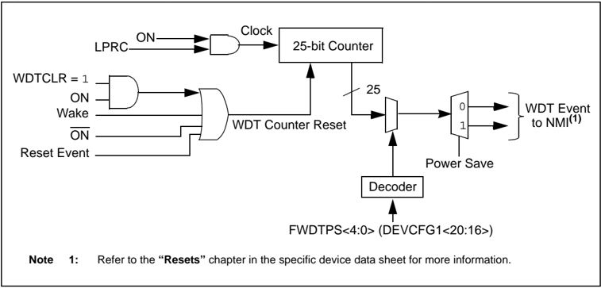
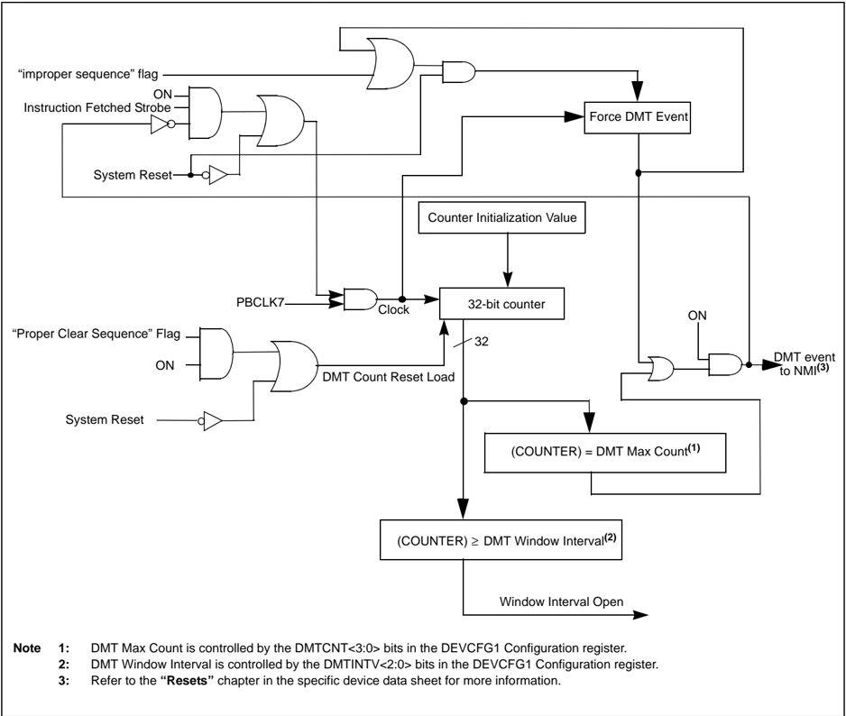
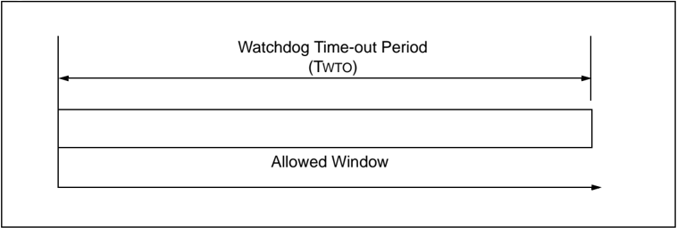
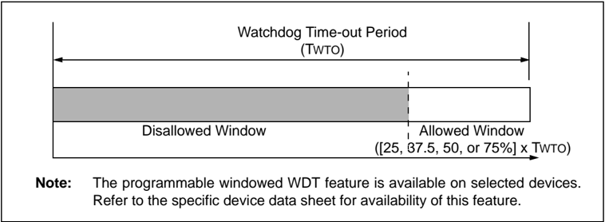

Microchip

## Section 9. Watchdog, Deadman, and Power-up Timers

| HIGHLIGHTS   |                                                                 |                                                                                                                                  |
|--------------|-----------------------------------------------------------------|----------------------------------------------------------------------------------------------------------------------------------|
|              | This section of the manual contains the following major topics: | This section of the manual contains the following major topics:                                                                  |
|              | 9.1                                                             | Introduction................................................................................................................9-2  |
|              | 9.2                                                             | Watchdog, Deadman, and Power-up Timers Control Registers................................9-4                                      |
|              | 9.3                                                             | Watchdog Timer Operation......................................................................................9-12               |
|              | 9.4                                                             | DMT Operation........................................................................................................9-16        |
|              | 9.5                                                             | Interrupt and Reset Generation...............................................................................9-18                |
|              | 9.6                                                             | I/O Pins....................................................................................................................9-21 |
|              | 9.7                                                             | Operation in Debug and Power-Saving Modes .......................................................9-21                            |
|              | 9.8                                                             | Effects of Various Resets.........................................................................................9-21           |
|              | 9.9                                                             | Related Application Notes .......................................................................................9-22            |
|              | 9.10                                                            | Revision History.......................................................................................................9-23      |

Note: This family reference manual section is meant to serve as a complement to device data sheets. Depending on the device variant, this manual section may not apply to all PIC32 devices.

Please consult the note at the beginning of the 'Watchdog Timer' , 'Deadman Timer' , 'Power-Saving  Features' and 'Special  Features' chapters  in  the current device data sheet to check whether this document supports the device you are using.

Device  data  sheets  and  family  reference  manual  sections  are  available  for download from the Microchip Worldwide Web site at: http://www.microchip.com

## 9.1 INTRODUCTION

The PIC32 Watchdog Timer (WDT), Deadman Timer (DMT), and Power-up Timer (PWRT) modules are described in this section. Refer to Figure 9-1 for a block diagram of the WDT and PWRT and Figure 9-2 for a block diagram of the DMT.

Note: The Deadman Timer is not available on all devices. Please refer to the 'Deadman Timer' chapter in the specific device data sheet to determine availability.

The WDT, when enabled, operates from the internal Low-Power RC (LPRC) Oscillator clock source. The WDT can be used to detect system software malfunctions by resetting the device if the WDT is not cleared periodically in software. The WDT can be configured in Windowed mode or  non-Windowed  mode.  Various  WDT  time-out  periods  can  be  selected  using  the  WDT postscaler. The WDT can also be used to wake the device from Sleep or Idle mode.

The DMT, when enabled, counts instruction fetches, and is able to cause a Reset if the DMT counter is not cleared within a set number of instructions. Since it does not measure time, it can remain active during sleep modes and continue after awakening.

The PWRT, when enabled, holds the device in Reset for a 64 millisecond period after the normal Power-on Reset (POR) start-up period is complete. This allows additional time for the Primary Oscillator (POSC) clock source and the power supply to stabilize. Like the WDT, the PWRT also uses the LPRC as its clock source.

Following are some of the key features of the WDT, DMT, and PWRT modules:

- Configuration or software controlled
- User-configurable time-out period or instruction count
- Can wake the device from Sleep or Idle

Figure 9-1: Watchdog Timer and Power-up Timer Block Diagram



## Section 9. Watchdog, Deadman, and Power-up Timers

Figure 9-2: Deadman Timer Block diagram



## PIC32 Family Reference Manual

## 9.2 WATCHDOG, DEADMAN, AND POWER-UP TIMERS CONTROL REGISTERS

The WDT, DMT, and PWRT modules consist of the following Special Function Registers (SFRs):

- WDTCON: Watchdog Timer Control Register

This register is used to enable or disable the Watchdog Timer, clear the WDT to prevent a time-out, and enables or disables the windowed operation.

- RCON: Resets Control Register

This register indicates the cause of a reset.

- DMTCON: Deadman Timer Control Register

This register is used to enable or disable Deadman Timer.

- DMTPRECLR: Deadman Timer Preclear Register

This register is used to write a preclear key word to eventually clear the Deadman Timer.

- DMTCLR: Deadman Timer Clear Register

This register is used to write a clear key word after a preclear word has been written to the DMTPRECLR register. The Deadman Timer will be cleared following a clear key word write.

- DMTSTAT: Deadman Timer Status Register

This register provides status for incorrect key word values or sequences, Deadman Timer events, and whether or not the DMT clear window is open.

- DMTCNT: Deadman Timer Count Register

This register allows user software to read the contents of the DMT counter.

- DMTPSCNT: Post Status Configure DMT Count Status Register

This register provides the value of the DMTCNT Configuration bits in the DEVCFG1 register.

- DMTPSINTV: Post Status Configure DMT Interval Status Register

This register provides the value of the DMTINTV Configuration bits in the DEVCFG1 register.

Table 9-2 provides a brief summary of the related WDT, DMT, and PWRT module registers. Corresponding registers appear after the summary, followed by a detailed description of each register.

Table 9-1: Watchdog, Deadman, and Power-up Timers Register Map

|                   |                   | Bits                | Bits                | Bits                | Bits                | Bits                | Bits                | Bits                | Bits                | Bits                | Bits                | Bits                | Bits                | Bits                | Bits                | Bits                | Bits                |
|-------------------|-------------------|---------------------|---------------------|---------------------|---------------------|---------------------|---------------------|---------------------|---------------------|---------------------|---------------------|---------------------|---------------------|---------------------|---------------------|---------------------|---------------------|
| Register Name (1) | Register Name (1) | 31/15               | 30/14               | 29/13               | 28/12               | 27/11               | 26/10               | 25/9                | 24/8                | 23/7                | 22/6                | 21/5                | 20/4                | 19/3                | 18/2                | 17/1                | 16/0                |
|                   | 31:16             | WDTCLRKEY<15:0> (3) | WDTCLRKEY<15:0> (3) | WDTCLRKEY<15:0> (3) | WDTCLRKEY<15:0> (3) | WDTCLRKEY<15:0> (3) | WDTCLRKEY<15:0> (3) | WDTCLRKEY<15:0> (3) | WDTCLRKEY<15:0> (3) | WDTCLRKEY<15:0> (3) | WDTCLRKEY<15:0> (3) | WDTCLRKEY<15:0> (3) | WDTCLRKEY<15:0> (3) | WDTCLRKEY<15:0> (3) | WDTCLRKEY<15:0> (3) | WDTCLRKEY<15:0> (3) | WDTCLRKEY<15:0> (3) |
| WDTCON            | 15:0              | ON                  | -                   | -                   | -                   | -                   | -                   | -                   | -                   | -                   | SWDTPS<4:0>         | SWDTPS<4:0>         | SWDTPS<4:0>         | SWDTPS<4:0>         |                     | WDTWINEN (3)        | WDTCLR (3)          |
| RCON              | 31:16             | -                   | -                   | -                   | -                   | -                   | -                   | -                   | -                   | -                   | -                   | -                   | -                   | -                   | -                   | -                   | -                   |
| RCON              | 15:0              | -                   | -                   | -                   | -                   | -                   | -                   | CM (2)              | WREGS (2)           | EXTR (2)            | SWR (2)             | -                   | WDTO                | SLEEP               | IDLE                | BOR (2)             | POR (2)             |
| DMTCON            | 31:16             | -                   | -                   | -                   | -                   | -                   | -                   | -                   | -                   | -                   | -                   | -                   | -                   | -                   | -                   | -                   | -                   |
| DMTCON            | 15:0              | ON                  | -                   | -                   | -                   | -                   | -                   | -                   | -                   | -                   | -                   | -                   | -                   | -                   | -                   | -                   | -                   |
| DMTPRECLR         | 31:16             | -                   | -                   | -                   | -                   | -                   | -                   | -                   | -                   | -                   | -                   | -                   | -                   | -                   | -                   | -                   | -                   |
| DMTPRECLR         | 15:0              | STEP1<7:0>          | STEP1<7:0>          | STEP1<7:0>          | STEP1<7:0>          | STEP1<7:0>          | STEP1<7:0>          | STEP1<7:0>          |                     | -                   | -                   | -                   | -                   | -                   | -                   | -                   | -                   |
| DMCLR             | 31:16             | -                   | -                   | -                   | -                   | -                   | -                   | -                   | -                   | -                   | -                   | -                   | -                   | -                   | -                   | -                   | -                   |
| DMCLR             | 15:0              | -                   | -                   | -                   | -                   | -                   | -                   | -                   | -                   | STEP2<7:0>          | STEP2<7:0>          | STEP2<7:0>          | STEP2<7:0>          | STEP2<7:0>          | STEP2<7:0>          | STEP2<7:0>          | STEP2<7:0>          |
| DMTSTAT           | 31:16             | -                   | -                   | -                   | -                   | -                   | -                   | -                   | - -                 |                     | -                   | -                   | -                   | -                   | -                   | -                   | -                   |
| DMTSTAT           | 15:0              | -                   | -                   | -                   | -                   | -                   | -                   | -                   | -                   | BAD1                | BAD2                | DMTEVENT            | -                   | -                   | -                   | -                   | WINOPN              |
| DMTCNT            | 31:16 15:0        |                     |                     |                     |                     |                     |                     |                     |                     |                     |                     |                     |                     |                     |                     |                     |                     |
| DMTPSCNT          | 31:16             | COUNTER<31:0>       | COUNTER<31:0>       | COUNTER<31:0>       | COUNTER<31:0>       | COUNTER<31:0>       | COUNTER<31:0>       | COUNTER<31:0>       | COUNTER<31:0>       | COUNTER<31:0>       | COUNTER<31:0>       | COUNTER<31:0>       | COUNTER<31:0>       | COUNTER<31:0>       | COUNTER<31:0>       | COUNTER<31:0>       | COUNTER<31:0>       |
| DMTPSCNT          | 15:0              | PSCNT<31:0>         | PSCNT<31:0>         | PSCNT<31:0>         | PSCNT<31:0>         | PSCNT<31:0>         | PSCNT<31:0>         | PSCNT<31:0>         | PSCNT<31:0>         | PSCNT<31:0>         | PSCNT<31:0>         | PSCNT<31:0>         | PSCNT<31:0>         | PSCNT<31:0>         | PSCNT<31:0>         | PSCNT<31:0>         | PSCNT<31:0>         |
| DMTPSINTV         | 31:16             |                     |                     |                     |                     |                     |                     |                     |                     |                     |                     |                     |                     |                     |                     |                     |                     |
|                   | 15:0              | PSINTV<31:0>        | PSINTV<31:0>        | PSINTV<31:0>        | PSINTV<31:0>        | PSINTV<31:0>        | PSINTV<31:0>        | PSINTV<31:0>        | PSINTV<31:0>        | PSINTV<31:0>        | PSINTV<31:0>        | PSINTV<31:0>        | PSINTV<31:0>        | PSINTV<31:0>        | PSINTV<31:0>        | PSINTV<31:0>        | PSINTV<31:0>        |

Legend: - = unimplemented, read as '

0 '.

Note 1: All registers have an associated Clear, Set, and Invert register at an offset of 0x4, 0x8, and 0xC bytes, respectively. These registers have the same name with CLR, SET, or INV appended to the end of the register name (e.g., WDTCONCLR). Writing a ' 1 ' to any bit position in these registers will clear valid bits in the associated register. Reads from the these registers should be ignored.

2: These bits are not associated with the WDT or PWRT modules. For complete register details, see Register 7-1: 'RCON: Resets Control Register' in Section 6. 'Resets' (DS61118) of the ' PIC32 Family Reference Manual '.

3: These bits are not available on all devices. Please refer to the 'Watchdog Timer' chapter in the specific device data sheet for availability.

## PIC32 Family Reference Manual

## Register 9-1: WDTCON: Watchdog Timer Control Register

| Bit Range   | Bit 31/23/15/7      | Bit 30/22/14/6      | Bit 29/21/13/5      | Bit 28/20/12/4      | Bit 27/19/11/3      | Bit 26/18/10/2      | Bit 25/17/9/1       | Bit 24/16/8/0       |
|-------------|---------------------|---------------------|---------------------|---------------------|---------------------|---------------------|---------------------|---------------------|
| 31:24       | W-0                 | W-0                 | W-0                 | W-0                 | W-0                 | W-0                 | W-0                 | W-0                 |
| 31:24       | WDTCLRKEY<15:8> (3) | WDTCLRKEY<15:8> (3) | WDTCLRKEY<15:8> (3) | WDTCLRKEY<15:8> (3) | WDTCLRKEY<15:8> (3) | WDTCLRKEY<15:8> (3) | WDTCLRKEY<15:8> (3) | WDTCLRKEY<15:8> (3) |
| 23:16       | W-0                 | W-0                 | W-0                 | W-0                 | W-0                 | W-0                 | W-0                 | W-0                 |
| 23:16       | WDTCLRKEY<7:0> (3)  | WDTCLRKEY<7:0> (3)  | WDTCLRKEY<7:0> (3)  | WDTCLRKEY<7:0> (3)  | WDTCLRKEY<7:0> (3)  | WDTCLRKEY<7:0> (3)  | WDTCLRKEY<7:0> (3)  | WDTCLRKEY<7:0> (3)  |
| 15:8        | R/W-0               | U-0                 | U-0                 | U-0                 | U-0                 | U-0                 | U-0                 | U-0                 |
| 15:8        | ON (1,2)            | -                   | -                   | -                   | -                   | -                   | -                   | -                   |
| 7:0         | U-0                 | R-y                 | R-y                 | R-y                 | R-y                 | R-y                 | R/W-0               | R/W-0               |
| 7:0         | -                   | SWDTPS<4:0>         | SWDTPS<4:0>         | SWDTPS<4:0>         | SWDTPS<4:0>         | SWDTPS<4:0>         | WDTWINEN (3)        | WDTCLR (3)          |

## Legend:

y = Value from Configuration bit on POR

R = Readable bit

W = Writable bit

U = Unimplemented bit, read as '0'

-n = Value at POR

'1' = Bit is set

'0' = Bit is cleared

x = Bit is unknown

bit 31-16 WDTCLRKEY: Watchdog Timer Clear Key bits (3)

To clear the Watchdog Timer to prevent a time-out, software must write the value 0x5743 to this location using a single 16-bit write.

bit 15 ON: Watchdog Timer Enable bit (1,2)

- 1 = Enables the Watchdog Timer if it is not enabled by the device configuration

0 = Disable the Watchdog Timer if it was enabled in software

bit 14-7 Unimplemented: Read as ' 0 '

bit 6-2 SWDTPS&lt;4:0&gt;: Shadow Copy of Watchdog Timer Postscaler Value from Device Configuration bits On reset, these bits are set to the values of the WDTPS&lt;4:0&gt; Configuration bits.

bit 1 WDTWINEN: Watchdog Timer Window Enable bit (3)

1 = Enable windowed Watchdog Timer

0 = Disable windowed Watchdog Timer

bit 0 WDTCLR:

Watchdog Timer Reset bit (3)

1 = Writing a ' 1 ' will clear the WDT

0 = Software cannot force this bit to a ' 0 '

- Note 1: A read of this bit will result in a ' 1 ' if the WDT is enabled by the device configuration or by software.
- 2: When using the 1:1 PBCLK divisor, the user's software should not read or write the peripheral's SFRs in the SYSCLK cycle immediately following the instruction that clears the module's ON bit.
- 3: These bits are not available on all devices. Please refer to the 'Watchdog Timer' chapter in the specific device data sheet for availability.

## Register 9-2:

RCON: Resets Control Register

| Bit Range   | Bit 31/23/15/7   | Bit 30/22/14/6   | Bit 29/21/13/5   | Bit 28/20/12/4   | Bit 27/19/11/3   | Bit 26/18/10/2   | Bit 25/17/9/1   | Bit 24/16/8/0   |
|-------------|------------------|------------------|------------------|------------------|------------------|------------------|-----------------|-----------------|
| 31:24       | U-0              | U-0              | U-0              | U-0              | U-0              | U-0              | U-0             | U-0             |
| 31:24       | -                | -                | -                | -                | -                | -                | -               | -               |
| 23:16       | U-0              | U-0              | U-0              | U-0              | U-0              | U-0              | U-0             | U-0             |
| 23:16       | -                | -                | -                | -                | -                | -                | -               | -               |
| 15:8        | U-0              | U-0              | U-0              | U-0              | U-0              | U-0              | R/W-0           | R.W-0           |
| 15:8        | -                | -                | -                | -                | -                | -                | CM (1)          | VREGS (1)       |
| 7:0         | R/W-0            | R/W-0            | R/W-0, HS        | R/W-0            | R/W-0            | R/W-0            | R/W-1           | R/W-1           |
| 7:0         | EXTR (1)         | SWR (1)          | DMTO (2)         | WDTO             | SLEEP            | IDLE             | BOR (1)         | POR (1)         |

## Legend:

HS = Set by hardware

R = Readable bit

W = Writable bit

U = Unimplemented bit, read as '0'

-n = Value at POR

'1' = Bit is set

'0' = Bit is cleared

x = Bit is unknown

## bit 5 DMTO: Deadman Timer Time-out bit

(2)

1 = A Deadman Timer time-out has occurred

0 = A Deadman Timer time-out has not occurred

## bit 4 WDTO: Watchdog Time-out bit

- 1 = A Watchdog Timer time-out has occurred since either the device was powered up or the WDTO bit was last cleared by software
- 0 = A Watchdog Timer time-out has not occurred since either the WDTO bit was cleared by software or the device was reset

## bit 3 SLEEP:

Sleep Event bit

- 1 = The device was in Sleep since either the device was powered up or the SLEEP bit was last cleared by software
- 0 = The device was not in Sleep since either the SLEEP bit was cleared by software or the device was reset

## bit 2 IDLE: Idle Event bit

- 1 = The device has been in Idle mode since either the device was powered up or the IDLE bit was last cleared by software
- 0 = The device has not been in Idle mode since either the IDLE bit was cleared by software or the device was reset
- Note 1: These bits are not associated with the WDT or PWRT modules. For complete register details, see Register 7-1: 'RCON: Resets Control Register' in Section 6. 'Resets' (DS61118) of the ' PIC32 Family Reference Manual '.
- 2: This bit is not available on all devices. Please refer to the 'Watchdog Timer' chapter in the specific device data sheet to determine availability.

## PIC32 Family Reference Manual

## Register 9-3: DMTCON: Deadman Timer Control Register

| Bit Range   | Bit 31/23/15/7   | Bit 30/22/14/6   | Bit 29/21/13/5   | Bit 28/20/12/4   | Bit 27/19/11/3   | Bit 26/18/10/2   | Bit 25/17/9/1   | Bit 24/16/8/0   |
|-------------|------------------|------------------|------------------|------------------|------------------|------------------|-----------------|-----------------|
| 31:24       | U-0              | U-0              | U-0              | U-0              | U-0              | U-0              | U-0             | U-0             |
| 31:24       | -                | -                | -                | -                | -                | -                | -               | -               |
| 23:16       | U-0              | U-0              | U-0              | U-0              | U-0              | U-0              | U-0             | U-0             |
| 23:16       | -                | -                | -                | -                | -                | -                | -               | -               |
| 15:8        | R/W-0            | U-0              | U-0              | U-0              | U-0              | U-0              | U-0             | U-0             |
| 15:8        | ON (1)           | -                | -                | -                | -                | -                | -               | -               |
| 7:0         | U-0              | U-0              | U-0              | U-0              | U-0              | U-0              | U-0             | U-0             |
| 7:0         | -                | -                | -                | -                | -                | -                | -               | -               |

## Legend:

R = Readable bit

W = Writable bit

U = Unimplemented bit

-n = Bit Value at POR: ('0', '1', x = unknown)

P = Programmable bit

r = Reserved bit

bit 31-16

Unimplemented: Read as ' 0 '

bit 15

ON:

Deadman Timer Module Enable bit (1)

1 = Deadman Timer module is enabled

0 = Deadman Timer module is disabled

bit 14-0 Unimplemented: Read as '

0 '

Note 1: This bit only has control when FDMTEN (DEVCFG1&lt;3&gt;) = 0 .

Register 9-4: DMTPRECLR: Deadman Timer Preclear Register

| Bit Range   | Bit 31/23/15/7   | Bit 30/22/14/6   | Bit 29/21/13/5   | Bit 28/20/12/4   | Bit 27/19/11/3   | Bit 26/18/10/2   | Bit 25/17/9/1   | Bit 24/16/8/0   |
|-------------|------------------|------------------|------------------|------------------|------------------|------------------|-----------------|-----------------|
| 31:24       | U-0              | U-0              | U-0              | U-0              | U-0              | U-0              | U-0             | U-0             |
| 31:24       | -                | -                | -                | -                | -                | -                | -               | -               |
| 23:16       | U-0              | U-0              | U-0              | U-0              | U-0              | U-0              | U-0             | U-0             |
| 23:16       | -                | -                | -                | -                | -                | -                | -               | -               |
| 15:8        | R/W-0            | R/W-0            | R/W-0            | R/W-0            | R/W-0            | R/W-0            | R/W-0           | R/W-0           |
| 15:8        | STEP1<7:0>       | STEP1<7:0>       | STEP1<7:0>       | STEP1<7:0>       | STEP1<7:0>       | STEP1<7:0>       | STEP1<7:0>      | STEP1<7:0>      |
| 7:0         | U-0              | U-0              | U-0              | U-0              | U-0              | U-0              | U-0             | U-0             |
| 7:0         | -                | -                | -                | -                | -                | -                | -               | -               |

## Legend:

R = Readable bit

W = Writable bit

U = Unimplemented bit

-n = Bit Value at POR: ('0', '1', x = unknown)

P = Programmable bit

r = Reserved bit

bit 31-16 Unimplemented:

Read as ' 0 '

bit 15-8

STEP1&lt;7:0&gt;:

Preclear Enable bits

01000000 = Enables the Deadman Timer Preclear (Step 1)

All other write patterns = Set BAD1 flag.

These bits are cleared when a DMT reset event occurs. STEP1&lt;7:0&gt; is also cleared if the STEP2&lt;7:0&gt; bits are loaded with the correct value in the correct sequence.

bit 7-0 Unimplemented: Read as ' 0 '

## Section 9. Watchdog, Deadman, and Power-up Timers

Register 9-5:

DMTCLR: Deadman Timer Clear Register

| Bit Range   | Bit 31/23/15/7   | Bit 30/22/14/6   | Bit 29/21/13/5   | Bit 28/20/12/4   | Bit 27/19/11/3   | Bit 26/18/10/2   | Bit 25/17/9/1   | Bit 24/16/8/0   |
|-------------|------------------|------------------|------------------|------------------|------------------|------------------|-----------------|-----------------|
| 31:24       | U-0              | U-0              | U-0              | U-0              | U-0              | U-0              | U-0             | U-0             |
| 31:24       | -                | -                | -                | -                | -                | -                | -               | -               |
| 23:16       | U-0              | U-0              | U-0              | U-0              | U-0              | U-0              | U-0             | U-0             |
| 23:16       | -                | -                | -                | -                | -                | -                | -               | -               |
| 15:8        | U-0              | U-0              | U-0              | U-0              | U-0              | U-0              | U-0             | U-0             |
| 15:8        | -                | -                | -                | -                | -                | -                | -               | -               |
| 7:0         | R/W-0            | R/W-0            | R/W-0            | R/W-0            | R/W-0            | R/W-0            | R/W-0           | R/W-0           |
| 7:0         | STEP2<7:0>       | STEP2<7:0>       | STEP2<7:0>       | STEP2<7:0>       | STEP2<7:0>       | STEP2<7:0>       | STEP2<7:0>      | STEP2<7:0>      |

| Legend:                                                                          |
|----------------------------------------------------------------------------------|
| R = Readable bit W = Writable bit U = Unimplemented bit                          |
| -n = Bit Value at POR: ('0', '1', x = unknown) P = Programmable bit r = Reserved |

bit 31-8

Unimplemented:

Read as ' 0 '

bit 7-0

STEP2&lt;7:0&gt;:

Clear Timer bits

00001000 = Clears STEP1&lt;7:0&gt;, STEP2&lt;7:0&gt; and the Deadman Timer if, and only if, preceded by correct loading of STEP1&lt;7:0&gt; bits in the correct sequence. The write to these bits may be verified by reading DMTCNT and observing the counter being reset.

All other write patterns = Set BAD2 bit, the value of STEP1&lt;7:0&gt; will remain unchanged, and the new value being written STEP2&lt;7:0&gt; will be captured. These bits are also cleared when a DMT reset event occurs.

## PIC32 Family Reference Manual

## Register 9-6: DMTSTAT: Deadman Timer Status Register

| Bit Range   | Bit 31/23/15/7   | Bit 30/22/14/6   | Bit 29/21/13/5   | Bit 28/20/12/4   | Bit 27/19/11/3   | Bit 26/18/10/2   | Bit 25/17/9/1   | Bit 24/16/8/0   |
|-------------|------------------|------------------|------------------|------------------|------------------|------------------|-----------------|-----------------|
| 31:24       | U-0              | U-0              | U-0              | U-0              | U-0              | U-0              | U-0             | U-0             |
| 31:24       | -                | -                | -                | -                | -                | -                | -               | -               |
| 23:16       | U-0              | U-0              | U-0              | U-0              | U-0              | U-0              | U-0             | U-0             |
| 23:16       | -                | -                | -                | -                | -                | -                | -               | -               |
| 15:8        | U-0              | U-0              | U-0              | U-0              | U-0              | U-0              | U-0             | U-0             |
| 15:8        | -                | -                | -                | -                | -                | -                | -               | -               |
| 7:0         | R-0, HC          | R-0, HC          | R-0, HC          | U-0              | U-0              | U-0              | U-0             | R-0             |
| 7:0         | BAD1             | BAD2             | DMTEVENT         | -                | -                | -                | -               | WINOPN          |

## Legend:

HC = Cleared by Hardware

R = Readable bit

W = Writable bit

U = Unimplemented bit

-n = Bit Value at POR: ('0', '1', x = unknown)

P = Programmable bit

r = Reserved bit

bit 31-8

Unimplemented:

Read as ' 0 '

bit 7

BAD1:

Bad STEP1&lt;7:0&gt; Value Detect bit

1 = Incorrect STEP1&lt;7:0&gt; value was detected

0 = Incorrect STEP1&lt;7:0&gt; value was not detected

bit 6

BAD2: Bad STEP2&lt;7:0&gt; Value Detect bit

1 = Incorrect STEP2&lt;7:0&gt; value was detected

0 = Incorrect STEP2&lt;7:0&gt; value was not detected

bit 5

DMTEVENT:

Deadman Timer Event bit

1 = Deadman timer event was detected (counter expired or bad STEP1&lt;7:0&gt; or STEP2&lt;7:0&gt; value was entered prior to counter increment)

0 = Deadman timer event was not detected

bit 4-1

Unimplemented: Read as ' 0 '

bit 0

WINOPN:

Deadman Timer Clear Window bit

1 = Deadman timer clear window is open

0 = Deadman timer clear window is not open

## Register 9-7: DMTCNT: Deadman Timer Count Register

| Bit Range   | Bit 31/23/15/7   | Bit 30/22/14/6   | Bit 29/21/13/5   | Bit 28/20/12/4   | Bit 27/19/11/3   | Bit 26/18/10/2   | Bit 25/17/9/1   | Bit 24/16/8/0   |
|-------------|------------------|------------------|------------------|------------------|------------------|------------------|-----------------|-----------------|
| 31:24       | R-0              | R-0              | R-0              | R-0              | R-0              | R-0              | R-0             | R-0             |
| 31:24       | COUNTER<31:24>   | COUNTER<31:24>   | COUNTER<31:24>   | COUNTER<31:24>   | COUNTER<31:24>   | COUNTER<31:24>   | COUNTER<31:24>  | COUNTER<31:24>  |
| 23:16       | R-0              | R-0              | R-0              | R-0              | R-0              | R-0              | R-0             | R-0             |
| 23:16       | COUNTER<23:16>   | COUNTER<23:16>   | COUNTER<23:16>   | COUNTER<23:16>   | COUNTER<23:16>   | COUNTER<23:16>   | COUNTER<23:16>  | COUNTER<23:16>  |
| 15:8        | R-0              | R-0              | R-0              | R-0              | R-0              | R-0              | R-0             | R-0             |
| 15:8        | COUNTER<15:8>    | COUNTER<15:8>    | COUNTER<15:8>    | COUNTER<15:8>    | COUNTER<15:8>    | COUNTER<15:8>    | COUNTER<15:8>   | COUNTER<15:8>   |
| 7:0         | R-0              | R-0              | R-0              | R-0              | R-0              | R-0              | R-0             | R-0             |
| 7:0         | COUNTER<7:0>     | COUNTER<7:0>     | COUNTER<7:0>     | COUNTER<7:0>     | COUNTER<7:0>     | COUNTER<7:0>     | COUNTER<7:0>    | COUNTER<7:0>    |

## Legend:

R = Readable bit

W = Writable bit

U = Unimplemented bit

-n = Bit Value at POR: ('0', '1', x = unknown)

P = Programmable bit

r = Reserved bit

bit 31-8

COUNTER&lt;31:0&gt;: Read current contents of DMT counter

## Section 9. Watchdog, Deadman, and Power-up Timers

Register 9-8: DMTPSCNT: Post Status Configure DMT Count Status Register

| Bit Range   | Bit 31/23/15/7   | Bit 30/22/14/6   | Bit 29/21/13/5   | Bit 28/20/12/4   | Bit 27/19/11/3   | Bit 26/18/10/2   | Bit 25/17/9/1   | Bit 24/16/8/0   |
|-------------|------------------|------------------|------------------|------------------|------------------|------------------|-----------------|-----------------|
| 31:24       | R-0              | R-0              | R-0              | R-0              | R-0              | R-0              | R-0             | R-0             |
| 31:24       | PSCNT<31:24>     | PSCNT<31:24>     | PSCNT<31:24>     | PSCNT<31:24>     | PSCNT<31:24>     | PSCNT<31:24>     | PSCNT<31:24>    | PSCNT<31:24>    |
| 23:16       | R-0              | R-0              | R-0              | R-0              | R-0              | R-0              | R-0             | R-0             |
| 23:16       | PSCNT<23:16>     | PSCNT<23:16>     | PSCNT<23:16>     | PSCNT<23:16>     | PSCNT<23:16>     | PSCNT<23:16>     | PSCNT<23:16>    | PSCNT<23:16>    |
| 15:8        | R-0              | R-0              | R-0              | R-0              | R-0              | R-0              | R-0             | R-0             |
| 15:8        | PSCNT<15:8>      | PSCNT<15:8>      | PSCNT<15:8>      | PSCNT<15:8>      | PSCNT<15:8>      | PSCNT<15:8>      | PSCNT<15:8>     | PSCNT<15:8>     |
| 7:0         | R-0              | R-0              | R-0              | R-0              | R-0              | R-0              | R-0             | R-0             |
| 7:0         | PSCNT<7:0>       | PSCNT<7:0>       | PSCNT<7:0>       | PSCNT<7:0>       | PSCNT<7:0>       | PSCNT<7:0>       | PSCNT<7:0>      | PSCNT<7:0>      |

| Legend:                                                                          |
|----------------------------------------------------------------------------------|
| R = Readable bit W = Writable bit U = Unimplemented bit                          |
| -n = Bit Value at POR: ('0', '1', x = unknown) P = Programmable bit r = Reserved |

bit 31-8

PSCNT&lt;31:0&gt;: DMT Instruction Count Value Configuration Status bits

This is always the value of the DMTCNT&lt;3:0&gt; bits in the DEVCFG1 Configuration register.

Register 9-9: DMTPSINTV: Post Status Configure DMT Interval Status Register

| Bit Range   | Bit 31/23/15/7   | Bit 30/22/14/6   | Bit 29/21/13/5   | Bit 28/20/12/4   | Bit 27/19/11/3   | Bit 26/18/10/2   | Bit 25/17/9/1   | Bit 24/16/8/0   |
|-------------|------------------|------------------|------------------|------------------|------------------|------------------|-----------------|-----------------|
| 31:24       | R-0              | R-0              | R-0              | R-0              | R-0              | R-0              | R-0             | R-0             |
| 31:24       | PSINTV<31:24>    | PSINTV<31:24>    | PSINTV<31:24>    | PSINTV<31:24>    | PSINTV<31:24>    | PSINTV<31:24>    | PSINTV<31:24>   | PSINTV<31:24>   |
| 23:16       | R-0              | R-0              | R-0              | R-0              | R-0              | R-0              | R-0             | R-0             |
| 23:16       | PSINTV<23:16>    | PSINTV<23:16>    | PSINTV<23:16>    | PSINTV<23:16>    | PSINTV<23:16>    | PSINTV<23:16>    | PSINTV<23:16>   | PSINTV<23:16>   |
| 15:8        | R-0              | R-0              | R-0              | R-0              | R-0              | R-0              | R-0             | R-0             |
| 15:8        | PSINTV<15:8>     | PSINTV<15:8>     | PSINTV<15:8>     | PSINTV<15:8>     | PSINTV<15:8>     | PSINTV<15:8>     | PSINTV<15:8>    | PSINTV<15:8>    |
| 7:0         | R-0              | R-0              | R-0              | R-0              | R-0              | R-0              | R-0             | R-0             |
| 7:0         | PSINTV<7:0>      | PSINTV<7:0>      | PSINTV<7:0>      | PSINTV<7:0>      | PSINTV<7:0>      | PSINTV<7:0>      | PSINTV<7:0>     | PSINTV<7:0>     |

| Legend:                                                                          |
|----------------------------------------------------------------------------------|
| R = Readable bit W = Writable bit U = Unimplemented bit                          |
| -n = Bit Value at POR: ('0', '1', x = unknown) P = Programmable bit r = Reserved |

bit 31-8

PSINTV&lt;31:0&gt;:

DMT Window Interval Configuration Status bits

This is always the value of the DMTINTV&lt;2:0&gt; bits in the DEVCFG1 Configuration register.

## 9.3 WATCHDOG TIMER OPERATION

The primary function of the Watchdog Timer (WDT) is to reset the processor in the event of a software malfunction or wake-up the processor in the event of a time-out while in Sleep mode.

If enabled, the WDT will increment until it overflows or 'times out'. A WDT time-out will force a device Reset, except during Sleep or Idle modes. To prevent a WDT time-out Reset, the user application must periodically clear the WDT by setting the WDTCLR bit (WDTCON&lt;0&gt;), or by writing a key word 0x5743 to the WDTCLRKEY&lt;15:0&gt; bits (WDTCON&lt;31:16&gt;) through a single 16-bit write. Refer to the 'Watchdog Timer' chapter in the specific device data sheet to determine availability of the WDTCLR bit and the WDTCLRKEY&lt;15:0&gt; bits.

The WDT module uses the LPRC Oscillator for reliability.

Note: The LPRC Oscillator is enabled whenever the WDT is enabled.

## 9.3.1 Modes of Operation

The WDT has two modes of operation: Non-Windowed and Programmable Windowed.

The  Programmable  Windowed  mode  can  be  enabled  by  setting  the  Watchdog  Window Enable  (WDTWINEN)  bit  (WDTCON&lt;1&gt;).  In  Programmable  Windowed  mode,  software  can clear  the  WDT  only  when  the  counter  is  in  its  final  window  before  a  period  match  occurs. There are four window size options. This window is active when the timer counter is greater than a predetermined value for each option. Depending on the device, any attempts to clear the WDT when the window is not active will cause either a Non-maskable Interrupt (NMI) or a  device  Reset.  Refer  to  the 'Power-Saving Features' chapter  in  the  specific  device  data sheet for more information on which type of reset occurs for your device. In Non-Windowed mode, software can clear the WDT anytime before the period match occurs.

## 9.3.2 Enabling and Disabling the WDT

The WDT is enabled or disabled by the device configuration or controlled through software by writing to the WDTCON register (Register 9-1).

## 9.3.3 Device Configuration Controlled WDT

If  the  FWDTEN  Configuration  bit  is  set,  the  WDT  is  always  enabled.  The  ON  control  bit (WDTCON&lt;15&gt;) will reflect this by reading a ' 1 '. In this mode, the ON bit cannot be cleared in software. The FWDTEN Configuration bit will not be cleared by any form of reset. To disable the WDT, the configuration must be rewritten to the device.

Note: The WDT is enabled by default on an unprogrammed device.

The WINDIS Configuration bit can be used to enable or disable the Programmable Windowed mode. The window size for the WDT Programmable Windowed mode can be configured using the FWDTWINSZ Configuration bits.

## 9.3.4 Software Controlled WDT

If the FWDTEN Configuration bit is a ' 0 ', the WDT module can be enabled or disabled (the default condition) by software. In this mode, the ON bit (WDTCON&lt;15&gt;) reflects the status of the WDT under  software  control.  A  ' 1 '  indicates  the  WDT  module  is  enabled  and  a  ' 0 '  indicates  it  is disabled. If the WINDIS Configuration bit is a ' 0 ', the WDT Programmable Windowed mode can be enabled or disabled by software. The Programmable Windowed mode can be configured using the WDTWINEN bit (WDTCON&lt;2&gt;). A ' 1 ' indicates that Programmable Windowed mode is enabled and ' 0 '  indicates it is disabled. The window sizes can be configured by setting the FWDTWINSZ configuration bits only, and cannot be set in software.

The WDT is enabled in software by setting the Watchdog Timer control bit, ON (WDTCON&lt;15&gt;). The ON control bit is cleared on any device Reset. The bit is not cleared upon a wake from Sleep or exit from Idle mode. The software WDT option allows the user to enable the WDT for critical code segments and disable the WDT during noncritical segments for maximum power savings. This bit can also be used to disable the WDT while the device is awake to eliminate the need for WDT servicing, and then re-enable it before the device is put into Idle mode or Sleep mode to wake the device at a later time. Example 9-1 shows the WDT initialization and servicing sample.

## Section 9. Watchdog, Deadman, and Power-up Timers

```
//This code fragment assumes the WDT was not enabled by the device configuration // The Postscaler value must be set with the device configuration // In certain devices, software must write a 0x5743 to WDTCON<31:16> using a // single 16-bit write. WDTCONSET = 0x8000; // Turn on the WDT main { WDTCONSET = 0x01; // Service the WDT ... User code goes here ... }
```

Example 9-1: Sample WDT Initialization and Servicing

## 9.3.4.1 WATCHDOG TIMER PROGRAMMABLE WINDOW

Note: Window mode and its associated bits are not available on all devices. Please refer to the specific device data sheet to determine availability.

The window size is determined by the Configuration bits, FWDTWINSZ and WDTPS. In the Programmable Windowed mode (WDTWINEN = 1 ), the WDT should be cleared based on the setting of the Window Size Configuration bits (FWDTWINSZ&lt;1:0&gt;), see Figure 9-4. These bit settings are:

- 11 = WDT window is 25% of the WDT period
- 10 = WDT window is 37.5% of the WDT period
- 01 = WDT window is 50% of the WDT period
- 00 = WDT window is 75% of the WDT period

Depending on the device, if the WDT is cleared before the allowed window, a system Reset or NMI is immediately generated. Refer to the 'Power-Saving Features' chapter in the specific device data sheet for more information on which type of reset occurs for your device.

The Windowed mode is useful for resetting the device during unexpected quick or slow execution of a critical portion of the code.

Figure 9-3: Non-Windowed WDT



Figure 9-4: Programmable Windowed WDT



## 9.3.5 WDT Operation in Power-Saving Modes

The WDT, if enabled, will continue operation in Sleep mode or Idle mode. The WDT module may be used to wake the device from Sleep mode or Idle mode. When the WDT times out in a Power-Saving  mode,  a  Non-Maskable  Interrupt  (NMI)  is  generated  and  the  WDTO  bit (RCON&lt;4&gt;) is set. The NMI vectors execution to the CPU start-up address, but does not reset registers or peripherals. If the device was in Sleep, the SLEEP status bit (RCON&lt;3&gt;) will also be set. If the device was in Idle, the IDLE status bit (RCON&lt;2&gt;) will also be set. These bits allow the start-up code to determine the cause of the wake-up.

## 9.3.6 WDT NMI Reset Delay

On those devices that have a NMI reset counter, it is possible to program a delay time between a WDT event and a device Reset. Refer to the 'Resets' chapter in the specific device data sheet, and Section 7. 'Resets' (DS60001118) in the 'PIC32 Family Reference Manual' for details.

## 9.3.7 Time Delays on Wake

There will be a time delay between the WDT event in Sleep and the beginning of code execution. The duration of this delay consists of the start-up time for the oscillator in use and the power-up timer delay, if it is enabled.

Unlike a wake-up from Sleep mode, there are no time delays associated with wake-up from Idle mode. The system clock is running during Idle mode; therefore, no start-up delays are required at wake-up.

## 9.3.8 Resetting the WDT

The WDT is cleared by any one of the following:

- On any device Reset
- By a WDTCONSET = 0x01 or equivalent instruction during normal execution (device-dependent; refer to the 'Watchdog Timer' chapter in the specific device data sheet for availability)
- Execution of a DEBUG command
- Detection of a correct write value (0x5743) to the WDTCLRKEY&lt;15:0&gt; bits (WDTCON&lt;31:16&gt;) (device-dependent; refer to the 'Watchdog Timer' chapter in the specific device data sheet for availability)
- Exiting from Idle or Sleep due to an interrupt

Note: The WDT is not reset when the device enters a Power-Saving mode. The WDT module should be serviced prior to entering a Power-Saving mode.

## 9.3.9 WDT Period Selection

The WDT can have an external clock source or the clock source is the internal LPRC Oscillator, which has a nominal frequency of 32 kHz. This creates a nominal time-out period for the WDT (TWDT) of 1 millisecond when no postscaler is used.

Note:

The WDT module time-out period is directly related to the frequency of the LPRC Oscillator. The frequency of the LPRC Oscillator will vary as a function of device operating voltage and temperature. Please refer to the specific device data sheet for LPRC clock frequency specifications.

## 9.3.10 WDT Postscalers

The WDT has a 5-bit postscaler to create a wide variety of time-out periods. This postscaler provides  1:1  through  1:1048576  divider  ratios,  see  Table 9-2.  Time-out  periods  that  range between 1 ms and 1048.576 seconds (nominal) can be achieved using the postscaler.

The postscaler settings are selected using the WDTPS&lt;4:0&gt; Configuration bits in the DEVCFG1 register. The time-out period of the WDT is calculated, as shown in Equation 9-1.

## Section 9. Watchdog, Deadman, and Power-up Timers

Equation 9-1: WDT Time-out Period Calculation

WDT Period = 1 ms · 2 Postscaler

Table 9-2: WDT Time-out Period versus Postscaler Settings (1,2)

|   WDTPS<4:0> | Postscaler Ratio   | Time-out Period (Windowed Mode)   | Time-out Period (Programmable Windowed mode) (3)   |
|--------------|--------------------|-----------------------------------|----------------------------------------------------|
|        00000 | 1:1                | 1 ms                              | 0.75 ms                                            |
|        00001 | 1:2                | 2 ms                              | 1.5 ms                                             |
|        00010 | 1:4                | 4 ms                              | 3 ms                                               |
|        00011 | 1:8                | 8 ms                              | 6 ms                                               |
|        00100 | 1:16               | 16 ms                             | 12 ms                                              |
|        00101 | 1:32               | 32 ms                             | 24 ms                                              |
|        00110 | 1:64               | 64 ms                             | 48 ms                                              |
|        00111 | 1:128              | 128 ms                            | 96 ms                                              |
|        01000 | 1:256              | 256 ms                            | 192 ms                                             |
|        01001 | 1:512              | 512 ms                            | 384 ms                                             |
|        01010 | 1:1024             | 1.024s                            | 0.768s                                             |
|        01011 | 1:2048             | 2.048s                            | 1.536s                                             |
|        01100 | 1:4096             | 4.096s                            | 3.072s                                             |
|        01101 | 1:8192             | 8.192s                            | 6.144s                                             |
|        01110 | 1:16384            | 16.384s                           | 12.228s                                            |
|        01111 | 1:32768            | 32.768s                           | 24.576s                                            |
|        10000 | 1:65536            | 65.536s                           | 49.152s                                            |
|        10001 | 1:131072           | 131.072s                          | 98.304s                                            |
|        10010 | 1:262144           | 262.144s                          | 196.608s                                           |
|        10011 | 1:524288           | 524.288s                          | 393.216s                                           |
|        10100 | 1:1045876          | 1048.576s                         | 786.432s                                           |

- 3: In this case, FWDTWINSZ = 00 . The WDT window is 75% of the selected WDT period.

## 9.4 DMT OPERATION

## 9.4.1 Modes of Operation

The primary function of the Deadman Timer (DMT) is to reset the processor in the event of a software  malfunction.  The  DMT  is  a  free-running  instruction  fetch  timer,  which  is  clocked whenever an instruction fetch occurs until a count match occurs. Instructions are not fetched when the processor is in Sleep mode.

The DMT consists of a 32-bit counter with a time-out count match value as specified by the DMTCNT&lt;3:0&gt; bits in the DEVCFG1 Configuration register.

A Deadman Timer is typically used in mission critical and safety critical applications, where any single failure of the software functionality and sequencing must be detected.

## 9.4.2 Enabling and Disabling the DMT

The DMT is enabled or disabled by the device configuration or controlled through software by writing to the DMTCON register.

## 9.4.2.1 DEVICE CONFIGURATION CONTROLLED DMT

If the FDMTEN Configuration bit in the DEVCFG1 register is set, the DMT is always enabled. The ON control bit (DMTCON&lt;15&gt;) will reflect this by reading a ' 1 '. In this mode, the ON bit cannot be cleared in software. To disable the DMT, the configuration must be rewritten to the device. If FDMTEN is set to ' 0 ', the DMT is disabled in hardware

## 9.4.2.2 SOFTWARE CONTROLLED DMT

Software can enable the DMT by setting the ON bit in the Deadman Timer Control (DMTCON) register. However, for software control, the FDMTEN Configuration bit in the DEVCFG1 register should be set to ' 0 '.

## 9.4.3 DMT Count Windowed Interval

The  DMT  has  a  windowed  operation  mode.  The  DMTINTV&lt;2:0&gt;  Configuration  bits  in  the DEVCFG1 register set the window interval value. In Windowed mode, software can clear the WDT only when the counter is in its final window before a count match occurs. The window is active when the counter is greater than a predetermined value for each option. If the DMT is cleared before the allowed window an NMI is immediately generated.

## 9.4.4 DMT Operation in Power-saving Modes

Since the Deadman Timer is only incremented by instruction fetches, the count value will not change when the core is inactive. The DMT remains inactive in Sleep and Idle modes.

## 9.4.5 Resetting the DMT

Clearing the DMT counter value requires a special sequence of operations in two steps:

1. The STEP1 bits in the DMTPRECLR register must be written as 01000000 (0x40). If any other value is written, a BAD1 bit is set. This bit remains set until a device Reset. If STEP1 is done after another STEP1 without STEP2, the BAD1 bit is then set.
2. The STEP2 bits in the DMTCLR register must be written as 00001000 (0x08). This can only be done if preceded by STEP 1.

If STEP2 is done without doing STEP1, the BAD2 bit is set. On the next clock, the DMTEVENT bit will be set and the device will enter an NMI (refer to the 'Resets' chapter in the specific device data sheet) or a reset. If the NMI delay is used, the flags will remain active. The user may choose to  use  the  NMI  routine  to  save  the  values  of  the  status  registers  in  non-volatile  memory  for examination at a later time.

It is essential to have a STEP1 action followed by a STEP2 action with no other occurrences of either step in the sequence to clear the DMT.

A system Reset also resets the Deadman Timer.

## Section 9. Watchdog, Deadman, and Power-up Timers

## 9.4.6 DMT Count Selection

The Deadman Timer count is set by the DMTCNT&lt;3:0&gt; bits in the DEVCFG1 register. The current DMT count value can be obtained from the Deadman Timer Count register, DMTCNT.

The PSCNT&lt;31:0&gt; bits in the DMTPSCNT register allow the software to read the maximum count  selected  for  the  Deadman  Timer.  The  PSCNT  bits  hold  the  value  of  the  DMTCNT Configuration bits in the DEVCFG1 register.

The DMTINTV&lt;2:0&gt; bits in the DEVCFG1 register determine the interval number of instructions between needing to clear the DMT.

The PSINTV&lt;31:0&gt; bits in DMTPSINTV register allow the software to read the DMT timer count window interval.

## 9.5 INTERRUPT AND RESET GENERATION

## 9.5.1 Watchdog Timer Reset

The WDT will cause a NMI or a device Reset when it expires. The Power-Saving mode of the device determines which event occurs. The PWRT does not generate interrupts or resets.

When the WDT module expires and the device is not in Sleep mode or Idle mode, a device Reset is generated. The CPU code execution jumps to the device reset vector and the registers and peripherals are forced to their reset values.

To  detect  a  WDT  Reset,  the  WDTO  bit  (RCON&lt;4&gt;),  SLEEP  bit  (RCON&lt;3&gt;)  and  IDLE  bit (RCON&lt;2&gt;) must be tested. If the WDTO bit is a ' 1 ', the event was due to a WDT time-out. The SLEEP and IDLE bits can then be tested to determine if the WDT event occurred while the device was awake or if it was in Sleep or Idle.

## 9.5.2 Watchdog Timer NMI

When the WDT module expires in Sleep or Idle, a NMI is generated. The NMI causes the CPU code execution to jump to the device reset vector. Although the NMI shares the same vector as a device Reset, registers and peripherals are not reset.

To detect a wake from a Power-Saving mode by the WDT, the WDTO bit (RCON&lt;4&gt;), SLEEP bit (RCON&lt;3&gt;) and IDLE bit (RCON&lt;2&gt;) must be tested. If the WDTO bit is a ' 1 ', the event was caused by a WDT time-out. The SLEEP and IDLE bits can then be tested to determine if the WDT event occurred in Sleep or Idle modes.

To cause a WDT time-out in Sleep mode to act like an interrupt, a return from interrupt instruction ( RETFIE )  may  be  used  in  the  start-up  code  after  the  event  was  determined  to  be  a  WDT wake-up.  This  will  cause  code  execution  to  continue  with  the  opcode  following  the WAIT instruction that put the device into the Power-Saving mode (see Example 9-2).

Note: On those devices that have a NMI reset counter, it is possible to program a delay time between a WDT event and a device Reset. Refer to the 'Resets' chapter in the  specific  device  data  sheet,  and Section  7.  'Resets' (DS60001118)  in  the 'PIC32 Family Reference Manual' for details.

## Section 9. Watchdog, Deadman, and Power-up Timers

## Example 9-2: Sample Code to Determine the Cause of a WDT Event

```
// sample code to determine the cause of a WDT event // Unlock the OSCCON register SYSKEY = 0x12345678; //write invalid key to force lock SYSKEY = 0xAA996655; //write Key1 to SYSKEY SYSKEY = 0x556699AA; //write Key2 to SYSKEY // OSCCON is now unlocked OSCCONSET = 0x10; // set power save mode to Sleep // Alternate relock code in 'C' SYSREG = 0x33333333; // OSCCON is relocked WDTCONSET = 0x8000; //Enable WDT while (1) { ... user code ... WDTCONSET = 0x01; // service the WDT // In certain devices, software must write a 0x5743 // to WDTCON<31:16> using a single 16-bit write tmp = RCON; // Perform a dummy read before WAIT instruction asm volatile ( 'wait' ); // put device into selected power-saving mode // code execution will resume here after wake ... user code ... } // The following code fragment is at the top of the device start-up code if (( RCON & 0x18 ) == 0x18) { // The WDT caused a wake from sleep asm volatile ( 'eret' ); // return from interrupt } if (( RCON & 0x14 ) == 0x14) { // The WDT caused a wake from idle asm volatile ( 'eret' ); // return from interrupt } if (( RCON & 0x10 ) == 0x10) { // WDT timed out (device may have been awake or may have been in Sleep/Idle mode) }
```

## 9.5.3 Determining Device Status When a WDT Event Has Occurred

To  detect  a  WDT  Reset,  the  WDTO  bit  (RCON&lt;4&gt;),  SLEEP  bit  (RCON&lt;3&gt;),  and  IDLE  bit (RCON&lt;2&gt;) must be tested. If the WDTO bit is a ' 1 ', the event was due to a WDT time-out. The SLEEP and IDLE bits can then be tested to determine whether the WDT event occurred while the device was awake or if it was in Sleep mode or Idle mode. The user should clear the WDTO, SLEEP,  and  IDLE  bits  in  the  Interrupt  Service  Routine  (ISR)  to  allow  software  to  correctly determine the source of a subsequent WDT event.

## 9.5.4 Wake From a Power-Saving Mode By a non-WDT Event

When the device is awakened from a Power-Saving mode by an interrupt, the WDT is cleared. Practically, this extends the time until the next WDT generated device Reset occurs, so that an unintended WDT event does not occur too soon after the interrupt that woke the device.

## 9.5.5 Deadman Timer Reset

A Deadman Timer event results when the device is not in Sleep or Idle mode and the DMT value reaches  the  maximum  count  set  by  the  DMTCNT&lt;3:0&gt;  bits  in  the  DEVCFG1  Configuration register. A DMT event can also result if a proper sequence of key words are not used to clear the DMT (see 9.4.4 'DMT Operation in Power-saving Modes' ) or if the user software attempts to clear the DMT outside of the clear window (set by the DMTINTV&lt;2:0&gt; Configuration bits). A DMT event will force the device to enter into a NMI.

## 9.5.6 Determining Device Status When a DMT Event Has Occurred

To detect a DMT reset, the DMTEVENT bit (DMSTAT&lt;5&gt;) in register must be tested. If this bit is set, it indicates a DMT event due to counter time-out or incorrect STEP1 or STEP2 values (used for clearing the DMT). If the DMTO bit (RCON&lt;5&gt;) is set in the Reset Control register, it indicates a DMT time-out. If the BAD1 bit (DMTSTAT&lt;7&gt;) is set, it indicates an incorrect STEP1 value. If the BAD2 bit (DMTSTAT&lt;6&gt;) is set, it indicates an incorrect STEP2 value.

## Section 9. Watchdog, Deadman, and Power-up Timers

## 9.6 I/O PINS

The  PWRT is  disabled  when  the  internal  voltage  regulator  is  enabled.  A  device  without  an internal voltage regulator will always have the PWRT enabled. A device with an internal voltage regulator will enable the PWRT when the VREG pin is tied to ground (to disable the regulator).

## 9.7 OPERATION IN DEBUG AND POWER-SAVING MODES

## 9.7.1 WDT Operation in Power-Saving Modes

The WDT can be used to wake the device from Sleep or Idle modes. The WDT continues to operate in power-saving modes. A time-out can then be used to wake the device. This allows the device to remain in Sleep mode until the WDT expires or another interrupt wakes the device.

If  the  device  does  not  re-enter  Sleep  or  Idle  mode  following  a  wake-up,  the  WDT  must  be disabled or periodically serviced to prevent a device Reset.

## 9.7.2 WDT Operation in Sleep Mode

The WDT, if enabled, will continue operation in Sleep mode. The WDT may be used to wake the device from Sleep mode. When the WDT times out in Sleep, a NMI is generated and the WDTO bit (RCON&lt;4&gt;) is set. The NMI vectors execution to the CPU start-up address, but does not reset registers or peripherals. The Sleep status bit (RCON&lt;3&gt;) will be set indicating the device was in Sleep mode. These bits allow the start-up code to determine the cause of the wake-up.

## 9.7.3 WDT Operation in Idle Mode

The WDT, if enabled, will continue operation in Idle mode. The WDT may be used to wake the device from Idle mode. When the WDT times out in Idle, a NMI is generated and the WDTO bit (RCON&lt;4&gt;) is set. The NMI vectors execution to the CPU start-up address, but does not reset registers or peripherals. The IDLE status bit (RCON&lt;2&gt;) will be set indicating the device was in Idle mode. These bits allow the start-up code to determine the cause of the wake-up.

## 9.7.4 Time Delays During Wake-up

The  delay  between  a  WDT  time-out  and  the  beginning  of  code  execution  depends  on  the Power-Saving mode.

There will be a time delay between the WDT event in Sleep mode and the beginning of code execution. The duration of this delay consists of the start-up time for the oscillator in use and the PWRT delay, if it is enabled.

Unlike a wake-up from Sleep mode, there are no time delays associated with wake-up from Idle mode. The system clock is running during Idle mode; therefore, no start-up delays are required at wake-up.

## 9.7.5 WDT Operation in Debug Mode

The WDT is always suspended in Debug mode, and therefore does not time-out.

## 9.7.6 DMT Operation in Sleep and Idle Modes

The DMT is inactive in Sleep and Idle modes as there are no instruction fetches.

## 9.8 EFFECTS OF VARIOUS RESETS

Any form of device Reset will clear the WDT. The reset will return the WDTCON register to the default value and the WDT will be disabled unless it is enabled by the device configuration.

Note: After a device Reset, the WDT ON bit (WDTCON&lt;15&gt;) will reflect the state of the FWDTEN bit (DEVCFG1&lt;23&gt;).

## PIC32 Family Reference Manual

## 9.9 RELATED APPLICATION NOTES

This  section  lists  application  notes  that  are  related  to  this  section  of  the  manual.  These application notes may not be written specifically for the PIC32 device family, but the concepts are pertinent and could be used with modification and possible limitations. The current application notes related to the Watchdog, Deadman, and Power-up Timers module are:

## Title

No related application notes at this time.

Note:

Application Note #

N/A

Visit the Microchip web site (www.microchip.com) for additional application notes and code examples for the PIC32 family of devices.

## Section 9. Watchdog, Deadman, and Power-up Timers

## 9.10 REVISION HISTORY

## Revision A (October 2007)

This is the initial released version of this document.

## Revision B (October 2007)

Updated document to remove Confidential status.

## Revision C (April 2008)

Revised status to Preliminary; Revised U-0 to r-x.

## Revision D (June 2008)

Revised Registers 29-1, bit 14; Revised Registers 29-26, 29-27, Footnote; Revised Examples 29-1  and  29-9;  Change  Reserved  bits  from  'Maintain  as'  to  'Write';  Added  Note  to  ON  bit (RTCCON Register).

## Revision E (November 2010)

This revision includes the following updates:

- Added information to 9.3.7 'Resetting the WDT' , which states that the Watchdog Timer can be cleared by executing a DEBUG command
- Added a Note at the beginning of the section, which provides information on complementary documentation
- Added a Note regarding the shaded bit names in Register 9-2
- Added Notes describing the Clear, Set and Invert registers associated with the WDTCON and RCON registers in Table 9-1
- Revised Register 9-1 and Register 9-2
- The following registers were removed:
- -RCONCLR, RCONSET, RCONINV
- -WDTCONCLR, WDTCONSET, WDTCONINV
- DEVCFG1
- Updated the FWDTPS bit as WDTPS bit throughout the document
- Minor changes to the text and formatting have been incorporated throughout the document

## Revision F (July 2011)

This revision includes the following updates:

- Added the WDTWINEN bit to the SFR summary table and the Watchdog Timer Control Register (see Table 9-1 and Register 9-1)
- Updated the reset value definition for the SWDTPS&lt;4:0&gt; bits in the Watchdog Timer Control Register (see Register 9-1)
- Removed the Notes describing the Clear, Set and Invert register from the WDTCON and RCON registers (see Register 9-1 and Register 9-2)
- Updated Note 1 in the RCON register (see Register 9-2)
- Updated 9.3 'Operation' to clarify the windowed modes of operation
- Added 9.3.1 'Modes of Operation', which introduces information on windowed modes of operation
- Updated 9.3.2 'Enabling and Disabling the WDT' and 9.3.3 'Device Configuration Controlled WDT' with information on windowed modes of operation
- Added 9.3.4.1 'Watchdog Timer Programmable Window' with information on configuring Windowed mode
- Added a new column, Time-out Period (Programmable Windowed mode), to the WDT Time-out Period versus Postscaler Settings (see Table 9-2)
- Removed 9.8 'Design Tips'
- Modifications to register formatting and minor text updates have been incorporated throughout the document

## PIC32 Family Reference Manual

## Revision G (November 2013)

This revision includes the following updates:

- The entire document was updated to include content describing the Deadman Timer
- Minor updates to text and formatting were incorporated throughout the document

## Note the following details of the code protection feature on Microchip devices:

- Microchip products meet the specification contained in their particular Microchip Data Sheet.
- Microchip believes that its family of products is one of the most secure families of its kind on the market today, when used in the intended manner and under normal conditions.
- There are dishonest and possibly illegal methods used to breach the code protection feature. All of these methods, to our knowledge, require using the Microchip products in a manner outside the operating specifications contained in Microchip's Data Sheets. Most likely, the person doing so is engaged in theft of intellectual property.
- Microchip is willing to work with the customer who is concerned about the integrity of their code.
- Neither Microchip nor any other semiconductor manufacturer can guarantee the security of their code. Code protection does not mean that we are guaranteeing the product as 'unbreakable.'

Code protection is constantly evolving. We at Microchip are committed to continuously improving the code protection features of our products. Attempts to break Microchip's code protection feature may be a violation of the Digital Millennium Copyright Act. If such acts allow unauthorized access to your software or other copyrighted work, you may have a right to sue for relief under that Act.

Information  contained  in  this  publication  regarding  device applications and the like is provided only for your convenience and may be superseded by updates. It is your responsibility to ensure  that  your  application  meets  with  your  specifications. MICROCHIP MAKES NO REPRESENTATIONS OR WARRANTIES  OF  ANY  KIND  WHETHER  EXPRESS  OR IMPLIED, WRITTEN OR ORAL, STATUTORY OR OTHERWISE, RELATED TO THE INFORMATION, INCLUDING  BUT  NOT  LIMITED  TO  ITS  CONDITION, QUALITY, PERFORMANCE, MERCHANTABILITY OR FITNESS  FOR  PURPOSE . Microchip  disclaims  all  liability arising  from  this  information  and  its  use.  Use  of  Microchip devices in life support and/or safety applications is entirely at the buyer's risk, and the buyer agrees to defend, indemnify and hold  harmless  Microchip  from  any  and  all  damages,  claims, suits,  or  expenses  resulting  from  such  use.  No  licenses  are conveyed, implicitly or otherwise, under any Microchip intellectual property rights.

## QUALITY MANAGEMENT  SYSTEM CERTIFIED BY DNV

== ISO/TS 16949 ==

## Trademarks

The Microchip name and logo, the Microchip logo, dsPIC, FlashFlex, KEELOQ, KEELOQ logo, MPLAB, PIC, PICmicro, PICSTART, PIC 32  logo, rfPIC, SST, SST Logo, SuperFlash and UNI/O are registered trademarks of Microchip Technology Incorporated in the U.S.A. and other countries.

FilterLab, Hampshire, HI-TECH C, Linear Active Thermistor, MTP, SEEVAL and The Embedded Control Solutions Company are registered trademarks of Microchip Technology Incorporated in the U.S.A.

Silicon Storage Technology is a registered trademark of Microchip Technology Inc. in other countries.

Analog-for-the-Digital Age, Application Maestro, BodyCom, chipKIT, chipKIT logo, CodeGuard, dsPICDEM, dsPICDEM.net, dsPICworks, dsSPEAK, ECAN, ECONOMONITOR, FanSense, HI-TIDE, In-Circuit Serial Programming, ICSP, Mindi, MiWi, MPASM, MPF, MPLAB Certified logo, MPLIB, MPLINK, mTouch, Omniscient Code Generation, PICC, PICC-18, PICDEM, PICDEM.net, PICkit, PICtail, REAL ICE, rfLAB, Select Mode, SQI, Serial Quad I/O, Total Endurance, TSHARC, UniWinDriver, WiperLock, ZENA and Z-Scale are trademarks of Microchip Technology Incorporated in the U.S.A. and other countries.

SQTP is a service mark of Microchip Technology Incorporated in the U.S.A.

GestIC and ULPP are registered trademarks of Microchip Technology Germany II GmbH &amp; Co. KG, a subsidiary of Microchip Technology Inc., in other countries.

All other trademarks mentioned herein are property of their respective companies.

© 2007-2013, Microchip Technology Incorporated, Printed in the U.S.A., All Rights Reserved.

Printed on recycled paper.


ISBN: 978-1-62077-639-1

Microchip received ISO/TS-16949:2009 certification for its worldwide headquarters, design and wafer fabrication facilities in Chandler and Tempe, Arizona; Gresham, Oregon and design centers in California and India. The Company's quality system processes and procedures are for its PIC ®  MCUs and dsPIC ®  DSCs, KEELOQ ®  code hopping devices, Serial EEPROMs, microperipherals, nonvolatile memory and analog products. In addition, Microchip's quality system for the design and manufacture of development systems is ISO 9001:2000 certified.


Microchip

## Worldwide Sales and Service

## ASIA/PACIFIC

Asia Pacific Office Suites 3707-14, 37th Floor Tower 6, The Gateway Harbour City, Kowloon Hong Kong Tel: 852-2401-1200 Fax: 852-2401-3431

Australia - Sydney Tel: 61-2-9868-6733 Fax: 61-2-9868-6755

China - Beijing Tel: 86-10-8569-7000 Fax: 86-10-8528-2104

China - Chengdu Tel: 86-28-8665-5511 Fax: 86-28-8665-7889

China - Chongqing Tel: 86-23-8980-9588 Fax: 86-23-8980-9500

China - Hangzhou Tel: 86-571-2819-3187 Fax: 86-571-2819-3189

China - Hong Kong SAR Tel: 852-2943-5100 Fax: 852-2401-3431

China - Nanjing Tel: 86-25-8473-2460 Fax: 86-25-8473-2470

China - Qingdao Tel: 86-532-8502-7355 Fax: 86-532-8502-7205

China - Shanghai Tel: 86-21-5407-5533 Fax: 86-21-5407-5066

China - Shenyang Tel: 86-24-2334-2829 Fax: 86-24-2334-2393

China - Shenzhen Tel: 86-755-8864-2200

Fax: 86-755-8203-1760

China - Wuhan Tel: 86-27-5980-5300 Fax: 86-27-5980-5118

China - Xian Tel: 86-29-8833-7252 Fax: 86-29-8833-7256

China - Xiamen Tel: 86-592-2388138 Fax: 86-592-2388130

China - Zhuhai Tel: 86-756-3210040 Fax: 86-756-3210049

## ASIA/PACIFIC

India - Bangalore Tel: 91-80-3090-4444 Fax: 91-80-3090-4123

India - New Delhi Tel: 91-11-4160-8631 Fax: 91-11-4160-8632

India - Pune Tel: 91-20-3019-1500

Japan - Osaka Tel: 81-6-6152-7160 Fax: 81-6-6152-9310

Japan - Tokyo Tel: 81-3-6880- 3770 Fax: 81-3-6880-3771

Korea - Daegu Tel: 82-53-744-4301 Fax: 82-53-744-4302

Korea - Seoul Tel: 82-2-554-7200 Fax: 82-2-558-5932 or 82-2-558-5934

Malaysia - Kuala Lumpur Tel: 60-3-6201-9857 Fax: 60-3-6201-9859

Malaysia - Penang Tel: 60-4-227-8870 Fax: 60-4-227-4068

Philippines - Manila Tel: 63-2-634-9065 Fax: 63-2-634-9069

Singapore Tel: 65-6334-8870 Fax: 65-6334-8850

Taiwan - Hsin Chu Tel: 886-3-5778-366 Fax: 886-3-5770-955

Taiwan - Kaohsiung Tel: 886-7-213-7830

Taiwan - Taipei Tel: 886-2-2508-8600 Fax: 886-2-2508-0102

Thailand - Bangkok Tel: 66-2-694-1351 Fax: 66-2-694-1350

## AMERICAS

Corporate Office 2355 West Chandler Blvd. Chandler, AZ 85224-6199 Tel: 480-792-7200 Fax: 480-792-7277 Technical Support:

http://www.microchip.com/ support

Web Address:

www.microchip.com

Atlanta Duluth, GA Tel: 678-957-9614 Fax: 678-957-1455

Austin, TX Tel: 512-257-3370

Boston

Westborough, MA Tel: 774-760-0087 Fax: 774-760-0088

Chicago Itasca, IL Tel: 630-285-0071 Fax: 630-285-0075

Cleveland Independence, OH Tel: 216-447-0464 Fax: 216-447-0643

Dallas Addison, TX Tel: 972-818-7423 Fax: 972-818-2924

Detroit Novi, MI Tel: 248-848-4000

Houston, TX Tel: 281-894-5983

Indianapolis Noblesville, IN Tel: 317-773-8323 Fax: 317-773-5453

Los Angeles Mission Viejo, CA Tel: 949-462-9523 Fax: 949-462-9608

New York, NY Tel: 631-435-6000

San Jose, CA Tel: 408-735-9110

Canada - Toronto Tel: 905-673-0699 Fax: 905-673-6509

## EUROPE

Austria - Wels Tel: 43-7242-2244-39 Fax: 43-7242-2244-393

Denmark - Copenhagen Tel: 45-4450-2828 Fax: 45-4485-2829

France - Paris Tel: 33-1-69-53-63-20 Fax: 33-1-69-30-90-79

Germany - Dusseldorf Tel: 49-2129-3766400

Germany - Munich Tel: 49-89-627-144-0 Fax: 49-89-627-144-44

Germany - Pforzheim Tel: 49-7231-424750

Italy - Milan Tel: 39-0331-742611 Fax: 39-0331-466781

Italy - Venice Tel: 39-049-7625286

Netherlands - Drunen Tel: 31-416-690399 Fax: 31-416-690340

Poland - Warsaw Tel: 48-22-3325737

Spain - Madrid Tel: 34-91-708-08-90 Fax: 34-91-708-08-91

Sweden - Stockholm Tel: 46-8-5090-4654

UK - Wokingham Tel: 44-118-921-5800 Fax: 44-118-921-5820

10/28/13