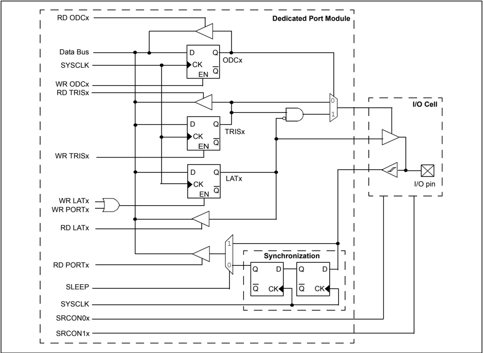
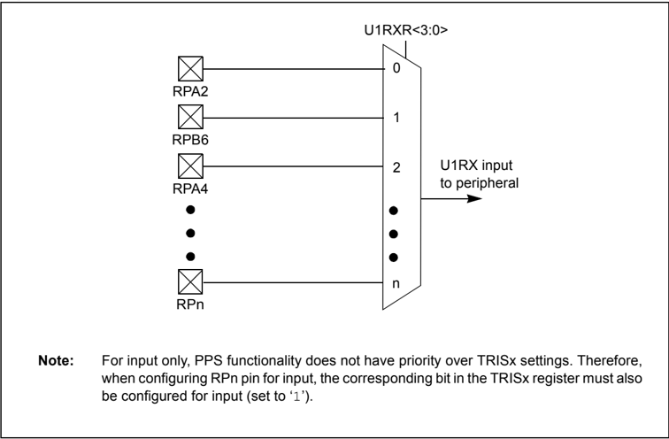
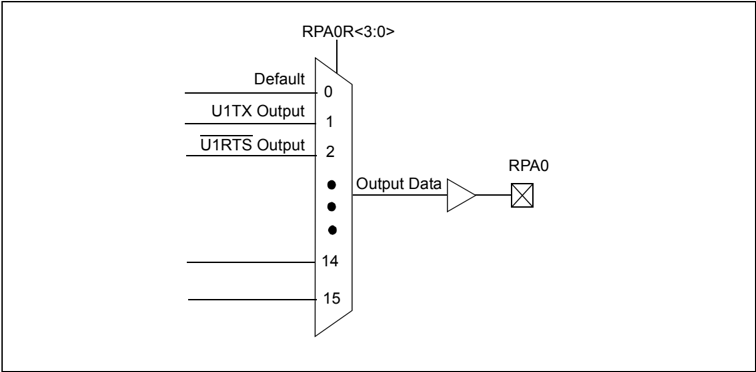
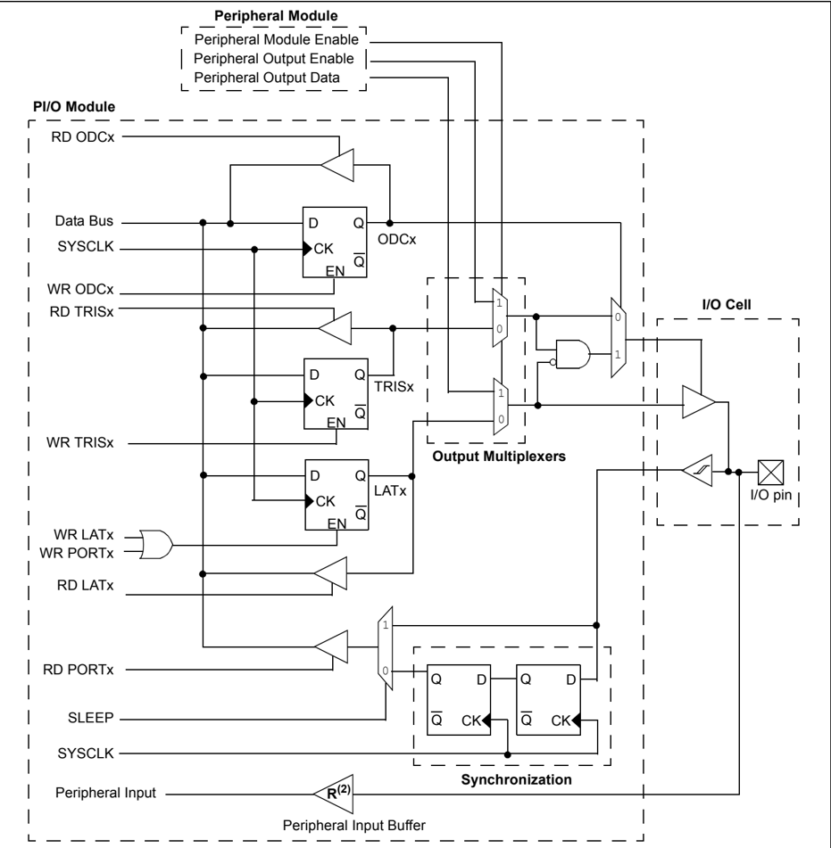
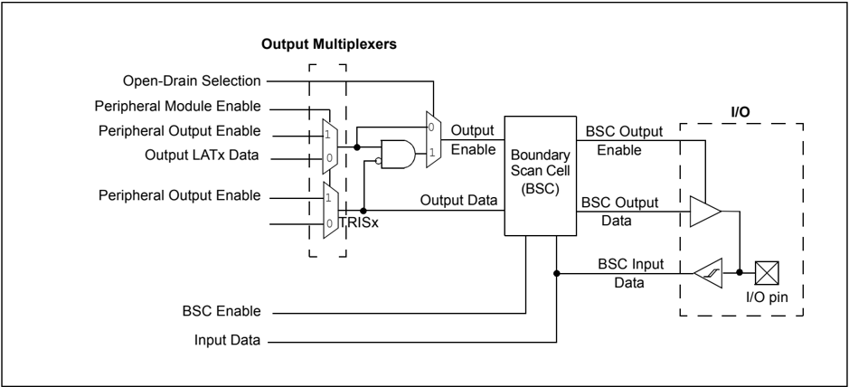

Microchip

## HIGHLIGHTS

## Section 12. I/O Ports

|   This section of the manual contains the following | topics:                                                                                                                        | 12    |
|-----------------------------------------------------|--------------------------------------------------------------------------------------------------------------------------------|-------|
|                                                12.1 | Introduction..............................................................................................................12-2 | I/O   |
|                                                12.2 | Control Registers.....................................................................................................12-3     |       |
|                                                12.3 | Modes of Operation .................................................................................................12-8       |       |
|                                                12.4 | Operation in Power-Saving Modes........................................................................12-17                   |       |
|                                                12.5 | Effects of Various Resets.......................................................................................12-17          | Ports |
|                                                12.6 | Related Application Notes .....................................................................................12-18           |       |
|                                                12.7 | Revision History.....................................................................................................12-19     |       |

Note: This family reference manual section is meant to serve as a complement to device data sheets. Depending on the device variant, this manual section may not apply to all PIC32 devices.

Please consult the note at the beginning of the 'I/O Ports' chapter in the current device  data sheet to  check  whether this document supports the device you are using.

Device  data  sheets  and  family  reference  manual  sections  are  available  for download from the Microchip Worldwide Web site at: http://www.microchip.com

## 12.1 INTRODUCTION

The general purpose I/O pins can be considered the simplest of peripherals. These I/O pins allow the PIC32 microcontroller to monitor and control other devices. To add flexibility and functionality to a device, some pins are multiplexed with alternate function(s). These functions depend on which peripheral features are on the device. In general, when a peripheral is functioning, that pin may not be used as a general purpose I/O pin.

Following are some of the key features of the I/O Ports module:

- Individual output pin open-drain enable/disable
- Individual input pin pull-up enable/disable
- Monitor select inputs and generate interrupt on a mismatch condition
- Operate during Sleep and Idle modes
- Fast bit manipulation using CLR, SET, and INV registers (not available on all devices)
- Slew Rate Control (not available on all devices)

A block diagram of a typical I/O port structure is shown in Figure 12-1. The diagram depicts the many peripheral functions that can be multiplexed onto the I/O pin.

Figure 12-1: Typical Port Structure Block Diagram

## 12.2 CONTROL REGISTERS

Note: Not all registers and associated bits are available on all devices. Refer to the 'I/O Ports' chapter in the specific device data sheet to determine availability.

Before reading and writing any I/O port, the desired pin or pins should be properly configured for the application. Each I/O port has nine registers directly associated with the operation of the port and one control register. Each I/O port pin has a corresponding bit in these registers. Throughout this section, the letter 'x', denotes any or all Port module instances. For example, TRISx would represent TRISA, TRISB, TRISC, and so on. Any bit and its associated data and control registers that is not valid for a particular device will be disabled and will read as zeros.

For additional information on the registers in this section, refer to the 'I/O Ports' chapter in the specific device data sheet.

## 12.2.1 Registers for Configuring Tri-state Functions (TRISx)

The TRISx registers configure the data direction flow through port I/O pins. The TRISx register bits determine whether a PORTx I/O pin is an input or an output:

- If a data direction bit is ' 1 ', the corresponding I/O port pin is an input
- If a data direction bit is ' 0 ', the corresponding I/O port pin is an output
- A read from a TRISx register reads the last value written to that register
- All I/O port pins are defined as inputs after a Power-on Reset (POR)

## 12.2.2 Registers for Configuring PORT Functions (PORTx)

The PORTx registers allow I/O pins to be accessed:

- A write to a PORTx register writes to the corresponding LATx register (PORTx data latch). Those I/O port pin(s) configured as outputs are updated.
- A write to a PORTx register is the effectively the same as a write to a LATx register
- A read from a PORTx register reads the synchronized signal applied to the port I/O pins

## 12.2.3 Registers for Configuring Latch Functions (LATx)

The LATx registers (PORTx data latch) hold data written to port I/O pins:

- A write to a LATx register latches data to corresponding port I/O pins. Those I/O port pins configured as outputs are updated.
- A read from LATx register reads the data held in the PORTx data latch, not from the port I/O pins

## 12.2.4 Registers for Open-Drain Configuration (ODCx)

Each I/O pin can be individually configured for either normal digital output or open-drain output. This is controlled by the Open-Drain Control register, ODCx, associated with each I/O pin. If the ODCx bit for an I/O pin is a ' 1 ', the pin acts as an open-drain output. If the ODCx bit for an I/O pin is a ' 0 ', the pin is configured for a normal digital output (the ODCx bit is valid only for output pins). After a Reset, the status of all the bits of the ODCx register is set to ' 0 '.

The Open-Drain feature allows the generation of outputs higher than VDD (for example, 5V) on any  desired  5V-tolerant   pins  by  using  external  pull-up  resistors.  The  maximum  open-drain voltage allowed is the same as the maximum VIH specification. The ODCx register setting takes effect in all of the I/O modes, allowing the output to behave as an open-drain even if a peripheral is  controlling  the  pin.  Although  the  user  could  achieve  the  same  effect  by  manipulating  the corresponding LATx and TRISx bits, this procedure will not allow the peripheral to operate in Open-Drain mode (except for the default operation of the I 2 C™ pins). Since I 2 C pins are already open-drain pins, the ODCx settings do not affect the I 2 C pins. Also, the ODCx settings do not affect the JTAG output characteristics as the JTAG scan cells are inserted between the ODCx logic and the I/O.

## 12.2.5 Registers for Configuring Analog and Digital Port Pins (ANSELx)

The ANSELx (or AD1PCFG) register controls the operation of the analog port pins. The port  pins that are to function as analog inputs must have their corresponding ANSEL and TRISx bits set (or AD1PCFG cleared). To use port pins for I/O functionality with digital modules such as Timers, UARTs, etc., the corresponding ANSELx bit must be cleared (or the corresponding AD1PCFG bit must be set).

The ANSELx register has a default value of 0xFFFF (or 0x0000 for AD1PCFG); therefore, all pins that share analog functions are by default analog and not digital.

If the TRISx bit is cleared (output) while the ANSELx bit is set (or the AD1PCFG bit is cleared), the digital output level (VOH or VOL) is converted by an analog peripheral,  such as the ADC module or the Comparator module.

When the PORTx register is read, all pins configured as analog input channels are read as cleared (a low-level).

Pins configured as digital inputs do not convert an analog input. Analog levels on any pin defined as a digital input (including the ANx pins) can cause the input buffer to consume current that exceeds the device specifications.

## 12.2.6 Registers for Input Change Notification (CN)

The input Change Notification (CN) function of the I/O ports allows PIC32 devices to generate interrupt requests to the processor in response to a change-of-state on selected input pins. This feature can detect input change-of-states even in Sleep mode, when the clocks are disabled.

The following control registers are associated with the CN functionality of each I/O port:

- Change Notice Pull-up Enable (CNPUEx)
- Change Notice Pull-down Enable (CNPDx)
- Change Notice Control (CNCONx) (Register 12-1)
- Change Notice Enable (CNENx/CNNEx)
- Change Notice Status (CNSTATx/CNFx) or the positive edge control

Each I/O pin also has a weak pull-up and a weak pull-down connected to it. The pull-ups act as a current source or sink source connected to the pin, and eliminate the need for external resistors  when  pushbutton  or  keypad  devices  are  connected.  The  pull-ups  and  pull-downs are  enabled  separately  using  the  CNPUEx  and  the  CNPDx  registers,  which  contain  the control  bits  for  each  of  the  pins.  Setting  any  of  the  control  bits  enables  the  weak  pull-ups and/or pull-downs for the corresponding pins.

Note: Pull-ups and pull-downs on Change Notification pins should always be disabled when the port pin is configured as a digital output.

The CNCONx registers provide change notice control.

The CNENx/CNNEx registers contain the CN interrupt enable control bits for each of the input pins. Setting any of these bits enables a CN interrupt for the corresponding pins. CNENx enables a mismatch CN interrupt condition when EDGEDETECT is not set. When EDGEDETECT is set, CNNEx controls the negative edge while CNENx controls the positive. On devices that do not have EDGEDETECT, this CN logic acts as if EDGEDETECT is not set.

The CNSTATx/CNFx registers indicate whether a change occurred on the corresponding pin since  the  last  read  of  the  PORTx  bit.  The  CNFx  registers  indicate  the  type  of  change  that occurred.

## Register 12-1: CNCONx: Change Notice Control Register

| Bit Range   | Bit 31/23/15/7   | Bit 30/22/14/6   | Bit 29/21/13/5   | Bit 28/20/12/4   | Bit 27/19/11/3   | Bit 26/18/10/2   | Bit 25/17/9/1   | Bit 24/16/8/0   |
|-------------|------------------|------------------|------------------|------------------|------------------|------------------|-----------------|-----------------|
| 31:24       | U-0              | U-0              | U-0              | U-0              | U-0              | U-0              | U-0             | U-0             |
| 31:24       | -                | -                | -                | -                | -                | -                | -               | -               |
| 23:16       | U-0              | U-0              | U-0              | U-0              | U-0              | U-0              | U-0             | U-0             |
| 23:16       | -                | -                | -                | -                | -                | -                | -               | -               |
| 15:8        | R/W-0            | U-0              | R/W-0            | U-0              | R/W-0            | U-0              | U-0             | U-0             |
| 15:8        | ON               | -                | SIDL             | -                | EDGEDETECT       | -                | -               | -               |
| 7:0         | U-0              | U-0              | U-0              | U-0              | U-0              | U-0              | U-0             | U-0             |
| 7:0         | -                | -                | -                | -                | -                | -                | -               | -               |

## Legend:

R = Readable bit

W = Writable bit

U = Unimplemented bit, read as '0'

-n = Value at POR

'1' = Bit is set

'0' = Bit is cleared

x = Bit is unknown

bit 31-16 Unimplemented:

Read as ' 0 '

bit 15

ON: Change Notice (CN) Control ON bit

1 = CN is enabled

0 = CN is disabled

bit 14

Unimplemented: Read as ' 0 '

bit 13

SIDL: Stop in Idle Control bit

1 = CPU Idle Mode halts CN operation

0 = CPU Idle does not affect CN operation

bit 12-0

Unimplemented: Read as ' 0 '

bit 11

EDGEDETECT: Edge Detection Type Control bit

1 = Detects any edge on the pin (CNFx is used for the CN event)

0 = Detects any edge on the pin (CNSTATx is used for the CN event)

bit 10-0 Unimplemented: Read as ' 0 '

## 12.2.7 Registers for Peripheral Pin Select

The Peripheral  Pin  Select  [ pin name ]R register  (Register 12-2)  and  the  Peripheral  Pin  Select Output (RPnR) register (Register 12-3) provide the control bits for peripheral pin select input and output. See 12.3.1.4 'Input Mapping' and 12.3.1.5 'Output Mapping' for detailed information on configuring these registers.

Register 12-2: [ pin name ]R: Peripheral Pin Select Input Register

| Bit Range   | Bit 31/23/15/7   | Bit 30/22/14/6   | Bit 29/21/13/5   | Bit 28/20/12/4   | Bit 27/19/11/3     | Bit 26/18/10/2     | Bit 25/17/9/1      | Bit 24/16/8/0      |
|-------------|------------------|------------------|------------------|------------------|--------------------|--------------------|--------------------|--------------------|
| 31:24       | U-0              | U-0              | U-0              | U-0              | U-0                | U-0                | U-0                | U-0                |
| 31:24       | -                | -                | -                | -                | -                  | -                  | -                  | -                  |
| 23:16       | U-0              | U-0              | U-0              | U-0              | U-0                | U-0                | U-0                | U-0                |
| 23:16       | -                | -                | -                | -                | -                  | -                  | -                  | -                  |
| 15:8        | U-0              | U-0              | U-0              | U-0              | U-0                | U-0                | U-0                | U-0                |
| 15:8        | -                | -                | -                | -                | -                  | -                  | -                  | -                  |
| 7:0         | U-0              | U-0              | U-0              | U-0              | R/W-0              | R/W-0              | R/W-0              | R/W-0              |
| 7:0         | -                | -                | -                | -                | [ pin name ]R<3:0> | [ pin name ]R<3:0> | [ pin name ]R<3:0> | [ pin name ]R<3:0> |

## Legend:

R = Readable bit

W = Writable bit

U = Unimplemented bit, read as '0'

-n = Value at POR

'1' = Bit is set

'0' = Bit is cleared

x = Bit is unknown

bit 31-4 Unimplemented: Read as ' 0 '

bit 3-0

[ pin name ]R&lt;3:0&gt;: Peripheral Pin Select Input bits

Where [ pin name ] refers to the pins that are used to configure peripheral input mapping. See Table 12-2 for input pin selection values.

Note: Values in this register can only be changed if the IOLOCK Configuration bit (CFGCON&lt;13&gt;) = 0 .

Register 12-3: RPnR: Peripheral Pin Select Output Register

| Bit Range   | Bit 31/23/15/7   | Bit 30/22/14/6   | Bit 29/21/13/5   | Bit 28/20/12/4   | Bit 27/19/11/3   | Bit 26/18/10/2   | Bit 25/17/9/1   | Bit 24/16/8/0   |
|-------------|------------------|------------------|------------------|------------------|------------------|------------------|-----------------|-----------------|
| 31:24       | U-0              | U-0              | U-0              | U-0              | U-0              | U-0              | U-0             | U-0             |
| 31:24       | -                | -                | -                | -                | -                | -                | -               | -               |
| 23:16       | U-0              | U-0              | U-0              | U-0              | U-0              | U-0              | U-0             | U-0             |
| 23:16       | -                | -                | -                | -                | -                | -                | -               | -               |
| 15:8        | U-0              | U-0              | U-0              | U-0              | U-0              | U-0              | U-0             | U-0             |
| 15:8        | -                | -                | -                | -                | -                | -                | -               | -               |
| 7:0         | U-0              | U-0              | U-0              | U-0              | R/W-0            | R/W-0            | R/W-0           | R/W-0           |
| 7:0         | -                | -                | -                | -                | RPnR<3:0>        | RPnR<3:0>        | RPnR<3:0>       | RPnR<3:0>       |

## Legend:

R = Readable bit

W = Writable bit

U = Unimplemented bit, read as '0'

-n = Value at POR

'1' = Bit is set

'0' = Bit is cleared

x = Bit is unknown

bit 31-4 Unimplemented: Read as ' 0 '

bit 3-0

RPnR&lt;3:0&gt;: Peripheral Pin Select Output bits

See Table 12-3 for output pin selection values.

Note:

Values in this register can only be changed if the IOLOCK Configuration bit (CFGCON&lt;13&gt;) = 1 .

## 12.2.8 Set, Clear, and Invert I/O Port Registers

Note: The Set, Clear, and Invert registers (i.e., SET, CLR, and INV) are available for all modules and their  registers,  unless  otherwise  noted  in  the  specific  device  data sheet.

Every I/O module register has a corresponding SET, CLR, and INV register, which provide atomic bit manipulations. As the name of the register implies, a value written to a SET, CLR, or INV register effectively performs the implied operation, but only on the corresponding base register and only bits specified as ' 1 ' are modified. Bits specified as ' 0 ' are not modified.

- Writing 0x0001 to TRISASET register sets only bit 0 in the base register TRISA
- Writing 0x0020 to PORTDCLR register clears only bit 5 in the base register PORTD
- Writing 0x9000 to LATCINV register inverts only bits 15 and 12 in the base register LATC

Reading SET, CLR, and INV registers returns an undefined value. To see the affects of a write operation to a SET, CLR, or INV register, the base register must be read instead.

A typical method to toggle an I/O pin requires a read-modify-write operation performed on a PORTx register in software. For example, a read from a PORTx register, mask and modify the desired output bit or bits, and write the resulting value back to the PORTx register. This method is vulnerable to a read-modify-write issue where the port value may change after it is read and before the modified data can be written back, thus changing the previous state. This method also requires more instructions.

<!-- formula-not-decoded -->

A more efficient  and atomic method uses the PORTxINV register. A write to the PORTxINV register effectively performs a read-modify-write operation on the target base register, equivalent to the software operation described previously; however, it is done in hardware. To toggle an I/O pin using this method, a ' 1 ' is written to the corresponding bit in the PORTxINV register. This operation  will  read  the  PORTx  register,  invert  only  those  bits  specified  as  ' 1 ',  and  write  the resulting value to the LATx register, thus toggling the corresponding I/O pins all in a single atomic instruction cycle.

PORTAINV = 0x0001;

## 12.2.9 Registers for Slew Rate Control

Note: The slew rate control  is  not  available  on  Port  pins  for  all  devices.  Refer  to  the 'I/O Ports' chapter in the specific device data sheet to determine availability.

Each I/O pin can be configured for various types of slew rate control on its associated port. This is controlled by the Slew Rate Control bits in the SRCON1x and SRCON0x registers that are associated with each I/O port. The slew rate control is configured using the corresponding bit in each register, as shown in Table 12-1.

As an example, writing 0x0001, 0x0000 to SRCON1A and SRCON0A, respectively, will enable slew rate control on the RA0 pin and sets the slew rate to the slow edge rate.

Table 12-1: Slew Rate Control Bit Settings

|   SRCON1x |   SRCON0x | Description                                                        |
|-----------|-----------|--------------------------------------------------------------------|
|         1 |         1 | Slew rate control is enabled and is set to the slowest edge rate.  |
|         1 |         0 | Slew rate control is enabled and is set to the slow edge rate.     |
|         0 |         1 | Slew rate control is enabled and is set to the fast edge rate.     |
|         0 |         0 | Slew rate control is disabled and is set to the fastest edge rate. |

Note: By default, all of the Port pins are set to the fastest edge rate.

## 12.3 MODES OF OPERATION

## 12.3.1 Peripheral Pin Select (PPS)

A major challenge in general purpose devices is providing the largest possible set of peripheral features while minimizing the conflict of features on I/O pins. The challenge is even greater on low pin-count devices. In an application where more than one peripheral needs to be assigned to a single pin, inconvenient work arounds in application code or a complete redesign may be the only option.

Peripheral Pin Select (PPS) configuration provides an alternative to these choices by enabling peripheral set selection and their placement on a wide range of I/O pins. By increasing the pinout options available on a particular device, users can tailor the device to their entire application, rather than trimming the application to fit the device.

The PPS configuration feature operates over a fixed subset of digital I/O pins. Users may independently map the input and/or output of most digital peripherals to these I/O pins. PPS is performed in software and generally does not require the device to be reprogrammed. Hardware safeguards are included that prevent accidental or spurious changes to the peripheral mapping once it has been established.

## 12.3.1.1 AVAILABLE PINS

The number of available pins is dependent on the particular device and its pin count. Pins that support the PPS feature include the designation 'RPn' in their full pin designation, where 'RP' designates a remappable peripheral and 'n' is the remappable port number.

Note: Refer to the 'I/O  Ports' chapter  in  the  specific  device  data  sheet  to  determine availability.

## 12.3.1.2 AVAILABLE PERIPHERALS

The peripherals managed by the PPS are all digital-only peripherals. These include general serial  communications  (UART  and  SPI),  general  purpose  timer  clock  inputs,  timer-related peripherals (Input Capture and Output Compare) and interrupt-on-change inputs.

In comparison, some digital-only peripheral modules are never included in the PPS feature. This is because the peripheral's function requires special I/O circuitry on a specific port and cannot be easily  connected  to  multiple  pins.  These  modules  include  I 2 C  among  others.  A  similar requirement excludes all modules with analog inputs, such as the ADC.

A  key  difference  between  remappable  and  non-remappable  peripherals  is  that  remappable peripherals are not associated with a default I/O pin. The peripheral must always be assigned to a specific I/O pin before it can be used. In contrast, non-remappable peripherals are always available on a default pin, assuming that the peripheral is active and not conflicting with another peripheral.

When a remappable peripheral is active on a given I/O pin, it takes priority over all other digital I/O and digital communication peripherals associated with the pin. Priority is given regardless of the  type  of  peripheral  that  is  mapped.  Remappable  peripherals  never  take  priority  over  any analog functions associated with the pin.

## 12.3.1.3 CONTROLLING PPS

PPS features are controlled through two sets of Special Function Registers (SFRs): one to map peripheral inputs, and one to map outputs. Because they are separately controlled, a particular peripheral's input and output (if the peripheral has both) can be placed on any selectable function pin without constraint.

The association of a peripheral to a peripheral-selectable pin is handled in two different ways, depending on whether an input or output is being mapped.

## 12.3.1.4 INPUT MAPPING

The inputs of the PPS options are mapped on the basis of the peripheral. That is, a control register associated with a peripheral dictates the pin it will be mapped to. The [ pin name ] R registers, where [ pin name ] refers to the peripheral pins listed in Table 12-2, are used to configure peripheral input mapping (see Register 12-2). Each register contains a set of four bit fields. Programming these bit  fields  with  an  appropriate  value,  maps  the  RPn  pin  with  the  corresponding  value  to  that peripheral. Table 12-2 provides an example of the valid range of values for any bit field.

Note: Refer to the 'I/O Ports' chapter in the specific device data sheet for the available input pin selections.

For example, Figure 12-2 illustrates the remappable pin selection for the U1RX input.

Figure 12-2: Remappable Input Example for U1RX

Table 12-2: Input Pin Selection

| Peripheral Pin   | [ pin name ]R SFR   | [ pin name ]R bits   | [ pin name ]R Value to RPn Pin Selection   |
|------------------|---------------------|----------------------|--------------------------------------------|
| INT4             | INT4R               | INT4R<3:0>           | 0000 = RPA0 0001 = RPB3                    |
| T2CK             | T2CKR               | T2CKR<3:0>           | 0010 = RPB4 0011 = RPB15 0100 = RPB7       |
| IC4              | IC4R                | IC4R<3:0>            | 0101 = RPC7 0110 = RPC0 0111 = RPC5        |
| SS1              | SS1R                | SS1R<3:0>            | 1000 = Reserved • •                        |
| REFCLKI          | REFCLKIR            | REFCLKIR<3:0>        | • 1111 = Reserved                          |
| INT3             | INT3R               | INT3R<3:0>           | 0000 = RPA1 0001 = RPB5                    |
| T3CK             | T3CKR               | T3CKR<3:0>           | 0010 = RPB1 0011 = RPB11                   |
| IC3              | IC3R                | IC3R<3:0>            | 0100 = RPB8 0101 = RPA8 0110 = RPC8        |
| U1CTS            | U1CTSR              | U1CTSR<3:0>          | 0111 = RPA9 1000 = Reserved                |
| U2RX             | U2RXR               | U2RXR<3:0>           | • •                                        |
| SDI1             | SDI1R               | SDI1R<3:0>           | • 1111 = Reserved                          |
| INT2             | INT2R               | INT2R<3:0>           | 0000 = RPA2 0001 = RPB6                    |
| T4CK             | T4CKR               | T4CKR<3:0>           | 0010 = RPA4                                |
| IC1              | IC1R                | IC1R<3:0>            | 0011 = RPB13 0100 = RPB2                   |
| IC5              | IC5R                | IC5R<3:0>            | 0101 = RPC6 = RPC1                         |
| U1RX             | U1RXR               | U1RXR<3:0>           | 0110 0111 = RPC3                           |
| U2CTS            | U2CTSR              | U2CTSR<3:0>          | 1000 = Reserved •                          |
| SDI2             | SDI2R               | SDI2R<3:0>           | •                                          |
| OCFB             | OCFBR               | OCFBR<3:0>           | 1111 = Reserved                            |
| INT1             | INT1R               | INT1R<3:0>           | 0000 = RPA3 0001 = RPB14                   |
| T5CK             | T5CKR               | T5CKR<3:0>           | 0010 = RPB0 0011 = RPB10 0100 = RPB9       |
| IC2              | IC2R                | IC2R<3:0>            | 0101 = RPC9 0110 = RPC2 0111 = RPC4        |
| SS2              | SS2R                | SS2R<3:0>            | 1000 = Reserved •                          |
| OCFA             | OCFAR               | OCFAR<3:0>           | • 1111 = Reserved                          |

Note: This table provides an example of input pin selection. Refer to the 'I/O Ports' chapter the specific device data sheet for available selections.

## 12.3.1.5 OUTPUT MAPPING

In  contrast to inputs, the outputs of the PPS options are mapped on the basis of the pin. In this  case,  a  control  register  associated  with  a  particular  pin  dictates  the  peripheral  output  to be  mapped.  The  RPnR  registers  (see  Register 12-3)  are  used  to  control  output  mapping. Like the [ pin name ]R registers, each register contains a set of four bit fields. The value of the bit field corresponds to one of the peripherals, and that peripheral's output is mapped to the pin (see Table 12-3 and Figure 12-3).

A null output is associated with the output register Reset value of ' 0 '. This is done to ensure that remappable outputs remain disconnected from all output pins by default.

Figure 12-3: Example of Multiplexing of Remappable Output for RPA0

## 12.3.1.6 CONTROLLING CONFIGURATION CHANGES

Because peripheral remapping can be changed during run-time, some restrictions on peripheral remapping are needed to prevent accidental configuration changes. PIC32 devices include two features to prevent alterations to the peripheral map:

- Control register lock sequence
- Configuration bit select lock

## 12.3.1.6.1 Control Register Lock

Under  normal  operation,  writes  to  the  RPnR  and  [ pin  name ]R  registers  are  not  allowed. Attempted  writes  appear  to  execute  normally,  but  the  contents  of  the  registers  remain unchanged. To change these registers, they must be unlocked in hardware. The register lock is  controlled  by  the  IOLOCK  Configuration  bit  (CFGCON&lt;13&gt;).  Setting  the  IOLOCK  bit prevents writes to the control registers; whereas clearing the IOLOCK bit allows writes.

To set or clear the IOLOCK bit, an unlock sequence must be executed. Refer to Section 6. 'Oscillator' (DS60001112) in the 'PIC32 Family Reference Manual' for details.

## 12.3.1.6.2 Configuration Bit Select Lock

As an additional level of safety, the device can be configured to prevent more than one write session to the RPnR and [ pin name ]R registers. The IOL1WAY Configuration bit (DEVCFG3&lt;29&gt;) blocks the IOLOCK bit from being cleared after it has been set once. If the IOLOCK bit remains set, the register unlock procedure does not execute, and the PPS control registers cannot be written to. The only way to clear the bit and re-enable peripheral remapping is to perform a device Reset.

In  the  default  (unprogrammed)  state,  the  IOL1WAY  bit  is  set,  restricting  users  to  one  write session.

Table 12-3: Output Pin Selection

| RPn Port Pin   | RPnR SFR   | RPnR bits   | RPnR Value to Peripheral                                                                                                                                                                                                           |
|----------------|------------|-------------|------------------------------------------------------------------------------------------------------------------------------------------------------------------------------------------------------------------------------------|
| RPA0           | RPA0R      | RPA0R<3:0>  | Selection 0000 = No Connect 0001 = U1TX 0010 = U2RTS 0011 = SS1 0100 = Reserved 0101 = OC1 0110 = Reserved 0111 = C2OUT 1000 = Reserved • • • 1111 = Reserved 0000 = No Connect 0001 = Reserved 0010 = Reserved 0011 = SDO1 = SDO2 |
| RPB3           | RPB3R      | RPB3R<3:0>  | Selection 0000 = No Connect 0001 = U1TX 0010 = U2RTS 0011 = SS1 0100 = Reserved 0101 = OC1 0110 = Reserved 0111 = C2OUT 1000 = Reserved • • • 1111 = Reserved 0000 = No Connect 0001 = Reserved 0010 = Reserved 0011 = SDO1 = SDO2 |
| RPB4           | RPB4R      | RPB4R<3:0>  | Selection 0000 = No Connect 0001 = U1TX 0010 = U2RTS 0011 = SS1 0100 = Reserved 0101 = OC1 0110 = Reserved 0111 = C2OUT 1000 = Reserved • • • 1111 = Reserved 0000 = No Connect 0001 = Reserved 0010 = Reserved 0011 = SDO1 = SDO2 |
| RPB15          | RPB15R     | RPB15R<3:0> | Selection 0000 = No Connect 0001 = U1TX 0010 = U2RTS 0011 = SS1 0100 = Reserved 0101 = OC1 0110 = Reserved 0111 = C2OUT 1000 = Reserved • • • 1111 = Reserved 0000 = No Connect 0001 = Reserved 0010 = Reserved 0011 = SDO1 = SDO2 |
| RPB7           | RPB7R      | RPB7R<3:0>  | Selection 0000 = No Connect 0001 = U1TX 0010 = U2RTS 0011 = SS1 0100 = Reserved 0101 = OC1 0110 = Reserved 0111 = C2OUT 1000 = Reserved • • • 1111 = Reserved 0000 = No Connect 0001 = Reserved 0010 = Reserved 0011 = SDO1 = SDO2 |
| RPC7           | RPC7R      | RPC7R<3:0>  | Selection 0000 = No Connect 0001 = U1TX 0010 = U2RTS 0011 = SS1 0100 = Reserved 0101 = OC1 0110 = Reserved 0111 = C2OUT 1000 = Reserved • • • 1111 = Reserved 0000 = No Connect 0001 = Reserved 0010 = Reserved 0011 = SDO1 = SDO2 |
| RPC0           | RPC0R      | RPC0R<3:0>  | Selection 0000 = No Connect 0001 = U1TX 0010 = U2RTS 0011 = SS1 0100 = Reserved 0101 = OC1 0110 = Reserved 0111 = C2OUT 1000 = Reserved • • • 1111 = Reserved 0000 = No Connect 0001 = Reserved 0010 = Reserved 0011 = SDO1 = SDO2 |
| RPC5           | RPC5R      | RPC5R<3:0>  | Selection 0000 = No Connect 0001 = U1TX 0010 = U2RTS 0011 = SS1 0100 = Reserved 0101 = OC1 0110 = Reserved 0111 = C2OUT 1000 = Reserved • • • 1111 = Reserved 0000 = No Connect 0001 = Reserved 0010 = Reserved 0011 = SDO1 = SDO2 |
| RPA1           | RPA1R      | RPA1R<3:0>  |                                                                                                                                                                                                                                    |
| RPB5           | RPB5R      | RPB5R<3:0>  |                                                                                                                                                                                                                                    |
| RPB1           | RPB1R      | RPB1R<3:0>  |                                                                                                                                                                                                                                    |
| RPB11          | RPB11R     | RPB11R<3:0> | 0100 = OC2                                                                                                                                                                                                                         |
| RPB8           | RPB8R      | RPB8R<3:0>  | 0101 0110 = Reserved                                                                                                                                                                                                               |
| RPA8           | RPA8R      | RPA8R<3:0>  | •                                                                                                                                                                                                                                  |
| RPC8           | RPC8R      | RPC8R<3:0>  | • •                                                                                                                                                                                                                                |
| RPA9           | RPA9R      | RPA9R<3:0>  |                                                                                                                                                                                                                                    |
| RPA2           | RPA2R      | RPA2R<3:0>  | 1111 = Reserved 0000 = No Connect 0001 = Reserved 0010 = Reserved 0011 = SDO1 0100 = SDO2 0101 = OC4 0110 = OC5 0111 = REFCLKO 1000 = Reserved • • • 1111 = Reserved 0000 = No Connect 0001 = U1RTS 0010 = U2TX 0011 = Reserved    |
| RPB6           | RPB6R      | RPB6R<3:0>  | 1111 = Reserved 0000 = No Connect 0001 = Reserved 0010 = Reserved 0011 = SDO1 0100 = SDO2 0101 = OC4 0110 = OC5 0111 = REFCLKO 1000 = Reserved • • • 1111 = Reserved 0000 = No Connect 0001 = U1RTS 0010 = U2TX 0011 = Reserved    |
| RPA4           | RPA4R      | RPA4R<3:0>  | 1111 = Reserved 0000 = No Connect 0001 = Reserved 0010 = Reserved 0011 = SDO1 0100 = SDO2 0101 = OC4 0110 = OC5 0111 = REFCLKO 1000 = Reserved • • • 1111 = Reserved 0000 = No Connect 0001 = U1RTS 0010 = U2TX 0011 = Reserved    |
| RPB13          | RPB13R     | RPB13R<3:0> | 1111 = Reserved 0000 = No Connect 0001 = Reserved 0010 = Reserved 0011 = SDO1 0100 = SDO2 0101 = OC4 0110 = OC5 0111 = REFCLKO 1000 = Reserved • • • 1111 = Reserved 0000 = No Connect 0001 = U1RTS 0010 = U2TX 0011 = Reserved    |
| RPB2           | RPB2R      | RPB2R<3:0>  | 1111 = Reserved 0000 = No Connect 0001 = Reserved 0010 = Reserved 0011 = SDO1 0100 = SDO2 0101 = OC4 0110 = OC5 0111 = REFCLKO 1000 = Reserved • • • 1111 = Reserved 0000 = No Connect 0001 = U1RTS 0010 = U2TX 0011 = Reserved    |
| RPC6           | RPC6R      | RPC6R<3:0>  | 1111 = Reserved 0000 = No Connect 0001 = Reserved 0010 = Reserved 0011 = SDO1 0100 = SDO2 0101 = OC4 0110 = OC5 0111 = REFCLKO 1000 = Reserved • • • 1111 = Reserved 0000 = No Connect 0001 = U1RTS 0010 = U2TX 0011 = Reserved    |
| RPC1           | RPC1R      | RPC1R<3:0>  | 1111 = Reserved 0000 = No Connect 0001 = Reserved 0010 = Reserved 0011 = SDO1 0100 = SDO2 0101 = OC4 0110 = OC5 0111 = REFCLKO 1000 = Reserved • • • 1111 = Reserved 0000 = No Connect 0001 = U1RTS 0010 = U2TX 0011 = Reserved    |
| RPC3           | RPC3R      | RPC3R<3:0>  | 1111 = Reserved 0000 = No Connect 0001 = Reserved 0010 = Reserved 0011 = SDO1 0100 = SDO2 0101 = OC4 0110 = OC5 0111 = REFCLKO 1000 = Reserved • • • 1111 = Reserved 0000 = No Connect 0001 = U1RTS 0010 = U2TX 0011 = Reserved    |
| RPA3           | RPA3R      | RPA3R<3:0>  |                                                                                                                                                                                                                                    |
| RPB14          | RPB14R     | RPB14R<3:0> |                                                                                                                                                                                                                                    |
| RPB0           | RPB0R      | RPB0R<3:0>  |                                                                                                                                                                                                                                    |
| RPB10          | RPB10R     | RPB10R<3:0> | 0100 = SS2 0101 = OC3                                                                                                                                                                                                              |
| RPB9           | RPB9R      | RPB9R<3:0>  | 0110 = Reserved                                                                                                                                                                                                                    |
| RPC9           | RPC9R      | RPC9R<3:0>  | 0111 = C1OUT 1000 = Reserved                                                                                                                                                                                                       |
| RPC2           | RPC2R      | RPC2R<3:0>  | •                                                                                                                                                                                                                                  |
| RPC4           | RPC4R      | RPC4R<3:0>  | • •                                                                                                                                                                                                                                |
| RPC3           | RPC3R      | RPC3R<3:0>  | 1111 = Reserved                                                                                                                                                                                                                    |

Note: This table provides an example of output pin selection. Refer to the 'I/O Ports' chapter in the specific device data sheet for available selections.

## 12.3.2 Peripheral Multiplexing

Many pins also support one or more peripheral modules. When configured to operate with a peripheral, a pin may not be used for general input or output. In many cases, a pin must still be configured  for  input  or  output,  although  some  peripherals  override  the  TRISx  configuration. Figure 12-4 shows how ports are shared with other peripherals, and the associated I/O pin to which  they  are  connected.  For  some  PIC32  devices,  multiple  peripheral  functions  may  be multiplexed on each I/O pin. The priority of the peripheral function depends on the order of the pin descriptions in the specific device data sheet.

Note that the output of a pin can be controlled by the TRISx register bit or, in some cases, by the peripheral itself.

Figure 12-4: Block Diagram of a Typical Shared Port Structure

- Note 1: This block diagram is a general representation of a shared port/peripheral structure and is provided for illustration purposes only. The actual structure for any specific port/peripheral combination may be different than what is depicted in this diagram.
- 2: R = Peripheral input buffer types may vary. Refer to the specific device data sheet for peripheral details.

## 12.3.2.1 MULTIPLEXED DIGITAL INPUT PERIPHERAL

The following conditions are characteristic of a multiplexed digital input peripheral:

- Peripheral does not control the TRISx register. Some peripherals require the pin be configured as an input by setting the corresponding TRISx bit = 1
- Peripheral input path is independent of I/O input path and uses an input buffer that is dependent on the peripheral
- PORTx register data input path is not affected and is able to read the pin value

## 12.3.2.2 MULTIPLEXING DIGITAL OUTPUT PERIPHERAL

The following conditions are characteristic of a multiplexed digital output peripheral:

- Peripheral controls the output data. Some peripherals require the pin be configured as an output by setting the corresponding TRISx bit = 0
- If a peripheral pin has an automatic tri-state feature (e.g., PWM outputs), the peripheral has the ability to tri-state the pin
- Pin output driver type could be affected by peripheral (e.g., drive strength, slew rate, etc.)
- PORTx register output data has no effect

## 12.3.2.3 MULTIPLEXING DIGITAL BIDIRECTIONAL PERIPHERAL

The following conditions are characteristic of a multiplexed digital bidirectional peripheral:

- Peripheral automatically configures the pin as an output, but not as an input. Some peripherals require the pin be configured as an input by setting the corresponding TRISx bit = 1
- Peripherals control output data
- Pin output driver type could be affected by peripheral (e.g., drive strength, slew rate, etc.)
- PORTx register data input path is not affected and is able to read the pin value
- PORTx register output data has no effect

## 12.3.2.4 MULTIPLEXING ANALOG INPUT PERIPHERAL

The following condition is characteristic of a multiplexed analog input peripheral:

All  digital  port  input  buffers  are  disabled  and  PORTx  registers  read  ' 0 '  to  prevent  'crowbar' current.

## 12.3.2.5 MULTIPLEXING ANALOG OUTPUT PERIPHERAL

The following conditions are characteristic of a multiplexed analog output peripheral:

- All digital port input buffers are disabled and PORTx registers read ' 0 ' to prevent crowbar current
- Analog output is driven onto the pin independent of the associated TRISx setting

Note:

To  use  pins  that  are  multiplexed  with  the  ADC  module  for  digital  I/O,  the corresponding bits in the AD1PCFG register, if present, must be set to ' 1 ', even if the ADC module is turned OFF.

## 12.3.2.6 SOFTWARE INPUT PIN CONTROL

Some of the functions assigned to an I/O pin may be input functions that do not take control of the pin output driver. An example of one such peripheral is the Input Capture module. If the I/O pin  associated  with  the  input  capture  is  configured  as  an  output,  using  the  appropriate TRISx control bit, the  user can manually  affect  the  state of the  input  capture pin  through its corresponding  LATx  register.  This  behavior  can  be  useful  in  some  situations,  especially  for testing purposes, when no external signal is connected to the input pin.

As shown previously in Figure 12-4, the organization of the peripheral multiplexers determines whether the peripheral input pin can be manipulated in software using the PORTx register. The conceptual peripherals shown in this figure disconnect the PORTx data from the I/O pin when the peripheral function is enabled.

In general, the following peripherals allow their input pins to be controlled manually through the LATx registers:

- External Interrupts pins
- Input Capture pins
- Timer Clock input pins
- PWM Fault pins

Most serial communication peripherals, when enabled, take full control of the I/O pin so that the input pins associated with the peripheral cannot be affected through the corresponding PORTx registers. These peripherals include the following modules:

- SPI
- I 2 C
- UART

## 12.3.3 Change Notice (CN) Pins

The CN pins provide PIC32 devices the ability to generate interrupt requests to the processor in response to a change of state on selected input pins (corresponding TRISx bits must be = 1 ). The total number of available CN inputs is dependent on the selected PIC32 device. Refer to the 'I/O Ports' chapter in the specific device data sheet for further details.

The enabled pin values are compared with the values sampled during the last read operation of the designated PORTx register. If the pin value is different from the last value read, a mismatch condition is generated. The mismatch condition can occur on any of the enabled input pins. The mismatches are 'ORed' together to provide a single interrupt-on-change signal. The enabled pins are sampled on every internal system clock cycle, SYSCLK.

## 12.3.3.1 CN CONFIGURATION AND OPERATION

The CN pins are configured as follows:

1. Disable CPU interrupts.
2. Set the desired CN I/O pin as an input by setting the corresponding TRISx register bits = 1 .

Note: If the I/O pin is shared with an analog peripheral, it may be necessary to configure this pin as digital input.

3. Enable the CN Module by setting the ON bit (CNCONx&lt;15&gt;) = 1 .
4. Enable individual CN input pins, enable optional pull-ups or pull-downs.
5. Read the corresponding PORTx registers to clear the CN interrupt.
6. Configure the CN Interrupt Priority bits, CNIP&lt;2:0&gt; (IPC6&lt;20:18&gt;), and Sub-priority bits, CNIS&lt;1:0&gt; (IPC6&lt;17:16&gt;).
7. Clear the CN Interrupt Flag bit, by setting the CNIF bit (IFS1&lt;0&gt;) = 0 .
8. Configure the CN pin interrupt for a specific edge detect using the EDGEDETECT bit in the CNCONx register, and set up edge control using the CNENx/CNNEx bits.
9. Enable the CN Interrupt Enable bit, by setting the CNIE bit (IEC1&lt;0&gt;) = 1 .
10. Enable CPU interrupts.

The CNSTATx/CNFx registers indicate whether a change occurred on the corresponding pin since the last read of the PORTx bit. The CNFx registers indicate which type. When a CN interrupt occurs in Mismatch mode, the user should read the PORTx register associated with the CN pins. This will clear the mismatch condition and set up the CN logic to detect the next pin change. The current PORTx value can be compared to the PORTx read value obtained at the last CN interrupt or during initialization, and used to determine which pin is changed. In Edge Detect mode, a CN interrupt can be controlled to occur only during a rising or falling edge condition on a pin. The CN pins have a minimum input pulse-width specification. Refer to the 'Electrical Characteristics' chapter of the specific device data sheet to learn more.

## 12.3.4 Boundary Scan Cell Connections

The  PIC32  devices  support  JTAG  boundary  scan.  A  Boundary  Scan  Cell  (BSC)  is  inserted between the internal I/O logic circuit and the I/O pin, as shown in Figure 12-5. Most of the I/O pads have Boundary Scan Cells; however, JTAG pads do not. For normal I/O operation, the BSC is disabled, and therefore, is bypassed. The output enable input of the BSC is directly connected to the BSC output enable, and the output data input of the BSC is directly connected to the BSC output  data.  The  pads  that  do  not  have  BSC  are  the  power  supply  pads  (VDD,  VSS  and VCAP/VCORE) and the JTAG pads (TCK, TDI, TDO, and TMS).

Figure 12-5: Boundary Scan Cell Connections

## 12.4 OPERATION IN POWER-SAVING MODES

## 12.4.1 I/O Port Operation in Sleep Mode

As the device enters Sleep mode,  the system clock is disabled; however, the  CN module continues  to  operate.  If  one  of  the  enabled  CN  pins  changes  state,  the  CNIF  bit (IFS1&lt;0&gt;) will be set. If the CNIE bit (IEC1&lt;0&gt;) is set, and its priority is greater than current CPU priority, the device will wake from Sleep (or Idle) mode and execute the CN Interrupt Service Routine.

If the assigned priority level of the CN interrupt is less than or equal to the current CPU priority level, the CPU will not be awakened and the device will enter Idle mode.

## 12.4.2 I/O Port Operation in Idle Mode

As  the  device  enters  Idle  mode,  the  system  clock  sources  remain  functional.  The  SIDL  bit (CNCONx&lt;13&gt;) selects whether the module will stop or continue functioning in Idle mode.

- If SIDL = 1 , the module will continue to sample Input CN I/O pins in Idle mode; however, synchronization is disabled
- If SIDL = 0 , the module will continue to synchronize and sample Input CN I/O pins in Idle mode

## 12.5 EFFECTS OF VARIOUS RESETS

## 12.5.1 Device Reset

All I/O registers are forced to their reset states upon a device Reset.

## 12.5.2 Power-on Reset

All I/O registers are forced to their reset states upon a Power-on Reset (POR).

## 12.5.3 Watchdog Reset

All I/O registers are unchanged upon a Watchdog Reset.

## 12.6 RELATED APPLICATION NOTES

This  section  lists  application  notes  that  are  related  to  this  section  of  the  manual.  These application notes may not be written specifically for the PIC32 device family, but the concepts are pertinent and could be used with modification and possible limitations. The current application notes related to the I/O Ports are:

Title

No related application notes at this time

Note:

Application Note #

N/A

Please  visit  the  Microchip  web  site  (http://www.microchip.com)  for  additional application notes and code examples for the PIC32 family of devices.

## 12.7 REVISION HISTORY

## Revision A (August 2007)

This is the initial released version of this document.

## Revision B (October 2007)

Updated document to remove Confidential status.

## Revision C (April 2008)

Revised status to Preliminary; Revised U-0 to r-x; Revised Register 12-13; Revised Figure 12-1 and 12-2.

## Revision D (May 2008)

Revised Register 12-17, add note to FRZ; Add note to Registers 12-19, 12-30, 12-31; Revised Example 12-1 and 12-2; Change Reserved bits from 'Maintain as' to 'Write'; Added Note to ON bit (CNCONx Register).

## Revision E (July 2011)

This revision includes the following changes:

- Added a note at the beginning of the section, which provides information on complementary documentation
- Changed all occurrences of PIC32MX to PIC32
- Removed the paragraph about the I/O related SFRs in 12.1 'Introduction'
- Added 12.2.7 'Registers for Peripheral Pin Select'
- Removed all Interrupt registers
- Removed TRISx, PORTx, LATx, ODCx, CNEN, CNPUE registers and their associated SET, INV, and CLR registers
- Removed the FRZ bit from the Change Notice Control register (see Register 12-1)
- Removed related Interrupts section and sub-sections
- Removed the operation of the I/O port in Debug mode from 12.4 'Operation in Power-Saving Modes'
- Removed I/O Port Application, I/O Pin Control and Design Tips sections
- Removed 12.2.6 CN Control Registers section
- Renamed the section 12.2.5 ODCx Registers as 12.2.4 'Registers for Open-Drain Configuration (ODCx)'
- Added section 12.2.5 'Registers for Configuring Analog and Digital Port Pins (ANSELx)'
- Added section 12.2.6 'Registers for Input Change Notification'
- Added section 12.3.1 'Peripheral Pin Select (PPS)'
- In 12.3 'Modes of Operation' , removed sections on Digital Inputs, Analog Inputs, Digital Outputs, Analog Outputs, Open-Drain Configuration and Port Descriptions
- Updated the note in the second point of 12.3.3.1 'CN Configuration and Operation'
- Modifications to register formatting and minor updates have been made throughout the document

## Revision F (January 2015)

This revision includes the following updates:

- Added 12.2.9 'Registers for Slew Rate Control'
- 12.3.3.1 'CN Configuration and Operation' was updated
- Minor updates to text and formatting were incorporated throughout the document

NOTES:

## Note the following details of the code protection feature on Microchip devices:

- Microchip products meet the specification contained in their particular Microchip Data Sheet.
- Microchip believes that its family of products is one of the most secure families of its kind on the market today, when used in the intended manner and under normal conditions.
- There are dishonest and possibly illegal methods used to breach the code protection feature. All of these methods, to our knowledge, require using the Microchip products in a manner outside the operating specifications contained in Microchip's Data Sheets. Most likely, the person doing so is engaged in theft of intellectual property.
- Microchip is willing to work with the customer who is concerned about the integrity of their code.
- Neither Microchip nor any other semiconductor manufacturer can guarantee the security of their code. Code protection does not mean that we are guaranteeing the product as 'unbreakable.'

Code protection is constantly evolving. We at Microchip are committed to continuously improving the code protection features of our products. Attempts to break Microchip's code protection feature may be a violation of the Digital Millennium Copyright Act. If such acts allow unauthorized access to your software or other copyrighted work, you may have a right to sue for relief under that Act.

Information  contained  in  this  publication  regarding  device applications and the like is provided only for your convenience and may be superseded by updates. It is your responsibility to ensure  that  your  application  meets  with  your  specifications. MICROCHIP MAKES NO REPRESENTATIONS OR WARRANTIES  OF  ANY  KIND  WHETHER  EXPRESS  OR IMPLIED, WRITTEN OR ORAL, STATUTORY OR OTHERWISE, RELATED TO THE INFORMATION, INCLUDING  BUT  NOT  LIMITED  TO  ITS  CONDITION, QUALITY, PERFORMANCE, MERCHANTABILITY OR FITNESS  FOR  PURPOSE . Microchip  disclaims  all  liability arising  from  this  information  and  its  use.  Use  of  Microchip devices in life support and/or safety applications is entirely at the buyer's risk, and the buyer agrees to defend, indemnify and hold  harmless  Microchip  from  any  and  all  damages,  claims, suits,  or  expenses  resulting  from  such  use.  No  licenses  are conveyed, implicitly or otherwise, under any Microchip intellectual property rights.

## QUALITY MANAGEMENT  SYSTEM CERTIFIED BY DNV

== ISO/TS 16949 ==

## Trademarks

The Microchip name and logo, the Microchip logo, dsPIC, FlashFlex, flexPWR, JukeBlox, KEELOQ, KEELOQ logo, Kleer, LANCheck, MediaLB, MOST, MOST logo, MPLAB, OptoLyzer, PIC, PICSTART, PIC 32  logo, RightTouch, SpyNIC, SST, SST Logo, SuperFlash and UNI/O are registered trademarks of Microchip Technology Incorporated in the U.S.A. and other countries.

The Embedded Control Solutions Company and mTouch are registered trademarks of Microchip Technology Incorporated in the U.S.A.

Analog-for-the-Digital Age, BodyCom, chipKIT, chipKIT logo, CodeGuard, dsPICDEM, dsPICDEM.net, ECAN, In-Circuit Serial Programming, ICSP, Inter-Chip Connectivity, KleerNet, KleerNet logo, MiWi, MPASM, MPF, MPLAB Certified logo, MPLIB, MPLINK, MultiTRAK, NetDetach, Omniscient Code Generation, PICDEM, PICDEM.net, PICkit, PICtail, RightTouch logo, REAL ICE, SQI, Serial Quad I/O, Total Endurance, TSHARC, USBCheck, VariSense, ViewSpan, WiperLock, Wireless DNA, and ZENA are trademarks of Microchip Technology Incorporated in the U.S.A. and other countries.

SQTP is a service mark of Microchip Technology Incorporated in the U.S.A.

Silicon Storage Technology is a registered trademark of Microchip Technology Inc. in other countries.

GestIC is a registered trademarks of Microchip Technology Germany II GmbH &amp; Co. KG, a subsidiary of Microchip Technology Inc., in other countries.

All other trademarks mentioned herein are property of their respective companies.

© 2007-2015, Microchip Technology Incorporated, Printed in the U.S.A., All Rights Reserved.

ISBN: 978-1-63276-835-3

Microchip received ISO/TS-16949:2009 certification for its worldwide headquarters, design and wafer fabrication facilities in Chandler and Tempe, Arizona; Gresham, Oregon and design centers in California and India. The Company's quality system processes and procedures are for its PIC ®  MCUs and dsPIC ®  DSCs, KEELOQ ®  code hopping devices, Serial EEPROMs, microperipherals, nonvolatile memory and analog products. In addition, Microchip's quality system for the design and manufacture of development systems is ISO 9001:2000 certified.

## Worldwide Sales and Service

## ASIA/PACIFIC

Asia Pacific Office Suites 3707-14, 37th Floor Tower 6, The Gateway Harbour City, Kowloon Hong Kong Tel: 852-2943-5100 Fax: 852-2401-3431

Australia - Sydney Tel: 61-2-9868-6733 Fax: 61-2-9868-6755

China - Beijing Tel: 86-10-8569-7000 Fax: 86-10-8528-2104

China - Chengdu Tel: 86-28-8665-5511 Fax: 86-28-8665-7889

China - Chongqing Tel: 86-23-8980-9588 Fax: 86-23-8980-9500

China - Dongguan Tel: 86-769-8702-9880

China - Hangzhou Tel: 86-571-8792-8115 Fax: 86-571-8792-8116

China - Hong Kong SAR Tel: 852-2943-5100 Fax: 852-2401-3431

China - Nanjing Tel: 86-25-8473-2460 Fax: 86-25-8473-2470

China - Qingdao Tel: 86-532-8502-7355 Fax: 86-532-8502-7205

China - Shanghai Tel: 86-21-5407-5533 Fax: 86-21-5407-5066

China - Shenyang Tel: 86-24-2334-2829 Fax: 86-24-2334-2393

China - Shenzhen Tel: 86-755-8864-2200 Fax: 86-755-8203-1760

China - Wuhan Tel: 86-27-5980-5300 Fax: 86-27-5980-5118

China - Xian Tel: 86-29-8833-7252 Fax: 86-29-8833-7256

## ASIA/PACIFIC

China - Xiamen Tel: 86-592-2388138 Fax: 86-592-2388130

China - Zhuhai Tel: 86-756-3210040 Fax: 86-756-3210049

India - Bangalore Tel: 91-80-3090-4444 Fax: 91-80-3090-4123

India - New Delhi Tel: 91-11-4160-8631 Fax: 91-11-4160-8632

India - Pune Tel: 91-20-3019-1500

Japan - Osaka Tel: 81-6-6152-7160 Fax: 81-6-6152-9310

Japan - Tokyo Tel: 81-3-6880- 3770 Fax: 81-3-6880-3771

Korea - Daegu Tel: 82-53-744-4301 Fax: 82-53-744-4302

Korea - Seoul Tel: 82-2-554-7200 Fax: 82-2-558-5932 or 82-2-558-5934

Malaysia - Kuala Lumpur Tel: 60-3-6201-9857 Fax: 60-3-6201-9859

Malaysia - Penang Tel: 60-4-227-8870 Fax: 60-4-227-4068

Philippines - Manila Tel: 63-2-634-9065 Fax: 63-2-634-9069

Singapore Tel: 65-6334-8870 Fax: 65-6334-8850

Taiwan - Hsin Chu Tel: 886-3-5778-366 Fax: 886-3-5770-955

Taiwan - Kaohsiung Tel: 886-7-213-7828

Taiwan - Taipei Tel: 886-2-2508-8600 Fax: 886-2-2508-0102

Thailand - Bangkok Tel: 66-2-694-1351 Fax: 66-2-694-1350

## AMERICAS

Corporate Office 2355 West Chandler Blvd. Chandler, AZ 85224-6199 Tel: 480-792-7200 Fax: 480-792-7277 Technical Support:

http://www.microchip.com/ support

Web Address:

www.microchip.com

Atlanta Duluth, GA Tel: 678-957-9614 Fax: 678-957-1455

Austin, TX Tel: 512-257-3370

Boston Westborough, MA Tel: 774-760-0087 Fax: 774-760-0088

Chicago Itasca, IL Tel: 630-285-0071 Fax: 630-285-0075

Cleveland Independence, OH Tel: 216-447-0464 Fax: 216-447-0643

Dallas Addison, TX Tel: 972-818-7423 Fax: 972-818-2924

Detroit Novi, MI Tel: 248-848-4000

Houston, TX Tel: 281-894-5983

Indianapolis Noblesville, IN Tel: 317-773-8323 Fax: 317-773-5453

Los Angeles Mission Viejo, CA Tel: 949-462-9523 Fax: 949-462-9608

New York, NY Tel: 631-435-6000

San Jose, CA Tel: 408-735-9110

Canada - Toronto Tel: 905-673-0699 Fax: 905-673-6509

## EUROPE

Austria - Wels Tel: 43-7242-2244-39 Fax: 43-7242-2244-393

Denmark - Copenhagen Tel: 45-4450-2828 Fax: 45-4485-2829

France - Paris Tel: 33-1-69-53-63-20 Fax: 33-1-69-30-90-79

Germany - Dusseldorf Tel: 49-2129-3766400

Germany - Munich Tel: 49-89-627-144-0 Fax: 49-89-627-144-44

Germany - Pforzheim Tel: 49-7231-424750

Italy - Milan Tel: 39-0331-742611 Fax: 39-0331-466781

Italy - Venice Tel: 39-049-7625286

Netherlands - Drunen Tel: 31-416-690399 Fax: 31-416-690340

Poland - Warsaw Tel: 48-22-3325737

Spain - Madrid Tel: 34-91-708-08-90 Fax: 34-91-708-08-91

Sweden - Stockholm Tel: 46-8-5090-4654

UK - Wokingham Tel: 44-118-921-5800 Fax: 44-118-921-5820

01/27/15