Microchip

## Section 13. Parallel Master Port (PMP)

| HIGHLIGHTS   |                                                                                                                                        |                                                                                                                                        |
|--------------|----------------------------------------------------------------------------------------------------------------------------------------|----------------------------------------------------------------------------------------------------------------------------------------|
|              | This section of the manual contains the following major topics:                                                                        | This section of the manual contains the following major topics:                                                                        |
|              | 13.1                                                                                                                                   | Introduction ..................................................................................................................13-2    |
|              | 13.2                                                                                                                                   | Control Registers .........................................................................................................13-3        |
|              | 13.3                                                                                                                                   | Master Modes of Operation .......................................................................................13-18                 |
|              | 13.4                                                                                                                                   | Slave Modes of Operation .........................................................................................13-41                |
|              | 13.5                                                                                                                                   | Interrupts....................................................................................................................13-48    |
|              | 13.6                                                                                                                                   | Operation in Power-Saving and Debug Modes..........................................................13-50                               |
|              | 13.7                                                                                                                                   | Effects of Various Resets...........................................................................................13-50              |
|              | 13.8                                                                                                                                   | Parallel Master Port Applications...............................................................................13-51                  |
|              | 13.9                                                                                                                                   | Parallel Slave Port Application...................................................................................13-56                |
|              | 13.10 Direct Memory Access Support .................................................................................13-56              | 13.10 Direct Memory Access Support .................................................................................13-56              |
|              | 13.11 I/O Pin Control ...........................................................................................................13-57 | 13.11 I/O Pin Control ...........................................................................................................13-57 |
|              | 13.12 Related Application Notes..........................................................................................13-60         | 13.12 Related Application Notes..........................................................................................13-60         |
|              | 13.13 Revision History .........................................................................................................13-61  | 13.13 Revision History .........................................................................................................13-61  |

## Note:

This family reference manual section is meant to serve as a complement to device data sheets. Depending on the device variant, this manual section may not apply to all PIC32 devices.

Please  consult  the  note  at  the  beginning  of  the 'Parallel  Master  Port  (PMP)' chapter in the current device data sheet to check whether this document supports the device you are using.

Device  data  sheets  and  family  reference  manual  sections  are  available  for download from the Microchip Worldwide Web site at: http://www.microchip.com

## 13.1 INTRODUCTION

The Parallel  Master  Port  (PMP)  is  a  parallel  8-bit/16-bit  I/O  module  specifically  designed  to communicate with a wide variety of parallel devices such as communications peripherals, LCDs, external memory devices and microcontrollers. Because the interfaces to parallel peripherals vary significantly, the PMP module is highly configurable. The key features of the PMP module include:

- Up to 24 programmable address lines
- Up to two Chip Select lines with two alternate Chip Selects for extended addressing
- Programmable strobe options:
- -Individual read and write strobes or Read/write strobe with enable strobe
- Address auto-increment/auto-decrement
- Programmable address/data multiplexing
- Programmable polarity on control signals
- Legacy parallel slave port support
- Enhanced parallel slave support:
- -Address support
- -4 bytes deep, auto-incrementing buffer
- Schmitt Trigger or TTL input buffers
- Programmable Wait states
- Freeze option for in-circuit debugging
- Separate configurable read/write registers or dual buffers for Master mode (not available on all devices)

Figure 13-1: PMP Module Pinout and Connections to External Devices

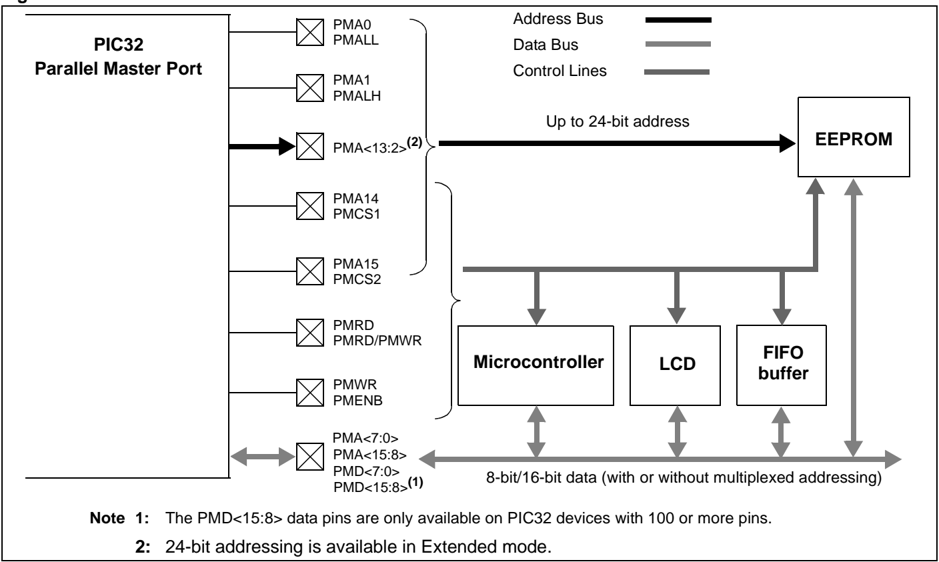

## 13.2 CONTROL REGISTERS

The PMP module uses these Special Function Registers (SFRs):

## · PMCON: Parallel Port Control Register

This register contains the bits that control much of the module's basic functionality. A key bit is the ON control bit, which is used to Reset, enable or disable the module.

When the module is disabled, all of the associated I/O pins revert to their designated I/O function. In addition, any read or write operations active or pending are stopped, and the BUSY bit is cleared. The data within the module registers is retained, including the data in PMSTAT register. Therefore, the module could be disabled after a reception, and the last received data and status would still be available for processing.

When the module is enabled, all buffer control logic is reset, along with PMSTAT.

All other bits in PMCON control address multiplexing enable various port control signals, and select control signal polarity. These are discussed in detail in 13.3.1 'Parallel Master Port Configuration Options' .

## · PMMODE: Parallel Port Mode Register

This register contains bits that control the operational modes of the module. Master/Slave mode selection and configuration options for both modes, are set by this register. It also contains the universal status flag, BUSY, which is used in master modes to indicate that an operation by the module is in progress.

Details  on  the  use  of  the  PMMODE  bits  to  configure  PMP  operation  are  provided  in 13.3 'Master Modes of Operation' and 13.4 'Slave Modes of Operation' .

## · PMADDR: Parallel Port Address Register

This register contains the address to which outgoing data is to be written, as well as the Chip Select control bits for addressing parallel slave devices. The PMADDR register is only used in Single Buffer Master modes.

## · PMDOUT: Parallel Port Data Output Register

This register is used only in Slave mode for buffered output data.

## · PMDIN: Parallel Port Data Input Register

This register is used by the PMP module in both Master and Slave modes.

In  Slave  mode,  this  register  is  used  to  hold  data  that  is  asynchronously  clocked  in.  Its operation is described in 13.4.2 'Buffered Parallel Slave Port Mode' .

In Single Buffer Master modes, PMDIN is the holding register for both incoming and outgoing data.  Its  operation  in  Master  mode  is  described  in 13.3.3 'Read  Operation' and 13.3.4 'Write Operation' .

In Dual Buffer Master modes, the PMDIN is the holding register for the outgoing data. A separate PMRDIN register holds the incoming data.

## · PMAEN: Parallel Port Pin Enable Register

This register controls the operation of address and Chip Select pins associated with the PMP module.  Setting  these  bits  allocates  the  corresponding  microcontroller  pins  to  the  PMP module;  clearing  the  bits  allocates  the  pins  to  port  I/O  or  other  peripheral  modules associated with the pin.

## · PMSTAT: Parallel Port Status Register (Slave modes only)

This register contains status bits associated with buffered operating modes when the port is functioning as a slave port. This includes overflow, underflow and full flag bit.

These flags are discussed in detail in 13.4.2 'Buffered Parallel Slave Port Mode' .

## · PMWADDR: Parallel Port Write Address Register

This register contains the address to which outgoing data is to be written, as well as the Chip Select control bits for addressing parallel slave devices. The PMWADDR register is only used in Dual Buffer Master modes.

## PIC32 Family Reference Manual

## · PMRADDR: Parallel Port Read Address Register

This register contains the address to which incoming data is to be read, as well as the Chip Select control bits for addressing parallel slave devices. The PMRADDR register is only used in Dual Buffer Master modes.

## · PMRDIN: Parallel Port Read Input Data Register

In  Dual  Buffer  Master  modes, PMRDIN is the holding register for the incoming data. Its operation  in  Master  mode  is  described  in 13.3.3 'Read  Operation' and 13.3.4 'Write Operation' .

Table 13-1 provides a brief summary of all PMP-module-related registers. Corresponding registers appear after the summary with a detailed description of each bit.

Table 13-1: PMP Special Function Register Summary

| Register Name (1)   | Bit Range   | Bit 31/15                   | Bit 30/14                   | Bit 29/13                   | Bit 28/12                   | Bit 27/11                   | Bit 26/10                   | Bit 25/9                    | Bit 24/8                    | Bit 23/7                    | Bit 22/6                    | Bit 21/5                    | Bit 20/4                    | Bit 19/3                    | Bit 118/2                   | Bit 17/1                    | Bit 16/0                    |
|---------------------|-------------|-----------------------------|-----------------------------|-----------------------------|-----------------------------|-----------------------------|-----------------------------|-----------------------------|-----------------------------|-----------------------------|-----------------------------|-----------------------------|-----------------------------|-----------------------------|-----------------------------|-----------------------------|-----------------------------|
| PMCON               | 31:16       | -                           | -                           | -                           | -                           | -                           | -                           | -                           | -                           | RDSTART (2)                 | -                           | -                           | -                           | -                           | -                           | DUALBUF (2)                 | EXADDR                      |
| PMCON               | 15:0        | ON                          | -                           | SIDL                        | ADRMUX<1:0>                 |                             | PMPTTL                      | PTWREN                      | PTRDEN                      | CSF<1:0>                    |                             | ALP                         | CS2P                        | CS1P                        | -                           | WRSP                        | RDSP                        |
| PMMODE              | 31:16       | -                           | -                           | -                           | -                           | -                           | -                           | -                           | -                           | -                           | -                           | -                           | -                           | -                           | -                           | -                           | -                           |
| PMMODE              | 15:0        | BUSY                        | IRQM<1:0>                   | IRQM<1:0>                   | INCM<1:0>                   | INCM<1:0>                   | MODE16                      | MODE<1:0>                   | MODE<1:0>                   | WAITB<1:0>                  | WAITB<1:0>                  | WAITM<3:0>                  | WAITM<3:0>                  | WAITM<3:0>                  | WAITM<3:0>                  | WAITE<1:0>                  | WAITE<1:0>                  |
| PMADDR              | 31:16       | -                           | -                           | -                           | -                           | -                           | -                           | -                           | -                           | CS2A                        | CS1A                        | ADDR<21:16>                 | ADDR<21:16>                 | ADDR<21:16>                 | ADDR<21:16>                 | ADDR<21:16>                 | ADDR<21:16>                 |
| PMADDR              |             | CS2                         | CS1                         |                             |                             |                             |                             |                             |                             | ADDR23                      | ADDR22                      |                             |                             |                             |                             |                             |                             |
| PMADDR              | 15:0        | ADDR15 (2)                  | ADDR14 (2)                  |                             |                             |                             |                             |                             |                             | ADDR<13:0>                  | ADDR<13:0>                  |                             |                             |                             |                             |                             |                             |
| PMDOUT              | 31:16       |                             |                             |                             |                             |                             |                             |                             |                             | DATAOUT<31:16>              | DATAOUT<31:16>              |                             |                             |                             |                             |                             |                             |
| PMDOUT              | 15:0        |                             |                             |                             |                             |                             |                             |                             |                             | DATAOUT<15:0>               | DATAOUT<15:0>               |                             |                             |                             |                             |                             |                             |
| PMDIN               | 31:16       |                             |                             |                             |                             |                             |                             |                             |                             | DATAIN<31:16>               | DATAIN<31:16>               |                             |                             |                             |                             |                             |                             |
| PMDIN               | 15:0        | DATAIN<15:0>                | DATAIN<15:0>                | DATAIN<15:0>                | DATAIN<15:0>                | DATAIN<15:0>                | DATAIN<15:0>                | DATAIN<15:0>                | DATAIN<15:0>                | DATAIN<15:0>                | DATAIN<15:0>                | DATAIN<15:0>                | DATAIN<15:0>                | DATAIN<15:0>                | DATAIN<15:0>                | DATAIN<15:0>                | DATAIN<15:0>                |
| PMAEN               | 31:16       | -                           | -                           | -                           | -                           | -                           | -                           | -                           | -                           | PTEN<23:22>                 |                             | PTEN<21:16>                 | PTEN<21:16>                 | PTEN<21:16>                 | PTEN<21:16>                 | PTEN<21:16>                 | PTEN<21:16>                 |
| PMAEN               | 15:0        | PTEN<15:0>                  | PTEN<15:0>                  | PTEN<15:0>                  | PTEN<15:0>                  | PTEN<15:0>                  | PTEN<15:0>                  | PTEN<15:0>                  | PTEN<15:0>                  | PTEN<15:0>                  | PTEN<15:0>                  | PTEN<15:0>                  | PTEN<15:0>                  | PTEN<15:0>                  | PTEN<15:0>                  | PTEN<15:0>                  | PTEN<15:0>                  |
| PMSTAT              | 31:16       | -                           | -                           | -                           | -                           | -                           | -                           | -                           | -                           | -                           | -                           | -                           | -                           | -                           | -                           | -                           | -                           |
| PMSTAT              | 15:0        | IBF                         | IBOV                        | -                           | -                           | IB3F                        | IB2F                        | IB1F                        | IB0F                        | OBE                         | OBUF                        | -                           | -                           | OB3E                        | OB2E                        | OB1E                        | OB0E                        |
| PMWADDR (2)         | 31:16       | -                           | -                           | -                           | -                           | -                           | -                           | -                           | -                           | WCS2A WADDR23               | WCS1A WADDR22               | WADDR<21:16>                | WADDR<21:16>                | WADDR<21:16>                | WADDR<21:16>                | WADDR<21:16>                | WADDR<21:16>                |
| PMWADDR (2)         | 15:0        | WCS2                        | WCS1                        | -                           | -                           | -                           | -                           | -                           | -                           | -                           | -                           | -                           | -                           | -                           | -                           | -                           | -                           |
| PMWADDR (2)         | 15:0        | WADDR15 WADDR14 WADDR<13:0> | WADDR15 WADDR14 WADDR<13:0> | WADDR15 WADDR14 WADDR<13:0> | WADDR15 WADDR14 WADDR<13:0> | WADDR15 WADDR14 WADDR<13:0> | WADDR15 WADDR14 WADDR<13:0> | WADDR15 WADDR14 WADDR<13:0> | WADDR15 WADDR14 WADDR<13:0> | WADDR15 WADDR14 WADDR<13:0> | WADDR15 WADDR14 WADDR<13:0> | WADDR15 WADDR14 WADDR<13:0> | WADDR15 WADDR14 WADDR<13:0> | WADDR15 WADDR14 WADDR<13:0> | WADDR15 WADDR14 WADDR<13:0> | WADDR15 WADDR14 WADDR<13:0> | WADDR15 WADDR14 WADDR<13:0> |
| PMRADDR (2)         | 31:16       | -                           | -                           | -                           | -                           | -                           | -                           | -                           | -                           | RCS2A                       | RCS1A                       | RADDR<21:16>                | RADDR<21:16>                | RADDR<21:16>                | RADDR<21:16>                | RADDR<21:16>                | RADDR<21:16>                |
| PMRADDR (2)         | 31:16       | -                           | -                           | -                           | -                           | -                           | -                           | -                           | -                           | RADDR23 RADDR22             | RADDR23 RADDR22             |                             |                             |                             |                             |                             |                             |
| PMRADDR (2)         | 15:0        | RCS2                        | RCS1                        | -                           | -                           | -                           | -                           | -                           | -                           | -                           | -                           | -                           | -                           | -                           | -                           | -                           | -                           |
| PMRADDR (2)         | 15:0        | RADDR15 RADDR14 RADDR<13:0> | RADDR15 RADDR14 RADDR<13:0> | RADDR15 RADDR14 RADDR<13:0> | RADDR15 RADDR14 RADDR<13:0> | RADDR15 RADDR14 RADDR<13:0> | RADDR15 RADDR14 RADDR<13:0> | RADDR15 RADDR14 RADDR<13:0> | RADDR15 RADDR14 RADDR<13:0> | RADDR15 RADDR14 RADDR<13:0> | RADDR15 RADDR14 RADDR<13:0> | RADDR15 RADDR14 RADDR<13:0> | RADDR15 RADDR14 RADDR<13:0> | RADDR15 RADDR14 RADDR<13:0> | RADDR15 RADDR14 RADDR<13:0> | RADDR15 RADDR14 RADDR<13:0> | RADDR15 RADDR14 RADDR<13:0> |
| PMRDIN (2)          | 31:16       | 31:16                       | -                           | -                           | -                           | -                           | -                           | -                           | -                           | -                           | -                           | -                           | -                           | -                           | -                           | -                           | -                           |
| PMRDIN (2)          | 15:0        | 15:0 RDATAIN<15:0>          | 15:0 RDATAIN<15:0>          | 15:0 RDATAIN<15:0>          | 15:0 RDATAIN<15:0>          | 15:0 RDATAIN<15:0>          | 15:0 RDATAIN<15:0>          | 15:0 RDATAIN<15:0>          | 15:0 RDATAIN<15:0>          | 15:0 RDATAIN<15:0>          | 15:0 RDATAIN<15:0>          | 15:0 RDATAIN<15:0>          | 15:0 RDATAIN<15:0>          | 15:0 RDATAIN<15:0>          | 15:0 RDATAIN<15:0>          | 15:0 RDATAIN<15:0>          | 15:0 RDATAIN<15:0>          |

## PIC32 Family Reference Manual

## Register 13-1: PMCON: Parallel Port Control Register

| Bit Range   | Bit 31/23/15/7   | Bit 30/22/14/6   | Bit 29/21/13/5   | Bit 28/20/12/4   | Bit 27/19/11/3   | Bit 26/18/10/2   | Bit 25/17/9/1   | Bit 24/16/8/0   |
|-------------|------------------|------------------|------------------|------------------|------------------|------------------|-----------------|-----------------|
| 31:24       | U-0              | U-0              | U-0              | U-0              | U-0              | U-0              | U-0             | U-0             |
| 31:24       | -                | -                | -                | -                | -                | -                | -               | -               |
| 23:16       | R/W-0, HC        | U-0              | U-0              | U-0              | U-0              | U-0              | R/W-0           | U-0             |
| 23:16       | RDSTART (3)      | -                | -                | -                | -                | -                | DUALBUF (3)     | EXADDR (3)      |
| 15:8        | R/W-0            | U-0              | R/W-0            | R/W-0            | R/W-0            | R/W-0            | R/W-0           | R/W-0           |
| 15:8        | ON (1)           | -                | SIDL             | ADRMUX<1:0>      | ADRMUX<1:0>      | PMPTTL           | PTWREN          | PTRDEN          |
| 7:0         | R/W-0            | R/W-0            | R/W-0            | R/W-0            | R/W-0            | U-0              | R/W-0           | R/W-0           |
| 7:0         | CSF<1:0> (2)     | CSF<1:0> (2)     | ALP (2)          | CS2P (2)         | CS1P (2)         | -                | WRSP            | RDSP            |

## Legend:

HC = Hardware cleared

R = Readable bit

W = Writable bit

U = Unimplemented bit, read as '0'

-n = Value at POR

'1' = Bit is set

'0' = Bit is cleared

x = Bit is unknown

bit 31-24 Unimplemented: Read as '0'

bit 23

RDSTART: Start a Read on the PMP Bus bit

1 = Start a read cycle on the PMP bus

0 = No effect

This bit is cleared by hardware at the end of the read cycle when the BUSY bit (PMMODE&lt;15&gt;) = 0 .

bit 22-18 Unimplemented: Read as '0'

bit 17 DUALBUF: Parallel Master Port Dual Read/Write Buffer Enable bit (3)

This bit is only valid in Master mode.

- 1 = PMP uses separate registers for reads and writes

Reads: PMRADDR and PMRDIN

Writes: PMRWADDR and PMDOUT

- 0 = PMP uses legacy registers for reads and writes

Reads/Writes: PMADDR and PMRDIN

- bit 16 EXADDR: Parallel Master Port Extended 24-bit Addressing (Valid in Demultiplexed Master Mode Only) (3)
- 1 = PMP 24 bit addressing is enabled

0 = PMP 24 bit addressing is disabled

bit 15 ON: Parallel Master Port Enable bit

(1)

1 = PMP enabled

0 = PMP disabled, no off-chip access performed

bit 14 Unimplemented:

Write ' 0 '; ignore read

bit 13 SIDL: Stop in Idle Mode bit

- 1 = Discontinue module operation when device enters Idle mode
- 0 = Continue module operation in Idle mode

bit 12-11 ADRMUX&lt;1:0&gt;: Address/Data Multiplexing Selection bits

- 11 = All 16 bits of address are multiplexed on PMD&lt;15:0&gt; pins
- 10 = All 16 bits of address are multiplexed on PMD&lt;7:0&gt; pins
- 01 = Lower 8 bits of address are multiplexed on PMD&lt;7:0&gt; pins, upper 8 bits are on PMA&lt;15:8&gt;
- 00 = Address and data appear on separate pins

bit 10 PMPTTL: PMP Module TTL Input Buffer Select bit

- 1 = PMP module uses TTL input buffers
- 0 = PMP module uses Schmitt Trigger input buffer
- Note 1: When using 1:1 PBCLK divisor, the user's software should not read/write the peripheral's SFRs in the SYSCLK cycle immediately following the instruction that clears the module's ON control bit.
- 2: These bits have no effect when its corresponding pin is used as an address line.
- 3: This bit is not available on all devices. Refer to the 'Parallel Master Port (PMP)' chapter in the specific device data sheet to determine availability.

(3)

## Section 13. Parallel Master Port (PMP)

## Register 13-1: PMCON: Parallel Port Control Register (Continued)

bit 9

PTWREN: Write Enable Strobe Port Enable bit

1 = PMWR/PMENB port is enabled

0 = PMWR/PMENB port is disabled

bit 8

PTRDEN:

Read/Write Strobe Port Enable bit

1 = PMRD/PMWR port is enabled

0 = PMRD/PMWR port is disabled

bit 7-6 CSF&lt;1:0&gt;: Chip Select Function bits (2)

11 = Reserved

10 = PMCS2/PMCS2A and PMCS1/PMCS1A function as Chip Select

01 = PMCS2/PMCS2A functions as Chip Select, PMCS1/PMCS1A functions as address bit

00 = PMCS2/PMCS2A and PMCS1/PMCS1A function as address bits

bit 5 ALP: Address Latch Polarity bit (2)

1 = Active-high (PMALL and PMALH)

0 = Active-low (PMALL and PMALH)

bit 4 CS2P: Chip Select 2/2A Polarity bit (2)

1 = Active-high

0 = Active-low

Note: PMCS1A and PMCS2A are only applicable when EXADDR=1

bit 3 CS1P:

Chip Select 1/1A Polarity bit (2)

1 = Active-high

0 = Active-low

bit 2 Unimplemented: Write ' 0 '; ignore read

bit 1 WRSP:

Write Strobe Polarity bit

For Slave Modes and Master mode 2 MODE &lt;1:0&gt; (PMMODE&lt;9:8&gt; = 00 , 01 , 10 ):

1 = Write strobe active-high (PMWR)

0 = Write strobe active-low (PMWR)

For Master mode 1 MODE &lt;1:0&gt; (PMMODE&lt;9:8&gt; = 11 ):

1 = Enable strobe active-high (PMENB)

0 = Enable strobe active-low (PMENB)

bit 0 RDSP: Read Strobe Polarity bit

For Slave modes and Master mode 2 MODE &lt;1:0&gt; (PMMODE&lt;9:8&gt; = 00 , 01 , 10 ):

- 1 = Read strobe active-high (PMRD)

0 = Read strobe active-low (PMRD)

For Master mode 1 MODE &lt;1:0&gt; (PMMODE&lt;9:8&gt; = 11 ):

- 1 = Read/write strobe active-high (PMRD/PMWR)

0 = Read/write strobe active-low (PMRD/PMWR)

- Note 1: When using 1:1 PBCLK divisor, the user's software should not read/write the peripheral's SFRs in the SYSCLK cycle immediately following the instruction that clears the module's ON control bit.
- 2: These bits have no effect when its corresponding pin is used as an address line.
- 3: This bit is not available on all devices. Refer to the 'Parallel Master Port (PMP)' chapter in the specific device data sheet to determine availability.

## PIC32 Family Reference Manual

## Register 13-2: PMMODE: Parallel Port Mode Register

| Bit Range   | Bit 31/23/15/7   | Bit 30/22/14/6   | Bit 29/21/13/5   | Bit 28/20/12/4   | Bit 27/19/11/3   | Bit 26/18/10/2   | Bit 25/17/9/1   | Bit 24/16/8/0   |
|-------------|------------------|------------------|------------------|------------------|------------------|------------------|-----------------|-----------------|
| 31:24       | U-0              | U-0              | U-0              | U-0              | U-0              | U-0              | U-0             | U-0             |
| 31:24       | -                | -                | -                | -                | -                | -                | -               | -               |
| 23:16       | U-0              | U-0              | U-0              | U-0              | U-0              | U-0              | U-0             | U-0             |
| 23:16       | -                | -                | -                | -                | -                | -                | -               | -               |
| 15:8        | R-0              | R/W-0            | R/W-0            | R/W-0            | R/W-0            | R/W-0            | R/W-0           | R/W-0           |
| 15:8        | BUSY             | IRQM<1:0>        | IRQM<1:0>        | INCM<1:0>        | INCM<1:0>        | MODE16           | MODE<1:0>       | MODE<1:0>       |
| 7:0         | R/W-0            | R/W-0            | R/W-0            | R/W-0            | R/W-0            | R/W-0            | R/W-0           | R/W-0           |
| 7:0         | WAITB<1:0> (1)   | WAITB<1:0> (1)   | WAITM<3:0> (1)   | WAITM<3:0> (1)   | WAITM<3:0> (1)   | WAITM<3:0> (1)   | WAITE<1:0> (1)  | WAITE<1:0> (1)  |

## Legend:

R = Readable bit

W = Writable bit

U = Unimplemented bit, read as '0'

-n = Value at POR

'1' = Bit is set

'0' = Bit is cleared

x = Bit is unknown



## bit 31-16 Unimplemented: Write ' 0 '; ignore read

bit 15 BUSY: Busy bit (Master mode only)

1 = Port is busy

0 = Port is not busy

## bit 14-13 IRQM&lt;1:0&gt;: Interrupt Request Mode bits

- 11 = Reserved, do not use

- 10 = Interrupt generated when Read Buffer 3 is read or Write Buffer 3 is written (Buffered PSP mode),

- or on a read or write operation when PMA&lt;1:0&gt; = 11 (Addressable Slave mode only)

- 01 = Interrupt generated at the end of the read/write cycle

- 00 = No Interrupt generated

## bit 12-11 INCM&lt;1:0&gt;: Increment Mode bits

- 11 = Slave mode read and write buffers auto-increment MODE&lt;1:0&gt; (PMMODE&lt;9:8&gt; = 00 only)

- 10 = Decrement ADDR&lt;15:0&gt; by 1 every read/write cycle (2,4)

- 01 = Increment ADDR&lt;15:0&gt; by 1 every read/write cycle (2,4)

- 00 = No increment or decrement of address

## bit 10 MODE16: 8/16-bit Mode bit

- 1 = 16-bit mode: a read or write to the data register invokes a single 16-bit transfer

0 = 8-bit mode: a read or write to the data register invokes a single 8-bit transfer

## bit 9-8 MODE&lt;1:0&gt;: Parallel Port Mode Select bits

11 = Master mode 1 (PMCSx, PMRD/PMWR, PMENB, PMA&lt;x:0&gt;, PMD&lt;7:0&gt; and PMD&lt;8:15&gt; (3) )

- 10 = Master mode 2 (PMCSx, PMRD, PMWR, PMA&lt;x:0&gt;, PMD&lt;7:0&gt; and PMD&lt;8:15&gt; (3) )

01 = Enhanced Slave mode, control signals (PMRD, PMWR, PMCS, PMD&lt;7:0&gt; and PMA&lt;1:0&gt;)

00 = Legacy Parallel Slave Port, control signals (PMRD, PMWR, PMCS and PMD&lt;7:0&gt;)

bit 7-6 WAITB&lt;1:0&gt;: Data Setup to Read/Write Strobe Wait States bits (1)

- 11 = Data wait of 4 TPB; multiplexed address phase of 4 TPB

10 = Data wait of 3 TPB; multiplexed address phase of 3 TPB

01 = Data wait of 2 TPB; multiplexed address phase of 2 TPB

- 00 = Data wait of 1 TPB; multiplexed address phase of 1 TPB (default)

- Note 1: When WAITM&lt;3:0&gt; = 0000 , the WAITB and WAITE bits are ignored and forced to 1 TPBCLK cycle for a write operation; WAITB = 1 TPBCLK cycle, WAITE = 0 TPBCLK cycles for a read operation.
- 2: Address bit A15/A23 and A14/A22 are not subject to auto-increment/decrement if configured as Chip Select CS2/CS2A and CS1/CS1A.
- 3: These pins are active when MODE16 = 1 (16-bit mode).
- 4: The PMPADDR register is always incremented/decremented by 1 regardless of the transfer data width.

## Register 13-2: PMMODE: Parallel Port Mode Register (Continued)

```
bit 5-2 WAITM<3:0>: Data Read/Write Strobe Wait States bits (1) 1111 = Wait of 16 TPB · · · 0001 = Wait of 2 TPB 0000 = Wait of 1 TPB (default) bit 1-0 WAITE<1:0>: Data Hold After Read/Write Strobe Wait States bits (1) 11 = Wait of 4 TPB 10 = Wait of 3 TPB 01 = Wait of 2 TPB 00 = Wait of 1 TPB (default) For read operations: 11 = Wait of 3 TPB 10 = Wait of 2 TPB 01 = Wait of 1 TPB 00 = Wait of 0 TPB (default)
```

- Note 1: When WAITM&lt;3:0&gt; = 0000 , the WAITB and WAITE bits are ignored and forced to 1 TPBCLK cycle for a write operation; WAITB = 1 TPBCLK cycle, WAITE = 0 TPBCLK cycles for a read operation.
- 2: Address bit A15/A23 and A14/A22 are not subject to auto-increment/decrement if configured as Chip Select CS2/CS2A and CS1/CS1A.
- 3: These pins are active when MODE16 = 1 (16-bit mode).
- 4: The PMPADDR register is always incremented/decremented by 1 regardless of the transfer data width.

## PIC32 Family Reference Manual

## Register 13-3: PMADDR: Parallel Port Address Register

| Bit Range   | Bit 31/23/15/7   | Bit 30/22/14/6   | Bit 29/21/13/5   | Bit 28/20/12/4   | Bit 27/19/11/3   | Bit 26/18/10/2   | Bit 25/17/9/1   | Bit 24/16/8/0   |
|-------------|------------------|------------------|------------------|------------------|------------------|------------------|-----------------|-----------------|
| 31:24       | U-0              | U-0              | U-0              | U-0              | U-0              | U-0              | U-0             | U-0             |
| 31:24       | -                | -                | -                | -                | -                | -                | -               | -               |
| 23:16       | R/W-0            | R/W-0            | R/W-0            | R/W-0            | R/W-0            | R/W-0            | R/W-0           | R/W-0           |
| 23:16       | CS2A (2)         | CS1A (2)         |                  |                  |                  |                  |                 |                 |
| 23:16       | ADDR23 (2)       | ADDR22 (2)       | ADDR<21:16>      | ADDR<21:16>      | ADDR<21:16>      | ADDR<21:16>      | ADDR<21:16>     | ADDR<21:16>     |
| 15:8        | R/W-0            | R/W-0            | R/W-0            | R/W-0            | R/W-0            | R/W-0            | R/W-0           | R/W-0           |
| 15:8        | CS2 (1)          | CS1 (1)          |                  |                  |                  |                  |                 |                 |
| 15:8        | ADDR15 (1)       | ADDR14 (1)       | ADDR<13:8>       | ADDR<13:8>       | ADDR<13:8>       | ADDR<13:8>       | ADDR<13:8>      | ADDR<13:8>      |
| 7:0         | R/W-0            | R/W-0            | R/W-0            | R/W-0            | R/W-0            | R/W-0            | R/W-0           | R/W-0           |
| 7:0         | ADDR<7:0>        | ADDR<7:0>        | ADDR<7:0>        | ADDR<7:0>        | ADDR<7:0>        | ADDR<7:0>        | ADDR<7:0>       | ADDR<7:0>       |

Legend:

R = Readable bit

W = Writable bit

U = Unimplemented bit, read as '0'

-n = Value at POR

'1' = Bit is set

'0' = Bit is cleared

x = Bit is unknown

bit 31-24 Unimplemented: Read as ' 0 '

bit 23 CS2A: Chip Select 2 bit (2)

1 = Chip Select 2 is active

0 = Chip Select 2 is inactive (ADDR23 function is selected)

bit 23 ADDR23: Target Address bit 23 (2)

bit 22 CS1A: Chip Select 1 bit (2)

1 = Chip Select 1 is active

0 = Chip Select 1 is inactive (ADDR22 function is selected)

bit 22 ADDR22: Target Address bit 22 (2)

bit 21-16 ADDR&lt;21:16&gt; Address bits

bit 15 CS2: Chip Select 2 bit (1)

1 = Chip Select 2 is active

0 = Chip Select 2 is inactive (ADDR15 function is selected)

bit 15 ADDR15: Target Address bit 15 (1)

bit 14 CS1: Chip Select 1 bit (1)

1 = Chip Select 1 is active

0 = Chip Select 1 is inactive (ADDR14 function is selected)

bit 14 ADDR14: Target Address bit 14 (1)

bit 13-0 ADDR&lt;13:0&gt;: Address bits

Note 1: The use of these pins as PMA15/PMA14 or CS2/CS1 is selected by the CSF&lt;1:0&gt; bits (PMCON&lt;7:6&gt;) when EXADDR = 0 .

- 2: The use of these pins as PMA23/PMA22 or CS2A/CS1A is selected by the CSF&lt;1:0&gt; bits (PMCON&lt;7:6&gt;) when EXADDR = 1 .

Note: If  the  DUALBUF  bit  (PMCON&lt;17&gt;)  = 0 ,  the  bits  in  this  register  control  both  read  and  write  target addressing.  If  the  DUALBUF  bit  = 1 ,  the  bits  in  this  register  are  not  used.  In  this  instance,  use  the PMRADDR register for Read operations and the PMWADDR register for Write operations.

## Register 13-4: PMDOUT: Parallel Port Data Output Register

bit 31-0 DATAOUT&lt;31:0&gt;: Output Data Port bits for 8-bit write operations in Slave mode

| Bit Range   | Bit 31/23/15/7   | Bit 30/22/14/6   | Bit 29/21/13/5   | Bit 28/20/12/4   | Bit 27/19/11/3   | Bit 26/18/10/2   | Bit 25/17/9/1   | Bit 24/16/8/0   |
|-------------|------------------|------------------|------------------|------------------|------------------|------------------|-----------------|-----------------|
| 31:24       | R/W-0            | R/W-0            | R/W-0            | R/W-0            | R/W-0            | R/W-0            | R/W-0           | R/W-0           |
| 31:24       | DATAOUT<31:24>   | DATAOUT<31:24>   | DATAOUT<31:24>   | DATAOUT<31:24>   | DATAOUT<31:24>   | DATAOUT<31:24>   | DATAOUT<31:24>  | DATAOUT<31:24>  |
| 23:16       | R/W-0            | R/W-0            | R/W-0            | R/W-0            | R/W-0            | R/W-0            | R/W-0           | R/W-0           |
| 23:16       | DATAOUT<23:16>   | DATAOUT<23:16>   | DATAOUT<23:16>   | DATAOUT<23:16>   | DATAOUT<23:16>   | DATAOUT<23:16>   | DATAOUT<23:16>  | DATAOUT<23:16>  |
| 15:8        | R/W-0            | R/W-0            | R/W-0            | R/W-0            | R/W-0            | R/W-0            | R/W-0           | R/W-0           |
| 15:8        | DATAOUT<15:8>    | DATAOUT<15:8>    | DATAOUT<15:8>    | DATAOUT<15:8>    | DATAOUT<15:8>    | DATAOUT<15:8>    | DATAOUT<15:8>   | DATAOUT<15:8>   |
| 7:0         | R/W-0            | R/W-0            | R/W-0            | R/W-0            | R/W-0            | R/W-0            | R/W-0           | R/W-0           |
| 7:0         | DATAOUT<7:0>     | DATAOUT<7:0>     | DATAOUT<7:0>     | DATAOUT<7:0>     | DATAOUT<7:0>     | DATAOUT<7:0>     | DATAOUT<7:0>    | DATAOUT<7:0>    |

| Legend:           | Legend:          | Legend:                            | Legend:                            |
|-------------------|------------------|------------------------------------|------------------------------------|
| R = Readable bit  | W = Writable bit | U = Unimplemented bit, read as '0' | U = Unimplemented bit, read as '0' |
| -n = Value at POR | '1' = Bit is set | '0' = Bit is cleared               | x = Bit is unknown                 |

## PIC32 Family Reference Manual

Register 13-5: PMDIN: Parallel Port Data Input Register

| Bit Range   | Bit 31/23/15/7   | Bit 30/22/14/6   | Bit 29/21/13/5   | Bit 28/20/12/4   | Bit 27/19/11/3   | Bit 26/18/10/2   | Bit 25/17/9/1   | Bit 24/16/8/0   |
|-------------|------------------|------------------|------------------|------------------|------------------|------------------|-----------------|-----------------|
| 31:24       | R/W-0            | R/W-0            | R/W-0            | R/W-0            | R/W-0            | R/W-0            | R/W-0           | R/W-0           |
| 31:24       | DATAIN<31:24>    | DATAIN<31:24>    | DATAIN<31:24>    | DATAIN<31:24>    | DATAIN<31:24>    | DATAIN<31:24>    | DATAIN<31:24>   | DATAIN<31:24>   |
| 23:16       | R/W-0            | R/W-0            | R/W-0            | R/W-0            | R/W-0            | R/W-0            | R/W-0           | R/W-0           |
| 23:16       | DATAIN<23:16>    | DATAIN<23:16>    | DATAIN<23:16>    | DATAIN<23:16>    | DATAIN<23:16>    | DATAIN<23:16>    | DATAIN<23:16>   | DATAIN<23:16>   |
| 15:8        | R/W-0            | R/W-0            | R/W-0            | R/W-0            | R/W-0            | R/W-0            | R/W-0           | R/W-0           |
| 15:8        | DATAIN<15:8>     | DATAIN<15:8>     | DATAIN<15:8>     | DATAIN<15:8>     | DATAIN<15:8>     | DATAIN<15:8>     | DATAIN<15:8>    | DATAIN<15:8>    |
| 7:0         | R/W-0            | R/W-0            | R/W-0            | R/W-0            | R/W-0            | R/W-0            | R/W-0           | R/W-0           |
| 7:0         | DATAIN<7:0>      | DATAIN<7:0>      | DATAIN<7:0>      | DATAIN<7:0>      | DATAIN<7:0>      | DATAIN<7:0>      | DATAIN<7:0>     | DATAIN<7:0>     |

| Legend:           | Legend:          | Legend:                            | Legend:                            |
|-------------------|------------------|------------------------------------|------------------------------------|
| R = Readable bit  | W = Writable bit | U = Unimplemented bit, read as '0' | U = Unimplemented bit, read as '0' |
| -n = Value at POR | '1' = Bit is set | '0' = Bit is cleared               | x = Bit is unknown                 |

bit 31-0 DATAIN&lt;31:0&gt;: Input/Output Data Port bits for 8-bit or 16-bit read/write operations in Master mode Input Data Port for 8-bit read operations in Slave mode.

## Register 13-6: PMAEN: Parallel Port Pin Enable Register

| Bit Range   | Bit 31/23/15/7   | Bit 30/22/14/6   | Bit 29/21/13/5   | Bit 28/20/12/4   | Bit 27/19/11/3   | Bit 26/18/10/2   | Bit 25/17/9/1   | Bit 24/16/8/0   |
|-------------|------------------|------------------|------------------|------------------|------------------|------------------|-----------------|-----------------|
| 31:24       | U-0              | U-0              | U-0              | U-0              | U-0              | U-0              | U-0             | U-0             |
| 31:24       | -                | -                | -                | -                | -                | -                | -               | -               |
| 23:16       | U-0              | U-0              | U-0              | U-0              | U-0              | U-0              | U-0             | U-0             |
| 23:16       | PTEN<23:22>      | PTEN<23:22>      | PTEN<21:16>      | PTEN<21:16>      | PTEN<21:16>      | PTEN<21:16>      | PTEN<21:16>     | PTEN<21:16>     |
| 15:8        | R/W-0            | R/W-0            | R/W-0            | R/W-0            | R/W-0            | R/W-0            | R/W-0           | R/W-0           |
| 15:8        | PTEN<15:14>      | PTEN<15:14>      | PTEN<13:8>       | PTEN<13:8>       | PTEN<13:8>       | PTEN<13:8>       | PTEN<13:8>      | PTEN<13:8>      |
| 7:0         | R/W-0            | R/W-0            | R/W-0            | R/W-0            | R/W-0            | R/W-0            | R/W-0           | R/W-0           |
| 7:0         | PTEN<7:2>        | PTEN<7:2>        | PTEN<7:2>        | PTEN<7:2>        | PTEN<7:2>        | PTEN<7:2>        | PTEN<1:0>       | PTEN<1:0>       |

## Legend:

R = Readable bit

W = Writable bit

U = Unimplemented bit, read as '0'

-n = Value at POR

'1' = Bit is set

'0' = Bit is cleared

x = Bit is unknown

31-24 Unimplemented: Write ' 0 '; ignore read

bit 23-22 PTEN&lt;23:22&gt;: PMCSx Strobe Enable bits

1 = PMA23 and PMA22 function as either PMA&lt;23:22&gt; or PMCS2A and PMCS1A (1)

0 = PMA23 and PMA22 function as port I/O

bit 21-16 PTEN&lt;21:16&gt;: PMP Address Port Enable bits

1 = PMA&lt;21:16&gt; function as PMP address lines

0 = PMA&lt;21:16&gt; function as port I/O

bit 15-14 PTEN&lt;15:14&gt;: PMCSx Strobe Enable bits

1 = PMA15 and PMA14 function as either PMA&lt;15:14&gt; or PMCS2 and PMCS1 (1)

0 = PMA15 and PMA14 function as port I/O

bit 13-2 PTEN&lt;13:2&gt;: PMP Address Port Enable bits

1 = PMA&lt;13:2&gt; function as PMP address lines

0 = PMA&lt;13:2&gt; function as port I/O

bit 1-0 PTEN&lt;1:0&gt;: PMALH/PMALL Strobe Enable bits

1 = PMA1 and PMA0 function as either PMA&lt;1:0&gt; or PMALH and PMALL (2)

0 = PMA1 and PMA0 pads function as port I/O

Note 1: The use of these pins as address or chip select lines selected by the CSF&lt;1:0&gt; bits (PMCON&lt;7:6&gt;).

- 2: The use of these pins as PMA1/PMA0 or PMALH/PMALL depends on the Address/Data Multiplex mode selected by the ADRMUX&lt;1:0&gt; bits in the PMCON register.

## PIC32 Family Reference Manual

## Register 13-7: PMSTAT: Parallel Port Status Register (Slave modes only)

| Bit Range   | Bit 31/23/15/7   | Bit 30/22/14/6   | Bit 29/21/13/5   | Bit 28/20/12/4   | Bit 27/19/11/3   | Bit 26/18/10/2   | Bit 25/17/9/1   | Bit 24/16/8/0   |
|-------------|------------------|------------------|------------------|------------------|------------------|------------------|-----------------|-----------------|
| 31:24       | U-0              | U-0              | U-0              | U-0              | U-0              | U-0              | U-0             | U-0             |
| 31:24       | -                | -                | -                | -                | -                | -                | -               | -               |
| 23:16       | U-0              | U-0              | U-0              | U-0              | U-0              | U-0              | U-0             | U-0             |
| 23:16       | -                | -                | -                | -                | -                | -                | -               | -               |
| 15:8        | R-0              | R/W-0            | U-0              | U-0              | R-0              | R-0              | R-0             | R-0             |
| 15:8        | IBF              | IBOV             | -                | -                | IB3F             | IB2F             | IB1F            | IB0F            |
| 7:0         | R-1              | R/W-0            | U-0              | U-0              | R-1              | R-1              | R-1             | R-1             |
| 7:0         | OBE              | OBUF             | -                | -                | OB3E             | OB2E             | OB1E            | OB0E            |

## Legend:

R = Readable bit

W = Writable bit

U = Unimplemented bit, read as '0'

-n = Value at POR

'1' = Bit is set

'0' = Bit is cleared

x = Bit is unknown

bit 31-16 Unimplemented: Write ' 0 '; ignore read

bit 15 IBF:

Input Buffer Full Status bit

1 = All writable input buffer registers are full

0 = Some or all of the writable input buffer registers are empty

bit 14 IBOV: Input Buffer Overflow Status bit

1 = A write attempt to a full input byte buffer occurred (must be cleared in software)

0 = No overflow occurred

This bit is set (= 1 ) in hardware; can only be cleared (= 0 ) in software.

bit 13-12 Unimplemented: Write ' 0 '; ignore read

bit 11-8 IBnF: Input Buffer n Status Full bits

1 = Input Buffer contains data that has not been read (reading buffer will clear this bit)

0 = Input Buffer does not contain any unread data

bit 7 OBE: Output Buffer Empty Status bit

1 = All readable output buffer registers are empty

0 = Some or all of the readable output buffer registers are full

bit 6 OBUF: Output Buffer Underflow Status bit

1 = A read occurred from an empty output byte buffer (must be cleared in software)

0 = No underflow occurred

This bit is set (= 1 ) in hardware; can only be cleared (= 0 ) in software.

bit 5-4 Unimplemented: Write ' 0 '; ignore read

bit 3-0 OBnE: Output Buffer n Status Empty bits

1 = Output buffer is empty (writing data to the buffer will clear this bit)

0 = Output buffer contains data that has not been transmitted

## Section 13. Parallel Master Port (PMP)

## Register 13-8: PMWADDR: Parallel Port Write Address Register

| Bit Range   | Bit 31/23/15/7   | Bit 30/22/14/6   | Bit 29/21/13/5   | Bit 28/20/12/4   | Bit 27/19/11/3   | Bit 26/18/10/2   | Bit 25/17/9/1   | Bit 24/16/8/0   |
|-------------|------------------|------------------|------------------|------------------|------------------|------------------|-----------------|-----------------|
| 31:24       | U-0              | U-0              | U-0              | U-0              | U-0              | U-0              | U-0             | U-0             |
| 31:24       | -                | -                | -                | -                | -                | -                | -               | -               |
| 23:26       | R/W-0            | R/W-0            | R/W-0            | R/W-0            | R/W-0            | R/W-0            | R/W-0           | R/W-0           |
| 23:26       | WCS2A (2)        | WCS1A (2)        |                  |                  |                  |                  |                 |                 |
| 23:26       | WADDR23 (2)      | WADDR22 (2)      | WADDR<21:16>     | WADDR<21:16>     | WADDR<21:16>     | WADDR<21:16>     | WADDR<21:16>    | WADDR<21:16>    |
| 15:8        | R/W-0            | R/W-0            | R/W-0            | R/W-0            | R/W-0            | R/W-0            | R/W-0           | R/W-0           |
| 15:8        | WCS2 (1)         | WCS1 (1)         |                  |                  |                  |                  |                 |                 |
| 15:8        | WADDR15 (1)      | WADDR14 (1)      | WADDR<13:8>      | WADDR<13:8>      | WADDR<13:8>      | WADDR<13:8>      | WADDR<13:8>     | WADDR<13:8>     |
| 7:0         | R/W-0            | R/W-0            | R/W-0            | R/W-0            | R/W-0            | R/W-0            | R/W-0           | R/W-0           |
| 7:0         | WADDR<7:0>       | WADDR<7:0>       | WADDR<7:0>       | WADDR<7:0>       | WADDR<7:0>       | WADDR<7:0>       | WADDR<7:0>      | WADDR<7:0>      |

Legend:

R = Readable bit

W = Writable bit

U = Unimplemented bit, read as '0'

-n = Value at POR

'1' = Bit is set

'0' = Bit is cleared

x = Bit is unknown

bit 31-24 Unimplemented:

Read as ' 0 '

bit 23 WCS2A: Chip Select 2 bit (2)

1 = Chip Select 2 is active

0 = Chip Select 2 is inactive (WADDR23 function is selected)

bit 23 WADDR23:

Target Address bit 23 (2)

bit 22 WCS1A: Chip Select 1 bit

(2)

1 = Chip Select 1 is active

0 = Chip Select 1 is inactive (WADDR22 function is selected)

bit 22 WADDR22:

Target Address bit 22 (2)

bit 21-16 WADDR&lt;21:16&gt;: Address bits

bit 15 WCS2:

Chip Select 2 bit (1)

1 = Chip Select 2 is active

0 = Chip Select 2 is inactive (WADDR15 function is selected)

bit 15 WADDR15: Target Address bit 15 (1)

bit 14 WCS1:

Chip Select 1 bit (1)

1 = Chip Select 1 is active

0 = Chip Select 1 is inactive (WADDR14 function is selected)

bit 14 WADDR14: Target Address bit 14 (1)

bit 13-0 WADDR&lt;13:0&gt;: Address bits

- Note 1: The use of these pins as PMA15/PMA14 or CS2/CS1 is selected by the CSF&lt;1:0&gt; bits (PMCON&lt;7:6&gt;) when EXADDR = 0.

- 2: The use of these pins as PMA23/PMA22 or CS2A/CS1A is selected by the CSF&lt;1:0&gt; bits (PMCON&lt;7:6&gt;) when EXADDR = 1.

- Note 1: This register is only used when the DUALBUF bit (PMCON&lt;17&gt;) is set to ' 1 '.

- 2: This register is not available on all devices. Refer to the 'Parallel Master Port (PMP)' chapter in the spe- cific device data sheet to determine availability.

## PIC32 Family Reference Manual

## Register 13-9: PMRADDR: Parallel Port Read Address Register

| Bit Range   | Bit 31/23/15/7   | Bit 30/22/14/6   | Bit 29/21/13/5   | Bit 28/20/12/4   | Bit 27/19/11/3   | Bit 26/18/10/2   | Bit 25/17/9/1   | Bit 24/16/8/0   |
|-------------|------------------|------------------|------------------|------------------|------------------|------------------|-----------------|-----------------|
| 31:24       | U-0              | U-0              | U-0              | U-0              | U-0              | U-0              | U-0             | U-0             |
| 31:24       | -                | -                | -                | -                | -                | -                | -               | -               |
| 23:16       | R/W-0            | R/W-0            | R/W-0            | R/W-0            | R/W-0            | R/W-0            | R/W-0           | R/W-0           |
| 23:16       | RCS2A (2)        | RCS1A (2)        |                  |                  |                  |                  |                 |                 |
| 23:16       | RADDR23 (2)      | RADDR22 (2)      | RADDR<21:16>     | RADDR<21:16>     | RADDR<21:16>     | RADDR<21:16>     | RADDR<21:16>    | RADDR<21:16>    |
| 15:8        | R/W-0            | R/W-0            | R/W-0            | R/W-0            | R/W-0            | R/W-0            | R/W-0           | R/W-0           |
| 15:8        | RCS2 (1)         | RCS1 (1)         |                  |                  |                  |                  |                 |                 |
| 15:8        | RADDR15 (1)      | RADDR14 (1)      | RADDR<13:8>      | RADDR<13:8>      | RADDR<13:8>      | RADDR<13:8>      | RADDR<13:8>     | RADDR<13:8>     |
| 7:0         | R/W-0            | R/W-0            | R/W-0            | R/W-0            | R/W-0            | R/W-0            | R/W-0           | R/W-0           |
| 7:0         | RADDR<7:0>       | RADDR<7:0>       | RADDR<7:0>       | RADDR<7:0>       | RADDR<7:0>       | RADDR<7:0>       | RADDR<7:0>      | RADDR<7:0>      |

Legend:

R = Readable bit

W = Writable bit

U = Unimplemented bit, read as '0'

-n = Value at POR

'1' = Bit is set

'0' = Bit is cleared

x = Bit is unknown

bit 31-24 Unimplemented:

Read as ' 0 '

bit 23

RCS2A:

Chip Select 2 bit (2)

1 = Chip Select 2 is active

0 = Chip Select 2 is inactive (RADDR23 function is selected)

bit 23 RADDR23:

Target Address bit 23 (2)

bit 22 RCS1A:

Chip Select 1 bit (2)

1 = Chip Select 1 is active

0 = Chip Select 1 is inactive (RADDR22 function is selected)

bit 22 RADDR22:

Target Address bit 22 (2)

bit 21-16 RADDR&lt;21:16&gt;: Address bits

bit 15 RCS2: Chip Select 2 bit

(1)

1 = Chip Select 2 is active

0 = Chip Select 2 is inactive (RADDR15 function is selected)

bit 15 RADDR15:

Target Address bit 15 (1)

bit 14 RCS1:

Chip Select 1 bit (1)

1 = Chip Select 1 is active

0 = Chip Select 1 is inactive (RADDR14 function is selected)

bit 14 RADDR14:

Target Address bit 14 (1)

bit 13-0 RADDR&lt;13:0&gt;: Address bits

- Note 1: The use of these pins as PMA15/PMA14 or CS2/CS1 is selected by the CSF&lt;1:0&gt; bits (PMCON&lt;7:6&gt;) when EXADDR = 0.

- 2: The use of these pins as PMA23/PMA22 or CS2A/CS1A is selected by the CSF&lt;1:0&gt; bits (PMCON&lt;7:6&gt;) when EXADDR = 1.

- Note 1: This register is only used when the DUALBUF bit (PMCON&lt;17&gt;) is set to ' 1 '.

- 2: This register is not available on all devices. Refer to the 'Parallel Master Port (PMP)' chapter in the spe- cific device data sheet to determine availability.

## Section 13. Parallel Master Port (PMP)

## Register 13-10: PMRDIN: Parallel Port Read Input Data Register

| Bit Range   | Bit 31/23/15/7   | Bit 30/22/14/6   | Bit 29/21/13/5   | Bit 28/20/12/4   | Bit 27/19/11/3   | Bit 26/18/10/2   | Bit 25/17/9/1   | Bit 24/16/8/0   |
|-------------|------------------|------------------|------------------|------------------|------------------|------------------|-----------------|-----------------|
| 31:24       | U-0              | U-0              | U-0              | U-0              | U-0              | U-0              | U-0             | U-0             |
| 31:24       | -                | -                | -                | -                | -                | -                | -               | -               |
| 23:16       | U-0              | U-0              | U-0              | U-0              | U-0              | U-0              | U-0             | U-0             |
| 23:16       | -                | -                | -                | -                | -                | -                | -               | -               |
| 15:8        | R/W-0            | R/W-0            | R/W-0            | R/W-0            | R/W-0            | R/W-0            | R/W-0           | R/W-0           |
| 15:8        | RDATAIN<15:8>    | RDATAIN<15:8>    | RDATAIN<15:8>    | RDATAIN<15:8>    | RDATAIN<15:8>    | RDATAIN<15:8>    | RDATAIN<15:8>   | RDATAIN<15:8>   |
| 7:0         | R/W-0            | R/W-0            | R/W-0            | R/W-0            | R/W-0            | R/W-0            | R/W-0           | R/W-0           |
| 7:0         | RDATAIN<7:0>     | RDATAIN<7:0>     | RDATAIN<7:0>     | RDATAIN<7:0>     | RDATAIN<7:0>     | RDATAIN<7:0>     | RDATAIN<7:0>    | RDATAIN<7:0>    |

## Legend:

R = Readable bit

W = Writable bit

U = Unimplemented bit, read as '0'

-n = Value at POR

'1' = Bit is set

'0' = Bit is cleared

x = Bit is unknown

bit 31-16 Unimplemented:

Read as ' 0 '

bit 15-0 RDATAIN&lt;15:0&gt;: Port Read Input Data bits

- Note 1: This register is only used when the DUALBUF bit (PMCON&lt;17&gt;) is set to ' 1 ' and exclusively for reads. If the DUALBUF bit is '0', the PMDIN register (Register 13-5) is used for reads instead of PMRDIN.
- 2: This register is not available on all devices. Refer to the 'Parallel Master Port (PMP)' chapter in the specific device data sheet to determine availability.

## 13.3 MASTER MODES OF OPERATION

In its master modes, the PMP module can provide a 8-bit or 16-bit data bus, up to 24 bits of address, and all the necessary control signals to operate a variety of external parallel devices such  as  memory  devices,  peripherals  and  slave  microcontrollers.  The  PMP  master  modes provide a simple interface for reading and writing data, but not executing program instructions from external devices, such as SRAM or Flash memories.

Because there are a number of parallel devices with a variety of control methods, the PMP module is designed for flexibility  to  accommodate  a  range  of  configurations.  Some  of  these features include:

- 8-bit and 16-bit data modes
- Configurable address/data multiplexing
- Up to two Chip Select lines
- Up to 24 selectable address lines
- Address auto-increment and auto-decrement
- Selectable polarity on all control lines
- Configurable Wait states at different stages of the read/write cycle
- Separate configurable read/write registers for Master mode (not available on all devices)

## 13.3.1 Parallel Master Port Configuration Options

## 13.3.1.1 8-BIT AND 16-BIT DATA MODES

The PMP in Master mode supports data with widths of 8 and 16 bits. By default, the data width is  8 bits  wide,  MODE16  bit (PMMODE&lt;10&gt;)  = 0 .  To  select  a  data  width  of  16  bits,  set MODE16 = 1 . When configured in 8-bit Data mode, the upper 8 bits of the data bus, PMD&lt;15:8&gt;, are not controlled by the PMP module and are available as general purpose I/O pins.

## 13.3.1.2 DUAL BUFFER MODE

Note: This  mode  is  not  available  on  all  devices.  Refer  to  the 'Parallel  Master  Port (PMP)' chapter in the specific device data sheet to determine availability.

Dual Buffer mode acts similar to Single Buffer mode, except the PMDIN read and write register, which has been expanded to both the PMDOUT and PMRDIN read and write registers. This feature was added to make PMP bus transactions more efficient when both read and write are being performed at high rates. It saves the time to have to store either read or write data while switching through transactions.

The PMDOUT and PMRDIN registers share the PMP bus transactions for incoming and outgoing data. The PMWADDR and PMRADDR registers, instead of the PMADDR register, share the PMP bus for both incoming and outgoing address line data.

## 13.3.1.3 CHIP SELECT

Two Chip Select lines, PMCS1 and PMCS2, are available for master modes. These lines are multiplexed with the Most Significant bits (MSbs) of the address bus. When a pin is configured as a Chip Select, it is not included in any address auto-increment/decrement. It is possible to enable both PMCS2 and PMCS1 as Chip Selects, or enable only PMCS2 as a Chip Select, allowing PMCS1 to function strictly as an address line. It is not possible to enable PMCS1 alone. If extended addressing is used, then PMCS1A and PMCS2A are used as the chip selects.The Chip Select signals are configured using the Chip Select Function bits CSF&lt;1:0&gt; (PMCON&lt;7:6&gt;).

## Table 13-2: Chip Select Control

|   CSF<1:0> | Function                           |
|------------|------------------------------------|
|         10 | PMCS2, PMCS1 = Enabled             |
|         01 | PMCS2 = Enabled, PMCS1 = Disabled  |
|         00 | PMCS2 = Disabled, PMCS1 = Disabled |

## 13.3.1.4 PORT PIN CONTROL

There are several bits available to configure the presence or absence of control and address signals  in  the  module.  These  bits  are  PTWREN  (PMCON&lt;9&gt;),  PTRDEN  (PMCON&lt;8&gt;)  and PTEN&lt;23&gt; (PMAEN&lt;23:0&gt;). They provide the ability to conserve pins for other functions and allow flexibility to control the external address. When any one of these bits is set, the associated function is present on its associated pin; when clear, the associated pin reverts to its defined I/O port function.

Setting a PTEN bit will enable the associated pin as an address pin and drive the corresponding data contained in the PMADDR register. Clearing any PTEN bit will force the pin to revert to its original I/O function.

For the pins configured as Chip Select (PMCS1/1A or PMCS2/2A) with the corresponding PTEN bit set, Chip Select pins drive inactive data when a read or write operation is not being performed. The PTEN0 and PTEN1 bits also control the PMALL and PMALH signals. When multiplexing is used, the associated address latch signals should be enabled. For I/O pin configuration, see 13.11 'I/O Pin Control' .

## 13.3.1.5 READ/WRITE CONTROL

The PMP module supports two distinct read/write signaling methods. In Master mode 1, read and write  strobe  are  combined  into  a  single  control  line,  PMRD/PMWR;  a  second  control  line, PMENB, determines when a read or write action is to be taken. In Master mode 2, read and write strobes (PMRD and PMWR) are supplied on separate pins.

## 13.3.1.6 CONTROL LINE POLARITY

All control signals (PMRD, PMWR, PMENB, PMALL, PMALH, PMCS1/1A and PMCS2/2A) can be individually configured for either positive or negative polarity. Configuration is controlled by separate bits in the PMCON register, as shown in Table 13-3.

Table 13-3: Pin Polarity Configuration

| Control Pin   | PMCON Control Bit   |   Active-High Select |   Active-Low Select |
|---------------|---------------------|----------------------|---------------------|
| PMRD          | RDSP                |                    1 |                   0 |
| PMWR          | WRSP                |                    1 |                   0 |
| PMALL         | ALP                 |                    1 |                   0 |
| PMALH         | ALP                 |                    1 |                   0 |
| PMCS1/1A      | CS1P                |                    1 |                   0 |
| PMCS2/2A      | CS2P                |                    1 |                   0 |

Note: The polarity of control signals that share the same output pin (for example, PMWR and PMENB) are controlled by the same bit; the configuration depends on which Master Port mode is being used.

## 13.3.1.7 AUTO-INCREMENT/DECREMENT

While  the  PMP  module  is  operating  in  one  of  the  master  modes,  the  INCM&lt;1:0&gt;  bits (PMMODE&lt;12:11&gt;) control the behavior of the address value. The address in the PMADDR register can be made to automatically increment or decrement by 1, regardless of the transfer data width, after each read and write operation is completed, and the BUSY bit (PMMODE&lt;15&gt;) goes to ' 0 '.

. Table 13-4: Address INC/DEC Control

|   INCM<1:0> | Function                    |
|-------------|-----------------------------|
|          10 | Decrement every R/W cycle   |
|          01 | Increment every R/W cycle   |
|          00 | No Increment - No Decrement |

If the Chip Select signals are disabled and configured as address bits, the bits will participate in the  increment  and  decrement  operations;  otherwise,  CS2/2A  and  CS1/1A  bit  values  will  be unaffected.

## 13.3.1.8 WAIT STATES

In  Master mode, the user can control the duration of the read, write and address cycles by configuring the module Wait states. One Wait state period is equivalent to one peripheral bus clock cycle, TPBCLK. Figure 13-2 is an example of a Master mode 2 Read operation using Wait states.

Figure 13-2: Read Operation, Wait States Enabled

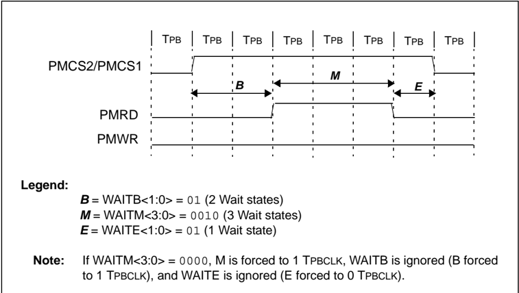

Wait states can be added to the beginning, middle and end of any read or write cycle using the corresponding WAITB, WAITM and WAITE bits in the PMMODE register.

The WAITB&lt;1:0&gt; bits (PMMODE&lt;7:6&gt;) define the number of wait cycles for the data setup prior to  the  PMRD/PMWR  strobe  in  Mode  10,  or  prior  to  the  PMENB  strobe  in  Mode  11.  When multiplexing the address and data bus, ADRMUX&lt;1:0&gt; bits (PMCON&lt;12:11&gt;) = 01 , 10 or 11 , WAITB defines the number of wait cycles for which the addressing period is extended.

The WAITM&lt;3:0&gt; bits (PMMODE&lt;5:2&gt;) define the number of wait cycles for the PMRD/PMWR strobe in Mode 10, or for the PMENB strobe in Mode 11. When this Wait state setting is ' 0000 ', WAITB and WAITE are ignored. The number of Wait states for the data setup time (WAITB) defaults to one, while the number of Wait states for data hold time (WAITE) defaults to one during a write operation and zero during a read operation.

The WAITE&lt;1:0&gt; bits (PMMODE&lt;1:0&gt;) define the number of wait cycles for the data hold time after the PMRD/PMWR strobe in Mode 10, or after the PMENB strobe in Mode 11.

## 13.3.1.9 ADDRESS MULTIPLEXING

Address multiplexing allows some or all address line signals to be generated from the data bus during the address cycle of a read/write operation. This can be a useful option for address lines PMA&lt;15:0&gt; needed as general purpose I/O pins. The user application can select to multiplex the lower 8 data bits, upper 8 data bits or full 16 data bits. These multiplexing modes are available in both Master mode 1 and 2. For Multiplexing mode timing diagrams, see 13.3.8 'Master Mode Timing' .

Table 13-5: Address Multiplex Configurations

|   ADRMUX<1:0> | Address/Data Multiplex Modes                           |
|---------------|--------------------------------------------------------|
|            11 | Fully multiplexed (16 data pins PMD<15:0>)             |
|            10 | Fully multiplexed (lower eight data pins PMD<7:0>)     |
|            01 | Partially multiplexed (lower eight data pins PMD<7:0>) |
|            00 | Demultiplexed                                          |

## 13.3.1.9.1 Demultiplexed Mode

Demultiplexed mode is selected by configuring the ADRMUX&lt;1:0&gt; bits (PMCON&lt;12:11&gt;) = 00 . In this mode, address bits are presented on pins PMA&lt;15:0&gt;.

When  PMCS2  is  enabled,  address  pin  PMA15  is  not  available.  When  PMCS1  is  enabled, address  pin  PMA14  is  not  available.  In  16-bit  Data  mode,  data  bits  are  presented  on  pins PMD&lt;15:0&gt;. In 8-bit Data mode, data bits are presented on pins PMD&lt;7:0&gt;.

Figure 13-3: Demultiplexed Addressing Mode

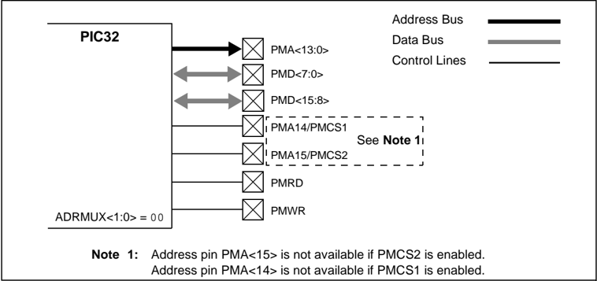

Figure 13-4: Demultiplexed Addressing Example

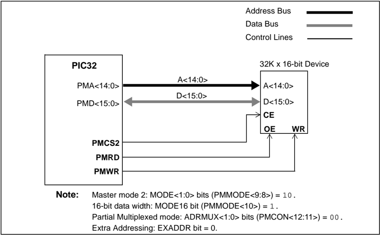

## 13.3.1.9.2 Partially Multiplexed Mode

Partially  Multiplexed  mode  (8-bit  data  pins)  is  available  in  both  8-bit  and  16-bit  data  bus configurations and is selected by setting the ADRMUX&lt;1:0&gt; bits (PMCON&lt;12:11&gt;) = 01 . In this mode, the lower eight address bits are multiplexed with the lower eight data bus pins, PMD&lt;7:0&gt;. The upper eight address bits are unaffected and are presented on PMA&lt;15:8&gt;. In this mode, address pins PMA&lt;7:1&gt; are available as general purpose I/O pins.

Address  pin  PMA15  is  not  available  when  PMCS2  is  enabled;  address  pin  PMA14  is  not available when PMCS1 is enabled.

Address pin PMA&lt;0&gt; is used as an address latch enable strobe, PMALL, during which the lower eight bits of the address are presented on the PMD&lt;7:0&gt; pins. Read and write sequences are extended by at least three peripheral bus clock cycles (TPBCLK).

If  WAITM&lt;3:0&gt;  (PMMODE&lt;5:2&gt;)  is  non-zero,  the  PMALL  strobe  will  be  extended  by WAITB&lt;1:0&gt; (PMMODE&lt;7:6&gt;) Wait states.

Figure 13-5: Partial Multiplexed Addressing Mode

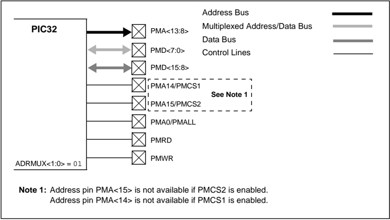

Figure 13-6: Partial Multiplexed Addressing Example

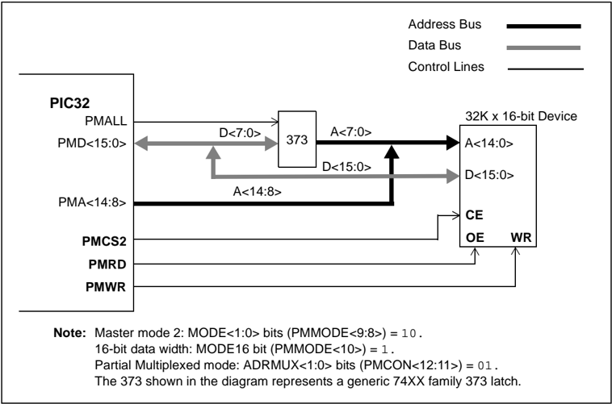

## 13.3.1.9.3 Fully Multiplexed Mode (8-bit Data Pins)

Fully  Multiplexed  mode  (8-bit  data  pins)  is  available  in  both  8-bit  and  16-bit  data  bus configurations and is selected by setting the ADRMUX&lt;1:0&gt; bits (PMCON&lt;12:11&gt;) = 10 . In this mode, the  entire  16  bits  of  the  address  are  multiplexed  with  the  lower  eight  data  bus  pins, PMD&lt;7:0&gt;. In this mode, PMA&lt;13:2&gt; pins are available as general purpose I/O pins.

If  PMCS2/PMA15 or PMCS1/PMA14 are configured as Chip Select pins, the corresponding address bit, PMADDR&lt;15&gt; or PMADDR&lt;14&gt; is automatically forced to ' 0 '.

Address pins PMA&lt;0&gt; and PMA&lt;1&gt; are used as an address latch enable strobes, PMALL and PMALH, respectively. During the first cycle, the lower eight address bits are presented on the PMD&lt;7:0&gt; pins with the PMALL strobe active. During the second cycle, the upper eight address bits are presented on the PMD&lt;7:0&gt; pins with the PMALH strobe active. The read and write sequences are extended by at least six peripheral bus clock cycles (TPBCLK).

If WAITM&lt;3:0&gt; (PMMODE&lt;5:2&gt;) is non-zero, both PMALL and PMALH strobes will be extended by WAITB&lt;1:0&gt; (PMMODE&lt;7:6&gt;) Wait states.

Figure 13-7: Fully Multiplexed Addressing Mode (8-bit Bus)

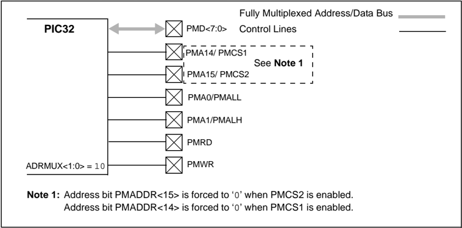

Figure 13-8: Fully Multiplexed Address Example (8-bit Bus)

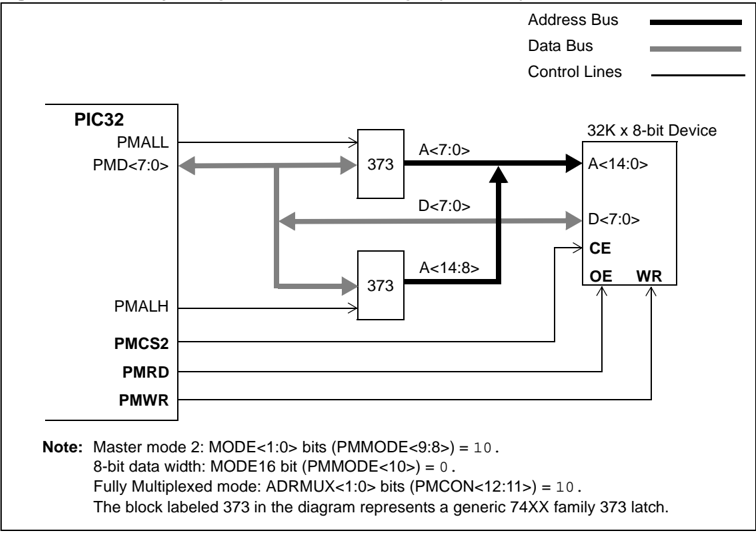

## 13.3.1.9.4 Fully Multiplexed Mode (16-bit Data Pins)

Fully Multiplexed mode (16-bit data pins) is only available in the 16-bit data bus configuration and is  selected by configuring the ADRMUX&lt;1:0&gt; bits (PMCON&lt;12:11&gt;) = 11 .  In  this  mode,  the entire 16 bits of the address are multiplexed with all 16 data bus pins, PMD&lt;15:0&gt;.

If  PMCS2/PMA15 or PMCS1/PMA14 are configured as Chip Select pins, the corresponding address bit, PMADDR&lt;15&gt; or PMADDR&lt;14&gt; is automatically forced to ' 0 '.

Address pins PMA&lt;0&gt; and PMA&lt;1&gt; are used as an address latch enable strobes, PMALL and PMALH, respectively, and at the same time. While the PMALL and PMALH strobes are active, the lower eight address bits are presented on the PMD&lt;7:0&gt; pins and the upper eight address bits are presented on the PMD&lt;15:8&gt; pins. The read and write sequences are extended by at least 3 peripheral bus clock cycles (TPBCLK).

If WAITM&lt;3:0&gt; (PMMODE&lt;5:2&gt;) is non-zero, both PMALL and PMALH strobes will be extended by WAITB&lt;1:0&gt; (PMMODE&lt;7:6&gt;) Wait states.

Figure 13-9: Fully Multiplexed Addressing Mode (16-bit Bus)

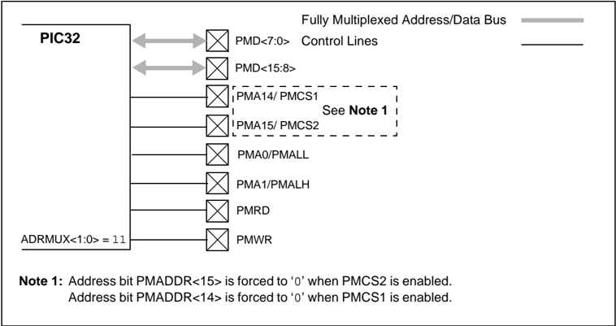

Figure 13-10: Fully Multiplexed Addressing Example (16-bit Bus)

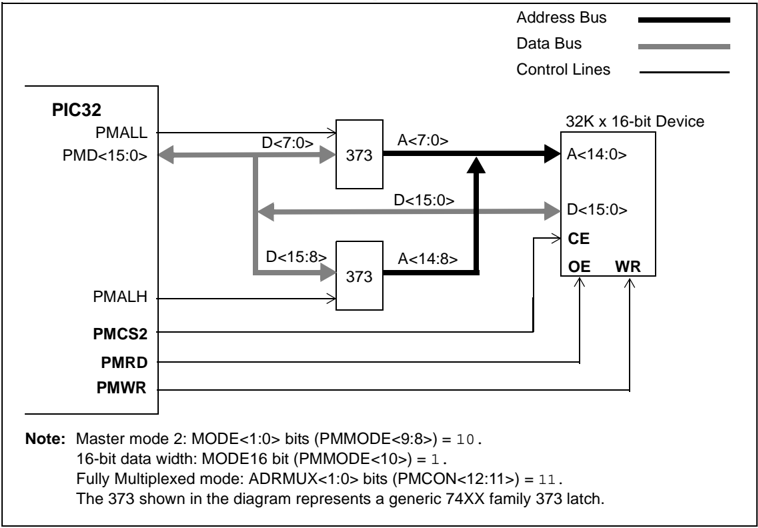

## Section 13. Parallel Master Port (PMP)

## 13.3.2 Master Mode Configuration

The Master mode configuration is  determined primarily  by  the  interface  requirements  to  the external device. Address multiplexing, control signal polarity, data width and Wait states typically dictate the specific configuration of the PMP.

To  use  the  PMP  as  a  master,  the  module  must  be  enabled  by  setting  the  ON  control  bit (PMCON&lt;15&gt;) = 1 , and the mode must be set to one of two possible master modes. Control bits MODE&lt;1:0&gt; (PMMODE&lt;9:8&gt;) = 10 for Master mode 2, or MODE&lt;1:0&gt; = 11 for Master mode 1.

The following Master mode initialization steps prepares the PMP port for communicating with an external device.

1. If interrupts are used, disable the PMP interrupt by clearing the interrupt enable bit, PMPIE (IEC1&lt;2&gt;) = 0 .
2. Stop and reset the PMP module by clearing the ON control bit (PMCON&lt;15&gt;) = 0 .
3. Configure the desired settings in the PMCON, PMMODE and PMAEN control registers.
- a) Set the EXADDR PMCON&lt;16&gt; bit if 24 bit addressing is being used.
4. If interrupts are used:
- a) Clear the interrupt flag bit, PMPIF (IFS1&lt;2&gt;) = 0 .
- b) Configure the PMP interrupt priority bits PMPIP&lt;2:0&gt; (IPC7&lt;4:2&gt;) and the interrupt subpriority bits PMPIS (IPC7&lt;1:0&gt;).
- c) Enable the PMP interrupt by setting the interrupt enable bit, PMPIE = 1 .
5. Enable the PMP master port by setting the ON control bit = 1 .

Note: It is recommended to wait for any pending read or write operation to be completed before reconfiguring the PMP module.

The following list illustrates an example setup for a typical Master mode 2 operation:

1. Select Master mode 2: MODE&lt;1:0&gt; bits (PMMODE&lt;9:8&gt;) = 10 .
2. Select 16-bit Data mode: MODE16 bit (PMMODE&lt;10&gt;) = 0 .
3. Select partially multiplexed addressing: ADRMUX&lt;1:0&gt; bits (PMCON&lt;12:11&gt;) = 01 .
4. Select auto address increment: INCM&lt;1:0&gt; bits (PMMODE&lt;12:11&gt;) = 01 .
5. Enable Interrupt Request mode: IRQM&lt;1:0&gt; bits (PMMODE&lt;14:13&gt;) = 01 .
6. Enable PMRD strobe: PTRDEN bit (PMCON&lt;8&gt;)  = 1 .
7. Enable PMWR strobe: PTWREN bit (PMCON&lt;9&gt;) = 1 .
8. Enable PMCS2 and PMCS1 Chip Selects: CSF&lt;1:0&gt; bits (PMCON&lt;7:6&gt;) = 10 .
9. Select PMRD active-low pin polarity: RDSP bit (PMCON&lt;0&gt;) = 0 .
10. Select PMWR active-low pin polarity: WRSP bit (PMCON&lt;1&gt;) = 0 .
11. Select PMCS2, PMCS1 active-low pin polarity: CS2P bit (PMCON&lt;4&gt;) = 0 and CS1P bit (PMCON&lt;3&gt;) = 0 .
12. Select 1 wait cycle for data setup: WAITB&lt;1:0&gt; bits (PMMODE&lt;7:6&gt;) = 00 .
13. Select 2 wait cycles to extend PMRD/PMWR: WAITM&lt;3:0&gt; bits (PMMODE&lt;5:2&gt;) = 0001 .
14. Select 1 wait cycle for data hold: WAITE&lt;1:0&gt; bits (PMMODE&lt;1:0&gt;) = 00 .
15. Enable upper 8 PMA&lt;15:8&gt; address pins: PMAEN&lt;15:8&gt; = 1 (the lower 8 bits can be used as general purpose I/O).

See the code shown in Example 13-1.

## PIC32 Family Reference Manual

## Example 13-1: Initialization for Master Mode 2, Demultiplexed Address, 16-bit Data

```
/*  Configuration Example: Master mode 2, 16-bit data, partially multiplexed address/data, active-lo polarities. */ IEC1CLR = 0x0004 // Disable PMP interrupt PMCON = 0x0000; // Stop PMP module and clear control register  PMCONSET = 0x0B80; // Configure the addressing and polarities  PMMODE = 0x2A40; // Configure the mode PMAEN = 0xFF00; // Enable all address and Chip Select lines IPC7SET = 0x001C; // Set priority level = 7 and IPC7SET = 0x0003; // Set subpriority level = 3 // Could have also done this in single // operation by assigning IPC7SET = 0x001F IEC1SET = 0x0004; // Enable PMP interrupts  PMCONSET = 0x8000; // Enable the PMP module
```

## 13.3.3 Read Operation

To perform a read on the parallel bus, the user application reads the PMDIN register. The effect of reading the PMDIN register retrieves the current value and causes the PMP to activate the Chip  Select  lines  and  the  address  bus.  The  read  line  PMRD  is  strobed  in  Master  mode  2, PMRD/PMWR and PMENB lines in Master mode 1, and the new data is latched into the PMDIN register making it available the next time the PMDIN register is read.

Note that the read data obtained from the PMDIN register is actually the read value from the previous read operation. Therefore, the first user application read will be a dummy read to initiate the first bus read and fill the read register. See Figure 13-11, which illustrates this sequence. Also, the requested read value will not be ready until after the BUSY bit (PMMODE&lt;15&gt;) is observed low. Therefore, in a back-to-back read operation, the data read from the register will be the same for both reads. The next read of the register will yield the new value.

In  16-bit  Data mode (MODE16 bit (PMMODE&lt;10&gt;) = 1) ,  the  read  from  the  PMDIN  register causes the data bus PMD&lt;15:0&gt; to be read into PMDIN&lt;15:0&gt; (see the following Note ). In 8-bit mode, MODE16 bit (PMMODE&lt;10&gt;) = 0 , the read from the PMDIN register causes the data bus PMD&lt;7:0&gt; to be read into PMDIN&lt;7:0&gt;. The upper 8 bits, PMD&lt;15:8&gt;, are ignored.

Note: Refer to the 13.3.1.2 'Dual Buffer Mode' for additional information.

Figure 13-11: Example Read Sequence Demonstrating 'Dummy' Read Operation

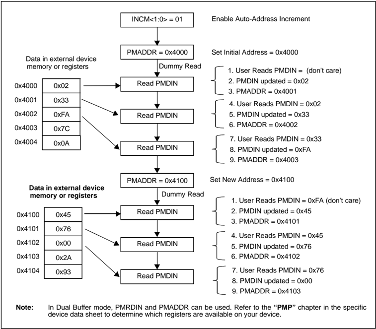

## 13.3.4 Write Operation

To perform a write on the parallel port, the user application writes to the PMDIN register (same register as a read operation). This causes the PMP module to first activate the Chip Select lines and the address bus. The write data from the PMDIN register is placed onto the PMD data bus and the write line PMPWR is strobed in Master mode 2, PMRD/PMWR and PMENB lines in Master Mode 1.

In 16-bit Data mode (MODE16 bit (PMMODE&lt;10&gt;) = 1 ), the write to the PMDIN register causes PMDIN&lt;15:0&gt;  to  appear  on  the  data  bus,  (PMD&lt;15:0&gt;).  In  8-bit  mode,  MODE16  bit (PMMODE&lt;10&gt;) = 0 , the write to the PMDIN register causes PMDIN&lt;7:0&gt; to appear on the data bus, PMD&lt;7:0&gt;. The upper 8 bits, PMD&lt;15:8&gt;, are ignored.

Note: Refer to the 13.3.1.2 'Dual Buffer Mode' for additional information.

## 13.3.5 Master Mode Interrupts

In PMP master modes, the PMPIF bit is set on every read or write strobe. An interrupt request is generated when the IRQM&lt;1:0&gt; bits (PMMODE&lt;14:13&gt;) are set = 01 and PMP interrupts are enabled, PMPIE (IEC1&lt;2&gt;) = 1 .

## 13.3.6 Parallel Master Port Status - The BUSY Bit

In addition to the PMP interrupt, the BUSY bit (PMMODE&lt;15&gt;) is provided to indicate the status of the module. This bit is only used in Master mode.

While any read or write operation is in progress, the BUSY bit is set for all but the very last peripheral bus cycle of the operation. This is helpful when Wait states are enabled or multiplexed address/data is selected. While the bit is set, any request by the user to initiate a new operation will be ignored (i.e., writing or reading the PMDIN register will not initiate a read or a write).

Since the system clock, SYSCLK, can operate faster than the peripheral bus clock in certain configurations, or if a large number of Wait states are used, it is possible for the PMP module to be in  the  process of  completing  a read  or  write  operation  when  the  next  CPU  instruction  is reading or writing to the PMP module. For this reason, it is highly recommended that the BUSY bit  be  checked  prior  to  any  operation  that  accesses  the  PMDIN  or  PMADDR  register. Example 13-2 shows a polling operation of the BUSY bit prior to accessing the PMP module.

In most applications, the PMP module's Chip Select pin(s) provide the Chip Select interface and is under the timing control of the PMP module. However, some applications may require the PMP Chip Select pin(s) to not be configured as a Chip Select, but as a high order address line, such as  PMA&lt;14&gt;  or  PMA&lt;15&gt;.  In  this  situation,  the  application's  Chip  Select  function  must  be provided by an available I/O port pin under software control. In these cases, it is  especially important that the user's software poll the BUSY bit to ensure any read or write operation is complete before deasserting the software controlled Chip Select.

## Example 13-2: Example Code: Polling the BUSY Bit Flag

```
/*  This example reads 256 16-bit words from an external device at address 0x4000 and copies the data to a second external device at address 0x8000. The PMP port is operating in Master mode 2. Note how the PMP's BUSY bit is polled prior to all operations to the PMDOUT, PMDIN or PMADDR register, except where noted. */ unsigned short DataArray<256>; // Provide the setup code here including large Wait // states, auto increment. ... CopyData(); // A call to the copy function is made. ... void CopyData() { PMADDR = 0x4000; // Initialize PMP address. First time, no need to poll BUSY bit while(PMMODE & 0x8000); // Poll - if busy, wait before reading. PMDIN; // Read the PMDIN to clear previous data and latch new // data. for(i=0; i<256; i++) { while(PMMODE & 0x8000); // Poll - if busy, wait before reading. DataArray<i> = PMDIN; // Read the external device. } while(PMMODE & 0x8000); // Poll - if busy, wait before changing PMADDR. PMADDR = 0x8000; // Address of second external device. for(i=0; i<256; i++) { while(PMMODE & 0x8000); // Poll - if busy, wait before writing. PMDIN = DataArray<i> // Write the external device. } return(); }
```

## 13.3.7 Addressing Considerations

The PMCS2/PMCS2A and PMCS1/PMCS1A Chip Select pins share functionality with address lines  A15/A23  and  A14/A22.  It  is  possible  to  enable  both  as  Chip  Selects,  or  enable  only PMCS2/PMCS2A as a Chip Select; allowing PMCS1/PMCS1A to function strictly as address line A14/A22. It is not possible to enable only PMCS1/PMCS1A.

Note: Setting both A15/A23 and A14/A22 = 1 when PMCS2/PMCS2A and PMCS1/PMCS1A are enabled as Chip Selects will cause both chip selects to be active during a read or write operation. This may enable two devices simultaneously and should be avoided.

When configured as Chip Selects, a ' 1 ' must be written into the CS bit position of the PMADDR register in order for the chip select to become active during a read or write operation. Failing to write a ' 1 ' to the chip select bit does not prevent the address pins PMA&lt;13:0&gt; from being active as the specified address appears; however, no Chip Select signal will be active.

Note: When using Auto-Increment Address mode, the PMCS2/PMCS2A and PMCS1/PMCS1A bits do not participate and must be controlled by the user's software by writing to ' 1 ' to their respective PMADDR address bits.

In fully multiplexed modes, address bits PMADDR&lt;15:0&gt; are multiplexed with the data bus and in the event address bits PMA15 or PMA14 are configured as Chip Selects, the corresponding PMADDR&lt;15:14&gt; address bits are automatically forced to ' 0 '. Disabling one or both PMCS2 and PMCS1 makes these bits available as address bits PMADDR&lt;15:14&gt;.

In any of the master mode multiplexing schemes, disabling both Chip Select pins PMCS2 and PMCS1 requires the user to provide Chip Select line control through some other I/O pin under software control, as shown in Figure 13-12.

## PIC32 Family Reference Manual

Figure 13-12: PMP Chip Select Address Maps

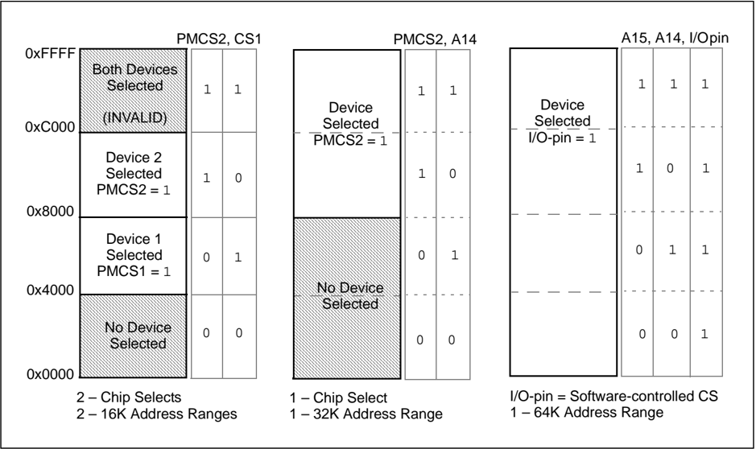

## 13.3.7.1 ADDRESSING MEMORY DEVICES LARGER THAN 64K (EXADDR = 0)

When using the PMCS2 or PMCS1 Chip Select pins, the addressable range is limited to 16K or 32K locations, depending on the Chip Select pin being used. Disabling PMCS2 and PMCS1 as Chip Selects allows these pins to function as address lines PMA15 and PMA14, increasing the range to 64K addressable locations. A dedicated I/O pin is required to function as the Chip Select and the user's software must now control the function of this pin. 



To interface to memory devices larger than 64K, use additional available I/O pins as the higher order address lines A16, A17, A18, etc., as shown in Figure 13-13.

Figure 13-13: Interface to a 16 Megabit (1M x 16-bit) SRAM Memory Device

Note: Master mode 2: MODE&lt;1:0&gt; bits (PMMODE&lt;9:8&gt;) = 10.  16-bit data width: MODE16 bit (PMMODE&lt;10&gt;) = 1.  Demultiplexed mode: ADRMUX&lt;1:0&gt; bits (PMCON&lt;12:11&gt;) =

00.

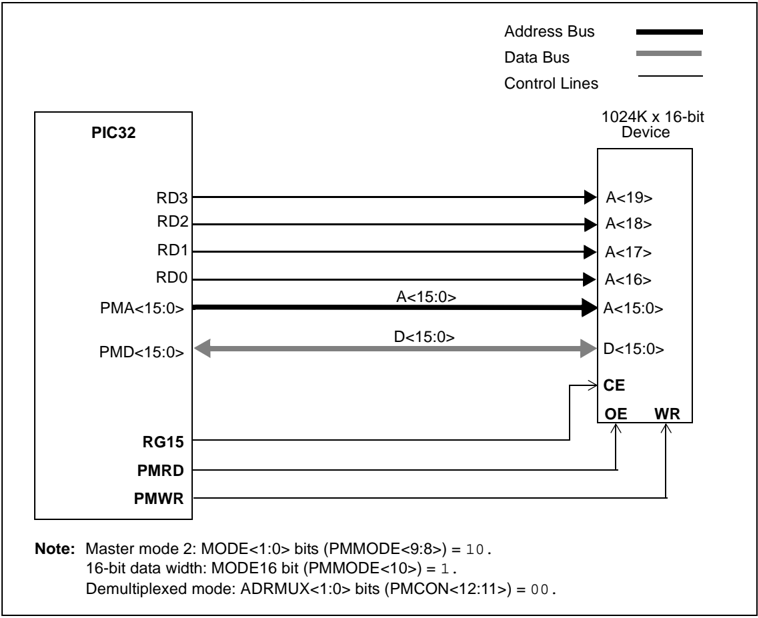

## 13.3.8 Master Mode Timing

A PMP Master mode cycle time is defined as the number of PBCLK cycles required by the PMP to  perform  a  read  or  write  operation  and  is  dependent  on  PBCLK  clock  speed,  PMP Address/Data  Multiplexing  modes,  and  the  number  of  PMP  wait  states,  if  any.  Refer  to  the specific device data sheet for setup and hold timing characteristics.

A PMP Master mode read or write cycle is initiated by accessing (reading or writing) the PMDIN register. Table 13-6 provides a summary of read and write PMP cycle times for each multiplex configuration.

The actual data rate of the PMP (the rate at which the user's code can perform a sequence of read or write operations) will be highly dependent on several factors:

- User's application code content
- Code optimization level
- Internal bus activity
- Other factors relating to the instruction execution speed

Note:

During any Master mode read or write operation, the busy flag will always de-assert 1 peripheral bus clock cycle (TPBCLK), before the end of the operation, including Wait states. The user's application must check the status of the busy flag to ensure it is equal to ' 0 ' before initiating the next PMP operation.

Table 13-6: PMP Read/Write Cycle Times (1)

| Address/Data Multiplex Configuration   | ADRMUX Bit Settings   | PMP Cycle Time (PBCLK Cycles)   | PMP Cycle Time (PBCLK Cycles)   |
|----------------------------------------|-----------------------|---------------------------------|---------------------------------|
| Address/Data Multiplex Configuration   | ADRMUX Bit Settings   | Read                            | Write                           |
| Fully Multiplexed (16-bit data)        | 11                    | 5                               | 6                               |
| Fully Multiplexed (8-bit data)         | 10                    | 8                               | 9                               |
| Partial Multiplex                      | 01                    | 5                               | 6                               |
| Demultiplexed                          | 00                    | 2                               | 3                               |

Note 1: Wait states are not enabled.

The following timing examples represent the common master mode configuration options. These options vary from 8-bit to 16-bit data, non-multiplexed to fully multiplexed address, as well as with and without Wait states. For illustration purposes only, all control signal polarities are shown as 'active-high'.

## 13.3.8.1 DEMULTIPLEXED ADDRESS AND DATA TIMING

The timing diagram in Figure 13-14 illustrates the demultiplexed timing (separate address and data bus) for a read operation with no Wait states. A read operation requires 2 TPBCLK, peripheral bus clock cycles.

Figure 13-14: 8-bit, 16-bit Read Operations, ADRMUX = 00 , No Wait States, EXADDR = 0

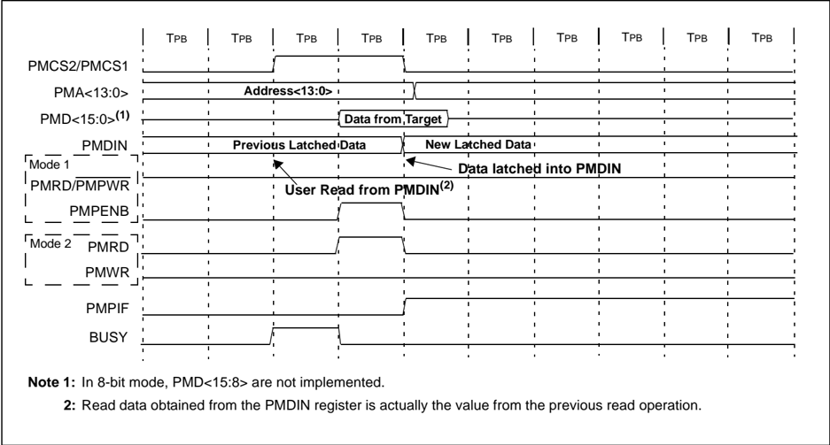

In  this  timing  diagram  with  Wait  states,  shown  in  Figure 13-15,  the  read  operation  requires 6 TPBCLK, peripheral bus clock cycles.

Figure 13-15: 8-bit, 16-bit Read Operations, ADRMUX = 00 , Wait States Enabled, EXADDR = 0

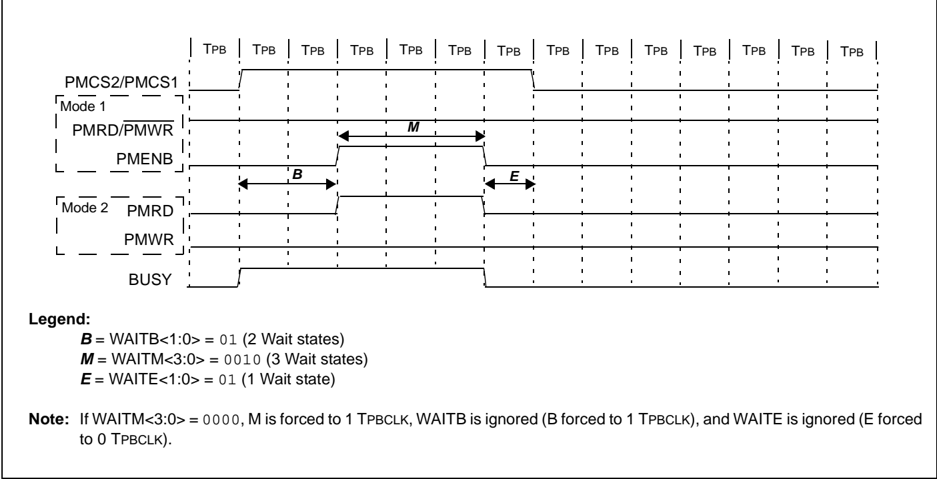

The timing diagram in Figure 13-16 illustrates demultiplexed timing (separate address and data bus) for a write operation with no Wait states. A write operation requires 3 TPBCLK, peripheral bus clock cycles.

Figure 13-16: 8-bit, 16-bit Write Operations, ADRMUX = 00 , No Wait States, EXADDR = 0

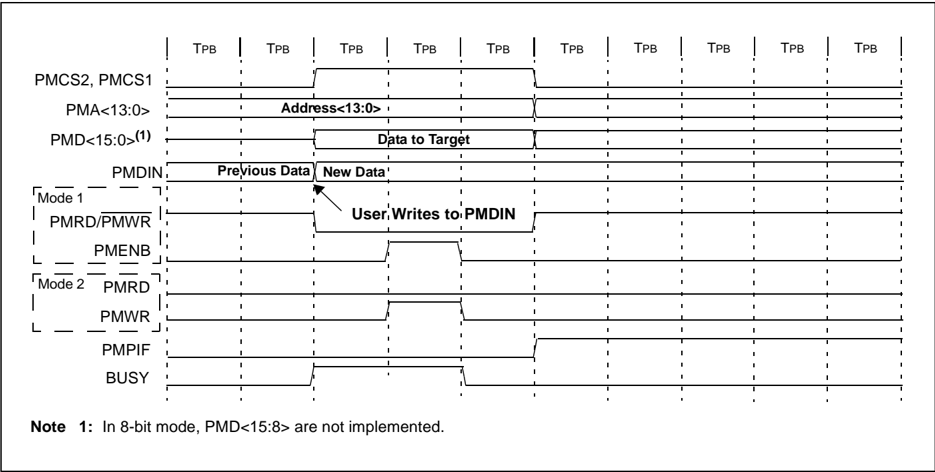

In  this  timing  diagram  with  Wait  states,  shown  in  Figure 13-17,  the  write  operation  requires 7 TPBCLK, peripheral bus clock cycles.

Figure 13-17: 8-bit, 16-bit Write Operations, ADRMUX = 00 , Wait States Enabled, EXADDR = 0

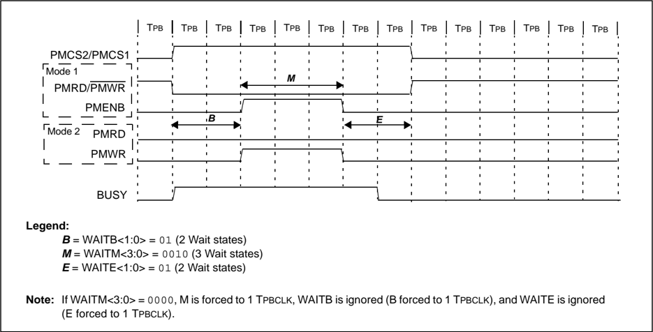

## 13.3.8.2 PARTIALLY MULTIPLEXED ADDRESS AND DATA TIMING

The timing diagram shown in Figure 13-18 illustrates partially multiplexed timing (address bits &lt;7:0&gt; multiplexed with data bus, PMD&lt;7:0&gt;) for a read operation with no Wait states. A read operation requires 5 TPBCLK, peripheral bus clock cycles.

Figure 13-18: 8-bit, 16-bit Read Operations, ADRMUX = 01 , No Wait States

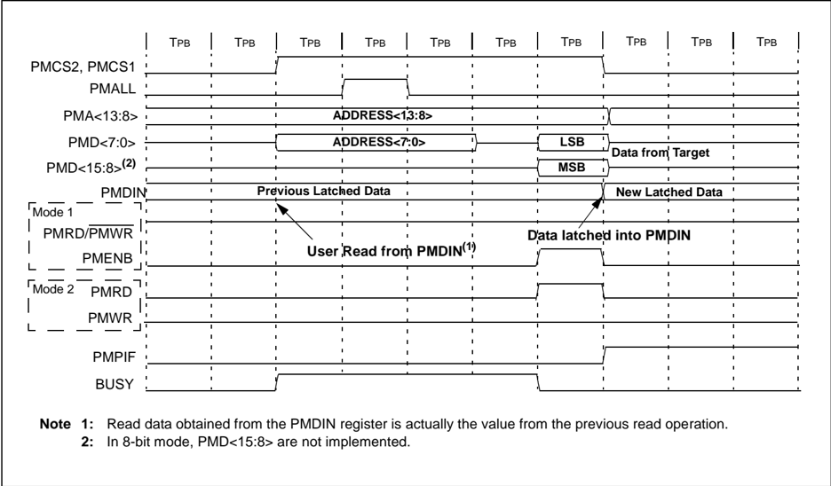

In  this  timing  diagram  with  Wait  states,  shown  in  Figure 13-19,  the  read  operation  requires 10 TPBCLK, peripheral bus clock cycles.

Figure 13-19: 8-bit, 16-bit Read Operations, ADRMUX = 01 , Wait States Enabled

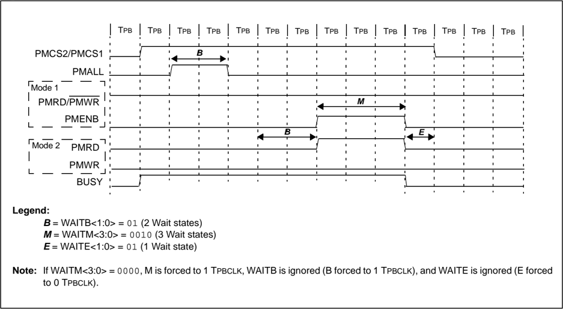

The timing diagram shown in Figure 13-20 illustrates partially multiplexed timing (address bits &lt;7:0&gt; multiplexed with data bus, PMD&lt;7:0&gt;) for a write operation with no Wait states. A write operation requires 6 TPBCLK, peripheral bus clock cycles.

Figure 13-20: 8-bit, 16-bit Write Operations, ADRMUX = 01 , No Wait States

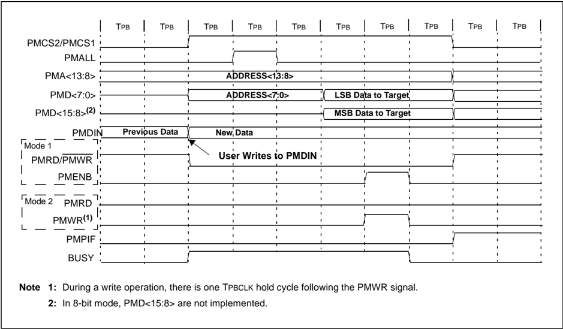

In  this  timing  diagram  with  Wait  states,  shown  in  Figure 13-21,  the  write  operation  requires 11 TPBCLK, peripheral bus clock cycles.

Figure 13-21: 8-bit, 16-bit Write Operations, ADRMUX = 01 , Wait States Enabled

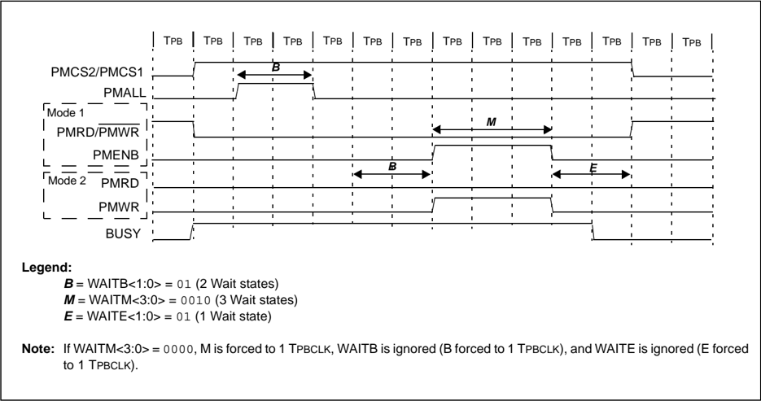

## 13.3.8.3 FULLY MULTIPLEXED (8-BIT BUS) ADDRESS AND DATA TIMING

The  timing  diagram  in  Figure 13-22  illustrates  fully  multiplexed  timing  (address  bits  &lt;15:0&gt; multiplexed with data bus, PMD&lt;7:0&gt;) for a read operation with no Wait states. A read operation requires 8 TPBCLK, peripheral bus clock cycles.

Figure 13-22: 8-bit, 16-bit Read Operations, ADRMUX = 10 , No Wait States

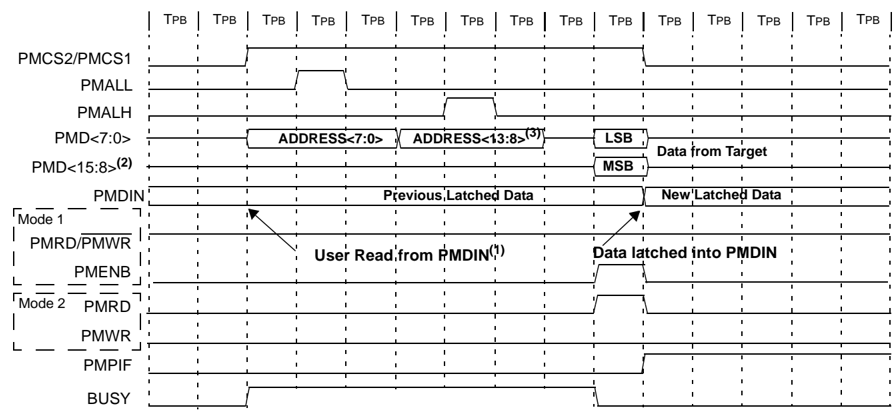

Note 1: Read data obtained from the PMDIN register is actually the value from the previous read operation.

- 2: In 8-bit mode, PMD&lt;15:8&gt; are not implemented.
- 3: PMADDR address bit A15 and A14 are forced to ' 0 ' if PMCS2 and/or PMCS1 are enabled as Chip Selects.

In  this  timing  diagram  with  Wait  states,  shown  in  Figure 13-23,  the  read  operation  requires 14 TPBCLK, peripheral bus clock cycles.

Figure 13-23: 8-bit, 16-bit Read Operations, ADRMUX = 10 , Wait States Enabled

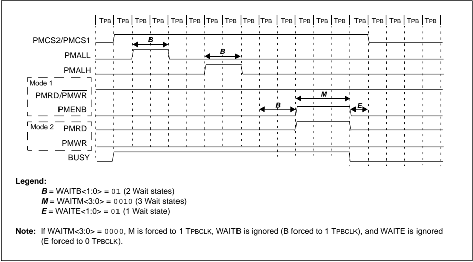

The  timing  diagram  shown  in  Figure 13-24  illustrates  fully  multiplexed  timing  (address  bits &lt;15:0&gt; multiplexed with data bus, PMD&lt;7:0&gt;) for a write operation with no Wait states. A write operation requires 9 TPBCLK, peripheral bus clock cycles.

Figure 13-24: 8-bit, 16-bit Write Operations, ADRMUX = 10 , No Wait States

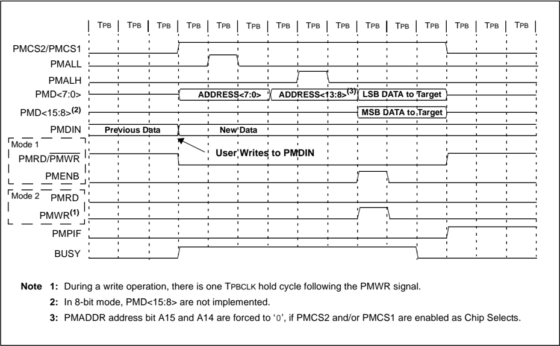

In  this  timing  diagram  with  Wait  states,  shown  in  Figure 13-25,  the  write  operation  requires 15 TPBCLK, peripheral bus clock cycles.

Figure 13-25: 8-bit, 16-bit Write Operations, ADRMUX = 10 , Wait States Enabled

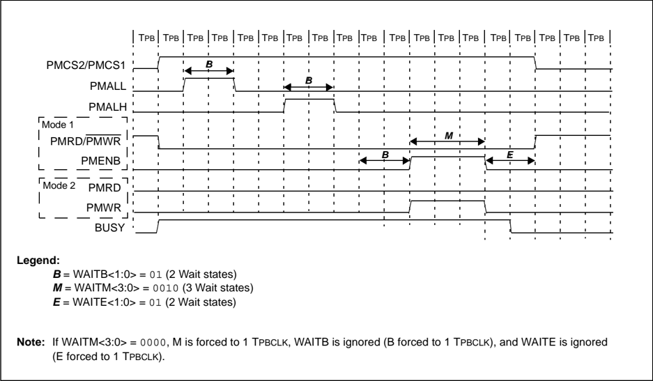

## 13.3.8.4 FULLY MULTIPLEXED (16-BIT BUS) ADDRESS AND DATA TIMING

The  timing  diagram  shown  in  Figure 13-26  illustrates  fully  multiplexed  timing  (address  bits &lt;15:0&gt; multiplexed with data bus, PMD&lt;15:0&gt;) for a read operation with no Wait states. A read operation requires 5 TPBCLK, peripheral bus clock cycles.

Figure 13-26: 16-bit Read Operation, ADRMUX = 11 , No Wait States

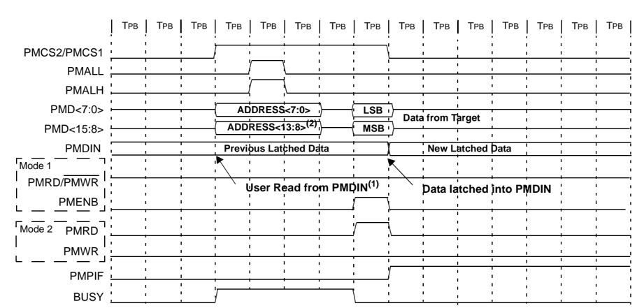

Note 1: Read data obtained from the PMDIN register is actually the value from the previous read operation.

- 2: PMADDR address bit A15 and A14 are forced to ' 0 ' if PMCS2 and/or PMCS1 are enabled as Chip Selects.

In  this  timing  diagram  with  Wait  states,  shown  in  Figure 13-27,  the  read  operation  requires 10 TPBCLK, peripheral bus clock cycles.

Figure 13-27: 16-bit Read Operation, ADRMUX = 11 , Wait States Enabled

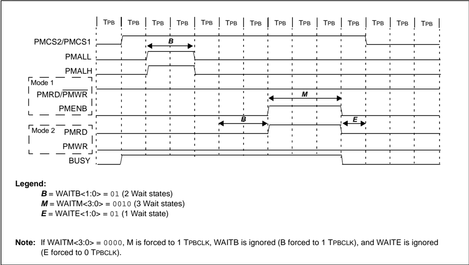

The  timing  diagram  shown  in  Figure 13-28  illustrates  fully  multiplexed  timing  (address  bits &lt;15:0&gt; multiplexed with data bus, PMD&lt;15:0&gt;) for a write operation with no Wait states. A read operation requires 6 TPBCLK, peripheral bus clock cycles.

Figure 13-28: 16-bit Write Operation, ADRMUX = 11 , No Wait States

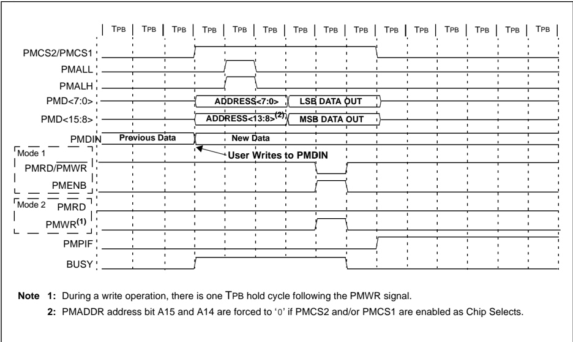

In  this  timing  diagram  with  Wait  states,  shown  in  Figure 13-29,  the  write  operation  requires 11 TPBCLK , peripheral bus clock cycles.

Figure 13-29: 16-bit Write Operation, ADRMUX = 11 , Wait States Enabled

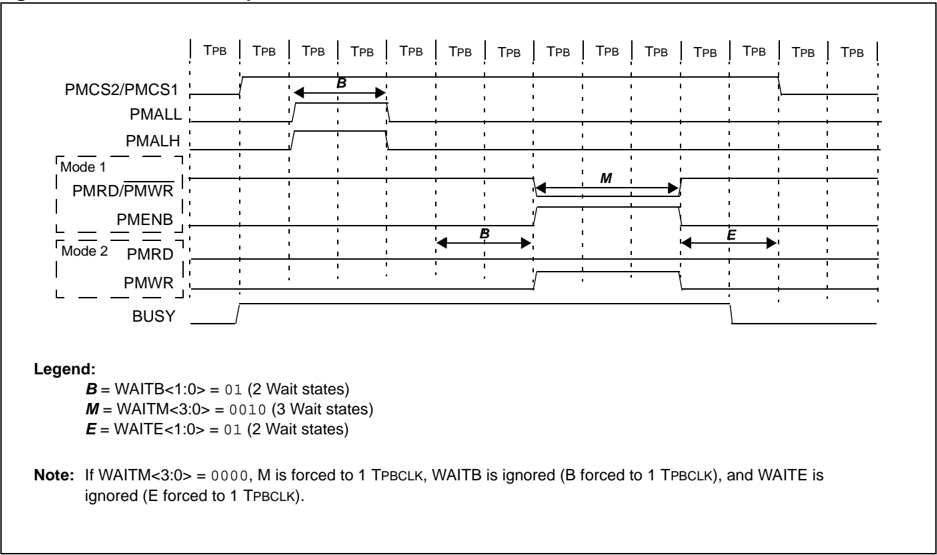

## 13.4 SLAVE MODES OF OPERATION

The PMP module provides 8-bit (byte) legacy Parallel Slave Port (PSP) functionality as well as new buffered and addressable slave modes.

Table 13-7: Slave Mode Selection

| Slave Mode   |   PMMODE<9:8> bits (MODE<1:0>) | PMMODE<12:11> bits (INCM<1:0>)   |
|--------------|--------------------------------|----------------------------------|
| Addressable  |                             01 | x = don't care                   |
| Legacy       |                             00 | x = don't care                   |
| Buffered     |                             00 | 11                               |

All slave modes support 8-bit data only and the module control pins are automatically dedicated when any of these modes are selected. The user application only needs to configure the polarity of the PMCS1, PMRD and PMWR signals.

Table 13-8: Slave Mode Pin Polarity Configuration

| CONTROL PIN   | PMCON Control Bit   |   Active-High Select |   Active-Low Select |
|---------------|---------------------|----------------------|---------------------|
| PMRD          | RDSP                |                    1 |                   0 |
| PMWR          | WRSP                |                    1 |                   0 |
| PMCS1         | CS1P                |                    1 |                   0 |

## 13.4.1 Legacy Slave Port Mode

In  8-bit  PMP  Legacy  Slave  mode,  the  module  is  configured  as  a  PSP  using  control  bits MODE&lt;1:0&gt;  (PMMODE&lt;9:8&gt;)  = 00 .  In  this  mode,  an  external  device  such  as  another microcontroller or microprocessor can asynchronously read and write data using the 8-bit data bus PMD&lt;7:0&gt;, the read PMRD, write PMWR and Chip Select PMCS1 inputs.

Figure 13-30: Parallel Master/Slave Connection Example

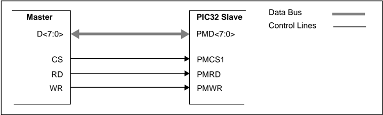

## 13.4.1.1 INITIALIZATION STEPS

The following Slave mode initialization steps properly prepares the PMP port for communicating with an external device.

1. Clear the ON control bit (PMCON&lt;15&gt; = 0 ) to disable the PMP module.
2. Select Legacy mode with the MODE&lt;1:0&gt; bits (PMMODE&lt;9:8&gt;) = 00 .
3. Select the polarity of the Chip Select pin, CS1P (PMCON&lt;3&gt;).
4. Select the polarity of the control pins, WRSP (PMCON&lt;1&gt;) and RDSP (PMCON&lt;0&gt;).
5. If interrupts are used:
- a) Clear the interrupt flag bit, PMPIF (IFS1&lt;2&gt;) = 0 .
- b) Configure the PMP interrupt priority bits, PMPIP&lt;2:0&gt; (IPC7&lt;4:2&gt;) and the interrupt subpriority bits PMPIS (IPC7&lt;1:0&gt;).
- c) Enable the PMP interrupt by setting the interrupt enable bit, PMPIE (IEC1&lt;2&gt;) = 1 .
6. Set the ON control bit to ' 1 ' to enable the PMP module.

```
/* Example configuration for Legacy Slave mode */ IEC1CLR  = 0x0004; // Disable PMP interrupt in case it is already enabled PMCON = 0x0008; // Stop and Configure PMCON register for Legacy mode PMMODE = 0x0000; // Configure PMMODE register IPC7SET  = 0x001C; // Set priority level = 7 and IPC7SET  = 0x0003; // Set subpriority level = 3 // Could have also done this in single // operation by assigning IPC7SET = 0x001F IFS1CLR  = 0x0004; // Clear the PMP interrupt status flag  IEC1SET  = 0x0004; // Enable PMP interrupts  PMCONSET = 0x8000; // Enable PMP module
```

Example 13-3: Legacy Parallel Slave Port Initialization (Example Code)

## 13.4.1.2 WRITE TO SLAVE PORT

When Chip Select is active and a write strobe occurs, the data on the bus pins PMD&lt;7:0&gt; is captured into the lower 8 bits of the PMDIN register, PMDIN&lt;7:0&gt;. The PMPIF (interrupt flag bit) is set during the write strobe. The IB0F bit will remain set until the PMDIN register is read by the user application. If a write operation occurs while the IB0F = 1 , the write data will be ignored and an overflow condition will be generated, IB0V = 1 .  See the timing diagrams in 13.4.4 'Slave Mode Read and Write Timing Diagrams' .

## 13.4.1.3 READ FROM SLAVE PORT

When Chip Select is active and a read strobe occurs, the data from the lower 8 bits of the PMDOUT register (PMDOUT&lt;7:0&gt;) is presented onto data bus pins PMD&lt;7:0&gt; and read by the master device. The PMPIF (interrupt flag bit) is set during the read strobe. The OB0E bit will remain set until the PMDOUT register is written to by the user application. If a read operation occurs while the OB0E = 1 , the read data will be the same as the previous read data and an underflow condition will be generated, OBUF = 1 .  See the timing diagrams in 13.4.4 'Slave Mode Read and Write Timing Diagrams' .

## 13.4.1.4 LEGACY MODE INTERRUPT OPERATION

In PMP Legacy Slave mode, the PMPIF bit is set every read or write strobe. If using interrupts, the user's application vectors to an Interrupt Service Routine (ISR) where the IBF and OBE status bits can be examined to determine if the buffer is full or empty. If not using interrupts, the user's application should wait for PMPIF to be set before polling the IBF and OBE Status bits to determine if the buffer is full or empty.

Note:

On persistent interrupt implementations of the PMP, the interrupt is generated on the  falling  edge  of  the  WR  signal  with  the  WR  signal  configured  to  active-high polarity.  On non-persistent interrupt implementations of the PMP, the interrupt is generated on the rising edge of the WR signal with the WR signal configured to active-high polarity. Firmware should poll the IBF or IBnF bit to ensure the data is valid before attempting to read the data from the PMP module.

## 13.4.2 Buffered Parallel Slave Port Mode

The 8-bit Buffered Parallel Slave Port mode is functionally identical to the Legacy Parallel Slave Port mode with one exception: the implementation of 4-level read and write buffers. Buffered Slave  mode  is  enabled  by  setting  the  MODE&lt;1:0&gt;  bits  (PMMODE&lt;9:8&gt;)  = 00 ,  and  the INCM&lt;1:0&gt; bits (PMMODE&lt;12:11&gt;) = 11 .

When the buffered mode is active, the module uses the PMDIN register as write buffers and the PMDOUT register as read buffers. Each register is divided into four 8-bit buffer registers, four read buffers in PMDOUT and four write buffers in PMDIN. Buffers are numbered 0 through 3, starting with the lower byte &lt;7:0&gt; and progressing upward through the high byte &lt;31:24&gt;.

## Section 13. Parallel Master Port (PMP)

Figure 13-31: Parallel Master/Slave Connection Buffered Example

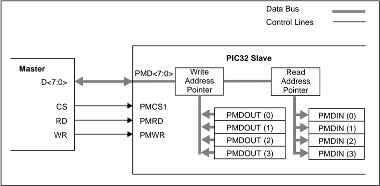

## 13.4.2.1 INITIALIZATION STEPS

The  following Buffered Slave mode  initialization properly prepares the PMP  port for communicating with an external device.

1. Clear the ON control bit (PMCON&lt;15&gt; = 0) to disable the PMP module.
2. Select the Legacy mode with MODE&lt;1:0&gt; bits (PMMODE&lt;9:8&gt;) = 00 .
3. Select Buffer mode with INCM&lt;1:0&gt; bits (PMMODE&lt;12:11&gt;) = 11 .
4. Select the polarity of the Chip Select CS1P (PMCON&lt;3&gt;).
5. Select the polarity of the control pins WRSP (PMCON&lt;1&gt;) and RDSP (PMCON&lt;0&gt;).
6. If interrupts are used:
- a) Clear interrupt flag bit PMPIF (IFS1&lt;2&gt;).
- b) Configure interrupt priority and subpriority levels in IPC7.
- c) Set interrupt enable bit PMPIE (IEC1&lt;2&gt;).
7. Set the ON control bit to ' 1 ' to enable the PMP module.

## Example 13-4: Buffered Parallel Slave Port Initialization (Example Code)

```
/*  Example configuration for Buffered Slave mode */ IEC1CLR = 0x0004 // Disable PMP interrupt in case it is already enabled PMCON = 0x0000 // Stop and configure PMCON register for Buffered mode PMMODE = 0x1800 // Configure PMMODE register IPC7SET = 0x001C; // Set priority level = 7 and IPC7SET = 0x0003; // Set subpriority level = 3 // Could have also done this in single operation by // by assigning IPC7SET = 0x001F IFS1CLR = 0x0004; // Clear the PMP interrupt status flag  IEC1SET = 0x0004; // Enable PMP interrupts  PMCONSET = 0x8000; // Enable the PMP module
```

## 13.4.2.2 READ FROM SLAVE PORT

For read operations, the bytes will be sent out sequentially, starting with Buffer 0, PMDOUT&lt;7:0&gt;, and ending with Buffer 3, PMDOUT&lt;31:24&gt;, for every read strobe. The module maintains an internal pointer to keep track of which buffer is to be read.

Each of the buffers has a corresponding read Status bit, OBnE, in the PMSTAT register. This bit is cleared when a buffer contains data that has not been written to the bus, and is set when data is written to the bus. If the current buffer location being read from is empty, a buffer underflow is generated, and the Buffer Overflow flag bit OBUF is set. If all four OBnE Status bits are set, the Output Buffer Empty flag OBE will also be set. See the timing diagrams in 13.4.4 'Slave Mode Read and Write Timing Diagrams' .

## 13.4.2.3 WRITE TO SLAVE PORT

For write operations, the data is be stored sequentially, starting with Buffer 0, PMDIN&lt;7:0&gt; and ending with Buffer 3, PMDIN&lt;31:24&gt;. As with read operations, the module maintains an internal pointer to the buffer that is to be written next.

The input buffers have their own write Status bits, IBnF. The bit is set when the buffer contains unread incoming data, and cleared when the data has been read. The flag bit is set on the write strobe. If a write occurs on a buffer when its associated IBnF bit is set, the Buffer Overflow flag IBOV is set; any incoming data in the buffer will be lost. If all four IBnF flags are set, the Input Buffer Full flag  IBF  is set.  See the timing diagrams in 13.4.4 'Slave Mode Read and Write Timing Diagrams' .

## 13.4.2.4 BUFFERED MODE INTERRUPT OPERATION

In Buffered Slave mode, the module can be configured to generate an interrupt on every read or write  strobe,  IRQM&lt;1:0&gt;  bits (PMMODE&lt;14:13&gt;) = 01 .  It  can  be  configured  to  generate  an interrupt on a read from Read Buffer 3 or a write to Write Buffer 3, IRQM&lt;1:0&gt; = 10 , which is essentially an interrupt every fourth read or write strobe. When interrupting every fourth byte for input data, all input buffer registers should be read to clear the IBnF flags. If these flags are not cleared then there is a risk of hitting an overflow condition.

If using interrupts, the user's application vectors to an Interrupt Service Routine (ISR) where the IBF and OBE status bits can be examined to determine if the buffer is full or empty. If not using interrupts, the user application should wait for PMPIF to be set before polling the IBF and OBE status bits to determine if the buffer is full or empty.

## 13.4.3 Addressable Buffered Parallel Slave Port Mode

In the 8-bit Addressable Buffered Parallel Slave Port mode, the module is configured with two extra inputs, PMA&lt;1:0&gt;. This makes the 4-byte buffer space directly addressable as fixed pairs of read and write buffers. As with Buffered Legacy mode, data is output from register PMDOUT and is input to register PMDIN. Table 13-9 shows the address resolution for the incoming address to the input and output registers.

Table 13-9: Slave Mode Buffer Addresses

|   PMA<1:0> | Output Register (Buffer)   | Input Register (Buffer)   |
|------------|----------------------------|---------------------------|
|         11 | PMDOUT<31:24> (3)          | PMDIN<31:24> (3)          |
|         10 | PMDOUT<23:16> (2)          | PMDIN<23:16> (2)          |
|         01 | PMDOUT<15:8> (1)           | PMDIN<15:8> (1)           |
|         00 | PMDOUT<7:0> (0)            | PMDIN<7:0> (0)            |

Figure 13-32: Parallel Master/Slave Connection Addressed Buffer Example

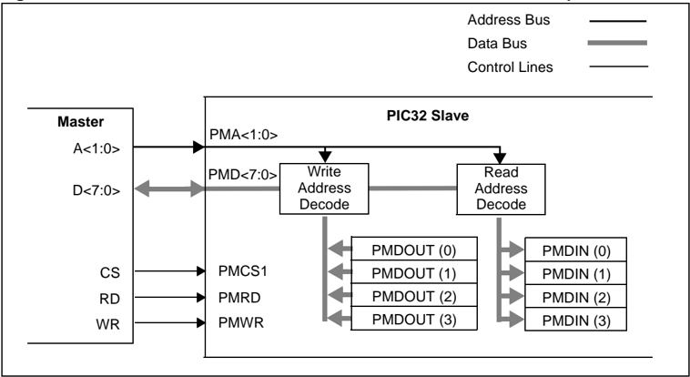

## 13.4.3.1 INITIALIZATION STEPS

The following Addressable Buffered Slave mode initialization steps properly prepares the PMP port for communicating with an external device.

1. Clear the ON control bit (PMCON&lt;15&gt; = 0 ) to disable the PMP module.
2. Select the Legacy mode with MODE&lt;1:0&gt; bits (PMMODE&lt;9:8) = 00 .
3. Select the polarity of the Chip Select CS1P (PMCON&lt;3&gt;).
4. Select the polarity of the control pins WRSP (PMCON&lt;1&gt;) and RDSP (PMCON&lt;0&gt;).
5. If interrupts are used:
- a) Clear interrupt flag bit PMPIF (IFS1&lt;2&gt;).
- b) Configure interrupt priority and subpriority levels in IPC7.
- c) Set interrupt enable bit PMPIE (IEC1&lt;2&gt;).
6. Set the ON control bit to ' 1 ' to enable the PMP module.

## Example 13-5: Addressable Parallel Slave Port Initialization (Example Code)

```
/*  Example configuration for Addressable Slave mode */ IEC1CLR = 0x0004 // Disable PMP interrupt in case it is already enabled PMCON = 0x0000 // Stop and configure PMCON register for Address mode PMMODE = 0x0100 // Configure PMMODE register IPC7SET = 0x001C; // Set priority level = 7 and IPC7SET = 0x0003; // Set subpriority level = 3 // Could have also done this in single operation // by assigning IPC7SET = 0x001F IFS1CLR = 0x0004; // Clear the PMP interrupt status flag  IEC1SET = 0x0004; // Enable PMP interrupts  PMCONSET = 0x8000; // Enable the PMP module
```

## 13.4.3.2 READ FROM SLAVE PORT

When Chip Select is active and a read strobe occurs, the data from one of the four output 8-bit buffers is presented onto PMD&lt;7:0&gt;. The byte selected to be read depends on the 2-bit address placed on PMA&lt;1:0&gt;. Table 13-9 shows the corresponding output registers and their associated address. When an output buffer is read, the corresponding OBnE bit is set. The OBE flag bit is set when all the buffers are empty. If any buffer is already empty, OBnE = 1 , the next read to that buffer will generate an OBUF event. See the timing diagrams in 13.4.4 'Slave Mode Read and Write Timing Diagrams' .

## 13.4.3.3 WRITE TO SLAVE PORT

When Chip Select is active and a write strobe occurs (PMCS = 1 and PMWR = 1 ), the data from PMD&lt;7:0&gt; is captured into one of the four input buffer bytes. The byte selected to be written depends on the 2-bit address placed on ADDR&lt;1:0&gt;. Table 13-9 shows the corresponding input registers and their associated address.

When an input buffer is written, the corresponding IBnF bit is set. The IBF flag bit is set when all the buffers are written. If any buffer is already written, IBnF = 1 , the next write strobe to that buffer will  generate  an  IBOV  event,  and  the  byte  will  be  discarded.  See  the  timing  diagrams  in 13.4.4 'Slave Mode Read and Write Timing Diagrams' .

## 13.4.3.4 ADDRESSABLE BUFFERED MODE INTERRUPT OPERATION

In Addressable Slave mode, the module can be configured to generate an interrupt on every read or write strobe, IRQM&lt;1:0&gt; bits (PMMODE&lt;14:13&gt;) = 01 . It can also be configured to generate an interrupt on any read from Read Buffer 3 or write to Write Buffer 3, IRQM&lt;1:0&gt; = 10 ; in other words, an interrupt will occur whenever a read or write occurs when PMA&lt;1:0&gt; is ' 11 '.

If using interrupts, the user application vectors to an Interrupt Service Routine (ISR) where the IBF and OBE Status bits can be examined to determine if the buffer is full or empty. If not using interrupts, the user application should wait for PMPIF to be set before polling the IBF and OBE Status bits to determine if the buffer is full or empty.

## 13.4.4 Slave Mode Read and Write Timing Diagrams

In all of the slave modes, an external master device is connected to the parallel slave port and is controlling the read and write operations. When an external read or write operation is performed by the external master device, the PMPIF bit (IFS1&lt;2&gt;) will be set on the active edge of PMRD or PMWR pin.

- For any external write operation, the user's application must poll the IBOV or IB0F buffer Status bit to ensure adequate time for the write operation to be completed before accessing the PMDIN register.
- For any external read operation, the user's application must poll the OBUF or OB0E buffer Status bit to ensure adequate time for the read operation to be completed before accessing the PMDOUT register.

Figure 13-33: Parallel Slave Port Write Operation

Note: Control signal polarity are configurable and are shown active-high in this example.

Figure 13-34: Parallel Slave Port Write Operation - Buffer Full, Overflow Condition

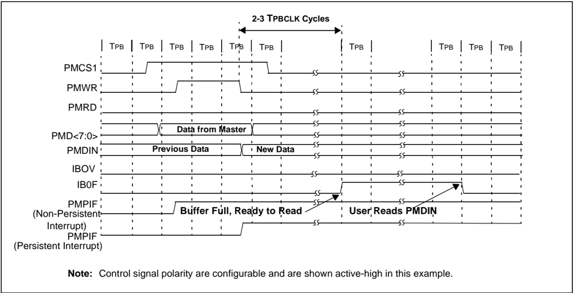

Note: Control signal polarity are configurable and are shown active-high in this example.

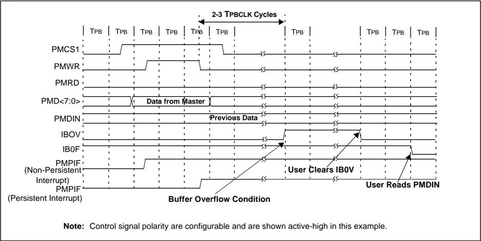

Figure 13-35: Parallel Slave Port Read Operation

Note: Control signal polarity are configurable and are shown active-high in this example.

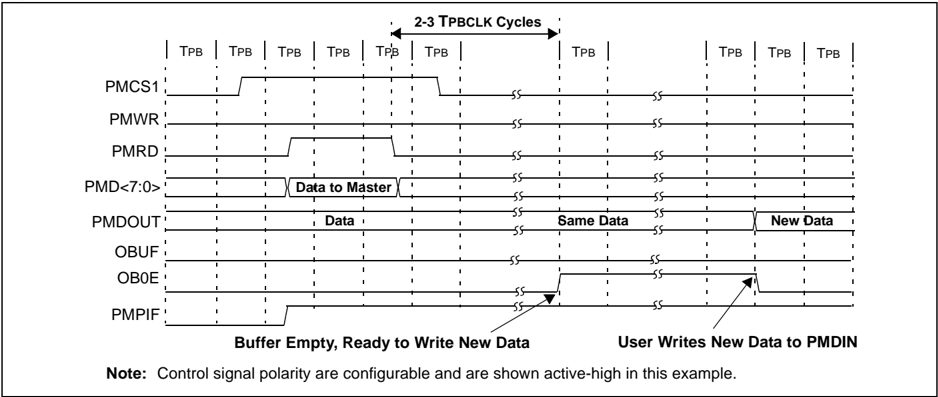

Figure 13-36: Parallel Slave Port Read Operation - Buffer Empty, Underflow Condition

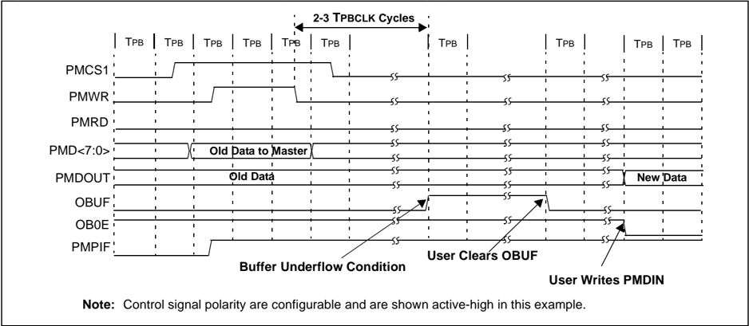

## 13.5 INTERRUPTS

The Parallel Master Port module can generate an interrupt, depending on the selected operating mode.

- PMP (Master) mode:

Interrupt on every completed read or write operation.

- PSP (Legacy Slave) mode:

Interrupt on every read and write byte

- PSP (Buffered Slave) mode:
- -Interrupt on every read and write byte
- -Interrupt on read or write byte of Buffer 3 (PMDOUT&lt;31:24&gt;)
- EPSP (Enhanced Addressable Slave) mode:
- -Interrupt on every read and write byte
- -Interrupt on read or write byte of Buffer 3 (PMDOUT&lt;31:24&gt;), PMA&lt;1:0&gt; = 11 .

The PMPIF bit must be cleared in software.

The PMP module is enabled as a source of interrupt through the PMP Interrupt Enable bit, PMPIE. The Interrupt Priority  bits (PMPIP&lt;2:0&gt;) and Interrupt Subpriority  bits (PMPIS&lt;1:0&gt;) must also be configured. For more details, refer to Section 8. 'Interrupts' (DS60001108).

## 13.5.1 Interrupt Configuration

The  PMP  module  has  a  dedicated  interrupt  flag  bit,  PMPIF,  and  a  corresponding  interrupt enable/mask bit, PMPIE. These bits are used to determine the source of an interrupt and to enable or disable an individual interrupt source.

The  PMPIE bit  is  used  to  define  the  behavior  of  the  Vector  Interrupt  Controller  or  Interrupt Controller when the PMPIF bit is set. When the PMPIE bit is clear, the Interrupt Controller module does not generate a CPU interrupt for the event. If the PMPIE bit is set, the Interrupt Controller module will generate an interrupt to the CPU when the PMPIF bit is set (subject to the priority and subpriority as outlined below).

It is the responsibility of the user's software routine that services a particular interrupt to clear the appropriate Interrupt Flag bit before the service routine is complete.

The priority of PMP module can be set with the PMPIP&lt;2:0&gt; bits. This priority defines the priority group to which the interrupt source will be assigned. The priority groups range from a value of 7, the highest priority, to a value of 0, which does not generate an interrupt. An interrupt being serviced will be preempted by an interrupt in a higher priority group.

The subpriority bits allow setting the priority of a interrupt source within a priority group. The values of the subpriority, PMPIS&lt;1:0&gt;, range from 3, the highest priority, to 0 the lowest priority. An interrupt with the same priority group but having a higher subpriority value will preempt a lower subpriority interrupt that is in progress.

The priority group and subpriority bits allow more than one interrupt source to share the same priority and subpriority. If simultaneous interrupts occur in this configuration, the natural order of the  interrupt  sources  within  a  priority/subgroup  pair  determine  the  interrupt  generated.  The natural priority is based on the vector numbers of the interrupt sources. The lower the vector number the higher the natural priority of the interrupt. Any interrupts that were overridden by natural  order  will  then  generate  their  respective  interrupts  based  on  priority,  subpriority  and natural order after the interrupt flag for the current interrupt is cleared.

After an enabled interrupt is generated, the CPU will jump to the vector assigned to that interrupt. The vector number for the interrupt is the same as the natural order number. The CPU will then begin  executing  code  at  the  vector  address.  The  user's  code  at  this  vector  address  should perform any application specific operations and clear the PMPIF interrupt flag, and then exit. For more  information  on  interrupts  and  the  vector  addresses,  refer  to Section  8.  'Interrupts' (DS60001108).

## Section 13. Parallel Master Port (PMP)

## Example 13-6: PMP Module Interrupt Initialization Code Example

```
/*  This code example illustrates a PMP interrupt configuration. When the PMP interrupt is generated, the CPU will branch to the vector assigned to PMP interrupt. */ // Configure PMP for desired mode of operation ... // Configure the PMP interrupts IPC7SET = 0x0014; // Set priority level = 5 IPC7SET = 0x0003; // Set subpriority level = 3 // Could have also done this in single // operation by assigning IPC7SET = 0x0017 IFS1CLR = 0x0004; // Clear the PMP interrupt status flag  IEC1SET = 0x0004; // Enable PMP interrupts  PMCONSET = 0x8000; // Enable the PMP module
```

## Example 13-7: PMP ISR Code Example

```
/*  This code example demonstrates a simple Interrupt Service Routine for PMP interrupts. The user's code at this vector should perform any application specific operations and must clear the PMP interrupt status flag before exiting. */ void __ISR(_PMP_VECTOR, ipl5) PMP_HANDLER(void) { ... perform application specific operations in response to the interrupt IFS1CLR = 0x0004; // Be sure to clear the PMP interrupt status // flag before exiting the service routine.  }
```

Note: The PMP ISR code example shows MPLAB ®  C32 C compiler-specific syntax. Refer to your compiler manual regarding support for ISRs.

## 13.6 OPERATION IN POWER-SAVING AND DEBUG MODES

## 13.6.1 PMP Operation in Sleep Mode

When the device enters Sleep mode, the system clock is disabled. The consequences of Sleep mode depend on which mode the module is configured in at the time that Sleep mode is invoked.

## 13.6.1.1 PMP OPERATION - SLEEP IN MASTER MODE

If the device enters Sleep mode while the module is operating in Master mode, PMP operation is suspended in its current state until clock execution resumes. As this may cause unexpected control pin timings, users should avoid invoking Sleep mode when continuous use of the module is needed.

## 13.6.1.2 PMP OPERATION - SLEEP IN SLAVE MODE

While  the  module  is  inactive,  but  enabled  for  any  Slave  mode  operation,  any  read  or  write operations occurring at that time will be able to complete without the use of the microcontroller clock. Once the operation is completed, the module will issue an interrupt according to the setting of the IRQM bits.

If the PMPIE bit is set, and its priority is greater than current CPU priority, the device will wake from Sleep or Idle mode and execute the PMP interrupt service routine.

If the assigned priority level of the PMP interrupt is less than or equal to the current CPU priority level, the CPU will not be awakened and the device will enter the Idle mode.

## 13.6.2 PMP Operation in Idle Mode

When the device enters Idle mode, the system clock sources remain functional. The SIDL bit (PMCON&lt;13&gt;) selects whether the module will stop or continue functioning on Idle mode. If SIDL = 0 , the module will continue operation in Idle mode.

If SIDL = 1 , the module will stop communications when the microcontroller enters Idle mode, in the same manner as it does in Sleep mode. The current transaction in Slave modes will complete and issue an interrupt, while the current transaction in Master mode will be suspended until normal clocking resumes. As with Sleep mode, Idle mode should be avoided when using the module in Master mode if continuous use of the module is required.

## 13.7 EFFECTS OF VARIOUS RESETS

## 13.7.1 Device Reset

All PMP module registers are forced to their reset states on a device Reset.

## 13.7.2 Power-on Reset (POR)

All PMP module registers are forced to their Reset states on a POR.

## 13.7.3 Watchdog Reset

All PMP module registers are forced to their reset states on a Watchdog reset.

## 13.8 PARALLEL MASTER PORT APPLICATIONS

This section illustrates typical interfaces between the PMP module and external devices for each of the module's multiplexing modes. Additionally, there are some potential applications shown for the PMP module.

Note: The PMD&lt;15:0&gt; data pins are available on PIC32 devices with 100 or more pins. For all other devices, only pins PMD&lt;7:0&gt; are available. Refer to the specific PIC32 device data sheet for details.

## 13.8.1 Demultiplexed Memory or Peripheral

Figure 13-37  illustrates  the  connections  to  an  8-bit  memory  or  addressable  peripheral  in Demultiplexed mode. This mode does not require any external latches.

Figure 13-37: Demultiplexed Addressing, 8-bit Data (Up to 15-bit Address)

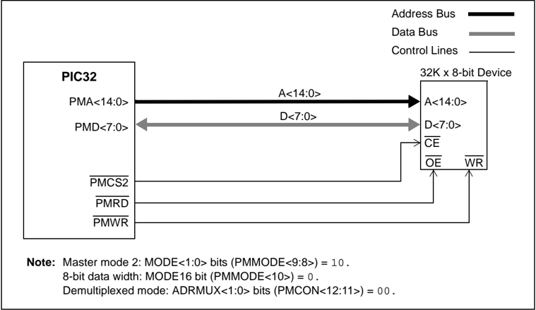

Figure 13-38  illustrates  the  connections  to  a  16-bit  memory  or  addressable  peripheral  in Demultiplexed mode. This mode does not require any external latches.

Figure 13-38: Demultiplexed Addressing, 16-bit Data (Up to 15-bit Address)

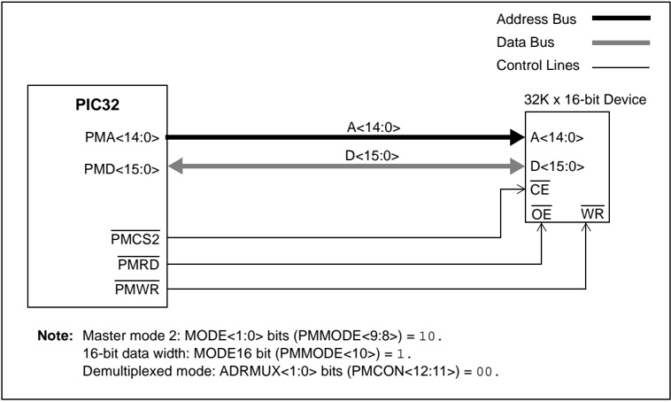

## 13.8.2 Partial Multiplexed Memory or Peripheral

Figure 13-39 illustrates the connections to an 8-bit memory or other addressable peripheral in Partial  Multiplex  mode.  In  this  mode,  an  external  latch  is  required.  Consequently,  from  the microcontroller perspective, this mode achieves some pin savings over the Demultiplexed mode, however, at the price of performance. The lower 8 bits of the address are multiplexed with the PMD&lt;7:0&gt; data bus and require one extra peripheral bus clock cycle.

Figure 13-39: Partial Multiplexed Addressing, 8-bit Data (Up to 15-bit Address)

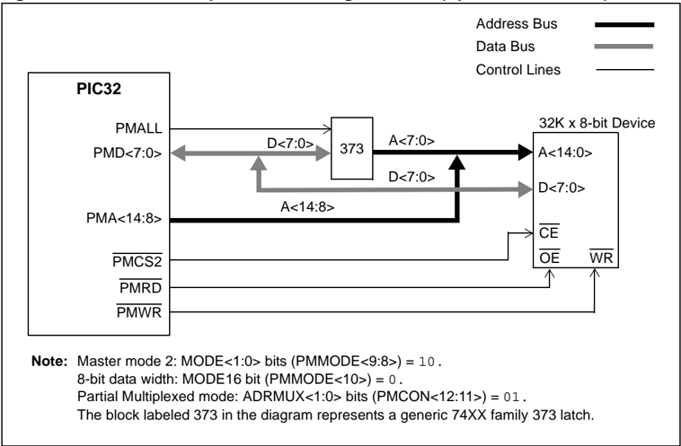

If  the  peripheral  has  internal  latches  as  shown  in  Figure 13-40,  no  extra circuitry  is  required except for the peripheral itself.

Figure 13-40: Partial Multiplexed Addressing, 8-bit Data

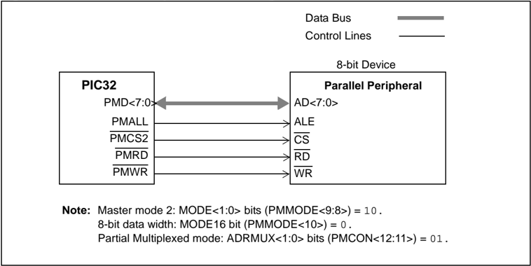

Figure 13-41 illustrates the connections to a 16-bit memory or other addressable peripheral in Partial  Multiplex  mode.  In  this  mode,  an  external  latch  is  required.  Consequently,  from  the microcontroller perspective, this mode achieves some pin savings over the Demultiplexed mode, however,  at  the  price  of  performance.  The  lower  8  bits  of  address  are  multiplexed  with  the PMD&lt;7:0&gt; data bus and require one extra peripheral bus clock cycle.

Figure 13-41: Partial Multiplexed Addressing, 16-bit Data (Up to 15-bit Address)

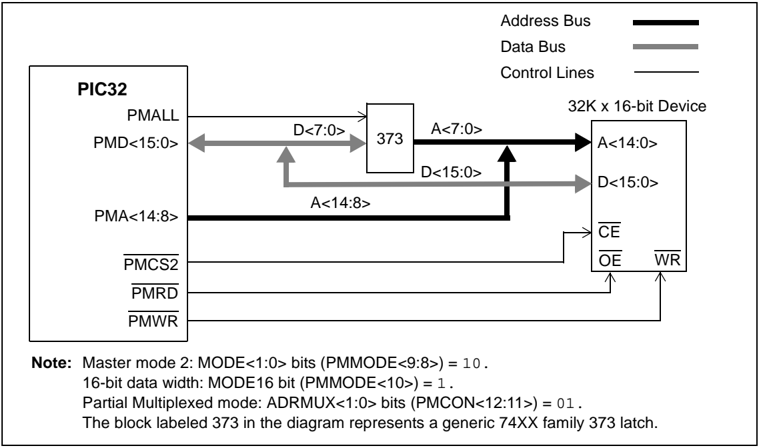

## 13.8.3 Full Multiplexed Memory or Peripheral

Figure 13-42 illustrates the connections to a memory or other addressable peripheral in full 8-bit Multiplexed  mode,  ADRMUX&lt;1:0&gt;  bits  (PMCON&lt;12:11&gt;)  = 10 .  Consequently,  from  the microcontroller  perspective,  this  mode  achieves  the  best  pin  saving  over  the  Demultiplexed mode or Partially Multiplexed mode, however, at the price of performance. The lower 8 address bits are multiplexed with the PMD&lt;7:0&gt; data bus followed by the upper 6 or 7 address bits (if CS2, CS1 or both are enabled) and therefore require two extra peripheral bus clock cycles.

Figure 13-42: Fully Multiplexed Addressing, 8-bit Data (Up to 15-bit Address)

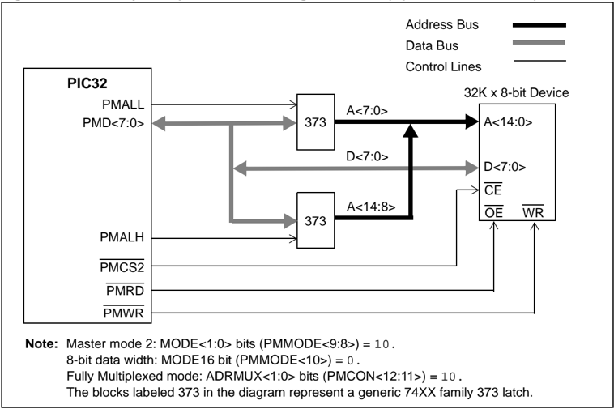

Figure 13-43 illustrates the connections to a 16-bit memory or other addressable peripheral in full 16-bit Multiplex mode, ADRMUX&lt;1:0&gt; bits (PMCON&lt;12:11&gt;) = 10 . Consequently, from the microcontroller  perspective,  this  mode  achieves  the  best  pin  saving  over  the  Demultiplexed mode or Partially Multiplexed mode, however, at the price of performance. The lower 8 address bits are multiplexed with the PMD&lt;7:0&gt; data bus followed by the upper 6 or 7 address bits (if CS2, CS1 or both are enabled) and therefore require two extra peripheral bus clock cycles.

Figure 13-43: Fully Multiplexed Addressing, 16-bit Data (Up to 15-bit Address)

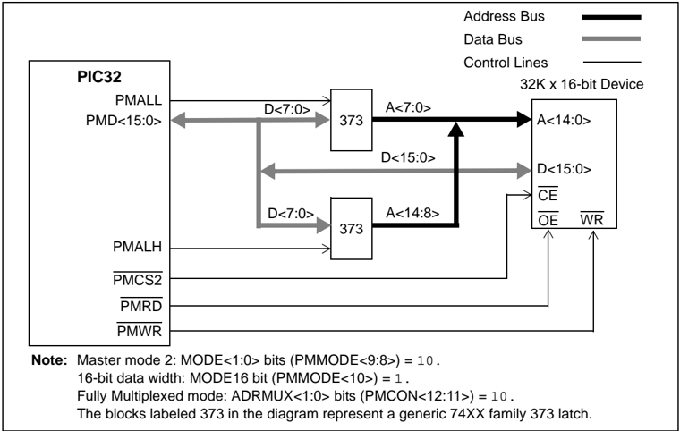

Figure 13-44 illustrates the connections to a 16-bit memory or other addressable peripheral in full 16-bit Multiplex mode, ADRMUX&lt;1:0&gt; bits (PMCON&lt;12:11&gt;) = 11 . Consequently, from the microcontroller  perspective,  this  mode  achieves  the  best  pin  saving  over  the  Demultiplexed mode or Partially Multiplexed mode, however, at the price of performance. Compared to the previous Full Multiplex mode, ADRMUX = 10 ,  this mode multiplexes 14 or 15 address bits (if CS2, CS1 or both are enabled) simultaneously with the PMD&lt;15:0&gt; bus and therefore requires only one extra peripheral bus clock cycle.

Figure 13-44: Fully Multiplexed Addressing, 16-bit Data (Up to 15-bit Address), Example 2

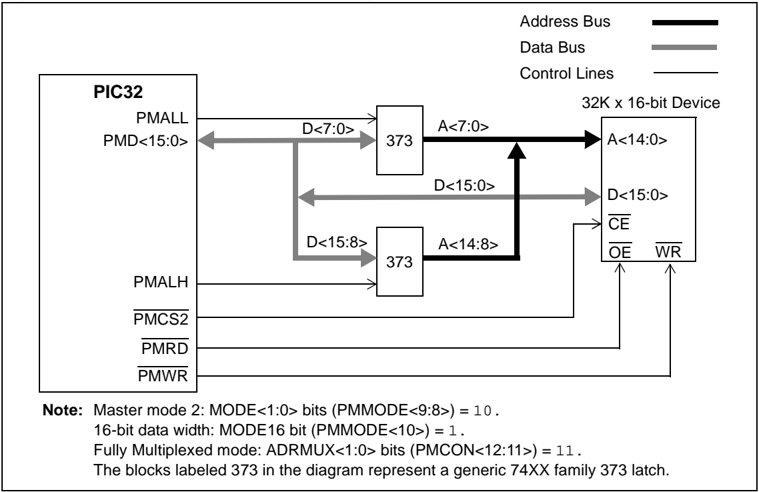

## 13.8.4 8-bit LCD Controller Example

The PMP module can be configured to connect to a typical LCD controller interface as shown in Figure 13-45. In this case, the PMP module is configured for Master mode 1, MODE&lt;1:0&gt; = 11 (PMMODE&lt;9:8&gt;),  and  uses  active-high  control  signals  as  common  LCD  displays  require active-high control.

Figure 13-45: Demultiplexed Addressing, 8-bit Data, LCD Controller

Note:

Master mode 1: MODE&lt;1:0&gt; bits (PMMODE&lt;9:8&gt;) = 11.



8-bit data width: MODE16 bit (PMMODE&lt;10&gt;) =

0.



Demultiplexed mode: ADRMUX&lt;1:0&gt; bits (PMCON&lt;12:11&gt;) = 00.

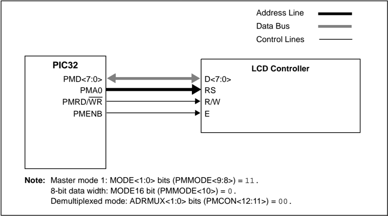

## 13.9 PARALLEL SLAVE PORT APPLICATION

Figure 13-46 illustrates the connections to a master peripheral in 8-bit Data mode as a slave, MODE&lt;1:0&gt; bits (PMMODE&lt;9:8&gt;) = 00 .  The  microcontroller's  PMP  is  controlled  by  a  Chip Select (PMCS1).

Figure 13-46: Legacy Mode Slave Port

Note:

Legacy Slave mode: MODE&lt;1:0&gt; bits (PMMODE&lt;9:8&gt;) = 00.

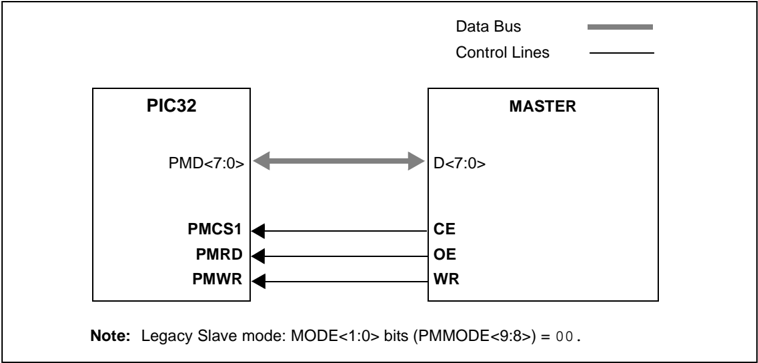

## 13.10 DIRECT MEMORY ACCESS SUPPORT

Direct  Memory  Access  (DMA)  reads  from  and  writes  to  the  PMDIN  register  when  the  PMP module is configured for Master mode. The following steps are to be performed for using DMA.

1. Set the CHSIRQ&lt;7:0&gt; bits (DCHxECON&lt;15:8&gt;) to the PMP IRQ number.
2. Configure the PMP module for the required mode (Master or Legacy Slave).
3. Set the IRQM&lt;1:0&gt; bits (PMMODE&lt;14:13&gt;) = 01 to generate the PMP interrupts on every byte.

## 13.11 I/O PIN CONTROL

## 13.11.1 I/O Pin Resources

When enabling the PMP module for Master mode operations, the PMAEN register must be configured (set to ' 1 ') for the corresponding bits of the PMA&lt;15:0&gt; I/O pins to be controlled by the PMP module. The I/O pins not configured for use by the PMP module remain as general purpose I/O pins.

Table 13-10: Required I/O Pin Resources for Master Modes

| I/O Pin Name   | Legacy   | Buffered   | Enhanced   | Functional Description              |
|----------------|----------|------------|------------|-------------------------------------|
| PMPCS2A/PMA23  | Yes (2)  | Yes (2)    | Yes (2)    | PMP Chip Select 2A/Address A23      |
| PMPCS1A/PMA22  | Yes (2)  | Yes (2)    | Yes (2)    | PMP Chip Select 1A/Address A22      |
| PMA<21:16>     | Yes (2)  | Yes (2)    | Yes (2)    | PMP Address A21...A16               |
| PMPCS2/PMA15   | Yes (2)  | Yes (2)    | Yes (2)    | PMP Chip Select 2/Address A15       |
| PMPCS1/PMA14   | Yes (2)  | Yes (2)    | Yes (2)    | PMP Chip Select 1/Address A14       |
| PMA<13:2>      | Yes (2)  | Yes (3)    | No (1)     | PMP Address A13...A2                |
| PMA1/PALH      | No (1)   | No (1)     | Yes (4)    | PMP Address A1/Address Latch High   |
| PMA0/PALL      | No (1)   | Yes (3)    | Yes (4)    | PMP Address A0/Address Latch Low    |
| PMRD/PMWR      | Yes      | Yes        | Yes        | PMP Read/Write Control              |
| PMWR/PMENB     | Yes      | Yes        | Yes        | PMP Write/Enable Control            |
| PMD<15:0> (6)  | Yes (5)  | Yes (5)    | Yes (5)    | PMP Bidirectional Data Bus D15...D0 |

Note 1: 'No' indicates the pin is not required and is available as a general purpose I/O pin when the corresponding PMAEN bit is cleared (= 0 ).

- 2: Depending on the application, not all PMA&lt;15:0&gt; or CS2, CS1 may be required.
- 3: When Partial Multiplex mode is selected (ADDRMUX&lt;1:0&gt; = 01 ), the lower 8 address lines are multiplexed with PMD&lt;7:0&gt;, PMA&lt;0&gt; becomes (ALL) and PMA&lt;7:1&gt; are available as general purpose I/O pins.
- 4: When Full Multiplex mode is selected (ADDRMUX&lt;1:0&gt; = 10 or 11 ), all 16 address lines are multiplexed with PMD&lt;15:0&gt;, PMA&lt;0&gt; becomes (ALL), PMA&lt;1&gt; becomes (ALH) and PMA&lt;13:2&gt; are available as general purpose I/O pins.
- 5: If MODE16 = 0 , only PMD&lt;7:0&gt; are required. PMD&lt;15:8&gt; are available as general purpose I/O pins.
- 6: Data pins PMD&lt;15:0&gt; are available on PIC32 devices with 100 or more pins. For all other device variants, only pins PMD&lt;7:0&gt; are available. Refer to the specific PIC32 device data sheet for details.

When enabling any of the PMP module for Slave mode operations, the PMPCS1, PMRD, PMWR control pins and PMD&lt;7:0&gt; data pins are automatically enabled and configured. The user is, however, responsible for selecting the appropriate polarity for these control lines.

Table 13-11: Required I/O Pin Resources for Slave Modes

| I/O Pin Name   | Legacy   | Buffered   | Enhanced   | Functional Description         |
|----------------|----------|------------|------------|--------------------------------|
| PMPCS1/PMA14   | Yes      | Yes        | Yes        | Chip Select                    |
| PMA1/PALH      | No (1)   | No (1)     | Yes        | Address A1                     |
| PMA0/PALL      | No (1)   | No (1)     | Yes        | Address A0                     |
| PMRD/PMWR      | Yes      | Yes        | Yes        | Read Control                   |
| PMWR/PMENB     | Yes      | Yes        | Yes        | Write Control                  |
| PMD<15:0>      | Yes (2)  | Yes (2)    | Yes (2)    | Bidirectional Data Bus D7...D0 |

Note 1: 'No' indicates the pin is not required and is available as a general purpose I/O pin when the corresponding PMAEN bit is cleared (= 0 ).

- 2: Slave modes use only PMD&lt;7:0&gt; pins. PMD&lt;15:8&gt; are available as general purpose I/O pins. Control bit MODE16 (PMMODE&lt;10&gt;) is ignored.

## 13.11.2 I/O Pin Configuration

Table 13-12 provides a summary of the settings required to enable the I/O pin resources used with this module. The PMAEN register controls the functionality of pins PMA&lt;23:0&gt;. Setting any PMAEN bit = 1 configures the corresponding PMA pin as an address line. The bits that are set to ' 0 ' remain as general purpose I/O pins.

Table 13-12: I/O Pin Configuration

| I/O Pin Name   | Required ( 1)   | Bit Field               | TRIS   | Pin Type   | Buffer Type   | Description                          |
|----------------|-----------------|-------------------------|--------|------------|---------------|--------------------------------------|
| PMPCS2A/PMA23  | Yes             | CSF<1:0>,  CS2A PTEN23 | -      | O          | CMOS          | PMP Chip Select 2A/Address A23       |
| PMPCS1A/PMA22  | Yes             | CSF<1:0>,  CS1A PTEN22 | -      | O          | CMOS          | PMP Chip Select 1A/Address A22       |
| PMA<21:16>     | Yes             | PTEN<21:16>             | -      | O          | CMOS          | PMP Address A21...A16                |
| PMPCS2/PMA15   | Yes             | CSF<1:0>,  CS2 PTEN15  | -      | O          | CMOS          | PMP Chip Select 2/ Address A15       |
| PMPCS1/PMA14   | Yes             | CSF<1:0>,  CS1 PTEN14  | -      | O          | CMOS          | PMP Chip Select 1/ Address A14       |
| PMA<13:2>      | Yes             | PTEN<13:2>              | -      | O          | CMOS          | PMP Address  A13... A2              |
| PMA1/PALH      | Yes             | PTEN<1>                 | -      | I (2) , O  | CMOS          | PMP Address A1/ Address Latch High   |
| PMA0/PALL      | Yes             | PTEN<0>                 | -      | I (2) , O  | CMOS          | PMP Address A0/ Address Latch Low    |
| PMRD/PMWR      | Yes             | PTRDEN                  | -      | O          | CMOS          | PMP Read/Write Control               |
| PMWR/PMENB     | Yes             | PTWREN                  | -      | O          | CMOS          | PMP Write/  Enable Control          |
| PMD<15:0>      | Yes             | MODE16,  ADRMUX<1:0>   | -      | I (2) , O  | CMOS          | PMP Bidirectional Data Bus D15... D0 |

Legend:

CMOS = CMOS-compatible input or output with CMOS levels  I = Input

ST = Schmitt Trigger input

O = Output

- Note 1: Depending on the PMP mode and the user's application, these pins may not be required. If not enabled, these pins can be used for general purpose I/O.
- 2: Input buffers can be Schmitt Trigger or TTL.

## 13.12 RELATED APPLICATION NOTES

This  section  lists  application  notes  that  are  related  to  this  section  of  the  manual.  These application notes may not be written specifically for the PIC32 device family, but the concepts are pertinent and could be used with modification and possible limitations. The current application notes related to the Parallel Master Port (PMP) module are:

## Title

No related application notes at this time.

Note:

Application Note #

N/A

Please visit the Microchip web site (www.microchip.com) for additional Application Notes and code examples for the PIC32 family of devices.

## 13.13 REVISION HISTORY

## Revision A (August 2007)

This is the initial released version of the document.

## Revision B (October 2007)

Updated document to remove Confidential status.

## Revision C (April 2008)

Revised status to Preliminary; Revised U-0 to r-x; Revised Table 13-10; Revised Section 13.3.1.6 and Section 13.3.8; Revised Register 13-5; Revised Figures 13-11, 13-37, 13-40, 13-41, 13-42, 13-43, 13-46; Revised Timing Diagram text for Figures 13-16, 13-18, 13-19.

Revision D (June 2008)

Revised Register 13-1, add note to FRZ; Revised Figures 13-4, 13-6, 13-8, 13-10, 13-36, 13-37, 13-38, 13-45; Revised Table 13-6; Revised Examples 13-6 and 13-7; Change Reserved bits from 'Maintain as' to 'Write'; Added Note to ON bit (PMCON Register).

## Revision E (October 2009)

This revision includes the following updates:

- Minor updates to text and formatting have been implemented throughout the document
- Added the following item to the key feature list: Schmitt Trigger or TTL input buffers (see 13.1 'Introduction' )
- Interrupts Register Summary (Table 13-1):
- -Removed all references to the Clear, Set and Invert registers
- -Added the Address Offset column
- -Added Notes 1, 2 and 3, which describe the Clear, Set and Invert registers
- Added Notes 1, 2 and 3, which describe the Clear, Set and Invert registers to the following registers
- -PMCON: Parallel Port Control Register (see Register 13-1)
- -PMMODE: Parallel Port Mode Register (see Register 13-2)
- -PMADDR: Parallel Port Address Register (see Register 13-3)
- -PMDOUT: Parallel Port Data Output Register (see Register 13-4)
- -PMDIN: Parallel Port Data Input Register (see Register 13-5)
- -PMAEN: Parallel Port Pin Enable Register (see Register 13-6)
- -PMSTAT: Parallel Port Status Register (Slave modes only) (see Register 13-7)
- Removed all references to Interrupt registers (IEC1, IFS1 and IPC7)
- Added a shaded note to 13.4.1.4 'Legacy Mode Interrupt Operation'
- Updated the 2-3 TPBCLK cycles duration in Figure 13-33, Figure 13-34, Figure 13-35 and Figure 13-36
- Added Note 2 to the I/O Pin Configuration table (Table 13-12)

## Revision F (May 2011)

This revision includes the following updates:

- Changed all occurrences of PIC32MX to PIC32
- Updated the note in section 13.4.1.4 'Legacy Mode Interrupt Operation'
- Added a new section 13.10 'Direct Memory Access Support'
- Removed the Notes referencing the CLR, SET, and INV registers from all register tables
- Changed all occurrences of r-x to U-0 in all register tables
- Updated Figure 13-33 and Figure 13-34
- Removed the Module Control column from Table 13-12

## PIC32 Family Reference Manual

## Revision F (May 2011) (Continued)

- Removed the note from section 13.6.2 'PMP Operation in Idle Mode'
- Removed Table 13-10 and Table 13-11
- Minor changes to the text and formatting have been incorporated throughout the document

## Revision G (April 2012)

This revision includes the following updates:

- Updated Example 13-3
- Added 13.3.7.1 'Addressing Memory Devices Larger Than 64K'
- Updated the second sentence of 13.4.1.2 'Write to Slave Port' (the reference to the input buffer full flag was removed)
- Updated the second sentence of 13.4.2.2 'Read from Slave Port' (the reference to the output buffer empty flag was removed)
- Removed the note box and updated step 2 in 13.10 'Direct Memory Access Support'
- Updated the PMRD/PMWR signal for 16-bit Write Operation (ADRMUX = 11 , No Wait States and Wait States Enabled) (see Figure 13-28 and Figure 13-29)
- Removed 13.12 'Design Tips'
- Minor changes to the text and formatting have been incorporated throughout the document

## Revision H (July 2015)

This revision includes the following updates:

- Updated the Special Function Register map (see Table 13-1)
- Updated Register 13-3: 'PMADDR: Parallel Port Address Register'
- Added the following registers:
- -Register 13-8: 'PMWADDR: Parallel Port Write Address Register'
- -Register 13-9: 'PMRADDR: Parallel Port Read Address Register'
- -Register 13-10: 'PMRDIN: Parallel Port Read Input Data Register'
- Added 13.3.1.2 'Dual Buffer Mode'
- Minor changes to the text and formatting have been incorporated throughout the document

## Note the following details of the code protection feature on Microchip devices:

- Microchip products meet the specification contained in their particular Microchip Data Sheet.
- Microchip believes that its family of products is one of the most secure families of its kind on the market today, when used in the intended manner and under normal conditions.
- There are dishonest and possibly illegal methods used to breach the code protection feature. All of these methods, to our knowledge, require using the Microchip products in a manner outside the operating specifications contained in Microchip's Data Sheets. Most likely, the person doing so is engaged in theft of intellectual property.
- Microchip is willing to work with the customer who is concerned about the integrity of their code.
- Neither Microchip nor any other semiconductor manufacturer can guarantee the security of their code. Code protection does not mean that we are guaranteeing the product as 'unbreakable.'

Code protection is constantly evolving. We at Microchip are committed to continuously improving the code protection features of our products. Attempts to break Microchip's code protection feature may be a violation of the Digital Millennium Copyright Act. If such acts allow unauthorized access to your software or other copyrighted work, you may have a right to sue for relief under that Act.

Information  contained  in  this  publication  regarding  device applications and the like is provided only for your convenience and may be superseded by updates. It is your responsibility to ensure  that  your  application  meets  with  your  specifications. MICROCHIP MAKES NO REPRESENTATIONS OR WARRANTIES  OF  ANY  KIND  WHETHER  EXPRESS  OR IMPLIED, WRITTEN OR ORAL, STATUTORY OR OTHERWISE, RELATED TO THE INFORMATION, INCLUDING  BUT  NOT  LIMITED  TO  ITS  CONDITION, QUALITY, PERFORMANCE, MERCHANTABILITY OR FITNESS  FOR  PURPOSE . Microchip  disclaims  all  liability arising  from  this  information  and  its  use.  Use  of  Microchip devices in life support and/or safety applications is entirely at the buyer's risk, and the buyer agrees to defend, indemnify and hold  harmless  Microchip  from  any  and  all  damages,  claims, suits,  or  expenses  resulting  from  such  use.  No  licenses  are conveyed, implicitly or otherwise, under any Microchip intellectual property rights unless otherwise stated.

## QUALITY MANAGEMENT  SYSTEM CERTIFIED BY DNV

== ISO/TS 16949 ==

## Trademarks

The Microchip name and logo, the Microchip logo, dsPIC, FlashFlex, flexPWR, JukeBlox, KEELOQ, KEELOQ logo, Kleer, LANCheck, MediaLB, MOST, MOST logo, MPLAB, OptoLyzer, PIC, PICSTART, PIC 32  logo, RightTouch, SpyNIC, SST, SST Logo, SuperFlash and UNI/O are registered trademarks of Microchip Technology Incorporated in the U.S.A. and other countries.

The Embedded Control Solutions Company and mTouch are registered trademarks of Microchip Technology Incorporated in the U.S.A.

Analog-for-the-Digital Age, BodyCom, chipKIT, chipKIT logo, CodeGuard, dsPICDEM, dsPICDEM.net, ECAN, In-Circuit Serial Programming, ICSP, Inter-Chip Connectivity, KleerNet, KleerNet logo, MiWi, MPASM, MPF, MPLAB Certified logo, MPLIB, MPLINK, MultiTRAK, NetDetach, Omniscient Code Generation, PICDEM, PICDEM.net, PICkit, PICtail, RightTouch logo, REAL ICE, SQI, Serial Quad I/O, Total Endurance, TSHARC, USBCheck, VariSense, ViewSpan, WiperLock, Wireless DNA, and ZENA are trademarks of Microchip Technology Incorporated in the U.S.A. and other countries.

SQTP is a service mark of Microchip Technology Incorporated in the U.S.A.

Silicon Storage Technology is a registered trademark of Microchip Technology Inc. in other countries.

GestIC is a registered trademark of Microchip Technology Germany II GmbH &amp; Co. KG, a subsidiary of Microchip Technology Inc., in other countries.

All other trademarks mentioned herein are property of their respective companies.

© 2007-2015, Microchip Technology Incorporated, Printed in the U.S.A., All Rights Reserved.

ISBN: 978-1-63277-554-2

Microchip received ISO/TS-16949:2009 certification for its worldwide headquarters, design and wafer fabrication facilities in Chandler and Tempe, Arizona; Gresham, Oregon and design centers in California and India. The Company's quality system processes and procedures are for its PIC ®  MCUs and dsPIC ®  DSCs, KEELOQ ®  code hopping devices, Serial EEPROMs, microperipherals, nonvolatile memory and analog products. In addition, Microchip's quality system for the design and manufacture of development systems is ISO 9001:2000 certified.


## Worldwide Sales and Service

## ASIA/PACIFIC

Asia Pacific Office Suites 3707-14, 37th Floor Tower 6, The Gateway Harbour City, Kowloon Hong Kong Tel: 852-2943-5100 Fax: 852-2401-3431

Australia - Sydney Tel: 61-2-9868-6733 Fax: 61-2-9868-6755

China - Beijing Tel: 86-10-8569-7000 Fax: 86-10-8528-2104

China - Chengdu Tel: 86-28-8665-5511 Fax: 86-28-8665-7889

China - Chongqing Tel: 86-23-8980-9588 Fax: 86-23-8980-9500

China - Dongguan

Tel: 86-769-8702-9880

China - Hangzhou Tel: 86-571-8792-8115 Fax: 86-571-8792-8116

China - Hong Kong SAR Tel: 852-2943-5100 Fax: 852-2401-3431

China - Nanjing Tel: 86-25-8473-2460 Fax: 86-25-8473-2470

China - Qingdao Tel: 86-532-8502-7355 Fax: 86-532-8502-7205

China - Shanghai Tel: 86-21-5407-5533 Fax: 86-21-5407-5066

China - Shenyang Tel: 86-24-2334-2829 Fax: 86-24-2334-2393

China - Shenzhen Tel: 86-755-8864-2200 Fax: 86-755-8203-1760

China - Wuhan Tel: 86-27-5980-5300 Fax: 86-27-5980-5118

China - Xian Tel: 86-29-8833-7252 Fax: 86-29-8833-7256

## ASIA/PACIFIC

China - Xiamen Tel: 86-592-2388138 Fax: 86-592-2388130

China - Zhuhai Tel: 86-756-3210040 Fax: 86-756-3210049

India - Bangalore Tel: 91-80-3090-4444 Fax: 91-80-3090-4123

India - New Delhi Tel: 91-11-4160-8631 Fax: 91-11-4160-8632

India - Pune Tel: 91-20-3019-1500

Japan - Osaka Tel: 81-6-6152-7160 Fax: 81-6-6152-9310

Japan - Tokyo Tel: 81-3-6880- 3770 Fax: 81-3-6880-3771

Korea - Daegu Tel: 82-53-744-4301 Fax: 82-53-744-4302

Korea - Seoul Tel: 82-2-554-7200 Fax: 82-2-558-5932 or 82-2-558-5934

Malaysia - Kuala Lumpur Tel: 60-3-6201-9857 Fax: 60-3-6201-9859

Malaysia - Penang Tel: 60-4-227-8870 Fax: 60-4-227-4068

Philippines - Manila Tel: 63-2-634-9065 Fax: 63-2-634-9069

Singapore Tel: 65-6334-8870 Fax: 65-6334-8850

Taiwan - Hsin Chu Tel: 886-3-5778-366 Fax: 886-3-5770-955

Taiwan - Kaohsiung Tel: 886-7-213-7828

Taiwan - Taipei Tel: 886-2-2508-8600 Fax: 886-2-2508-0102

Thailand - Bangkok Tel: 66-2-694-1351 Fax: 66-2-694-1350

## AMERICAS

Corporate Office 2355 West Chandler Blvd. Chandler, AZ 85224-6199 Tel: 480-792-7200 Fax: 480-792-7277 Technical Support:

http://www.microchip.com/

support

Web Address:

www.microchip.com

Atlanta Duluth, GA Tel: 678-957-9614 Fax: 678-957-1455

Austin, TX Tel: 512-257-3370

Boston Westborough, MA Tel: 774-760-0087 Fax: 774-760-0088

Chicago Itasca, IL Tel: 630-285-0071 Fax: 630-285-0075

Cleveland Independence, OH Tel: 216-447-0464 Fax: 216-447-0643

Dallas Addison, TX Tel: 972-818-7423 Fax: 972-818-2924

Detroit Novi, MI Tel: 248-848-4000

Houston, TX Tel: 281-894-5983

Indianapolis Noblesville, IN Tel: 317-773-8323 Fax: 317-773-5453

Los Angeles Mission Viejo, CA Tel: 949-462-9523 Fax: 949-462-9608

New York, NY Tel: 631-435-6000

San Jose, CA Tel: 408-735-9110

Canada - Toronto Tel: 905-673-0699 Fax: 905-673-6509

## EUROPE

Austria - Wels Tel: 43-7242-2244-39 Fax: 43-7242-2244-393

Denmark - Copenhagen Tel: 45-4450-2828 Fax: 45-4485-2829

France - Paris Tel: 33-1-69-53-63-20 Fax: 33-1-69-30-90-79

Germany - Dusseldorf Tel: 49-2129-3766400

Germany - Munich Tel: 49-89-627-144-0 Fax: 49-89-627-144-44

Germany - Pforzheim Tel: 49-7231-424750

Italy - Milan Tel: 39-0331-742611 Fax: 39-0331-466781

Italy - Venice Tel: 39-049-7625286

Netherlands - Drunen Tel: 31-416-690399 Fax: 31-416-690340

Poland - Warsaw Tel: 48-22-3325737

Spain - Madrid Tel: 34-91-708-08-90 Fax: 34-91-708-08-91

Sweden - Stockholm Tel: 46-8-5090-4654

UK - Wokingham Tel: 44-118-921-5800 Fax: 44-118-921-5820

01/27/15