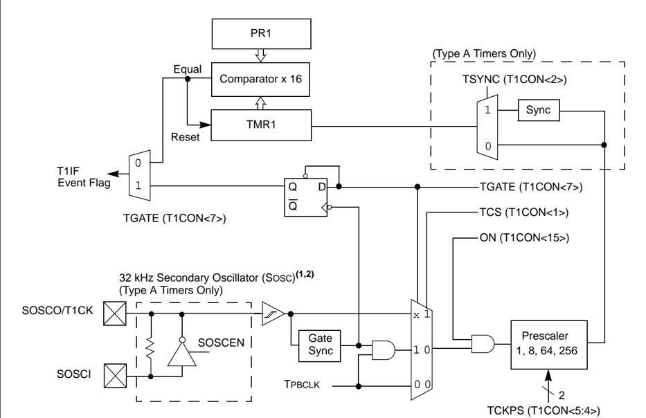
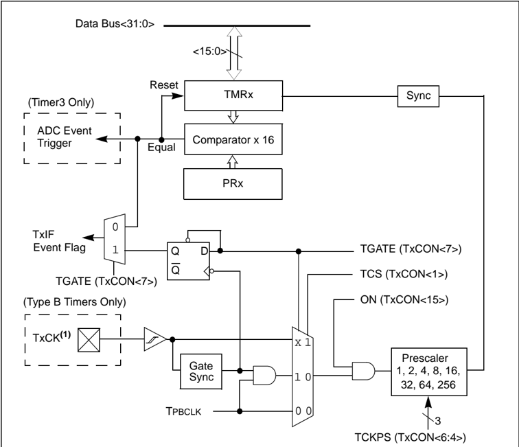
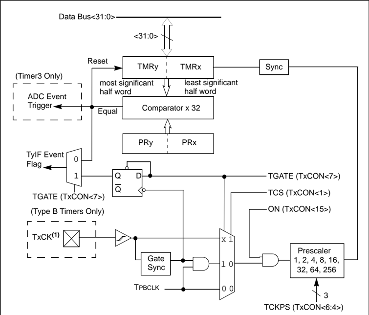

Microchip

## Section 14. Timers

## HIGHLIGHTS

This section of the manual contains the following topics:

|   14.1 | Introduction ..................................................................................................................14-2   |
|--------|---------------------------------------------------------------------------------------------------------------------------------------|
|   14.2 | Control Registers .........................................................................................................14-6       |
|   14.3 | Modes of Operation ................................................................................................... 14-11          |
|   14.4 | Interrupts....................................................................................................................14-25   |
|   14.5 | Operation in Power-Saving Modes............................................................................14-28                      |
|   14.6 | Effects of Various Resets...........................................................................................14-29             |
|   14.7 | Peripherals Using Timer Modules..............................................................................14-29                    |
|   14.8 | I/O Pin Control ...........................................................................................................14-30      |
|   14.9 | Related Application Notes..........................................................................................14-31              |
|  14.10 | Revision History.........................................................................................................14-32        |

Note: This family reference manual section is meant to serve as a complement to device data sheets. Depending on the device, this manual section may not apply to all PIC32 devices.

[Please consult the note at the beginning of the 'Timers' chapters in the current device data sheet to check whether this document supports the device you are using.](http://www.microchip.com/)

Device  data  sheets  and  family  reference  manual  sections  are  available  for download from the Microchip Worldwide Web site at: http://www.microchip.com

## 14.1 INTRODUCTION

The PIC32 device family has two different types of timers, depending on the particular device. Timers  are  useful  for  generating  accurate  time-based  periodic  interrupt  events  for  software applications  or  real-time  operating  systems.  Other  uses  include  counting  external  pulses  or accurate timing measurement of external events by using the timer's gate feature.

With  certain  exceptions,  all  of  the  timers  have  the  same  functional  circuitry.  The  timers  are broadly classified into two types, namely:

- Type A Timer (16-bit synchronous/asynchronous timer/counter with gate)
- Type B Timer (16-bit or 32-bit synchronous timer/counter with gate and Special Event Trigger)

All timer modules include the following common features:

- 16-bit timer/counter
- Software-selectable internal or external clock source
- Programmable interrupt generation and priority
- Gated external pulse counter

Apart from these common features, each timer type offers the following additional features:

## · Type A:

- -Asynchronous timer/counter with a built-in oscillator
- -Operational during CPU Sleep mode
- -Software selectable prescalers 1:1, 1:8, 1:64, and 1:256
- Type B:
- -Ability to form a 32-bit timer/counter
- -Software prescalers 1:1, 1:2, 1:4, 1:8, 1:16, 1:32, 1:64, and 1:256
- -Event trigger capability

Table 14-1 provides a summary of timer features. Refer to the specific device data sheet for more information on type and number of timers associated with a specific PIC32 device.

Table 14-1: Timer Features

| Available Timer Types   | Secondary Oscillator   | Asynchronous External Clock   | Synchronous External Clock   | 16-bit Synchronous Timer/Counter   | 32-bit Synchronous Timer/Counter (see Note 1)   | Gated Timer   | Special Event Trigger   |
|-------------------------|------------------------|-------------------------------|------------------------------|------------------------------------|-------------------------------------------------|---------------|-------------------------|
| Type A                  | Yes                    | Yes                           | Yes                          | Yes                                | No                                              | Yes           | No                      |
| Type B                  | No                     | No                            | Yes                          | Yes                                | Yes                                             | Yes           | Yes                     |

Note 1: 32-bit timer/counter configuration requires an even numbered timer combined with an adjacent odd numbered timer, for example, Timer2 and Timer3, or Timer4 and Timer5, and so on.

## 14.1.1 Type A Timer

Most of the PIC32 family devices contain at least one Type A timer; usually, Timer1.

The Type A Timer module is distinct from other types of timers based on the following features:

- Operable from the external Secondary Oscillator (SOSC)
- Operable in Asynchronous mode using an external clock source
- Operable during CPU Sleep mode
- Software selectable prescalers 1:1, 1:8, 1:64 and 1:256

The Type A timer does not support 32-bit mode.

The unique features of the Type A Timer module allow it to be used for Real-Time Clock (RTC) applications. Figure 14-1 illustrates the block diagram of a Type A Timer module.

Figure 14-1: Type A Timer Block Diagram



- Note 1: For information on enabling the 32 kHz Secondary Oscillator (SOSC), refer to Section 6. 'Oscillators' (DS61112).
- 2: The default state of the SOSCEN bit (OSCCON&lt;1&gt;) during a device Reset is controlled by the FSOSCEN bit (DEVCFG1&lt;5&gt;).

## 14.1.2 Type B Timer

The Type B timer is distinct from other types of timer based on the following features:

- Can be combined to form a 32-bit timer
- Software selectable prescalers 1:1, 1:2, 1:4, 1:8, 1:16, 1:32, 1:64 and 1:256
- Analog-to-Digital Converter (ADC) Event Trigger capability

The  block  diagrams  of  Type  B  timer  (16-bit)  and  Type  B  timer  (32-bit)  are  illustrated  in Figure 14-2 and Figure 14-3, respectively.

Figure 14-2: Type B Timer Block Diagram (16-bit)



Note 1: The TxCK pin is not available in certain devices in the PIC32 family. In such cases, the timer must use the peripheral clock as its input clock. Refer to the 'Timers' chapters in the specific device data sheet for the I/O pin details.

Note: The  timer  configuration  bit,  T32  (TxCON&lt;3&gt;),  must  be  set  to  ' 1 '  for  a  32-bit timer/counter operation. All control bits are respective to the TxCON register, and interrupt bits are respective to the TyCON register.

Figure 14-3: Type B Timer Block Diagram (32-bit)



Note 1: The TxCK pin is not available in certain PIC32MX family devices. In such cases, the timer must use the peripheral clock as its input clock. Refer to the 'Timers' chapters in the specific device data sheet for the I/O pin details.

## 14.2 CONTROL REGISTERS

| Note:   | Each PIC32 family device may have one or more timer modules. An 'x' used in the names of pins, control/status bits and registers denotes the particular module. For more information, refer to the specific device data sheet.   |
|---------|----------------------------------------------------------------------------------------------------------------------------------------------------------------------------------------------------------------------------------|

Each  Timer  module  is  a  16-bit  timer/counter  that  consists  of  the  following  Special  Function Registers (SFRs), which are summarized in Table 14-2:

- T1CON: Type A Timer Control Register
- TxCON: Type B Timer Control Register
- TMRx: Timer Register
- PRx: Period Register

Each Timer module also has the following associated bits for interrupt control:

- TxIE: Interrupt Enable Control bit in IEC0 interrupt register
- TxIF: Interrupt Flag Status bit in IFS0 interrupt register
- TxIP&lt;2:0&gt;: Interrupt Priority Control bits in IPC1, IPC2, IPC3, IPC4, and IPC5 interrupt registers
- TxIS&lt;1:0&gt;: Interrupt Subpriority Control bits in IPC1, IPC2, IPC3, IPC4, and IPC5 interrupt registers

Note:

Refer  to Section  8.  'Interrupts' (DS61108)  in  the 'PIC32  Family  Reference Manual' for more information on these registers.

Table 14-2: Timers SFR Summary

| Register Name (1)   | Bit Range   | Bit 31/23/15/7   | Bit 30/22/14/6   | Bit 29/21/13/5   | Bit 28/20/12/4   | Bit 27/19/11/3   | Bit 26/18/10/2   | Bit 25/17/9/1   | Bit 24/16/8/0   |
|---------------------|-------------|------------------|------------------|------------------|------------------|------------------|------------------|-----------------|-----------------|
| T1CON               | 31:24       | -                | -                | -                | -                | -                | -                | -               | -               |
| T1CON               | 23:16       | -                | -                | -                | -                | -                | -                | -               | -               |
| T1CON               | 15:8        | ON               | -                | SIDL             | TWDIS            | TWIP             | -                | -               | -               |
| T1CON               | 7:0         | TGATE            | -                | TCKPS<1:0>       | TCKPS<1:0>       | -                | TSYNC            | TCS             | -               |
| TxCON               | 31:24       | -                | -                | -                | -                | -                | -                | -               | -               |
| TxCON               | 23:16       | -                | -                | -                | -                | -                | -                | -               | -               |
| TxCON               | 15:8        | ON               | -                | SIDL             | -                | -                | -                | -               | -               |
| TxCON               | 7:0         | TGATE            | TCKPS<2:0> (2)   | TCKPS<2:0> (2)   | TCKPS<2:0> (2)   | T32 (3)          | -                | TCS             | -               |
| TMRx                | 31:24       | -                | -                | -                | -                | -                | -                | -               | -               |
| TMRx                | 23:16       | -                | -                | -                | -                | -                | -                | -               | -               |
| TMRx                | 15:8        | TMRx<15:8>       | TMRx<15:8>       | TMRx<15:8>       | TMRx<15:8>       | TMRx<15:8>       | TMRx<15:8>       | TMRx<15:8>      | TMRx<15:8>      |
| TMRx                | 7:0         | TMRx<7:0>        | TMRx<7:0>        | TMRx<7:0>        | TMRx<7:0>        | TMRx<7:0>        | TMRx<7:0>        | TMRx<7:0>       | TMRx<7:0>       |
| PRx                 | 31:24       | -                | -                | -                | -                | -                | -                | -               | -               |
| PRx                 | 23:16       | -                | -                | -                | -                | -                | -                | -               | -               |
| PRx                 | 15:8        | PRx<15:8>        | PRx<15:8>        | PRx<15:8>        | PRx<15:8>        | PRx<15:8>        | PRx<15:8>        | PRx<15:8>       | PRx<15:8>       |
| PRx                 | 7:0         | PRx<7:0>         | PRx<7:0>         | PRx<7:0>         | PRx<7:0>         | PRx<7:0>         | PRx<7:0>         | PRx<7:0>        | PRx<7:0>        |

Note 1: All registers have an associated Clear, Set, and Invert register at an offset of 0x4, 0x8, and 0xC bytes, respectively. These registers have the same name with CLR, SET, or INV appended to the end of the register name (e.g., T1CONCLR). Writing a ' 1 ' to any bit position in these registers will clear, set, or invert valid bits in the associated register. Reads from these registers should be ignored.

- 2: The TCKPS&lt;2:0&gt; bits are available only on even numbered Type B timers. For example, Timer2 and Timer4 in 32-bit Timer mode.
- 3: The T32 bit is available only on even numbered Type B timers, such as Timer2, Timer4, and so on.

## Register 14-1: T1CON: Type A Timer Control Register

| Bit Range   | Bit 31/23/15/7   | Bit 30/22/14/6   | Bit 29/21/13/5   | Bit 28/20/12/4   | Bit 27/19/11/3   | Bit 26/18/10/2   | Bit 25/17/9/1   | Bit 24/16/8/0   |
|-------------|------------------|------------------|------------------|------------------|------------------|------------------|-----------------|-----------------|
| 31:24       | U-0              | U-0              | U-0              | U-0              | U-0              | U-0              | U-0             | U-0             |
| 31:24       | -                | -                | -                | -                | -                | -                | -               | -               |
| 23:16       | U-0              | U-0              | U-0              | U-0              | U-0              | U-0              | U-0             | U-0             |
| 23:16       | -                | -                | -                | -                | -                | -                | -               | -               |
| 15:8        | R/W-0            | U-0              | R/W-0            | R/W-0            | R-0              | U-0              | U-0             | U-0             |
| 15:8        | ON (1)           | -                | SIDL             | TWDIS            | TWIP             | -                | -               | -               |
| 7:0         | R/W-0            | U-0              | R/W-0            | R/W-0            | U-0              | R/W-0            | R/W-0           | U-0             |
| 7:0         | TGATE            | -                | TCKPS<1:0>       | TCKPS<1:0>       | -                | TSYNC            | TCS             | -               |

## Legend:

R = Readable bit

W = Writable bit

U = Unimplemented bit, read as '0'

-n = Value at POR

'1' = Bit is set

'0' = Bit is cleared

x = Bit is unknown

bit 31-16

Unimplemented:

Read as ' 0 '

bit 15

ON:

Timer On bit (1)

1 = Timer is enabled

0 = Timer is disabled

bit 14

Unimplemented: Read as ' 0 '

bit 13

SIDL:

Stop in Idle Mode bit

1 = Discontinue operation when device enters Idle mode

0 = Continue operation when device enters Idle mode

bit 12

TWDIS:

Asynchronous Timer Write Disable bit

1 = Writes to TMR1 are ignored until pending write operation completes

0 = Back-to-back writes are enabled (Legacy Asynchronous Timer functionality)

bit 11

TWIP: Asynchronous Timer Write in Progress bit

In Asynchronous Timer mode:

1 = Asynchronous write to TMR1 register in progress

0 = Asynchronous write to TMR1 register complete

In Synchronous Timer mode:

This bit is read as ' 0 '.

bit 10-8

Unimplemented:

Read as ' 0 '

bit 7

TGATE:

Timer Gated Time Accumulation Enable bit

When TCS = 1 :

This bit is ignored.

When TCS = 0 :

1 = Gated time accumulation is enabled

0 = Gated time accumulation is disabled

bit 6

Unimplemented:

Read as ' 0 '

bit 5-4

TCKPS&lt;1:0&gt;:

Timer Input Clock Prescale Select bits

11 = 1:256 prescale value

10 = 1:64 prescale value

01 = 1:8 prescale value

00 = 1:1 prescale value

bit 3

Unimplemented: Read as ' 0 '

Note 1: When using 1:1 PBCLK divisor, the user's software should not read/write the peripheral SFRs in the SYSCLK cycle immediately following the instruction that clears the module's ON bit.

## PIC32 Family Reference Manual

bit 2

TSYNC:

Timer External Clock Input Synchronization Selection bit

When TCS = 1 :

1 = External clock input is synchronized

0 = External clock input is not synchronized

When TCS = 0 : This bit is ignored.

bit 1

TCS: Timer Clock Source Select bit

1 = External clock from TxCKI pin

0 = Internal peripheral clock

bit 0

Unimplemented:

Read as ' 0 '

## Register 14-1: T1CON: Type A Timer Control Register (Continued)

Note 1: When using 1:1 PBCLK divisor, the user's software should not read/write the peripheral SFRs in the SYSCLK cycle immediately following the instruction that clears the module's ON bit.

## Register 14-2: TxCON: Type B Timer Control Register

| Bit Range   | Bit 31/23/15/7   | Bit 30/22/14/6   | Bit 29/21/13/5   | Bit 28/20/12/4   | Bit 27/19/11/3   | Bit 26/18/10/2   | Bit 25/17/9/1   | Bit 24/16/8/0   |
|-------------|------------------|------------------|------------------|------------------|------------------|------------------|-----------------|-----------------|
| 31:24       | U-0              | U-0              | U-0              | U-0              | U-0              | U-0              | U-0             | U-0             |
| 31:24       | -                | -                | -                | -                | -                | -                | -               | -               |
| 23:16       | U-0              | U-0              | U-0              | U-0              | U-0              | U-0              | U-0             | U-0             |
| 23:16       | -                | -                | -                | -                | -                | -                | -               | -               |
| 15:8        | R/W-0            | U-0              | R/W-0            | U-0              | U-0              | U-0              | U-0             | U-0             |
| 15:8        | ON (1)           | -                | SIDL (2)         | -                | -                | -                | -               | -               |
| 7:0         | R/W-0            | R/W-0            | R/W-0            | R/W-0            | R/W-0            | U-0              | R/W-0           | U-0             |
| 7:0         | TGATE            | TCKPS<2:0>       | TCKPS<2:0>       | TCKPS<2:0>       | T32 (3)          | -                | TCS (4)         | -               |

## Legend:

R = Readable bit

W = Writable bit

U = Unimplemented bit, read as '0'

-n = Value at POR

'1' = Bit is set

'0' = Bit is cleared

x = Bit is unknown

## bit 31-16 Unimplemented: Read as ' 0 '

bit 15

ON: Timer On bit (1)

1 = Module is enabled

0 = Module is disabled

bit 14

Unimplemented:

Read as ' 0 '

bit 13 SIDL: Stop in Idle Mode bit (2)

1 = Discontinue operation when device enters Idle mode

0 = Continue operation when device enters Idle mode

bit 12-8 Unimplemented:

Read as ' 0 '

bit 7

TGATE:

Timer Gated Time Accumulation Enable bit

When TCS = 1 :

This bit is ignored and is read as ' 0 '.

When TCS = 0 :

1 = Gated time accumulation is enabled

0

= Gated time accumulation is disabled

## bit 6-4 TCKPS&lt;2:0&gt;: Timer Input Clock Prescale Select bits

111 = 1:256 prescale value

110 = 1:64 prescale value

101 = 1:32 prescale value

100 = 1:16 prescale value

011 = 1:8 prescale value

010 = 1:4 prescale value

001 = 1:2 prescale value

000 = 1:1 prescale value

bit 3 T32: 32-bit Timer Mode Select bit (3)

1 = TMRx and TMRy form a 32-bit timer

0 = TMRx and TMRy form separate 16-bit timer

bit 2

Unimplemented:

Read as ' 0 '

bit 1

TCS: Timer Clock Source Select bit

(4)

1 = External clock from TxCK pin

0 = Internal peripheral clock

bit 0

Unimplemented:

Read as ' 0 '

- Note 1: When using 1:1 PBCLK divisor, the user's software should not read/write the peripheral SFRs in the SYSCLK cycle immediately following the instruction that clears the module's ON bit.
- 2: While operating in 32-bit mode, the SIDL bit (TxCON&lt;13&gt;) of consecutive odd number timers of the 32-bit timer pair has an affect on the timer operation. All other bits in this register have no affect.
- 3: The T32 bit is available only on even numbered Type B timers, such as Timer2, Timer4, and so on.
- 4: The TxCK pin is not available on all timers. Refer to the 'Timers' chapters in the specific device data sheet for availability.

## PIC32 Family Reference Manual

## Register 14-3: TMRx: Timer Register

| Bit Range   | Bit 31/23/15/7   | Bit 30/22/14/6   | Bit 29/21/13/5   | Bit 28/20/12/4   | Bit 27/19/11/3   | Bit 26/18/10/2   | Bit 25/17/9/1   | Bit 24/16/8/0   |
|-------------|------------------|------------------|------------------|------------------|------------------|------------------|-----------------|-----------------|
| 31:24       | U-0              | U-0              | U-0              | U-0              | U-0              | U-0              | U-0             | U-0             |
| 31:24       | -                | -                | -                | -                | -                | -                | -               | -               |
| 23:16       | U-0              | U-0              | U-0              | U-0              | U-0              | U-0              | U-0             | U-0             |
| 23:16       | -                | -                | -                | -                | -                | -                | -               | -               |
| 15:8        | R/W-0            | R/W-0            | R/W-0            | R/W-0            | R/W-0            | R/W-0            | R/W-0           | R/W-0           |
| 15:8        | TMR<15:8>        | TMR<15:8>        | TMR<15:8>        | TMR<15:8>        | TMR<15:8>        | TMR<15:8>        | TMR<15:8>       | TMR<15:8>       |
| 7:0         | R/W-0            | R/W-0            | R/W-0            | R/W-0            | R/W-0            | R/W-0            | R/W-0           | R/W-0           |
| 7:0         | TMR<7:0>         | TMR<7:0>         | TMR<7:0>         | TMR<7:0>         | TMR<7:0>         | TMR<7:0>         | TMR<7:0>        | TMR<7:0>        |

## Legend:

R = Readable bit

-n = Value at POR

W = Writable bit

'1' = Bit is set

bit 31-16 Unimplemented:

Read as ' 0 '

bit 15-0 TMR&lt;15:0&gt;:

Timer Count Register bits

## 16-bit mode:

These bits represent the complete 16-bit timer count.

## 32-bit mode (Type B Timer only):

Timer2 and Timer4: These bits represent the least significant half word (16 bits) of the 32-bit timer count.

Timer3 and Timer5: These bits represent the most significant half word (16 bits) of the 32-bit timer count.

## Register 14-4: PRx: Period Register

| Bit Range   | Bit 31/23/15/7   | Bit 30/22/14/6   | Bit 29/21/13/5   | Bit 28/20/12/4   | Bit 27/19/11/3   | Bit 26/18/10/2   | Bit 25/17/9/1   | Bit 24/16/8/0   |
|-------------|------------------|------------------|------------------|------------------|------------------|------------------|-----------------|-----------------|
| 31:24       | U-0              | U-0              | U-0              | U-0              | U-0              | U-0              | U-0             | U-0             |
| 31:24       | -                | -                | -                | -                | -                | -                | -               | -               |
| 23:16       | U-0              | U-0              | U-0              | U-0              | U-0              | U-0              | U-0             | U-0             |
| 23:16       | -                | -                | -                | -                | -                | -                | -               | -               |
| 15:8        | R/W-1            | R/W-1            | R/W-1            | R/W-1            | R/W-1            | R/W-1            | R/W-1           | R/W-1           |
| 15:8        | PR<15:8>         | PR<15:8>         | PR<15:8>         | PR<15:8>         | PR<15:8>         | PR<15:8>         | PR<15:8>        | PR<15:8>        |
| 7:0         | R/W-1            | R/W-1            | R/W-1            | R/W-1            | R/W-1            | R/W-1            | R/W-1           | R/W-1           |
| 7:0         | PR<7:0>          | PR<7:0>          | PR<7:0>          | PR<7:0>          | PR<7:0>          | PR<7:0>          | PR<7:0>         | PR<7:0>         |

## Legend:

| R = Readable bit   | W = Writable bit   | U = Unimplemented bit, read as '0'   | U = Unimplemented bit, read as '0'   |
|--------------------|--------------------|--------------------------------------|--------------------------------------|
| -n = Value at POR  | '1' = Bit is set   | '0' = Bit is cleared                 | x = Bit is unknown                   |

bit 31-16 Unimplemented:

Read as ' 0 '

## bit 15-0 PR&lt;15:0&gt;: Period Register bits

## 16-bit mode:

These bits represent the complete 16-bit period match.

## 32-bit mode (Type B Timer only):

Timer2 and Timer4: These bits represent the least significant half word (16 bits) of the 32-bit period match.

Timer3 and Timer5: These bits represent the most significant half word (16 bits) of the 32-bit period match.

U = Unimplemented bit, read as '0'

'0' = Bit is cleared x = Bit is unknown

## 14.3 MODES OF OPERATION

## 14.3.1 16-bit Modes

Type A and Type B timer modules support the following 16-bit modes:

- 16-bit Synchronous Clock Counter
- 16-bit Synchronous External Clock Counter
- 16-bit Gated Timer
- 16-bit Asynchronous External Counter (Type A Timer module only)

The 16-bit Timer modes are determined by the following bits:

- TCS (TxCON&lt;1&gt;): Timer Clock Source Control bit
- TGATE (TxCON&lt;7&gt;): Timer Gate Control bit
- TSYNC (T1CON&lt;2&gt;): Timer Synchronization Control bit (Type A Timer module only)

## 14.3.1.1 16-BIT TIMER CONSIDERATIONS

The following should be considered when using a 16-bit timer:

- All Timer module SFRs can be written to as a byte (8 bits) or as a half word (16 bits)
- All Timer module SFRs can be read from as a byte or as a half word

## 14.3.2 32-bit Modes (Type B Timer)

Only Type B timer modules support 32-bit modes of operation. A 32-bit Timer module is formed by combining an even numbered Type B timer (referred to as TimerX) with a consecutive odd numbered Type B timer (referred to as TimerY). For example, 32-bit timer combinations are Timer2 and Timer3, Timer4 and Timer5, and so on. The number of timer pairs depends on the particular PIC32 device.

The 32-bit timer pairs can operate in the following modes:

- 32-bit Synchronous Clock Counter
- 32-bit Synchronous External Clock Counter
- 32-bit Gated Timer

The 32-bit Timer modes are determined by the following bits:

- T32 (TxCON&lt;3&gt;): 32-bit Timer Mode Select bit (TimerX only)
- TCS (TxCON&lt;1&gt;): Timer Clock Source Select bit
- TGATE (TxCON&lt;7&gt;): Timer Gated Time Accumulation Enable bit

Specific behavior in 32-bit Timer mode:

- TimerX is the master timer; TimerY is the slave timer
- TMRx count register is least significant half word of the 32-bit timer value
- TMRy count register is most significant half word of the 32-bit timer value
- PRx period register is least significant half word of the 32-bit period value
- PRy period register is most significant half word of the 32-bit period value
- TimerX control bits (TxCON) configure the operation for the 32-bit timer pair
- TimerY control bits (TyCON) have no effect
- TimerX interrupt and status bits are ignored
- TimerY provides the interrupt enable, interrupt flag and interrupt priority control bits

## 14.3.2.1 32-BIT TIMER CONSIDERATIONS

The following points should be considered when using a 32-bit timer:

- Ensure that the timer pair is configured for 32-bit mode by setting T32 (TxCON&lt;3&gt;) = 1 , before writing any 32-bit value to the TMRxy count registers or PRxy period registers
- All Timer module SFRs can be written to as a byte (8 bits), a half word (16 bits) or a word (32 bits)
- All Timer module SFRs can be read from as a byte, a half word or a word
- TMRx and TMRy count register pairs can be read as well as written as a single 32-bit value
- PRx and PRy period register pairs can be read as well as written as a single 32-bit value

Note:

While  operating  in  32-bit  mode,  the  SIDL  bit  (TxCON&lt;13&gt;)  of  consecutive  odd number timers of the 32-bit timer pair has an affect on the timer operation. All other bits in this register have no affect.

## 14.3.3 16-bit Synchronous Clock Counter Mode

The Synchronous Clock Counter operation provides the following capabilities:

- Elapsed time measurements
- Time delays
- Periodic timer interrupts

Type A and Type B timers have the ability to operate in Synchronous Clock Counter mode. In this mode, the input clock source for the timer is  the  internal  peripheral  bus  clock,  PBCLK.  It  is selected by clearing the clock source control bit, TCS (TxCON&lt;1&gt; = 0 ).  Type A and Type B timers automatically provide synchronization to the peripheral bus clock; therefore, the Type A Timer Synchronous mode control bit TSYNC (T1CON&lt;2&gt;) is ignored in this mode.

Type A and Type B timers that use a 1:1 timer input clock prescale, operate at a timer clock rate that is same as the PBCLK, and which increments the TMR count register on every rising timer clock edge. The timer continues to increment until the TMR count register matches the PR period register value. The TMR count register resets to 0x0000 on the next timer clock cycle, and then continues to increment and repeats the period match until the timer is disabled. If the PR period register value = 0x0000, the TMR count register resets to 0x0000 on the next timer clock cycle, but does not continue to increment.

Type A and Type B timers using a timer input clock prescale = N (other than 1:1) operate at a timer clock rate (PBCLK  N ), and the TMR count register increments on every N th timer clock rising edge. For example, if the timer input clock prescale is 1:8, the timer increments on every eighth timer clock cycle. The timer continues to increment until the TMR count register matches the PR period register value. The TMR count register then resets to 0x0000 after ' N ' more timer clock cycles, and then continues to increment and repeats the period match until the timer is disabled. If the PR period register value = 0x0000, the TMR count register resets to 0x0000 on the next N th timer clock cycle, but will not continue to increment.

Type A timers generate a timer event one-half timer clock cycle (on the falling edge) after the TMR count register matches the PR period register value. Type B timers generate a timer event within one PBCLK, plus two SYSCLK system clock cycles after the TMR count register matches the PR period register value. Both Type A and Type B timer interrupt flag bits, TxIF, are set within one PBCLK, plus two SYSCLK cycles of this event, and if the timer interrupt enable bit TxIE is set, an interrupt is generated.

## 14.3.3.1 16-BIT SYNCHRONOUS CLOCK COUNTER CONSIDERATIONS

The timer period is determined by the value in the PR period register. To initialize the timer period, a  user  may  write  to  the  PR  period  register  directly  at  any  time  while  the  timer  is  disabled, ON bit = 0 , or during a timer match Interrupt Service Routine (ISR) while the timer is enabled, ON bit = 1 .  In  all  other  cases,  writing  to  the  period  register while  the timer is enabled is not recommended and may allow unintended period matches to occur. The maximum period that can be loaded is 0xFFFF.

Writing 0x0000 to the PRx period register allows a TMRx match to occur; however, no interrupt is generated.

## 14.3.4 32-bit Synchronous Clock Counter Mode (Type B Timer)

Only Type B timers have the ability to operate in 32-bit Synchronous Counter mode. To enable 32-bit Synchronous Clock Counter operation, Type B (TimerX) T32 control bit (TxCON&lt;3&gt;) must be set (= 1 ). In this mode, the input clock source for the timer is the internal peripheral bus clock, PBCLK, and is selected by clearing the clock source control bit TCS, (TxCON&lt;1&gt;) = 0 . Type B timers automatically provide synchronization to the peripheral bus clock.

Type B timers that use a 1:1 timer input clock prescale operate at a timer clock rate which is the same as the PBCLK, and increments the TMRxy count register on every rising timer clock edge. The  timer  continues  to  increment  until  the  TMRxy  count  register  matches  the  PRxy  period register value. The TMRxy count register resets to 0x00000000 on the next timer clock cycle, and then continues to increment and repeats the period match until the timer is disabled. If the PR period register value = 0x00000000, the TMR count register resets to 0x00000000 on the next timer clock cycle, but does not continue to increment.

Type B timers using a timer input clock prescale = N (other than 1:1) operate at a timer clock rate (PBCLK  N ), and the TMRxy count register increments on every N th timer clock rising edge. For example, if the timer input clock prescale is 1:8, the timer increments on every eight timer clock cycle. The timer continues to increment until the TMRxy count register matches the PRxy period register value. The TMRxy count register resets to 0x00000000 after ' N ' more timer clock cycles, and then continues to increment and repeats the period match until the timer is disabled.

Type B timers generate a timer event within one PBCLK, plus two SYSCLK system clock cycles after  the  TMRxy  count  register  matches  the  PRxy  period  register  value.  The  Type  B  timer interrupt flag bit, TyIF, is set within one PBCLK, plus two SYSCLK cycles of this event, and if the timer interrupt enable bit TyIE is set, an interrupt is generated.

## 14.3.4.1 32-BIT SYNCHRONOUS CLOCK COUNTER CONSIDERATIONS

This  section  describes  items  that  should  be  considered  when  using  the  32-bit  Synchronous Clock Counter.

The timer period is determined by the value in the PRxy period register. To initialize the timer period,  a  user  may  write  to  the  PRxy  period  register  directly  at  any  time  while  the  timer  is disabled, ON bit = 0 , or during a timer match Interrupt Service Routine while the timer is enabled, ON bit = 1 .  In  all  other  cases,  writing  to  the  period  register while  the timer is enabled is not recommended, and may allow unintended period matches to occur. The maximum period that can be loaded is 0xFFFFFFFF.

Writing 0x00000000 to the PRxy period register allows a TMRxy match to occur; however, no interrupt is generated.

## PIC32 Family Reference Manual

## 14.3.4.2 16-BIT SYNCHRONOUS COUNTER INITIALIZATION STEPS

The following  steps  must  be  performed  to  configure  the  timer  for  16-bit  Synchronous  Timer mode.

1. Clear the ON control bit (TxCON&lt;15&gt; = 0 ) to disable the timer.
2. Clear the TCS control bit (TxCON&lt;1&gt; = 0 ) to select the internal PBCLK source.
3. Select the desired timer input clock prescale.
4. Load/Clear the timer register TMRx.
5. Load the period register PRx with the desired 16-bit match value.
6. If interrupts are used:
- a) Clear the TxIF interrupt flag bit in the IFSx register.
- b) Configure the interrupt priority and subpriority levels in the IPCx register.
- c) Set the TxIE interrupt enable bit in the IECx register.
7. Set the ON control bit (TxCON&lt;15&gt; = 1 ) to enable the timer.

## Example 14-1: 16-bit Synchronous Clock Counter Example Code

```
T2CON = 0x0; // Stop timer and clear control register, // set prescaler at 1:1, internal clock source TMR2 = 0x0; // Clear timer register PR2 = 0xFFFF; // Load period register T2CONSET = 0x8000; // Start timer
```

## 14.3.4.3 32-BIT SYNCHRONOUS CLOCK COUNTER INITIALIZATION STEPS

The following  steps  must  be  performed  to  configure  the  timer  for  32-bit  Synchronous  Clock Counter mode.

1. Clear the ON control bit (TxCON&lt;15&gt; = 0 ) to disable the timer.
2. Clear the TCS control bit (TxCON&lt;1&gt; = 0 ) to select the internal PBCLK source.
3. Set the T32 control bit (TxCON&lt;3&gt; = 1 ) to select 32-bit operations.
4. Select the desired timer input clock prescale.
5. Load/Clear the timer register TMRxy.
6. Load the period register PRxy with the desired 32-bit match value.
7. If interrupts are used:
- a) Clear the TyIF interrupt flag bit in the IFSx register.
- b) Configure the interrupt priority and subpriority levels in the IPCx register.
- c) Set the TyIE interrupt enable bit in the IECx register.
8. Set the ON control bit (TxCON&lt;15&gt; = 1 ) to enable the timer.

## Example 14-2: 32-bit Synchronous Clock Counter Example Code

```
T4CON = 0x0; // Stop any 16/32-bit Timer4 operation T5CON = 0x0; // Stop any 16-bit Timer5 operation T4CONSET = 0x0038; // Enable 32-bit mode, prescaler 1:8, // internal peripheral clock source TMR4 = 0x0; // Clear contents of the TMR4 and TMR5 PR4 = 0xFFFFFFFF; // Load PR4 and PR5 registers with 32-bit value T4CONSET = 0x8000; // Start Timer4/5
```

## 14.3.5 16-bit Synchronous External Clock Counter Mode

The Synchronous External Clock Counter operation provides the following capabilities:

- Counting periodic or non-periodic pulses
- Use external clock as time base for timers

Type A and Type B timers have the ability to operate in Synchronous External Clock Counter mode. In this mode, the input clock source for the timer is an external clock applied to the TxCK pin. It is selected by setting the clock source control bit, TCS (TxCON&lt;1&gt;) = 1 . Type B timers automatically provide synchronization for the external clock source; however, the Type A timer does not, and requires the external clock synchronization bit TSYNC (T1CON&lt;2&gt;) be set (= 1 ).

Type A and Type B timers that use a 1:1 timer input clock prescale increment the TMR count register  on  every  rising  external  clock  edge  after  synchronization.  The  timer  continues  to increment until the TMR count register matches the PR period register value. The TMR count register resets to 0x0000 on the next rising external clock edge after synchronization. The timer interrupt flag is set, and the CPU executes the timer interrupt service routine if the interrupt is enabled. The TMR count register continues to increment and repeats the period match until the timer is disabled. If the PR period register value = 0x0000, the TMR count register resets to 0x0000 on the next timer clock cycle, but will not continue to increment.

Type A and Type B timers using a timer input clock prescale = N (other than 1:1) operate at a timer  clock  rate  (external  clock  N ),  and  the  TMR  count  register  increments  on  every N th external clock rising edge after synchronization. For example, if the timer input clock prescale is 1:8, the timer increments on every eight external clock cycle. The timer continues to increment until the TMR count register matches the PR period register value. The TMR count register then resets  to  0x0000  after  ' N '  more  external  clock  cycles,  and  then  continues  to  increment  and repeats the period match until the timer is disabled. If the PR period register value = 0x0000, the TMR count register resets to 0x0000 on the next external clock cycle, but does not continue to increment.

Type A timers generate a timer event one-half timer clock cycle (on the falling edge) after the TMR count register matches the PR period register value. Type B timers generate a timer event within one PBCLK, plus two SYSCLK system clock cycles after the TMR count register matches the PR period register value. Both Type A and Type B timer interrupt flag bits, TxIF, are set within one PBCLK, plus two SYSCLK cycles of this event and if the timer interrupt enable bit TxIE is set, an interrupt is generated.

## 14.3.5.1 16-BIT SYNCHRONOUS EXTERNAL CLOCK COUNTER CONSIDERATIONS

This  section  describes  items  that  should  be  considered  when  using  the  16-bit  Synchronous External Clock Counter.

Type A or Type B timers operating from a synchronized external clock source will not operate in Sleep mode, since the synchronization circuit is disabled during Sleep mode.

Type A and Type B timers using a timer input clock prescale = N (other than 1:1) require two to three external clock cycles, after the ON bit = 1 , before the TMR count register increments. For more information, see 14.3.12 'Timer Latency Considerations' .

When operating the timer in Synchronous Counter mode, the external input clock must meet certain minimum high time and low time requirements. Refer to the 'Electrical Specifications' section in the specific device data sheet for further details.

## 14.3.6 32-bit Synchronous External Clock Counter Mode

The 32-bit Synchronous External Clock Counter operation provides the following capabilities:

- Counting large number of periodic or non-periodic pulses
- Use external clock as large time base for timers

Only Type B timers have the ability to operate in 32-bit Synchronous External Clock Counter mode. To enable 32-bit Synchronous External Clock Counter operation, a Type B (TimerX) T32 control bit (TxCON&lt;3&gt;) must be set (= 1 ). In this mode, the input clock source for the timer is an external clock applied to the TxCK pin and is selected by setting the clock source control bit TCS (TxCON&lt;1&gt;) = 1 .  Type  B timers automatically provide synchronization for the external clock source.

Type B timers that use a 1:1 timer input clock prescale increment the TMRxy count register on every rising external clock edge after synchronization. The timer continues to increment until the TMRxy count register matches the PRxy period register value. The TMRxy count register resets to 0x0000 on the next rising external clock edge after synchronization. The timer interrupt flag is set, and the CPU executes the timer interrupt service routine if the interrupt is enabled. The TMRxy count register continues to increment and repeats the period match until the timer is disabled.  If  the  PRxy  period  register  value  =  0x0000,  the  TMRxy  count  register  resets  to 0x00000000 on the next timer clock cycle, but does not continue to increment.

Type B timers that use a timer input clock prescale = N (other than 1:1) operate at a timer clock rate (external clock  N ), and the TMRxy count register increments on every N th external clock rising edge after synchronization. For example, if the timer input clock prescale is 1:8, the timer increments on every eight external clock cycle. The timer continues to increment until the TMRxy count  register  matches  the  PRxy  period  register  value.  The  TMRxy  count  register  resets  to 0x0000 after ' N '  more external clock cycles, and then continues to increment and repeats the period match until the timer is disabled. If the PRxy period register value = 0x00000000, the TMRxy count  register  resets  to  0x00000000  on  the  next  external  clock  cycle,  but  does  not continue to increment.

Type B timers generate a timer event within one PBCLK, plus two SYSCLK system clock cycles after  the  TMRxy  count  register  matches  the  PRxy  period  register  value.  The  Type  B  timer interrupt flag bit, TyIF, is set within one PBCLK, plus two SYSCLK cycles of this event, and if the timer interrupt enable bit TyIE is set, an interrupt is generated.

## 14.3.6.1 32-BIT SYNCHRONOUS EXTERNAL CLOCK COUNTER CONSIDERATIONS

This section describes the items that should be considered when using the 32-bit Synchronous External Clock Counter.

Type B timers operating from a synchronized external clock source will not operate in Sleep mode, since the synchronization circuit is disabled during Sleep mode.

Type B timers using a timer input clock prescale = N (other than 1:1) require two to three external clock  cycles,  after  the  ON  bit  = 1 ,  before  the  TMR  count  register  increments.  For  more information, see 14.3.12 'Timer Latency Considerations' .

When operating the timer in Synchronous Counter mode, the external input clock must meet certain  minimum  high-time  and  low-time  requirements.  For  more  information  on  these requirements, refer to the 'Electrical Specifications' section in the specific device data sheet.

## 14.3.6.2 16-BIT SYNCHRONOUS EXTERNAL COUNTER INITIALIZATION STEPS

The following steps must be performed to configure the timer for 16-bit Synchronous Counter mode:

1. Clear the ON control bit (TxCON&lt;15&gt; = 0 ) to disable timer.
2. Set the TCS control bit (TxCON&lt;1&gt; = 1 ) to select external clock source.
3. If the Type A Timer is used, set the TSYNC control bit (T1CON&lt;2&gt; = 1 ) to enable clock synchronization.
4. Select the desired timer input clock prescale.
5. Load/Clear the timer register TMRx.
6. If using period match:
- a) Load the period register PRx with the desired 16-bit match value.
7. If interrupts are used:
- a) Clear TxIF interrupt flag bit in the IFSx register.
- b) Configure interrupt priority and subpriority levels in IPCx register.
- c) Set the TxIE interrupt enable bit in the IECx register.
8. Set the ON control bit (TxCON&lt;15&gt; = 1 ) to enable the timer.

## Example 14-3: 16-bit Synchronous External Counter Example Code

```
T3CON = 0x0; // Stop timer and clear control register T3CONSET = 0x0072; // Set prescaler at 1:256, external clock source TMR3 = 0x0; // Clear timer register PR3 = 0x3FFF; // Load period register T3CONSET = 0x8000; // Start timer
```

## 14.3.6.3 32-BIT SYNCHRONOUS EXTERNAL CLOCK COUNTER INITIALIZATION STEPS

The following steps must be performed to configure the timer for 32-bit Synchronous External Clock Counter mode:

1. Clear the ON control bit (TxCON&lt;15&gt; = 0 ) to disable timer.
2. Set the TCS control bit (TxCON&lt;1&gt; = 1 ) to select external clock source.
3. Set the T32 bit (TxCON&lt;3&gt; = 1 ) to enable 32-bit operations.
4. Select the desired timer input clock prescale.
5. Load/Clear timer register TMRxy.
6. Load the period register PRxy with the desired 32-bit match value.
7. If interrupts are used:
- a) Clear the TyIF interrupt flag bit in the IFSx registers.
- b) Configure the interrupt priority and subpriority levels in the IPCx register.
- c) Set the TyIE interrupt enable bit in the IECx register.
8. Set the ON control bit (TxCON&lt;15&gt; = 1 ) to enable the timer.

## Example 14-4: 32-bit Synchronous External Clock Counter Example Code

```
T4CON = 0x0; // Stop any 16/32-bit Timer4 operation T5CON = 0x0; // Stop any 16-bit Timer5 operation T4CONSET = 0x006A; // 32-bit mode, external clock, 1:64 prescale TMR4 = 0x0; // Clear contents of the TMR4 and TMR5 PR4 = 0xFFFFFFFF; // Load PR4 and PR5 registers with 32-bit value T4CONSET = 0x8000; // Start 32-bit timer
```

14

## 14.3.7 16-bit Gated Timer Mode

The Gate operation starts on a rising edge of the signal applied to the TxCK pin. The TMRx count register increments while the external Gate signal remains high. The Gate operation terminates on the falling edge of the signal applied to the TxCK pin. The timer interrupt flag, TxIF, is set.

Type A and Type B timers can operate in Gated Timer mode. The timer clock source is the internal  peripheral  bus  clock,  PBCLK,  and  is  selected  by  clearing  the  TCS  control  bit (TxCON&lt;1&gt;)  = 0 .  Type  A  and  Type  B  timers  automatically  provide  synchronization  to  the peripheral  bus  clock,  therefore,  the  Type  A  Timer  Synchronous  mode  control  bit  TSYNC (T1CON&lt;2&gt;) is ignored in this mode. In Gated Timer mode, the input clock is gated by the signal applied to the TxCK pin. The Gated Timer mode is enabled by setting the TGATE control bit (TxCON&lt;7&gt;) = 1 .

Type A and Type B timers using a 1:1 timer input clock prescale operate at a timer clock rate same as the PBCLK, and increment the TMR count register on every rising timer clock edge. The timer continues to increment until the TMR count register matches the PR period register value. The TMR count register then resets to 0x0000 on the next timer clock cycle, and then continues to increment and repeats the period match until the falling edge of the Gate signal or the timer is disabled. The timer does not generate an interrupt when a timer period match occurs.

Type A and Type B timers using a timer input clock prescale = N (other than 1:1) operate at a timer clock rate (PBCLK  N ), and the TMR count register increments on every N th timer clock rising edge. For example, if the timer input clock prescale is 1:8, the timer increments on every eight timer clock cycle. The timer continues to increment until the TMR count register matches the PR period register value. The TMR count register then resets to 0x0000 after ' N ' more timer clock cycles, and continues to increment and repeats the period match until the falling edge of the Gate signal or the timer is disabled. The timer does not generate an interrupt when a timer period match occurs.

On  the  falling  edge  of  the  Gate  signal,  the  count  operations  terminates,  a  Timer  event  is generated, and the interrupt flag bit (TxIF) is set one PBCLK, plus two SYSCLK system clock cycles after the falling edge of the signal on the gate pin. The TMR count register is not reset to 0x0000. Reset the TMR count register if it is desired to start from zero on the next rising edge gate input.

The resolution of the timer count is directly related to the timer clock period. When the timer input clock prescale is 1:1, the timer clock period is one peripheral bus clock cycle TPBCLK. For a timer input clock prescale of 1:8, the timer clock period is eight times the peripheral bus clock cycle.

## 14.3.7.1 SPECIAL GATED TIMER MODE CONSIDERATIONS

This  section  describes  the  items  that  should  be  considered  when  using  the  special  Gated Timer mode.

Gated Timer mode is overridden if the clock source bit (TCS) is set to external clock source, TCS = 1 . For Gated Timer operation, the internal clock source must be selected, TCS = 0 .

Type A and Type B timers using a timer input clock prescale = N (other than 1:1) require two to three timer clock cycles, after the ON bit = 1 , before the TMR count register increments. For more information, see 14.3.12 'Timer Latency Considerations' .

For details on gate width pulse requirements, refer to the 'Electrical Specifications' section in the specific device data sheet.

## 14.3.8 32-bit Gated Timer Mode

The Gate operation starts on a rising edge of the signal applied to the TxCK pin. The TMRx count register increments while the external Gate signal remains high. The Gate operation terminates on the falling edge of the signal applied to the TxCK pin. The timer interrupt flag, TyIF, is set.

Only Type B timers can operate in 32-bit Gated Timer mode. The timer clock source is the internal  peripheral  bus  clock,  PBCLK,  and  is  selected  by  clearing  the  TCS  control  bit (TxCON&lt;1&gt; = 0 ).  Type  B  timers  automatically  provide  synchronization  to  the  peripheral  bus clock. In 32-bit Gated Timer mode, the input clock is gated by the signal applied to the TxCK pin. The Gated Timer mode is enabled by setting the TGATE control bit (TxCON&lt;7&gt;) = 1 .

The Gate operation starts on a rising edge of the signal applied to the TxCK pin, and the TMRxy count register increments while the external Gate signal remains high.

Type B timers using a 1:1 timer input clock prescale operate at a timer clock rate same as the PBCLK, and increment the TMRxy count register on every rising timer clock edge. The timer continues to increment until the TMRxy count register matches the PRxy period register value. The TMRxy count register then resets to 0x00000000 on the next timer clock cycle, and then continues to increment and repeats the period match until the falling edge of the Gate signal or the timer is disabled. The timer does not generate an interrupt when a timer period match occurs.

Type B timers using a timer input clock prescale = N (other than 1:1) operate at a timer clock rate (PBCLK  N ), and the TMRxy count register increments on every N th timer clock rising edge. For example, if the timer input clock prescale is 1:8, the timer increments on every eighth timer clock cycle. The timer continues to increment until the TMRxy count register matches the PRxy period register value. The TMRxy count register then resets to 0x00000000 after ' N ' more timer clock cycles, and then continues to increment and repeats the period match until the falling edge of the Gate signal or the timer is disabled. The timer does not generate an interrupt when a timer period match occurs.

On the falling edge of the Gate signal, the count operations terminate, a timer event is generated, and the interrupt flag bit (TyIF) is set one PBCLK, plus two SYSCLK system clock cycles after the falling edge of the signal on the gate pin. The TMR count register is not reset to 0x00000000. Reset the TMRxy count register if it is desired to start from zero on the next rising edge gate input.

The resolution of the timer count is directly related to the timer clock period. When the timer input clock prescale is 1:1, the timer clock period is one PBCLK peripheral bus clock cycle. For a timer input clock prescale of 1:8, the timer clock period is eight times the peripheral bus clock cycle.

## 14.3.8.1 32-BIT GATED TIMER MODE CONSIDERATIONS

This  section  describes  the  items  that  should  be  considered  when  using  the  32-bit  Gated Timer mode.

Gated Timer mode is overridden if the clock source bit (TCS) is set to external clock source, TCS = 1 . For Gated Timer operation, the internal clock source must be selected, TCS = 0 .

For details on gate width pulse requirements, refer to the 'Electrical Specifications' section in the specific device data sheet.

## PIC32 Family Reference Manual

## 14.3.8.2 16-BIT GATED TIMER INITIALIZATION STEPS

The following steps must be performed to configure the timer for 16-bit Gated Timer mode:

1. Clear the ON control bit (TxCON&lt;15&gt; = 0 ) to disable the timer.
2. Set the TCS control bit (TxCON&lt;1&gt; = 0 ) to select the internal PBCLK source.
3. Set the TGATE control bit (T1CON&lt;7&gt; = 1 ) to enable Gated Timer mode.
4. Select the desired prescaler.
5. Clear the timer register TMRx.
6. Load the period register PRx with the desired 16-bit match value.
7. If interrupts are used:
- a) Clear the TxIF interrupt flag bit in the IFSx register.
- b) Configure the interrupt priority and subpriority levels in the IPCx register.
- c) Set the TxIE interrupt enable bit in the IECx register.
8. Set the ON control bit (TxCON&lt;15&gt; = 1 ) to enable the timer.

## Example 14-5: 16-bit Gated Timer Example Code

```
T4CON = 0x0; // Stop timer and clear control register T4CON = 0x00E0; // Gated Timer mode, prescaler at 1:64, internal clock source TMR4 = 0; // Clear timer register PR4 = 0xFFFF; // Load period register with 16-bit match value T4CONSET = 0x8000; // Start timer
```

## 14.3.8.3 32-BIT GATED TIMER INITIALIZATION STEPS

The  following  steps  must  be  performed  to  configure  the  timer  for  32-bit  Gated  Timer Accumulation mode:

1. Clear the ON control bit (TxCON&lt;15&gt; = 0 ) to disable Timer.
2. Clear the TCS control bit (TxCON&lt;1&gt; = 0 ) to select internal PBCLK source.
3. Set the T32 control bit (TxCON&lt;3&gt; = 1 ) to enable 32-bit operations.
4. Set the TGATE control bit (TxCON&lt;7&gt; = 1 ) to enable Gated Timer mode.
5. Select desired timer input clock prescale.
6. Load/Clear the timer register TMRx.
7. Load the period register PRx with the desired 32-bit match value.
8. If interrupts are used:
- a) Clear the TyIF interrupt flag bit in the IFSx register.
- b) Configure the interrupt priority and subpriority levels in the IPCx register.
- c) Set the TyIE interrupt enable bit in the IECx registers.
9. Set the ON control bit (TxCON&lt;15&gt; = 1 ) to enable the timer.

## Example 14-6: 32-bit Gated Timer Example Code

```
T2CON = 0x0; // Stops any 16/32-bit Timer2 operation T3CON = 0x0; // Stops any 16-bit Timer3 operation T2CONSET = 0x00C8;  // 32-bit mode, gate enable, internal clock, 1:16 prescale TMR2 = 0x0; // Clear contents of the TMR2 and TMR3 PR2 = 0xFFFFFFFF; // Load PR2 and PR3 registers with 32-bit match value T2CONSET = 0x8000; // Start 32-bit timer
```

## 14.3.9 Asynchronous Clock Counter Mode (Type A Timer Only)

The Asynchronous Timer operation provides the following capabilities:

- The timer can operate during Sleep mode and can generate an interrupt on period register match that will wake the processor from Sleep or Idle mode
- The timer can be clocked from the secondary oscillator for real-time clock applications

The Type A timer has the ability to operate in an Asynchronous Counting mode, using an external clock source connected to the T1CK pin, and is selected by setting the clock source control bit TCS (TxCON&lt;1&gt;) = 1 . This requires the external clock synchronization be disabled, by setting the TSYNC bit (T1CON&lt;2&gt;) = 0 .  It  is  also  possible  to  utilize  the  secondary  oscillator  with  a 32 kHz crystal connected to SOSCI/SOSCO pins as an asynchronous clock source. For more information, see 14.3.13 'Secondary Oscillator (SOSC)' .

Type A timer using a 1:1 timer input clock prescale operates at the same clock rate as the applied external clock rate, and increments the TMR count register on every rising timer clock edge. The timer continues to increment until the TMR count register matches the PR period register value. The TMR count register resets to 0x0000 on the next timer clock cycle, and then continues to increment and repeats the period match until the timer is disabled. If the PR period register value = 0x0000, the TMR count register resets to 0x0000 on the next timer clock cycle, but will not continue to increment.

Type A timers generate a timer event when the TMR count register matches the PR period register  value.  The  timer  interrupt  flag  bit,  TxIF  is  set  within  one  PBCLK,  plus  two  SYSCLK system clock cycles of this event. If the timer interrupt enable bit is set, TxIE = 1 , an interrupt is generated.

## 14.3.9.1 ASYNCHRONOUS MODE TMR1 READ AND WRITE OPERATIONS

Due to the asynchronous nature of Timer1 operating in this mode, reading and writing to the TMR1 count register requires synchronization between the asynchronous clock source and the internal PBCLK peripheral bus clock. Timer1 features a control bit, the Asynchronous Timer Write Disable bit (TWDIS), and a status bit, the Asynchronous Timer Write in Progress bit (TWIP) to provide users with two options for safely writing to the TMR1 count register while Timer1 is enabled. These bits have no effect in Synchronous Clock Counter modes.

Option 1 is the legacy Timer1 Write mode, TWDIS bit = 0 . To determine when it is safe to write to the TMR1 count register, it is recommended to poll the TWIP bit. When TWIP = 0 , it is safe to perform the next write operation to the TMR1 count register. When TWIP = 1 , the previous Write operation  to  the  TMR1  count  register  is  still  being  synchronized  and  any  additional  write operations should wait until TWIP = 0 .

Option 2 is the new synchronized Timer1 Write mode, TWDIS bit = 1 . A write to the TMR1 count register can be performed at any time. However, if the previous write operation to the TMR1 count register is still being synchronized, any additional write operations are ignored.

When performing a write to the TMR1 count register, two to three asynchronous external clock cycles are required for the value to be synchronized into the register.

Note: A write to the TMR1 count register must be performed prior to configuring Timer1 for Asynchronous mode.

When performing a read from the TMR1 count register, synchronization requires two PBCLK cycle  delays  between the current unsynchronized value in the TMR1 count register and the synchronized value returned by the read operation. In other words, the value read is always two PBCLK cycles behind the actual value in the TMR1 count register.

## 14.3.9.2 ASYNCHRONOUS CLOCK COUNTER CONSIDERATIONS

This  section  describes  items  that  should  be  considered  when  using  the  Asynchronous Clock Counter.

Regardless of the timer input clock prescale, Type A timers require two to three timer clock cycles, after the ON bit = 1 before the TMR count register increments. For more information, see 14.3.12 'Timer Latency Considerations' .

The external input clock must meet certain minimum high-time and low-time requirements when used  in  the  Asynchronous  Counter  mode.  For  more  information,  refer  to  the 'Electrical Specifications' section in the specific device data sheet.

## PIC32 Family Reference Manual

## 14.3.9.3 ASYNCHRONOUS EXTERNAL CLOCK COUNTER INITIALIZATION STEPS

The following steps must be performed to configure the timer for 16-bit Asynchronous Counter mode.

1. Clear the ON control bit (T1CON&lt;15&gt; = 0 ) to disable the timer.
2. Set the TCS control bit (T1CON&lt;1&gt; = 1 ) to enable external clock source.
3. Clear the TSYNC control bit (T1CON&lt;2&gt; = 0 ) to disable clock synchronization.
4. Select the desired prescaler.
5. Load/Clear the timer register TMR1.
6. If using period match, load the period register PR1 with the desired 16-bit match value.
7. If interrupts are used:
- a) Clear the T1IF interrupt flag bit in the IFSx register.
- b) Configure the interrupt priority and subpriority levels in the IPCx register.
- c) Set the T1IE interrupt enable bit in the IECx register.
8. Set the ON control bit (T1CON&lt;15&gt; = 1 ) to enable the timer.

## Example 14-7: 16-bit Asynchronous Counter Mode Code Example

```
/* 16-bit Asynchronous Counter Mode Example */ T1CON = 0x0; // Stops the Timer1 and resets the control register TMR1 = 0x0; // Clear timer register T1CON = 0x0042; // Set prescaler 1:16, external clock, asynchronous mode PR1 = 0x7FFF; // Load period register T1CONSET = 0x8000; // Start timer
```

## 14.3.10 Timer Prescalers

Type A timers provide input clock (peripheral bus clock or external clock) prescale options of 1:1, 1:8, 1:64 and 1:256 which can be selected by using the TCKPS bits (TxCON&lt;5:4&gt;).

Type B timers provide input clock (peripheral bus clock or external clock) prescale options of 1:1, 1:2,  1:4,  1:8,  1:16,  1:32,  1:64  and  1:256,  which  can  be  selected  by  using  the  TCKPS  bits (TxCON&lt;6:4&gt;).

The prescaler counter is cleared when any of the following occurs:

- A write to the TMRx register
- Disabling the timer bit, ON (TxCON&lt;15&gt;) = 0
- Any device Reset, except Power-on Reset (POR)

## 14.3.11 Writing to TxCON, TMR and PR Registers

A  timer  is  disabled  and  powered  OFF  when  the  ON bit  (TxCON&lt;15&gt;)  = 0 ,  thus  providing maximum power savings.

To prevent unpredictable timer behavior, it is recommended that the timer be disabled, by setting the ON bit = 0 ,  before writing to any of the TxCON register bits or timer input clock prescale. Attempting to set the ON bit = 1 and writing to any TxCON register bits in the same instruction may cause erroneous timer operation.

The PRx period register can be written to while the module is operating. However, to prevent unintended  period  matches,  writing  to  the  PRx  period  register  while  the  timer  is  enabled (ON bit = 1 ) is not recommended.

The TMRx count register can be written to while the module is operating. The user should be aware of the following points when byte writes are performed:

- If the timer is incrementing and the low byte of the timer is written to, the upper byte of the timer is not affected. If 0xFF is written into the low byte of the timer, the next timer count clock after this write will cause the low byte to rollover to 0x00 and generate a carry into the high byte of the timer.
- If the timer is incrementing and the high byte of the timer is written to, the low byte of the timer is not affected. If the low byte of the timer contains 0xFF when the write occurs, the next timer count clock will generate a carry from the timer low byte and this carry will cause the upper byte of the timer to increment.

Additionally, TMR1 count register can be written to while the module is operating. For information on Asynchronous Clock operations, see 14.3.9.1 'Asynchronous Mode TMR1 Read and Write Operations' .

When the TMRx register is written to (a word, half word or byte) via an instruction, the TMRx register increment is masked and does not occur during that instruction cycle.

A TMR count register is not reset to zero when the module is disabled.

## 14.3.12 Timer Latency Considerations

Since both Type A and Type B timers can use the Internal Peripheral Bus Clock (PBCLK) or an external clock (Type A also supports asynchronous clock), there are considerations regarding latencies  of  operations  performed  on  the  timer.  These  latencies  represent  the  time  delay between the moment an operation is executed (read or write) and the moment its first effect begins, as shown in Table 14-3 and Table 14-4.

For Type A and Type B timers, reading and writing the TxCON, TMRx and PRx registers in any Synchronized Clock mode do not require synchronization of data between the main SYSCLK clock  domain  and  the  Timer  module  clock  domain.  Therefore,  the  operation  is  immediate. However, when operating Timer1 in Asynchronous Clock mode, reading the TMR1 count register requires two PBCLK cycles for synchronization, while writing to theTMR1 count register requires two to three timer clock cycles for synchronization.

For example, Timer1 is using an asynchronous clock source, and a read operation of TMR1 register is being executed. Two PBCLK peripheral bus clocks are required to synchronize this data to the TMR1 count register. The effect is a value that is always two PBCLK cycles behind the actual TMR1 count.

Additionally, any timer using an external clock source requires two to three external clock cycles, after the ON bit (TxCON&lt;15&gt;) is set (= 1 ), before the timer starts incrementing.

The interrupt flag latency represents the time delay between the timer event and the moment the timer interrupt flag is active.

Table 14-3: Type A Timer Latencies

| Operation                  | PBCLK Internal Clock    | Synchronous External Clock   | Asynchronous External Clock    |
|----------------------------|-------------------------|------------------------------|--------------------------------|
| Set ON = 1 (Enable Timer)  | 0 PBCLK                 | 2-3 TMRCLKCY                 | 2-3 TMRCLKCY                   |
| Set ON = 0 (Disable Timer) | 0 PBCLK                 | 2-3 TMRCLKCY                 | 2-3 TMRCLKCY                   |
| Read PRx                   | 0 PBCLK                 | 0 PBCLK                      | 0 PBCLK                        |
| Write PRx                  | 0 PBCLK                 | 0 PBCLK                      | 0 PBCLK                        |
| Read TMRx                  | 0 PBCLK                 | 0 PBCLK                      | 2 PBCLK                        |
| Write TMRx                 | 0 PBCLK                 | 0 PBCLK                      | 2-3 TMRCLKCY                   |
| Interrupt Flag INTF = 1    | 1 PBCLK + 2 to 3 SYSCLK | 1 PBCLK + 2 to 3 SYSCLK      | (TMRCLKCY  2) + 2 to 3 SYSCLK |

Legend: TMRCLKCY = External synchronous or asynchronous timer clock cycles.

Table 14-4: Type B Timer Latencies

| Operation                  | PBCLK Internal Clock    | Synchronous External Clock   |
|----------------------------|-------------------------|------------------------------|
| Set ON = 1 (Enable Timer)  | 0 PBCLK                 | 0 PBCLK                      |
| Set ON = 0 (Disable Timer) | 0 PBCLK                 | 0 PBCLK                      |
| Read PRx                   | 0 PBCLK                 | 0 PBCLK                      |
| Write PRx                  | 0 PBCLK                 | 0 PBCLK                      |
| Read TMRx                  | 0 PBCLK                 | 0 PBCLK                      |
| Write TMRx                 | 0 PBCLK                 | 0 PBCLK                      |
| Interrupt Flag INTF = 1    | 1 PBCLK + 2 to 3 SYSCLK | 1 PBCLK + 2 to 3 SYSCLK      |

## 14.3.13 Secondary Oscillator (SOSC)

In each PIC32 device, the Secondary Oscillator (SOSC) is available to the Type A Timer module for Real-Time Clock (RTC) applications.

- The SOSC (if enabled) becomes the clock source for the timer when the timer is configured to use the external clock source
- The SOSC is enabled by setting the SOSCEN control bit (OSCCON&lt;1&gt;) when the FSOSCEN Configuration bit (DEVCFG1&lt;5&gt;) = 0

For more information, refer to Section 6. 'Oscillators' (DS61112).

## 14.4 INTERRUPTS

A timer has the ability to generate an interrupt on a period match or falling edge of the external Gate signal, depending on the operating mode.

The TxIF bit (TyIF bit in 32-bit mode) is set when one of the following conditions is true:

- When the timer count matches the respective period register, and the Timer module is not operating in Gated Time Accumulation mode
- When the falling edge of the Gate signal is detected when the timer is operating in Gated Time Accumulation mode

The TxIF bit (TyIF bit in 32-bit mode) must be cleared in software.

A timer is enabled as a source of interrupt via the respective timer interrupt enable bit, TxIE (TyIE for  32-bit  mode).  The  interrupt  priority  level  bits  TxIP&lt;2:0&gt;  (TyIP&lt;2:0&gt;  for  32-bit  mode)  and interrupt subpriority level bits TxIS&lt;1:0&gt; (TyIS&lt;1:0&gt; for 32-bit mode) also must be configured. For more information, refer to Section 8. 'Interrupts' (DS61108).

Note: A special case occurs, when the period register is loaded with ' 0 ', and the timer is enabled. Timer interrupts are not generated for this configuration.

## 14.4.1 Interrupt Configuration

Each time base module has a dedicated interrupt flag bit (TxIF) and a corresponding interrupt enable/mask bit (TxIE). These bits determine the source of an interrupt, and enable or disable an individual interrupt source. Each timer module can have its own priority level independent of other timer modules.

The TxIF bit is set, when the timer count matches the respective period register and the timer module is not operational in Gated Time Accumulation mode. This bit is also set, if the falling edge of the Gate signal is detected when the timer is operating in Gated Time Accumulation mode. The TxIF bit is set regardless of the state of the corresponding TxIE bit. If required, the TxIF bit can be polled by software.

The TxIE bit is used to define the behavior of the interrupt controller when a corresponding TxIF bit is set. When the TxIE bit is clear, the interrupt controller does not generate a CPU interrupt for the event. If the TxIE bit is set, the interrupt controller generates an interrupt to the CPU when the corresponding TxIF bit is set (subject to the interrupt priority and subpriority).

It is the responsibility of the user's software routine that services a particular interrupt to clear the appropriate Interrupt Flag bit before the service routine is complete.

The priority of each timer module can be set independently with the TxIP&lt;2:0&gt; bits. This priority defines the priority group to which the interrupt source will be assigned. The priority groups range from a value of 7 (the highest priority) to a value of 0 (which does not generate an interrupt). An interrupt being serviced will be preempted by an interrupt in a higher priority group.

The subpriority bits allow setting the priority of a interrupt source within a priority group. The values of the subpriority bits (TxIS&lt;1:0&gt;) range from 3 (the highest priority) to 0 (the lowest priority). The subpriority will not cause pre-emption of an interrupt in the same priority; rather, if two interrupts with the same priority are pending, the interrupt with the highest subpriority will be handled first.

The priority group and subpriority bits allow more than one interrupt source to share the same priority and subpriority. If simultaneous interrupts occur in this configuration, the natural order of the  interrupt  sources  within  a  priority/subgroup  pair  determines  the  interrupt  generated.  The natural priority is based on the vector numbers of the interrupt sources. The lower the vector number, the higher the natural priority of the interrupt. Any interrupts that were overridden by natural  order  will  then  generate  their  respective  interrupts  based  on  priority,  subpriority  and natural order after the interrupt flag for the current interrupt is cleared.

After an enabled interrupt is generated, the CPU will jump to the vector assigned to that interrupt. The vector number for the interrupt is the same as the natural order number. The CPU will then begin  executing  code  at  the  vector  address.  The  user's  code  at  this  vector  address  should perform any application specific operations and clear the TxIF interrupt flag, and then exit. For more  information  on  interrupts  and  vector  address  details,  refer  to Section  8.  'Interrupts' (DS61108).

## PIC32 Family Reference Manual

Table 14-5: Timer Interrupt Vectors for Various Offsets with EBASE = 0x8000:0000

| Interrupt   |   Vector/Natural Order |   IRQ Number | Vector Address IntCtl.VS = 0x01   | Vector Address IntCtl.VS = 0x02   | Vector Address IntCtl.VS = 0x04   | Vector Address IntCtl.VS = 0x08   | Vector Address IntCtl.VS = 0x10   |
|-------------|------------------------|--------------|-----------------------------------|-----------------------------------|-----------------------------------|-----------------------------------|-----------------------------------|
| Timer1      |                      4 |            4 | 8000 0280                         | 8000 0300                         | 8000 0400                         | 8000 0600                         | 8000 0A00                         |
| Timer2      |                      8 |            8 | 8000 0300                         | 8000 0400                         | 8000 0600                         | 8000 0A00                         | 8000 1200                         |
| Timer3      |                     12 |           12 | 8000 0380                         | 8000 0500                         | 8000 0800                         | 8000 0E00                         | 8000 1A00                         |
| Timer4      |                     16 |           16 | 8000 0400                         | 8000 0600                         | 8000 0A00                         | 8000 1200                         | 8000 2200                         |
| Timer5      |                     20 |           20 | 8000 0480                         | 8000 0700                         | 8000 0C00                         | 8000 1600                         | 8000 2A00                         |

Table 14-6: Example of Priority and Subpriority Assignment

| Interrupt   |   Priority Group |   Subpriority |   Vector/Natural Order |
|-------------|------------------|---------------|------------------------|
| Timer1      |                7 |             3 |                      4 |
| Timer2      |                7 |             3 |                      8 |
| Timer3      |                7 |             2 |                     12 |
| Timer4      |                6 |             1 |                     16 |
| Timer5      |                0 |             3 |                     20 |

## Example 14-8: 16-bit Timer Interrupt Initialization Code Example

```
/* This code example enables the Timer2 interrupts, loads the Timer2 period register, and starts the timer. When a Timer2 period match interrupt occurs, the interrupt service routine must clear the Timer2 interrupt status flag in software. */ T2CON = 0x0;           // Stop the timer and clear the control register, // prescaler at 1:1,internal clock source TMR2 = 0x0; // Clear the timer register PR2 = 0xFFFF; // Load the period register IPC2SET = 0x0000000C; // Set priority level = 3 IPC2SET = 0x00000001; // Set subpriority level = 1 // Can be done in a single operation by assigning PC2SET = 0x0000000D IFS0CLR = 0x00000100; // Clear the timer interrupt status flag IEC0SET = 0x00000100; // Enable timer interrupts T2CONSET = 0x8000; // Start the timer
```

## Example 14-9: Timer ISR Code Example

```
/* This code example demonstrates a simple interrupt service routine for Timer interrupts. The user's code at this ISR handler should perform any application specific operations and must clear the corresponding Timer interrupt status flag before exiting. */ void __ISR(_Timer_1_Vector,ipl3)Timer1Handler(void) { ... perform application specific operations in response to the interrupt IFS0CLR = 0x00000010; // Be sure to clear the Timer1 interrupt status }
```

Note: The Timer ISR code example shows syntax specific to the MPLAB ®  C-compiler for PIC32 MCUs. The user should refer to their compiler manual for information on support for ISRs.

## Example 14-10: 32-bit Timer Interrupt Initialization Code Example

```
/* This code example enables Timer5 interrupts, loads the Timer4:Timer5 period register pair, and starts the 32-bit Timer module. When a 32-bit period match interrupt occurs, the user must clear the Timer5 interrupt status flag in software. */ T4CON = 0x0; // Stop 16-bit Timer4 and clear control register T5CON = 0x0; // Stop 16-bit Timer5 and clear control register T4CONSET = 0x0038; // Enable 32-bit mode, prescaler at 1:8, // internal clock source TMR4 = 0x0; // Clear contents of the TMR4 and TMR5 PR4 = 0xFFFFFFFF; // Load PR4 and PR5 registers with 32-bit value IPC5SET = 0x00000004; // Set priority level = 1 IPC5SET = 0x00000001; // Set sub-priority level = 1 // Can be done in a single operation by assigning // IPC5SET = 0x00000005 IFS0CLR = 0x00100000; // Clear the Timer5 interrupt status flag IEC0SET = 0x00100000; // Enable Timer5 interrupts T4CONSET = 0x8000; // Start the timer
```

## 14.5 OPERATION IN POWER-SAVING MODES

## 14.5.1 Timer Operation in Sleep Mode

As the device enters Sleep mode, the system clock (SYSCLK) and peripheral bus clock (PBCLK) are disabled. For both timer types (A and B) operating in Synchronous mode, the Timer module stops operating.

Type  A  Timer  module  is  different  from  the  Type  B  Timer  module,  because  it  can  operate asynchronously from an external clock source. Because of this distinction, the Type A Timer module can continue to operate during Sleep mode.

To operate in Sleep mode, the Type A Timer module is configured as follows:

- Timer1 module is enabled, ON bit (T1CON&lt;15&gt;) = 1
- Timer1 clock source is selected as external, TCS bit (T1CON&lt;1&gt;) = 1
- TSYNC bit (T1CON&lt;2&gt;) is set to a logic ' 0 ' (Asynchronous Counter mode enabled)

When these conditions are met, Timer1 continues to count and detect period matches when the device is in Sleep mode. When a match between the timer and the period register occurs, the T1IF status bit is set. If the T1IE bit is set, and its priority is greater than current CPU priority, the device wakes from Sleep or Idle mode and executes the Timer1 Interrupt Service Routine.

If  the  assigned priority level of the Timer1 interrupt is less than or equal to, the current CPU priority level, the CPU is not awakened and the device enters Idle mode.

## 14.5.2 Timer Operation in Idle Mode

When the device enters Idle mode, the system clock sources remain functional and the CPU stops executing code. The timer modules can optionally continue to operate in Idle mode.

The setting of the SIDL bit (TxCON&lt;13&gt;) determines whether the timer stops in Idle mode, or continues  to  operate  normally.  If  SIDL = 0 ,  the  timer  continues  operation  in  Idle  mode.  If SIDL = 1 , the timer stops in Idle mode.

## 14.6 EFFECTS OF VARIOUS RESETS

## 14.6.1 Device Reset

All timer registers are forced to their reset states on a device Reset.

## 14.6.2 Power-on Reset (POR)

All timer registers are forced to their reset states on a Power-on Reset (POR).

## 14.6.3 Watchdog Reset

All timer registers are forced to their reset states on a Watchdog reset.

## 14.7 PERIPHERALS USING TIMER MODULES

## 14.7.1 Time Base for Input Capture/Output Compare

The Input Capture and Output Compare peripherals can select one of the two timer modules or a combined 32-bit timer as their timer source. For more information, refer to the specific device data  sheet,  and  to Section  15.  'Input  Capture' (DS61122)  and Section  16.  'Output Compare' (DS61111).

## 14.7.2 Analog-to-Digital Special Event Trigger

On each PIC32 device, a Type B timer (Timer3 or Timer5) has the ability to generate a special analog-to-digital conversion trigger signal on a period match in both 16-bit and 32-bit modes. The Timer module provides a conversion Start signal to the analog-to-digital sampling logic.

- If T32 = 0 , when a match occurs between the 16-bit timer register (TMRx) and the respective 16-bit period register (PRx), an analog-to-digital Special Event Trigger signal is generated
- If T32 = 1 , when a match occurs between the 32-bit timer (TMRx:TMRy) and the 32-bit respective combined period register (PRx:PRy), an analog-to-digital Special Event Trigger signal is generated

The Special Event Trigger signal is always generated by the timer. The trigger source must be selected in the ADC  module control registers. For more information, refer to the 'Analog-to-Digital Converter (ADC)' chapter in the specific device data sheet, and to Section 17. '10-bit Analog-to-Digital Converter' (DS61104) or Section 18. '12-bit Analog-to-Digital Converter' .

## 14.8 I/O PIN CONTROL

Enabling a timer module does not configure the I/O pin direction. When a timer module is enabled and configured for external Clock or Gate operation, the user must ensure the I/O pin direction is configured as an input by setting the corresponding TRIS control register bit (= 1 ).

On PIC32 family devices, the TxCK pins become the gate inputs:

- When Gated Timer mode is selected, TGATE bit (TxCON&lt;7&gt;) = 1 , and
- Internal peripheral bus clock (PBCLK) source is selected, TCS bit (TxCON&lt;1&gt;) = 0

The TxCK pins can be external clock inputs for other modes when the external clock source, TCS bit (TxCON&lt;1&gt;) = 1 is selected. If the pins are not used as a gate or external clock input, they can be used as a general purpose I/O pins.

## 14.8.1 I/O Pin Resources

A summary of timer/counter modes and the specific I/O pins required for each mode is provided in Table 14-7. This table provides details of I/O pins required for a certain mode of operation.

Refer to Table 14-8 to configure the I/O pins.

Table 14-7: Required I/O Pin Resources

|              | 16/32-bit Timer Modes              | 16/32-bit Timer Modes   | 16/32-bit Timer Modes          | 16/32-bit Counter Modes   |
|--------------|------------------------------------|-------------------------|--------------------------------|---------------------------|
| I/O Pin Name | Internal Clock Source (see Note 1) | External Clock Source   | Gate for Internal Clock Source | External Clock Source     |
| T1CK         | No                                 | Yes                     | Yes                            | Yes                       |
| T2CK         | No                                 | Yes                     | Yes                            | Yes                       |
| T3CK         | No                                 | Yes                     | Yes                            | Yes                       |
| T4CK         | No                                 | Yes                     | Yes                            | Yes                       |
| T5CK         | No                                 | Yes                     | Yes                            | Yes                       |

Note 1: 'No' indicates the pin is not required and can be used as a general purpose I/O pin.

## 14.8.2 I/O Pin Configuration

Table 14-8 provides a summary of I/O pin resources associated with the timer modules. This table also shows the settings required to make each I/O pin work with a specific timer module.

Table 14-8: I/O Pin Configuration for Use with Timer Modules

| I/O Pin Name   | Required (see Note 1)   | Required Settings for Module Pin Control   | Required Settings for Module Pin Control   | Required Settings for Module Pin Control   | Pin Type   | Buffer Type   | Description                       |
|----------------|-------------------------|--------------------------------------------|--------------------------------------------|--------------------------------------------|------------|---------------|-----------------------------------|
| I/O Pin Name   | Required (see Note 1)   | Module Control                             | Bit Field                                  | TRIS                                       | Pin Type   | Buffer Type   | Description                       |
| T1CK           | No                      | ON                                         | TCS,TGATE                                  | Input                                      | Input      | ST            | Timer 1 External Clock/Gate Input |
| T2CK           | No                      | ON                                         | TCS,TGATE                                  | Input                                      | Input      | ST            | Timer 2 External Clock/Gate Input |
| T3CK           | No                      | ON                                         | TCS,TGATE                                  | Input                                      | Input      | ST            | Timer 3 External Clock/Gate Input |
| T4CK           | No                      | ON                                         | TCS,TGATE                                  | Input                                      | Input      | ST            | Timer 4 External Clock/Gate Input |
| T5CK           | No                      | ON                                         | TCS,TGATE                                  | Input                                      | Input      | ST            | Timer 5 External Clock/Gate Input |

Legend: ST = Schmitt Trigger input with CMOS levels.

Note 1: These pins are only required for modes that use gated timer or external clock inputs. Otherwise, they can be used for general purpose I/O by setting the corresponding TRIS control register bits.

## 14.9 RELATED APPLICATION NOTES

This  section  lists  application  notes  that  are  related  to  this  section  of  the  manual.  These application notes may not be written specifically for the PIC32 device family, but the concepts are pertinent and could be used with modification and possible limitations. The current application notes related to the Timer modules are:

## Title

[No related application notes at this time.](http://www.microchip.com/)

Note:

Application Note #

N/A

Please visit the Microchip web site (www.microchip.com) for additional application notes and code examples for the PIC32 family family of devices.

## PIC32 Family Reference Manual

## 14.10 REVISION HISTORY

## Revision A (August 2007)

This is the initial released version of the document.

## Revision B (October 2007)

Updated document to remove Confidential status.

## Revision C (April 2008)

Revised status to Preliminary; Revised U-0 to r-x; Revised Table 14-2; Revised Register 14-1; Revised Section 14.3.9.1

## Revision D (May 2008)

Added note to Registers 14-17, 14-18, 14-19, 14-20, 14-21, 14-22 and 14-23; Revised Tables 14-1  and  14-5;  Revised  Examples  14-9  and  14-10;  Revised  Section  14.3.9.1  Title;  Revised Section  14.3.11;  Change  Reserved  bits  from  'Maintain  as'  to  'Write';  Added  note  to  ON  bit (T1CON, TxCON registers).

## Revision E (May 2010)

This revision includes the following updates:

- Added T1CON bit names row (15:8) in Table 14-2
- Updated the third paragraph of 14.3.5 '16-bit Synchronous External Clock Counter Mode' and 14.3.6 '32-bit Synchronous External Clock Counter Mode'
- Added Note 4 to Register 14-2
- Timers Register Summary (Table 14-2):
- -Removed all references to the Clear, Set and Invert registers
- -Removed references to the IFS1, IEC1 and IPC8 registers
- -Added Notes 3, 4 and 5, which describe the Clear, Set and Invert registers
- Deleted the following registers:
- -IEC0: Interrupt Enable Control Register
- -IFS0: Interrupt Flag Status Register 0
- -IPC1: Interrupt Priority Control Register 1
- -IPC2: Interrupt Priority Control Register 2
- -IPC3: Interrupt Priority Control Register 3
- -IPC4: Interrupt Priority Control Register 4
- -IPC5: Interrupt Priority Control Register 5
- Removed the Preliminary marking from the footer of the document
- Minor text and formatting changes have been incorporated throughout the document

## Revision F (January 2013)

This revision includes the following updates:

- All references to the FRZ bit were removed
- Updated the TGATE and TSYNC bit value definitions for TCS (see Register 14-1)
- The footnotes in the TxCON register were updated (see Register 14-2)
- A note was added to 14.3.9.1 'Asynchronous Mode TMR1 Read and Write Operations'
- The last sentence of the sixth paragraph in 14.4.1 'Interrupt Configuration' was updated
- Section 15.5.3 'Timer Operation in Debug Mode' was removed
- Section 14.9 'Design Tips' was removed
- Minor updates to text and formatting were incorporated throughout the document

## Note the following details of the code protection feature on Microchip devices:

- Microchip products meet the specification contained in their particular Microchip Data Sheet.
- Microchip believes that its family of products is one of the most secure families of its kind on the market today, when used in the intended manner and under normal conditions.
- There are dishonest and possibly illegal methods used to breach the code protection feature. All of these methods, to our knowledge, require using the Microchip products in a manner outside the operating specifications contained in Microchip's Data Sheets. Most likely, the person doing so is engaged in theft of intellectual property.
- Microchip is willing to work with the customer who is concerned about the integrity of their code.
- Neither Microchip nor any other semiconductor manufacturer can guarantee the security of their code. Code protection does not mean that we are guaranteeing the product as 'unbreakable.'

Code protection is constantly evolving. We at Microchip are committed to continuously improving the code protection features of our products. Attempts to break Microchip's code protection feature may be a violation of the Digital Millennium Copyright Act. If such acts allow unauthorized access to your software or other copyrighted work, you may have a right to sue for relief under that Act.

Information  contained  in  this  publication  regarding  device applications and the like is provided only for your convenience and may be superseded by updates. It is your responsibility to ensure  that  your  application  meets  with  your  specifications. MICROCHIP MAKES NO REPRESENTATIONS OR WARRANTIES  OF  ANY  KIND  WHETHER  EXPRESS  OR IMPLIED, WRITTEN OR ORAL, STATUTORY OR OTHERWISE, RELATED TO THE INFORMATION, INCLUDING  BUT  NOT  LIMITED  TO  ITS  CONDITION, QUALITY, PERFORMANCE, MERCHANTABILITY OR FITNESS  FOR  PURPOSE . Microchip  disclaims  all  liability arising  from  this  information  and  its  use.  Use  of  Microchip devices in life support and/or safety applications is entirely at the buyer's risk, and the buyer agrees to defend, indemnify and hold  harmless  Microchip  from  any  and  all  damages,  claims, suits,  or  expenses  resulting  from  such  use.  No  licenses  are conveyed, implicitly or otherwise, under any Microchip intellectual property rights.

## QUALITY MANAGEMENT  SYSTEM CERTIFIED BY DNV


== ISO/TS 16949 ==

## Trademarks

The Microchip name and logo, the Microchip logo, dsPIC, FlashFlex, KEELOQ, KEELOQ logo, MPLAB, PIC, PICmicro, PICSTART, PIC 32  logo, rfPIC, SST, SST Logo, SuperFlash and UNI/O are registered trademarks of Microchip Technology Incorporated in the U.S.A. and other countries.

FilterLab, Hampshire, HI-TECH C, Linear Active Thermistor, MTP, SEEVAL and The Embedded Control Solutions Company are registered trademarks of Microchip Technology Incorporated in the U.S.A.

Silicon Storage Technology is a registered trademark of Microchip Technology Inc. in other countries.

Analog-for-the-Digital Age, Application Maestro, BodyCom, chipKIT, chipKIT logo, CodeGuard, dsPICDEM, dsPICDEM.net, dsPICworks, dsSPEAK, ECAN, ECONOMONITOR, FanSense, HI-TIDE, In-Circuit Serial Programming, ICSP, Mindi, MiWi, MPASM, MPF, MPLAB Certified logo, MPLIB, MPLINK, mTouch, Omniscient Code Generation, PICC, PICC-18, PICDEM, PICDEM.net, PICkit, PICtail, REAL ICE, rfLAB, Select Mode, SQI, Serial Quad I/O, Total Endurance, TSHARC, UniWinDriver, WiperLock, ZENA and Z-Scale are trademarks of Microchip Technology Incorporated in the U.S.A. and other countries.

SQTP is a service mark of Microchip Technology Incorporated in the U.S.A.

GestIC and ULPP are registered trademarks of Microchip Technology Germany II GmbH &amp; Co. &amp; KG, a subsidiary of Microchip Technology Inc., in other countries.

All other trademarks mentioned herein are property of their respective companies.

© 2007-2013, Microchip Technology Incorporated, Printed in the U.S.A., All Rights Reserved.

Printed on recycled paper.


ISBN: 978-1-62076-857-0

Microchip received ISO/TS-16949:2009 certification for its worldwide headquarters, design and wafer fabrication facilities in Chandler and Tempe, Arizona; Gresham, Oregon and design centers in California and India. The Company's quality system processes and procedures are for its PIC ®  MCUs and dsPIC ®  DSCs, KEELOQ ®  code hopping devices, Serial EEPROMs, microperipherals, nonvolatile memory and analog products. In addition, Microchip's quality system for the design and manufacture of development systems is ISO 9001:2000 certified.


Microchip

## Worldwide Sales and Service

## ASIA/PACIFIC

Asia Pacific Office Suites 3707-14, 37th Floor Tower 6, The Gateway Harbour City, Kowloon Hong Kong Tel: 852-2401-1200 Fax: 852-2401-3431

Australia - Sydney Tel: 61-2-9868-6733 Fax: 61-2-9868-6755

China - Beijing Tel: 86-10-8569-7000 Fax: 86-10-8528-2104

China - Chengdu Tel: 86-28-8665-5511 Fax: 86-28-8665-7889

China - Chongqing Tel: 86-23-8980-9588 Fax: 86-23-8980-9500

China - Hangzhou Tel: 86-571-2819-3187 Fax: 86-571-2819-3189

China - Hong Kong SAR Tel: 852-2943-5100 Fax: 852-2401-3431

China - Nanjing Tel: 86-25-8473-2460 Fax: 86-25-8473-2470

China - Qingdao Tel: 86-532-8502-7355 Fax: 86-532-8502-7205

China - Shanghai Tel: 86-21-5407-5533 Fax: 86-21-5407-5066

China - Shenyang Tel: 86-24-2334-2829 Fax: 86-24-2334-2393

China - Shenzhen Tel: 86-755-8864-2200 Fax: 86-755-8203-1760

China - Wuhan Tel: 86-27-5980-5300 Fax: 86-27-5980-5118

China - Xian Tel: 86-29-8833-7252 Fax: 86-29-8833-7256

China - Xiamen Tel: 86-592-2388138 Fax: 86-592-2388130

China - Zhuhai Tel: 86-756-3210040 Fax: 86-756-3210049

## ASIA/PACIFIC

India - Bangalore Tel: 91-80-3090-4444 Fax: 91-80-3090-4123

India - New Delhi Tel: 91-11-4160-8631 Fax: 91-11-4160-8632

India - Pune Tel: 91-20-2566-1512 Fax: 91-20-2566-1513

Japan - Osaka Tel: 81-6-6152-7160 Fax: 81-6-6152-9310

Japan - Tokyo Tel: 81-3-6880- 3770 Fax: 81-3-6880-3771

Korea - Daegu Tel: 82-53-744-4301 Fax: 82-53-744-4302

Korea - Seoul Tel: 82-2-554-7200 Fax: 82-2-558-5932 or 82-2-558-5934

Malaysia - Kuala Lumpur Tel: 60-3-6201-9857 Fax: 60-3-6201-9859

Malaysia - Penang Tel: 60-4-227-8870 Fax: 60-4-227-4068

Philippines - Manila Tel: 63-2-634-9065 Fax: 63-2-634-9069

Singapore Tel: 65-6334-8870 Fax: 65-6334-8850

Taiwan - Hsin Chu Tel: 886-3-5778-366 Fax: 886-3-5770-955

Taiwan - Kaohsiung Tel: 886-7-213-7828 Fax: 886-7-330-9305

Taiwan - Taipei Tel: 886-2-2508-8600 Fax: 886-2-2508-0102

Thailand - Bangkok Tel: 66-2-694-1351 Fax: 66-2-694-1350

## AMERICAS

Corporate Office 2355 West Chandler Blvd. Chandler, AZ 85224-6199 Tel: 480-792-7200 Fax: 480-792-7277 Technical Support:

http://www.microchip.com/ support

Web Address:

www.microchip.com

Atlanta Duluth, GA Tel: 678-957-9614 Fax: 678-957-1455

Boston

Westborough, MA Tel: 774-760-0087 Fax: 774-760-0088

## Chicago

Itasca, IL Tel: 630-285-0071 Fax: 630-285-0075

Cleveland Independence, OH Tel: 216-447-0464 Fax: 216-447-0643

Dallas

Addison, TX Tel: 972-818-7423 Fax: 972-818-2924

Detroit

Farmington Hills, MI Tel: 248-538-2250 Fax: 248-538-2260

Indianapolis Noblesville, IN Tel: 317-773-8323 Fax: 317-773-5453

## Los Angeles

Mission Viejo, CA Tel: 949-462-9523 Fax: 949-462-9608

## Santa Clara

Santa Clara, CA Tel: 408-961-6444 Fax: 408-961-6445

Toronto Mississauga, Ontario, Canada Tel: 905-673-0699 Fax: 905-673-6509

## EUROPE

Austria - Wels Tel: 43-7242-2244-39 Fax: 43-7242-2244-393

Denmark - Copenhagen Tel: 45-4450-2828 Fax: 45-4485-2829

France - Paris Tel: 33-1-69-53-63-20 Fax: 33-1-69-30-90-79

Germany - Munich Tel: 49-89-627-144-0 Fax: 49-89-627-144-44

Italy - Milan Tel: 39-0331-742611 Fax: 39-0331-466781

Netherlands - Drunen Tel: 31-416-690399 Fax: 31-416-690340

Spain - Madrid Tel: 34-91-708-08-90 Fax: 34-91-708-08-91

UK - Wokingham Tel: 44-118-921-5869 Fax: 44-118-921-5820

11/29/12