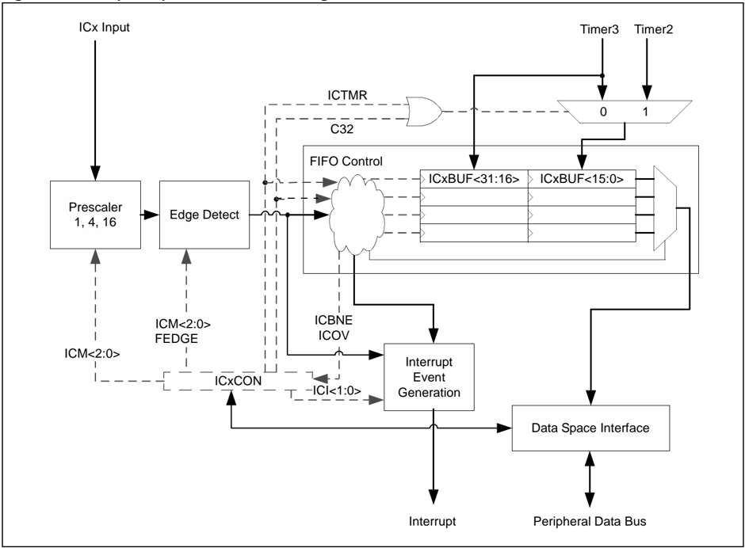
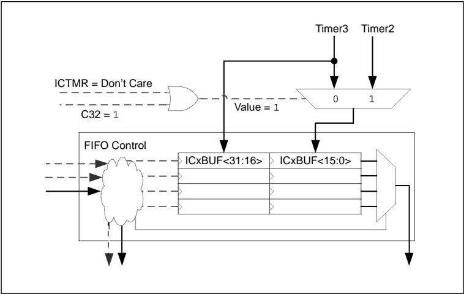
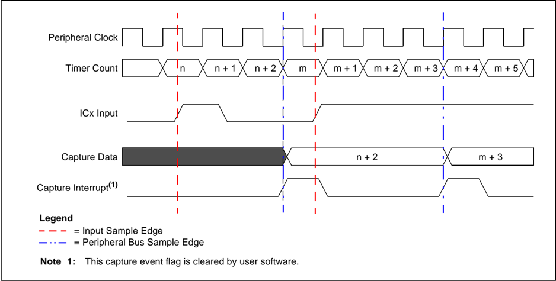
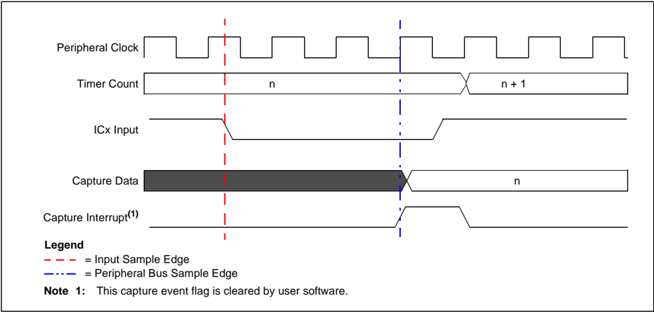
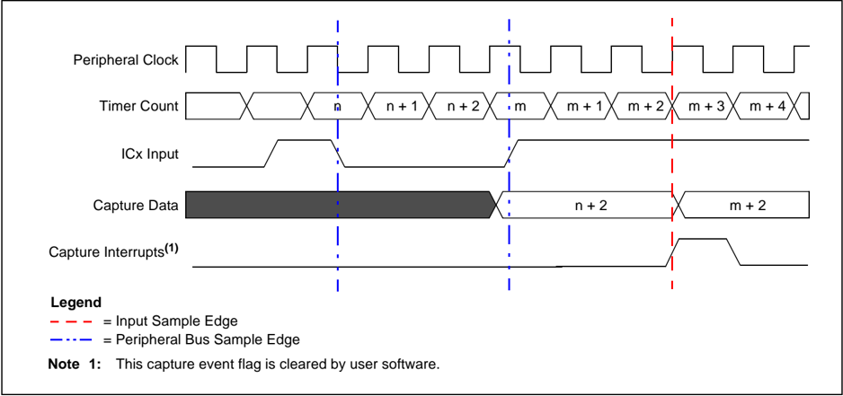
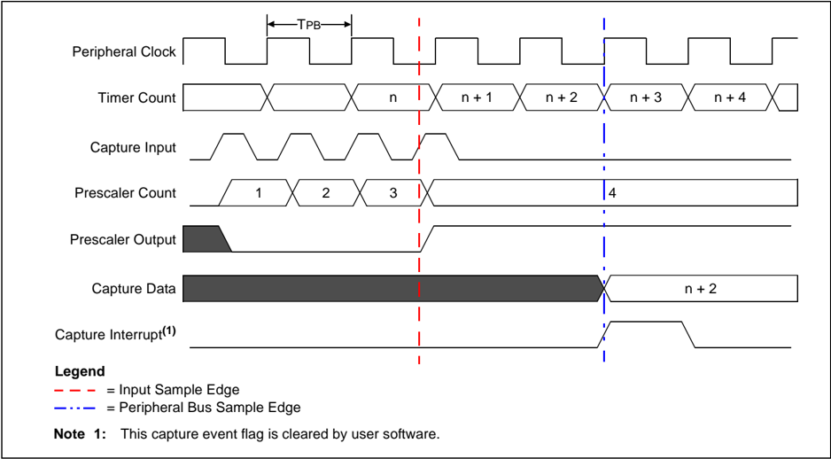
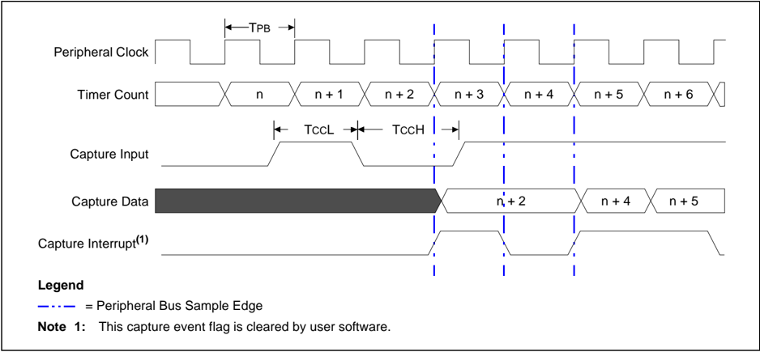
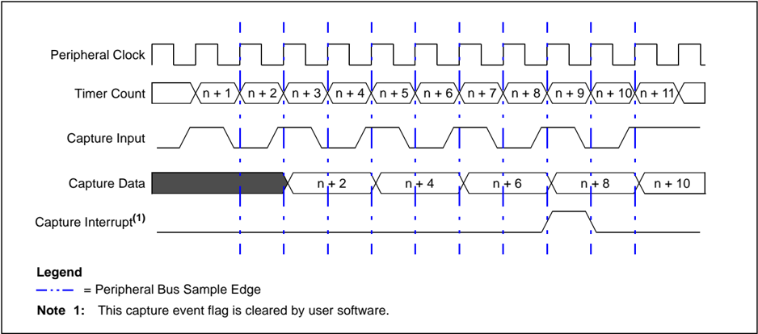

Microchip

## Section 15. Input Capture

This section of the manual contains the following topics:

|   15.1 | Introduction..............................................................................................................15-2   |
|--------|----------------------------------------------------------------------------------------------------------------------------------|
|   15.2 | Input Capture Registers...........................................................................................15-4           |
|   15.3 | Timer Selection........................................................................................................15-8      |
|   15.4 | Input Capture Enable...............................................................................................15-8          |
|   15.5 | Input Capture Event Modes.....................................................................................15-9               |
|   15.6 | Capture Buffer Operation.......................................................................................15-15             |
|   15.7 | Input Capture Interrupts.........................................................................................15-16           |
|   15.8 | Operation in Power-Saving Modes........................................................................15-18                     |
|   15.9 | Operation in Debug Mode .....................................................................................15-18               |
|  15.10 | I/O Pin Control .......................................................................................................15-18     |
|  15.11 | Related Application Notes .....................................................................................15-19             |
|  15.12 | Revision History.....................................................................................................15-20       |

Note: This family reference manual section is meant to serve as a complement to device data sheets. Depending on the device variant, this manual section may not apply to all PIC32 devices.

[Please consult the note at the beginning of the 'Input Capture' chapter  in the current device data sheet to check whether this document supports the device you are using.](http://www.microchip.com/)

Device  data  sheets  and  family  reference  manual  sections  are  available  for download from the Microchip Worldwide Web site at: http://www.microchip.com

## 15.1 INTRODUCTION

This section describes the Input Capture module and its associated operational modes. The Input Capture module is used to capture a timer value from one of two selectable time bases on the occurrence of an event on an input pin. The Input Capture features are useful in applications requiring  frequency  (Time  Period)  and  pulse  measurement.  Figure 15-1  depicts  a  simplified block diagram of the Input Capture module.

Note: Each PIC32 device variant may have one or more Input Capture modules. Refer to

the  specific  device  data  sheet  for  information  on  the  number  of  Input  Capture modules available in a particular device.

All Input Capture modules are functionally identical. In this document, an 'x' used in the  names  of  pins,  Control/Status  bits,  and  registers  denotes  the  specific  Input Capture module.

The  Input  Capture  module  has  multiple  operating  modes,  which  are  selected  through  the ICxCON register. The operating modes include the following:

- Capture timer value on every falling edge of input applied at the ICx pin
- Capture timer value on every rising edge of input applied at the ICx pin
- Capture timer value on every fourth rising edge of input applied at the ICx pin
- Capture timer value on every sixteenth rising edge of input applied at the ICx pin
- Capture timer value on every rising and falling edge of input applied at the ICx pin
- Capture timer value on the specified edge and every edge thereafter

The Input Capture module has a four-level First in First Out (FIFO) buffer. The number of capture events required to generate a CPU interrupt can be selected by the user application. An Input Capture module can also be configured to generate a CPU interrupt on a rising edge of the capture input when the device is in Sleep or Idle mode.

Figure 15-1: Input Capture Module Block Diagram

## 15.2 INPUT CAPTURE REGISTERS

Each  Input  Capture  module  available  on  PIC32  devices  has  the  following  Special  Function Registers (SFRs):

- ICXCON: Input Capture 'X' Control Register

These registers contain the main control bits for the Input Capture module, which includes the ON bit for enabling or disabling the module. They also contain the controls for setting up the input capture type including; capture mode, timer source, timer type, and interrupt mode. Status bits are also available for data received and overflow recognition.

## · ICXBUF: Input Capture X Buffer Register

These registers are the FIFO buffers that contain the stored timer values received from the synchronized input capture event.

Each Input Capture module also has the following associated bits for interrupt control (refer to the 'Interrupts Controller' chapter in the specific device data sheet for more information):

- Interrupt Enable Control bit (ICxIE)
- Interrupt Flag Status bit (ICxIF)
- Interrupt Priority Control bits (ICxIP)
- Interrupt Subpriority Control bits (ICxIS)

Table 15-1 provides a brief summary of the Input Capture related registers, and is followed by a detailed description of each register.

Table 15-1: Input Capture SFR Summary

| Register Name   | Bit Range   | Bit 31/15     | Bit 30/14     | Bit 29/13     | Bit 28/12     | Bit 27/11     | Bit 26/10     | Bit 25/9      | Bit 24/8      | Bit 23/7      | Bit 22/6      | Bit 21/5      | Bit 20/4      | Bit 19/3      | Bit 18/2      | Bit 17/1      | Bit 16/0      |
|-----------------|-------------|---------------|---------------|---------------|---------------|---------------|---------------|---------------|---------------|---------------|---------------|---------------|---------------|---------------|---------------|---------------|---------------|
| ICxCON (1)      | 31:16       | -             | -             | -             | -             | -             | -             | -             | -             | -             | -             | -             | -             | -             | -             | -             | -             |
| ICxCON (1)      | 15:0        | ON            | -             | SIDL          | -             | -             | -             | FEDGE         | C32           | ICTMR         | ICI<1:0>      | ICI<1:0>      | ICOV          | ICBNE         | ICM<2:0>      | ICM<2:0>      | ICM<2:0>      |
| ICxBUF          | 31:16       | ICxBUF<31:16> | ICxBUF<31:16> | ICxBUF<31:16> | ICxBUF<31:16> | ICxBUF<31:16> | ICxBUF<31:16> | ICxBUF<31:16> | ICxBUF<31:16> | ICxBUF<31:16> | ICxBUF<31:16> | ICxBUF<31:16> | ICxBUF<31:16> | ICxBUF<31:16> | ICxBUF<31:16> | ICxBUF<31:16> | ICxBUF<31:16> |
| ICxBUF          | 15:0        | ICxBUF<15:0>  | ICxBUF<15:0>  | ICxBUF<15:0>  | ICxBUF<15:0>  | ICxBUF<15:0>  | ICxBUF<15:0>  | ICxBUF<15:0>  | ICxBUF<15:0>  | ICxBUF<15:0>  | ICxBUF<15:0>  | ICxBUF<15:0>  | ICxBUF<15:0>  | ICxBUF<15:0>  | ICxBUF<15:0>  | ICxBUF<15:0>  | ICxBUF<15:0>  |

Note 1: This register has an associated Clear, Set, and Invert register at an offset of 0x4, 0x8, and 0xC bytes, respectively. These registers have the same name with CLR, SET, or INV appended to the end of the register name (e.g., ICxCONCLR). Writing a ' 1 ' to any bit position in these registers will clear, set, or invert valid bits in the associated register. Reads from these registers should be ignored.

## PIC32 Family Reference Manual

## Register 15-1: ICXCON: Input Capture 'X' Control Register

| Bit Range   | Bit 31/23/15/7   | Bit 30/22/14/6   | Bit 29/21/13/5   | Bit 28/20/12/4   | Bit 27/19/11/3   | Bit 26/18/10/2   | Bit 25/17/9/1   | Bit 24/16/8/0   |
|-------------|------------------|------------------|------------------|------------------|------------------|------------------|-----------------|-----------------|
| 31:24       | U-0              | U-0              | U-0              | U-0              | U-0              | U-0              | U-0             | U-0             |
| 31:24       | -                | -                | -                | -                | -                | -                | -               | -               |
| 23:16       | U-0              | U-0              | U-0              | U-0              | U-0              | U-0              | U-0             | U-0             |
| 23:16       | -                | -                | -                | -                | -                | -                | -               | -               |
| 15:8        | R/W-0            | U-0              | R/W-0            | U-0              | U-0              | U-0              | R/W-0           | R/W-0           |
| 15:8        | ON               | -                | SIDL             | -                | -                | -                | FEDGE           | C32             |
| 7:0         | R/W-0            | R/W-0            | R/W-0            | R-0              | R-0              | R/W-0            | R/W-0           | R/W-0           |
| 7:0         | ICTMR            | ICI<1:0>         | ICI<1:0>         | ICOV             | ICBNE            | ICM<2:0>         | ICM<2:0>        | ICM<2:0>        |

## Legend:

R = Readable bit

W = Writable bit

U = Unimplemented bit, read as '0'

-n = Value at POR

'1' = Bit is set

'0' = Bit is cleared

x = Bit is unknown

bit 31-16 Unimplemented: Read as ' 0 '

bit 15

ON: Input Capture Module Enable bit

1 = Module is enabled

0 = Disable and reset module, disable clocks, disable interrupt generation and allow SFR modifications

Note:

When using 1:1 PBCLK divisor, the user's software should not read/write the peripheral's SFRs in the SYSCLK cycle immediately following the instruction that clears the module's ON bit.

bit 14 Unimplemented: Read as ' 0 '

bit 13 SIDL:

Stop in Idle Control bit

1 = Halt in CPU Idle mode

0 = Continue to operate in CPU Idle mode

bit 12-10 Unimplemented: Read as ' 0 '

bit 9

FEDGE:

First Capture Edge Select bit (only used in mode 6, ICM&lt;2:0&gt; = 110 )

1 = Capture rising edge first

0 = Capture falling edge first

bit 8

C32: 32-bit Capture Select bit

1 = 32-bit timer resource capture

0 = 16-bit timer resource capture

bit 7 ICTMR: Timer Select bit (Does not affect timer selection when C32 (ICxCON&lt;8&gt;) is ' 1 ')

0 = Timer3 is the counter source for capture

1 = Timer2 is the counter source for capture

bit 6-5 ICI&lt;1:0&gt;: Interrupt Control bits

11 =  Interrupt on every fourth capture event

10 =  Interrupt on every third capture event

01 =  Interrupt on every second capture event

00 =  Interrupt on every capture event

bit 4 ICOV: Input Capture Overflow Status Flag bit (read-only)

1 = Input capture overflow occurred

0 = No input capture overflow occurred

## bit 3

ICBNE: Input Capture Buffer Not Empty Status bit (read-only)

1 = Input capture buffer is not empty; at least one more capture value can be read

0 = Input capture buffer is empty

bit 2-0 ICM&lt;2:0&gt;: Input Capture Mode Select bits

111 =  Interrupt-Only mode (only supported while in Sleep mode or Idle mode)

110 =  Simple Capture Event mode - every edge, specified edge first and every edge thereafter

101 =  Prescaled Capture Event mode - every sixteenth rising edge

100 =  Prescaled Capture Event mode - every fourth rising edge

011 =  Simple Capture Event mode - every rising edge

010 =  Simple Capture Event mode - every falling edge

001 =  Edge Detect mode - every edge (rising and falling)

000 =  Capture Disable mode

## Register 15-2: ICXBUF: Input Capture X Buffer Register

| Bit Range   | Bit 31/23/15/7   | Bit 30/22/14/6   | Bit 29/21/13/5   | Bit 28/20/12/4   | Bit 27/19/11/3   | Bit 26/18/10/2   | Bit 25/17/9/1   | Bit 24/16/8/0   |
|-------------|------------------|------------------|------------------|------------------|------------------|------------------|-----------------|-----------------|
| 31:24       | R-0              | R-0              | R-0              | R-0              | R-0              | R-0              | R-0             | R-0             |
| 31:24       | ICxBUF<31:24>    | ICxBUF<31:24>    | ICxBUF<31:24>    | ICxBUF<31:24>    | ICxBUF<31:24>    | ICxBUF<31:24>    | ICxBUF<31:24>   | ICxBUF<31:24>   |
| 23:16       | R-0              | R-0              | R-0              | R-0              | R-0              | R-0              | R-0             | R-0             |
| 23:16       | ICxBUF<23:10>    | ICxBUF<23:10>    | ICxBUF<23:10>    | ICxBUF<23:10>    | ICxBUF<23:10>    | ICxBUF<23:10>    | ICxBUF<23:10>   | ICxBUF<23:10>   |
| 15:8        | R-0              | R-0              | R-0              | R-0              | R-0              | R-0              | R-0             | R-0             |
| 15:8        | ICxBUF<15:8>     | ICxBUF<15:8>     | ICxBUF<15:8>     | ICxBUF<15:8>     | ICxBUF<15:8>     | ICxBUF<15:8>     | ICxBUF<15:8>    | ICxBUF<15:8>    |
| 7:0         | R-0              | R-0              | R-0              | R-0              | R-0              | R-0              | R-0             | R-0             |
| 7:0         | ICxBUF<7:0>      | ICxBUF<7:0>      | ICxBUF<7:0>      | ICxBUF<7:0>      | ICxBUF<7:0>      | ICxBUF<7:0>      | ICxBUF<7:0>     | ICxBUF<7:0>     |

| Legend: R = Readable bit   | W = Writable     | U = Unimplemented bit, read   | as '0'             |
|----------------------------|------------------|-------------------------------|--------------------|
| -n = Value at POR          | '1' = Bit is set | '0' = Bit is cleared          | x = Bit is unknown |

## bit 31-0 ICxBUF&lt;31:0&gt;: Buffer Register bits

These bits contain the value of the current captured input timer count.

## 15.3 TIMER SELECTION

Each PIC32 device may have one or more Input Capture modules. Each module can select between one of two 16-bit  timers  for  the  time  base  or  one  32-bit  timer,  which  is  formed  by combining two 16-bit timers. Refer to the 'Timers' chapter in the specific device data sheet for the timers that can be selected.

For 16-bit Capture mode, setting the ICTMR bit (ICxCON&lt;7&gt;) to ' 0 ' selects Timer3 for capture. Setting the ICTMR bit (ICxCON&lt;7&gt;) to ' 1 ' selects Timer2 for capture.

An Input Capture module configured to support 32-bit capture may use a 32-bit timer resource for capture. By setting the C32 bit (ICxCON&lt;8&gt;) to ' 1 ', a 32-bit timer resource is captured. The 32-bit  timer  resource  is routed  into the  module using the existing 16-bit timer inputs. Timer2 provides the lower 16 bits and Timer3 provides the upper 16 bits, as illustrated in Figure 15-2.

The timer's clock can be set up using the internal peripheral clock source or a synchronized external clock source applied at the TxCK pin.

Figure 15-2: 32-bit Timer Selection Block Diagram

## 15.4 INPUT CAPTURE ENABLE

After configuration, an Input Capture module is enabled by setting the ON bit (ICxCON&lt;15&gt;). When this bit is cleared, the module is reset. Resetting the module has the following effects:

- Clears the Overflow Condition Flag
- Resets the FIFO to the empty state
- Resets the event count (for interrupt generation)
- Resets the prescaler count

Register reads and writes are allowed regardless of the state of the ON bit (ICxCON&lt;15&gt;).

## 15.5 INPUT CAPTURE EVENT MODES

The Input Capture module captures the value of the selected time base register when an event occurs at the ICx pin. An Input Capture module can be configured in the following modes:

- Simple Capture Event modes:
- -Capture timer value on every falling edge of input at ICx pin
- -Capture timer value on every rising edge of input at ICx pin
- -Capture timer value on every rising and falling edge of input at ICx pin, starting with a specified edge
- Prescaled Capture Event modes:
- -Capture timer value on every fourth rising edge of input at ICx pin
- -Capture timer value on every sixteenth rising edge of input at ICx pin
- Edge Detect mode (See 15.5.3 'Edge Detect (Hall Sensor) Mode' )
- Interrupt-Only mode (See 15.5.4 'Interrupt-Only Mode' )

These input capture modes are configured by setting the appropriate Input Capture mode bits, ICM&lt;2:0&gt; (ICxCON&lt;2:0&gt;).

When the Input Capture module is disabled (ICM&lt;2:0&gt; = 000 ), the input capture logic ignores incoming capture edges and does not generate further capture events or interrupts. The FIFO continues to be operational for reading. Returning the module to any of the other modes resumes operation.  A  state  change on  the  capture  input  while  capture  is  disabled,  does  not  cause  a capture event on exiting Capture Disable mode.

Note: The prescaler logic continues to run when the Input Capture module is in Capture Disable mode.

## 15.5.1 Simple Capture Events

The Input Capture module can capture a timer count value based on the selected edge (rising, falling or both, defined by mode) of the input applied to the ICx pin. Table 15-2 provides the mode settings. In Simple Capture Event mode, the prescaler is not used. See Figure 15-3, Figure 15-4 and Figure 15-5 for simplified timing diagrams of a simple capture event.

Table 15-2: Input Capture Mode Settings

|   ICM<2:0> Setting | Capture Occurs On            |
|--------------------|------------------------------|
|                001 | Rising edge                  |
|                010 | Falling edge                 |
|                110 | Rising and falling edges (1) |

Note 1: This capture begins with the edge specified by the FEDGE bit (ICxCON&lt;9&gt;).

The input capture logic detects and synchronizes the rising or falling edge of the capture pin signal  on  the  peripheral  clock.  When  the  rising/falling  edge  has  occurred,  the  Input  Capture module logic will write the current time base value to the capture buffer and signal the interrupt generation logic.

Note: Since the capture input must be synchronized to the peripheral clock, the module captures the timer count value that is valid 2-3 peripheral clock cycles (TPB) after the capture event.

An input capture interrupt event is generated after one, two, three or four timer count captures, as configured by the ICI&lt;1:0&gt; bits (ICxCON&lt;6:5&gt;). See 15.7 'Input Capture Interrupts' for more details.

Since the capture pin is sampled by the peripheral clock, the capture pulse high and low widths must be greater than the peripheral clock period.

Figure 15-3 depicts two capture events when the Input Capture module is in Simple Capture mode  configured  to  capture  every  rising  edge,  ICM&lt;2:0&gt;  bits  (ICxCON&lt;2:0&gt;)  = 011 ,  with interrupts generated for every event, ICI&lt;1:0&gt; bits (ICxCON&lt;6:5&gt;) = 00 .

The first capture event occurs when the timer value is 'n'. Due to synchronization delay, timer value 'n + 2' is stored in the capture buffer. The second capture event occurs when the timer value is 'm'. Note that 'm + 3' is stored in the capture buffer due to propagation delay as well as the synchronization delay. Interrupt events are generated on each capture event.

Figure 15-3: Simple Capture Event Timing Diagram, Capture Every Rising Edge

Figure 15-4 depicts a capture event when the Input Capture module is in Simple Capture mode configured to capture every falling edge, ICM&lt;2:0&gt; = 010 ,  with interrupts generated for every event, ICI&lt;1:0&gt; = 00 . In this example, the timer frequency is slower than the peripheral clock.

The capture event occurs when the timer value is 'n'. Value 'n' is stored in the capture buffer and an interrupt event is generated.

Figure 15-4: Simple Capture Event Timing Diagram, Capture Every Falling Edge

Figure 15-5 depicts a capture event when the Input Capture module is in Simple Capture mode configured to capture every edge, ICM&lt;2:0&gt; bits (ICxCON&lt;2:0&gt;) = 011 ; starting with a falling edge,  FEDGE bit  (ICxCON&lt;9&gt;)  = 0 ,  with  interrupts  generated  for  every  second  event, ICI&lt;1:0&gt; bits (ICxCON&lt;6:5&gt;) = 01 .

The first falling edge occurs when the timer value is 'n'. Value 'n + 2' is stored in the capture buffer. A subsequent rising edge occurs when the timer value is 'm'. Value 'm + 2' is stored in the capture buffer and an interrupt event is generated.

Figure 15-5: Simple Capture Event Timing Diagram, Capture Every Edge, Falling Edge First

## 15.5.2 Prescaled Capture Event Mode

In Prescaled Capture Event mode, the Input Capture module triggers a capture event on either every fourth or every sixteenth rising edge. Table 15-3 provides the Prescaled Capture Event mode settings.

Table 15-3: Prescaled Capture Event Mode Settings

|   ICM<2:0> Setting |   Number of Rising Edges Before Trigger |
|--------------------|-----------------------------------------|
|                100 |                                       4 |
|                101 |                                      16 |

The capture prescaler counter is incremented on every rising edge on the capture input. When the prescaler counter equals four or sixteen (depending on the mode selected), the counter outputs a 'valid' capture event signal. The valid capture event signal is then synchronized to the peripheral clock. The synchronized capture event signal triggers a timer count capture.

Note: Since the capture input must be synchronized to the peripheral clock, the module captures the timer count value that is valid 2-3 peripheral clock cycles (TPB) after the capture event.

An input capture interrupt is generated after one, two, three or four timer count captures, as configured by the ICI&lt;1:0&gt; bits (ICxCON&lt;6:5&gt;). See 15.7 'Input Capture Interrupts' for further details.

Note: It is recommended that the user disable the capture module (i.e., clear the ON bit, ICxCON&lt;15&gt;),  before  switching  to  Prescaler  Capture  Event  mode.  Simply switching to Prescaler Capture Event mode from another active mode does not reset the prescaler and may cause an inadvertent capture event.

The prescaler counter is cleared when the following events occur:

- The Input Capture module is turned off (i.e., ON = 0 (ICxCON&lt;15&gt;))
- The Input Capture module is reset

The Input Capture signal high and low time requires that certain timing specifications are met to account for propagation delays and clock jitter. The Input Capture module synchronizes on the rising edge of PBCLK. There is no guarantee that the Input Capture module will validate the signal if it is less than 1 PBCLK plus a margin. Refer to the 'Electrical Characteristics' section in the specific device data sheet for details on Input Capture electrical specifications.

Figure 15-6 depicts a capture event when the Input Capture module is in Prescaler Capture Event mode. The prescaler is configured to capture a timer value for every fourth rising edge on the  capture  input,  ICM&lt;2:0&gt; bits  (ICxCON&lt;2:0&gt;)  = 100 ,  with  interrupts  generated  for  every capture event, ICI&lt;1:0&gt; bits (ICxCON&lt;6:5&gt;) = 00 . The fourth rising edge on the capture input occurs at time 'n'. The prescaler output is synchronized. Due to synchronization delay, timer value 'n + 2' is stored in the capture buffer. An interrupt signal is generated due to the capture event.

Figure 15-6: Prescaler Capture Event Timing Diagram

## 15.5.3 Edge Detect (Hall Sensor) Mode

In Edge Detect mode, the Input Capture module captures a timer count value on every edge of the capture input. Edge Detection mode is selected by setting the ICM&lt;2:0&gt; bits (ICxCON&lt;2:0&gt;) to ' 001 ' . In this mode, the capture prescaler is not used and the Input Capture Overflow bit, ICOV (ICxCON&lt;4&gt;),  is  not updated. In this mode,  the  Interrupt Control bits, ICI&lt;1:0&gt;  bits (ICxCON&lt;6:5&gt;), are ignored and an interrupt event is generated for every timer count capture. See Figure 15-7 for a simplified timing diagram.

As with the Simple Capture Event mode, the Input Capture logic detects and synchronizes the rising and falling edge of the capture input signal on the peripheral clock. When a rising or falling edge occurs, the Input Capture module writes the time base value to the capture buffer.

Note:

Since the capture input must be synchronized to the peripheral clock, the module captures the timer count value that is valid 2-3 peripheral clock cycles (TPB) after the capture event.

Since the capture pin is sampled by the peripheral clock, the capture pulse high and low widths must be greater than the peripheral clock period.

Figure 15-7  depicts  three  capture  events  when  the  Input  Capture  module  is  in  Edge  Detect mode, ICM&lt;2:0&gt; bits = 001 . Transitions on the capture input occur at times 'n', 'n + 1' and 'n + 3'. Due to synchronization and propagation delay, timer values 'n + 2', 'n + 4' and 'n + 5' are stored in the capture buffer. Interrupt signals are generated due to each capture input transition.

Figure 15-7: Edge Detect Capture Event Timing Diagram

## 15.5.4 Interrupt-Only Mode

Interrupt-Only mode does not function while the device is running, and only operates when the device is in Sleep or Idle mode; however, during normal operation, when the device is in Sleep or  Idle  mode  and  the  Input  Capture  module  is  set  for  Interrupt-Only  mode  (ICM&lt;2:0&gt;  bits (ICxCON&lt;2:0&gt; = 111 ), the Input Capture module functions as an interrupt pin. Any rising edge on the input capture triggers an interrupt, which wakes the device. No timer values are captured and the FIFO buffer is not updated.

Since no timer values are captured, the Timer Select bit, ICTMR (ICxCON&lt;7&gt;), is ignored and there is no need to configure the timer source. The prescaler is not used in this mode, as the wake-up  interrupt is  generated on the first rising edge. Therefore, the ICI&lt;1:0&gt; bits (ICxCON&lt;6:5&gt;) are ignored. When the device leaves Sleep or Idle mode, the interrupt signal is deasserted. This mode is used strictly as an external wake-up source.

The Input Capture signal high and low time requires that certain timing specifications are met to account for propagation delays and clock jitter. The Input Capture module synchronizes on the rising edge of PBCLK. You cannot guarantee that the Input Capture module will validate the signal if it is less than 1 PBCLK plus a margin. Refer to the 'Electrical Characteristics' chapter in the specific device data sheet for details on Input Capture electrical specifications.

## 15.6 CAPTURE BUFFER OPERATION

Each  Input  Capture  module  has  an  associated  four-level  deep  FIFO  buffer.  The  buffer  is accessible to the user application through the buffer register (ICxBUF). The ICxBUF register is written by the input capture logic and can only be read by the user application. Writes to the ICxBUF register are ignored.

There are two status flags that provide status on the FIFO buffer:

- ICBNE (ICxCON&lt;3&gt;) - Input Capture Buffer Not Empty
- ICOV (ICxCON&lt;4&gt;) - Input Capture Overrun

When the Input Capture module is disabled (i.e., ON bit (ICxCON&lt;15&gt; = 0 ) or Reset), the status flags are cleared and the buffer is cleared to the empty state.

The ICBNE flag is set on the first input capture event and remains set until all capture events have been read from the FIFO. For example, if three capture events have occurred, three reads of the capture FIFO buffer are required before the ICBNE flag is cleared. If four capture events have occurred, four reads are required to clear the ICBNE flag.

Each read of the FIFO buffer adjusts the read pointer, allowing the remaining entries to move to the next available top location of the FIFO. In 32-bit Capture mode, the upper 16 bits must be read last if reading 16 bits at a time. The FIFO read pointer is advanced when reading the Most Significant Byte (MSB).

If the FIFO is full with four capture events and a fifth capture event occurs prior to a read of the FIFO, an overrun condition occurs and the ICOV bit (ICxCON&lt;4&gt;) is set to a logic ' 1 '. The fifth capture event is not recorded, subsequent capture events do not alter the current FIFO contents until the overrun condition is cleared, and an input capture error interrupt will be generated.

Note: Some PIC32 microcontrollers do not support the ICxE interrupt. Refer to the specific device data sheet for availability.

The overflow condition is cleared in any of the following ways:

- Module is disabled (i.e., the ON bit (ICxCON&lt;15&gt;) = 0 )
- Capture buffer is read until the ICBNE bit (ICxCON&lt;3&gt;) = 0
- Device is Reset

Note: When the ICI&lt;1:0&gt; bits = 00 or the ICM&lt;2:0&gt; bits = 001 , interrupts continue to occur and the ICOV bit remains clear even after a buffer overflow has occurred.

If the Input Capture module is disabled and at some time re-enabled, the FIFO buffer contents are not defined and a read may yield indeterminate results.

If  a  FIFO  read  is  performed  when  no  capture  event  has  been  received,  the  read  yields indeterminate results.

## 15.7 INPUT CAPTURE INTERRUPTS

The Input Capture module can generate an interrupt event signal based on the selected number of capture events. A capture event is defined by the writing of a timer value into the FIFO. The number  of  capture  events  required  to  trigger  an  interrupt  event  is  set  by  the  ICI&lt;1:0&gt;  bits (ICxCON&lt;6:5&gt;) . If the ICBNE bit (ICxCON&lt;3&gt;) = 0 , the interrupt count is cleared. This allows the user to synchronize the interrupt count to the FIFO status.

For example, assuming that ICI&lt;1:0&gt; = 01 (specifying an interrupt event every second capture event), the following sequence could occur:

1. Turn on module, interrupt count = 0.
2. Capture event. FIFO contains one entry, interrupt count = 1.
3. Read FIFO. FIFO is empty, interrupt count = 0.
4. Capture event. FIFO contains one entry, interrupt count = 1.
5. Capture event. FIFO contains two entries, interrupt count = 2.
6. Interrupt issued. interrupt count = 0.
7. Capture event. FIFO contains three entries, interrupt count = 1.
8. Read FIFO three times. FIFO becomes empty, interrupt count = 0.
9. Capture event. FIFO contains one entry, interrupt count = 1.
10. Read FIFO. FIFO becomes empty, interrupt count = 0.

The first capture event is defined as the capture event occurring after a mode change from the OFF mode or after ICBNE = 0 .

When an overrun occurs (unless ICI&lt;1:0&gt; = 00 or ICM&lt;2:0&gt; = 001 ), the Input Capture module will stop generating input capture events and generates an input capture error event instead. This interrupt will persist until the  overflow  condition  is  cleared  (see 15.6 'Capture  Buffer Operation' for details on how to clear the overflow condition).

Note: Some  PIC32  microcontrollers  do  not  support  the  ICxE  interrupt.  Refer  to  the 'Interrupts' chapter in the specific device data sheet for availability.

Applications often dictate using the Input Capture pins as auxiliary external interrupt sources. When ICI&lt;1:0&gt; = 00 or ICM&lt;2:0&gt; = 001 , interrupt events occur regardless of the FIFO overrun. There is no need to perform a dummy read on the capture buffer to clear the event and prevent an  overflow  in  order  to  ensure  that  future  interrupt  events  are  not  inhibited.  The  ICOV  flag (ICxCON&lt;4&gt;) is still set for the overflow condition.

Figure 15-8 depicts five capture events when the Input Capture module is configured to capture timer values on every rising edge (ICM&lt;2:0&gt; = 011 )  and generate an interrupt for every four captures (ICI&lt;1:0&gt; = 11 ). Note that the fourth capture causes the capture of value 'n + 8' and triggers an interrupt event.

Figure 15-8: Interrupt Event (ICM&lt;2:0&gt; (ICxCON&lt;2:0&gt;) = 011 , ICI&lt;1:0&gt; (ICxCON&lt;6:5&gt;) = 11

## 15.7.1 Interrupt Control Bits

Each Input Capture module has interrupt flag status bits (ICxIF), interrupt error status bits (ICxE), interrupt enable bits (ICxIE), interrupt priority control bits (ICxIP) and secondary interrupt priority control bits (ICxIS). Refer to 8.2 'Control Registers' in Section 8. 'Interrupts' (DS60001108) of the 'PIC32 Family Reference Manual' for additional information on peripheral interrupts.

## 15.7.2 Interrupt Persistence

Input capture interrupts persist so long as the condition that caused them persists. In addition, they will occur again immediately if the condition is not cleared. Table 15-4 describes the interrupt persistence set and clear conditions.

Note: Some  PIC32  microcontrollers  do  not  support  the  ICxE  interrupt  or  persistent interrupts. Refer to the 'Interrupts' chapter in the specific device data sheet for availability.

Table 15-4: Interrupt Persistence Conditions

| ICxCON Value                                                                                      | Set Condition                                     | Persistence                                                                      |
|---------------------------------------------------------------------------------------------------|---------------------------------------------------|----------------------------------------------------------------------------------|
| ICI<1:0> = 11                                                                                     | Interrupt on every fourth capture event.          | Interrupt is active if the number of FIFO entries is equal to 4.                 |
| ICI<1:0> = 10                                                                                     | Interrupt on every third capture event.           | Interrupt is active if the number of FIFO entries is greater than or equal to 3. |
| ICI<1:0> = 01                                                                                     | Interrupt on every second capture event.          | Interrupt is active if the number of FIFO entries is greater than or equal to 2. |
| ICI<1:0> = 00 or Edge Detect modes (see the ICM<2:0> bits in the ICxCON register (Register 15-1)) | Interrupt on every capture event.                 | Interrupt is active if the number of FIFO entries is greater than or equal to 1. |
| ICOV = 1                                                                                          | Interrupt on fifth capture event if FIFO is full. | Interrupt is active until the error condition flag (ICxCON.ICOV) is cleared.     |

## 15.8 OPERATION IN POWER-SAVING MODES

## 15.8.1 Input Capture Operation in Sleep Mode

When the device enters Sleep mode, the peripheral clock is disabled. In Sleep mode, the Input Capture module can only function as an external interrupt source. This mode is enabled by setting the ICM&lt;2:0&gt; bits (ICxCON&lt;2:0&gt;) = 111 , for Interrupt-Only mode. In this mode, a rising edge on the capture pin will generate a device wake-up from Sleep. If the respective module interrupt bit is enabled and the module's priority is of the required priority level, an interrupt will be generated. Refer to 15.5.4 'Interrupt-Only Mode' for more details.

If the Input Capture module has been configured for a mode other than ICM&lt;2:0&gt; = 111 and the device enters Sleep mode, no external pin stimulus, rising or falling, will generate a wake-up from Sleep.

## 15.8.2 Input Capture Operation in Idle Mode

When the device enters Idle mode, the peripheral clock sources remain functional and the CPU stops executing code. The Sleep-In-Idle Control bit, SIDL (ICxCON&lt;13&gt;), determines whether the module will stop in Idle mode or continue to operate.

If SIDL is ' 0 ', the module continues normal operation in Idle mode. Although Interrupt-Only mode (ICM&lt;2:0&gt; = 111 ) may generate an interrupt when in Idle mode if SIDL is ' 0 ', an interrupt is not generated when the processor is running. Refer to 15.5.4 'Interrupt-Only Mode' for  further details.

If SIDL is ' 1 ', the module stops when the device is in Idle mode. The module performs the same procedures  when stopped in Idle mode as  for Sleep mode.  Refer to 15.5.4 'Interrupt-Only Mode' for further details.

## 15.8.3 Device Wake-up on Sleep or Idle

While using Interrupt-Only  mode, an input capture event can generate a device wake-up or interrupt, if enabled, when the device is in Sleep or Idle mode. Refer to 15.5.4 'Interrupt-Only Mode' for further details.

## 15.9 OPERATION IN DEBUG MODE

Programming operations will continue to completion if processor execution is halted in Debug mode.

## 15.10 I/O PIN CONTROL

When the Input Capture module is enabled, the user application must ensure that the I/O pin direction is configured for an input by setting the associated TRISx bit. The pin direction is not set when the Input Capture module is enabled. Furthermore, all other peripherals multiplexed with the input pin must be disabled.

## 15.11 RELATED APPLICATION NOTES

This  section  lists  application  notes  that  are  related  to  this  section  of  the  manual.  These application notes may not be written specifically for the PIC32 device family, but the concepts are pertinent and could be used with modification and possible limitations. The current application notes related to the Input Capture module include the following:

Title

Application Note #

Using the CCP Module(s)

AN594

Implementing Ultrasonic Ranging

AN597

Note:

Please visit the Microchip web site (www.microchip.com) for additional application notes and code examples for the PIC32 family of devices.

## PIC32 Family Reference Manual

## 15.12 REVISION HISTORY

## Revision A (October 2007)

This is the initial released version of this document.

## Revision B (October 2007)

Updated document to remove Confidential status.

## Revision C (April 2008)

Revised status to Preliminary; Revised U-0 to r-x; Removed 'x' in bit names.

## Revision D (June 2008)

Revised note for Registers 15-1, 15-3, 15-4, 15-5, 15-6, 15-7, 15-8, 15-9; Change Reserved bits from 'Maintain as' to 'Write'; Added Note to ON bit (ICxCON Register).

## Revision E (October 2009)

This revision includes the following updates:

- Minor updates to text and formatting have been incorporated throughout the document.
- Updated the following figures:
- -Simple Capture Event Timing Diagram, Capture Every Rising Edge (Figure 15-3)
- -Simple Capture Event Timing Diagram, Capture Every Falling Edge (Figure 15-4)
- -Simple Capture Event Timing Diagram, Capture Every Edge, Falling Edge First (Figure 15-5)
- -Prescaler Capture Event Timing Diagram (Figure 15-6)
- -Edge Detect Capture Event Timing Diagram (Figure 15-7)
- -Interrupt Event, ICXCON.ICM&lt;2:0&gt; = 011 , ICXCON.ICI&lt;1:0&gt; = 11 (Figure 15-8)
- Updated the shaded note in 15.1 'Introduction' .
- Removed the shaded note in 15.2 'Input Capture Registers' .
- Updated the Interrupts Register Summary (Table 15-1):
- -Removed all references to the Clear, Set and Invert registers
- -Added the Address Offset column
- -Added Notes 1, 2 and 3, which describe the Clear, Set and Invert registers
- Added Notes 1, 2 and 3, which describe the Clear, Set and Invert registers to the ICxCON register (see Register 15-1).
- Removed the IFS0, IEC0, IPC1, IPC2, IPC3, IPC4 and IPC5 registers.
- Updated the bit definition for ICM&lt;2:0&gt; = 111 in the ICxCON: Input Capture x Control Register (see Register 15-1).
- Updated the first paragraph of 15.3 'Timer Selection' to clarify the formation of the timers used for the time base.
- Removed content from the first paragraph of 15.5.1 'Simple Capture Events' , which is now presented in Table 15-2.
- Removed content from the first paragraph of 15.5.2 'Prescaled Capture Event Mode' , which is now presented in Table 15-3.
- Updated all three paragraphs of 15.5.4 'Interrupt-Only Mode' .
- Added a shaded note and updated the sixth paragraph of 15.6 'Capture Buffer Operation' .
- Updated the capture event sequence in 15.7 'Input Capture Interrupts' .
- Added a reference to the interrupt error status bits (ICxE) in 15.7.1 'Interrupt Control Bits' .
- Added 15.7.2 'Interrupt Persistence' .
- Updated the second paragraph of 15.8.2 'Input Capture Operation in Idle Mode' to clarify operation during Interrupt-Only mode.

## Revision E (October 2009) (Continued)

- Updated 15.8.3 'Device Wake-up on Sleep or Idle' to clarify operation during Interrupt-Only mode.
- Updated the first paragraph of 15.9.1 'Capture Operation During Freeze (FRZ = 1 )' , and removed the second paragraph.
- Removed 15.9.2 'Operation of the Capture Buffer in Debug Mode'.

## Revision F (November 2010)

This revision includes the following updates:

- Formatting updates and minor text changes have been incorporated throughout the document
- The bit named ICFEDGE has been renamed to FEDGE
- The bit named ICC32 has been renamed to C32
- A new note box regarding interrupts has been added immediately after the last bullet item in 15.6 'Capture Buffer Operation'

## Revision G (April 2016)

This revision includes the following updates:

- The FRZ bit (ICxCON&lt;14&gt;) was removed (see Table 15-1 and Register 15-1)
- Figure 15-3 through Figure 15-8 were updated
- 15.5.2 'Prescaled Capture Event Mode' was updated
- 15.5.4 'Interrupt-Only Mode' was updated
- 15.9 'Operation in Debug Mode' was updated
- 15.11 'Design Tips' was removed
- In addition, minor updates to formatting and text were incorporated throughout the document

NOTES:

## Note the following details of the code protection feature on Microchip devices:

- Microchip products meet the specification contained in their particular Microchip Data Sheet.
- Microchip believes that its family of products is one of the most secure families of its kind on the market today, when used in the intended manner and under normal conditions.
- There are dishonest and possibly illegal methods used to breach the code protection feature. All of these methods, to our knowledge, require using the Microchip products in a manner outside the operating specifications contained in Microchip's Data Sheets. Most likely, the person doing so is engaged in theft of intellectual property.
- Microchip is willing to work with the customer who is concerned about the integrity of their code.
- Neither Microchip nor any other semiconductor manufacturer can guarantee the security of their code. Code protection does not mean that we are guaranteeing the product as 'unbreakable.'

Code protection is constantly evolving. We at Microchip are committed to continuously improving the code protection features of our products. Attempts to break Microchip's code protection feature may be a violation of the Digital Millennium Copyright Act. If such acts allow unauthorized access to your software or other copyrighted work, you may have a right to sue for relief under that Act.

Information  contained  in  this  publication  regarding  device applications and the like is provided only for your convenience and may be superseded by updates. It is your responsibility to ensure  that  your  application  meets  with  your  specifications. MICROCHIP MAKES NO REPRESENTATIONS OR WARRANTIES  OF  ANY  KIND  WHETHER  EXPRESS  OR IMPLIED, WRITTEN OR ORAL, STATUTORY OR OTHERWISE, RELATED TO THE INFORMATION, INCLUDING  BUT  NOT  LIMITED  TO  ITS  CONDITION, QUALITY, PERFORMANCE, MERCHANTABILITY OR FITNESS  FOR  PURPOSE . Microchip  disclaims  all  liability arising  from  this  information  and  its  use.  Use  of  Microchip devices in life support and/or safety applications is entirely at the buyer's risk, and the buyer agrees to defend, indemnify and hold  harmless  Microchip  from  any  and  all  damages,  claims, suits,  or  expenses  resulting  from  such  use.  No  licenses  are conveyed, implicitly or otherwise, under any Microchip intellectual property rights unless otherwise stated.

Microchip received ISO/TS-16949:2009 certification for its worldwide headquarters, design and wafer fabrication facilities in Chandler and Tempe, Arizona; Gresham, Oregon and design centers in California and India. The Company's quality system processes and procedures are for its PIC ®  MCUs and dsPIC ®  DSCs, KEELOQ ®  code hopping devices, Serial EEPROMs, microperipherals, nonvolatile memory and analog products. In addition, Microchip's quality system for the design and manufacture of development systems is ISO 9001:2000 certified.

## QUALITY MANAGEMENT  SYSTEM CERTIFIED BY DNV

== ISO/TS 16949 ==

## Trademarks

The Microchip name and logo, the Microchip logo, AnyRate, dsPIC, FlashFlex, flexPWR, Heldo, JukeBlox, KeeLoq, KeeLoq logo, Kleer, LANCheck, LINK MD, MediaLB, MOST, MOST logo, MPLAB, OptoLyzer, PIC, PICSTART, PIC32 logo, RightTouch, SpyNIC, SST, SST Logo, SuperFlash and UNI/O are registered trademarks of Microchip Technology Incorporated in the U.S.A. and other countries.

ClockWorks, The Embedded Control Solutions Company, ETHERSYNCH, Hyper Speed Control, HyperLight Load, IntelliMOS, mTouch, Precision Edge, and QUIET-WIRE are registered trademarks of Microchip Technology Incorporated in the U.S.A.

Analog-for-the-Digital Age, Any Capacitor, AnyIn, AnyOut, BodyCom, chipKIT, chipKIT logo, CodeGuard, dsPICDEM, dsPICDEM.net, Dynamic Average Matching, DAM, ECAN, EtherGREEN, In-Circuit Serial Programming, ICSP, Inter-Chip Connectivity, JitterBlocker, KleerNet, KleerNet logo, MiWi, motorBench, MPASM, MPF, MPLAB Certified logo, MPLIB, MPLINK, MultiTRAK, NetDetach, Omniscient Code Generation, PICDEM, PICDEM.net, PICkit, PICtail, PureSilicon, RightTouch logo, REAL ICE, Ripple Blocker, Serial Quad I/O, SQI, SuperSwitcher, SuperSwitcher II, Total Endurance, TSHARC, USBCheck, VariSense, ViewSpan, WiperLock, Wireless DNA, and ZENA are trademarks of Microchip Technology Incorporated in the U.S.A. and other countries.

SQTP is a service mark of Microchip Technology Incorporated in the U.S.A.

Silicon Storage Technology is a registered trademark of Microchip Technology Inc. in other countries.

GestIC is a registered trademarks of Microchip Technology Germany II GmbH &amp; Co. KG, a subsidiary of Microchip Technology Inc., in other countries.

All other trademarks mentioned herein are property of their respective companies.

© 2010-2016, Microchip Technology Incorporated, Printed in the U.S.A., All Rights Reserved.

ISBN: 978-1-5224-0529-0

## Worldwide Sales and Service

## ASIA/PACIFIC

Asia Pacific Office Suites 3707-14, 37th Floor Tower 6, The Gateway Harbour City, Kowloon

Hong Kong Tel: 852-2943-5100 Fax: 852-2401-3431

Australia - Sydney Tel: 61-2-9868-6733 Fax: 61-2-9868-6755

China - Beijing Tel: 86-10-8569-7000 Fax: 86-10-8528-2104

China - Chengdu Tel: 86-28-8665-5511 Fax: 86-28-8665-7889

China - Chongqing Tel: 86-23-8980-9588 Fax: 86-23-8980-9500

China - Dongguan Tel: 86-769-8702-9880

China - Hangzhou Tel: 86-571-8792-8115 Fax: 86-571-8792-8116

China - Hong Kong SAR Tel: 852-2943-5100 Fax: 852-2401-3431

China - Nanjing Tel: 86-25-8473-2460 Fax: 86-25-8473-2470

China - Qingdao Tel: 86-532-8502-7355 Fax: 86-532-8502-7205

China - Shanghai Tel: 86-21-5407-5533 Fax: 86-21-5407-5066

China - Shenyang Tel: 86-24-2334-2829 Fax: 86-24-2334-2393

China - Shenzhen Tel: 86-755-8864-2200 Fax: 86-755-8203-1760

China - Wuhan Tel: 86-27-5980-5300 Fax: 86-27-5980-5118

China - Xian Tel: 86-29-8833-7252 Fax: 86-29-8833-7256

## ASIA/PACIFIC

China - Xiamen Tel: 86-592-2388138 Fax: 86-592-2388130

China - Zhuhai Tel: 86-756-3210040 Fax: 86-756-3210049

India - Bangalore Tel: 91-80-3090-4444 Fax: 91-80-3090-4123

India - New Delhi Tel: 91-11-4160-8631 Fax: 91-11-4160-8632

India - Pune Tel: 91-20-3019-1500

Japan - Osaka Tel: 81-6-6152-7160 Fax: 81-6-6152-9310

Japan - Tokyo Tel: 81-3-6880- 3770 Fax: 81-3-6880-3771

Korea - Daegu Tel: 82-53-744-4301 Fax: 82-53-744-4302

Korea - Seoul Tel: 82-2-554-7200 Fax: 82-2-558-5932 or 82-2-558-5934

Malaysia - Kuala Lumpur Tel: 60-3-6201-9857 Fax: 60-3-6201-9859

Malaysia - Penang Tel: 60-4-227-8870 Fax: 60-4-227-4068

Philippines - Manila Tel: 63-2-634-9065 Fax: 63-2-634-9069

Singapore Tel: 65-6334-8870 Fax: 65-6334-8850

Taiwan - Hsin Chu Tel: 886-3-5778-366 Fax: 886-3-5770-955

Taiwan - Kaohsiung Tel: 886-7-213-7828

Taiwan - Taipei Tel: 886-2-2508-8600 Fax: 886-2-2508-0102

Thailand - Bangkok Tel: 66-2-694-1351 Fax: 66-2-694-1350

## AMERICAS

Corporate Office 2355 West Chandler Blvd. Chandler, AZ 85224-6199 Tel: 480-792-7200 Fax: 480-792-7277 Technical Support:

http://www.microchip.com/ support Web Address:

www.microchip.com

Atlanta Duluth, GA Tel: 678-957-9614 Fax: 678-957-1455

Austin, TX Tel: 512-257-3370

Boston

Westborough, MA Tel: 774-760-0087 Fax: 774-760-0088

Chicago

Itasca, IL Tel: 630-285-0071 Fax: 630-285-0075

Cleveland Independence, OH Tel: 216-447-0464 Fax: 216-447-0643

Dallas Addison, TX Tel: 972-818-7423 Fax: 972-818-2924

Detroit Novi, MI Tel: 248-848-4000

Houston, TX Tel: 281-894-5983

Indianapolis Noblesville, IN Tel: 317-773-8323 Fax: 317-773-5453

Los Angeles Mission Viejo, CA Tel: 949-462-9523 Fax: 949-462-9608

New York, NY Tel: 631-435-6000

San Jose, CA Tel: 408-735-9110

Canada - Toronto Tel: 905-673-0699 Fax: 905-673-6509

## EUROPE

Austria - Wels Tel: 43-7242-2244-39 Fax: 43-7242-2244-393

Denmark - Copenhagen Tel: 45-4450-2828 Fax: 45-4485-2829

France - Paris Tel: 33-1-69-53-63-20 Fax: 33-1-69-30-90-79

Germany - Dusseldorf Tel: 49-2129-3766400

Germany - Karlsruhe Tel: 49-721-625370

Germany - Munich Tel: 49-89-627-144-0 Fax: 49-89-627-144-44

Italy - Milan Tel: 39-0331-742611 Fax: 39-0331-466781

Italy - Venice Tel: 39-049-7625286

Netherlands - Drunen Tel: 31-416-690399 Fax: 31-416-690340

Poland - Warsaw Tel: 48-22-3325737

Spain - Madrid Tel: 34-91-708-08-90 Fax: 34-91-708-08-91

Sweden - Stockholm Tel: 46-8-5090-4654

UK - Wokingham Tel: 44-118-921-5800 Fax: 44-118-921-5820

07/14/15