## HIGHLIGHTS

This section of the manual contains the following major topics:

| 16.1                      | Introduction ..................................................................................................................16-2   |
|---------------------------|---------------------------------------------------------------------------------------------------------------------------------------|
| 16.2                      | Output Compare Registers ..........................................................................................16-3               |
| 16.3                      | Operation .....................................................................................................................16-6   |
| 16.4                      | Interrupts....................................................................................................................16-33   |
| 16.5                      | I/O Pin Control ...........................................................................................................16-34      |
| 16.6                      | Operation In Power-Saving and Debug Modes .........................................................16-35                              |
| 16.7                      | Effects of Various Resets...........................................................................................16-35             |
| 16.8                      | Output Compare Application......................................................................................16-36                 |
| 16.9                      | Design Tips ................................................................................................................16-38     |
| 16.10 Related Application | Notes..........................................................................................16-39                                  |
| 16.11                     | Revision History.........................................................................................................16-40        |

Microchip

## Section 16. Output Compare

Note:

This family reference manual section is meant to serve as a complement to device data sheets. Depending on the device variant, this manual section may not apply to all PIC32 devices.

Please consult the note at the beginning of the 'Output Compare' chapter in the current device data sheet to check whether this document supports the device you are using.

Device  data  sheets  and  family  reference  manual  sections  are  available  for download from the Microchip Worldwide Web site at: http://www.microchip.com

## 16.1 INTRODUCTION

The Output Compare module is primarily used to generate a single pulse or a series of pulses in response to selected time base events.

The following are some of the key features of the Output Compare module:

- Multiple Output Compare modules in a device
- Single and Dual Compare modes
- Single and continuous output pulse generation
- Pulse-Width Modulation (PWM) mode
- Programmable interrupt generation on compare event
- Hardware-based PWM Fault detection and automatic output disable
- Programmable selection of 16 or 32-bit time bases
- Operate from either of two available 16-bit time bases or a single 32-bit time base

Figure 16-1 illustrates the block diagram of an Output Compare module.

Figure 16-1: Output Compare Module Block Diagram

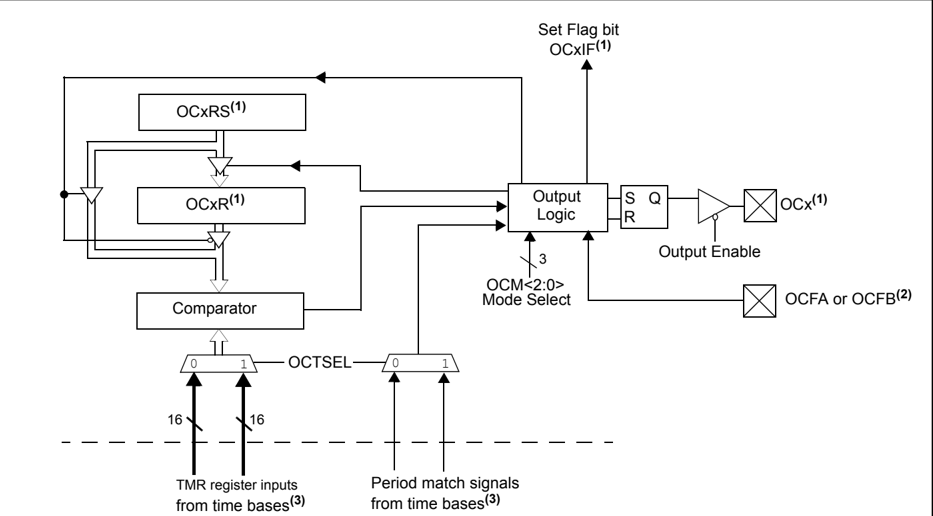

- Note 1: Where 'x'  is  shown,  reference  is  made  to  the  registers  associated  with  the  respective  output  compare channels 1 through 5.
- 2: OCFA pin controls OC1-OC4 channels. OCFB pin controls OC5 channels.
- 3: Each output compare channel can use one of two selectable 16-bit time bases or a single 32-bit time base. Refer to the specific device data sheet for the time bases associated with the module.

## 16.2 OUTPUT COMPARE REGISTERS

Note: Each PIC32 family device variant may have one or more Output Compare modules. An  'x'  used  in  the  names  of  pins,  control/status  bits  and  registers  denotes  the particular module. Refer to the specific device data sheets for more details.

Each Output Compare module consists of the following Special Function Registers (SFRs):

- OCxCON: Output Compare 'x' Control Register
- OCxR: Output Compare 'x' Compare Register
- OCxRS: Output Compare 'x' Secondary Compare Register

Table 16-1 summarizes all output compare related registers. Corresponding registers appear after the summary, followed by a detailed description of each register.

Table 16-1: Output Compare SFR Summary

| Name           | Name   | Bit 31/23/15/7   | Bit 30/22/14/6   | Bit 29/21/13/5   | Bit 28/20/12/4   | Bit 27/19/11/3   | Bit 26/18/10/2   | Bit 25/17/9/1   | Bit 24/16/8/0   |
|----------------|--------|------------------|------------------|------------------|------------------|------------------|------------------|-----------------|-----------------|
| OCxCON (1,2,3) | 31:24  | -                | -                | -                | -                | -                | -                | -               | -               |
| OCxCON (1,2,3) | 23:16  | -                | -                | -                | -                | -                | -                | -               | -               |
| OCxCON (1,2,3) | 15:8   | ON               | -                | SIDL             | -                | -                | -                | -               | -               |
| OCxCON (1,2,3) | 7:0    | -                | -                | OC32             | OCFLT            | OCTSEL           | OCM<2:0>         | OCM<2:0>        | OCM<2:0>        |
| OCxR (1,2,3)   | 31:24  | OCxR<31:24>      | OCxR<31:24>      | OCxR<31:24>      | OCxR<31:24>      | OCxR<31:24>      | OCxR<31:24>      | OCxR<31:24>     | OCxR<31:24>     |
| OCxR (1,2,3)   | 23:16  | OCxR<23:16>      | OCxR<23:16>      | OCxR<23:16>      | OCxR<23:16>      | OCxR<23:16>      | OCxR<23:16>      | OCxR<23:16>     | OCxR<23:16>     |
| OCxR (1,2,3)   | 15:8   | OCxR<15:8>       | OCxR<15:8>       | OCxR<15:8>       | OCxR<15:8>       | OCxR<15:8>       | OCxR<15:8>       | OCxR<15:8>      | OCxR<15:8>      |
| OCxR (1,2,3)   | 7:0    | OCxR<7:0>        | OCxR<7:0>        | OCxR<7:0>        | OCxR<7:0>        | OCxR<7:0>        | OCxR<7:0>        | OCxR<7:0>       | OCxR<7:0>       |
| OCxRS (1,2,3)  | 31:24  | OCxRS<31:24>     | OCxRS<31:24>     | OCxRS<31:24>     | OCxRS<31:24>     | OCxRS<31:24>     | OCxRS<31:24>     | OCxRS<31:24>    | OCxRS<31:24>    |
| OCxRS (1,2,3)  | 23:16  | OCxRS<23:16>     | OCxRS<23:16>     | OCxRS<23:16>     | OCxRS<23:16>     | OCxRS<23:16>     | OCxRS<23:16>     | OCxRS<23:16>    | OCxRS<23:16>    |
| OCxRS (1,2,3)  | 15:8   | OCxRS<15:8>      | OCxRS<15:8>      | OCxRS<15:8>      | OCxRS<15:8>      | OCxRS<15:8>      | OCxRS<15:8>      | OCxRS<15:8>     | OCxRS<15:8>     |
| OCxRS (1,2,3)  | 7:0    | OCxRS<7:0>       | OCxRS<7:0>       | OCxRS<7:0>       | OCxRS<7:0>       | OCxRS<7:0>       | OCxRS<7:0>       | OCxRS<7:0>      | OCxRS<7:0>      |

## Legend:

- = unimplemented, read as ' 0 '.

- Note 1: This register has an associated Clear register at an offset of 0x4 bytes. The Clear register has the same name with CLR appended to the register name (e.g., OCxCONCLR). Writing a ' 1 ' to any bit position in the Clear register will clear valid bits in the associated register. Reads from the Clear register should be ignored.
- 2: This register has an associated Set register at an offset of 0x8 bytes. The Set register has the same name with SET appended to the register name (e.g., OCxCONSET). Writing a ' 1 ' to any bit position in the Set register will set valid bits in the associated register. Reads from the Set register should be ignored.
- 3: This register has an associated Invert register at an offset of 0xC bytes. The Invert register has the same name with INV appended to the register name (e.g., OCxCONINV). Writing a ' 1 ' to any bit position in the Invert register will invert valid bits in the associated register. Reads from the Invert register should be ignored.

## PIC32 Family Reference Manual

## Register 16-1: OCxCON: Output Compare 'x' Control Register

| Bit Range   | Bit 31/23/15/7   | Bit 30/22/14/6   | Bit 29/21/13/5   | Bit 28/20/12/4   | Bit 27/19/11/3   | Bit 26/18/10/2   | Bit 25/17/9/1   | Bit 24/16/8/0   |
|-------------|------------------|------------------|------------------|------------------|------------------|------------------|-----------------|-----------------|
| 31:24       | U-0              | U-0              | U-0              | U-0              | U-0              | U-0              | U-0             | U-0             |
| 31:24       | -                | -                | -                | -                | -                | -                | -               | -               |
| 23:16       | U-0              | U-0              | U-0              | U-0              | U-0              | U-0              | U-0             | U-0             |
| 23:16       | -                | -                | -                | -                | -                | -                | -               | -               |
| 15:8        | R/W-0            | U-0              | R/W-0            | U-0              | U-0              | U-0              | U-0             | U-0             |
| 15:8        | ON (1)           | -                | SIDL             | -                | -                | -                | -               | -               |
| 7:0         | U-0              | U-0              | R/W-0            | R-0              | R/W-0            | R/W-0            | R/W-0           | R/W-0           |
| 7:0         | -                | -                | OC32             | OCFLT (2)        | OCTSEL           | OCM<2:0>         | OCM<2:0>        | OCM<2:0>        |

## Legend:

R = Readable bit

W = Writable bit

U = Unimplemented bit, read as '0'

-n = Value at POR

'1' = Bit is set

'0' = Bit is cleared

x = Bit is unknown

bit 31-16

## Unimplemented: Read as ' 0 '

bit 15 ON:

Output Compare Peripheral On bit (1)

- 1 = Output compare peripheral is enabled

- 0 = Output compare peripheral is disabled and not drawing current. SFR modifications are allowed. The status of other bits in this register are not affected by setting or clearing this bit

bit 14 Unimplemented: Read as ' 0

'

bit 13 SIDL: Stop in Idle Mode bit

- 1 = Discontinue operation when CPU enters Idle mode

- 0 = Continue operation in Idle mode

bit 12-6 Unimplemented: Read as ' 0 '

bit 5

OC32: 32-bit Compare Mode bit

- 1 = OCxR&lt;31:0&gt; and/or OCxRS&lt;31:0&gt; is used for comparisions to the 32-bit timer source

- 0 = OCxR&lt;15:0&gt; and OCxRS&lt;15:0&gt; are used for comparisons to the 16-bit timer source

bit 4

OCFLT:

PWM Fault Condition Status bit

(2)

- 1 = PWM Fault condition has occurred (cleared in hardware only)

- 0 = No PWM Fault condition has occurred

bit 3 OCTSEL: Output Compare Timer Select bit

- 1 = Timer3 is the clock source for this Output Compare module

- 0 = Timer2 is the clock source for this Output Compare module

Refer to the specific device data sheet for the time bases that are available to the Output Compare module.

bit 2-0 OCM&lt;2:0&gt;: Output Compare Mode Select bits

111 =  PWM mode on OCx; Fault pin enabled

110 =  PWM mode on OCx; Fault pin disabled

101 =  Initialize OCx pin low; generate continuous output pulses on OCx pin

100 =  Initialize OCx pin low; generate single output pulse on OCx pin

011 =  Compare event toggles OCx pin

010 =  Initialize OCx pin high; compare event forces OCx pin low

001 =  Initialize OCx pin low; compare event forces OCx pin high

000 =  Output compare peripheral is disabled but continues to draw current

- Note 1: When using 1:1 PBCLK divisor, the user's software should not read/write the peripheral's SFRs in the SYSCLK cycle immediately following the instruction that clears the module's ON bit.
- 2: This bit is only used when OCM&lt;2:0&gt; = 111 and reads as ' 0 ' in modes other than PWM mode.

Register 16-2:

OCxR: Output Compare 'x' Compare Register

| Bit Range   | Bit 31/23/15/7   | Bit 30/22/14/6   | Bit 29/21/13/5   | Bit 28/20/12/4   | Bit 27/19/11/3   | Bit 26/18/10/2   | Bit 25/17/9/1   | Bit 24/16/8/0   |
|-------------|------------------|------------------|------------------|------------------|------------------|------------------|-----------------|-----------------|
| 31:24       | R/W-0            | R/W-0            | R/W-0            | R/W-0            | R/W-0            | R/W-0            | R/W-0           | R/W-0           |
| 31:24       | OCR<31:24>       | OCR<31:24>       | OCR<31:24>       | OCR<31:24>       | OCR<31:24>       | OCR<31:24>       | OCR<31:24>      | OCR<31:24>      |
| 23:16       | R/W-0            | R/W-0            | R/W-0            | R/W-0            | R/W-0            | R/W-0            | R/W-0           | R/W-0           |
| 23:16       | OCR<23:16>       | OCR<23:16>       | OCR<23:16>       | OCR<23:16>       | OCR<23:16>       | OCR<23:16>       | OCR<23:16>      | OCR<23:16>      |
| 15:8        | R/W-0            | R/W-0            | R/W-0            | R/W-0            | R/W-0            | R/W-0            | R/W-0           | R/W-0           |
| 15:8        | OCR<15:8>        | OCR<15:8>        | OCR<15:8>        | OCR<15:8>        | OCR<15:8>        | OCR<15:8>        | OCR<15:8>       | OCR<15:8>       |
| 7:0         | R/W-0            | R/W-0            | R/W-0            | R/W-0            | R/W-0            | R/W-0            | R/W-0           | R/W-0           |
| 7:0         | OCR<7:0>         | OCR<7:0>         | OCR<7:0>         | OCR<7:0>         | OCR<7:0>         | OCR<7:0>         | OCR<7:0>        | OCR<7:0>        |

## Legend:

R = Readable bit

W = Writable bit

U = Unimplemented bit, read as '0'

-n = Value at POR

'1' = Bit is set

'0' = Bit is cleared

x = Bit is unknown

bit 31-16 OCxR&lt;31:16&gt;: Upper 16 bits of 32-bit compare value, when OC32 (OCxCON&lt;5&gt;) = 1

bit 15-0 OCxR&lt;15:0&gt;: Lower  16  bits  of  32-bit  compare  value  or  entire  16  bits  of  16-bit  compare  value  when OC32 = 0

Register 16-3: OCxRS: Output Compare 'x' Secondary Compare Register

| Bit Range   | Bit 31/23/15/7   | Bit 30/22/14/6   | Bit 29/21/13/5   | Bit 28/20/12/4   | Bit 27/19/11/3   | Bit 26/18/10/2   | Bit 25/17/9/1   | Bit 24/16/8/0   |
|-------------|------------------|------------------|------------------|------------------|------------------|------------------|-----------------|-----------------|
| 31:24       | R/W-0            | R/W-0            | R/W-0            | R/W-0            | R/W-0            | R/W-0            | R/W-0           | R/W-0           |
| 31:24       | OCRS<31:24>      | OCRS<31:24>      | OCRS<31:24>      | OCRS<31:24>      | OCRS<31:24>      | OCRS<31:24>      | OCRS<31:24>     | OCRS<31:24>     |
| 23:16       | R/W-0            | R/W-0            | R/W-0            | R/W-0            | R/W-0            | R/W-0            | R/W-0           | R/W-0           |
| 23:16       | OCRS<23:16>      | OCRS<23:16>      | OCRS<23:16>      | OCRS<23:16>      | OCRS<23:16>      | OCRS<23:16>      | OCRS<23:16>     | OCRS<23:16>     |
| 15:8        | R/W-0            | R/W-0            | R/W-0            | R/W-0            | R/W-0            | R/W-0            | R/W-0           | R/W-0           |
| 15:8        | OCRS<15:8>       | OCRS<15:8>       | OCRS<15:8>       | OCRS<15:8>       | OCRS<15:8>       | OCRS<15:8>       | OCRS<15:8>      | OCRS<15:8>      |
| 7:0         | R/W-0            | R/W-0            | R/W-0            | R/W-0            | R/W-0            | R/W-0            | R/W-0           | R/W-0           |
| 7:0         | OCRS<7:0>        | OCRS<7:0>        | OCRS<7:0>        | OCRS<7:0>        | OCRS<7:0>        | OCRS<7:0>        | OCRS<7:0>       | OCRS<7:0>       |

## Legend:

R = Readable bit

W = Writable bit

U = Unimplemented bit, read as '0'

-n = Value at POR

'1' = Bit is set

'0' = Bit is cleared

x = Bit is unknown

bit 31-16 OCxRS&lt;31:16&gt;: Upper 16 bits of 32-bit compare value when OC32 (OCxCON&lt;5&gt;) = 1

bit 15-0 OCxRS&lt;15:0&gt;: Lower 16 bits  of  32-bit  compare  value  or  entire  16  bits  of  16-bit  compare  value  when OC32 = 0

## 16.3 OPERATION

Each Output Compare module has the following modes of operation:

- Single Compare Match mode
- -With output drive high
- -With output drive low
- -With output drive toggles
- Dual Compare Match mode
- -With single output pulse
- -With continuous output pulses
- Simple Pulse-Width Modulation mode
- -Without Fault protection input
- -With Fault protection input
- Note 1: The Output Compare module must be turned OFF by the user application (i.e., clear  the  OCM&lt;2:0&gt;  bits  (OCxCON&lt;2:0&gt;))  before  switching  to  a  new  mode. Changing modes while the module is in operation may produce unexpected results.
- 2: In this section, a reference to any SFRs associated with the selected timer source is indicated by a 'y' suffix. For example, PR2 is the Period register for the selected timer  source,  while  TyCON  is  the  Timer  Control  register  for  the  selected  timer source.

## 16.3.1 Single Compare Match Mode

When the OCM&lt;2:0&gt; control bits (OCxCON&lt;2:0&gt;) are set to ' 001 ', ' 010 ' or ' 011 ', the selected output compare channel is configured for one of three Single Output Compare Match modes. The compare time base must also be enabled.

In the Single Compare mode, the OCxR register is loaded with a value and is compared to the selected incrementing timer register, TMRy. On a compare match event, one of the following events will take place:

- Compare forces OCx pin high; initial state of pin is low. Interrupt is generated on the single compare match event.
- Compare forces OCx pin low; initial state of pin is high. Interrupt is generated on the single compare match event.
- Compare toggles OCx pin. Toggle event is continuous and an interrupt is generated for each toggle event.

## 16.3.1.1 Compare Mode Output Driven High

To configure the Output Compare module for this mode, set the OCM&lt;2:0&gt; control bits to ' 001 '. The compare time base must also be enabled. Once this mode has been enabled, the output pin, OCx, will be driven low and remain low until a match occurs between the TMRy and OCxR registers. In Figure 16-2, note the following key timing events:

- The OCx pin is driven high one peripheral clock after the compare match occurs between the compare time base and the OCxR register. The OCx pin will remain high until a mode change has been made or the module is disabled.
- The compare time base will count up to the value contained in the associated period register, and then reset to 0x0000 on the next PBCLK
- The respective channel interrupt flag, OCxIF (see the IFS0 register for the position of the interrupt flag bit for each of the output compare channels), is asserted when the OCx pin is driven high

Figure 16-2: Single Compare Mode: Set OCx High on Compare Match Event (16-Bit Mode)

Note: An 'x' represents the output compare channel number. A 'y' represents the time base number.

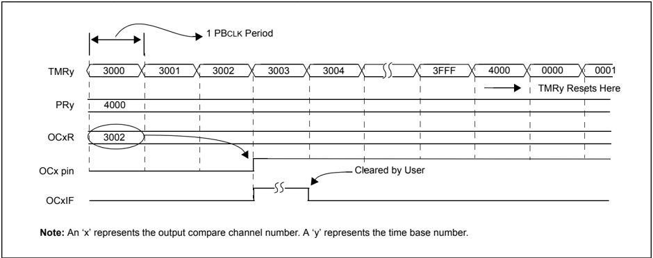

Figure 16-3: Single Compare Mode: Set OCx High on Compare Match Event (32-Bit Mode)

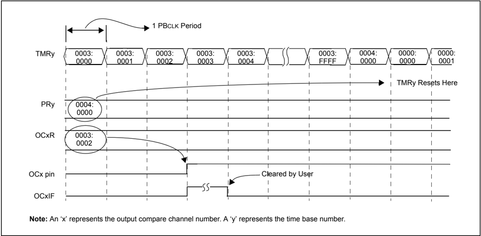

## 16.3.1.2 Compare Mode Output Driven Low

To configure the Output Compare module for this mode, set the OCM&lt;2:0&gt; control bits to ' 010 '. The compare time base must also be enabled. Once this mode has been enabled, the output pin, OCx, will be driven high and remain high until a match occurs between the Timer and OCxR registers. In Figure 16-4, note the following key timing events:

- The OCx pin is driven low by one PBCLK after the compare match occurs between the compare time base and the OCxR register. The OCx pin will remain low until a mode change has been made or the module is disabled.
- The compare time base will count up to the value contained in the associated period register, and then reset to 0x0000 on the next PBCLK
- The respective channel interrupt flag, OCxIF, is asserted when the OCx pin is driven low

Figure 16-4: Single Compare Mode: Force OCx Low on Compare Match Event (16-Bit Mode)

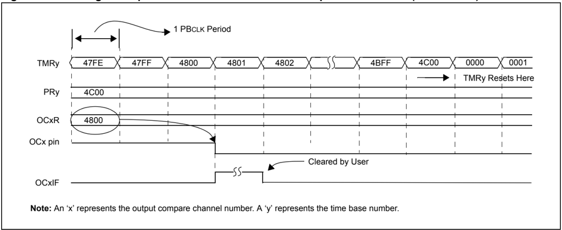

Figure 16-5: Single Compare Mode: Set OCx Low on Compare Match Event (32-Bit Mode)

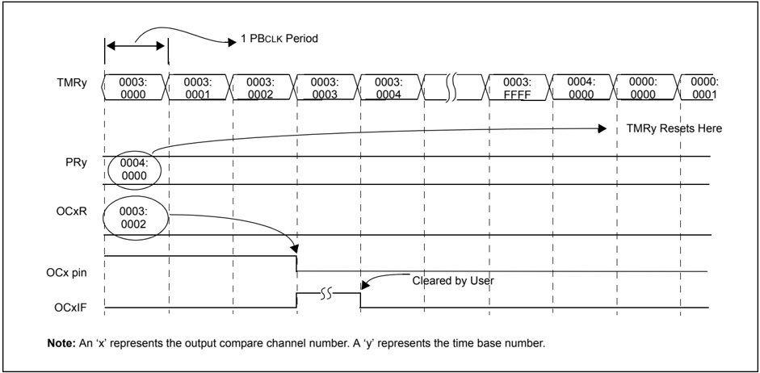

## 16.3.1.3 Single Compare Mode Toggle Output

To configure the Output Compare module for this mode, set the OCM&lt;2:0&gt; control bits to ' 011 '. In addition, Timer2 or Timer3 must be selected and enabled. Once this mode has been enabled, the output pin, OCx, will be initially driven low, and then toggle on each and every subsequent match event between the Timer and OCxR registers. In Figure 16-6 and Figure 16-8, note the following key timing events:

- The OCx pin is toggled one PBCLK after the compare match occurs between the compare time base and the OCxR register. The OCx pin will remain at this new state until the next toggle event, or until a mode change has been made or the module is disabled.
- The compare time base will count up to the contents in the period register, and then reset to 0x0000 on the next PBCLK
- The respective channel interrupt flag, OCxIF, is asserted when the OCx pin is toggled

Note:

The internal OCx pin output logic is set to a logic ' 0 ' on a device Reset. However, the operational OCx pin state for the Toggle mode can be set by the user application. Example 16-1 shows a code example for defining the desired initial OCx pin state in the Toggle mode of operation.

Figure 16-6: Single Compare Mode: Toggle Output on Compare Match Event (16-Bit Mode)

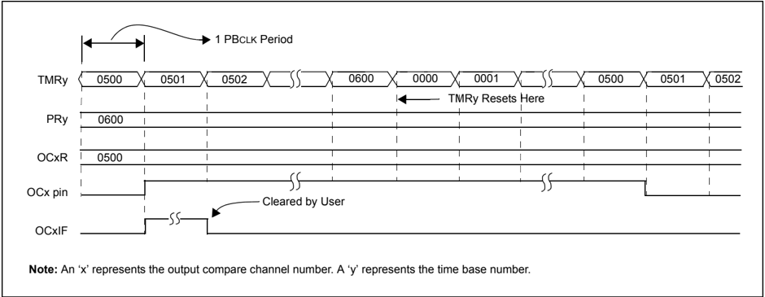

Figure 16-7: Single Compare Mode: Toggle Output on Compare Match Event (32-Bit Mode)

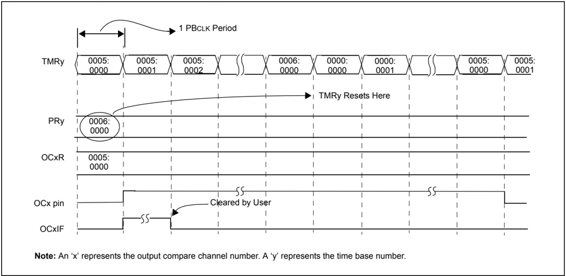

Figure 16-8: Single Compare Mode: Toggle Output on Compare Match Event (PRy = OCxR, 16-Bit Mode)

Note: An 'x' represents the output compare channel number. A 'y' represents the time base number.

Figure 16-9: Single Compare Mode: Toggle Output on Compare Match Event (PRy = OCxR, 32-Bit Mode)

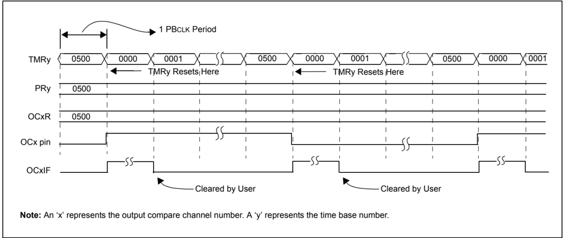

Note: An 'x' represents the output compare channel number. A 'y' represents the time base number.

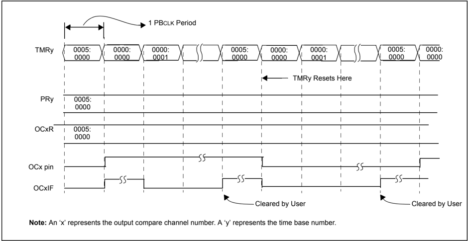

Example 16-1: Compare Mode Toggle Mode Pin State Setup (16-Bit Mode)

```
// The following code example illustrates how to define the initial // OC1 pin state for the output compare toggle mode of operation. // Toggle mode with initial OC1 pin state set low OC1CON = 0x0001; // Configure module for OC1 pin low, toggle high OC1CONSET = 0x8000; // Enable OC1 module
```

## Example 16-2: Compare Mode Toggle Mode Pin State Setup (32-Bit Mode)

```
// The following code example illustrates how to define the initial // OC1 pin state for the output compare toggle mode of operation. // Toggle mode with initial OC1 pin state set low OC1CON = 0x0021; // Configure module for OC1 pin low, toggle high, // 32-bit mode OC1CONSET = 0x8000; // Enable OC1 module
```

Example 16-3 shows example code for the  configuration  and  interrupt  service  of  the  Single Compare mode toggle event.

## Example 16-3: Compare Mode Toggle Setup and Interrupt Servicing (16-Bit Mode)

```
// The following code example will set the Output Compare 1 module // for interrupts on the toggle event and select Timer2 as the clock // source for the compare time base. T2CON = 0x0010; // Configure Timer2 for a prescaler of 2 OC1CON = 0x0000; // Turn off OC1 while doing setup. OC1CON = 0x0003; // Configure for compare toggle mode OC1R = 0x0500; // Initialize Compare Register 1 PR2 = 0x0500; // Set period // Configure int IFS0CLR = 0x0040; // Clear the OC1 interrupt flag IEC0SET = 0x040; // Enable OC1 interrupt IPC1SET = 0x001C0000; // Set OC1 interrupt priority to 7, // the highest level IPC1SET = 0x00030000; // Set Subpriority to 3, maximum T2CONSET = 0x8000; // Enable Timer2 OC1CONSET = 0x8000; // Enable OC1 // Example code for Output Compare 1 ISR: void __ISR(_OUTPUT_COMPARE_1_VECTOR, ipl7) OC1_IntHandler (void) { // insert user code here IFS0CLR = 0x0040; // Clear the OC1 interrupt flag }
```

## PIC32 Family Reference Manual

## Example 16-4: Compare Mode Toggle Setup and Interrupt Servicing (32-Bit Mode)

```
// The following code example will set the Output Compare 1 module // for interrupts on the toggle event and select the Timer2/Timer3 pair as // the 32-bit as the clock source for the compare time base. T2CON = 0x0018; // Configure Timer2 for 32-bit operation // with a prescaler of 2. The Timer2/Timer3 // pair is accessed via registers associated // with the Timer2 register OC1CON = 0x0000; // Turn off OC1 while doing setup. OC1CON = 0x0023; // Configure for compare toggle mode OC1R = 0x00500000; // Initialize Compare Register 1 PR2 = 0x00500000; // Set period (PR2 is now 32-bits wide) // configure int IFS0CLR = 0x00000040; // Clear the OC1 interrupt flag IFS0SET = 0x00000040; // Enable OC1 interrupt IPC1SET = 0x001C0000; // Set OC1 interrupt priority to 7, // the highest level IPC1SET = 0x00030000; // Set Subpriority to 3, maximum T2CONSET = 0x8000; // Enable Timer2 OC1CONSET = 0x8000; // Enable OC1 // Example code for Output Compare 1 ISR: void__ISR (_OUTPUT_COMPARE_1_VECTOR, ipl7) OC1_IntlHandler (void) { // Insert user code here IFS0CLR = 0x0040; // Clear the OC1 interrupt flag }
```

## 16.3.2 Dual Compare Match Modes

When the OCM&lt;2:0&gt; control bits are set to ' 100 ' or ' 101 ', the selected output compare channel is configured for one of two Dual Compare Match modes:

- Single Output Pulse mode
- Continuous Output Pulse mode

In these Dual Compare modes, the module uses both the OCxR and OCxRS registers for the compare match events. The OCxR register is compared against the incrementing timer count, TMRy, and the leading (rising) edge of the pulse is generated at the OCx pin on a compare match event. The OCxRS register is then compared to the same incrementing timer count, TMRy, and the trailing (falling) edge of the pulse is generated at the OCx pin on a compare match event.

## 16.3.2.1 Dual Compare Mode: Single Output Pulse

To configure the Output Compare module for the Single Output Pulse mode, set the OCM&lt;2:0&gt; control bits to ' 100 '. In addition, the compare time base must be selected and enabled. Once this mode has been enabled, the output pin, OCx, will be driven low and remain low until a match occurs between the time base and OCxR registers. In Figure 16-10 and Figure 16-12, note the following key timing events:

- The OCx pin is driven high one peripheral clock after the compare match occurs between the compare time base and the OCxR register. The OCx pin will remain high until the next match event occurs between the time base and the OCxRS register. At this time, the pin will be driven low. The OCx pin will remain low until a mode change has been made or the module is disabled.
- The compare time base will count up to the value contained in the associated period register, and then reset to 0x0000 on the next instruction clock
- If the time base period register contents are less than the OCxRS register contents, no falling edge of the pulse is generated. The OCx pin will remain high until OCxRS ≤ PR2, or a mode change or Reset condition has occurred.
- The respective channel interrupt flag, OCxIF, is asserted when the OCx pin is driven low (falling edge of single pulse)

Figure 16-10  depicts  the  General  Dual  Compare  mode  generating  a  single  output  pulse. Figure 16-12 depicts another timing example where OCxRS &gt; PR2. In this example, no falling edge of the pulse is generated because the compare time base resets before counting up to 0x4100.

## PIC32 Family Reference Manual

Figure 16-10: Dual Compare Mode (16-Bit Mode)

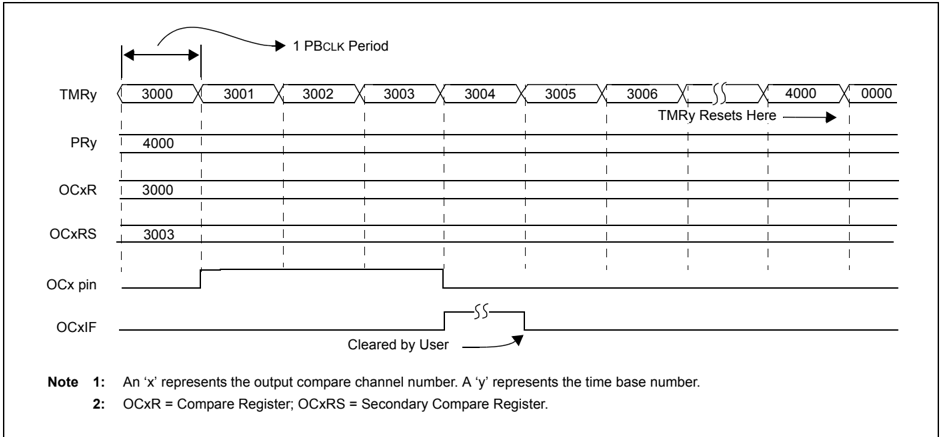

Figure 16-11: Dual Compare Mode (32-Bit Mode)

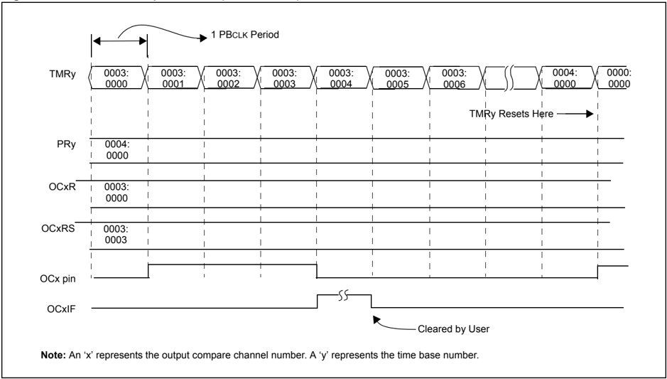

Figure 16-12: Dual Compare Mode: Single Output Pulse (OCxRS &gt; PRy, 16-Bit Mode)

Compare Interrupt does not occur

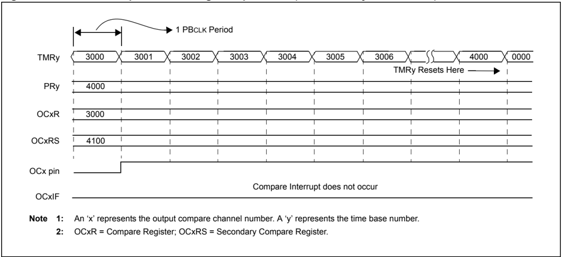

Figure 16-13: Dual Compare Mode: Single Output Pulse (OCxRS &gt; PRy, 32-Bit Mode)

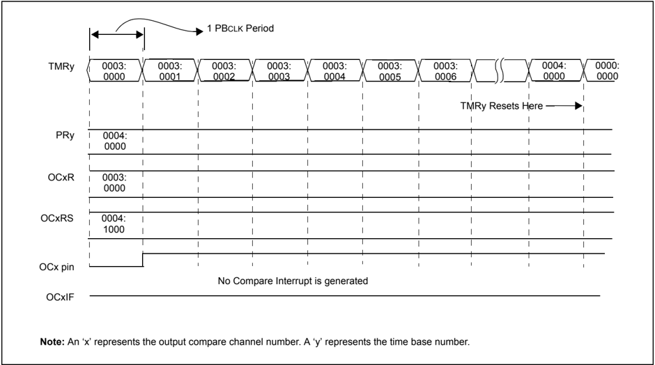

## 16.3.2.2 Setup for Single Output Pulse Generation

When the OCM&lt;2:0&gt; control bits (OCxCON&lt;2:0&gt;) are set to ' 100 ', the selected output compare channel initializes the OCx pin to the low state and generates a single output pulse.

To generate a single output pulse, the following steps are required (these steps assume the timer source is initially turned off, but this is not a requirement for module operation):

1. Determine the peripheral clock cycle time.
2. Calculate the time to the rising edge of the output pulse relative to the TMRy start value (0x0000).
3. Calculate the time to the falling edge of the pulse based on the desired pulse width and the time to the rising edge of the pulse.
4. Write the values computed in steps 2 and 3 above into the compare register, OCxR, and the secondary compare register, OCxRS, respectively.
5. Set the timer period register, PRy, to value equal to or greater than value in OCxRS, the secondary compare register.
6. Set OCM&lt;2:0&gt; = 100 and the OCTSEL bit (OCxCON&lt;3&gt;) to the desired timer source. The OCx pin state will now be driven low.
7. Set the ON bit (TyCON&lt;15&gt;) to ' 1 ', to enable the timer.
8. Upon the first match between TMRy and OCxR, the OCx pin will be driven high.
9. When the incrementing timer, TMRy, matches the secondary compare register, OCxRS, the second and trailing edge (high-to-low) of the pulse is driven onto the OCx pin. No additional pulses are driven onto the OCx pin and it remains at low. As a result of the second compare match event, the OCxIF interrupt flag bit is set, which will result in an interrupt (if it is enabled by setting the OCxIE bit). For more information on peripheral interrupts, refer to Section 8. 'Interrupts' (DS61108).
10. To initiate another single pulse output, change the timer and compare register settings, if needed, and then issue a write to set the OCM&lt;2:0&gt; control bits (OCxCON&lt;2:0&gt;) to ' 100 '. Disabling and re-enabling of the timer and clearing the TMRy register are not required, but may be advantageous for defining a pulse from a known event time boundary.

The Output Compare module does not have to be disabled after the falling edge of the output pulse. Another pulse can be initiated by rewriting the value of the OCxCON register.

Examples 16-5 and 16-6 show example code for configuration of the single output pulse event.

## Example 16-5: Single Output Pulse Setup and Interrupt Servicing (16-Bit Mode)

```
// The following code example will set the Output Compare 1 module // for interrupts on the single pulse event and select Timer2 // as the clock source for the compare time base. T2CON = 0x0010; // Configure Timer2 for a prescaler of 2 OC1CON = 0x0000; // Turn off OC1 while doing setup. OC1CON = 0x0004; // Configure for single pulse mode OC1R = 0x3000; // Initialize primary Compare Register OC1RS = 0x3003; // Initialize secondary Compare Register PR2 = 0x3003; // Set period (PR2 is now 32-bits wide) // configure int IFS0CLR = 0x00000040; // Clear the OC1 interrupt flag IFS0SET = 0x00000040; // Enable OC1 interrupt IPC1SET = 0x001C0000; // Set OC1 interrupt priority to 7, // the highest level IPC1SET = 0x00030000; // Set Subpriority to 3, maximum T2CONSET = 0x8000; // Enable Timer2 OC1CONSET = 0x8000; // Enable OC1 // Example code for Output Compare 1 ISR: void__ISR(_OUTPUT_COMPARE_1_VECTOR, ipl7) OC1_IntHandler (void) { // Insert user code here IFS0CLR = 0x0040; // Clear the OC1 interrupt flag }
```

## PIC32 Family Reference Manual

## Example 16-6: Single Output Pulse Setup and Interrupt Servicing (32-Bit Mode)

```
// The following code example will set the Output Compare 1 module // for interrupts on the single pulse event and select Timer2 // as the clock source for the compare time base. T2CON = 0x0018; // Configure Timer2 for 32-bit operation // with a prescaler of 2. The Timer2/Timer3 // pair is accessed via registers associated // with the Timer2 register OC1CON = 0x0000; // Turn off OC1 while doing setup. OC1CON = 0x0004; // Configure for single pulse mode OC1R = 0x00203000; // Initialize primary Compare Register OC1RS = 0x00203003; // Initialize secondary Compare Register PR2 = 0x00500000; // Set period (PR2 is now 32-bits wide) // configure int IFS0CLR = 0x00000040; // Clear the OC1 interrupt flag IFS0SET = 0x00000040; // Enable OC1 interrupt IPC1SET = 0x001C0000; // Set OC1 interrupt priority to 7, // the highest level IPC1SET = 0x00030000; // Set Subpriority to 3, maximum T2CONSET = 0x8000; // Enable Timer2 OC1CONSET = 0x8000; // Enable OC1 // Example code for Output Compare 1 ISR: void__ISR(_OUTPUT_COMPARE_1_VECTOR, ipl7) OC1_IntHandler (void) { // insert user code here IFS0CLR = 0x0040; // Clear the OC1 interrupt flag }
```

## 16.3.2.3 Special Cases for Dual Compare Mode Generating a Single Output Pulse

Depending  on  the  relationship  of  the  OCxR,  OCxRS  and  PRy  values,  the  Output  Compare module has a few unique conditions that should be understood. These special conditions are specified in Table 16-2, along with the resulting behavior of the module.

Table 16-2: Special Cases for Dual Compare Mode Generating a Single Output Pulse (1)

| SFR Logical Relationship     | Special Conditions           | Operation                                                                                                                                                                                                                                                                                                                                                                                                                                                                                                             | Output at OCx                                                              |
|------------------------------|------------------------------|-----------------------------------------------------------------------------------------------------------------------------------------------------------------------------------------------------------------------------------------------------------------------------------------------------------------------------------------------------------------------------------------------------------------------------------------------------------------------------------------------------------------------|----------------------------------------------------------------------------|
| PRy ≥ OCxRS and OCxRS > OCxR | OCxR = 0 Initialize TMRy = 0 | In the first iteration of the TMRy counting from 0x0000 up to PRy, the OCx pin remains low; no pulse is generated. After the TMRy resets to zero (on period match), the OCx pin goes high due to a match with OCxR. Upon the next TMRy to OCxRS match, the OCx pin goes low and remains there. The OCxIF bit will be set as a result of the second compare. There are two alternative initial conditions to consider: 1. Initialize TMRy = 0 and set OCxR ≥ 1 . 2. Initialize TMRy = PRy (PRy > 0) and set OCxR = 0 . | Pulse will be delayed by the value in the PRy register, depending on setup |
| PRy ≥ OCxR and OCxR ≥ OCxRS  | OCxR ≥ 1 and PRy ≥ 1         | TMRy counts up to OCxR and on a compare match event (i.e., TMRy = OCxR), the OCx pin is driven to a high state. TMRy then continues to count and eventually resets on a period match (i.e., PRy = TMRy). The timer then restarts from 0x0000 and counts up to OCxRS. On a compare match event (i.e., TMRy = OCxRS), the OCx pin is driven to a low state. The OCxIF bit will be set as a result of the second compare.                                                                                                | Pulse                                                                      |
| OCxRS > PRy and PRy ≥ OCxR   | None                         | Only the rising edge will be generated at the OCx pin. The OCxIF will not be set.                                                                                                                                                                                                                                                                                                                                                                                                                                     | Rising edge/ transition to high                                            |
| OCxR > PRy                   | None                         | Unsupported mode; timer resets prior to match condition.                                                                                                                                                                                                                                                                                                                                                                                                                                                              | Remains low                                                                |

Legend:

OCxR = Compare Register

OCxRS = Secondary Compare Register

TMRy = Timery Count

PRy = Timery Period Register

Note

1:

In all of these cases, the TMRy register is assumed to be initialized to 0x0000.

## 16.3.2.4 Dual Compare Mode: Continuous Output Pulses

To configure the Output Compare module for this mode, set the OCM&lt;2:0&gt; control bits to ' 101 '. In addition, the compare time base must be selected and enabled. Once this mode has been enabled, the output pin, OCx, will be driven low and remain low until a match occurs between the compare time base and OCxR register. In Figure 16-14 and Figure 16-16, note the following key timing events:

- The OCx pin is driven high one PBCLK after the compare match occurs between the compare time base and OCxR register. The OCx pin will remain high until the next match event occurs between the time base and the OCxRS register, at which time the pin will be driven low. This pulse generation sequence of a low-to-high and high-to-low edge will repeat on the OCx pin without further user intervention.
- Continuous pulses will be generated on the OCx pin until a mode change is made or the module is disabled
- The compare time base will count up to the value contained in the associated period register, and then reset to 0x0000 on the next instruction clock
- If the compare time base period register value is less than the OCxRS register value, no falling edge is generated. The OCx pin will remain high until OCxRS ≤ PRy, a mode change is made, or the device is Reset.
- The respective channel interrupt flag, OCxIF, is asserted when the OCx pin is driven low (falling edge of single pulse)

General Dual Compare mode generating a continuous output pulse is illustrated in Figure 16-14. Figure 16-16 depicts another timing example where OCxRS &gt; PRy. In this example, no falling edge of  the  pulse  is  generated,  because  the  time  base  will  reset  before  counting  up  to  the contents of OCxRS.

Figure 16-14: Dual Compare Mode: Continuous Output Pulse (PRy = OCxRS, 16-Bit Mode)

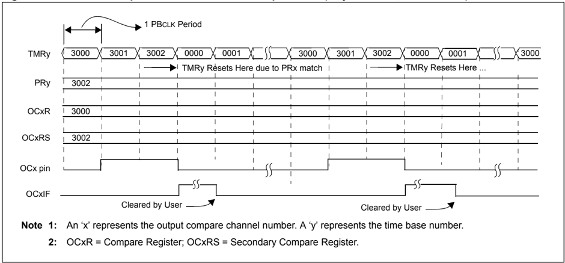

Figure 16-15: Dual Compare Mode: Continuous Output Pulse (PRy = OCxRS, 32-Bit Mode)

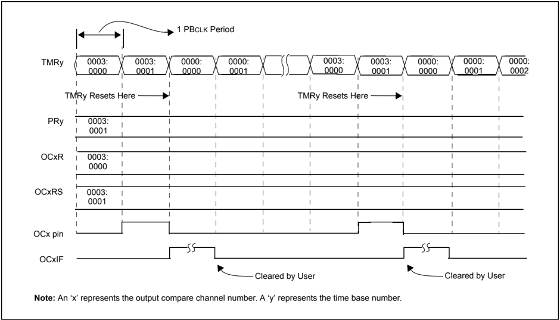

Figure 16-16: Dual Compare Mode: Continuous Output Pulse (PRy = OCxRS, 16-Bit Mode)

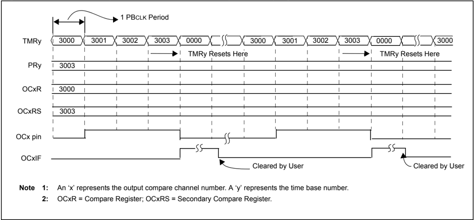

## 16.3.2.5 Setup for Continuous Output Pulse Generation

When the OCM&lt;2:0&gt; control bits are set to ' 101 ', the selected output compare channel initializes the OCx pin to the low state and generates output pulses on each and every compare match event.

For the user to configure the module for the generation of a continuous stream of output pulses, the following steps are required (these steps assume the timer source is initially turned off, but this is not a requirement for the module operation):

1. Determine the peripheral clock cycle time. Take into account the frequency of the external clock to the timer source (if one is used) and the timer prescaler settings.
2. Calculate the time to the rising edge of the output pulse, relative to the TMRy start value (0x0000).
3. Calculate the time to the falling edge of the pulse, based on the desired pulse width and the time to the rising edge of the pulse.
4. Write the values computed in step 2 and 3 above into the compare register, OCxR, and the secondary compare register, OCxRS, respectively.
5. Set the timer period register, PRy, to a value equal to or greater than the value in OCxRS, the secondary compare register.
6. Set OCM&lt;2:0&gt; = 101 and the OCTSEL bit (OCxCON&lt;3&gt;) to the desired timer source (for 16-bit mode only). The OCx pin state will now be driven low.
7. Enable the compare time base by setting the TON bit (TyCON&lt;15&gt;) to ' 1 '.
8. Upon the first match between TMRy and OCxR, the OCx pin will be driven high.
9. When the compare time base, TMRy, matches the secondary compare register, OCxRS, the second and trailing edge (high-to-low) of the pulse is driven onto the OCx pin.
10. As a result of the second compare match event, the OCxIF interrupt flag bit is set.
11. When the compare time base and the value in its respective period register match, the TMRy register resets to 0x0000 and resumes counting.
12. Steps  8  through  11  are  repeated,  and  a  continuous  stream  of  pulses  is  generated, indefinitely. The OCxIF flag (refer to the IFS0 register for the bit position of each channel's interrupt flag) is set on each OCxRS-TMRy compare match event.

Example 16-7 shows example code for configuration of the continuous output pulse event.

## Example 16-7: Continuous Output Pulse Setup and Interrupt Servicing (16-Bit Mode)

```
// The following code example will set the Output Compare 1 module // for interrupts on the continuous pulse event and select Timer2 // as the clock source for the compare time-base. T2CON = 0x0010; // Configure Timer2 for a prescaler of 2 OC1CON = 0x0000; // Disable OC1 module OC1CON = 0x0005; // Configure OC1 module for Pulse output OC1R = 0x3000; // Initialize Compare Register 1 OC1RS = 0x3003; // Initialize Secondary Compare Register 1 PR2 = 0x5000; // Set period // configure int IFS0CLR = 0x00000040; // Clear the OC1 interrupt flag IFS0SET = 0x00000040; // Enable OC1 interrupt IPC1SET = 0x001C0000; // Set OC1 interrupt priority to 7, // the highest level IPC1SET = 0x00030000; // Set Subpriority to 3, maximum T2CONSET = 0x8000; // Enable Timer2 OC1CONSET = 0x8000; // Enable OC1 // Example code for Output Compare 1 ISR: void__ISR(_OUTPUT_COMPARE_1_VECTOR, ipl7) OC1_IntHandler (void) { // insert user code here IFS0CLR= 0x0040; // Clear the OC1 interrupt flag }
```

## PIC32 Family Reference Manual

## Example 16-8: Continuous Output Pulse Setup and Interrupt Servicing (32-Bit Mode)

```
// The following code example will set the Output Compare 1 module // for interrupts on the continuous pulse event and select Timer2 // as the clock source for the compare time-base. T2CON = 0x0018; // Configure Timer2 for 32-bit operation // with a prescaler of 2. The Timer2/Timer3 // pair is accessed via registers associated // with the Timer2 register OC1CON = 0x0000; // disable OC1 module OC1CON = 0x0005; // Configure OC1 module for Pulse output OC1R = 0x3000; // Initialize Compare Register 1 OC1RS = 0x3003; // Initialize Secondary Compare Register 1 PR2 = 0x00500000; // Set period (PR2 is now 32-bits wide) // configure int IFS0CLR = 0x00000040; // Clear the OC1 interrupt flag IFS0SET = 0x00000040; // Enable OC1 interrupt IPC1SET = 0x001C0000; // Set OC1 interrupt priority to 7, // the highest level IPC1SET = 0x00030000; // Set Subpriority to 3, maximum T2CONSET = 0x8000; // Enable Timer2 OC1CONSET = 0x8000; // Enable OC1 // Example code for Output Compare 1 ISR: void__ISR(_OUTPUT_COMPARE_1_VECTOR, ipl7) OC1_IntHandler (void) { // insert user code here IFS0CLR = 0x0040; // Clear the OC1 interrupt flag }
```

## 16.3.2.6 Special Cases for Dual Compare Mode Generating Continuous Output Pulses

Depending  on  the  relationship  of  the  OCxR,  OCxRS  and  PRy  values,  the  Output  Compare module may not provide the expected results. These special cases are specified in Table 16-3, along with the resulting behavior of the module.

Table 16-3: Special Cases for Dual Compare Mode Generating Continuous Output Pulses (1)

| SFR Logical Relationship     | Special Conditions           | Operation                                                                                                                                                                                                                                                                                                                                                                                                                                                                                                                                                                                                    | Output at OCx                                                                                        |
|------------------------------|------------------------------|--------------------------------------------------------------------------------------------------------------------------------------------------------------------------------------------------------------------------------------------------------------------------------------------------------------------------------------------------------------------------------------------------------------------------------------------------------------------------------------------------------------------------------------------------------------------------------------------------------------|------------------------------------------------------------------------------------------------------|
| PRy ≥ OCxRS and OCxRS > OCxR | OCxR = 0 Initialize TMRy = 0 | In the first iteration of the TMRy counting from 0x0000 up to PRy, the OCx pin remains low; no pulse is generated. After the TMRy resets to zero (on period match), the OCx pin goes high. Upon the next TMRy to OCxRS match, the OCx pin goes low. If OCxR = 0 and PRy = OCxRS, the pin will remain low for one clock cycle, then be driven high until the next TMRy to OCxRS match. The OCxIF bit will be set as a result of the second compare. There are two alternative initial conditions to consider: 1. Initialize TMRy = 0 and set OCxR ≥ 1 . 2. Initialize TMRy = PRy (PRy > 0) and set OCxR = 0 . | Continuous pulses with the first pulse delayed by the value in the PRy register, depending on setup. |
| PRy ≥ OCxR and OCxR ≥ OCxRS  | OCxR ≥ 1 and PRy ≥ 1         | TMRy counts up to OCxR and on a compare match event (i.e., TMRy = OCxR), the OCx pin is driven to a high state. TMRy then continues to count and eventually resets on period match (i.e., PRy = TMRy). The timer then restarts from 0x0000 and counts up to OCxRS. On a compare match event (i.e., TMRy = OCxR), the OCx pin is driven to a low state. The OCxIF bit will be set as a result of the second compare.                                                                                                                                                                                          | Continuous pulses                                                                                    |
| OCxRS > PRy and PRy ≥ OCxR   | None                         | Only one transition will be generated at the OCx pin until the OCxRS register contents have been changed to a value less than or equal to the period register contents (PRy). OCxIF is not set until then.                                                                                                                                                                                                                                                                                                                                                                                                   | Rising edge/ transition to high                                                                      |
| OCxR > PRy                   | None                         | Unsupported mode; Timer resets prior to match condition.                                                                                                                                                                                                                                                                                                                                                                                                                                                                                                                                                     | Remains low                                                                                          |

Legend:

OCxR = Compare Register

OCxRS = Secondary Compare Register

TMRy = Timery Count

PRy = Timery Period Register

Note 1: In all of these cases, the TMRy register is assumed to be initialized to 0x0000.

## 16.3.3 Pulse Width Modulation Mode

When the OCM&lt;2:0&gt; control bits are set to ' 110 ' or ' 111 ', the selected output compare channel is configured for the PWM mode of operation.

The following two PWM modes are available:

- PWM without Fault Protection Input
- PWM with Fault Protection Input

The OCFA or OCFB Fault input pin is utilized for the second PWM mode. In this mode, an asynchronous logic level ' 0 ' on the OCFx pin will cause the selected PWM channel to be shut down. See 16.3.3.1 'PWM with Fault Protection Input Pin' .

In PWM mode, the OCxR register is a read-only slave duty cycle register and OCxRS is a buffer register that is written by the user to update the PWM duty cycle. On every timer to period register match event (end of PWM period), the duty cycle register, OCxR, is loaded with the contents of OCxRS. The TyIF interrupt flag is asserted at each PWM period boundary.

The following steps should be taken when configuring the Output Compare module for PWM operation:

1. Set the PWM period by writing to the selected timer period register (PRy).
2. Set the PWM duty cycle by writing to the OCxRS register.
3. Write the OxCR register with the initial duty cycle.
4. Enable interrupts, if required, for the timer and Output Compare modules. The output compare interrupt is required for PWM Fault pin utilization.
5. Configure the Output Compare module for one of two PWM Operation modes by writing to the Output Compare mode bits, OCM&lt;2:0&gt; (OCxCON&lt;2:0&gt;).
6. Set the TMRy prescale value and enable the time base by setting TON (TxCON&lt;15&gt;) = 1 .

Note:

The OCxR register should be initialized before the Output Compare module is first enabled.  The  OCxR  register  becomes  a  read-only  duty  cycle  register  when  the module is operated in the PWM modes. The value held in OCxR will become the PWM duty cycle for the first PWM period. The contents of the duty cycle buffer register, OCxRS, will not be transferred into OCxR until a time base period match occurs.

An example PWM output waveform is shown in Figure 16-17.

Figure 16-17: PWM Output Waveform

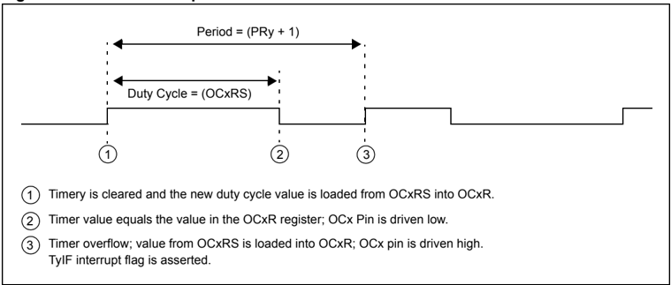

## 16.3.3.1 PWM with Fault Protection Input Pin

When the  OCM&lt;2:0&gt;  control  bits  are  set  to  ' 111 ',  the  selected  output  compare  channel  is configured  for  the  PWM  mode  of  operation.  All  functions  described  in 16.3.3 'Pulse  Width Modulation Mode' apply, with the addition of input Fault protection.

Fault protection is provided via the OCFA and OCFB pins. The OCFA pin is associated with the output compare channels 1 through 4, while the OCFB pin is associated with the output compare channel 5.

If a logic ' 0 ' is detected on the OCFA/OCFB pin, the selected PWM output pin(s) are placed in the tri-state. The user may elect to provide a pull-down or pull-up resistor on the PWM pin to provide  for  a  desired  state  if  a  Fault  condition  occurs.  The  shutdown  of  the  PWM  output  is immediate and is not tied to the device clock source. This state will remain until the following conditions are met:

- The external Fault condition has been removed
- The PWM mode is re-enabled by writing to the appropriate mode bits, OCM&lt;2:0&gt; bits (OCxCON&lt;2:0&gt;)

As a result of the Fault condition, the respective interrupt flag, OCxIF bit, is asserted and an interrupt  will  be  generated,  if  enabled.  Upon  detection  of  the  Fault  condition,  the  OCFLT  bit (OCxCON&lt;4&gt;) is asserted high (logic ' 1 '). This bit is a read-only bit and will only be cleared once the external Fault condition has been removed and the PWM mode is re-enabled by writing to the appropriate mode bits, OCM&lt;2:0&gt; (OCxCON&lt;2:0&gt;).

Note: The external Fault pins, if enabled for use, will continue to control the OCx output pins while the device is in Sleep or Idle mode.

## 16.3.3.2 PWM Period

The PWM period is specified by writing to the Timery Period register, PRy. The PWM period can be calculated using the following formula:

## Equation 16-1: Calculating the PWM Period

PWM Period = [(PR + 1 ) · TPB · (TMR Prescale Value)]

PWM Frequency = 1 /[PWM Period]

The PWM period must not exceed the width of the Period Register for the selected mode, 16 bits for 16-bit mode or 32 bits for 32-bit mode. If the calculated period is too large, select a larger prescaler  to  prevent  overflow.  To  maintain  maximum  PWM  resolution,  select  the  smallest prescaler that does not result in an overflow.

Note: A PRy value of N will produce a PWM period of N + 1 time base count cycles. For example, a value of 7 written into the PRy register will yield a period consisting of 8 time base cycles.

## 16.3.3.3 PWM Duty Cycle

The PWM duty cycle is specified by writing to the OCxRS register. The OCxRS register can be written to at any time, but the duty cycle value is not latched into OCxR until a match between PRy and TMRy occurs (i.e., the period is complete). This provides a double buffer for the PWM duty cycle and is essential for glitchless PWM operation. In the PWM mode, OCxR is a read-only register.

Some important boundary parameters of the PWM duty cycle include the following:

- If the duty cycle register OCxR is loaded with 0x0000, the OCx pin will remain low (0% duty cycle)
- If OCxR is greater than PRy (timer period register), the pin will remain high (100% duty cycle)
- If OCxR is equal to PRy, the OCx pin will be low for one time base count value and high for all other count values

See Figure 16-18 for PWM mode timing details. Table 16-4 through Table 16-9 show example PWM frequencies and resolutions for a device with the Peripheral Bus operating at a variety of frequencies.

## Equation 16-2: Calculation for Maximum PWM Resolution

<!-- formula-not-decoded -->

## Equation 16-3: PWM Period and Resolution Calculation

<!-- formula-not-decoded -->

<!-- formula-not-decoded -->

<!-- formula-not-decoded -->

Find the maximum resolution of the duty cycle that can be used with a 52.08 kHz PWM frequency and a 10 MHz Peripheral Bus clock rate .

<!-- formula-not-decoded -->

Figure 16-18: PWM Output Timing

Figure 16-19: Dual Compare Mode: Continuous Output Pulse (PR2 = OCxRS, 32-Bit Mode)

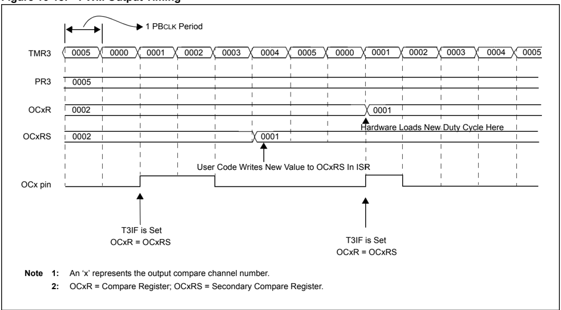

Note: An 'x' represents the output compare channel number.

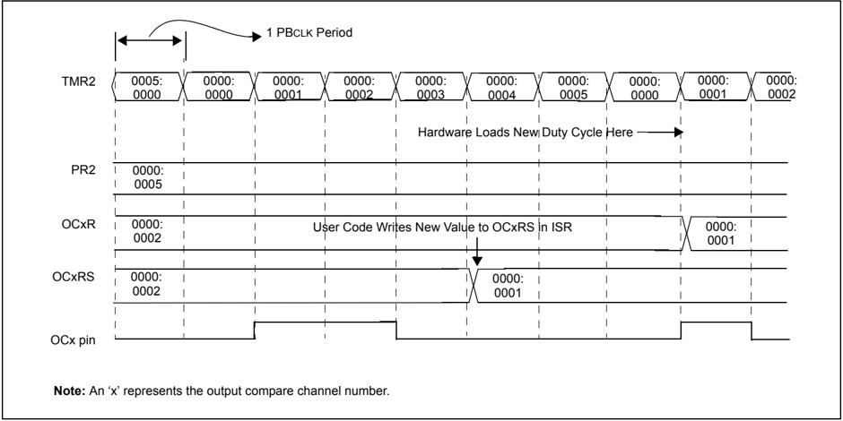

Table 16-4: Example PWM Frequencies and Resolutions with a 10 MHz (16-Bit Mode) Peripheral Bus Clock

| PWM Frequency         | 19 Hz   | 153 Hz   | 305 Hz   | 2.44 kHz   | 9.77 kHz   | 78.1 kHz   | 313 kHz   |
|-----------------------|---------|----------|----------|------------|------------|------------|-----------|
| Timer Prescaler Ratio | 8       | 1        | 1        | 1          | 1          | 1          | 1         |
| Period Register Value | 0xFFFF  | 0xFFFF   | 0x7FFF   | 0x0FFF     | 0x03FF     | 0x007F     | 0x001F    |
| Resolution (bits)     | 16      | 16       | 15       | 12         | 10         | 7          | 5         |

Table 16-5: Example PWM Frequencies and Resolutions with a 30 MHz (16-Bit Mode) Peripheral Bus Clock

| PWM Frequency         | 58 Hz   | 458 Hz   | 916 Hz   | 7.32 kHz   | 29.3 kHz   | 234 kHz   | 938 kHz   |
|-----------------------|---------|----------|----------|------------|------------|-----------|-----------|
| Timer Prescaler Ratio | 8       | 1        | 1        | 1          | 1          | 1         | 1         |
| Period Register Value | 0xFC8E  | 0xFFDD   | 0x7FEE   | 0x1001     | 0x03FE     | 0x007F    | 0x001E    |
| Resolution (bits)     | 16      | 16       | 15       | 12         | 10         | 7         | 5         |

Table 16-6: Example PWM Frequencies and Resolutions with a 50 MHz (16-Bit Mode) Peripheral Bus Clock

| PWM Frequency         | 57 Hz   | 458 Hz   | 916 Hz   | 7.32 kHz   | 29.3 kHz   | 234 kHz   | 938 kHz   |
|-----------------------|---------|----------|----------|------------|------------|-----------|-----------|
| Timer Prescaler Ratio | 64      | 8        | 1        | 1          | 1          | 1         | 1         |
| Period Register Value | 0x349C  | 0x354D   | 0xD538   | 0x1AAD     | 0x06A9     | 0x00D4    | 0x0034    |
| Resolution (bits)     | 13.7    | 13.7     | 15.7     | 12.7       | 10.7       | 7.7       | 5.7       |

Table 16-7: Example PWM Frequencies and Resolutions with a 50 MHz (16-Bit Mode) Peripheral Bus Clock

| PWM Frequency               | 100 Hz   | 200 Hz   | 500 Hz   | 1 kHz   | 2 kHz   | 5 kHz   | 10 kHz   |
|-----------------------------|----------|----------|----------|---------|---------|---------|----------|
| Timer Prescaler Ratio       | 8        | 8        | 8        | 1       | 8       | 1       | 1        |
| Period Register Value (hex) | 0xF423   | 0x7A11   | 0x30D3   | 0xC34F  | 0x0C34  | 0x270F  | 0x1387   |
| Resolution (bits) (decimal) | 15.9     | 14.9     | 13.6     | 15.6    | 11.6    | 13.3    | 12.3     |

Table 16-8: Example PWM Frequencies and Resolutions with a 50 MHz (16-Bit Mode) Peripheral Bus Clock

| PWM Frequency               | 100 Hz   | 200 Hz   | 500 Hz   | 1 kHz   | 2 kHz   | 5 kHz   | 10 kHz   |
|-----------------------------|----------|----------|----------|---------|---------|---------|----------|
| Timer Prescaler Ratio       | 8        | 4        | 2        | 1       | 1       | 1       | 1        |
| Period Register Value (hex) | 0xF423   | 0xF423   | 0xC34F   | 0x0C34F | 0x61A7  | 0x270F  | 0x1387   |
| Resolution (bits) (decimal) | 15.9     | 15.9     | 15.6     | 15.6    | 14.6    | 13.3    | 12.3     |

Table 16-9: Example PWM Frequencies and Resolutions with a 50 MHz (32-Bit Mode) Peripheral Bus Clock

| PWM Frequency               | 100 Hz     | 200 Hz     | 500 Hz     | 1 kHz      | 2 kHz      | 5 kHz      | 10 kHz     |
|-----------------------------|------------|------------|------------|------------|------------|------------|------------|
| Timer Prescaler Ratio       | 1          | 1          | 1          | 1          | 1          | 8          | 1          |
| Period Register Value (hex) | 0x0007A11F | 0x0003D08F | 0x0001869F | 0x0000C34F | 0x000061A7 | 0x000004E1 | 0x00001387 |
| Resolution (bits) (decimal) | 18.9       | 17.9       | 16.6       | 15.6       | 14.6       | 10.3       | 12.3       |

Example 16-9 shows configuration and interrupt service code for the PWM mode of operation.

## Example 16-9: PWM Mode Setup and Interrupt Servicing (16-Bit Mode)

```
// The following code example will set the Output Compare 1 module // for PWM mode with Fault pin disabled and for 50% duty cycle. // Timer2 is selected as the clock for the PWM time base, and Timer2 // interrupts are enabled. #include <plib.h> int main(void) { INTEnableSystemMultiVectoredInt(); // Enable system wide interrupt to // multivectored mode. OC1CON = 0x0000; // Turn off the OC1 when performing the setup OC1R = 0x0064; // Initialize primary Compare register OC1RS = 0x0064; // Initialize secondary Compare register OC1CON = 0x0006; // Configure for PWM mode without Fault pin // enabled PR2 = 0x00C7; // Set period // Configure Timer2 interrupt. Note that in PWM mode, the // corresponding source timer interrupt flag is asserted. // OC interrupt is not generated in PWM mode. IFS0CLR = 0x00000100; // Clear the T2 interrupt flag IEC0SET = 0x00000100; // Enable T2 interrupt IPC2SET = 0x0000001C; // Set T2 interrupt priority to 7 T2CONSET = 0x8000; // Enable Timer2 OC1CONSET = 0x8000; // Enable OC1 while(1); // Never return } // Example code for Timer2 ISR void __ISR(_TIMER_2_VECTOR, ipl7) T2_IntHandler (void) { // Insert user code here IFS0CLR = 0x0100; // Clearing Timer2 interrupt flag }
```

## PIC32 Family Reference Manual

## Example 16-10: PWM Mode Setup and Interrupt Servicing (32-Bit Mode)

```
// The following code example will set the Output Compare 1 module // for PWM mode with Fault pin disabled and for 50% duty cycle. // Timer2 and Timer3 are selected as the clocks for the PWM time base // in 32-bit mode, and Timer3 interrupts are enabled. #include <plib.h> int main(void) { INTEnableSystemMultiVectoredInt(); // Enable system wide interrupt to multivectored mode. OC1CON = 0x0000; // Turn off the OC1 when performing the setup OC1R = 0x00638000; // Initialize primary Compare register OC1RS = 0x00638000; // Initialize secondary Compare register OC1CON = 0x0006; // Configure for PWM mode without Fault pin enabled T2CONSET = 0x0008; // Enable 32-bit Timer mode PR2 = 0x00C6FFFF; // Set period // Configure Timer3 interrupt. Note that in PWM mode, the corresponding source timer // interrupt flag is asserted. OC interrupt is not generated in PWM mode. IFS0CLR = 0x00001000; // Clear the T3 interrupt flag IEC0SET = 0x00001000; // Enable T3 interrupt IPC3SET = 0x0000001C; // Set T3 interrupt priority to 7 T2CONSET = 0x8000; // Enable Timer2 OC1CONSET = 0x8020; // Enable OC1 in 32-bit mode. while(1); // Never return } // Example code for Timer3 ISR: void __ISR(_TIMER_3_VECTOR, ipl7) T3_IntHandler (void) { // Insert user code here IFS0CLR = 0x1000; // Clearing Timer3 interrupt flag }
```

## 16.4 INTERRUPTS

Each of  the  available  output  compare  channels  has  a  dedicated  interrupt  bit,  OCxIF,  and  a corresponding interrupt enable/mask bit, OCxIE. These bits are used to determine the source of an interrupt and to enable or disable an individual interrupt source. The priority level of each of the channels can also be set independently of the other channels.

OCxIF is set when an output compare channel detects a predefined match condition that is defined as an event generating an interrupt. The OCxIF bit will then be set without regard to the state of the corresponding OCxIE bit. The OCxIF bit can be polled by software if desired.

The OCxIE bit is used to define the behavior of the Vector Interrupt Controller (VIC) when a corresponding OCxIF is set. When the OCxIE bit is clear, the VIC module does not generate a CPU interrupt for the event. If the OCxIE bit is set, the VIC module will generate an interrupt to the  CPU when the corresponding OCxIF bit is set (subject to the priority and subpriority as outlined below).

It is the responsibility of the routine that services a particular interrupt to clear the appropriate interrupt flag bit before the service routine is complete.

The priority of each output compare channel can be set independently via the OCxIP&lt;2:0&gt; bits. This priority defines the priority group that the interrupt source will be assigned to. The priority groups range from a value of 7, the highest priority, to a value of 0, which does not generate an interrupt. An interrupt being serviced will be preempted by an interrupt in a higher priority group.

The subpriority bits allow setting the priority of an interrupt source within a priority group. The values of the subpriority, OCxIS&lt;1:0&gt;, range from 3, the highest priority, to 0, the lowest priority. An interrupt with the same priority group but having a higher subpriority value will preempt a lower subpriority interrupt that is in progress.

The priority group and subpriority bits allow more than one interrupt source to share the same priority and subpriority. If simultaneous interrupts occur in this configuration, the natural order of the interrupt sources within a priority/subpriority group pair determines the interrupt generated. The natural priority is based on the vector numbers of the interrupt sources. The lower the vector number, the higher the natural priority of the interrupt. any interrupts that were overridden by natural order will then generate their respective interrupts (based on priority, subpriority, and natural order) after the interrupt flag for the current interrupt is cleared.

After an enabled interrupt is generated, the CPU will jump to the vector assigned to that interrupt. The vector number for the interrupt is the same as the natural order number. The CPU will then begin  executing  code  at  the  vector  address.  The  user's  code  at  this  vector  address  should perform any operations required (such as reloading the duty cycle and clearing the interrupt flag), and then exit. For the vector address table details and for more information on interrupts, refer to Section 8. 'Interrupts' (DS61108).

## 16.5 I/O PIN CONTROL

When the Output Compare module is enabled, it controls the I/O pin direction. The Output Compare module returns the I/O pin control back to the appropriate pin LAT and TRIS control bits when it is disabled.

When the  PWM  with  Fault  Protection  Input  mode  is  enabled,  the  OCFx  Fault  pin  must  be configured for an input by setting the respective TRIS SFR bit. The OCFx Fault input pin is not automatically configured as an input when the PWM fault mode is selected.

Table 16-10: Pins Associated with Output Compare Modules 1-5

| Pin Name   | Module Control   | Pin Type   | Buffer Type   | Description                                     |
|------------|------------------|------------|---------------|-------------------------------------------------|
| OC1        | ON               | O          | -             | Output Compare/PWM Channel 1                    |
| OC2        | ON               | O          | -             | Output Compare/PWM Channel 2                    |
| OC3        | ON               | O          | -             | Output Compare/PWM Channel 3                    |
| OC4        | ON               | O          | -             | Output Compare/PWM Channel 4                    |
| OC5        | ON               | O          | -             | Output Compare/PWM Channel 5                    |
| OCFA       | ON               | I          | ST            | PWM Fault Protection A Input (for Channels 1-4) |
| OCFB       | ON               | I          | ST            | PWM Fault Protection B Input (for Channel 5)    |

Legend:

ST = Schmitt Trigger input with CMOS levels

I = Input

O = Output

## 16.6 OPERATION IN POWER-SAVING AND DEBUG MODES

## 16.6.1 Output Compare Operation in Sleep Mode

When the device enters Sleep mode, the system clock is disabled. During Sleep, the Output Compare module drives the pin to the same active state as driven prior to entering Sleep. The module will then halt at this state.

For example, if the pin was high and the CPU entered the Sleep state, the pin will stay high. Likewise, if the pin was low and the CPU entered the Sleep state, the pin will stay low. In both cases, when the device wakes up, the Output Compare module will resume operation.

When the module is operating in PWM Fault mode, the asynchronous portions of the Fault circuit remain active. If a Fault is detected, the compare output enable signal is deasserted and the OCFLT  bit  (OCxCON&lt;4&gt;)  is  set.  If  the  corresponding  interrupt  is  enabled,  an  interrupt  is generated and the device wakes up from Sleep.

## 16.6.2 Output Compare Operation in Idle Mode

When the device enters Idle mode, the system clock sources remain functional and the CPU stops executing code. The SIDL bit (OCxCON&lt;13&gt;) selects if the Output Compare module will stop operation when the device enters Idle mode or whether the module will continue normal operation in Idle mode.

- If SIDL = 1 , the module will discontinue operation in Idle mode. The module will perform the same procedures when stopped in Idle mode as it does for Sleep mode.
- If SIDL = 0 , the module will continue operation in Idle mode only if the selected time base is set to operate in Idle mode. The output compare channel(s) will operate during Idle mode if the SIDL bit is a logic ' 0 '. Furthermore, the time base must be enabled with the respective SIDL bit set to a logic ' 0 '.

Note: The external Fault pins, if enabled for use, will continue to control the associated OCx output pins while the device is in Sleep or Idle mode.

- When the module is operating in PWM Fault mode, the asynchronous portions of the Fault circuit remain active. If a Fault is detected, the compare output enable signal is deasserted and the OCFLT bit (OCxCON&lt;4&gt;) is set. If the corresponding interrupt is enabled, an interrupt is generated and the device wakes up from Idle.

## 16.6.3 Output Compare Operation in Debug Mode

When the module is operating in PWM Fault mode, the asynchronous portions of the Fault circuit remain active. If a Fault is detected, the compare output enable signal is deasserted and the OCFLT bit (OCxCON&lt;4&gt;) is set. If the corresponding interrupt is enabled, an interrupt will be generated.

## 16.7 EFFECTS OF VARIOUS RESETS

## 16.7.1 MCLR Reset

Following a MCLR event, the OCxCON, OCxR, and OCxRS registers for each Output Compare module are reset to a value of 0x00000000.

## 16.7.2 Power-on Reset

Following a Power-on (POR) event, the OCxCON, OCxR, and OCxRS registers for each Output Compare module are reset to a value of 0x00000000.

## 16.7.3 Watchdog Timer Reset

The  status  of  the  Output  Compare  control  registers  after  a  Watchdog  Timer  (WDT)  event depends on the operational mode of the CPU prior to the WDT event.

If the device is not in Sleep, a WDT event will force the OCxCON, OCxR, and OCxRS registers to a Reset value of 0x00000000. If the device is in Sleep when a WDT event occurs, the contents of the OCxCON, OCxR and OCxRS register values are not affected.

## 16.8 OUTPUT COMPARE APPLICATION

This section provides an example application  using the PWM mode of the Output Compare module to control the speed of a DC motor. The speed of the motor is controlled by changing the PWM duty cycle.

The circuit consists of the following:

- A PIC32 family device to generate the PWM
- A TC4431 or equivalent MOSFET driver to drive the MOSFET
- A MOSFET to drive the motor
- A pull-up resistor is used to pull the input of the MOSFET driver high when the PIC32 family is in Reset. This prevents unwanted motor operation during start-up.
- A DC motor

## Example 16-11: PWM Mode Example Application (16-Bit Mode)

```
// The following code example will set the Output Compare 1 module for PWM mode without Fault // pin disabled and for 50% duty cycle. Timer2 is selected as the clock for the PWM time base // and Timer2 interrupts are enabled. This example ramps the PWM duty cycle from min to max, // and then from max to min and repeats. The rate at which the PWM duty cycle is changed can be // adjusted by the rate at which the Timer2 overflows. The PWM period can be changed by writing // a different value to the PR2 register. If the PR2 value is adjusted, the maximum PWM value // will also have to be adjusted so that it is not greater than the PR2 value. unsigned int Pwm; // Variable to store calculated PWM value unsigned char Mode = 0; // Variable to determine ramp up or ramp down OC1CON = 0x0000; // Turn off the OC1 when performing the setup OC1R = 0x0064; // Initialize primary Compare register OC1RS = 0x0064; // Initialize secondary Compare register OC1CON = 0x0006; // Configure for PWM mode without Fault pin enabled PR2 = 0x00C7; // Set period IFS0CLR = 0x00000100; // Clear the T2 interrupt flag IEC0SET = 0x00000100; // Enable T2 interrupt IPC2SET = 0x0000001C; // Set T2 interrupt priority to 7 T2CONSET = 0x8000; // Enable Timer2 OC1CONSET = 0x8000; // Enable OC1 // Example code for Timer2 ISR: void __ISR(_TIMER_2_VECTOR, ipl7) T2_IntHandler (void) { if ( Mode ) { if ( Pwm < 0xFFFF ) // Ramp up mode { Pwm ++; // If the duty cycle is not at max, increase OC1RS = Pwm; // Write new duty cycle } else { Mode = 0; // PWM is at max, change mode to ramp down } } // End of ramp up else { if ( !Pwm ) // Ramp Down mode { Pwm --; // If the duty cycle is not at min, increase OC1RS = Pwm; // Write new duty cycle } else { Mode = 1; // PWM is at min, change mode to ramp up } } // End of ramp down // Insert user code here IFS0CLR = 0x0100; // Clearing Timer2 interrupt flag }
```

Figure 16-20: DC Motor Speed Control Application Schematic

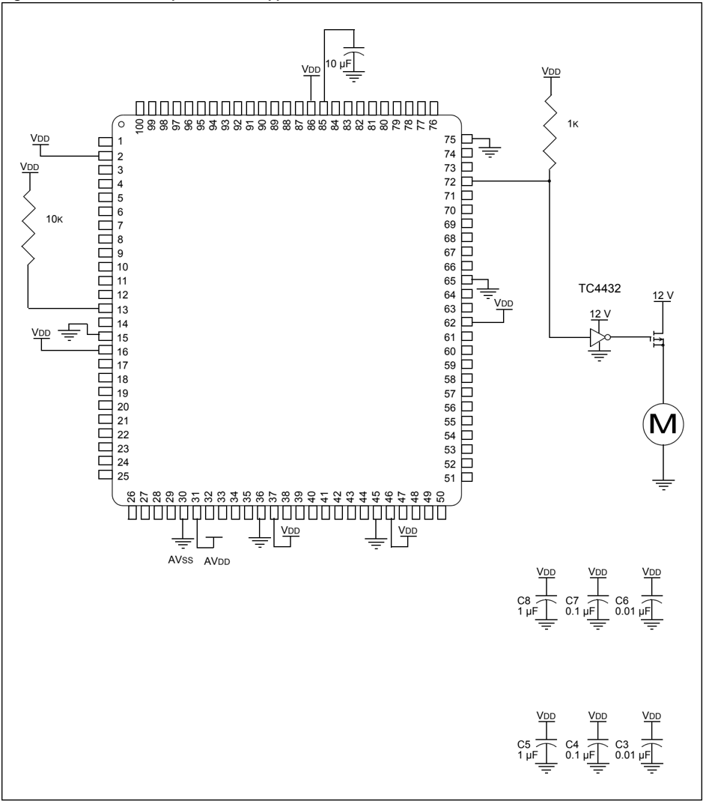

## 16.9 DESIGN TIPS

## Question 1: The Output Compare pin stops functioning even when the SIDL bit is not set. Why?

Answer:

This is most likely to occur when the SIDL bit (TxCON&lt;13&gt;) of the associated timer source is set. Therefore, it is the timer that actually goes into Idle mode when the PWRSAV instruction is executed.

- Question 2: Can  I  use  the  Output  Compare  modules  with  the  selected  time  base configured for 32-bit mode?

Answer:

Yes. The timer can be used in 32-bit mode as a time base for the Output Compare modules by setting the T32 bit (TxCON&lt;3&gt;). For proper operation, the Output Compare module must be configured for 32-bit Compare mode by setting the OC32 bit (OCxCON&lt;5&gt;) for all Output Compare modules using the 32-bit timer as a time base.

## 16.10 RELATED APPLICATION NOTES

This  section  lists  application  notes  that  are  related  to  this  section  of  the  manual.  These application notes may not be written specifically for the PIC32 device family, but the concepts are pertinent and could be used with modification and possible limitations. The current application notes related to the Output Compare module are:

## Title

No related application notes at this time.

Note:

Application Note #

N/A

Please visit the Microchip web site (www.microchip.com) for additional application notes and code examples for the PIC32 family of devices.

## 16.11 REVISION HISTORY

## Revision A (October 2007)

This is the initial released version of this document.

## Revision B (October 2007)

Updated document to remove Confidential status.

## Revision C (April 2008)

Revised status to Preliminary; Revised U-0 to r-x.

## Revision D (June 2008)

Revised Registers 16-1, 16-20, 16-32; Revised Examples 16-3, 16-4, 16-5, 16-6, 16-7, 16-8, 16-9, 16-10, 16-11; Added TMR1 and TMR2 to Summary Table; Revised Section 16.3, Notes; Change Reserved bits from 'Maintain as' to 'Write'; Added Note to ON bit (0CxCON, T2CON, T3CON Registers).

## Revision E (April 2011)

This revision includes the following updates:

- Changed the document running header from PIC32MX Family Reference Manual to PIC32 Family Reference Manual
- Removed the Preliminary status from the footer
- Removed all references to the FRZ bit throughout the document
- Updated the format of all registers (see Register 16-1 through Register 16-3)
- Changed all occurrences of r-x to U-0 in the register tables
- Removed the corresponding Clear, Set and Invert registers of the SFRs
- Changed the title of Equation 16-3 from PWM Period and Duty Cycle Calculation to PWM Period and Resolution Calculation
- Updated the code in Example 16-9, Example 16-10 and Example 16-11
- Minor changes to the text and formatting have been incorporated throughout the document

## Note the following details of the code protection feature on Microchip devices:

- Microchip products meet the specification contained in their particular Microchip Data Sheet.
- Microchip believes that its family of products is one of the most secure families of its kind on the market today, when used in the intended manner and under normal conditions.
- There are dishonest and possibly illegal methods used to breach the code protection feature. All of these methods, to our knowledge, require using the Microchip products in a manner outside the operating specifications contained in Microchip's Data Sheets. Most likely, the person doing so is engaged in theft of intellectual property.
- Microchip is willing to work with the customer who is concerned about the integrity of their code.
- Neither Microchip nor any other semiconductor manufacturer can guarantee the security of their code. Code protection does not mean that we are guaranteeing the product as 'unbreakable.'

Code protection is constantly evolving. We at Microchip are committed to continuously improving the code protection features of our products. Attempts to break Microchip's code protection feature may be a violation of the Digital Millennium Copyright Act. If such acts allow unauthorized access to your software or other copyrighted work, you may have a right to sue for relief under that Act.

Information  contained  in  this  publication  regarding  device applications and the like is provided only for your convenience and may be superseded by updates. It is your responsibility to ensure  that  your  application  meets  with  your  specifications. MICROCHIP MAKES NO REPRESENTATIONS OR WARRANTIES  OF  ANY  KIND  WHETHER  EXPRESS  OR IMPLIED, WRITTEN OR ORAL, STATUTORY OR OTHERWISE, RELATED TO THE INFORMATION, INCLUDING  BUT  NOT  LIMITED  TO  ITS  CONDITION, QUALITY, PERFORMANCE, MERCHANTABILITY OR FITNESS  FOR  PURPOSE . Microchip  disclaims  all  liability arising  from  this  information  and  its  use.  Use  of  Microchip devices in life support and/or safety applications is entirely at the buyer's risk, and the buyer agrees to defend, indemnify and hold  harmless  Microchip  from  any  and  all  damages,  claims, suits,  or  expenses  resulting  from  such  use.  No  licenses  are conveyed, implicitly or otherwise, under any Microchip intellectual property rights.

## QUALITY MANAGEMENT SYSTEM CERTIFIED BY DNV

ISO/TS 16949.2002

## Trademarks

The Microchip name and logo, the Microchip logo, dsPIC, KEELOQ, KEELOQ logo, MPLAB, PIC, PICmicro, PICSTART, PIC 32  logo, rfPIC and UNI/O are registered trademarks of Microchip Technology Incorporated in the U.S.A. and other countries.

FilterLab, Hampshire, HI-TECH C, Linear Active Thermistor, MXDEV, MXLAB, SEEVAL and The Embedded Control Solutions Company are registered trademarks of Microchip Technology Incorporated in the U.S.A.

Analog-for-the-Digital Age, Application Maestro, CodeGuard, dsPICDEM, dsPICDEM.net, dsPICworks, dsSPEAK, ECAN, ECONOMONITOR, FanSense, HI-TIDE, In-Circuit Serial Programming, ICSP, Mindi, MiWi, MPASM, MPLAB Certified logo, MPLIB, MPLINK, mTouch, Omniscient Code Generation, PICC, PICC-18, PICDEM, PICDEM.net, PICkit, PICtail, REAL ICE, rfLAB, Select Mode, Total Endurance, TSHARC, UniWinDriver, WiperLock and ZENA are trademarks of Microchip Technology Incorporated in the U.S.A. and other countries.

SQTP is a service mark of Microchip Technology Incorporated in the U.S.A.

All other trademarks mentioned herein are property of their respective companies.

© 2011, Microchip Technology Incorporated, Printed in the U.S.A., All Rights Reserved.

Printed on recycled paper.


ISBN: 978-1-61341-098-1

Microchip received ISO/TS-16949:2002 certification for its worldwide headquarters, design and wafer fabrication facilities in Chandler and Tempe, Arizona; Gresham, Oregon and design centers in California and India. The Company's quality system processes and procedures are for its PIC ®  MCUs and dsPIC ®  DSCs, KEELOQ ®  code hopping devices, Serial EEPROMs, microperipherals, nonvolatile memory and analog products. In addition, Microchip's quality system for the design and manufacture of development systems is ISO 9001:2000 certified.


## Worldwide Sales and Service

## ASIA/PACIFIC

Asia Pacific Office Suites 3707-14, 37th Floor Tower 6, The Gateway Harbour City, Kowloon Hong Kong Tel: 852-2401-1200 Fax: 852-2401-3431

Australia - Sydney Tel: 61-2-9868-6733 Fax: 61-2-9868-6755

China - Beijing Tel: 86-10-8528-2100 Fax: 86-10-8528-2104

China - Chengdu Tel: 86-28-8665-5511 Fax: 86-28-8665-7889

China - Chongqing Tel: 86-23-8980-9588 Fax: 86-23-8980-9500

China - Hong Kong SAR Tel: 852-2401-1200 Fax: 852-2401-3431

China - Nanjing Tel: 86-25-8473-2460 Fax: 86-25-8473-2470

China - Qingdao Tel: 86-532-8502-7355 Fax: 86-532-8502-7205

China - Shanghai Tel: 86-21-5407-5533 Fax: 86-21-5407-5066

China - Shenyang Tel: 86-24-2334-2829 Fax: 86-24-2334-2393

China - Shenzhen Tel: 86-755-8203-2660 Fax: 86-755-8203-1760

China - Wuhan Tel: 86-27-5980-5300 Fax: 86-27-5980-5118

China - Xian Tel: 86-29-8833-7252 Fax: 86-29-8833-7256

China - Xiamen Tel: 86-592-2388138 Fax: 86-592-2388130

China - Zhuhai Tel: 86-756-3210040 Fax: 86-756-3210049

## ASIA/PACIFIC

India - Bangalore Tel: 91-80-3090-4444 Fax: 91-80-3090-4123

India - New Delhi Tel: 91-11-4160-8631 Fax: 91-11-4160-8632

India - Pune Tel: 91-20-2566-1512 Fax: 91-20-2566-1513

Japan - Yokohama Tel: 81-45-471- 6166 Fax: 81-45-471-6122

Korea - Daegu Tel: 82-53-744-4301 Fax: 82-53-744-4302

Korea - Seoul Tel: 82-2-554-7200 Fax: 82-2-558-5932 or 82-2-558-5934

Malaysia - Kuala Lumpur Tel: 60-3-6201-9857 Fax: 60-3-6201-9859

Malaysia - Penang Tel: 60-4-227-8870 Fax: 60-4-227-4068

Philippines - Manila Tel: 63-2-634-9065 Fax: 63-2-634-9069

Singapore Tel: 65-6334-8870 Fax: 65-6334-8850

Taiwan - Hsin Chu Tel: 886-3-6578-300 Fax: 886-3-6578-370

Taiwan - Kaohsiung Tel: 886-7-213-7830 Fax: 886-7-330-9305

Taiwan - Taipei Tel: 886-2-2500-6610 Fax: 886-2-2508-0102

Thailand - Bangkok Tel: 66-2-694-1351 Fax: 66-2-694-1350

## AMERICAS

Corporate Office 2355 West Chandler Blvd. Chandler, AZ 85224-6199 Tel: 480-792-7200 Fax: 480-792-7277 Technical Support:

[http://www.microchip.com/ support](http://support.microchip.com/)

Web Address:

www.microchip.com

Atlanta Duluth, GA Tel: 678-957-9614 Fax: 678-957-1455

## Boston

Westborough, MA Tel: 774-760-0087 Fax: 774-760-0088

Chicago Itasca, IL Tel: 630-285-0071 Fax: 630-285-0075

Cleveland Independence, OH Tel: 216-447-0464 Fax: 216-447-0643

Dallas Addison, TX Tel: 972-818-7423 Fax: 972-818-2924

Detroit Farmington Hills, MI Tel: 248-538-2250 Fax: 248-538-2260

Indianapolis Noblesville, IN Tel: 317-773-8323 Fax: 317-773-5453

Los Angeles Mission Viejo, CA Tel: 949-462-9523 Fax: 949-462-9608

Santa Clara Santa Clara, CA Tel: 408-961-6444 Fax: 408-961-6445

Toronto Mississauga, Ontario, Canada Tel: 905-673-0699 Fax: 905-673-6509

## EUROPE

Austria - Wels Tel: 43-7242-2244-39 Fax: 43-7242-2244-393

Denmark - Copenhagen Tel: 45-4450-2828 Fax: 45-4485-2829

France - Paris Tel: 33-1-69-53-63-20 Fax: 33-1-69-30-90-79

Germany - Munich Tel: 49-89-627-144-0 Fax: 49-89-627-144-44

Italy - Milan Tel: 39-0331-742611 Fax: 39-0331-466781

Netherlands - Drunen Tel: 31-416-690399 Fax: 31-416-690340

Spain - Madrid Tel: 34-91-708-08-90 Fax: 34-91-708-08-91

UK - Wokingham Tel: 44-118-921-5869 Fax: 44-118-921-5820

02/18/11