Microchip

## Section 17. 10-bit Analog-to-Digital Converter (ADC)

## HIGHLIGHTS

This section of the manual contains the following major topics:

|   17.1 | Introduction..............................................................................................................17-2   |
|--------|----------------------------------------------------------------------------------------------------------------------------------|
|   17.2 | Control Registers.....................................................................................................17-4       |
|   17.3 | ADC Operation, Terminology and Conversion Sequence .....................................17-12                                    |
|   17.4 | ADC Module Configuration....................................................................................17-14                |
|   17.5 | Miscellaneous ADC Functions...............................................................................17-26                  |
|   17.6 | Initialization............................................................................................................17-51  |
|   17.7 | Interrupts................................................................................................................17-53  |
|   17.8 | Operation During Sleep and Idle Modes ...............................................................17-54                       |
|   17.9 | Effects of Various Resets.......................................................................................17-55            |
|  17.10 | Related Application Notes .....................................................................................17-56             |
|  17.11 | Revision History.....................................................................................................17-57       |

17

Note:

This family reference manual section is meant to serve as a complement to device data sheets. Depending on the device variant, this manual section may not apply to all PIC32 devices.

Please  consult  the  note  at  the  beginning  of  the '10-bit  Analog-to-Digital Converter (ADC)' chapter in the current device data sheet to check whether this document supports the device you are using.

Device  data  sheets  and  family  reference  manual  sections  are  available  for download from the Microchip Worldwide Web site at: http://www.microchip.com

## 17.1 INTRODUCTION

The PIC32 10-bit Analog-to-Digital Converter (ADC) includes the following features:

- Successive Approximation Register (SAR) conversion
- Up to 16 analog input pins
- External voltage reference input pins
- One unipolar differential Sample-and-Hold Amplifier (SHA)
- Automatic Channel Scan mode
- Selectable conversion trigger source
- 16-word conversion result buffer
- Selectable Buffer Fill modes
- Eight conversion result format options
- Operation during CPU Sleep and Idle modes

Figure 17-1 illustrates a block diagram of the 10-bit ADC. The 10-bit ADC can have up to 16 analog input pins, AN0 through AN15. In addition, there are two analog input pins for external voltage reference connections. These voltage reference inputs may be shared with other analog input pins and may be common to other analog module references. The actual number of analog input pins and external voltage reference input configuration will depend on the specific PIC32 device. Refer to the specific device data sheet for more information.

The  analog  inputs  are  connected  through  two  multiplexers  to  one  SHA.  The  analog  input multiplexers can be switched between two sets of analog inputs between conversions. Unipolar differential conversions are possible on all channels, other than the pin used as the reference, using a reference input pin (see Figure 17-1).

The Analog Input Scan mode sequentially converts user-specified channels. A control register specifies which analog input channels will be included in the scanning sequence.

The 10-bit ADC is connected to a 16-word result buffer. Each 10-bit result is converted to one of eight 32-bit output formats when it is read from the result buffer.

## Section 17. 10-bit Analog-to-Digital Converter (ADC)

Figure 17-1: 10-bit High-Speed ADC Block Diagram

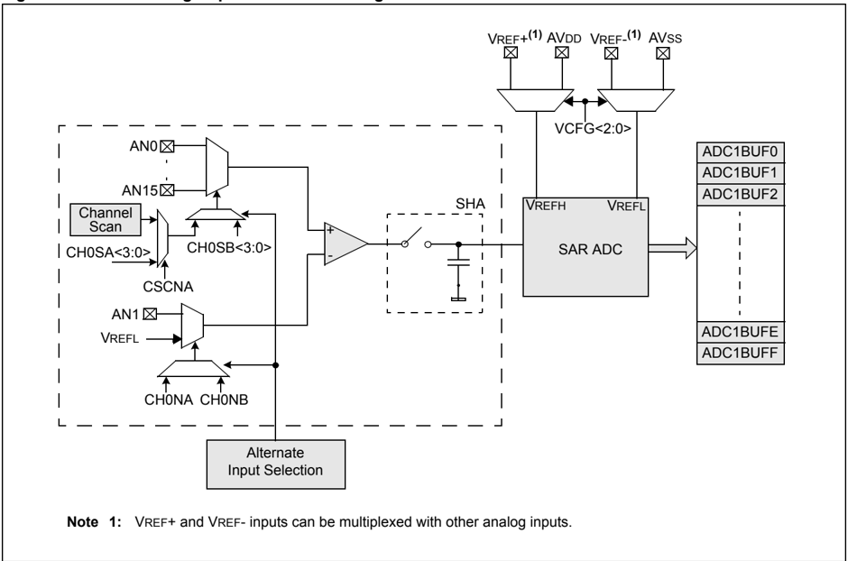

## 17.2 CONTROL REGISTERS

The ADC module has the following Special Function Registers (SFRs):

- AD1CON1: ADC Control Register 1
- AD1CON2: ADC Control Register 2
- AD1CON3: ADC Control Register 3

The  AD1CON1,  AD1CON2  and  AD1CON3  registers  control  the  operation  of  the  ADC module.

- AD1CHS: ADC Input Select Register

The AD1CHS register selects the input pins to be connected to the SHA.

- AD1PCFG: ADC Port Configuration Register (1,2)

The AD1PCFG register configures the analog input pins as analog inputs or as digital I/O.

- AD1CSSL: ADC Input Scan Select Register (1)

The AD1CSSL register selects inputs to be sequentially scanned.

Table 17-1  provides  a  summary  of  all  ADC-related  registers,  including  their  addresses  and formats. Corresponding registers appear after the summary, followed by a detailed description of each register. All unimplemented registers and/or bits within a register read as zero.

Table 17-1: ADC SFR Summary

| Name            | Name   | Bit 31/23/15/7   | Bit 30/22/14/6   | Bit 29/21/13/5   | Bit 28/20/12/4   | Bit 27/19/11/3   | Bit 26/18/10/2   | Bit 25/17/9/1   | Bit 24/16/8/0   |
|-----------------|--------|------------------|------------------|------------------|------------------|------------------|------------------|-----------------|-----------------|
| AD1CON1 (1,2,3) | 31:24  | -                | -                | -                | -                | -                | -                | -               | -               |
| AD1CON1 (1,2,3) | 23:16  | -                | -                | -                | -                | -                | -                | -               | -               |
| AD1CON1 (1,2,3) | 15:8   | ON               | -                | SIDL             | -                | -                | FORM<2:0>        | FORM<2:0>       | FORM<2:0>       |
| AD1CON1 (1,2,3) | 7:0    | SSRC<2:0>        | SSRC<2:0>        | SSRC<2:0>        | CLRASAM          | -                | ASAM             | SAMP            | DONE            |
| AD1CON2 (1,2,3) | 31:24  | -                | -                | -                | -                | -                | -                | -               | -               |
| AD1CON2 (1,2,3) | 23:16  | -                | -                | -                | -                | -                | -                | -               | -               |
| AD1CON2 (1,2,3) | 15:8   | VCFG<2:0>        | VCFG<2:0>        | VCFG<2:0>        | OFFCAL           | -                | CSCNA            | -               | -               |
| AD1CON2 (1,2,3) | 7:0    | BUFS             | -                | SMPI<3:0>        | SMPI<3:0>        | SMPI<3:0>        | SMPI<3:0>        | BUFM            | ALTS            |
| AD1CON3 (1,2,3) | 31:24  | -                | -                | -                | -                | -                | -                | -               | -               |
| AD1CON3 (1,2,3) | 23:16  | -                | -                | -                | -                | -                | -                | -               | -               |
| AD1CON3 (1,2,3) | 15:8   | ADRC             | -                | - SAMC<4:0>      | - SAMC<4:0>      | - SAMC<4:0>      | - SAMC<4:0>      | - SAMC<4:0>     | - SAMC<4:0>     |
| AD1CON3 (1,2,3) | 7:0    | ADCS<7:0>        | ADCS<7:0>        | ADCS<7:0>        | ADCS<7:0>        | ADCS<7:0>        | ADCS<7:0>        | ADCS<7:0>       | ADCS<7:0>       |
| AD1CHS (1,2,3)  | 31:24  | CH0NB            | -                | -                | -                | CH0SB<3:0>       | CH0SB<3:0>       | CH0SB<3:0>      | CH0SB<3:0>      |
| AD1CHS (1,2,3)  | 23:16  | CH0NA            | -                | -                | -                | CH0SA<3:0>       | CH0SA<3:0>       | CH0SA<3:0>      | CH0SA<3:0>      |
| AD1CHS (1,2,3)  | 15:8   | -                | -                | -                | -                | -                | -                | -               | -               |
| AD1CHS (1,2,3)  | 7:0    | -                | -                | -                | -                | -                | -                | -               | -               |
| AD1PCFG (1,2,3) | 31:24  | -                | -                | -                | -                | -                | -                | -               | -               |
| AD1PCFG (1,2,3) | 23:16  | -                | -                | -                | -                | -                | -                | -               | -               |
| AD1PCFG (1,2,3) | 15:8   | PCFG15           | PCFG14           | PCFG13           | PCFG12           | PCFG11           | PCFG10           | PCFG9           | PCFG8           |
| AD1PCFG (1,2,3) | 7:0    | PCFG7            | PCFG6            | PCFG5            | PCFG4            | PCFG3            | PCFG2            | PCFG1           | PCFG0           |

## Legend:

- = unimplemented, read as ' 0 '.

Note

- 1: This register has an associated Clear register at an offset of 0x4 bytes. These registers have the same name with CLR appended to the end of the register name (e.g.,AD1CON1CLR). Writing a ' 1 ' to any bit position in the Clear register will clear valid bits in the associated register. Reads from the Clear register should be ignored.
- 2: This register has an associated Set register at an offset of 0x8 bytes. These registers have the same name with SET appended to the end of the register name (e.g.,AD1CON1SET). Writing a ' 1 ' to any bit position in the Set register will set valid bits in the associated register. Reads from the Set register should be ignored.
- 3: This register has an associated Invert register at an offset of 0xC bytes. These registers have the same name with INV appended to the end of the register name (e.g., AD1CON1INV). Writing a ' 1 ' to any bit position in the Invert register will invert valid bits in the associated register. Reads from the Invert register should be ignored.

## Section 17. 10-bit Analog-to-Digital Converter (ADC)

Table 17-1: ADC SFR Summary (Continued)

| Name            | Name   | Bit 31/23/15/7                     | Bit 30/22/14/6                     | Bit 29/21/13/5                     | Bit 28/20/12/4                     | Bit 27/19/11/3                     | Bit 26/18/10/2                     | Bit 25/17/9/1                      | Bit 24/16/8/0                      |
|-----------------|--------|------------------------------------|------------------------------------|------------------------------------|------------------------------------|------------------------------------|------------------------------------|------------------------------------|------------------------------------|
| AD1CSSL (1,2,3) | 31:24  | -                                  | -                                  | -                                  | -                                  | -                                  | -                                  | -                                  | -                                  |
| AD1CSSL (1,2,3) | 23:16  | -                                  | -                                  | -                                  | -                                  | -                                  | -                                  | -                                  | -                                  |
| AD1CSSL (1,2,3) | 15:8   | CSSL15                             | CSSL14                             | CSSL13                             | CSSL12                             | CSSL11                             | CSSL10                             | CSSL9                              | CSSL8                              |
| AD1CSSL (1,2,3) | 7:0    | CSSL7                              | CSSL6                              | CSSL5                              | CSSL4                              | CSSL3                              | CSSL2                              | CSSL1                              | CSSL0                              |
| ADC1BUF0        | 31:0   | Result Word 0 (ADC1BUF0<31:0>)     | Result Word 0 (ADC1BUF0<31:0>)     | Result Word 0 (ADC1BUF0<31:0>)     | Result Word 0 (ADC1BUF0<31:0>)     | Result Word 0 (ADC1BUF0<31:0>)     | Result Word 0 (ADC1BUF0<31:0>)     | Result Word 0 (ADC1BUF0<31:0>)     | Result Word 0 (ADC1BUF0<31:0>)     |
| ADC1BUF1        | 31:0   | ADC Result Word 1 (ADC1BUF1<31:0>) | ADC Result Word 1 (ADC1BUF1<31:0>) | ADC Result Word 1 (ADC1BUF1<31:0>) | ADC Result Word 1 (ADC1BUF1<31:0>) | ADC Result Word 1 (ADC1BUF1<31:0>) | ADC Result Word 1 (ADC1BUF1<31:0>) | ADC Result Word 1 (ADC1BUF1<31:0>) | ADC Result Word 1 (ADC1BUF1<31:0>) |
| ADC1BUF2        | 31:0   | ADC Result Word 2 (ADC1BUF2<31:0>) | ADC Result Word 2 (ADC1BUF2<31:0>) | ADC Result Word 2 (ADC1BUF2<31:0>) | ADC Result Word 2 (ADC1BUF2<31:0>) | ADC Result Word 2 (ADC1BUF2<31:0>) | ADC Result Word 2 (ADC1BUF2<31:0>) | ADC Result Word 2 (ADC1BUF2<31:0>) | ADC Result Word 2 (ADC1BUF2<31:0>) |
| ADC1BUF3        | 31:0   | ADC Result Word 3 (ADC1BUF3<31:0>) | ADC Result Word 3 (ADC1BUF3<31:0>) | ADC Result Word 3 (ADC1BUF3<31:0>) | ADC Result Word 3 (ADC1BUF3<31:0>) | ADC Result Word 3 (ADC1BUF3<31:0>) | ADC Result Word 3 (ADC1BUF3<31:0>) | ADC Result Word 3 (ADC1BUF3<31:0>) | ADC Result Word 3 (ADC1BUF3<31:0>) |
| ADC1BUF4        | 31:0   | ADC Result Word 4 (ADC1BUF4<31:0>) | ADC Result Word 4 (ADC1BUF4<31:0>) | ADC Result Word 4 (ADC1BUF4<31:0>) | ADC Result Word 4 (ADC1BUF4<31:0>) | ADC Result Word 4 (ADC1BUF4<31:0>) | ADC Result Word 4 (ADC1BUF4<31:0>) | ADC Result Word 4 (ADC1BUF4<31:0>) | ADC Result Word 4 (ADC1BUF4<31:0>) |
| ADC1BUF5        | 31:0   | ADC Result Word 5 (ADC1BUF5<31:0>) | ADC Result Word 5 (ADC1BUF5<31:0>) | ADC Result Word 5 (ADC1BUF5<31:0>) | ADC Result Word 5 (ADC1BUF5<31:0>) | ADC Result Word 5 (ADC1BUF5<31:0>) | ADC Result Word 5 (ADC1BUF5<31:0>) | ADC Result Word 5 (ADC1BUF5<31:0>) | ADC Result Word 5 (ADC1BUF5<31:0>) |
| ADC1BUF6        | 31:0   | ADC Result Word 6 (ADC1BUF6<31:0>) | ADC Result Word 6 (ADC1BUF6<31:0>) | ADC Result Word 6 (ADC1BUF6<31:0>) | ADC Result Word 6 (ADC1BUF6<31:0>) | ADC Result Word 6 (ADC1BUF6<31:0>) | ADC Result Word 6 (ADC1BUF6<31:0>) | ADC Result Word 6 (ADC1BUF6<31:0>) | ADC Result Word 6 (ADC1BUF6<31:0>) |
| ADC1BUF7        | 31:0   | ADC Result Word 7 (ADC1BUF7<31:0>) | ADC Result Word 7 (ADC1BUF7<31:0>) | ADC Result Word 7 (ADC1BUF7<31:0>) | ADC Result Word 7 (ADC1BUF7<31:0>) | ADC Result Word 7 (ADC1BUF7<31:0>) | ADC Result Word 7 (ADC1BUF7<31:0>) | ADC Result Word 7 (ADC1BUF7<31:0>) | ADC Result Word 7 (ADC1BUF7<31:0>) |
| ADC1BUF8        | 31:0   | ADC Result Word 8 (ADC1BUF8<31:0>) | ADC Result Word 8 (ADC1BUF8<31:0>) | ADC Result Word 8 (ADC1BUF8<31:0>) | ADC Result Word 8 (ADC1BUF8<31:0>) | ADC Result Word 8 (ADC1BUF8<31:0>) | ADC Result Word 8 (ADC1BUF8<31:0>) | ADC Result Word 8 (ADC1BUF8<31:0>) | ADC Result Word 8 (ADC1BUF8<31:0>) |
| ADC1BUF9        | 31:0   | ADC Result Word 9 (ADC1BUF9<31:0>) | ADC Result Word 9 (ADC1BUF9<31:0>) | ADC Result Word 9 (ADC1BUF9<31:0>) | ADC Result Word 9 (ADC1BUF9<31:0>) | ADC Result Word 9 (ADC1BUF9<31:0>) | ADC Result Word 9 (ADC1BUF9<31:0>) | ADC Result Word 9 (ADC1BUF9<31:0>) | ADC Result Word 9 (ADC1BUF9<31:0>) |
| ADC1BUFA        | 31:0   | ADC Result Word A (ADC1BUFA<31:0>) | ADC Result Word A (ADC1BUFA<31:0>) | ADC Result Word A (ADC1BUFA<31:0>) | ADC Result Word A (ADC1BUFA<31:0>) | ADC Result Word A (ADC1BUFA<31:0>) | ADC Result Word A (ADC1BUFA<31:0>) | ADC Result Word A (ADC1BUFA<31:0>) | ADC Result Word A (ADC1BUFA<31:0>) |
| ADC1BUFB        | 31:0   | ADC Result Word B (ADC1BUFB<31:0>) | ADC Result Word B (ADC1BUFB<31:0>) | ADC Result Word B (ADC1BUFB<31:0>) | ADC Result Word B (ADC1BUFB<31:0>) | ADC Result Word B (ADC1BUFB<31:0>) | ADC Result Word B (ADC1BUFB<31:0>) | ADC Result Word B (ADC1BUFB<31:0>) | ADC Result Word B (ADC1BUFB<31:0>) |
| ADC1BUFC        | 31:0   | ADC Result Word C (ADC1BUFC<31:0>) | ADC Result Word C (ADC1BUFC<31:0>) | ADC Result Word C (ADC1BUFC<31:0>) | ADC Result Word C (ADC1BUFC<31:0>) | ADC Result Word C (ADC1BUFC<31:0>) | ADC Result Word C (ADC1BUFC<31:0>) | ADC Result Word C (ADC1BUFC<31:0>) | ADC Result Word C (ADC1BUFC<31:0>) |
| ADC1BUFD        | 31:0   | ADC Result Word D (ADC1BUFD<31:0>) | ADC Result Word D (ADC1BUFD<31:0>) | ADC Result Word D (ADC1BUFD<31:0>) | ADC Result Word D (ADC1BUFD<31:0>) | ADC Result Word D (ADC1BUFD<31:0>) | ADC Result Word D (ADC1BUFD<31:0>) | ADC Result Word D (ADC1BUFD<31:0>) | ADC Result Word D (ADC1BUFD<31:0>) |
| ADC1BUFE        | 31:0   | ADC Result Word E (ADC1BUFE<31:0>) | ADC Result Word E (ADC1BUFE<31:0>) | ADC Result Word E (ADC1BUFE<31:0>) | ADC Result Word E (ADC1BUFE<31:0>) | ADC Result Word E (ADC1BUFE<31:0>) | ADC Result Word E (ADC1BUFE<31:0>) | ADC Result Word E (ADC1BUFE<31:0>) | ADC Result Word E (ADC1BUFE<31:0>) |
| ADC1BUFF        | 31:0   | ADC Result Word F (ADC1BUFF<31:0>) | ADC Result Word F (ADC1BUFF<31:0>) | ADC Result Word F (ADC1BUFF<31:0>) | ADC Result Word F (ADC1BUFF<31:0>) | ADC Result Word F (ADC1BUFF<31:0>) | ADC Result Word F (ADC1BUFF<31:0>) | ADC Result Word F (ADC1BUFF<31:0>) | ADC Result Word F (ADC1BUFF<31:0>) |

Legend: - = unimplemented, read as ' 0 '.

Note 1: This register has an associated Clear register at an offset of 0x4 bytes. These registers have the same name with CLR appended to the end of the register name (e.g.,AD1CON1CLR). Writing a ' 1 ' to any bit position in the Clear register will clear valid bits in the associated register. Reads from the Clear register should be ignored.

2: This register has an associated Set register at an offset of 0x8 bytes. These registers have the same name with SET appended to the end of the register name (e.g.,AD1CON1SET). Writing a ' 1 ' to any bit position in the Set register will set valid bits in the associated register. Reads from the Set register should be ignored.

3: This register has an associated Invert register at an offset of 0xC bytes. These registers have the same name with INV appended to the end of the register name (e.g., AD1CON1INV). Writing a ' 1 ' to any bit position in the Invert register will invert valid bits in the associated register. Reads from the Invert register should be ignored.

## PIC32 Family Reference Manual

## Register 17-1: AD1CON1: ADC Control Register 1

| Bit Range   | Bit 31/23/15/7   | Bit 30/22/14/6   | Bit 29/21/13/5   | Bit 28/20/12/4   | Bit 27/19/11/3   | Bit 26/18/10/2   | Bit 25/17/9/1   | Bit 24/16/8/0   |
|-------------|------------------|------------------|------------------|------------------|------------------|------------------|-----------------|-----------------|
| 31:24       | U-0              | U-0              | U-0              | U-0              | U-0              | U-0              | U-0             | U-0             |
| 31:24       | -                | -                | -                | -                | -                | -                | -               | -               |
| 23:16       | U-0              | U-0              | U-0              | U-0              | U-0              | U-0              | U-0             | U-0             |
| 23:16       | -                | -                | -                | -                | -                | -                | -               | -               |
| 15:8        | R/W-0            | U-0              | R/W-0            | U-0              | U-0              | R/W-0            | R/W-0           | R/W-0           |
| 15:8        | ON (1)           | -                | SIDL             | -                | -                | FORM<2:0>        | FORM<2:0>       | FORM<2:0>       |
| 7:0         | R/W-0            | R/W-0            | R/W-0            | R/W-0            | U-0              | R/W-0            | R/W-0           | R/C-0           |
| 7:0         | SSRC<2:0>        | SSRC<2:0>        | SSRC<2:0>        | CLRASAM          | -                | ASAM             | SAMP            | DONE (2)        |

## Legend:

R = Readable bit

W = Writable bit

P = Programmable bit

r = Reserved bit

U = Unimplemented bit

-n = Bit Value at POR: ('0', '1',  x = Unknown)

C = Clearable bit

bit 31-16 Unimplemented: Read as '

bit 15

ON:

0 '

ADC Operating Mode bit (1)

1 = ADC module is operating

0 = ADC is off

bit 14 Unimplemented: Read as ' 0 '

bit 13

SIDL: Stop in Idle Mode bit

1 = Discontinue module operation when device enters Idle mode

0 = Continue module operation in Idle mode

bit 12-11 Unimplemented: Read as ' 0 '

bit 10-8 FORM&lt;2:0&gt;: Data Output Format bits

011 = Signed Fractional 16-bit (DOUT = 0000 0000 0000 0000 sddd dddd dd00 0000 )

010 = Fractional 16-bit (DOUT = 0000 0000 0000 0000 dddd dddd dd00 0000 )

001 = Signed Integer 16-bit (DOUT = 0000 0000 0000 0000 ssss sssd dddd dddd )

000 = Integer 16-bit (DOUT = 0000 0000 0000 0000 0000 00dd dddd dddd )

111 = Signed Fractional 32-bit (DOUT = sddd dddd dd00 0000 0000 0000 0000 )

110 = Fractional 32-bit (DOUT = dddd dddd dd00 0000 0000 0000 0000 0000 )

101 = Signed Integer 32-bit (DOUT = ssss ssss ssss ssss ssss sssd dddd dddd )

100 = Integer 32-bit (DOUT = 0000 0000 0000 0000 0000 00dd dddd dddd )

## bit 7-5 SSRC&lt;2:0&gt;: Conversion Trigger Source Select bits

111 = Internal counter ends sampling and starts conversion (auto convert)

110 = Reserved

101 = Reserved

100 = Reserved

011 = Reserved

010 = Timer3 period match ends sampling and starts conversion

001 = Active transition on INT0 pin ends sampling and starts conversion

000 = Clearing SAMP bit ends sampling and starts conversion

bit 4 CLRASAM: Stop Conversion Sequence bit (when the first ADC interrupt is generated)

- 1 = Stop conversions when the first ADC interrupt is generated. Hardware clears the ASAM bit when the ADC interrupt is generated.
- 0 = Normal operation, buffer contents will be overwritten by the next conversion sequence
- Note 1: When using the 1:1 Peripheral Bus Clock (PBCLK) divisor, the user software should not read or write the peripheral's SFRs in the SYSCLK cycle immediately following the instruction that clears the module's ON bit.
- 2: The DONE bit is not persistent in automatic modes. It is cleared by hardware at the beginning of the next sample.

## Section 17. 10-bit Analog-to-Digital Converter (ADC)

## Register 17-1: AD1CON1: ADC Control Register 1 (Continued)

bit 3

Unimplemented:

Read as ' 0 '

bit 2

ASAM:

ADC Sample Auto-Start bit

- 1 = Sampling begins immediately after last conversion completes; SAMP bit is automatically set

- 0 = Sampling begins when SAMP bit is set

bit 1

SAMP: ADC Sample Enable bit

- 1 = The ADC SHA is sampling

- 0 = The ADC sample/hold amplifier is holding

When ASAM = 0 , writing ' 1 ' to this bit starts sampling.

When SSRC = 000 , writing ' 0 ' to this bit will end sampling and start conversion.

bit 0

DONE: Analog-to-Digital Conversion Status bit (2)

- 1 = Analog-to-digital conversion is done

- 0 = Analog-to-digital conversion is not done or has not started

Clearing this bit will not affect any operation in progress.

- Note 1: When using the 1:1 Peripheral Bus Clock (PBCLK) divisor, the user software should not read or write the peripheral's SFRs in the SYSCLK cycle immediately following the instruction that clears the module's ON bit.
- 2: The DONE bit is not persistent in automatic modes. It is cleared by hardware at the beginning of the next sample.

17

## PIC32 Family Reference Manual

## Register 17-2: AD1CON2: ADC Control Register 2

| Bit Range   | Bit 31/23/15/7   | Bit 30/22/14/6   | Bit 29/21/13/5   | Bit 28/20/12/4   | Bit 27/19/11/3   | Bit 26/18/10/2   | Bit 25/17/9/1   | Bit 24/16/8/0   |
|-------------|------------------|------------------|------------------|------------------|------------------|------------------|-----------------|-----------------|
| 31:24       | U-0              | U-0              | U-0              | U-0              | U-0              | U-0              | U-0             | U-0             |
| 31:24       | -                | -                | -                | -                | -                | -                | -               | -               |
| 23:16       | U-0              | U-0              | U-0              | U-0              | U-0              | U-0              | U-0             | U-0             |
| 23:16       | -                | -                | -                | -                | -                | -                | -               | -               |
| 15:8        | R/W-0            | R/W-0            | R/W-0            | R/W-0            | U-0              | R/W-0            | U-0             | U-0             |
| 15:8        | VCFG<2:0>        | VCFG<2:0>        | VCFG<2:0>        | OFFCAL           | -                | CSCNA            | -               | -               |
| 7:0         | R/W-0            | U-0              | R/W-0            | R/W-0            | R/W-0            | R/W-0            | R/W-0           | R/W-0           |
| 7:0         | BUFS             | -                | SMPI<3:0>        | SMPI<3:0>        | SMPI<3:0>        | SMPI<3:0>        | BUFM            | ALTS            |

## Legend:

R = Readable bit

W = Writable bit

P = Programmable bit

r = Reserved bit

U = Unimplemented bit

-n = Bit Value at POR: ('0', '1',  x = Unknown)

bit 31-16

Unimplemented:

Read as ' 0 '

bit 15-13

VCFG&lt;2:0&gt;: Voltage Reference Configuration bits

|     | ADC VR+            | ADC VR-            |
|-----|--------------------|--------------------|
| 000 | AVDD               | AVSS               |
| 001 | External VREF+ pin | AVSS               |
| 010 | AVDD               | External VREF- pin |
| 011 | External VREF+ pin | External VREF- pin |
| 1xx | AVDD               | AVSS               |

bit 12

OFFCAL: Input Offset Calibration Mode Select bit

- 1 = Enable Offset Calibration mode VINH and VINL of the SHA are connected to VR

-

- 0 = Disable Offset Calibration mode

The inputs to the SHA are controlled by AD1CHS or AD1CSSL

bit 11

Unimplemented:

Read as ' 0 '

bit 10

CSCNA: Scan Input Selections for CH0+ SHA Input for MUX A Input Multiplexer Setting bit

1 = Scan inputs

0 = Do not scan inputs

bit 9-8

Unimplemented: Read as ' 0 '

bit 7

BUFS:

Buffer Fill Status bit

Only valid when BUFM = 1 (ADRES split into 2 x 8-word buffers).

1 = ADC is currently filling buffer 0x8-0xF, user should access data in 0x0-0x7

0 = ADC is currently filling buffer 0x0-0x7, user should access data in 0x8-0xF

bit 6

Unimplemented:

Read as ' 0 '

bit 5-2

SMPI&lt;3:0&gt;: Sample/Convert Sequences Per Interrupt Selection bits

1111 = Interrupts at the completion of conversion for each 16 th  sample/convert sequence

1110 = Interrupts at the completion of conversion for each 15 th  sample/convert sequence

•

•

•

0001 = Interrupts at the completion of conversion for each 2 nd  sample/convert sequence 0000 = Interrupts at the completion of conversion for each sample/convert sequence

bit 1

BUFM: ADC Result Buffer Mode Select bit

- 1 = Buffer configured as two 8-word buffers, ADC1BUF(7...0), ADC1BUF(15...8)

0 = Buffer configured as one 16-word buffer ADC1BUF(15...0.)

bit 0

ALTS: Alternate Input Sample Mode Select bit

- 1 MUX A input multiplexer settings for all subsequent samples

- = Uses MUX A input multiplexer settings for first sample, then alternates between MUX B and

- 0 = Always use MUX A input multiplexer settings

## Section 17. 10-bit Analog-to-Digital Converter (ADC)

## Register 17-3:

AD1CON3: ADC Control Register 3

| Bit Range   | Bit 31/23/15/7   | Bit 30/22/14/6   | Bit 29/21/13/5   | Bit 28/20/12/4   | Bit 27/19/11/3   | Bit 26/18/10/2   | Bit 25/17/9/1   | Bit 24/16/8/0   |
|-------------|------------------|------------------|------------------|------------------|------------------|------------------|-----------------|-----------------|
| 31:24       | U-0              | U-0              | U-0              | U-0              | U-0              | U-0              | U-0             | U-0             |
| 31:24       | -                | -                | -                | -                | -                | -                | -               | -               |
| 23:16       | U-0              | U-0              | U-0              | U-0              | U-0              | U-0              | U-0             | U-0             |
| 23:16       | -                | -                | -                | -                | -                | -                | -               | -               |
| 15:8        | R/W-0            | U-0              | U-0              | R/W-0            | R/W-0            | R/W-0            | R/W-0           | R/W-0           |
| 15:8        | ADRC             | -                | -                | SAMC<4:0>        | SAMC<4:0>        | SAMC<4:0>        | SAMC<4:0>       | SAMC<4:0>       |
| 7:0         | R/W-0            | R/W-0            | R/W-0            | R/W-0            | R/W-0            | R/W-0            | R/W-0           | R/W-0           |
| 7:0         | ADCS<7:0> (1)    | ADCS<7:0> (1)    | ADCS<7:0> (1)    | ADCS<7:0> (1)    | ADCS<7:0> (1)    | ADCS<7:0> (1)    | ADCS<7:0> (1)   | ADCS<7:0> (1)   |

## Legend:

R = Readable bit

W = Writable bit

P = Programmable bit

r = Reserved bit

U = Unimplemented bit

-n = Bit Value at POR: ('0', '1',  x = Unknown)

```
bit 31-16 Unimplemented: Read as ' 0 ' bit 15 ADRC: ADC Conversion Clock Source bit 1 = ADC internal RC clock 0 = Clock derived from Peripheral Bus Clock (PBCLK) bit 14-13 Unimplemented: Read as ' 0 ' bit 12-8 SAMC<4:0>: Auto-sample Time bits 11111 = 31 TAD · · · 00001 = 1 TAD 00000 = 0 TAD (Not allowed) bit 7-0 ADCS<7:0>: ADC Conversion Clock Select bits (1) 11111111 = TPB · 2 · (ADCS<7:0> + 1) = 512 · TPB = TAD · · · 00000001 = TPB · 2 · (ADCS<7:0> + 1) = 4 · TPB = TAD 00000000 = TPB · 2 · (ADCS<7:0> + 1) = 2 · TPB = TAD
```

Note 1: TPB is the PIC32 Peripheral Bus clock time period. Refer to Section 6. 'Oscillator' (DS61112) for more information.

17

## PIC32 Family Reference Manual

## Register 17-4: AD1CHS: ADC Input Select Register

| Bit Range   | Bit 31/23/15/7   | Bit 30/22/14/6   | Bit 29/21/13/5   | Bit 28/20/12/4   | Bit 27/19/11/3   | Bit 26/18/10/2   | Bit 25/17/9/1   | Bit 24/16/8/0   |
|-------------|------------------|------------------|------------------|------------------|------------------|------------------|-----------------|-----------------|
| 31:24       | R/W-0            | U-0              | U-0              | U-0              | R/W-0            | R/W-0            | R/W-0           | R/W-0           |
| 31:24       | CH0NB            | -                | -                | -                | CH0SB<3:0>       | CH0SB<3:0>       | CH0SB<3:0>      | CH0SB<3:0>      |
| 23:16       | R/W-0            | U-0              | U-0              | U-0              | R/W-0            | R/W-0            | R/W-0           | R/W-0           |
| 23:16       | CH0NA            | -                | -                | -                | CH0SA<3:0>       | CH0SA<3:0>       | CH0SA<3:0>      | CH0SA<3:0>      |
| 15:8        | U-0              | U-0              | U-0              | U-0              | U-0              | U-0              | U-0             | U-0             |
| 15:8        | -                | -                | -                | -                | -                | -                | -               | -               |
| 7:0         | U-0              | U-0              | U-0              | U-0              | U-0              | U-0              | U-0             | U-0             |
| 7:0         | -                | -                | -                | -                | -                | -                | -               | -               |

## Legend:

R = Readable bit

W = Writable bit

P = Programmable bit

r = Reserved bit

U = Unimplemented bit

-n = Bit Value at POR: ('0', '1',  x = Unknown)

## bit 31 CH0NB: Negative Input Select bit for MUX B

1 = Channel 0 negative input is AN1

0 = Channel 0 negative input is VR-

bit 30-28 Unimplemented: Read as ' 0 '

bit 27-24

CH0SB&lt;3:0&gt;:

Positive Input Select bits for MUX B

1111 = Channel 0 positive input is AN15

1110 = Channel 0 positive input is AN14

1101 = Channel 0 positive input is AN13

•

•

•

0001 = Channel 0 positive input is AN1

0000 = Channel 0 positive input is AN0

bit 23

CH0NA: Negative Input Select bit for MUX A Multiplexer Setting

1 = Channel 0 negative input is AN1

0 = Channel 0 negative input is VR-

bit 22-20

Unimplemented: Read as ' 0 '

bit 19-16 CH0SA&lt;3:0&gt;: Positive Input Select bits for MUX A Multiplexer Setting

1111 = Channel 0 positive input is AN15

1110 = Channel 0 positive input is AN14

1101 = Channel 0 positive input is AN13

•

•

•

0001 = Channel 0 positive input is AN1

0000 = Channel 0 positive input is AN0

bit 15-0 Unimplemented: Read as ' 0 '

## Register 17-5: AD1PCFG: ADC Port Configuration Register (1,2)

| Bit Range   | Bit 31/23/15/7   | Bit 30/22/14/6   | Bit 29/21/13/5   | Bit 28/20/12/4   | Bit 27/19/11/3   | Bit 26/18/10/2   | Bit 25/17/9/1   | Bit 24/16/8/0   |
|-------------|------------------|------------------|------------------|------------------|------------------|------------------|-----------------|-----------------|
| 31:24       | U-0              | U-0              | U-0              | U-0              | U-0              | U-0              | U-0             | U-0             |
| 31:24       | -                | -                | -                | -                | -                | -                | -               | -               |
| 23:16       | U-0              | U-0              | U-0              | U-0              | U-0              | U-0              | U-0             | U-0             |
| 23:16       | -                | -                | -                | -                | -                | -                | -               | -               |
| 15:8        | R/W-0            | R/W-0            | R/W-0            | R/W-0            | R/W-0            | R/W-0            | R/W-0           | R/W-0           |
| 15:8        | PCFG15           | PCFG14           | PCFG13           | PCFG12           | PCFG11           | PCFG10           | PCFG9           | PCFG8           |
| 7:0         | R/W-0            | R/W-0            | R/W-0            | R/W-0            | R/W-0            | R/W-0            | R/W-0           | R/W-0           |
| 7:0         | PCFG7            | PCFG6            | PCFG5            | PCFG4            | PCFG3            | PCFG2            | PCFG1           | PCFG0           |

## Legend:

R = Readable bit

W = Writable bit

P = Programmable bit

r = Reserved bit

U = Unimplemented bit

-n = Bit Value at POR: ('0', '1',  x = Unknown)

bit 31-16

Unimplemented: Read as ' 0 '

bit 15-0

PCFG&lt;15:0&gt;: Analog Input Pin Configuration Control bits

- 1 = Analog input pin in Digital mode, port read input enabled, ADC input multiplexer input for this analog input connected to AVss
- 0 = Analog input pin in Analog mode, digital port read will return as a ' 1 ' without regard to the voltage on the pin, ADC samples pin voltage
- Note 1: The AD1PCFG register functionality will vary depending on the number of ADC inputs available on the selected device. Refer to the specific device data sheet for additional details on this register.
- 2: The AD1PCFG register is not available on all PIC32 devices. Refer to the specific device data sheet for availability of this register.

## Register 17-6: AD1CSSL: ADC Input Scan Select Register (1)

| Bit Range   | Bit 31/23/15/7   | Bit 30/22/14/6   | Bit 29/21/13/5   | Bit 28/20/12/4   | Bit 27/19/11/3   | Bit 26/18/10/2   | Bit 25/17/9/1   | Bit 24/16/8/0   |
|-------------|------------------|------------------|------------------|------------------|------------------|------------------|-----------------|-----------------|
| 31:24       | U-0              | U-0              | U-0              | U-0              | U-0              | U-0              | U-0             | U-0             |
| 31:24       | -                | -                | -                | -                | -                | -                | -               | -               |
| 23:16       | U-0              | U-0              | U-0              | U-0              | U-0              | U-0              | U-0             | U-0             |
| 23:16       | -                | -                | -                | -                | -                | -                | -               | -               |
| 15:8        | R/W-0            | R/W-0            | R/W-0            | R/W-0            | R/W-0            | R/W-0            | R/W-0           | R/W-0           |
| 15:8        | CSSL15           | CSSL14           | CSSL13           | CSSL12           | CSSL11           | CSSL10           | CSSL9           | CSSL8           |
| 7:0         | R/W-0            | R/W-0            | R/W-0            | R/W-0            | R/W-0            | R/W-0            | R/W-0           | R/W-0           |
| 7:0         | CSSL7            | CSSL6            | CSSL5            | CSSL4            | CSSL3            | CSSL2            | CSSL1           | CSSL0           |

## Legend:

R = Readable bit

W = Writable bit

P = Programmable bit

r = Reserved bit

U = Unimplemented bit

-n = Bit Value at POR: ('0', '1',  x = Unknown)

bit 31-16

Unimplemented:

Read as ' 0 '

bit 15-0

CSSL&lt;15:0&gt;: ADC Input Pin Scan Selection bits

1 = Select ANx for input scan

0 = Skip ANx for input scan

- Note 1: The AD1CSSL register functionality will vary depending on the number of ADC inputs available on the selected device. Refer to the specific device data sheet for additional details on this register.

## 17.3 ADC OPERATION, TERMINOLOGY AND CONVERSION SEQUENCE

This section describes the operation of the ADC, the steps required to configure the converter, special  features  of  the  module,  and  provides  examples  of  ADC  configuration  with  timing diagrams and charts showing the expected output of the converter.

## 17.3.1 Overview of Operation

Analog sampling consists of two steps: acquisition and conversion (see Figure 17-2). During acquisition, the analog input pin is connected to the Sample and Hold Amplifier (SHA). After the pin has been sampled for a sufficient period, and the sample voltage is equivalent to the input, the pin is disconnected from the SHA to provide a stable input voltage for the conversion process. The conversion process then converts the analog sample voltage to a binary representation.

An overview of the ADC is presented in Figure 17-1. The 10-bit ADC has a single SHA. The SHA is connected to the analog input pins through the analog input multiplexers, MUX A and MUX B. The analog input multiplexers are controlled by the AD1CHS register. There are two sets of MUX control bits in the AD1CHS register. These two sets of control bits allow the two different analog input to be independently controlled. The ADC can optionally switch between MUX A and MUX B configurations  between  conversions.  The  ADC  can  also  optionally  scan  through  a  series  of analog inputs using a single MUX.

Acquisition time can be controlled manually or automatically. The acquisition time may be started manually by setting the SAMP bit (AD1CON1&lt;1&gt;), and ended manually by clearing the SAMP bit in user software. The acquisition time may be started automatically by the ADC hardware and ended automatically by a conversion trigger source. The acquisition time is set by the SAMC bits (AD1CON3&lt;12:8&gt;). The SHA has a minimum acquisition period; refer to the specific device data sheet for acquisition time specifications.

Conversion time is the time required for the ADC to convert the voltage held by the SHA. The ADC requires one ADC clock cycle (TAD) to convert each bit of the result, plus two additional clock cycles. Therefore, a total of 12 TAD cycles are required to perform the complete conversion. When the conversion time is complete, the result is written into one of the 16 ADC result registers (ADC1BUF0 through ADC1BUFF).

The sum of the acquisition  time  and  the  analog-to-digital  conversion  time  provides  the  total sample time (refer to Figure 17-2). There are multiple input clock options for the ADC that are used to create the TAD clock. The user must select an input clock option that does not violate the minimum TAD specification.

The sampling process can be performed once, periodically, or based on a trigger as defined by the module configuration.

Figure 17-2: ADC Sample/Conversion Sequence

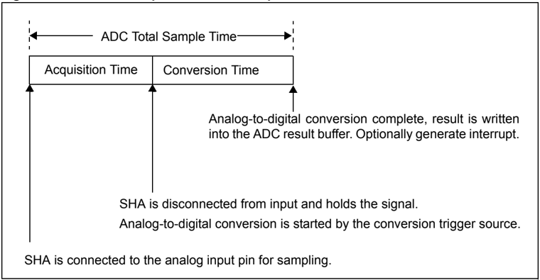

## Section 17. 10-bit Analog-to-Digital Converter (ADC)

The  start time for sampling  can  be  controlled in software by setting  the  SAMP  bit (AD1CON1&lt;1&gt;). The start of the sampling time can also be controlled automatically by the hardware. When the ADC operates in Auto-Sample mode, the SHA is reconnected to the analog input pin at the end of the conversion in the sample/convert sequence. The auto-sample function is controlled by the ASAM bit (AD1CON1&lt;2&gt;).

The conversion trigger source ends the sampling time and begins an analog-to-digital conversion or a sample/convert sequence. The conversion trigger source is selected by the SSRC&lt;2:0&gt; bits (AD1CON1&lt;7:5&gt;). The conversion trigger can be taken from a variety of hardware sources, or can be controlled manually in software by clearing the SAMP bit. One of the conversion trigger sources is an auto-conversion. The time between auto-conversions is set by a counter and the ADC clock. The Auto-Sample mode and auto-conversion trigger can be used together to provide endless automatic conversions without software intervention.

An  interrupt  may  be  generated  at  the  end  of  each  sample  sequence  or  multiple  sample sequences as determined by the value of the SMPI&lt;3:0&gt; bits (AD1CON2&lt;5:2&gt;). The number of sample sequences between interrupts can vary between 1 and 16. The user should note that the analog-to-digital conversion buffer holds the results of a single conversion sequence. The next sequence starts filling the buffer from the top even if the number of samples in the previous sequence was less than 16. The total number of conversion results between interrupts is the SMPI value. The total number of conversions between interrupts cannot exceed the physical buffer length.

## 17.4 ADC MODULE CONFIGURATION

Operation of the ADC module is directed through bit settings in the appropriate registers. The following  instructions  summarize  the  actions  and  the  settings.  Options  and  details  for  each configuration step are provided in subsequent sections.

To configure the ADC module, perform the following steps:

1. Configure the analog port pins in AD1PCFG&lt;15:0&gt; (see 17.4.1).
2. Select the analog inputs to the ADC multiplexers in AD1CHS&lt;32:0&gt; (see 17.4.2).
3. Select the format of the ADC result using FORM&lt;2:0&gt; (AD1CON1&lt;10:8&gt;) (see 17.4.3).
4. Select the sample clock source using SSRC&lt;2:0&gt; (AD1CON1&lt;7:5&gt;) (see 17.4.4).
5. Select the voltage reference source using VCFG&lt;2:0&gt; (AD1CON2&lt;15:13&gt;) (see 17.4.7).
6. Select the Scan mode using CSCNA (AD1CON2&lt;10&gt;) (see 17.4.8).
7. Set the number of conversions per interrupt SMP&lt;3:0&gt; (AD1CON2&lt;5:2&gt;), if interrupts are to be used (see 17.4.9).
8. Set Buffer Fill mode using BUFM (AD1CON2&lt;1&gt;) (see 17.4.10).
9. Select the MUX to be connected to the ADC in ALTS AD1CON2&lt;0&gt; (see 17.4.11).
10. Select the ADC clock source using ADRC (AD1CON3&lt;15&gt;) (see 17.4.12).
11. Select the sample time using SAMC&lt;4:0&gt; (AD1CON3&lt;12:8&gt;), if auto-convert is to be used (see 17-2).
12. Select the ADC clock prescaler using ADCS&lt;7:0&gt; (AD1CON3&lt;7:0&gt;) (see 17.4.12).
13. Turn the ADC module on using AD1CON1&lt;15&gt; (see 17.4.14).

Note: Steps 1 through 12, above, can be performed in any order, but Step 13 must be the final step in every case.

14. To configure ADC interrupt (if required):
- a) Clear the AD1IF bit (IFS1&lt;1&gt;) (see 17.7).
- b) Select ADC interrupt priority AD1IP&lt;2:0&gt; (IPC&lt;28:26&gt;) and subpriority AD1IS&lt;1:0&gt; (IPC&lt;24:24&gt;) if interrupts are to be used (see 17.7).
15. Start the conversion sequence by initiating sampling (see 17.4.15).

## 17.4.1 Configuring Analog Port Pins

The AD1PCFG register and the TRISB register  control  the  operation  of  the  ADC  port  pins. AD1PCFG specifies  the  configuration  of  device  pins  to  be  used  as  analog  inputs.  A  pin  is configured as an analog input when the corresponding PCFGn bit (AD1PCFG&lt;n&gt;) = 0 . When the bit = 1 , the pin is set to digital control. When configured for analog input, the associated port I/O digital input buffer is disabled so it does not consume current. The AD1PCFG register is cleared at Reset, causing the ADC input pins to be configured for analog input by default at Reset.

TRIS registers control the digital function of the port pins. The port pins that are desired as analog inputs must have their corresponding TRIS bit set, specifying the pin as an input. If the I/O pin associated with an ADC input is configured as output, the TRIS bit is cleared, the ports digital output level (VOH or VOL) will be converted. After a device Reset, all of the TRIS bits are set.

- Note 1: When reading a PORT register that shares pins with the ADC, any pin configured as an analog input reads as a ' 0 ' when the PORT latch is read. Analog levels on any pin that is defined as a digital input (including the AN15:AN0 pins), but is not configured as an analog input, may cause the input buffer to consume current that is out of the device's specification.
- 2: The  AD1PCFG  register  is  not  available  in  all  the  PIC32  devices.  Refer  to  the specific device data sheet for availability.

## 17.4.2 Selecting the Analog Inputs to the ADC Multiplexers

The AD1CHS register is used to select which analog input pin is connected to MUX A and MUX B. Each multiplexer has two inputs referred to as the positive and the negative input. The positive input to MUX A is controlled by the CH0SA&lt;3:0&gt; bits (AD1CHS&lt;19:16&gt;) and the negative input is controlled by the CH0NA bit (AD1CHS&lt;23&gt;). The positive input for MUX B is controlled by the CH0SB&lt;3:0&gt; bits (AD1CHS&lt;27:24&gt;) and the negative input is controlled by the CH0NB bit (AD1CHS&lt;31&gt;).

The positive input can be selected from any one of the available analog input pins. The negative input can be selected as the ADC negative reference or AN1. The use of AN1 as the negative input allows the ADC to be used in Unipolar Differential mode. Refer to the specific device data sheet for AN1 input voltage restrictions when used as a negative reference.

Note: When  using  Scan  mode,  the  CH0SA&lt;3:0&gt;  bits  may  be  overridden.  Refer  to 17.4.8 'Selecting the Scan Mode' for more information.

## 17.4.3 Selecting the Format of the ADC Result

The data in the ADC result register can be read as one of eight formats. The format is controlled by the FORM&lt;2:0&gt; bits (AD1CON1&lt;10:8&gt;). The user can select from integer, signed integer, fractional, or signed fractional as a 16-bit or 32-bit result. Figure 17-3 and Figure 17-4 illustrate how a result is formatted. Table 17-2 and Table 17-3 provide examples of results for the select results in each of the four formats with 32-bit and 16-bit results.

Note:

There is no numeric difference between 32-bit and 16-bit modes. In 32-bit mode, the sign extension is applied to all 32-bits. In 16-bit mode, the sign extension is applied only to the lower 16-bits of the result.

Figure 17-3: ADC Output Data Formats, 32-bit Mode

| RAM Contents:   |
|-----------------|

© 2007-2011 Microchip Technology Inc.

DS61104E-page 17-17

Figure 17-4: ADC Output Data Formats, 16-bit Mode

| RAM Contents:   |
|-----------------|


## Section 17. 10-bit Analog-to-Digital Converter (ADC)

## PIC32 Family Reference Manual

Table 17-2: Numerical Equivalents of Select Result Codes for FORM&lt;2&gt; (AD1CON1&lt;10&gt;) = 1 , 32-bit Result

| VIN/VR    | 10-bit Output Code   | 32-bit Integer Format                          | 32-bit Signed Integer Format                   | 32-bit Fractional Format                        | 32-bit Signed Fractional Format                  |
|-----------|----------------------|------------------------------------------------|------------------------------------------------|-------------------------------------------------|--------------------------------------------------|
| 1023/1024 | 11 1111 1111         | 0000 0000 0000 0000 0000 0011 1111 1111 = 1023 | 0000 0000 0000 0000 0000 0001 1111 1111 = 511  | 1111 1111 1100 0000 0000 0000 0000 0000 = 0.999 | 0111 1111 1100 0000 0000 0000 0000 0000 = 0.499  |
| 1022/1024 | 11 1111 1110         | 0000 0000 0000 0000 0000 0011 1111 1110 = 1022 | 0000 0000 0000 0000 0000 0001 1111 1110 = 510  | 1111 1111 1000 0000 0000 0000 0000 0000 = 0.998 | 0111 1111 1000 0000 0000 0000 0000 0000 = 0.498  |
| •••       | •••                  | •••                                            | •••                                            | •••                                             | •••                                              |
| 513/1024  | 10 0000 0001         | 0000 0000 0000 0000 0000 0010 0000 0001 = 513  | 0000 0000 0000 0000 0000 0000 0000 0001 = 1    | 1000 0000 0100 0000 0000 0000 0000 0000 = 0.501 | 0 000 0000 0100 0000 0000 0000 0000 0000 = 0.001 |
| 512/1024  | 10 0000 0000         | 0000 0000 0000 0000 0000 0010 0000 0000 = 512  | 0000 0000 0000 0000 0000 0000 0000 0000 = 0    | 1000 0000 0000 0000 0000 0000 0000 0000 = 0.500 | 0000 0000 0000 0000 0000 0000 0000 0000 = 0.000  |
| 511/1024  | 01 1111 1111         | 0000 0000 0000 0000 0000 0001 1111 1111 = 511  | 1111 1111 1111 1111 1111 1111 1111 1111 = -1   | 0111 1111 1100 0000 0000 0000 0000 0000 = .499  | 1111 1111 1100 0000 0000 0000 0000 0000 = -0.001 |
| •••       | •••                  | •••                                            | •••                                            | •••                                             | •••                                              |
| 1/1024    | 00 0000 0001         | 0000 0000 0000 0000 0000 0000 0000 0001 = 1    | 1111 1111 1111 1111 1111 1110 0000 0001 = -511 | 0000 0000 0100 0000 0000 0000 0000 0000 = 0.001 | 1000 0000 0100 0000 0000 0000 0000 0000 = -0.499 |
| 0/1024    | 00 0000 0000         | 0000 0000 0000 0000 0000 0000 0000 0000 = 0    | 1111 1111 1111 1111 1111 1110 0000 0000 = -512 | 0000 0000 0000 0000 0000 0000 0000 0000 = 0.000 | 1000 0000 0000 0000 0000 0000 0000 0000 = -0.500 |

Table 17-3: Numerical Equivalents of Select Result Codes for FORM&lt;2&gt; (AD1CON1&lt;10&gt;) = 0 , 16-bit Result

| VIN/VR    | 10-bit Output Code   | 16-bit Integer Format      | 16-bit Signed Integer Format   | 16-bit Fractional Format    | 16-bit Signed Fractional Format   |
|-----------|----------------------|----------------------------|--------------------------------|-----------------------------|-----------------------------------|
| 1023/1024 | 11 1111 1111         | 0000 0011 1111 1111 = 1023 | 0000 0001 1111 1111 = 511      | 1111 1111 1100 0000 = 0.999 | 0111 1111 1100 0000 = 0.499       |
| 1022/1024 | 11 1111 1110         | 0000 0011 1111 1110 = 1022 | 0000 0001 1111 1110 = 510      | 1111 1111 1000 0000 = 0.998 | 0111 1111 1000 0000 = 0.498       |
| •••       | •••                  | •••                        | •••                            | •••                         | •••                               |
| 513/1024  | 10 0000 0001         | 0000 0010 0000 0001 = 513  | 0000 0000 0000 0001 = 1        | 1000 0000 0100 0000 = 0.501 | 0 000 0000 0100 0000 = 0.001      |
| 512/1024  | 10 0000 0000         | 0000 0010 0000 0000 = 512  | 0000 0000 0000 0000 = 0        | 1000 0000 0000 0000 = 0.500 | 0000 0000 0000 0000 = 0.000       |
| 511/1024  | 01 1111 1111         | 0000 0001 1111 1111 = 511  | 1111 1111 1111 1111 = -1       | 0111 1111 1100 0000 = .499  | 1111 1111 1100 0000 = -0.001      |
| •••       | •••                  | •••                        | •••                            | •••                         | •••                               |
| 1/1024    | 00 0000 0001         | 0000 0000 0000 0001 = 1    | 1111 1110 0000 0001 = -511     | 0000 0000 0100 0000 = 0.001 | 1000 0000 0100 0000 = -0.499      |
| 0/1024    | 00 0000 0000         | 0000 0000 0000 0000 = 0    | 1111 1110 0000 0000 = -512     | 0000 0000 0000 0000 = 0.000 | 1000 0000 0000 0000 = -0.500      |

## 17.4.4 Selecting the Sample Clock Source

It is often desirable to synchronize the end of sampling and the start of conversion with some other time event. The ADC module may use one of four sources as a conversion trigger. The selection of the conversion trigger source is controlled by the SSRC&lt;2:0&gt; bits (AD1CON1&lt;7:5&gt;).

## 17.4.4.1 MANUAL CONVERSION

To  configure  the  ADC  to  end  sampling  and  start  a  conversion  when  the  SAMP  bit (AD1CON1&lt;1&gt;) is cleared (= 0 ), set the SSRC&lt;2:0&gt; bits to ' 000 '.

## 17.4.4.2 TIMER COMPARE TRIGGER

The ADC is configured for this trigger mode by setting the SSRC&lt;2:0&gt; = 010 . When a period match occurs for the 32-bit timer, TMR3/TMR2, or the 16-bit Timer3, a special ADC trigger event signal is generated by Timer3. This feature does not exist for the TMR5/TMR4 timer pair or for 16-bit timers other than Timer3. Refer to Section 14. 'Timers' (DS61105) for more details.

## 17.4.4.2.1 External INT0 Pin Trigger

To  configure  the  ADC  to  begin  a  conversion  on  an  active  transition  on  the  INT0  pin,  the SSRC&lt;2:0&gt; bits are set to ' 001 '. The INT0 pin may be programmed for either a rising edge input or a falling edge input to trigger the conversion process.

## 17.4.4.2.2 Auto-Convert

The ADC can be configured to automatically perform conversions at the rate selected by the SAMC&lt;4:0&gt; bits (AD1CON3&lt;12:8&gt;). The ADC is configured for this Trigger mode by setting the SSRC&lt;2:0&gt; bits to ' 111 '.  In  this  mode,  the  ADC  will  perform continuous conversions on the selected channels.

## 17.4.5 Synchronizing ADC Operations to Internal or External Events

The  modes  where  an  external  event  trigger  pulse  ends  sampling  and  starts  conversion (SSRC&lt;2:0&gt; bits = 001 , 010 or 011 ) may be used in combination with auto-sampling (ASAM bit (AD1CON1&lt;2&gt;) = 1 )  to  cause  the  ADC  to  synchronize  the  sample  conversion events to the trigger pulse source. For example, in Figure 17-13 where SSRC&lt;2:0&gt; = 010 and ASAM = 1 , ADC will  always  end  sampling  and  start  conversions  synchronously  with  the  timer  compare trigger  event.  The  ADC  will  have  a  sample  conversion  rate  that  corresponds  to  the  timer comparison event rate. See Example 17-5 for a code example.

## 17.4.6 Selecting Automatic or Manual Sampling

Sampling can be started manually or automatically when the previous conversion is complete.

## 17.4.6.1 MANUAL SAMPLING

Clearing the ASAM bit (AD1CON1&lt;2&gt;) disables the Auto-Sample mode. Acquisition will begin when the SAMP bit (AD1CON1&lt;1&gt;) is set by software. Acquisition will not resume until the SAMP bit is once again set. Figure 17-8 illustrates an example.

## 17.4.6.2 AUTOMATIC SAMPLING

Setting the ASAM bit (AD1CON1&lt;2&gt;) enables Auto-Sample mode. In this mode, the sampling will start automatically after the pervious sample has been converted. Figure 17-9 illustrates an example.

## 17.4.7 Selecting the Voltage Reference Source

The user can select the voltage reference for the ADC module. The reference can be internal or external.

The  VCFG&lt;2:0&gt;  bits  (AD1CON2&lt;15:13&gt;)  select  the  voltage  reference  for  analog-to-digital conversions. The upper voltage reference (VR+) and the lower voltage reference (VR-) may be the internal AVDD and AVSS voltage rails, or the VREF+ and VREF- input pins. The external ADC voltage reference may be used to reduce noise in the converter.

The external voltage reference pins may be shared with the AN0 and AN1 inputs on low pin count devices. The ADC can still perform conversions on these pins when they are shared with the VREF+ and VREF- input pins.

The voltages applied to the external reference pins must meet certain specifications. Refer to the 'Electrical Characteristics' section in the specific device data sheet for more information.

Note: External references, VREF+ and VREF-, must be selected for high conversion. Refer to  the  specific  device  data  sheet  for  more  information.  The  external  VREF+  and VREF- pins may be shared with other analog peripherals. Refer to the specific device data sheet for more information.

## 17.4.8 Selecting the Scan Mode

The ADC module has the ability to scan through a selected vector of inputs. The CSCNA bit (AD1CON2&lt;10&gt;) enables the MUX A input to be scanned across a selected number of analog inputs.

## 17.4.8.1 SCAN MODE ENABLE

Scan mode is enabled by setting the CSCNA bit (AD1CON2&lt;10&gt;). When Scan mode is enabled, the positive input of MUX A is controlled by the contents of the AD1CSSL register. Each bit in the AD1CSSL register corresponds to an analog input. Bit 0 corresponds to AN0, bit 1 corresponds to AN1, and so on. If a particular bit in the AD1CSSL register is ' 1 ', the corresponding input is part  of  the  scan  sequence.  The  input  is  always  scanned  from  lower-numbered  input  to higher-numbered input, starting at the first selected channel after each interrupt occurs. When Scan mode is enabled, the CH0SA&lt;3:0&gt; bits (AD1CHS&lt;19:16&gt;) are ignored.

Note: If the number of scanned input selected is greater than the number of samples taken per  interrupt,  the  higher  numbered  inputs  will  not  be  sampled.  The  AD1CSSL register specifies only the input of the positive input of the channel. The CH0NA bit (AD1CHS&lt;23&gt;)  selects  the  input  of  the  negative  input  of  the  channel  during scanning.

## 17.4.8.2 SCAN MODE DISABLE

When the CSCNA bit = 0 , Scan mode is disabled and the positive input to MUX A is controlled by the CH0SA&lt;3:0&gt; bits.

## 17.4.8.3 USING SCAN AND ALTERNATE MODES TOGETHER

The Scan and Alternate modes may be combined to allow a vector of inputs to be scanned and a single input to be converted every other sample.

This mode is enabled by setting the CSCNA bit (AD1CON2&lt;10&gt;) = 1 , and setting the ALTS bit (AD1CON2&lt;0&gt;) = 1 . The CSCNA bit enables the scan for MUX A, and the CH0SB&lt;3:0&gt; bits (AD1CHS&lt;27:24&gt;)  and  the  CH0NB  bit  (AD1CHS&lt;31&gt;)  are  used  to  configure  the  inputs  to MUX B. Scanning only applies to the MUX A input selection. The MUX B input selection, as specified by the CH0SB&lt;3:0&gt; bits, will still select a single input.

The following sequence is an example of three scanned channels (MUX A) and a single fixed channel (MUX B):

1. The first input in the scan list is sampled.
2. The input selected by CH0SB&lt;3:0&gt; and CH0NB is sampled.
3. The second input in the scan list is sampled.
4. The input selected by CH0SB&lt;3:0&gt; and CH0NB is sampled.
5. The third input in the scan list is sampled.
6. The input selected by CH0SB&lt;3:0&gt; and CH0NB is sampled.

The process is repeated.

## 17.4.9 Setting the Number of Conversions per Interrupt

The SMPI&lt;3:0&gt; bits (AD1CON2&lt;5:2&gt;) select how many analog-to-digital conversions will take place before a CPU interrupt is generated. This also defines the number of locations that will be written in the result buffer starting with ADC1BUF0 (ADC1BUF0 or ADC1BUF8 for Dual Buffer mode). This can vary from one sample to 16 samples (one to eight samples for Dual Buffer mode). After the interrupt is generated, the sampling sequence restarts, with the result of the first sample being written to the first buffer location.

For example, if the SMPI&lt;3:0&gt; bits = 0000 ,  the  conversion  results  will  always  be  written  to ADC1BUF0. In this example, no other buffer locations would be used.

For example, if the SMPI&lt;3:0&gt; bits = 1110 , 15 samples would be converted and stored in buffer locations, ADC1BUF0 through ADC1BUFE. An interrupt would be generated after ADC1BUFE is written. The next sample would be written to ADC1BUF0. In this example, ADC1BUFF would not be used.

The data in the result registers will be overwritten by the next sampling sequence. The data in the result buffer must be read before the completion of the first sample after the interrupt is generated. The Buffer Fill mode can be used to increase the time between interrupt generation and the overwriting of data. Refer to 17.4.10 'Buffer Fill Mode' .

The user cannot program a combination of samples and SMPI bits that results in more than 16 conversions  per  interrupt  when  the  BUFM  bit  (AD1CON2&lt;1&gt;)  is  ' 1 ',  or  more  than  eight conversions  per  interrupt  when  the  BUFM  bit  (AD1CON2&lt;1&gt;)  is  ' 0 '.  Attempting  to  create  a conversion list with the number of samples greater than 16 will result in the sampling sequence being truncated to 16 samples.

## 17.4.10 Buffer Fill Mode

The Buffer Fill mode allows the output buffer to be used as a single 16-word buffer or two 8-word buffers.

When the Dual Buffer Mode bit, BUFM (AD1CON2&lt;1&gt;), is ' 0 ', the complete 16-word buffer is used for all conversion sequences. Conversion results will be written sequentially in the buffer starting  at  ADC1BUF0  until  the  number  of  samples  as  defined  by  the  SMPI&lt;3:0&gt;  bits (AD1CON2&lt;5:2&gt;) is reached. The next conversion result will be written to ADC1BUF0 and the process repeats. If the ADC interrupt is enabled an interrupt will be generated when the number of samples in the buffer equals SMPI&lt;3:0&gt;.

When the BUFM bit is ' 1 ', the 16-word results buffer (ADRES) will be split into two 8-word groups. Conversion results will be written sequentially into the first buffer starting at ADC1BUF0, the BUFS  bit  (AD1CON2&lt;7&gt;)  will  be  cleared,  until  the  number  of  samples  as  defined  by  the SMPI&lt;3:0&gt; bits is reached. The ADC interrupt flag will then be set.

After the ADC interrupt flag is set, the following result will be written sequentially to the second buffer starting at ADC1BUF8. The next conversion result will be written to the second buffer starting at ADC1BUF8, the BUFS bit will be set, until the number of samples as defined by the SMPI&lt;3:0&gt; bits is reached. The ADC interrupt flag will then be set.

The process then restarts with BUFS = 0 and results being written to the first buffer.

The decision of which buffer fill mode to use will depend upon how much time is available to move the buffer contents after the analog-to-digital interrupt and the interrupt latency, as determined by the application. If the processor can unload a full buffer within the time it takes to sample and convert  one  channel,  the  BUFM  bit  can  be  ' 0 '  and  up  to  16  conversions  may  be  done  per interrupt. The processor will have one acquisition-and-conversion period before the first buffer location is overwritten.

If the processor cannot unload the buffer within the sample-and-conversion time, set the BUFM bit  = 1 ,  to  prevent  overwriting  result data.  For example, if the SMPI&lt;3:0&gt; bits = 0111 ,  eight conversions will be written loaded into the first buffer, following which an interrupt will occur. The next eight conversions will be written to the second buffer. Therefore, the processor will have the entire time between interrupts to read the eight conversions out of the buffer.

## 17.4.11 Selecting the MUX to be Connected to the ADC (Alternating Sample Mode)

The ADC has two input multiplexers that connect to the SHA. These multiplexers are used to select  which  analog  input  is  to  be  sampled.  Each  of  the  multiplexers  have  a  positive  and  a negative input (see Figure 17-5 and Figure 17-6).

Note: The number of analog inputs will vary among different devices. Consult the specific device data sheet to verify the analog input availability.

## 17.4.11.1 SINGLE INPUT SELECTION

The user may select one of up to 16 analog inputs, as determined by the number of analog channels on the device, as the positive input of the SHA. The CH0SA&lt;3:0&gt;  bits (AD1CHS&lt;19:16&gt;) select the positive analog input.

The user may select either VR- or AN1 as the negative input. The CH0NA bit (AD1CHS&lt;23&gt;) selects the analog input for the negative input of channel 0. Using AN1 as the negative input allows unipolar differential measurements. The ALTS bit (AD1CON2&lt;0&gt;) must be clear for this mode of operation.

## 17.4.11.2 ALTERNATING INPUT SELECTIONS

The ALTS bit (AD1CON2&lt;0&gt;) is used by the ADC module to alternate between the two input multiplexers.

The  inputs  specified  by  the  CH0SA&lt;3:0&gt;  bits  (AD1CHS&lt;19:16&gt;)  and  the  CH0NA  bit (AD1CHS&lt;23&gt;) are called the MUX A inputs. The inputs specified by the CH0SB&lt;3:0&gt; bits (AD1CHS&lt;27:24&gt;) and the CH0NB bit (AD1CHS&lt;31&gt;) are called the MUX B inputs.

When the ALTS bit is ' 1 ', the ADC module will alternate between the MUX A inputs on one sample and the MUX B inputs on the subsequent sample. When the ALTS bit is ' 0 ', only the inputs specified by the CH0SA&lt;3:0&gt; and CH0NA bits are selected for sampling.

For example, if the ALTS bit is ' 1 ' on the first sample/convert sequence, the inputs specified by the CH0SA&lt;3:0&gt; and CH0NA bits are selected for sampling. On the next sample, the inputs specified  by  the  CH0SB&lt;3:0&gt;  and  CH0NB  bits  are  selected  for  sampling.  The  pattern  then repeats.

## 17.4.12 Selecting the ADC Conversion Clock Source and Prescaler

The ADC module can use the internal RC oscillator or the Peripheral Bus Clock (PBCLK) as the conversion clock source.

When the internal RC oscillator is used as the clock source (ADRC bit (AD1CON3&lt;15&gt;) = 1 ), the TAD is the period of the oscillator, and no prescaler is used. When using the internal oscillator the ADC can continue to function in Sleep mode and in Idle mode.

Note:

The  internal  RC  oscillator  is  intended  for  ADC  operation  in  Sleep  mode,  and therefore,  it  is  not  calibrated.  Applications  requiring  precise  timing  of  ADC acquisitions should use a stable calibrated clock source for the ADC.

When the PBCLK is used as the conversion clock source, the ADRC bit = 0 , the TAD is the period of the PBCLK after the prescaler ADCS&lt;7:0&gt; bits (AD1CON3&lt;7:0&gt;) are applied.

The ADC has a maximum rate at which conversions may be completed. An Analog module clock, TAD,  controls  the  conversion  timing.  The  analog-to-digital  conversion  requires  12  clock periods (12 TAD).

The period of the ADC conversion clock is software selected using an 8-bit counter. There are 256 possible options for TAD, which are specified by the ADCS&lt;7:0&gt; bits (AD1CON3&lt;7:0&gt;).

Equation 17-1 gives the TAD value as a function of the ADCS bits and the device instruction cycle clock period, TCY.

## Equation 17-1: ADC Conversion Clock Period

<!-- formula-not-decoded -->

<!-- formula-not-decoded -->

For correct analog-to-digital conversions, the ADC conversion clock (TAD) must be selected to ensure a minimum TAD time of 83.33 ns (see 17.10 'Related Application Notes' ).

## Equation 17-2: Available Sampling Time, Sequential Sampling

T SMP TriggerPulseInterval T SEQ ( ) ConversionTime T CONV ( ) -=

<!-- formula-not-decoded -->

Note:

TSEQ is the trigger pulse interval time.

## 17.4.12.1 CONFIGURING THE ADC FOR 1000 KSPS OPERATION

Calculate the parameters for 1 Msps for a system clock of 60 MHz and Peripheral Clock Divider = 2. The calculation is performed as follows:

1. Calculate the Peripheral Bus clock time period (TPB) and the sample plus convert period.

## Equation 17-3: TPB and Sample Plus Convert Period

<!-- formula-not-decoded -->

<!-- formula-not-decoded -->

2. Calculate the ideal TAD. The ADC requires one or more TAD (sample time) and 12 TAD (convert time) to perform a sample/conversion.
- a) Calculate the ADC sample plus convert time with a minimum sample time (1 TAD), as shown in Equation 17-4. The ADC minimum requirements for TAD is met, but not the sample time.

## Equation 17-4: ADC Sample Plus Convert Time with a Minimum Sample Time

<!-- formula-not-decoded -->

- b) Increase the sample period to 2 TAD.
- c) Repeat the ADC clock calculation with a sample time equal to 2 TAD. This meets the ADC minimum requirements for TAD and sample time.

## Equation 17-5: ADC Clock Calculation

<!-- formula-not-decoded -->

<!-- formula-not-decoded -->

3. Calculate the ADC clock divisor value using the values from the previous steps.

The closest available higher integer divisor value is 4 (ADCS = 1 ).

The closest available lower integer divisor value is 2 (ADCS = 0 ).

## Equation 17-6: ADC Clock Divisor

<!-- formula-not-decoded -->

4. Calculate the sample rate using the available ADCS divisors. Calculate using an ADC clock divisor value of 4.

## Equation 17-7: Sample Rate Calculation

<!-- formula-not-decoded -->

The resulting actual sample rate is too low. Calculate using a ADC clock divisor value of 2.

<!-- formula-not-decoded -->

The actual sample rate achieved is very close to the desired value, but it exceeds the 1 Msps specification.

5. Calculate the sample time by increase the sampling time to reduce the sample rate to an acceptable value. Recalculate using the divisor value of 2 and a sample time of 3 TAD.

## Equation 17-8: Sample Time Calculation

<!-- formula-not-decoded -->

6. Verify the calculations of the actual TAD using the PB period and the actual ADC clock divisor.  The  desired  sample  rate  and  values  that  meet  the  device  specification  are calculated.

## Equation 17-9:

Summary:

ADCS = 2: ADC clock is PB divided by 2

SAMPC = 3: Sample time is 3 TAD periods

## 17.4.13 Acquisition Time Considerations

Different  acquisition/conversion  sequences  provide  different  times  for  the  sample-and-hold channel  to  acquire  the  analog  signal.  The  user  must  ensure  the  acquisition  time  meets  the sampling requirements, as outlined in 17.5.20 'ADC Sampling Requirements' .

When SSRC&lt;2:0&gt; (AD1CON1&lt;7:5&gt;) = 111 , the conversion trigger is under ADC clock control. The SAMC&lt;4:0&gt; bits (AD1CON3&lt;12:8&gt;) select the number of TAD clock cycles between the start of acquisition and the start of conversion. This trigger option provides the fastest conversion rates on multiple channels. After the start of acquisition, the module will count a number of TAD clocks specified by the SAMC bits.

<!-- formula-not-decoded -->

<!-- formula-not-decoded -->

<!-- formula-not-decoded -->

## 17.4.14 Turning ON the ADC

When the ON bit (AD1CON1&lt;15&gt;) is ' 1 ', the ADC module is in Active mode and is fully powered and functional.

When ON is ' 0 ', the ADC module is disabled. The digital and analog portions of the circuit are turned off for maximum current savings.

In order to return to the Active mode from the OFF mode, the user software must wait for the analog  stages  to  stabilize.  Refer  to  the 'Electrical  Characteristics' section  in  the  specific device data sheet for the stabilization time.

Note: Writing  to  any  ADC  control  bits  other  than  the  ON  (AD1CON1&lt;15&gt;),  SAMP (AD1CON1&lt;1&gt;), and DONE (AD1CON1&lt;0&gt;) bits is not recommended while the ADC module is running.

## 17.4.15 Initiating Sampling

## 17.4.15.1 MANUAL MODE

In manual sampling, an acquisition is started by writing a ' 1 ' to the SAMP bit (AD1CON1&lt;1&gt;). Software must manually manage the start and end of the acquisition period by setting and then clearing the SAMP bit after the desired acquisition period has elapsed.

## 17.4.15.2 AUTO-SAMPLE MODE

In  Auto-sample  mode,  the  sampling  process  is  started  by  writing  a  ' 1 '  to  the  ASAM  bit (AD1CON1&lt;2&gt;). In Auto-Sample mode, the acquisition period is defined by the ADCS&lt;7:0&gt; bits (AD1CON3&lt;7:0&gt;).  Acquisition  is  automatically  started  after  a  conversion  is  completed. Auto-Sample mode can be used with any trigger source other than manual.

## 17.5 MISCELLANEOUS ADC FUNCTIONS

## 17.5.1 Aborting Sampling

Clearing the SAMP bit (AD1CON1&lt;1&gt;) while in Manual Sample mode will terminate sampling, but may also start a conversion, if the SSRC&lt;2:0&gt; bits (AD1CON1&lt;7:5&gt;) = 000 .

Clearing the ASAM bit (AD1CON1&lt;2&gt;) while in Auto-sample mode will not terminate an ongoing acquire/convert sequence. However, sampling will not automatically resume after the current sample is converted.

## 17.5.2 Aborting a Conversion

Clearing the ON bit (AD1CON1&lt;15&gt;) during a conversion will abort the current conversion. The ADC Result register will not be updated with the partially completed analog-to-digital conversion sample. That is, the corresponding result buffer location will continue to contain the value of the last completed conversion (or the last value written to the buffer).

## 17.5.3 Buffer Fill Status

When the conversion result buffer is split using the BUFM bit (AD1CON2&lt;1&gt;), the BUFS bit (AD1CON2&lt;7&gt;) indicates which half of the buffer the ADC is currently filling. If the BUFS bit = 0 , the  ADC  is  filling  ADC1BUF0  to  ADC1BUF7  and  the  user  software  should  read  conversion values from ADC1BUF8 to ADC1BUFF. If the BUFS bit = 1 , the situation is reversed and the user software should read conversion values from ADC1BUF0 to ADC1BUF7.

## 17.5.4 Offset Calibration

The ADC module provides a method of measuring the internal offset error. After this offset error is measured, it can be subtracted, in software, from the result of a analog-to-digital conversion. Use the following steps to perform an offset measurement:

1. Configure the ADC in the same manner as it will be used in the application.
2. Set the OFFCAL bit (AD1CON2&lt;12&gt;). This overrides the input selections and connects the sample-and-hold inputs to AVss.
3. If auto-sample is used, set the CLRASAM bit (AD1CON1&lt;4&gt;) to stop conversions when the number of samples stated by SMPI is reached.
4. Enable the ADC and perform a conversion. The value that is written to the ADC result buffer is the internal offset error.
5. Clear the OFFCAL bit (AD2CON&lt;12&gt;) to return the ADC to normal operation.

Note: Only positive ADC offsets can be measured with this method.

## 17.5.5 Terminate Conversion Sequence after an Interrupt

The  CLRASAM  bit  provides  a  method  to  terminate  auto-sample  after  the  first  sequence  is completed. Setting the CLRASAM bit and starting an auto-sample sequence will cause the ADC to complete one auto-sample sequence (the number of samples as defined by the SMPI&lt;3:0&gt; bits (AD1CON2&lt;5:2&gt;)). Hardware will the clear the ASAM bit (AD1CON1&lt;2&gt;) and set the interrupt flag. This will stop the sampling process to allow inspection of the result buffer without results being  overwritten  by  the  next  automatic  conversion  sequence.  The  CLRASAM  bit  must  be cleared by software to disable this mode.

Note: Disabling Interrupts or masking the ADC interrupt has no effect on the operation of the CLRASAM bit.

## 17.5.6 DONE Bit Operation

The DONE bit (AD1CON1&lt;0&gt;) is set when a conversion sequence is complete. In Manual mode, the DONE bit is persistent. It remains set until it is cleared by software. The DONE bit can be polled to determine when the conversion has completed.

In all automatic sample modes (ASAM bit = 1 ), the DONE bit is not persistent. It is set at the end of a conversion sequence and cleared by hardware when the next acquisition is started. Polling the DONE bit is not recommended when operating the ADC in automatic modes. The AD1IF flag bit (IFS1&lt;1&gt;) is latched after a conversion sequence is completed and can therefore be polled. Figure 17-5 shows the ADC configuring for Alternate Sampling mode. Figure 17-6 shows the ADC configuration for Scan mode. Figure 17-7 shows the ADC configuration for a combination of Alternate Sampling mode and Scan mode.

17

## PIC32 Family Reference Manual

Figure 17-5: Simplified 10-bit High-Speed ADC Block Diagram for Alternate Sample Mode

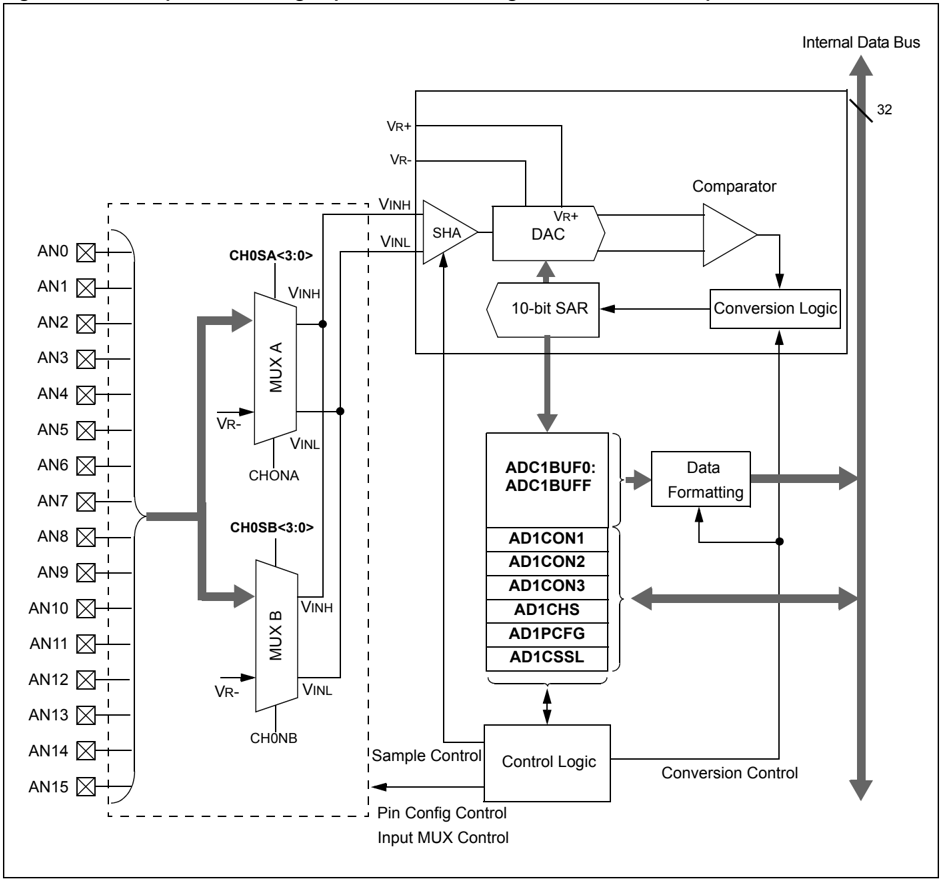

## Section 17. 10-bit Analog-to-Digital Converter (ADC)

Figure 17-6: Simplified 10-bit High-Speed ADC Block Diagram for Scan Mode

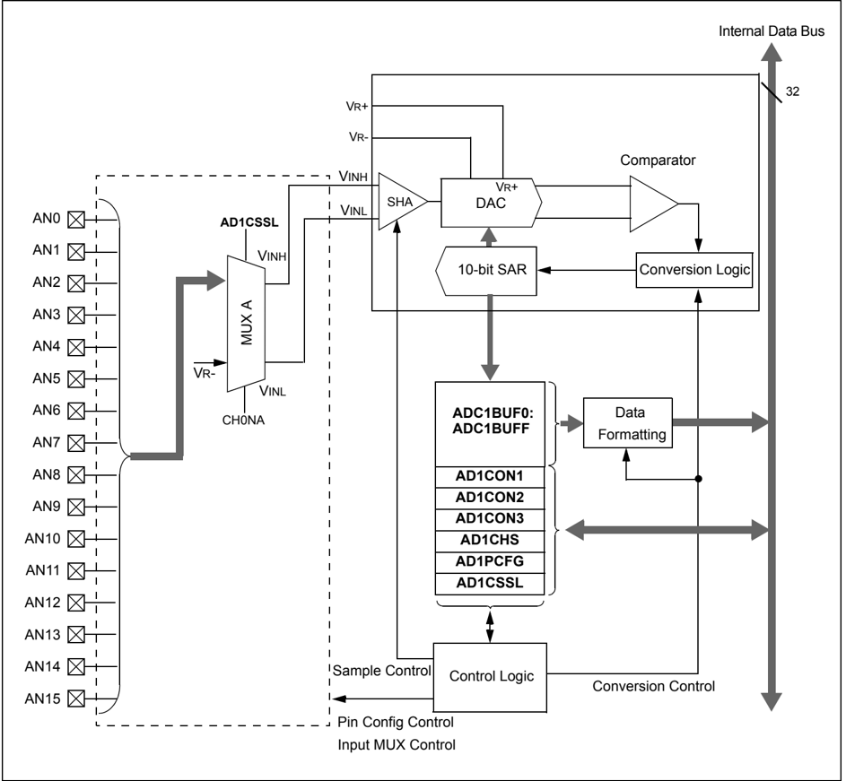

17

Figure 17-7: Simplified 10-bit High-Speed ADC Block Diagram for Alternate Sample and Scan Mode

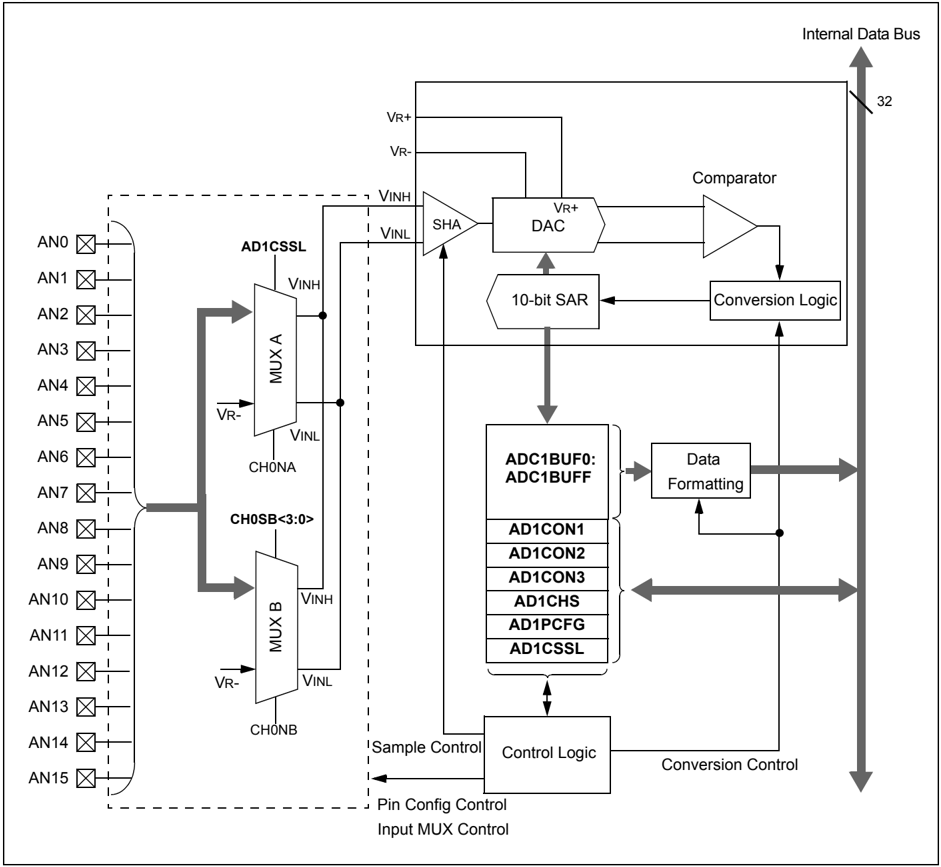

## 17.5.7 Conversion Sequence Examples

The following configuration examples show the ADC operation in different sampling and buffering configurations.  In  each  example,  setting  the  ASAM  bit  (AD1CON2&lt;1&gt;)  starts  automatic sampling. A conversion trigger ends sampling and starts conversion.

## 17.5.8 Manual Conversion Control

When the SSRC&lt;2:0&gt; bits (AD1CON1&lt;7:5&gt;) = 000 ,  the  conversion trigger is under software control. Clearing the SAMP bit (AD1CON1&lt;1&gt;) starts the conversion sequence.

Figure 17-8 is an example where setting the SAMP bit initiates sampling and clearing the SAMP bit  terminates  sampling  and  starts  conversion.  The  user  software  must  time  the  setting  and clearing  of  the  SAMP  bit  to  ensure  adequate  acquisition  time  of  the  input  signal.  See Example 17-1 for a code example.

Figure 17-8: Converting 1 Analog Input, Manual Sample Start, Manual Conversion Start

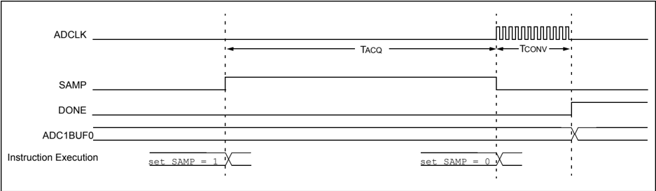

```
AD1PCFG = 0xFFFB; // PORTB = Digital; RB2 = analog AD1CON1 = 0x0000; // SAMP bit = 0 ends sampling // and starts converting AD1CHS = 0x00020000; // Connect RB2/AN2 as CH0 input // in this example RB2/AN2 is the input AD1CSSL = 0; AD1CON3 = 0x0002; // Manual Sample, TAD = internal 6 TPB AD1CON2 = 0; AD1CON1SET = 0x8000; // turn on the ADC while (1) // repeat continuously { AD1CON1SET = 0x0002; // start sampling ... DelayNmSec(100); // for 100 ms AD1CON1CLR = 0x0002; // start Converting while (!(AD1CON1 & 0x0001));// conversion done? ADCValue = ADC1BUF0; // yes then get ADC value } // repeat
```

Example 17-1: Converting 1 Channel, Manual Sample Start, Manual Conversion Start Code

17

## 17.5.9 Automatic Acquisition

Figure 17-9 is an example in which setting the ASAM bit (AD1CON1&lt;2&gt;) initiates automatic acquisition,  and  clearing  the  SAMP  bit  (AD1CON1&lt;1&gt;)  terminates  sampling  and  starts conversion. After the conversion completes, the module will automatically return to a acquisition state. The SAMP bit is automatically set at the start of the acquisition interval. The user software must time the clearing of the SAMP bit to ensure adequate acquisition time of the input signal, understanding that the time between clearing of the SAMP bit includes the conversion time as well as the acquisition time. See Example 17-2 for a code example.

Figure 17-9: Converting 1 Channel, Automatic Sample Start, Manual Conversion Start

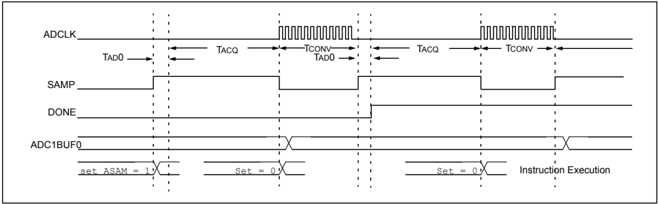

```
AD1PCFG = 0xFF7F; // all PORTB = Digital but RB7 = analog AD1CON1 = 0x0004; // ASAM bit = 1 implies acquisition // starts immediately after last // conversion is done AD1CHS = 0x00070000; // Connect RB7/AN7 as CH0 input // in this example RB7/AN7 is the input AD1CSSL = 0; AD1CON3 = 0x0002; // Sample time manual, TAD = internal 6 TPB AD1CON2 = 0; AD1CON1SET = 0x8000; // turn ON the ADC while (1) // repeat continuously { DelayNmSec(100); // sample for 100 mS AD1CON1SET = 0x0002; // start Converting while (!(AD1CON1 & 0x0001));// conversion done? ADCValue = ADC1BUF0; // yes then get ADC value } // repeat
```

Example 17-2: Converting 1 Channel, Automatic Sample Start, Manual Conversion Start Code

## 17.5.10 Clocked Conversion Trigger

When the SSRC&lt;2:0&gt; bits (AD1CON1&lt;7:5&gt;) = 111 , the conversion trigger is under ADC clock control. The SAMC&lt;4:0&gt; bits (AD1CON3&lt;4:0&gt;) select the number of TAD clock cycles between the  start  of  acquisition  and  the  start  of  conversion.  This  trigger  option  provides  the  fastest conversion rates on multiple channels. After the start of acquisition, the module will count a number of TAD clocks specified by the SAMC&lt;4:0&gt; bits.

## Equation 17-10: Clocked Conversion Trigger Time

<!-- formula-not-decoded -->

SAMC must always be programmed for at least one clock cycle. See Example 17-3 for a code example.

Figure 17-10: Converting 1 Channel, Manual Sample Start, TAD Based Conversion Start

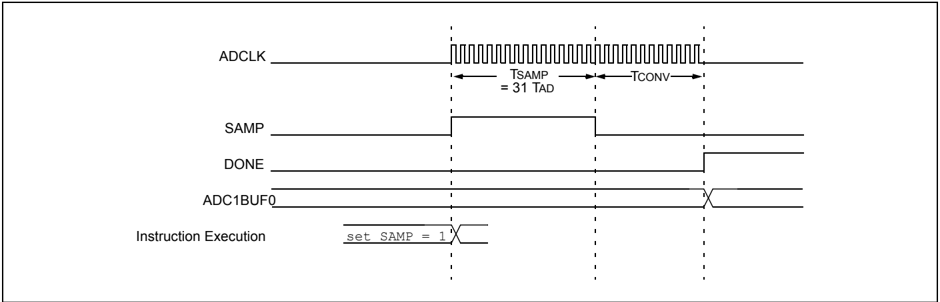

```
AD1PCFG = 0xEFFF; // all PORTB = Digital; RB12 = analog AD1CON1 = 0x00E0; // SSRC bit = 111 implies internal // counter ends sampling and starts converting AD1CHS = 0x000C0000; // Connect RB12/AN12 as CH0 input // in this example RB12/AN12 is the input AD1CSSL = 0; AD1CON3 = 0x1F02; // Sample time = 31 TAD AD1CON2 = 0; AD1CON1SET = 0x8000; // turn ON the ADC while (1) // repeat continuously { AD1CON1CLR = 0x0002; // start sampling then... // after 31Tad go to conversion while (!(AD1CON1 & 0x0001)); // conversion done? ADCValue = ADC1BUF0; // yes then get ADC value } // repeat
```

Example 17-3: Converting 1 Channel, Manual Sample Start, TAD Based Conversion Start Code

17

## 17.5.11 Free Running Sample Conversion Sequence

As shown in Figure 17-11, using the Auto-Convert Conversion Trigger mode (SSRC&lt;2:0&gt; = 111 ) in combination with the Automatic Sampling Start mode (ASAM = 1 ), allows the ADC module to schedule acquisition/conversion sequences with no intervention by the user or other device resources. This 'Clocked' mode allows continuous data collection after module initialization. See Example 17-4 for a code example.

Figure 17-11: Converting 1 Channel, Two Times, Auto-Sample Start, TAD Based Conversion Start

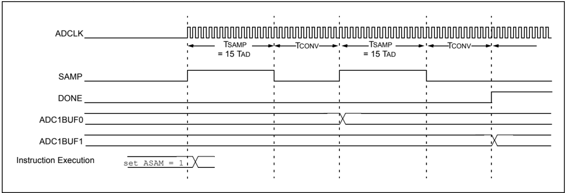

```
AD1PCFG = 0xFFFB; // all PORTB = Digital; RB2 = analog AD1CON1 = 0x00E0; // SSRC bit = 111 implies internal // counter ends sampling and starts // converting AD1CHS = 0x00020000; // Connect RB2/AN2 as CH0 input // in this example RB2/AN2 is the input AD1CSSL = 0; AD1CON3 = 0x0F00; // Sample time = 15 TAD AD1CON2 = 0x0004; // Interrupt after every 2 samples AD1CON1SET = 0x8000; // turn ON the ADC while (1) // repeat continuously { ADCValue = 0; // clear value ADC16Ptr = &ADC1BUF0; // initialize ADC1BUF0 pointer IFS1CLR = 0x0002; // clear ADC interrupt flag AD1CON1SET = 0x0004; // auto start sampling // for 31 TAD, and then go to conversion while (!IFS1 & 0x0002); // conversion done? AD1CON1CLR = 0x0004; // yes, stop sample/convert for (count = 0; count < 2; count++)// average the two ADC values { ADCValue = ADCValue + *(ADC16Ptr++); ADCValue = ADCValue >> 1; } // repeat }
```

Example 17-4: Converting 1 Channel, Auto-Sample Start, TAD Based Conversion Start Code

## 17.5.12 Acquisition Time Considerations Using Clocked Conversion Trigger and Automatic Sampling

Different acquisition/conversion sequences provide different available acquisition times for the sample-and-hold channel to acquire the analog signal. The user must ensure the acquisition time exceeds the acquisition requirements, as outlined in 17.5.20 'ADC Sampling Requirements' .

Assuming that the module is set for automatic sampling and using a clocked conversion trigger, the acquisition interval is determined by the SAMC&lt;4:0&gt; bits (AD1CON3&lt;12:8&gt;). Equation 17-11 shows the available sampling time.  Example 17-5 provides the Converting 1 Channel, Auto-Sample Start and Conversion Trigger Based Conversion Start code.

## Equation 17-11: Available Sampling Time

<!-- formula-not-decoded -->

Figure 17-12: Converting 1 Channel, Manual Sample Start, Conversion Trigger Based Conversion Start

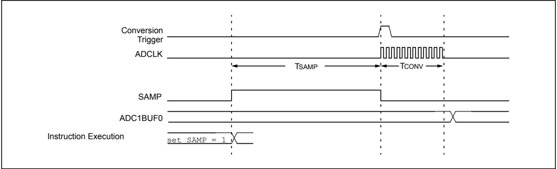

Figure 17-13: Converting 1 Channel, Auto-Sample Start, Conversion Trigger Based Conversion Start

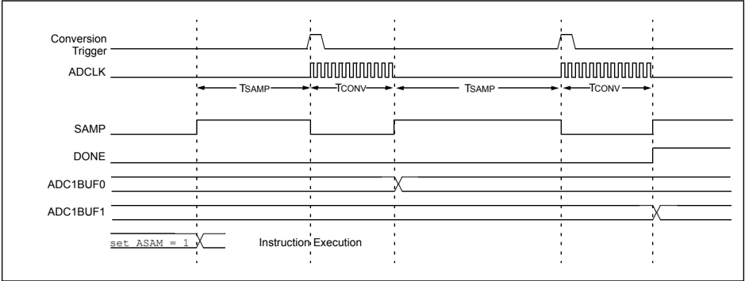

## PIC32 Family Reference Manual

## Example 17-5: Converting 1 Channel, Auto-Sample Start, Conversion Trigger Based Conversion Start Code

```
AD1PCFG = 0xFFFB; // all PORTB = Digital; RB2 analog AD1CON1 = 0x0040; // SSRC bit = 010 implies GP TMR3 // compare ends sampling and starts // converting. AD1CHS = 0x00020000; // Connect RB2/AN2 as CH0 input // in this example RB2/AN2 is the input AD1CSSL = 0; AD1CON3 = 0x0000; // Sample time is TMR3, TAD = internal TPB * 2 AD1CON2 = 0x0004; // Interrupt after 2 conversions // set TMR3 to time out every 125 ms TMR3= 0x0000; PR3= 0x3FFF; T3CON = 0x8010; AD1CON1SET = 0x8000; // turn ON the ADC AD1CON1SET = 0x0004; // start auto sampling every 125 mSecs while (1) // repeat continuously { while (!IFS1 & 0x0002){}; // conversion done? ADCValue = ADC1BUF0; // yes then get first ADC value IFS1CLR = 0x0002; // clear ADIF } // repeat
```

## Section 17. 10-bit Analog-to-Digital Converter (ADC)

## 17.5.13 Sampling a Single Channel Multiple Times

Figure 17-14 and Table 17-4 illustrate a basic configuration of the ADC module. In this case, one ADC input, AN0, will be acquired and converted. The results are stored in the ADC1BUF buffer. This process repeats 15 times until the buffer is full, and then the module generates an interrupt. The entire process repeats.

With the ALTS bit (AD1CON2&lt;0&gt;) clear, only the MUX A inputs are active. The CH0SA&lt;3:0&gt; bits (AD1CHS&lt;19:16&gt;) and CH0NA bit (AD1CHS&lt;23&gt;) are specified (AN0-VREF-) as the input to the sample/hold channel. Other input selection bits are not used.

Figure 17-14: Converting One Channel 15 Times 15 Samples Per Interrupt

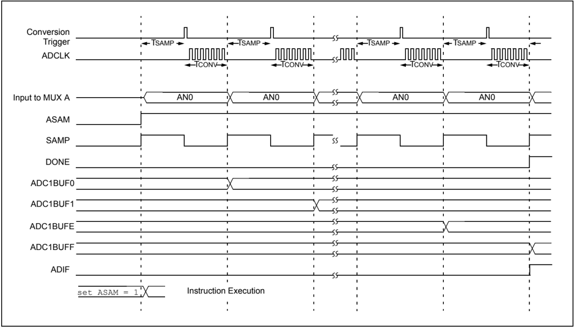

17

## PIC32 Family Reference Manual

## Table 17-4: Converting One Channel 15 Times/Interrupt

## CONTROL BITS Sequence Select

| SMPI<2:0> = 1111                       | Interrupt on 15th sample               |
|----------------------------------------|----------------------------------------|
|                                        | -                                      |
|                                        | -                                      |
| BUFM = 0                               | Single 16-word result buffer           |
| ALTS = 0 Always use MUX A input select | ALTS = 0 Always use MUX A input select |

## MUX A Input Select

| CH0SA<3:0> = 0000   | Select AN0 for CH0+ input   |
|---------------------|-----------------------------|
| CH0NA = 0           | Select VR- for CH0- input   |
| CSCNA = 0           | No input scan               |
| CSSL<15:0> = n/a    | Scan input select unused    |
|                     | -                           |
|                     | -                           |

## MUX B Input Select

| CH0SB<3:0> = n/a   | Mux B positive input unused   |
|--------------------|-------------------------------|
| CH0NB = n/a        | Mux B negative input unused   |
|                    | -                             |
|                    | -                             |

| Buffer   | Buffer @      |
|----------|---------------|
| Address  | 1st Interrupt |
| ADC1BUF0 | AN0 sample 1  |
| ADC1BUF1 | AN0 sample 2  |
| ADC1BUF2 | AN0 sample 3  |
| ADC1BUF3 | AN0 sample 4  |
| ADC1BUF4 | AN0 sample 5  |
| ADC1BUF5 | AN0 sample 6  |
| ADC1BUF6 | AN0 sample 7  |
| ADC1BUF7 | AN0 sample 8  |
| ADC1BUF8 | AN0 sample 9  |
| ADC1BUF9 | AN0 sample 10 |
| ADC1BUFA | AN0 sample 11 |
| ADC1BUFB | AN0 sample 12 |
| ADC1BUFC | AN0 sample 13 |
| ADC1BUFD | AN0 sample 14 |
| ADC1BUFE | AN0 sample 15 |
| ADC1BUFF |               |

## OPERATION SEQUENCE

| Sample MUX A Inputs: AN0   |
|----------------------------|
| Convert, Write Buffer 0x0  |
| Sample MUX A Inputs: AN0   |
| Convert, Write             |
| Sample MUX A Inputs: AN0   |
| Convert, Write Buffer 0x2  |
| Sample MUX A Inputs: AN0   |
| Convert, Write Buffer 0x3  |
| Sample MUX A Inputs: AN0   |
| Convert, Write Buffer 0x4  |
| Sample MUX A Inputs: AN0   |
| Convert, Write Buffer 0x5  |
| Sample MUX A Inputs: AN0   |
| Convert, Write Buffer 0x6  |
| Sample MUX A Inputs: AN0   |
| Convert, Write Buffer 0x7  |
| Sample MUX A Inputs: AN0   |
| Convert, Write Buffer 0x8  |
| Sample MUX A Inputs: AN0   |
| Convert, Write Buffer 0x9  |
| Sample MUX A Inputs: AN0   |
| Convert, Write Buffer 0xA  |
| Convert, Write Buffer 0xB  |
| AN0                        |
| Sample MUX A Inputs:       |
| Convert, Write Buffer 0xC  |
| Sample MUX A Inputs: AN0   |
| Convert, Write Buffer 0xD  |
| Sample MUX A Inputs: AN0   |
| Convert, Write Buffer 0xE  |

## Buffer @ 2nd Interrupt

| AN0 sample 16   |
|-----------------|
| AN0 sample 17   |
| AN0 sample 18   |
| AN0 sample 19   |
| AN0 sample 20   |
| AN0 sample 21   |
| AN0 sample 22   |
| AN0 sample 23   |
| AN0 sample 24   |
| AN0 sample 25   |
| AN0 sample 26   |
| AN0 sample 27   |
| AN0 sample 28   |
| AN0 sample 29   |
| AN0 sample 30   |

·

·

·

## Section 17. 10-bit Analog-to-Digital Converter (ADC)

## 17.5.14 Example: Analog-to-Digital Conversions While Scanning Through Analog Inputs

Figure 17-15 and Table 17-5 illustrate a typical setup where all available analog input channels are sampled and converted. Setting the CSCNA bit (AD1CON2&lt;10&gt;) specifies scanning of the ADC inputs. Other conditions are similar to the previous example, (see 17.5.13 'Sampling a Single Channel Multiple Times' ).

Initially, the AN0 input is acquired and converted. The result is stored in the ADC1BUF buffer. Then the AN1 input is acquired and converted. This process of scanning the inputs repeats 16 times until the buffer is full and then the module generates an interrupt. Then, the entire process repeats.

Figure 17-15: Scanning Through 16 Inputs 16 Samples Per Interrupt

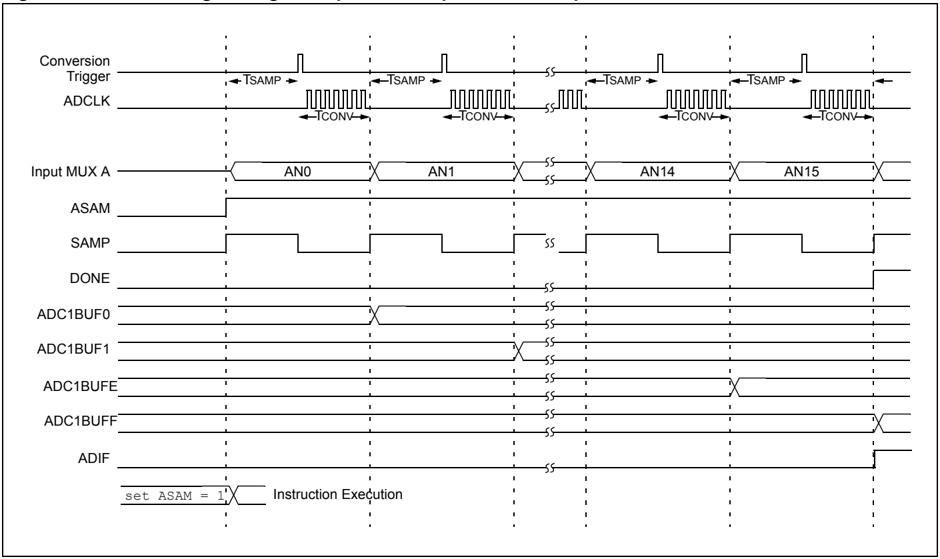

## PIC32 Family Reference Manual

## Table 17-5: Scanning Through 16 Inputs/Interrupt

## CONTROL BITS Sequence Select

| SMPI<2:0> = 1111   | Interrupt on 16th sample      |
|--------------------|-------------------------------|
|                    | -                             |
|                    | -                             |
| BUFM = 0           | Single 16-word result buffer  |
| ALTS = 0           | Always use MUX A input select |

## MUX A Input Select

| CH0SA<3:0> = n/a Overridden by CSCNA          | CH0SA<3:0> = n/a Overridden by CSCNA          | CH0SA<3:0> = n/a Overridden by CSCNA          |
|-----------------------------------------------|-----------------------------------------------|-----------------------------------------------|
| CH0NA = 0 Select VR- for MUX A negative input | CH0NA = 0 Select VR- for MUX A negative input | CH0NA = 0 Select VR- for MUX A negative input |
| CSCNA = 1                                     | CSCNA = 1                                     | CSCNA = 1                                     |
| CSSL<15:0> = 1111                             | 1111                                          | 1111 Scan input select                        |
|                                               | -                                             |                                               |
|                                               | -                                             |                                               |

## MUX B Input Select

| SB<3:0> = n/a   | MUX B positive input unused   |
|-----------------|-------------------------------|
| CH0NB = n/a     | MUX B negative input unused   |
|                 | -                             |
|                 | -                             |

| Buffer   | Buffer @       |
|----------|----------------|
| Address  | 1st Interrupt  |
| ADC1BUF0 | AN0 sample 1   |
| ADC1BUF1 | AN1 sample 2   |
| ADC1BUF2 | AN2 sample 3   |
| ADC1BUF3 | AN3 sample 4   |
| ADC1BUF4 | AN4 sample 5   |
| ADC1BUF5 | AN5 sample 6   |
| ADC1BUF6 | AN6 sample 7   |
| ADC1BUF7 | AN7 sample 8   |
| ADC1BUF8 | AN8 sample 9   |
| ADC1BUF9 | AN9 sample 10  |
| ADC1BUFA | AN10 sample 11 |
| ADC1BUFB | AN11 sample 12 |
| ADC1BUFC | AN12 sample 13 |
| ADC1BUFD | AN13 sample 14 |
| ADC1BUFE | AN14 sample 15 |
| ADC1BUFF | AN15 sample 16 |

## OPERATION SEQUENCE

| Sample MUX A Inputs: AN0                           |
|----------------------------------------------------|
| Convert, Write Buffer 0x0                          |
| Sample MUX A Inputs: AN1                           |
| Convert, Write Buffer 0x1                          |
| Sample MUX A Inputs: AN2                           |
| Convert, Write Buffer 0x2                          |
| Sample MUX A Inputs: AN3                           |
| Convert, Write Buffer 0x3                          |
| Sample MUX A Inputs: AN4                           |
| Convert, Write Buffer 0x4                          |
| Sample MUX A Inputs: AN5                           |
| Convert, Write Buffer 0x5                          |
| Sample MUX A Inputs: AN6                           |
| Convert, Write Buffer 0x6                          |
| Sample MUX A Inputs: AN7                           |
| Convert, Write Buffer 0x7 Sample MUX A Inputs: AN8 |
| Convert, Write Buffer 0x8                          |
| Sample MUX A Inputs: AN9                           |
| Convert, Write Buffer 0x9                          |
| Sample MUX A Inputs: AN10                          |
| Convert, Write Buffer 0xA                          |
| Sample MUX A Inputs: AN11                          |
| Convert, Write Buffer 0xB                          |
| Sample MUX A Inputs: AN12                          |
| Convert, Write Buffer 0xC                          |
| Convert, Write Buffer 0xD                          |
| Convert, Write Buffer 0xE                          |
| Sample MUX A Inputs: AN15                          |
| Convert, Write Buffer 0xF                          |
| Interrupt                                          |
| Repeat                                             |

## Buffer @ 2nd Interrupt

| AN0 sample 17   |
|-----------------|
| AN1 sample 18   |
| AN2 sample 19   |
| AN3 sample 20   |
| AN4 sample 21   |
| AN5 sample 22   |
| AN6 sample 23   |
| AN7 sample 24   |
| AN8 sample 25   |
| AN9 sample 26   |
| AN10 sample 27  |
| AN11 sample 28  |
| AN12 sample 29  |
| AN13 sample 30  |
| AN14 sample 31  |
| AN15 sample 32  |

·

·

·

## Section 17. 10-bit Analog-to-Digital Converter (ADC)

## 17.5.15 Example: Using Dual 8-Word Buffers

Figure 17-16 and Table 17-6 demonstrate using dual 8-word buffers and alternating the buffer fill. Setting the BUFM bit (AD1CON2&lt;1&gt;) enables dual 8-word buffers. The BUFM bit setting does not affect other operational parameters. First, the conversion sequence starts filling the buffer at ADC1BUF0 (buffer location  0 x 0).  After  the  first  interrupt  occurs,  the  buffer  begins  to  fill  at ADC1BUF8 (buffer location 0 x 8). The BUFS Status bit (AD1CON2&lt;7&gt;) is alternately set and cleared after each interrupt to show which buffer is being filled. In this example, three analog inputs are sampled and an interrupt occurs after every third sample.

Figure 17-16: Converting Three Inputs, Three Samples Per Interrupt Using Dual 8-Word Buffers

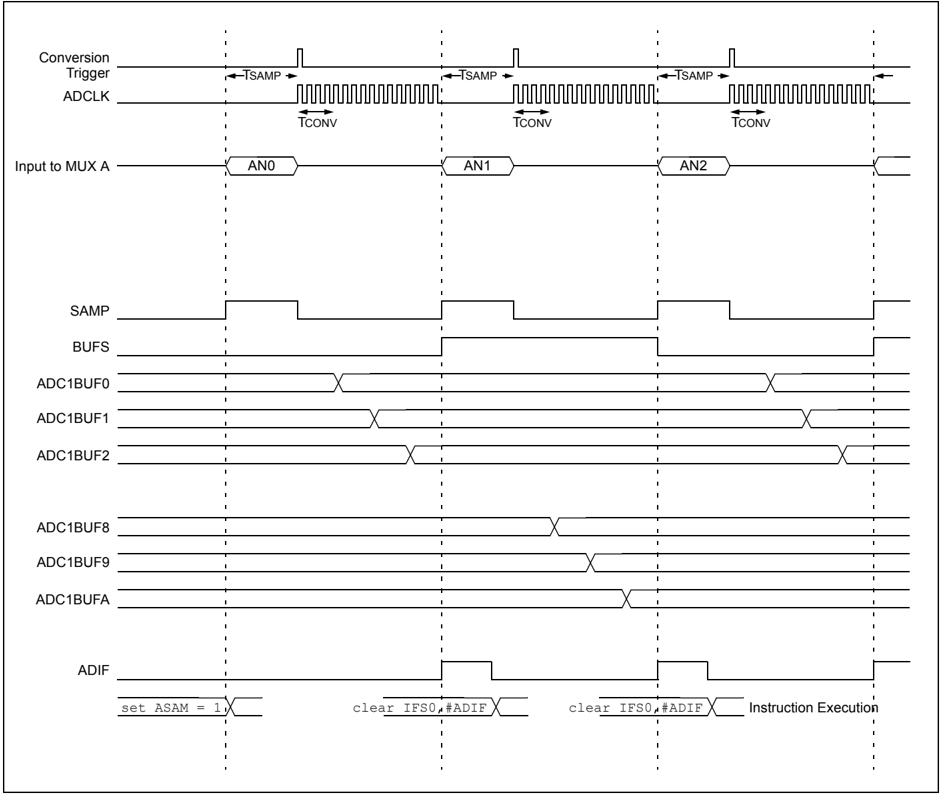

17

## PIC32 Family Reference Manual

Table 17-6: Converting Three Inputs, Three Samples/Interrupt Using Dual 8-Word Buffers

## CONTROL BITS Sequence Select

| SMPI<2:0> = 0010   | Interrupt after every third sample   |
|--------------------|--------------------------------------|
|                    | -                                    |
|                    | -                                    |
| BUFM = 1           | Dual 8-word result buffers           |
| ALTS = 0           | Always use MUX A                     |

## MUX A Input Select

| CH0SA<3:0> = n/a MUX A positive input select is not used                  |
|---------------------------------------------------------------------------|
| CH0NA = 0 Select VR- for MUX A negative input                             |
| CSCNA = 1 Enable input scan                                               |
| CSSL<15:0> = 0x0007 Scan input select scan list consisting of AN0, AN1,   |
| and AN2 AD1PCFG = 0X0007 Select Analog Input mode for AN0, AN1, and AN2 - |

## MUX B Input Select

| CH0SB<3:0> = n/a   | MUX B positive input unused   |
|--------------------|-------------------------------|
| CH0NB = n/a        | MUX B negative input unused   |
|                    | -                             |
|                    | -                             |

| Buffer   | Buffer @      |
|----------|---------------|
| Address  | 1st Interrupt |
| ADC1BUF0 | AN0 sample 1  |
| ADC1BUF1 | AN1 sample 1  |
| ADC1BUF2 | AN2 sample 1  |
| ADC1BUF3 |               |
| ADC1BUF4 |               |
| ADC1BUF5 |               |
| ADC1BUF6 |               |
| ADC1BUF7 |               |
| ADC1BUF8 |               |
| ADC1BUF9 |               |
| ADC1BUFA |               |
| ADC1BUFB |               |
| ADC1BUFC |               |
| ADC1BUFD |               |
| ADC1BUFE |               |
| ADC1BUFF |               |

## OPERATION SEQUENCE

| Sample MUX A Inputs: AN0      |
|-------------------------------|
| Convert AN0, Write Buffer 0x0 |
| Sample MUX A Inputs: AN1      |
| Convert AN1, Write Buffer 0x1 |
| Sample MUX A Inputs: AN2      |
| Convert AN2, Write Buffer 0x2 |
| Interrupt; Change Buffer      |
| Sample MUX A Inputs: AN0      |
| Convert AN0, Write Buffer 0x8 |
| Sample MUX A Inputs: AN1      |
| Convert AN1, Write Buffer 0x9 |
| Sample MUX A Inputs: AN2      |
| Convert AN2, Write Buffer 0xA |
| Repeat                        |

## Buffer @ 2nd Interrupt

AN0 sample 2

AN1 sample 2

AN2 sample 2

·

·

·

## Section 17. 10-bit Analog-to-Digital Converter (ADC)

## 17.5.16 Example: Using Alternating MUX A and MUX B Input Selections

Figure 17-17 and Table 17-7 demonstrate alternating sampling of the inputs assigned to MUX A and MUX B. Setting the ALTS (AD1CON2&lt;0&gt;) bit enables alternating input selections. The first sample  uses  the  MUX  A  inputs  specified  by  the  CH0SA  (AD1CHS&lt;19:16&gt;)  and  CH0NA (AD1CHS&lt;23&gt;)  bits.  The  next  sample  uses  the  MUX  B  inputs  specified  by  the  CH0SB (AD1CHS&lt;27:24&gt;) and CH0NB (AD1CHS&lt;31&gt;) bits.

In the following example, one of the MUX B input specifications uses two analog inputs as a differential source to the sample/hold.

This example also demonstrates use of the dual 8-word buffers. An interrupt occurs after every fourth sample, which results in filling 4 words into the buffer on each interrupt.

Figure 17-17: Converting Two Analog Inputs by Alternating with Four Samples Per Interrupt

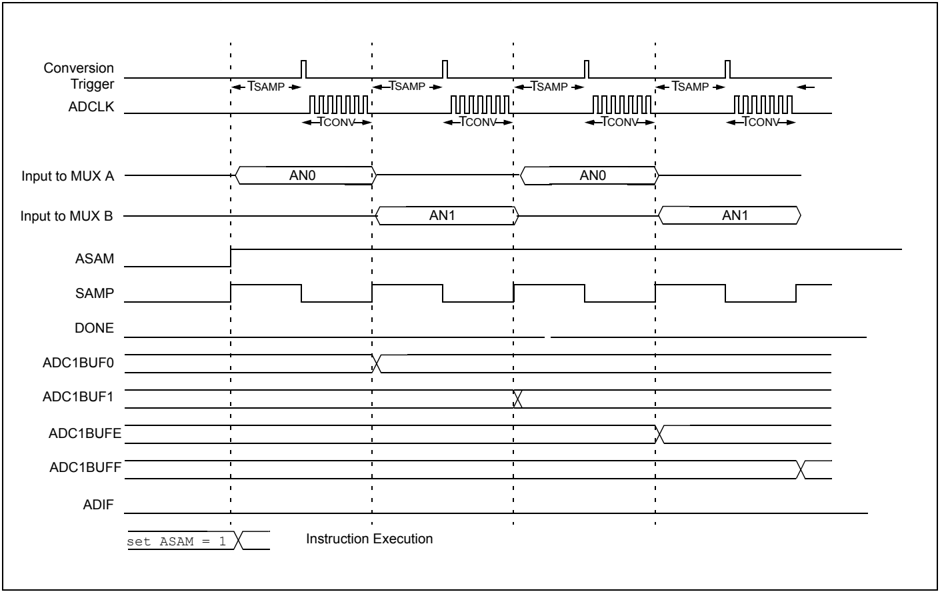

17

## PIC32 Family Reference Manual

Table 17-7: Converting Two Sets of Inputs Using Alternating Input Selections

## CONTROL BITS Sequence Select

| SMPI<2:0> = 0011   | Interrupt on 4th sample        |
|--------------------|--------------------------------|
|                    | -                              |
|                    | -                              |
| BUFM = 1           | Dual 8-word result buffers     |
| ALTS = 1           | Alternate MUX A/B input select |

## MUX A Input Select

| CH0SA<3:0> = 0000                             |
|-----------------------------------------------|
| CH0NA = 0 Select VR- for MUX A negative input |
| CSCNA = 0 No input scan                       |
| CSSL<15:0> = n/a Scan input select unused     |
| -                                             |

## MUX B Input Select

| CH0SB<3:0> = 0001 Select AN1 for MUX B positive input   |
|---------------------------------------------------------|
| CH0NB = 0                                               |
| -                                                       |
| -                                                       |

| Buffer   | Buffer @      |
|----------|---------------|
| Address  | 1st Interrupt |
| ADC1BUF0 | AN0 sample 1  |
| ADC1BUF1 | AN1 sample 1  |
| ADC1BUF2 | AN0 sample 2  |
| ADC1BUF3 | AN1 sample 2  |
| ADC1BUF4 |               |
| ADC1BUF5 |               |
| ADC1BUF6 |               |
| ADC1BUF7 |               |
| ADC1BUF8 |               |
| ADC1BUF9 |               |
| ADC1BUFA |               |
| ADC1BUFB |               |
| ADC1BUFC |               |
| ADC1BUFD |               |
| ADC1BUFE |               |
| ADC1BUFF |               |

## OPERATION SEQUENCE

| Sample MUX A Inputs: AN0   |
|----------------------------|
| Convert, Write Buffer 0x0  |
| Sample MUX B Inputs: AN1   |
| Convert, Write Buffer 0x1  |
| Sample MUX A Inputs: AN0   |
| Convert, Write Buffer 0x2  |
| Sample MUX B Inputs: AN1   |
| Convert, Write Buffer 0x3  |
| Interrupt; Change Buffer   |
| Sample MUX A Inputs: AN0   |
| Convert, Write Buffer 0x8  |
| Convert, Write Buffer 0x9  |
| Convert, Write Buffer 0xA  |
| Sample MUX B Inputs: AN1   |
| Convert, Write Buffer 0xB  |
| Interrupt; Change Buffer   |
| Repeat                     |

Buffer @

2nd Interrupt

AN0 sample 3

AN1 sample 3

AN0 sample 4

AN1 sample 4

·

·

·

## 17.5.17 Example: Converting Three Analog Inputs Using Alternating Sample Mode and a Scan List

Figure 17-18, Figure 17-19, and Table 17-8 demonstrate sampling by scanning through inputs and alternating between MUX A and MUX B. When the Alternating Sample mode is selected, the first input to be sampled will be the input selected for MUX A, the second sample will be the input selected for MUX B. Then the process repeats. When scanning is combined with Alternating Input mode, the positive input to MUX A is selected by the contents of the AD1CSSL register, not the CH0SA&lt;3:0&gt; bits (AD1CHS&lt;19:16&gt;). For each sample that MUX A is selected the next item in the scan list is sampled. The positive input to MUX B is selected by the CH0SB&lt;3:0&gt; bits (AD1CHS&lt;27:24&gt;).

When  the  ASAM  bit  (AD1CON1&lt;2&gt;)  is  clear,  sampling  will  not  resume  after  conversion completion, but will occur when setting the SAMP bit (AD1CON1&lt;1&gt;).

Figure 17-18: Converting Three Analog Inputs Using Alternating Sample Mode and a Scan List


## PIC32 Family Reference Manual

Figure 17-19: 10-bit High-Speed ADC Block Diagram for Alternating Sample and Scan

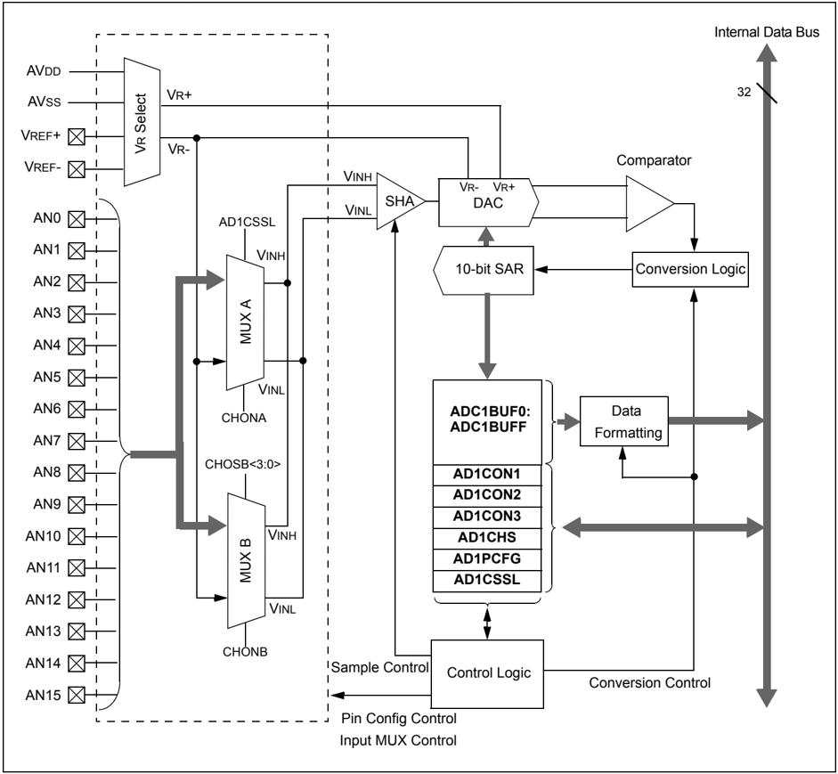

## Section 17. 10-bit Analog-to-Digital Converter (ADC)

Table 17-8: Sampling Eight Inputs Using Sequential Sampling

## CONTROL BITS

## Sequence Select

| SMPI<2:0> = 0011   | Interrupt on 4th sample        |
|--------------------|--------------------------------|
| BUFM = 0           | Single 16-word result buffer   |
| ALTS = 1           | Alternate MUX A/B input select |

## MUX A Input Select

| CH0SA<3:0> = n/a                                                       |
|------------------------------------------------------------------------|
| CH0NA = 0 Select VR- for CH0- input                                    |
| CSCNA = 1 Enable input scan                                            |
| CSSL<15:0> = n/a Scan input select scan list consisting of AN0 and AN1 |
| -                                                                      |
| -                                                                      |

## MUX B Input Select

| CH0SB<3:0> = 0010   | Select AN7 for CH0+ input   |
|---------------------|-----------------------------|
| CH0NB = 0           | Select VR- for CH0- input   |

| Buffer           | Buffer @ 1st Interrupt   | Buffer @ 2nd Interrupt   |
|------------------|--------------------------|--------------------------|
| Address ADC1BUF0 | AN0 sample 1             | AN0 sample 5             |
| ADC1BUF1         | AN2 sample 2             | AN2 sample 6             |
| ADC1BUF2         | AN1 sample 3             | AN1 sample 7             |
| ADC1BUF3         | AN2 sample 4             | AN2 sample 8             |
| ADC1BUF4         |                          |                          |
| ADC1BUF5         |                          |                          |
| ADC1BUF6         |                          |                          |
| ADC1BUF7         |                          |                          |
| ADC1BUF8         |                          |                          |
| ADC1BUF9         |                          |                          |
| ADC1BUFA         |                          |                          |
| ADC1BUFB         |                          |                          |
| ADC1BUFC         |                          |                          |
| ADC1BUFD         |                          |                          |
| ADC1BUFE         |                          |                          |
| ADC1BUFF         |                          |                          |

## OPERATION SEQUENCE

| Sample: AN0   |                           |
|---------------|---------------------------|
|               | Convert, Write Buffer 0x0 |
| Sample: AN2   |                           |
|               | Convert, Write Buffer 0x1 |
| Sample: AN1   |                           |
|               | Convert, Write Buffer 0x2 |
| Sample: AN2   | Convert, Write Buffer 0x3 |
|               | Interrupt                 |
| Repeat        |                           |

·

·

·

17

## 17.5.18 Transfer Function

The ideal transfer function of the ADC is shown in Figure 17-20. The difference of the input voltages, (VINH - VINL), is compared to the reference, (VR+ - VR-).

- The first code transition occurs when the input voltage is (VR+ - VR-L/2048) or 0.5 LSb
- The 00 0000 0001 code is centered at (VR+ - VR-/1024) or 1.0 LSb
- The 10 0000 0000 code is centered at (512 * (VR+ - VR-)/1024)
- An input voltage less than (1 * (VR+ - VR-L)/2048) converts as 00 0000 0000
- An input greater than (2045 * (VR+ - VR-)/2048) converts as 11 1111 1111

Figure 17-20: ADC Transfer Function

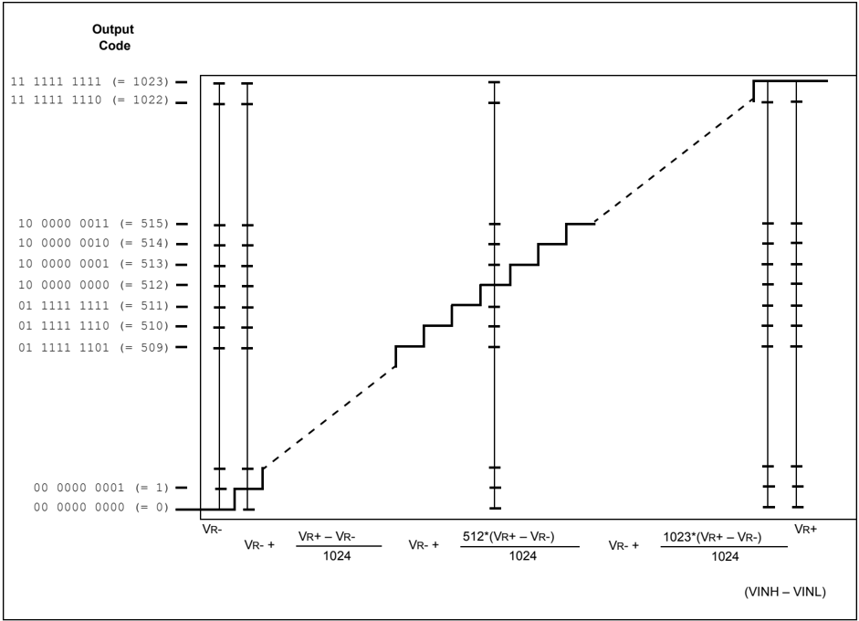

## Section 17. 10-bit Analog-to-Digital Converter (ADC)

## 17.5.19 ADC Accuracy/Error

Refer to 17.10 'Related Application Notes' for a list of documents that discuss ADC accuracy.

The following figure depicts the recommended circuit for the conversion rates above 400 ksps. A 100-pin PIC32 device package is shown as an example in Figure 17-21.

Figure 17-21: ADC Voltage Reference Schematic

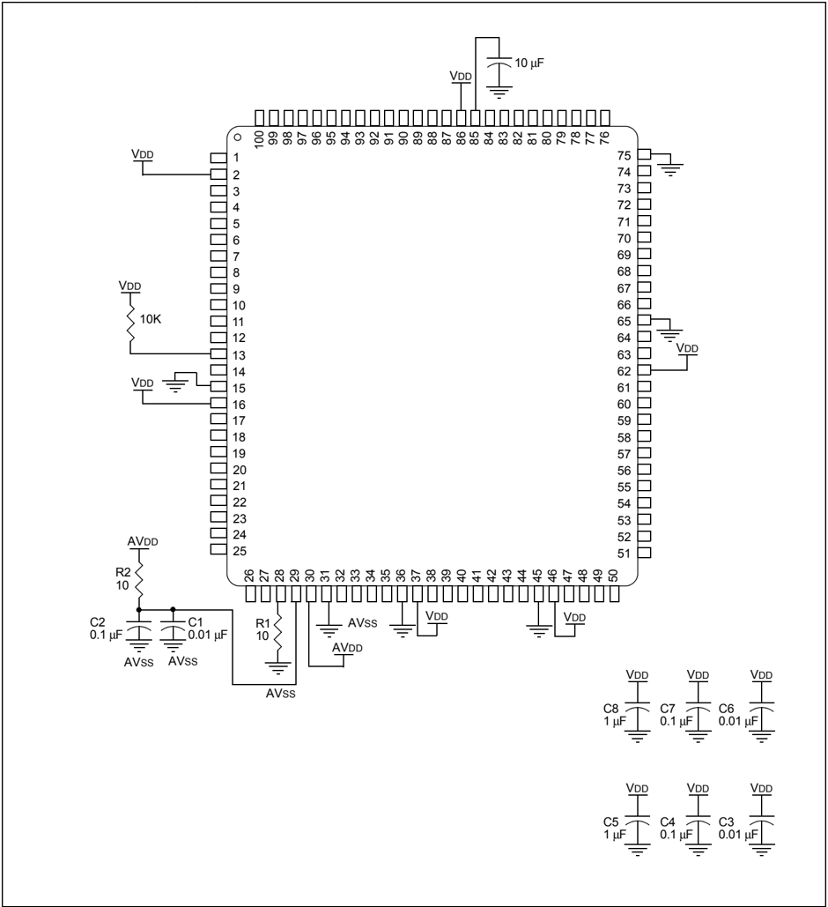

17

## 17.5.20 ADC Sampling Requirements

The analog input model of the 10-bit ADC module is shown in Figure 17-22. The total acquisition time for the analog-to-digital conversion is a function of the internal amplifier settling time and the holding capacitor charge time.

For the ADC module to meet its specified accuracy, the charge holding capacitor (CHOLD) must be allowed to fully charge to the voltage level on the analog input pin. The analog output source impedance  (RS),  the  interconnect  impedance  (RIC),  and  the  internal  sampling  switch  (RSS) impedance combine to directly affect the time required to charge the CHOLD. The combined impedance of the analog sources must therefore be small enough to fully charge the holding capacitor within the chosen sample time. After the analog input channel is selected (changed), this acquisition function must be completed prior to starting the conversion. The internal holding capacitor will be in a discharged state prior to each sample operation.

A time period of at least 1 TAD should be allowed between conversions for the acquisition time. Refer to the 'Electrical Characteristics' section  in  the  specific  device  data  sheet  for  more information.

Figure 17-22: 10-bit ADC Analog Input Model

CPIN = input capacitance

VT = threshold voltage

RSS = sampling switch resistance

RIC = interconnect resistance

RS = source resistance

CHOLD = sample/hold capacitance

ILEAKAGE = leakage current at the pin due to various junctions

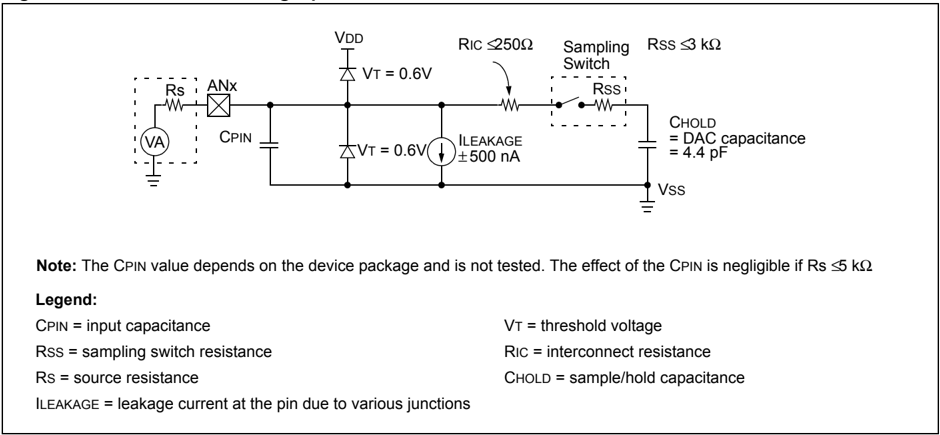

## 17.5.21 Connection Considerations

Since the analog inputs employ Electrostatic Discharge (ESD) protection, they have diodes to VDD and VSS. This requires that the analog input must be between VDD and VSS. If the input voltage exceeds this range by greater than 0.3V (in either direction), one of the diodes becomes forward-biased and it may damage the device if the input current specification is exceeded.

An external RC filter is sometimes added for anti-aliasing of the input signal. The R component should be selected to ensure that the acquisition time requirements are satisfied. Any external components connected (through high-impedance) to an analog input pin (capacitor, Zener diode, etc.) should have very little leakage current at the pin.

## 17.6 INITIALIZATION

A  simple  initialization  code  example  for  the  ADC  module  is  provided  in  Example 17-6. Example 17-7  shows  the  Converting  1  Channel  at  400  ksps,  Auto-Sample  Start  and  2  TAD Sampling Time code example.

In this particular configuration, all 16 analog input pins, AN0-AN15, are set up as analog inputs. Operation in Idle mode is disabled, output data is in unsigned fractional format, and AVDD and AVSS are used for VR+ and VR-. The start of acquisition, as well as start of conversion (conversion trigger), are performed manually in software. The Channel 0 (CH0) SHA is  used  for  conversions.  Scanning  of  inputs  is  disabled,  and  an  interrupt  occurs  after  every acquisition/convert sequence (1 conversion result). The ADC conversion clock is TPB/2.

Since  acquisition  is  started  manually  by  setting  the  SAMP  bit  (AD1CON1&lt;1&gt;)  after  each conversion is complete, the auto-sample time bits, SAMC&lt;4:0&gt; (AD1CON3&lt;12:8&gt;), are ignored. Moreover, since the start of conversion (i.e., end of acquisition) is also triggered manually, the SAMP bit needs to be cleared each time a new sample needs to be converted.

```
AD1PCFG = 0x0000; /* Configure ADC port all input pins are analog */ AD1CON1 = 0x2208; /* Configure sample clock source and Conversion Trigger mode. Unsigned Fractional format, Manual conversion trigger, Manual start of sampling, Simultaneous sampling, No operation in IDLE mode.  */ AD1CON2 = 0x0000; /* Configure ADC voltage reference and buffer fill modes. VREF from AVDD and AVSS, Inputs are not scanned, Interrupt every sample */ AD1CON3 = 0x0000; /* Configure ADC conversion clock */ AD1CHS = 0x0000; /* Configure input channels, CH0+ input is AN0. CHO- input is VREFL (AVss) AD1CSSL = 0x0000; /* No inputs are scanned. Note: Contents of AD1CSSL are ignored when CSCNA = 0 */ IFS1CLR = 2; /*Clear ADC conversion interrupt*/ // Configure ADC interrupt priority bits (AD1IP<2:0>) here, if // required. (default priority level is 4) IEC1SET = 2; /* Enable ADC conversion interrupt*/ AD1CON1SET = 0x8000; /* Turn on the ADC module */ AD1CON1SET = 0x0002; /* Start sampling the input */ DelayNmSec(100); /* Ensure the correct sampling time has elapsed before starting a conversion.*/ AD1CON1CLR = 0x0002; /* End Sampling and start Conversion*/ : /* The DONE bit is set by hardware when the convert sequence is finished. */ : /* The ADIF bit will be set. */
```

Example 17-6: ADC Initialization Code Example

## PIC32 Family Reference Manual

## Example 17-7: Converting 1 Channel at 400 ksps, Auto-Sample Start, 2 TAD Sampling Time Code Example

```
AD1PCFG = 0xFFFB; // all PORTB = Digital; RB2 = analog AD1CON1 = 0x00E0; // SSRC bit = 111 implies internal // counter ends sampling and starts // converting. AD1CHS = 0x00020000; // Connect RB2/AN2 as CH0 input // in this example RB2/AN2 is the input AD1CSSL = 0; AD1CON3 = 0x0203; // Sample time = 2 TAD AD1CON2 = 0x6004; // Select external VREF+ and VREF- pins // Interrupt after every 2 samples AD1CON1bits.ADON = 1; // turn ON the ADC while (1) // repeat continuously { ADCValue = 0; // clear value ADC16Ptr = &ADC1BUF0; // initialize ADC1BUF0 pointer IF1bits.AD1IF = 0; // clear ADC interrupt flag AD1CON1bits.ASAM = 1; // auto start sampling // for 31 TAD, and then go to conversion while (!IFS0bits.ADIF); // conversion done? AD1CON1bits.ASAM = 0; // yes, stop sample/convert for (count = 0; count <2; count++) { // average the two ADCValue = ADCValue + *ADC16Ptr++; ADCValue = ADCValue >> 1; } } // repeat
```

## 17.7 INTERRUPTS

The  ADC  module  has  a  dedicated  interrupt  bit,  AD1IF  bit  (IFS1&lt;1&gt;),  and  a  corresponding interrupt enable/mask bit, AD1IE bit (IEC&lt;1&gt;). These bits are used to determine the source of an interrupt and to enable or disable an individual interrupt source. The priority level of each of the channels can also be set independently of the other channels.

The  AD1IF  bit  (IFS1&lt;1&gt;)  is  set  when  the  condition  set  by  the  Samples  Per  Interrupt  bit, SMPI&lt;3:0&gt; bits (AD1CON2&lt;5:2&gt;), is met. The AD1IF bit (IFS1&lt;1&gt;) will then be set without regard to the state of the corresponding AD1IE bit (IEC&lt;1&gt;). The AD1IF bit (IFS1&lt;1&gt;) can be polled by software if desired.

The AD1IE bit (IEC&lt;1&gt;) controls the interrupt generation. If the AD1xIE bit is set, the CPU will be interrupted whenever an event defined by SMPI&lt;3:0&gt; occurs and the corresponding AD1IF bit (IFS1&lt;1&gt;) will be set (subject to the priority and sub priority as outlined below).

It is the responsibility of the routine that services a particular interrupt to clear the appropriate Interrupt Flag bit before the service routine is complete.

The  priority  of  the  ADC  interrupt  can  be  set  independently  through  the  AD1IP&lt;2:0&gt;  bits (IPC6&lt;28:26&gt;). This priority defines the priority group that interrupt source will be assigned to. The priority groups range from a value of 7, the highest priority, to a value of 0, which does not generate an interrupt. An interrupt being serviced will be preempted by an interrupt in a higher priority group.

The subpriority bits allow setting the priority of a interrupt source within a priority group. The values of the subpriority, AD1IS&lt;1:0&gt; bits (IPC6&lt;25:24&gt;), range from 3, the highest priority, to 0 the lowest priority. An interrupt with the same priority group but having a higher subpriority value will preempt a lower subpriority interrupt that is in progress.

The priority group and subpriority bits allow more than one interrupt source to share the same priority and subpriority. If simultaneous interrupts occur in this configuration the natural order of the  interrupt  sources  within  a  priority/subgroup  pair  determine  the  interrupt  generated.  The natural priority is based on the vector numbers of the interrupt sources. The lower the vector number the higher the natural priority of the interrupt. Any interrupts that were overridden by natural  order  will  then  generate  their  respective  interrupts  based  on  priority,  subpriority,  and natural order after the interrupt flag for the current interrupt is cleared.

After an enabled interrupt is generated, the CPU will jump to the vector assigned to that interrupt. The vector number for the interrupt is the same as the natural order number. The IRQ number is not always the same as the vector number due to some interrupts sharing a single vector. The CPU will then begin executing code at the vector address. The users code at this vector address should perform an operations required, such as reloading the duty cycle, clear the interrupt flag, and then exit. Refer to Section 8. 'Interrupts' (DS61108) for vector address table details and for more information on interrupts. Example 17-8 shows a code example of the ADC interrupt configuration.

```
IPS6SET = 0x0014; // Set Priority to 5 IPS6SET = 0x0003; // Set Sub Priority to 3 // IFS1CLR = 0x0002; // Ensure the interrupt flag is clear IEC1SET = 0x0002; // Enable ADC interrupts
```

Example 17-8: ADC Interrupt Configuration Code Example

Note:

Some PIC32 devices feature persistent interrupts. On such devices, clearing the AD1IF flag bit will not have any effect unless ADC1BUFx register is read. Refer to the specific device data sheet and Section 8. 'Interrupts' (DS61108) for more information.

## 17.8 OPERATION DURING SLEEP AND IDLE MODES

Sleep and Idle modes are useful for minimizing conversion noise because the digital activity of the CPU, buses and other peripherals is minimized.

## 17.8.1 CPU Sleep Mode Without RC ADC Clock

When the device enters Sleep mode, all clock sources to the module are shut down and stay at logic ' 0 '.

If Sleep occurs in the middle of a conversion, the conversion is aborted unless the ADC module is  clocked  from  its  internal  RC  clock  generator.  The  converter  will  not  resume  a  partially completed conversion on exiting from Sleep mode.

ADC register contents are not affected by the device entering or leaving Sleep mode.

## 17.8.2 CPU Sleep Mode With RC ADC Clock

The ADC module can operate during Sleep mode if the ADC clock source is set to the internal RC oscillator (ADRC bit (AD1CON3&lt;15&gt;) = 1 ). This reduces the digital switching noise from the conversion. When the conversion is completed, the DONE bit (AD1CON1&lt;0&gt;) will be set and the result loaded into the ADC result buffer, ADC1BUFx.

If the ADC interrupt is enabled (AD1IE bit (IEC&lt;1&gt;) = 1 ), the device will wake up from Sleep when the ADC interrupt occurs. Program execution will resume at the ADC Interrupt Service Routine (ISR), if the ADC interrupt is greater than the current CPU priority. Otherwise, execution will continue from the instruction after the WAIT instruction that placed the device in Sleep mode.

If the ADC interrupt is not enabled, the ADC module will then be disabled, although the ON bit (AD1CON1&lt;15&gt;) will remain set.

To minimize the effects of digital noise on the ADC module operation, the user should select a conversion trigger source that ensures the analog-to-digital conversion will take place in Sleep mode. The automatic conversion trigger option can be used for sampling and conversion in Sleep (SSRC&lt;2:0&gt; bits (AD1CON1&lt;7:5&gt;) = 111 ). To use the automatic conversion option, the ADC ON bit should be set in the instruction prior to the WAIT instruction.

Note: For the ADC module to operate in Sleep mode, the ADC clock source must be set to the internal RC oscillator (ADRC = 1 ).

## 17.8.3 ADC Operation During CPU IDLE Mode

For the ADC, the SIDL bit (AD1CON1&lt;13&gt;) specifies whether the module will stop on Idle or continue on Idle. If the SIDL bit = 0 , the ADC module will continue normal operation when the device enters Idle mode. If the ADC interrupt is enabled (AD1IE bit = 1 ), the device will wake up from Idle mode when the ADC interrupt occurs. Program execution will resume at the ADC ISR, if the ADC interrupt is greater than the current CPU priority. Otherwise, execution will continue from the instruction after the WAIT instruction that placed the device in Idle mode.

If the SIDL bit = 1 , the ADC module will stop in Idle mode. If the device enters Idle mode in the middle of  a  conversion,  the  conversion  is  aborted.  The  converter  will  not  resume  a  partially completed conversion on exiting from Idle mode.

## 17.9 EFFECTS OF VARIOUS RESETS

## 17.9.1 Master Clear Reset

Following a Master Clear (MCLR) reset, all of the ADC control registers (AD1CON1, AD1CON2, AD1CON3, AD1CHS, AD1PCFG, and AD1CSSL) are reset to a value of 0x00000000. This disables the ADC module and sets the analog input pins to Analog Input mode. Any conversion that was in progress will terminate and the result will not be written to the result buffer.

The values in the ADC1BUFx registers are initialized during a MCLR Reset. ADC1BUF0 through ADC1BUFF will contain 0x00000000.

## 17.9.2 Power-on Reset

Following  a  Power-on  Reset  (POR)  event,  all  of  the  ADC  control  registers  (AD1CON1, AD1CON2,  AD1CON3,  AD1CHS,  AD1PCFG  and  AD1CSSL)  are  reset  to  a  value  of 0x00000000. This disables the ADC module and sets the analog input pins to Analog Input mode.

The  values  in  the  ADC1BUFx  registers  are  initialized  during  a  POR.  ADC1BUF0  through ADC1BUFF will contain 0x00000000.

## 17.9.3 Watchdog Timer Reset

Following  a  Watchdog  Timer  (WDT)  reset,  all  of  the  ADC  control  registers  (AD1CON1, AD1CON2,  AD1CON3,  AD1CHS,  AD1PCFG  and  AD1CSSL)  are  reset  to  a  value  of 0x00000000. This disables the ADC module and sets the analog input pins to Analog Input mode. Any conversion that was in progress will terminate and the result will not be written to the result buffer.

The values in the ADC1BUFx registers are initialized after a WDT reset. ADC1BUF0 through ADC1BUFF will contain 0x00000000.

## 17.10 RELATED APPLICATION NOTES

This  section  lists  application  notes  that  are  related  to  this  section  of  the  manual.  These application notes may not be written specifically for the PIC32 device family, but the concepts are pertinent and could be used with modification and possible limitations. The current application notes related to the 10-bit Analog-to-Digital Converter (ADC) module are:

| Title                                                    | Application Note #   |
|----------------------------------------------------------|----------------------|
| Using the Analog-to-Digital (A/D) Converter              | AN546                |
| Four Channel Digital Voltmeter with Display and Keyboard | AN557                |
| Understanding ADC Performance Specifications             | AN693                |

Note:

Please visit the Microchip web site (www.microchip.com) for additional Application Notes and code examples for the PIC32 family of devices.

## 17.11 REVISION HISTORY

## Revision A (October 2007)

This is the initial released version of this document.

## Revision B (October 2007)

Updated document to remove Confidential status.

## Revision C (April 2008)

Revised status to Preliminary; Revised U-0 to r-x.

## Revision D (June 2008)

Revised  Register  17-1  note;  Revised  Registers  17-13,  17-17,  17-21,  17-25,  17-26;  Revised Equation  17-1;  Added  Section  17.5.6;  Revised  Tables  17-4,  17-5,  17-6,  17-7,  17-8;  Delete Section 17.11.5 (500 KSPS Configuration Guideline); Change Reserved bits from 'Maintain as' to 'Write'; Added Note to ON bit (AD1CON1 Register).

## Revision E (August 2011)

This revision includes the following updates:

- Equations:
- -Added Equation 17-3 through Equation 17-9 in 17.4.12.1 'Configuring the ADC for 1000 ksps Operation'
- Figures:
- -Replaced Figure 17-1
- Registers:
- -Removed all Interrupt registers
- Notes:
- -Removed Note 1 in Register 17-1
- -Added a note about TPB in Register 17-3
- -Added Note 2 in 17.4.1 'Configuring Analog Port Pins'
- -Added a note about the AD1IF flag bit in 17.7 'Interrupts'
- Sections:
- -Added 17.4.12.1 'Configuring the ADC for 1000 ksps Operation'
- -Removed 17.8 I/O PIN CONTROL
- -Removed all the Motor Control application notes reference in 17.10 'Related Application Notes'
- -Removed 17.11 DESIGN TIPS
- Tables:
- -Removed the Clear, Set and Invert registers associated with the AD1CONx, AD1CHS, AD1PCFG, AD1CSSL registers and added notes about the Set, Invert and Clear register in Table 17-1
- -Removed Table 17-9: ADC Interrupt Vectors for Various Offsets with EBASE = 0x8000:0000
- Changed all occurrences of PIC32MX to PIC32
- Updates to register formatting and minor text updates have been incorporated throughout the document

17

NOTES:

## Note the following details of the code protection feature on Microchip devices:

- Microchip products meet the specification contained in their particular Microchip Data Sheet.
- Microchip believes that its family of products is one of the most secure families of its kind on the market today, when used in the intended manner and under normal conditions.
- There are dishonest and possibly illegal methods used to breach the code protection feature. All of these methods, to our knowledge, require using the Microchip products in a manner outside the operating specifications contained in Microchip's Data Sheets. Most likely, the person doing so is engaged in theft of intellectual property.
- Microchip is willing to work with the customer who is concerned about the integrity of their code.
- Neither Microchip nor any other semiconductor manufacturer can guarantee the security of their code. Code protection does not mean that we are guaranteeing the product as 'unbreakable.'

Code protection is constantly evolving. We at Microchip are committed to continuously improving the code protection features of our products. Attempts to break Microchip's code protection feature may be a violation of the Digital Millennium Copyright Act. If such acts allow unauthorized access to your software or other copyrighted work, you may have a right to sue for relief under that Act.

Information  contained  in  this  publication  regarding  device applications and the like is provided only for your convenience and may be superseded by updates. It is your responsibility to ensure  that  your  application  meets  with  your  specifications. MICROCHIP MAKES NO REPRESENTATIONS OR WARRANTIES  OF  ANY  KIND  WHETHER  EXPRESS  OR IMPLIED, WRITTEN OR ORAL, STATUTORY OR OTHERWISE, RELATED TO THE INFORMATION, INCLUDING  BUT  NOT  LIMITED  TO  ITS  CONDITION, QUALITY, PERFORMANCE, MERCHANTABILITY OR FITNESS  FOR  PURPOSE . Microchip  disclaims  all  liability arising  from  this  information  and  its  use.  Use  of  Microchip devices in life support and/or safety applications is entirely at the buyer's risk, and the buyer agrees to defend, indemnify and hold  harmless  Microchip  from  any  and  all  damages,  claims, suits,  or  expenses  resulting  from  such  use.  No  licenses  are conveyed, implicitly or otherwise, under any Microchip intellectual property rights.

## QUALITY MANAGEMENT SYSTEM CERTIFIED BY DNV

ISO/TS 16949.2009

## Trademarks

The Microchip name and logo, the Microchip logo, dsPIC, KEELOQ, KEELOQ logo, MPLAB, PIC, PICmicro, PICSTART, PIC 32  logo, rfPIC and UNI/O are registered trademarks of Microchip Technology Incorporated in the U.S.A. and other countries.

FilterLab, Hampshire, HI-TECH C, Linear Active Thermistor, MXDEV, MXLAB, SEEVAL and The Embedded Control Solutions Company are registered trademarks of Microchip Technology Incorporated in the U.S.A.

Analog-for-the-Digital Age, Application Maestro, chipKIT, chipKIT logo, CodeGuard, dsPICDEM, dsPICDEM.net, dsPICworks, dsSPEAK, ECAN, ECONOMONITOR, FanSense, HI-TIDE, In-Circuit Serial Programming, ICSP, Mindi, MiWi, MPASM, MPLAB Certified logo, MPLIB, MPLINK, mTouch, Omniscient Code Generation, PICC, PICC-18, PICDEM, PICDEM.net, PICkit, PICtail, REAL ICE, rfLAB, Select Mode, Total Endurance, TSHARC, UniWinDriver, WiperLock and ZENA are trademarks of Microchip Technology Incorporated in the U.S.A. and other countries.

SQTP is a service mark of Microchip Technology Incorporated in the U.S.A.

All other trademarks mentioned herein are property of their respective companies.

© 2007-2011, Microchip Technology Incorporated, Printed in the U.S.A., All Rights Reserved.

Printed on recycled paper.


ISBN: 978-1-61341-575-7

Microchip received ISO/TS-16949:2009 certification for its worldwide headquarters, design and wafer fabrication facilities in Chandler and Tempe, Arizona; Gresham, Oregon and design centers in California and India. The Company's quality system processes and procedures are for its PIC ®  MCUs and dsPIC ®  DSCs, KEELOQ ®  code hopping devices, Serial EEPROMs, microperipherals, nonvolatile memory and analog products. In addition, Microchip's quality system for the design and manufacture of development systems is ISO 9001:2000 certified.


## Worldwide Sales and Service

## ASIA/PACIFIC

Asia Pacific Office Suites 3707-14, 37th Floor Tower 6, The Gateway Harbour City, Kowloon Hong Kong Tel: 852-2401-1200 Fax: 852-2401-3431

Australia - Sydney Tel: 61-2-9868-6733 Fax: 61-2-9868-6755

China - Beijing Tel: 86-10-8569-7000 Fax: 86-10-8528-2104

China - Chengdu Tel: 86-28-8665-5511 Fax: 86-28-8665-7889

China - Chongqing Tel: 86-23-8980-9588 Fax: 86-23-8980-9500

China - Hangzhou Tel: 86-571-2819-3187 Fax: 86-571-2819-3189

China - Hong Kong SAR Tel: 852-2401-1200 Fax: 852-2401-3431

China - Nanjing Tel: 86-25-8473-2460 Fax: 86-25-8473-2470

China - Qingdao Tel: 86-532-8502-7355 Fax: 86-532-8502-7205

China - Shanghai Tel: 86-21-5407-5533 Fax: 86-21-5407-5066

China - Shenyang Tel: 86-24-2334-2829 Fax: 86-24-2334-2393

China - Shenzhen Tel: 86-755-8203-2660 Fax: 86-755-8203-1760

China - Wuhan Tel: 86-27-5980-5300 Fax: 86-27-5980-5118

China - Xian Tel: 86-29-8833-7252 Fax: 86-29-8833-7256

China - Xiamen Tel: 86-592-2388138 Fax: 86-592-2388130

China - Zhuhai Tel: 86-756-3210040 Fax: 86-756-3210049

## ASIA/PACIFIC

India - Bangalore Tel: 91-80-3090-4444 Fax: 91-80-3090-4123

India - New Delhi Tel: 91-11-4160-8631 Fax: 91-11-4160-8632

India - Pune Tel: 91-20-2566-1512 Fax: 91-20-2566-1513

Japan - Yokohama Tel: 81-45-471- 6166 Fax: 81-45-471-6122

Korea - Daegu Tel: 82-53-744-4301 Fax: 82-53-744-4302

Korea - Seoul Tel: 82-2-554-7200 Fax: 82-2-558-5932 or 82-2-558-5934

Malaysia - Kuala Lumpur Tel: 60-3-6201-9857 Fax: 60-3-6201-9859

Malaysia - Penang Tel: 60-4-227-8870 Fax: 60-4-227-4068

Philippines - Manila Tel: 63-2-634-9065 Fax: 63-2-634-9069

Singapore Tel: 65-6334-8870 Fax: 65-6334-8850

Taiwan - Hsin Chu Tel: 886-3-5778-366 Fax: 886-3-5770-955

Taiwan - Kaohsiung Tel: 886-7-536-4818 Fax: 886-7-330-9305

Taiwan - Taipei Tel: 886-2-2500-6610 Fax: 886-2-2508-0102

Thailand - Bangkok Tel: 66-2-694-1351 Fax: 66-2-694-1350

## AMERICAS

Corporate Office 2355 West Chandler Blvd. Chandler, AZ 85224-6199 Tel: 480-792-7200 Fax: 480-792-7277 Technical Support:

[http://www.microchip.com/](http://support.microchip.com/)

support Web Address: www.microchip.com

Atlanta Duluth, GA Tel: 678-957-9614 Fax: 678-957-1455

Boston Westborough, MA Tel: 774-760-0087 Fax: 774-760-0088

## Chicago

Itasca, IL Tel: 630-285-0071 Fax: 630-285-0075

## Cleveland

Independence, OH Tel: 216-447-0464 Fax: 216-447-0643

Dallas

Addison, TX Tel: 972-818-7423 Fax: 972-818-2924

Detroit Farmington Hills, MI Tel: 248-538-2250 Fax: 248-538-2260

Indianapolis Noblesville, IN Tel: 317-773-8323 Fax: 317-773-5453

Los Angeles Mission Viejo, CA Tel: 949-462-9523 Fax: 949-462-9608

Santa Clara Santa Clara, CA Tel: 408-961-6444 Fax: 408-961-6445

Toronto Mississauga, Ontario, Canada Tel: 905-673-0699 Fax: 905-673-6509

## EUROPE

Austria - Wels Tel: 43-7242-2244-39 Fax: 43-7242-2244-393

Denmark - Copenhagen Tel: 45-4450-2828 Fax: 45-4485-2829

France - Paris Tel: 33-1-69-53-63-20 Fax: 33-1-69-30-90-79

Germany - Munich Tel: 49-89-627-144-0 Fax: 49-89-627-144-44

Italy - Milan Tel: 39-0331-742611 Fax: 39-0331-466781

Netherlands - Drunen Tel: 31-416-690399 Fax: 31-416-690340

Spain - Madrid Tel: 34-91-708-08-90 Fax: 34-91-708-08-91

UK - Wokingham Tel: 44-118-921-5869 Fax: 44-118-921-5820

08/02/11