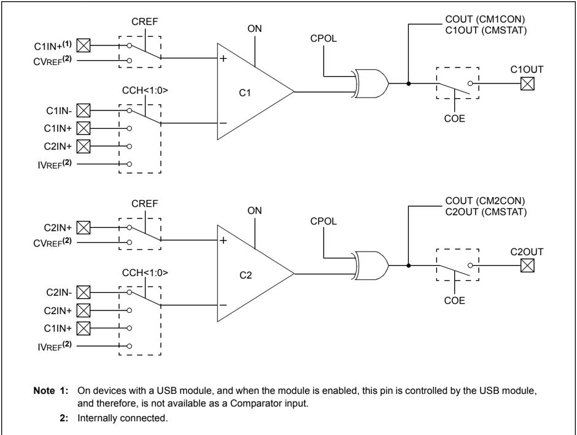
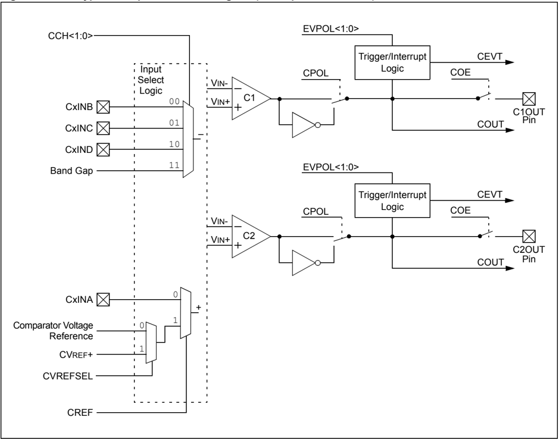
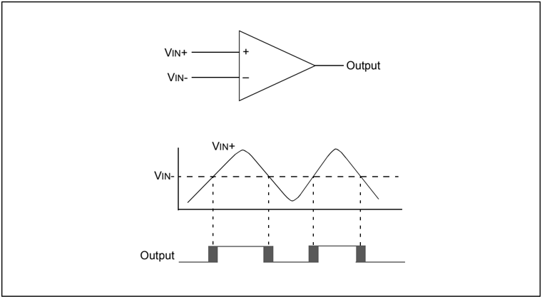
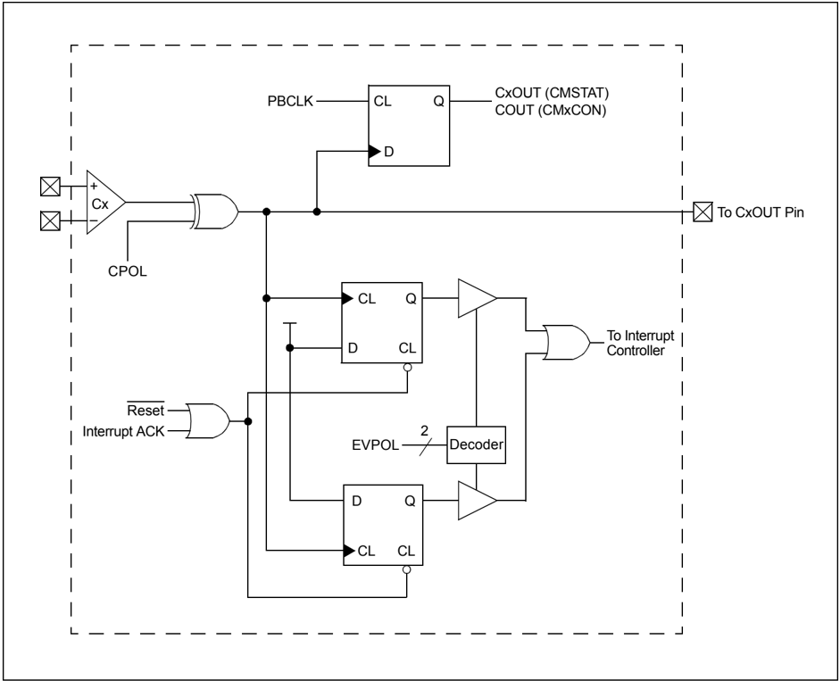
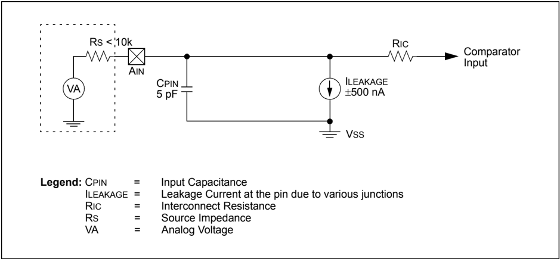

Microchip

## Section 19. Comparator

## HIGHLIGHTS

This section of the manual contains the following major topics:

|   19.1 | Introduction..............................................................................................................19-2   |
|--------|----------------------------------------------------------------------------------------------------------------------------------|
|   19.2 | Comparator Control Registers.................................................................................19-4                |
|   19.3 | Comparator Operation.............................................................................................19-8            |
|   19.4 | Interrupts................................................................................................................19-12  |
|   19.5 | Operation in Power-Saving and Debug Modes .....................................................19-14                             |
|   19.6 | Effects of a Reset ..................................................................................................19-14       |
|   19.7 | Related Application Notes .....................................................................................19-15             |
|   19.8 | Revision History.....................................................................................................19-16       |

Note:

This family reference manual section is meant to serve as a complement to device data sheets. Depending on the device variant, this manual section may not apply to all PIC32 devices.

There  are  two  different  Comparator  configurations:  Type  1  or  Type  2.  Please consult the note at the beginning of the 'Comparator' chapter in the current device data sheet to check which type of Comparator the device is using.

Device  data  sheets  and  family  reference  manual  sections  are  available  for download from the Microchip Worldwide Web site at: http://www.microchip.com

## 19.1 INTRODUCTION

The PIC32 family analog Comparator module contains one or more Comparator(s) that can be configured in a variety of ways.

The following are some of the key features of this module:

- Selectable Inputs Available include:
- -Analog inputs multiplexed with I/O pins
- -On-chip Internal Absolute Voltage Reference (IVREF)
- -Comparator Voltage Reference (CVREF)
- Outputs can be Inverted
- Selectable Interrupt Generation

A block diagram of the Comparator module is illustrated in Figure 19-1. The number of Comparators varies by device. Refer to the specific data sheet for the number of Comparators implemented.

Figure 19-1: Type 1 Comparator Block Diagram (2 Comparators Shown)



Figure 19-2: Type 2 Comparator Block Diagram (2 Comparators Shown)



## 19.2 COMPARATOR CONTROL REGISTERS

Note: Each PIC32 device variant may have Type 1 or Type 2 Comparators and one or more Comparator modules. An 'x' used in the names of pins, control/status bits and registers denotes the particular module. Refer to the specific device data sheet for more information.

A Comparator module consists of the following Special Function Registers (SFRs):

- CMxCON: Comparator Control Register (1,2,3)
- CMxSTAT: Comparator Status Register (1,2,3,4)

The following table provides a brief summary of all Comparator-related registers. Corresponding registers appear after the summary, followed by a detailed description of each register.

Table 19-1: Comparator SFRs Summary (4)

| Name           | Bit Range   | Bit 31/23/15/7   | Bit 30/22/14/6   | Bit 29/21/13/5   | Bit 28/20/12/4   | Bit 27/19/11/3   | Bit 26/18/10/2   | Bit 25/17/9/1    | Bit 24/16/8/0    |
|----------------|-------------|------------------|------------------|------------------|------------------|------------------|------------------|------------------|------------------|
| CMxCON (1,2,3) | 31:24       | -                | -                | -                | -                | -                | -                | -                | -                |
| CMxCON (1,2,3) | 23:16       | -                | -                | -                | -                | -                | -                | -                | -                |
| CMxCON (1,2,3) | 15:8        | ON               | COE              | CPOL             | -                | -                | -                | CVET (5)         | COUT             |
| CMxCON (1,2,3) | 7:0         | EVPOL<1:0>       | EVPOL<1:0>       | -                | CREF             | -                | -                | CCH<1:0>         | CCH<1:0>         |
| CMSTAT (1,2,3) | 31:24       | -                | -                | -                | -                | -                | -                | PWRMODE<1:0> (5) | PWRMODE<1:0> (5) |
| CMSTAT (1,2,3) | 23:16       | C8EVT (5)        | C7EVT (5)        | C6EVT (5)        | C5EVT (5)        | C4EVT (5)        | C3EVT (5)        | C2EVT (5)        | C1EVT (5)        |
| CMSTAT (1,2,3) | 15:8        | -                | -                | SIDL             | -                | -                | -                | -                | CVREFSEL (5)     |
| CMSTAT (1,2,3) | 7:0         | C8OUT            | C7EVT            | C6EVT            | C5EVT            | C4EVT            | C3EVT            | C2OUT            | C1OUT            |

Legend: - = unimplemented, read as ' 0 '.

- Note 1: This register has an associated Clear register at an offset of 0x4 bytes. These registers have the same name with CLR appended to the end of the register name (e.g., CMxCONCLR). Writing a ' 1 ' to any bit position in the Clear register will clear valid bits in the associated register. Reads from the Clear register should be ignored.
- 2: This register has an associated Set register at an offset of 0x8 bytes. These registers have the same name with SET appended to the end of the register name (e.g., CMxCONSET). Writing a ' 1 ' to any bit position in the Set register will set valid bits in the associated register. Reads from the Set register should be ignored.
- 3: This register has an associated Invert register at an offset of 0xC bytes. These registers have the same name with INV appended to the end of the register name (e.g., CMxCONINV). Writing a ' 1 ' to any bit position in the Invert register will invert valid bits in the associated register. Reads from the Invert register should be ignored.
- 4: Not all bits shown are implemented for a specific device variant. Refer to the device data sheet.
- 5: Type 2 Comparator only.

## Register 19-1: CMxCON: Comparator Control Register (1,2,3)

| Bit Range   | Bit 31/23/15/7   | Bit 30/22/14/6   | Bit 29/21/13/5   | Bit 28/20/12/4   | Bit 27/19/11/3   | Bit 26/18/10/2   | Bit 25/17/9/1   | Bit 24/16/8/0   |
|-------------|------------------|------------------|------------------|------------------|------------------|------------------|-----------------|-----------------|
| 31:24       | U-0              | U-0              | U-0              | U-0              | U-0              | U-0              | U-0             | U-0             |
| 31:24       | -                | -                | -                | -                | -                | -                | -               | -               |
| 23:16       | U-0              | U-0              | U-0              | U-0              | U-0              | U-0              | U-0             | U-0             |
| 23:16       | -                | -                | -                | -                | -                | -                | -               | -               |
| 15:8        | R/W-0            | R/W-0            | R/W-0            | U-0              | U-0              | U-0              | R/W-0           | R-0             |
| 15:8        | ON (5)           | COE              | CPOL (6)         | -                | -                | -                | CEVT (4)        | COUT            |
| 7:0         | R/W-1            | R/W-1            | U-0              | R/W-0            | U-0              | U-0              | R/W-1           | R/W-1           |
| 7:0         | EVPOL<1:0>       | EVPOL<1:0>       | -                | CREF             | -                | -                | CCH<1:0>        | CCH<1:0>        |

## Legend:

R = Readable bit

W = Writable bit

U = Unimplemented bit, read as '0'

-n = Value at POR

'1' = Bit is set

'0' = Bit is cleared

x = Bit is unknown

bit 31-16

Unimplemented: Read as ' 0 '

bit 15

ON: Comparator ON bit (5)

- 1 = Module is enabled; setting this bit does not affect the other bits in this register

- 0 = Module is disabled and does not consume current; clearing this bit does not affect the other bits in this register

bit 14 COE: Comparator Output Enable bit

- 1 = Comparator output is driven on the output CxOUT pin

0 = Comparator output is not driven on the output CxOUT pin

bit 13 CPOL:

Comparator Output Inversion bit (6)

- 1 = Output is inverted

- 0 = Output is not inverted

bit 12-10 Unimplemented: Read as ' 0

'

bit 9

CEVT: Comparator Event bit (4)

- 1 = Comparator event that is defined by EVPOL&lt;1:0&gt; has occurred; subsequent triggers and interrupts are disabled until the bit is cleared

- 0 = Comparator event has not occurred

- Note 1: This register has an associated Clear register (CMxCONCLR) at an offset of 0x4 bytes. Writing a ' 1 ' to any bit position in the Clear register will clear valid bits in the associated register. Reads from the Clear register should be ignored.
- 2: This register has an associated Set register (CMxCONSET) at an offset of 0x8 bytes. Writing a ' 1 ' to any bit position in the Set register will set valid bits in the associated register. Reads from the Set register should be ignored.
- 3: This register has an associated Invert register (CMxCONINV) at an offset of 0xC bytes. Writing a ' 1 ' to any bit position in the Invert register will invert valid bits in the associated register. Reads from the Invert register should be ignored.
- 4: Type 2 Comparator only.
- 5: When using the 1:1 PBCLK divisor, the user's software should not read/write the peripheral's SFRs in the SYSCLK cycle immediately following the instruction that clears the module's ON bit.
- 6: Setting this bit will invert the signal to the Comparator interrupt generator as well. This will result in an interrupt being generated on the opposite edge from the one selected by EVPOL&lt;1:0&gt;.

19

## PIC32 Family Reference Manual

## Register 19-1: CMxCON: Comparator Control Register (1,2,3)  (Continued)

## bit 8 COUT: Comparator Output bit

When CPOL = 0 :

1 = VIN+ &gt; VIN-

0 = VIN+ &lt; VIN-

When CPOL = 1 :

1 = VIN+ &lt; VIN-

0 = VIN+ &gt; VIN-

- bit 7-6 EVPOL&lt;1:0&gt;: Trigger/Event/Interrupt Polarity Select bits
- 11 = Trigger/event/interrupt is generated on any change of the comparator output (while CEVT = 0 )

10 = Trigger/event/interrupt is generated on transition of the comparator output:

If CPOL = 0 (non-inverted polarity):

High-to-low transition only.

If CPOL = 1 (inverted polarity):

Low-to-high transition only.

01 = Trigger/event/interrupt is generated on transition of the comparator output:

If CPOL = 0 (non-inverted polarity):

Low-to-high transition only.

If CPOL = 1 (inverted polarity):

High-to-low transition only.

- 00 = Trigger/event/interrupt generation is disabled
- bit 5 Unimplemented: Read as ' 0 '
- bit 4 CREF: Comparator Positive Input Configure bit
- 1 = Comparator non-inverting input is connected to the internal CVREF
- 0 = Comparator non-inverting input is connected to the CxIN+ pin
- bit 3-2 Unimplemented: Read as ' 0 '
- bit 1-0 CCH&lt;1:0&gt;: Comparator Negative Input Select for Comparator bits
- 11 = Comparator inverting input is connected to the IVREF
- 10 = Comparator inverting input is connected to the CyIN+ pin
- 01 = Comparator inverting input is connected to the CxIN+ pin
- 00 = Comparator inverting input is connected to the CxIN- pin
- Note 1: This register has an associated Clear register (CMxCONCLR) at an offset of 0x4 bytes. Writing a ' 1 ' to any bit position in the Clear register will clear valid bits in the associated register. Reads from the Clear register should be ignored.
- 2: This register has an associated Set register (CMxCONSET) at an offset of 0x8 bytes. Writing a ' 1 ' to any bit position in the Set register will set valid bits in the associated register. Reads from the Set register should be ignored.
- 3: This register has an associated Invert register (CMxCONINV) at an offset of 0xC bytes. Writing a ' 1 ' to any bit position in the Invert register will invert valid bits in the associated register. Reads from the Invert register should be ignored.
- 4: Type 2 Comparator only.
- 5: When using the 1:1 PBCLK divisor, the user's software should not read/write the peripheral's SFRs in the SYSCLK cycle immediately following the instruction that clears the module's ON bit.
- 6: Setting this bit will invert the signal to the Comparator interrupt generator as well. This will result in an interrupt being generated on the opposite edge from the one selected by EVPOL&lt;1:0&gt;.

Register 19-2:

CMxSTAT: Comparator Status Register (1,2,3,4)

| Bit Range   | Bit 31/23/15/7   | Bit 30/22/14/6   | Bit 29/21/13/5   | Bit 28/20/12/4   | Bit 27/19/11/3   | Bit 26/18/10/2   | Bit 25/17/9/1    | Bit 24/16/8/0    |
|-------------|------------------|------------------|------------------|------------------|------------------|------------------|------------------|------------------|
| 31:24       | U-0              | U-0              | U-0              | U-0              | U-0              | U-0              | U-0              | U-0              |
| 31:24       | -                | -                | -                | -                | -                | -                | PWRMODE<1:0> (5) | PWRMODE<1:0> (5) |
| 23:16       | R-0              | R-0              | R-0              | R-0              | R-0              | R-0              | R-0              | R-0              |
| 23:16       | C8EVT (5)        | C7EVT (5)        | C6EVT (5)        | C5EVT (5)        | C4EVT (5)        | C3EVT (5)        | C2EVT (5)        | C1EVT (5)        |
| 15:8        | U-0              | U-0              | R/W-0            | U-0              | U-0              | U-0              | U-0              | R-0              |
| 15:8        | -                | -                | SIDL             | -                | -                | -                | -                | CVREFSEL (5)     |
| 7:0         | R-0              | R-0              | R-0              | R-0              | R-0              | R-0              | R-0              | R-0              |
| 7:0         | C8OUT            | C7OUT            | C6OUT            | C5OUT            | C4OUT            | C3OUT            | C2OUT            | C1OUT            |

## Legend:

R = Readable bit

W = Writable bit

U = Unimplemented bit, read as '0'

-n = Value at POR

'1' = Bit is set

'0' = Bit is cleared

x = Bit is unknown

bit 31-26

Unimplemented:

Read as ' 0 '

bit 25-24

PWRMODE&lt;1:0&gt;: Comparator Power Mode bits (5)

Refer to the specific device data sheet for Power mode bit configurations.

bit 23-16 C&lt;8:1&gt;EVT:

Comparator Event Status bits (5)

Shows the current event status of Comparator x.

bit 15-14 Unimplemented:

Read as ' 0 '

bit 13

SIDL:

Stop in Idle Control bit

1 = All Comparator modules are disabled in Idle mode

0 = All Comparator modules continue to operate in Idle mode

bit 12-9 Unimplemented:

Read as ' 0 '

bit 8

CVREFSEL:

Comparator Reference Voltage Select Enable bit (5)

1 = External voltage reference from the CVREF+ pin is selected

0 = Internal band gap voltage reference is selected

bit 7-0

C&lt;8:1&gt;OUT:

Comparator Output bits

1 = Output of Comparator 1 is a ' 1 '

0 = Output of Comparator 1 is a ' 0 '

- Note 1: This register has an associated Clear register (CMSTATCLR) at an offset of 0x4 bytes. Writing a ' 1 ' to any bit position in the Clear register will clear valid bits in the associated register. Reads from the Clear register should be ignored.
- 2: This register has an associated Set register (CMSTATSET) at an offset of 0x8 bytes. Writing a ' 1 ' to any bit position in the Set register will set valid bits in the associated register. Reads from the Set register should be ignored.
- 3: This register has an associated Invert register (CMSTATINV) at an offset of 0xC bytes. Writing a ' 1 ' to any bit position in the Invert register will invert valid bits in the associated register. Reads from the Invert register should be ignored.
- 4: The number of Comparators is device-specific. Unimplemented Comparators will be U-0.
- 5: Type 2 Comparator only.

## 19.3 COMPARATOR OPERATION

## 19.3.1 Comparator Configurations

There are two possible types of Comparators found in PIC32 devices: Type 1 and Type 2. The Type 1 is a subset of the more versatile Type 2 Comparator. Refer to the specific device data sheet to see which Comparator type is used.

The number of Comparators will vary with the device and can range from 1 to 8. Not all features described  in  the  following  sections  may  be  implemented  in  a  specific  PIC32  device.  The Comparator module has a flexible  input  and  output  configuration  to  allow  the  module  to  be tailored to the needs of the application. The PIC32 family Comparator module has individual control over the enable, output inversion, output on I/O pin and input selections. The VIN+ pin of each Comparator can select from an input pin or the CVREF. The VIN- input of the Comparator module can select from one of three input pins or the IVREF. In addition, the Comparator module has two individual Comparator event generation control bits. These control bits can be used for detecting when the output of an individual Comparator changes to a desired state or changes states.

If  the  Comparator  mode  is  changed,  the  Comparator  output  level  may  not  be  valid  for  the specified mode change delay (refer to the specific device data sheet for more information).

Note: Comparator  interrupts  should  be  disabled  during  a  Comparator  mode  change; otherwise, a false interrupt may be generated.

A single Comparator is illustrated in the upper portion of Figure 19-3. The lower portion represents the relationship between the analog input levels and the digital output. When the analog input at VIN+ is less than the analog input at VIN-, the output of the Comparator is a digital low level. When the analog input at VIN+ is greater than the analog input at VIN-, the output of the Comparator is a digital high level. The shaded areas of the output of the Comparator in the lower portion of Figure 19-3 illustrate the uncertainty that is due to input offsets and the response time of the Comparator.

## 19.3.2 Comparator Inputs

Depending on the Comparator operating mode, the inputs to the Comparators may be from two input pins or a combination of an input pin and one of two internal voltage references. The analog signal present at VIN- is compared to the signal at VIN+ and the digital output of the Comparator is set or cleared according to the result of the comparison, as illustrated in Figure 19-3. Both types of comparators use the CCH&lt;1:0&gt; bits to select between various input sources.

Figure 19-3: Single Comparator



## 19.3.2.1 EXTERNAL REFERENCE SIGNAL

An external voltage reference (CVREF+ pin) may be used with the Comparator. Refer to the specific device data sheet for input voltage limits.

## 19.3.2.2 INTERNAL REFERENCE SIGNALS

The  CVREF  and  IVREF  (band  gap)  modules  can  be  used  as  inputs  to  the  Comparator,  as illustrated in Figure 19-1. The CVREF provides a user-selectable voltage for use as a Comparator reference.  For  more  information  on  this  module,  refer  to Section 20. 'Comparator Voltage Reference' (DS61109) in the 'PIC32 Family Reference Manual' . The IVREF has a fixed 1.2V output that does not change with the device supply voltage. Refer to the specific device data sheet for details and accuracy of this reference.

## 19.3.3 Comparator Response Time

Response time is the minimum amount of time that elapses from the moment a change is made in the input voltage of a Comparator to the moment the output reflects the new level. If the internal reference is changed, the maximum delay of the internal voltage reference must be considered, when using the Comparator outputs. Otherwise, the maximum delay of the Comparators should be used. For more information, refer to the specific device data sheet.

Type  2  Comparators  may  have  PWRMODEx bits  implemented.  These  bits  allow  a  trade-off between power supply current and response time. Refer to the Electrical Characteristics section in the device data sheet for the speed versus power options available.

## 19.3.4 Comparator Outputs

The Comparator output is read through the CMSTAT register or the COUT bit (CMxCON&lt;8&gt;). This bit is read-only. The Comparator output may also be directed to an I/O pin via the COE bit; however, the COUT bit is still valid when the signal is routed to a pin.

The  output  of  the  Comparator  has  a  degree  of  uncertainty.  The  uncertainty  of  each  of  the Comparators  is  related  to  the  input  offset  voltage  and  the  response  time,  as  stated  in  the specifications.  The  lower  portion  of  Figure 19-3  provides  a  graphical  representation  of  this uncertainty.

The Comparator Output bit, COUT, provides the latched sampled value of the Comparator's output when the register was read. There are two common methods used to detect a change in the Comparator output:

- Software polling
- Interrupt generation

## 19.3.4.1 SOFTWARE POLLING METHOD OF COMPARATOR EVENT DETECTION

Software polling of COUT is performed by periodically reading the COUT bit. This allows the output to be read at uniform time intervals. A change in the Comparator output is not detected until the next read of the COUT bit. If the input signal changes at a rate faster than the polling, a brief change in output may not be detected.

Devices with Type 2 Comparators have an additional CxEVT bit and corresponding interrupt.

## 19.3.4.2 INTERRUPT GENERATION METHOD OF COMPARATOR EVENT DETECTION

Interrupt generation is the other method for detecting a change in the Comparator output. The Comparator module can be configured to generate an interrupt when the COUT bit changes.

An interrupt will be generated when the Comparator's output changes (subject to the interrupt priorities).  This  method responds more rapidly to changes than the software polling method; however, rapidly changing signals will cause an equally large number of interrupts. This can cause  interrupt  loading  and  potentially  undetected  interrupts  due  to  new  interrupts  being generated while the previous interrupt is still being serviced, or even before the interrupt can be serviced.  If  the  input  signal  changes  rapidly,  reading  the  COUT  bit  in  the  Interrupt  Service Routine (ISR) may yield a different result than the one that generated the interrupt. This is due to the COUT bit representing the value of the Comparator output when the bit was read and not the value that caused the interrupt.

Comparator output and interrupt generation is illustrated in Figure 19-5.

## 19.3.4.3 CHANGING THE POLARITY OF COMPARATOR OUTPUTS

The polarity of the Comparator outputs can be changed using the CPOL bit (CMxCON&lt;13&gt;). CPOL appears below the Comparator Cx on the left side of Figure 19-4.

Figure 19-4: Comparator Output Block Diagram



## 19.3.5 Analog Input Connection Considerations

A simplified circuit for an analog input is illustrated in Figure 19-5. A maximum source impedance of 10 k  is recommended for the analog sources. Any external component connected to an analog input pin, such as a capacitor or a Zener diode, should have very little leakage current. Refer to the specific device data sheet for input voltage limits. If a pin is to be shared by two or more analog inputs that are to be used simultaneously, the loading effects of all the modules involved must be taken into consideration. This loading may reduce the accuracy of one or more of the modules connected to the common pin. This may also require a lower source impedance than is stated for a single module with exclusive use of a pin in Analog mode.

Note: When reading the PORT register, all pins configured as analog inputs will read as ' 0 's. Pins configured as digital inputs will convert an analog input according to the Schmitt Trigger input specification.

Analog levels on any pin defined as a digital input may cause the input buffer to consume more current than is specified.

Figure 19-5: Comparator Analog Input Model

Legend:

CPIN         =       Input Capacitance

ILEAKAGE

=       Leakage Current at the pin due to various junctions

RIC           =       Interconnect Resistance

RS            =       Source Impedance

VA            =       Analog Voltage



## 19.4 INTERRUPTS

Each of the available Comparators has a dedicated interrupt bit, CMPxIF (IFS1&lt;3&gt; or IFS1&lt;4&gt;), and a corresponding interrupt enable/mask bit, CMPxIE (IEC1&lt;3&gt; or IEC1&lt;4&gt;). These bits are used to determine the source of an interrupt and to enable or disable an individual interrupt source. The priority level of each of the channels can also be set independently of the other channels.

The CMPxIF bit is set when the CMPx channel detects a predefined match condition that is defined as an event generating an interrupt. The CMPxIF bit will then be set without regard to the state of the corresponding CMPxIE bit. The CMPxIF bit can be polled by software if desired.

The CMPxIE bit controls  the  interrupt  generation.  If  the  CMPxIE  bit  is  set,  the  CPU  will  be interrupted whenever a Comparator interrupt event occurs and the corresponding CMPxIF bit will be set (subject to the priority and subpriority as outlined below).

It is the responsibility of the user's software routine, that services a particular interrupt, to clear the appropriate interrupt flag bit before the service routine is complete.

The priority of each Comparator channel can be set independently through the CMPxIP&lt;2:0&gt; bits. This priority defines the priority group to which the interrupt source will be assigned. The priority  groups  range from a value of 7 (the highest priority) to a value of 0 (which does not generate an interrupt). An interrupt being serviced will be preempted by an interrupt in a higher priority group.

The subpriority bits allow setting the priority of an interrupt source within a priority group. The values of the subpriority bits, CMPxIS&lt;1:0&gt;, range from 3 (the highest priority) to 0 (the lowest priority). An interrupt within the same priority group, but having a higher subpriority value, will preempt a lower subpriority interrupt that is in progress.

The priority group and subpriority bits allow more than one interrupt source to share the same priority and subpriority. If simultaneous interrupts occur in this configuration, the natural order of the  interrupt  sources  within  a  priority/subgroup  pair  determine  the  interrupt  generated.  The natural priority is based on the vector numbers of the interrupt sources. The lower the vector number, the higher the natural priority of the interrupt. Any interrupts that were overridden by natural  order  will  then  generate  their  respective  interrupts  based  on  priority,  subpriority  and natural order, after the interrupt flag for the current interrupt is cleared.

After an enabled interrupt is generated, the CPU will jump to the vector assigned to that interrupt. The vector number for the interrupt is the same as the natural order number. The CPU will then begin executing code at the vector address. The user's code at this vector address should perform any application-specific operations required, such as reloading the duty cycle, clearing the interrupt flag, CMPxIF, and then exiting. For more information on interrupts, refer to the vector address table details in Section 8. 'Interrupts' (DS60001108).

## Example 19-1: Comparator Initialization with Interrupts Enabled Code

```
// Configure both comparators to generate an interrupt on any // output transition CM1CON = 0xC0D0; // Initialize Comparator 1 // Comparator enabled, output enabled, interrupt on any output // change, inputs: CVref, C1INCM2CON = 0xA0C2; // Initialize Comparator 2 // Comparator enabled, output enabled, interrupt on any output // change, inputs: C2IN+, C1IN+ // Enable interrupts for Comparator modules and set priorities // Set priority to 7 and subpriority to 3 IPC7SET = 0x00000700; // Set CMP1 interrupt subpriority IFS1CLR = 0x00000008; // Clear the CMP1 interrupt flag IEC1SET = 0x00000008; // Enable CMP1 interrupt IPC7SET = 0x00070000; // Set CMP2 interrupt sub priority IFS1CLR = 0x000000010; // Clear the CMP2 interrupt flag IEC1SET = 0x000000010; // Enable CMP2 interrupt
```

## Example 19-2: Comparator ISR Code

```
// Insert user code here void__ISR(_COMPARATOR_2_VECTOR, ipl4)Cmp2_IntHandler(void) { // Insert user code here IFS1CLR = 0x00000010; // Clear the CMP2 interrupt flag } void__ISR(_COMPARATOR_1_VECTOR, ipl4)Cmp1_IntHandler(void) { // Insert code user here IFS1CLR = 0x00000008; // Clear the CMP1 interrupt flag }
```

## 19.5 OPERATION IN POWER-SAVING AND DEBUG MODES

## 19.5.1 Comparator Operation During Idle Mode

When a Comparator is active and the device is placed in Idle mode, the Comparator remains active and interrupts are generated (if enabled). If SIDL = 1 (CMSTAT&lt;13&gt;), the Comparators are disabled in Idle mode.

## 19.5.2 Comparator Operation During Sleep Mode

When a Comparator is active and the device is placed in Sleep mode, the Comparator remains active and the interrupt is functional (if enabled). This interrupt will wake-up the device from Sleep mode (when enabled). Each operational Comparator will consume additional current, as shown in the Comparator specifications. To minimize power consumption while in Sleep mode, turn off the comparators (ON (CMxCON&lt;15&gt;) = 0 ) prior to entering Sleep mode. If the device wakes up from  Sleep  mode,  the  contents  of  the  CMxCON  register  are  not  affected.  For  additional information on Sleep mode, refer to Section 10. 'Power-Saving Modes' (DS60001130).

## 19.6 EFFECTS OF A RESET

All Resets force the CMxCON registers to their Reset state, causing the Comparator modules to be turned off (CMxCON&lt;15&gt; = 0 ). However, the input pins multiplexed with analog input sources are configured as analog inputs by default on device Reset. The I/O configuration for these pins is determined by setting the AD1PCFG register or the ANSELx register.

## 19.7 RELATED APPLICATION NOTES

This  section  lists  application  notes  that  are  related  to  this  section  of  the  manual.  These application notes may not be written specifically for the PIC32 device family, but the concepts are pertinent and could be used with modification and possible limitations. The current application notes related to the Comparator module are:

## Title

No related application notes at this time

Note:

Application Note #

N/A

Please visit the Microchip web site (www.microchip.com) for additional application notes and code examples for the PIC32 family of devices.

## 19.8 REVISION HISTORY

## Revision A (October 2007)

This is the initial released version of this document.

## Revision B (October 2007)

Updated document to remove Confidential status.

## Revision C (April 2008)

Revised status to Preliminary; Revised U-0 to r-x.

## Revision D (May 2008)

Revised Figure 19-1; Revised Registers 19-1, 19-5, 19-13, 19-14, 19-15; Revised Example 19-2; Revised Section 19.5, pin names; Change Reserved bits from 'Maintain as' to 'Write'; Added Note to ON bit (CM1CON/CM2CON Registers).

## Revision E (November 2010)

This revision includes the following updates:

- Notes:
- -Added a note at the beginning of the section, which provides information on complementary documentation.
- Updated all Reserved bits as Unimplemented bits in Register 19-1 and Register 19-2.
- Changed Figure 19-1.
- Removed CMxCON and CMSTAT registers along with their corresponding CLR, SET and INV registers and added the following Note in Table 19-1
- -All registers in this table have corresponding CLR, SET and INV registers at their virtual addresses, plus offset of 0X04, 0X08 and 0X0C respectively.
- Removed IFS1, IEC1, IPC1 registers and their corresponding CLR, SET and INV registers.
- Removed Table 19-2 from 19.4 'Interrupts' .
- Removed section 19.5 'I/O Pin Control'.
- Minor changes to the text and formatting have been incorporated throughout the document.

## Revision F (November 2015)

This revision includes the following updates:

- Updated Table 19-1 to add the CVREFSEL bit.
- In Register 19-1, updated the definition of the EVPOL&lt;1:0&gt; and COUT bits. Added the CVET bit and its definition.
- Updated all of the bits and definitions in Register 19-2.
- Removed Section 19.5.3 'Comparator Operation in Debug Mode' .

## Note the following details of the code protection feature on Microchip devices:

- Microchip products meet the specification contained in their particular Microchip Data Sheet.
- Microchip believes that its family of products is one of the most secure families of its kind on the market today, when used in the intended manner and under normal conditions.
- There are dishonest and possibly illegal methods used to breach the code protection feature. All of these methods, to our knowledge, require using the Microchip products in a manner outside the operating specifications contained in Microchip's Data Sheets. Most likely, the person doing so is engaged in theft of intellectual property.
- Microchip is willing to work with the customer who is concerned about the integrity of their code.
- Neither Microchip nor any other semiconductor manufacturer can guarantee the security of their code. Code protection does not mean that we are guaranteeing the product as 'unbreakable.'

Code protection is constantly evolving. We at Microchip are committed to continuously improving the code protection features of our products. Attempts to break Microchip's code protection feature may be a violation of the Digital Millennium Copyright Act. If such acts allow unauthorized access to your software or other copyrighted work, you may have a right to sue for relief under that Act.

Information  contained  in  this  publication  regarding  device applications and the like is provided only for your convenience and may be superseded by updates. It is your responsibility to ensure  that  your  application  meets  with  your  specifications. MICROCHIP MAKES NO REPRESENTATIONS OR WARRANTIES  OF  ANY  KIND  WHETHER  EXPRESS  OR IMPLIED, WRITTEN OR ORAL, STATUTORY OR OTHERWISE, RELATED TO THE INFORMATION, INCLUDING  BUT  NOT  LIMITED  TO  ITS  CONDITION, QUALITY, PERFORMANCE, MERCHANTABILITY OR FITNESS  FOR  PURPOSE . Microchip  disclaims  all  liability arising  from  this  information  and  its  use.  Use  of  Microchip devices in life support and/or safety applications is entirely at the buyer's risk, and the buyer agrees to defend, indemnify and hold  harmless  Microchip  from  any  and  all  damages,  claims, suits,  or  expenses  resulting  from  such  use.  No  licenses  are conveyed, implicitly or otherwise, under any Microchip intellectual property rights unless otherwise stated.

## QUALITY MANAGEMENT  SYSTEM CERTIFIED BY DNV

== ISO/TS 16949 ==

## Trademarks

The Microchip name and logo, the Microchip logo, dsPIC, FlashFlex, flexPWR, JukeBlox, KEELOQ, KEELOQ logo, Kleer, LANCheck, MediaLB, MOST, MOST logo, MPLAB, OptoLyzer, PIC, PICSTART, PIC 32  logo, RightTouch, SpyNIC, SST, SST Logo, SuperFlash and UNI/O are registered trademarks of Microchip Technology Incorporated in the U.S.A. and other countries.

The Embedded Control Solutions Company and mTouch are registered trademarks of Microchip Technology Incorporated in the U.S.A.

Analog-for-the-Digital Age, BodyCom, chipKIT, chipKIT logo, CodeGuard, dsPICDEM, dsPICDEM.net, ECAN, In-Circuit Serial Programming, ICSP, Inter-Chip Connectivity, KleerNet, KleerNet logo, MiWi, motorBench, MPASM, MPF, MPLAB Certified logo, MPLIB, MPLINK, MultiTRAK, NetDetach, Omniscient Code Generation, PICDEM, PICDEM.net, PICkit, PICtail, RightTouch logo, REAL ICE, SQI, Serial Quad I/O, Total Endurance, TSHARC, USBCheck, VariSense, ViewSpan, WiperLock, Wireless DNA, and ZENA are trademarks of Microchip Technology Incorporated in the U.S.A. and other countries.

SQTP is a service mark of Microchip Technology Incorporated in the U.S.A.

Silicon Storage Technology is a registered trademark of Microchip Technology Inc. in other countries.

GestIC is a registered trademark of Microchip Technology Germany II GmbH &amp; Co. KG, a subsidiary of Microchip Technology Inc., in other countries.

All other trademarks mentioned herein are property of their respective companies.

© 2007-2015, Microchip Technology Incorporated, Printed in the U.S.A., All Rights Reserved.

ISBN: 978-1-63277-932-8

Microchip received ISO/TS-16949:2009 certification for its worldwide headquarters, design and wafer fabrication facilities in Chandler and Tempe, Arizona; Gresham, Oregon and design centers in California and India. The Company's quality system processes and procedures are for its PIC ®  MCUs and dsPIC ®  DSCs, KEELOQ ®  code hopping devices, Serial EEPROMs, microperipherals, nonvolatile memory and analog products. In addition, Microchip's quality system for the design and manufacture of development systems is ISO 9001:2000 certified.


## Worldwide Sales and Service

## ASIA/PACIFIC

Asia Pacific Office Suites 3707-14, 37th Floor Tower 6, The Gateway Harbour City, Kowloon

Hong Kong Tel: 852-2943-5100 Fax: 852-2401-3431

Australia - Sydney Tel: 61-2-9868-6733 Fax: 61-2-9868-6755

China - Beijing Tel: 86-10-8569-7000 Fax: 86-10-8528-2104

China - Chengdu Tel: 86-28-8665-5511 Fax: 86-28-8665-7889

China - Chongqing Tel: 86-23-8980-9588 Fax: 86-23-8980-9500

China - Dongguan Tel: 86-769-8702-9880

China - Hangzhou Tel: 86-571-8792-8115 Fax: 86-571-8792-8116

China - Hong Kong SAR Tel: 852-2943-5100 Fax: 852-2401-3431

China - Nanjing Tel: 86-25-8473-2460 Fax: 86-25-8473-2470

China - Qingdao Tel: 86-532-8502-7355 Fax: 86-532-8502-7205

China - Shanghai Tel: 86-21-5407-5533 Fax: 86-21-5407-5066

China - Shenyang Tel: 86-24-2334-2829 Fax: 86-24-2334-2393

China - Shenzhen Tel: 86-755-8864-2200 Fax: 86-755-8203-1760

China - Wuhan Tel: 86-27-5980-5300 Fax: 86-27-5980-5118

China - Xian Tel: 86-29-8833-7252 Fax: 86-29-8833-7256

## ASIA/PACIFIC

China - Xiamen Tel: 86-592-2388138 Fax: 86-592-2388130

China - Zhuhai Tel: 86-756-3210040 Fax: 86-756-3210049

India - Bangalore Tel: 91-80-3090-4444 Fax: 91-80-3090-4123

India - New Delhi Tel: 91-11-4160-8631 Fax: 91-11-4160-8632

India - Pune Tel: 91-20-3019-1500

Japan - Osaka Tel: 81-6-6152-7160 Fax: 81-6-6152-9310

Japan - Tokyo Tel: 81-3-6880- 3770 Fax: 81-3-6880-3771

Korea - Daegu Tel: 82-53-744-4301 Fax: 82-53-744-4302

Korea - Seoul Tel: 82-2-554-7200 Fax: 82-2-558-5932 or 82-2-558-5934

Malaysia - Kuala Lumpur Tel: 60-3-6201-9857 Fax: 60-3-6201-9859

Malaysia - Penang Tel: 60-4-227-8870 Fax: 60-4-227-4068

Philippines - Manila Tel: 63-2-634-9065 Fax: 63-2-634-9069

Singapore Tel: 65-6334-8870 Fax: 65-6334-8850

Taiwan - Hsin Chu Tel: 886-3-5778-366 Fax: 886-3-5770-955

Taiwan - Kaohsiung Tel: 886-7-213-7828

Taiwan - Taipei Tel: 886-2-2508-8600 Fax: 886-2-2508-0102

Thailand - Bangkok Tel: 66-2-694-1351 Fax: 66-2-694-1350

## AMERICAS

Corporate Office 2355 West Chandler Blvd. Chandler, AZ 85224-6199 Tel: 480-792-7200 Fax: 480-792-7277 Technical Support:

[http://www.microchip.com/ support](http://support.microchip.com/)

Web Address:

www.microchip.com

Atlanta Duluth, GA Tel: 678-957-9614 Fax: 678-957-1455

Austin, TX Tel: 512-257-3370

Boston Westborough, MA Tel: 774-760-0087 Fax: 774-760-0088

Chicago Itasca, IL Tel: 630-285-0071 Fax: 630-285-0075

Cleveland Independence, OH Tel: 216-447-0464 Fax: 216-447-0643

Dallas Addison, TX Tel: 972-818-7423 Fax: 972-818-2924

Detroit Novi, MI Tel: 248-848-4000

Houston, TX Tel: 281-894-5983

Indianapolis Noblesville, IN Tel: 317-773-8323 Fax: 317-773-5453

Los Angeles Mission Viejo, CA Tel: 949-462-9523 Fax: 949-462-9608

New York, NY Tel: 631-435-6000

San Jose, CA Tel: 408-735-9110

Canada - Toronto Tel: 905-673-0699 Fax: 905-673-6509

## EUROPE

Austria - Wels Tel: 43-7242-2244-39 Fax: 43-7242-2244-393

Denmark - Copenhagen Tel: 45-4450-2828 Fax: 45-4485-2829

France - Paris Tel: 33-1-69-53-63-20 Fax: 33-1-69-30-90-79

Germany - Dusseldorf Tel: 49-2129-3766400

Germany - Karlsruhe Tel: 49-721-625370

Germany - Munich Tel: 49-89-627-144-0 Fax: 49-89-627-144-44

Italy - Milan Tel: 39-0331-742611 Fax: 39-0331-466781

Italy - Venice Tel: 39-049-7625286

Netherlands - Drunen Tel: 31-416-690399 Fax: 31-416-690340

Poland - Warsaw Tel: 48-22-3325737

Spain - Madrid Tel: 34-91-708-08-90 Fax: 34-91-708-08-91

Sweden - Stockholm Tel: 46-8-5090-4654

UK - Wokingham Tel: 44-118-921-5800 Fax: 44-118-921-5820

07/14/15