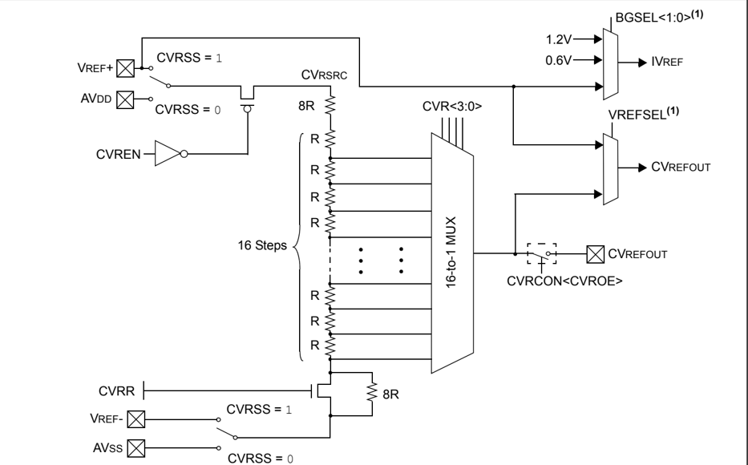
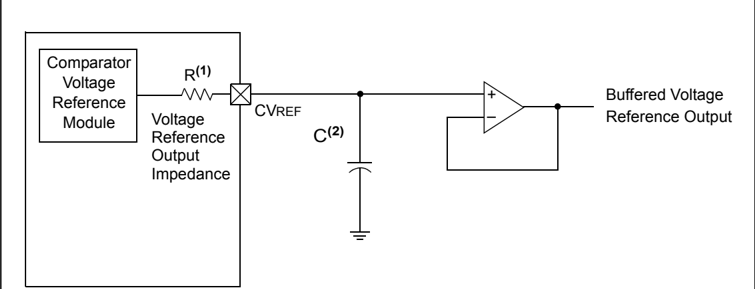

Microchip

## Section 20. Comparator Voltage Reference

## HIGHLIGHTS

This section of the manual contains the following major topics:

|   20.1 | Introduction ..................................................................................................................20-2   |
|--------|---------------------------------------------------------------------------------------------------------------------------------------|
|   20.2 | Comparator Voltage Reference Control Register.........................................................20-3                            |
|   20.3 | Operation .....................................................................................................................20-4   |
|   20.4 | Interrupts......................................................................................................................20-6  |
|   20.5 | I/O Pin Control .............................................................................................................20-6     |
|   20.6 | Operation in Power-Saving and Debug Modes............................................................20-7                             |
|   20.7 | Effects of Resets..........................................................................................................20-7       |
|   20.8 | Related Application Notes............................................................................................20-8             |
|   20.9 | Revision History...........................................................................................................20-9       |

Note: This family reference manual section is meant to serve as a complement to device data sheets. Depending on the device variant, this manual section may not apply to all PIC32 devices.

[Please consult the note at the beginning of the 'Comparator Voltage Reference' chapter in the current device data sheet to check whether this document supports the device you are using.](http://www.microchip.com/)

Device  data  sheets  and  family  reference  manual  sections  are  available  for download from the Microchip Worldwide Web site at: http://www.microchip.com

## 20.1 INTRODUCTION

The Comparator Voltage Reference module is a 16-tap, resistor ladder network that provides a selectable  reference  voltage.  Although  its  primary  purpose  is  to  provide  a  reference  for  the analog comparators, it also may be used independently of them.

A block diagram of the module is illustrated in Figure 20-1. The resistor ladder is segmented to provide two ranges of voltage reference values and has a power-down function to conserve power when the reference is not used. The module's supply reference can be provided from either device AVDD/AVSS or an external voltage reference. The module output is available for the comparators and typically available for pin output. For more information, refer to the 'Comparator Voltage Reference' chapter in the specific device data sheet.

The Comparator Voltage Reference module has the following features:

- High-range and low-range selection
- Sixteen output levels available for each range
- Internally connected to comparators to conserve device pins
- Output can be connected to a pin

Figure 20-1: Comparator Voltage Reference Block Diagram

Note 1: These bits are not available on all devices. On such devices, CVREF is generated by the resistor network and IVREF is connected to 1.2V. Refer to the 'Comparator Voltage Reference' chapter in the specific device data sheet for availability.

## 20.2 COMPARATOR VOLTAGE REFERENCE CONTROL REGISTER

## Register 20-1: CVRCON: Comparator Voltage Reference Control Register

| Bit Range   | Bit 31/23/15/7   | Bit 30/22/14/6   | Bit 29/21/13/5   | Bit 28/20/12/4   | Bit 27/19/11/3   | Bit 26/18/10/2   | Bit 25/17/9/1   | Bit 24/16/8/0   |
|-------------|------------------|------------------|------------------|------------------|------------------|------------------|-----------------|-----------------|
| 31:24       | U-0              | U-0              | U-0              | U-0              | U-0              | U-0              | U-0             | U-0             |
| 31:24       | -                | -                | -                | -                | -                | -                | -               | -               |
| 23:16       | U-0              | U-0              | U-0              | U-0              | U-0              | U-0              | U-0             | U-0             |
| 23:16       | -                | -                | -                | -                | -                | -                | -               | -               |
| 15:8        | R/W-0            | U-0              | U-0              | U-0              | U-0              | R/W-0            | R/W-0           | R/W-1           |
| 15:8        | ON (1)           | -                | -                | -                | -                | VREFSEL (2)      | BGSEL<1:0> (2)  | BGSEL<1:0> (2)  |
| 7:0         | U-0              | R/W-0            | R/W-0            | R/W-0            | R/W-0            | R/W-0            | R/W-0           | R/W-0           |
| 7:0         | -                | CVROE            | CVRR             | CVRSS            | CVR<3:0>         | CVR<3:0>         | CVR<3:0>        | CVR<3:0>        |

## Legend:

R = Readable bit

W = Writable bit

U = Unimplemented bit, read as '0'

-n = Value at POR

'1' = Bit is set

'0' = Bit is cleared

x = Bit is unknown

bit 31-16 Unimplemented: Read as ' 0 '

bit 15

ON: Comparator Voltage Reference On bit (1)

- 1 = Module is enabled, setting this bit does not affect other bits in the register.

- 0 = Module is disabled and does not consume current. Clearing this bit does not affect the other bits in the register

bit 14-11 Un imp le mn ted: Read as ' 0 '

bit 10 VREFSEL: Voltage Reference Select bit (2)

1 = CVREF = VREF+

0 = CVREF is generated by the resistor network

bit 9-8 BGSEL&lt;1:0&gt;: Band Gap Reference Source bits

(2)

11 = IVREF = VREF+

10 = Reserved

01 = IVREF = 0.6V (nominal, default)

00 = IVREF = 1.2V (nominal)

bit 7 Unimplemented: Read as ' 0 '

bit 6 CVROE: CVREFOUT Enable bit

1 = Voltage level is output on CVREFOUT pin

0 = Voltage level is disconnected from CVREFOUT pin

bit 5 CVRR: CVREF Range Selection bit

1 = 0 to 0.67 CVRSRC, with CVRSRC/24 step size

0 = 0.25 CVRSRC to 0.75 CVRSRC, with CVRSRC/32 step size

bit 4 CVRSS: CVREF Source Selection bit

1 = Comparator voltage reference source, CVRSRC = (VREF+) - (VREF-)

0 = Comparator voltage reference source, CVRSRC = AVDD - AVSS

bit 3-0

CVR&lt;3:0&gt;: CVREF Value Selection 0 ≤ CVR&lt;3:0&gt; ≤ 15 bits

When CVRR = 1 :

CVREF = (CVR&lt;3:0&gt;/24) • (CVRSRC)

When CVRR = 0 :

CVREF = 1/4 • (CVRSRC) + (CVR&lt;3:0&gt;/32) • (CVRSRC)

- Note 1: When using 1:1 PBCLK divisor, the user software should not read or write the peripheral's SFRs in the SYSCLK cycle immediately following the instruction that clears the module's ON bit.

- 2: These bits are not available on all devices and the reset value is ' 0 ' for devices without these bits. Refer to the 'Comparator Voltage Reference' chapter in the specific device data sheet for availability.

20

## 20.3 OPERATION

## 20.3.1 CVREF Output

The  Comparator  Voltage  Reference  module  is  controlled  through  the  CVRCON  register (Register 20-1). This module provides two ranges of output voltage, each with 16 distinct levels. The  range  to  be  used  is  selected  by  the  CVRR  bit  (CVRCON&lt;5&gt;).  The  primary  difference between  the  ranges  is  the  size  of  the  steps  selected  by  the  CVREF  value  selection  bits, CVR&lt;3:0&gt;, with one range offering finer resolution and the other offering a wider range of output voltage. The typical output voltages are listed in Table 20-1.

The equations used to calculate the CVREF output are as follows:

If CVRR  = 1 : Voltage Reference = ((CVR&lt;3:0&gt;)/24) x (CVRSRC)

If CVRR = 0 : Voltage Reference = (CVRSRC/4) + ((CVR&lt;3:0&gt;)/32) x (CVRSRC)

The CVREF Source Voltage (CVRSRC) can come from either AVDD and AVSS, or the external VREF+ and VREF- pins that are multiplexed with I/O pins. The voltage source is selected by the CVRSS bit (CVRCON&lt;4&gt;). The voltage reference is output to the CVREFOUT pin by setting the CVROE bit (CVRCON&lt;6&gt;), which overrides the corresponding TRIS bit setting.

The  settling  time  of  the  Comparator  Voltage  Reference  module  must  be  considered  when changing  the  CVREF  output.  For  more  information,  refer  to  the 'Comparator  Voltage Reference' chapter in the specific device data sheet.

Table 20-1: Typical Voltage Reference in Volts (CVRSRC = 3.3)

| CVR<3:0>   | Voltage Reference    | Voltage Reference    |
|------------|----------------------|----------------------|
| CVR<3:0>   | CVRR = 0 (CVRCON<5>) | CVRR = 1 (CVRCON<5>) |
| 0          | 0.83V                | 0.00V                |
| 1          | 0.93V                | 0.14V                |
| 2          | 1.03V                | 0.28V                |
| 3          | 1.13V                | 0.41V                |
| 4          | 1.24V                | 0.55V                |
| 5          | 1.34V                | 0.69V                |
| 6          | 1.44V                | 0.83V                |
| 7          | 1.55V                | 0.96V                |
| 8          | 1.65V                | 1.10V                |
| 9          | 1.75V                | 1.24V                |
| 10         | 1.86V                | 1.38V                |
| 11         | 1.96V                | 1.51V                |
| 12         | 2.06V                | 1.65V                |
| 13         | 2.17V                | 1.79V                |
| 14         | 2.27V                | 1.93V                |
| 15         | 2.37V                | 2.06V                |

## 20.3.2 CVREF Output Considerations

The full range of voltage reference cannot be realized due to the construction of the module. The transistors on the top and bottom of the resistor ladder network (see Figure 20-1) keep the voltage reference from approaching the reference source rails. The voltage reference is derived from the reference source. Therefore, the voltage reference output changes with fluctuations in that source. Refer to the 'Electrical Characteristics' chapter in the specific device data sheet for the electrical specifications. Table 20-2 lists the typical output impedances for the Comparator Voltage Reference module.

Table 20-2: Typical CVREF Output Impedance in kilohms

| CVR<3:0>   | Voltage Reference    | Voltage Reference    |
|------------|----------------------|----------------------|
| CVR<3:0>   | CVRR = 0 (CVRCON<5>) | CVRR = 1 (CVRCON<5>) |
| 0          | 12k                  | 0.5k                 |
| 1          | 13k                  | 1.9k                 |
| 2          | 13.8k                | 3.7k                 |
| 3          | 14.4k                | 5.3k                 |
| 4          | 15k                  | 6.7k                 |
| 5          | 15.4k                | 7.9k                 |
| 6          | 15.8k                | 9k                   |
| 7          | 15.9k                | 9.9k                 |
| 8          | 16k                  | 10.7k                |
| 9          | 15.9k                | 11.3k                |
| 10         | 15.8k                | 11.7k                |
| 11         | 15.4k                | 11.9k                |
| 12         | 15k                  | 12k                  |
| 13         | 14.4k                | 11.9k                |
| 14         | 13.8k                | 11.7k                |
| 15         | 12.9k                | 11.3k                |

## 20.3.3 IVREF Output

The Comparator Voltage Reference module provides selection for the internal voltage reference. The Band Gap Reference Source Select bits (BGSEL&lt;1:0&gt;) allow voltage selection of 1.2V or 0.6V, which is generated internally. Refer to the 'Electrical Characteristics' chapter  in  the specific device data sheet for the IVREF specifications.

## 20.4 INTERRUPTS

There are no Interrupt  Configuration  registers  or  bits  for  the  Comparator  Voltage  Reference module. The Comparator Voltage Reference module does not generate interrupts.

## 20.5 I/O PIN CONTROL

The Comparator Voltage Reference module can output to a pin. When the module is enabled and the CVROE bit (CVRCON&lt;6&gt;) is ' 1 ', the output driver for the CVREFOUT pin is disabled and the CVREF voltage is available at the pin.

For operation, the TRISx bit corresponding to the CVREFOUT pin must be a ' 1 '. This disables the digital input mode for the pin and prevents undesired current draw resulting from applying an analog voltage to a digital input pin. The output buffer has very limited drive capability. An external buffer amplifier is recommended for any application that uses the CVREF voltage externally. An output capacitor may be used to reduce output noise. Use of an output capacitor will increase settling time (see Figure 20-2).

Figure 20-2: Comparator Voltage Reference Output Buffer Example

- Note 1: R is dependent on the Comparator Voltage Reference Control bits CVRR (CVRCON&lt;5&gt;) and CVR&lt;3:0&gt; (CVRCON&lt;3:0&gt;). For more information, see Table 20-2.
- 2: Use of an output capacitor will increase settling time. Capacitor value selection is dependent on the CVR&lt;3:0&gt; and CVRR settings, and the frequency to be attenuated.

## 20.6 OPERATION IN POWER-SAVING AND DEBUG MODES

## 20.6.1 Operation in Sleep Mode

The Comparator Voltage Reference module continues to operate in Sleep mode. The CVRCON register is not affected when the device enters or wakes from Sleep mode. If the CVREF voltage is not used in Sleep mode, the module can be disabled by clearing the ON bit (CVRCON&lt;15&gt;) prior to entering Sleep mode to conserve power.

## 20.6.2 Operation in Idle Mode

The Comparator Voltage Reference module continues to operate in Idle mode. The CVRCON register is not affected when the device enters or exits Idle mode. There is no provision to automatically disable the module in Idle mode. If the CVREF voltage is not used in Idle mode, the module can be disabled by clearing the ON bit (CVRCON&lt;15&gt;) prior to entering Idle mode to conserve power.

## 20.6.3 Operation in Debug Mode

The Comparator Voltage Reference module continues to operate while the device is in Debug mode. The module does not support Freeze mode.

## 20.7 EFFECTS OF RESETS

All resets disable the voltage reference by forcing all bits in the CVRCON register to ' 0 '.

## 20.8 RELATED APPLICATION NOTES

This  section  lists  application  notes  that  are  related  to  this  section  of  the  manual.  These application  notes  may  not  be  written  specifically  for  the  PIC32  family  device  family,  but  the concepts are pertinent and could be used with modification and possible limitations. The current application notes related to the Comparator Voltage Reference module are:

## Title

Related application notes are not available.

Note:

Application Note #

N/A

Please visit the Microchip web site (www.microchip.com) for additional application notes and code examples for the PIC32 family of devices.

## 20.9 REVISION HISTORY

## Revision A (October 2007)

This is the initial released version of this document.

## Revision B (October 2007)

Updated document to remove Confidential status.

## Revision C (April 2008)

Revised status to Preliminary; Revised U-0 to r-x.

## Revision D (June 2008)

Revised Figure 20-1; Change Reserved bits from 'Maintain as' to 'Write'; Added Note to ON bit (CVRCON Register).

## Revision E (August 2010)

This revision includes the following updates:

- Updated the Comparator Voltage Reference Block Diagram (see Figure 20-1)
- Added notes regarding the INV, SET, and CLR registers to the Oscillators SFR Summary (see Table 20-1)
- Updated the Comparator Voltage Reference Control Register (see Register 20-1)
- Removed the CVRCONINV, CVRCONSET, and CVRCONCLR registers
- Removed 20.3.3 'Initialization'
- Added new section 20.3.3 'IVREF Output'
- Removed Table 20-4: Pins Associated with a Comparator
- Removed 20.8 'Design Tips'
- Minor corrections to formatting and text were incorporated throughout the document

## Revision F (May 2011)

This revision includes the following updates:

- Updated the Comparator Voltage Reference Block Diagram (see Figure 20-1)
- Removed the Comparator Voltage Reference SFR Summary (Table 20-1) and related text
- Updated the BGSEL&lt;1:0&gt; bit value for ' 10 ' to Reserved and modified the Notes in the CVRCON register (see Register 20-1)
- Updated the allowable voltage reference selections in 20.3.3 'IVREF Output'
- Minor updates to text and formatting were incorporated throughout the document

## Revision G (May 2012)

This revision includes the following updates:

- Changed references to VSS and VDD to: AVSS and AVDD, respectively, in 20.1 'Introduction' and 20.3.1 'CVREF Output'
- Minor updates to text and formatting were incorporated throughout the document

20

NOTES:

## Note the following details of the code protection feature on Microchip devices:

- Microchip products meet the specification contained in their particular Microchip Data Sheet.
- Microchip believes that its family of products is one of the most secure families of its kind on the market today, when used in the intended manner and under normal conditions.
- There are dishonest and possibly illegal methods used to breach the code protection feature. All of these methods, to our knowledge, require using the Microchip products in a manner outside the operating specifications contained in Microchip's Data Sheets. Most likely, the person doing so is engaged in theft of intellectual property.
- Microchip is willing to work with the customer who is concerned about the integrity of their code.
- Neither Microchip nor any other semiconductor manufacturer can guarantee the security of their code. Code protection does not mean that we are guaranteeing the product as 'unbreakable.'

Code protection is constantly evolving. We at Microchip are committed to continuously improving the code protection features of our products. Attempts to break Microchip's code protection feature may be a violation of the Digital Millennium Copyright Act. If such acts allow unauthorized access to your software or other copyrighted work, you may have a right to sue for relief under that Act.

Information  contained  in  this  publication  regarding  device applications and the like is provided only for your convenience and may be superseded by updates. It is your responsibility to ensure  that  your  application  meets  with  your  specifications. MICROCHIP MAKES NO REPRESENTATIONS OR WARRANTIES  OF  ANY  KIND  WHETHER  EXPRESS  OR IMPLIED, WRITTEN OR ORAL, STATUTORY OR OTHERWISE, RELATED TO THE INFORMATION, INCLUDING  BUT  NOT  LIMITED  TO  ITS  CONDITION, QUALITY, PERFORMANCE, MERCHANTABILITY OR FITNESS  FOR  PURPOSE . Microchip  disclaims  all  liability arising  from  this  information  and  its  use.  Use  of  Microchip devices in life support and/or safety applications is entirely at the buyer's risk, and the buyer agrees to defend, indemnify and hold  harmless  Microchip  from  any  and  all  damages,  claims, suits,  or  expenses  resulting  from  such  use.  No  licenses  are conveyed, implicitly or otherwise, under any Microchip intellectual property rights.

## QUALITY MANAGEMENT SYSTEM CERTIFIED BY DNV

== ISO/TS 16949 ==

## Trademarks

The Microchip name and logo, the Microchip logo, dsPIC, KEELOQ, KEELOQ logo, MPLAB, PIC, PICmicro, PICSTART, PIC 32  logo, rfPIC and UNI/O are registered trademarks of Microchip Technology Incorporated in the U.S.A. and other countries.

FilterLab, Hampshire, HI-TECH C, Linear Active Thermistor, MXDEV, MXLAB, SEEVAL and The Embedded Control Solutions Company are registered trademarks of Microchip Technology Incorporated in the U.S.A.

Analog-for-the-Digital Age, Application Maestro, chipKIT, chipKIT logo, CodeGuard, dsPICDEM, dsPICDEM.net, dsPICworks, dsSPEAK, ECAN, ECONOMONITOR, FanSense, HI-TIDE, In-Circuit Serial Programming, ICSP, Mindi, MiWi, MPASM, MPLAB Certified logo, MPLIB, MPLINK, mTouch, Omniscient Code Generation, PICC, PICC-18, PICDEM, PICDEM.net, PICkit, PICtail, REAL ICE, rfLAB, Select Mode, Total Endurance, TSHARC, UniWinDriver, WiperLock and ZENA are trademarks of Microchip Technology Incorporated in the U.S.A. and other

countries.

SQTP is a service mark of Microchip Technology Incorporated in the U.S.A.

All other trademarks mentioned herein are property of their respective companies.

© 2007-2012, Microchip Technology Incorporated, Printed in the U.S.A., All Rights Reserved.

Printed on recycled paper.

ISBN: 978-1-62076-303-2

Microchip received ISO/TS-16949:2009 certification for its worldwide headquarters, design and wafer fabrication facilities in Chandler and Tempe, Arizona; Gresham, Oregon and design centers in California and India. The Company's quality system processes and procedures are for its PIC ®  MCUs and dsPIC ®  DSCs, KEELOQ ®  code hopping devices, Serial EEPROMs, microperipherals, nonvolatile memory and analog products. In addition, Microchip's quality system for the design and manufacture of development systems is ISO 9001:2000 certified.

## Worldwide Sales and Service

## ASIA/PACIFIC

Asia Pacific Office Suites 3707-14, 37th Floor Tower 6, The Gateway Harbour City, Kowloon Hong Kong Tel: 852-2401-1200 Fax: 852-2401-3431

Australia - Sydney Tel: 61-2-9868-6733 Fax: 61-2-9868-6755

China - Beijing Tel: 86-10-8569-7000 Fax: 86-10-8528-2104

China - Chengdu Tel: 86-28-8665-5511 Fax: 86-28-8665-7889

China - Chongqing Tel: 86-23-8980-9588 Fax: 86-23-8980-9500

China - Hangzhou Tel: 86-571-2819-3187 Fax: 86-571-2819-3189

China - Hong Kong SAR Tel: 852-2401-1200 Fax: 852-2401-3431

China - Nanjing Tel: 86-25-8473-2460 Fax: 86-25-8473-2470

China - Qingdao Tel: 86-532-8502-7355 Fax: 86-532-8502-7205

China - Shanghai Tel: 86-21-5407-5533 Fax: 86-21-5407-5066

China - Shenyang Tel: 86-24-2334-2829 Fax: 86-24-2334-2393

China - Shenzhen Tel: 86-755-8203-2660 Fax: 86-755-8203-1760

China - Wuhan Tel: 86-27-5980-5300 Fax: 86-27-5980-5118

China - Xian Tel: 86-29-8833-7252 Fax: 86-29-8833-7256

China - Xiamen Tel: 86-592-2388138 Fax: 86-592-2388130

China - Zhuhai Tel: 86-756-3210040 Fax: 86-756-3210049

## ASIA/PACIFIC

India - Bangalore Tel: 91-80-3090-4444 Fax: 91-80-3090-4123

India - New Delhi Tel: 91-11-4160-8631 Fax: 91-11-4160-8632

India - Pune Tel: 91-20-2566-1512 Fax: 91-20-2566-1513

Japan - Osaka Tel: 81-66-152-7160 Fax: 81-66-152-9310

Japan - Yokohama Tel: 81-45-471- 6166 Fax: 81-45-471-6122

Korea - Daegu Tel: 82-53-744-4301 Fax: 82-53-744-4302

Korea - Seoul Tel: 82-2-554-7200 Fax: 82-2-558-5932 or 82-2-558-5934

Malaysia - Kuala Lumpur Tel: 60-3-6201-9857 Fax: 60-3-6201-9859

Malaysia - Penang Tel: 60-4-227-8870 Fax: 60-4-227-4068

Philippines - Manila Tel: 63-2-634-9065 Fax: 63-2-634-9069

Singapore Tel: 65-6334-8870 Fax: 65-6334-8850

Taiwan - Hsin Chu Tel: 886-3-5778-366 Fax: 886-3-5770-955

Taiwan - Kaohsiung Tel: 886-7-536-4818 Fax: 886-7-330-9305

Taiwan - Taipei Tel: 886-2-2500-6610 Fax: 886-2-2508-0102

Thailand - Bangkok Tel: 66-2-694-1351 Fax: 66-2-694-1350

## AMERICAS

Corporate Office 2355 West Chandler Blvd. Chandler, AZ 85224-6199 Tel: 480-792-7200 Fax: 480-792-7277 Technical Support:

http://www.microchip.com/ support

Web Address:

www.microchip.com

Atlanta Duluth, GA Tel: 678-957-9614 Fax: 678-957-1455

## Boston

Westborough, MA Tel: 774-760-0087 Fax: 774-760-0088

## Chicago

Itasca, IL Tel: 630-285-0071 Fax: 630-285-0075

Cleveland Independence, OH Tel: 216-447-0464 Fax: 216-447-0643

Dallas

Addison, TX Tel: 972-818-7423 Fax: 972-818-2924

Detroit

Farmington Hills, MI Tel: 248-538-2250 Fax: 248-538-2260

Indianapolis Noblesville, IN Tel: 317-773-8323 Fax: 317-773-5453

## Los Angeles

Mission Viejo, CA Tel: 949-462-9523 Fax: 949-462-9608

## Santa Clara

Santa Clara, CA Tel: 408-961-6444 Fax: 408-961-6445

Toronto Mississauga, Ontario, Canada Tel: 905-673-0699 Fax: 905-673-6509

## EUROPE

Austria - Wels Tel: 43-7242-2244-39 Fax: 43-7242-2244-393

Denmark - Copenhagen Tel: 45-4450-2828 Fax: 45-4485-2829

France - Paris Tel: 33-1-69-53-63-20 Fax: 33-1-69-30-90-79

Germany - Munich Tel: 49-89-627-144-0 Fax: 49-89-627-144-44

Italy - Milan Tel: 39-0331-742611 Fax: 39-0331-466781

Netherlands - Drunen Tel: 31-416-690399 Fax: 31-416-690340

Spain - Madrid Tel: 34-91-708-08-90 Fax: 34-91-708-08-91

UK - Wokingham Tel: 44-118-921-5869 Fax: 44-118-921-5820

11/29/11