Microchip

## Section 21. UART

This section of the manual contains the following major topics:

|   21.1 | Introduction ..................................................................................................................21-2   |                                                                                                                       |
|--------|---------------------------------------------------------------------------------------------------------------------------------------|-----------------------------------------------------------------------------------------------------------------------|
|   21.2 | Control Registers .........................................................................................................21-4       |                                                                                                                       |
|   21.3 | UART Baud Rate Generator ......................................................................................21-13                  |                                                                                                                       |
|   21.4 | UART Configuration...................................................................................................21-17            |                                                                                                                       |
|   21.5 | UART Transmitter ......................................................................................................21-18          |                                                                                                                       |
|   21.6 | Data Bit Detection......................................................................................................21-21         |                                                                                                                       |
|   21.7 | UART Receiver ..........................................................................................................21-22         |                                                                                                                       |
|   21.8 | Using the UART for 9-bit Communication..................................................................21-25                         |                                                                                                                       |
|   21.9 | Receiving Break Sequence........................................................................................21-27                 |                                                                                                                       |
|  21.10 | Initialization                                                                                                                        | ................................................................................................................21-27 |
|  21.11 | Other UART Features ................................................................................................21-28             |                                                                                                                       |
|  21.12 | Operation of UxCTS and UxRTS Control Pins                                                                                             | ..........................................................21-31                                                       |
|  21.13 | Infrared Support.........................................................................................................21-33        |                                                                                                                       |
|  21.14 | Interrupts....................................................................................................................21-35   |                                                                                                                       |
|  21.15 | I/O Pin Control                                                                                                                       | ...........................................................................................................21-35      |
|  21.16 | UART Operation in Power-Saving Modes..................................................................21-36                           |                                                                                                                       |
|  21.17 | Effects of Various Resets...........................................................................................21-38             |                                                                                                                       |
|  21.18 | Related Application Notes..........................................................................................21-39              |                                                                                                                       |
|  21.19 | Revision History .........................................................................................................21-40       |                                                                                                                       |

Note: This family reference manual section is meant to serve as a complement to device data sheets. Depending on the device variant, this manual section may not apply to all PIC32 devices.

Please consult the note at the beginning of the 'UART' chapter in the specific device data sheet to check whether this document supports the device you are using.

Device  data  sheets  and  family  reference  manual  sections  are  available  for download from the Microchip Worldwide Web site at: http://www.microchip.com

## 21.1 INTRODUCTION

The  Universal Asynchronous  Receiver  Transmitter  (UART)  module  is  one  of  the  serial  I/O modules available in the PIC32 family of devices. The UART is a full-duplex, asynchronous communication channel that  communicates with peripheral  devices  and personal computers through protocols, such as RS-232, RS-485, LIN 1.2 and IrDA ® .

Depending on the device variant, the UART module supports the hardware flow control option, with UxCTS and UxRTS pins, and it may also include the IrDA encoder and decoder. For more information, refer to the 'UART' chapter in the specific device data sheet.

The primary features of the UART module are:

- Full-duplex, 8-bit or 9-bit data transmission
- Even, Odd or No Parity options (for 8-bit data)
- One or two Stop bits
- Hardware auto-baud feature
- Fully integrated Baud Rate Generator (BRG) with 16-bit prescaler (see Note 1 &amp; Note 2)
- Supports wide range of Baud Rates (see Note 2)
- Separate receive and transmit First-In First-Out (FIFO) data buffers
- Parity, framing and buffer overrun error detection
- Support for interrupt only on address detect (ninth bit = 1 )
- Separate transmit and receive interrupts
- Support to run and receive data during Sleep mode
- Support to run under a receive overflow condition
- Configurable clock sources for the Baud Rate Generator (BRG)
- Loopback mode for diagnostic support
- LIN 1.2 protocol support

A simplified block diagram of the UART is illustrated in Figure 21-1. The UART module consists of these important hardware elements:

- Baud Rate Generator
- Asynchronous transmitter
- Asynchronous receiver and IrDA encoder/decoder

Note 1: Some devices support 20-bit prescaler.

- 2: Refer to the 'UART' chapter in the specific device data sheet for the actual value.

Figure 21-1: UART Simplified Block Diagram

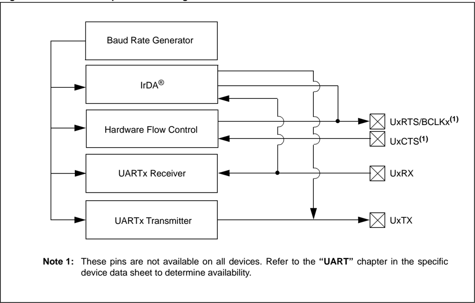

## 21.2 CONTROL REGISTERS

| Note:   | Each PIC32 family device variant may have one or more UART modules. An 'x' used in the names of pins, Control/Status bits and registers denotes the particular module. Refer to the 'UART' chapter in the specific device data sheet for more details.   |
|---------|----------------------------------------------------------------------------------------------------------------------------------------------------------------------------------------------------------------------------------------------------------|

Each UART module consists of the following Special Function Registers (SFRs):

## · UxMODE: UARTx Mode Register

This register does the following:

- -Enables or disables the UART module
- -Enables or disables the IrDA encoder and decoder
- -Enables or disables the WAKE, ABAUD and Loopback features
- -Enables or disables the UxRTS and UxCTS pins
- -Configures the UxRTS pin for the desired mode of operation
- -Configures the polarity of the UxRX pin
- -Selects the type of baud rate
- -Selects the number of data bits, parity and stop bits

Note:

The UxRTS and UxCTS pins are not available on all devices. Refer to the 'Pin Tables' section in the specific device data sheet to determine availability.

## · UxSTA: UARTx Status and Control Register

This register does the following:

- -Selects the Transmission Interrupt mode
- -Selects the Receive Interrupt mode
- -Enables or disables the UART transmission
- -Controls the Address Detect mode
- -Indicates various status conditions, such as transmit and receive buffer state, parity error, framing error and overflow error
- UxTXREG: UARTx Transmit Register

This register provides the data to be transmitted.

- UxRXREG: UARTx Receive Register

This register stores the received data.

- UxBRG: UARTx Baud Rate Register

This register stores the baud rate value of the transmitted or received data.

Each UART module also has associated bits for interrupt control:

Note: Refer to the 'Interrupts Controller' chapter in the specific device data sheet for availability and descriptions of these bits, and Section 8. 'Interrupts' (DS60001108) for additional information.

- Transmit Interrupt Enable Control bit (UxTXIE)
- Transmit Interrupt Flag Status bit (UXTXIF)
- Receive Interrupt Enable Control bit (UxRXIE)
- Receive Interrupt Flag Status bit (UxRXIF)
- Error Interrupt Enable Control bit (UxEIE)
- Error Interrupt Flag Status bit (UxEIF)
- Interrupt Priority Control bits (UxIP&lt;2:0&gt;)
- Interrupt Subpriority Control bits (UxIS&lt;1:0&gt;)

Table 21-1 summarizes all UART-related registers. Corresponding registers appear after the summary, followed by a detailed description of each register bit.

Table 21-1: UART SFRs Summary

| Register Name   | Bit Range   | Bits          | Bits          | Bits          | Bits          | Bits          | Bits          | Bits          | Bits          | Bits         | Bits         | Bits      | Bits      | Bits            | Bits            | Bits           | Bits           |
|-----------------|-------------|---------------|---------------|---------------|---------------|---------------|---------------|---------------|---------------|--------------|--------------|-----------|-----------|-----------------|-----------------|----------------|----------------|
| Register Name   | Bit Range   | 31/15         | 30/14         | 29/13         | 28/12         | 27/11         | 26/10         | 25/9          | 24/8          | 23/7         | 22/6         | 21/5      | 20/4      | 19/3            | 18/2            | 17/1           | 16/0           |
| UxMODE (1)      | 31:16       | -             | - -           | -             | -             |               | -             | -             | - SLPEN (2)   | ACTIVE (2)   | -            | -         | -         | CLKSEL<1:0> (2) | CLKSEL<1:0> (2) | RUNOVF (2)     |                |
| UxMODE (1)      | 15:0        | ON            | - SIDL        | IREN          | RTSMD (2)     | -             | UEN<1:0>      | UEN<1:0>      | (2) WAKE      | LPBACK       | ABAUD        | RXINV     | BRGH      | PDSEL<1:0>      | PDSEL<1:0>      | STSEL          |                |
| UxSTA (1)       | 31:16       | MASK<7:0> (2) | MASK<7:0> (2) | MASK<7:0> (2) | MASK<7:0> (2) | MASK<7:0> (2) | MASK<7:0> (2) | MASK<7:0> (2) | MASK<7:0> (2) |              |              |           |           |                 |                 |                |                |
| UxSTA (1)       | 31:16       | -             | -             | - -           | -             |               | -             | -             | ADM_EN (2)    | ADDR<7:0>    | ADDR<7:0>    | ADDR<7:0> | ADDR<7:0> | ADDR<7:0>       | ADDR<7:0>       | ADDR<7:0>      | ADDR<7:0>      |
| UxSTA (1)       | 15:0        | UTXISEL<1:0>  | UTXISEL<1:0>  | UTXINV        | URXEN         | UTXBRK        | UTXEN         | UTXBF         | TRMT          | URXISEL<1:0> | URXISEL<1:0> | ADDEN     | RIDLE     | PERR FERR       |                 | OERR           | URXDA          |
| UxTXREG         | 31:16       | -             | -             | -             | -             | -             | -             | -             | -             | -            | -            | -         | -         | -               | -               | -              | -              |
| UxTXREG         | 15:0        | -             | -             | -             | -             | -             | -             | - TX<8:0>     | - TX<8:0>     | - TX<8:0>    | - TX<8:0>    | - TX<8:0> | - TX<8:0> | - TX<8:0>       | - TX<8:0>       | - TX<8:0>      | - TX<8:0>      |
| UxRXREG         | 31:16       | -             | -             | - -           | -             | -             |               | -             | - -           |              | -            | -         | -         | -               | -               | -              | -              |
| UxRXREG         | 15:0        | -             | -             | - -           | -             |               | -             | - RX<8:0>     | - RX<8:0>     | - RX<8:0>    | - RX<8:0>    | - RX<8:0> | - RX<8:0> | - RX<8:0>       | - RX<8:0>       | - RX<8:0>      | - RX<8:0>      |
| UxBRG (1)       | 31:16       | -             | -             | - -           | -             | -             | -             | -             | -             | -            | -            | -         |           | BRG<19:16> (2)  | BRG<19:16> (2)  | BRG<19:16> (2) | BRG<19:16> (2) |
| UxBRG (1)       | 15:0        | BRG<15:0>     | BRG<15:0>     | BRG<15:0>     | BRG<15:0>     | BRG<15:0>     | BRG<15:0>     | BRG<15:0>     | BRG<15:0>     | BRG<15:0>    | BRG<15:0>    | BRG<15:0> | BRG<15:0> | BRG<15:0>       | BRG<15:0>       | BRG<15:0>      | BRG<15:0>      |

Note 1: This register has an associated Clear, Set, and Invert register at an offset of 0x4, 0x8, and 0xC bytes, respectively. The Clear, Set, and Invert registers share the same name with CLR, SET, or INV appended to the register name (e.g., UxMODECLR). Writing a ' 1 ' to any bit position in these registers will clear, set, or invert valid bits in the associated register. Reads from these registers should be ignored.

2: These bits are not available on all devices. Refer to the 'UART' chapter in the specific device data sheet to determine availability .

## PIC32 Family Reference Manual

## Register 21-1: UxMODE: UARTx Mode Register

| Bit Range   | Bit 31/23/15/7   | Bit 30/22/14/6   | Bit 29/21/13/5   | Bit 28/20/12/4   | Bit 27/19/11/3   | Bit 26/18/10/2   | Bit 25/17/9/1   | Bit 24/16/8/0   |
|-------------|------------------|------------------|------------------|------------------|------------------|------------------|-----------------|-----------------|
| 31:24       | U-0              | U-0              | U-0              | U-0              | U-0              | U-0              | U-0             | U-0             |
| 31:24       | -                | -                | -                | -                | -                | -                | -               | -               |
| 23:16       | R/W-0            | HS, HC, R-0      | U-0              | U-0              | U-0              | R/W-0            | R/W-0           | U-0             |
| 23:16       | SLPEN (2,3)      | ACTIVE (2)       | -                | -                | -                | CLKSEL<1:0> (2)  | CLKSEL<1:0> (2) | RUNOVF (2)      |
| 15:8        | R/W-0            | U-0              | R/W-0            | R/W-0            | R/W-0            | U-0              | R/W-0           | R/W-0           |
| 15:8        | ON (1)           | -                | SIDL             | IREN             | RTSMD (2)        | -                | UEN<1:0> (2)    | UEN<1:0> (2)    |
| 7:0         | R/W-0            | R/W-0            | R/W-0            | R/W-0            | R/W-0            | R/W-0            | R/W-0           | R/W-0           |
| 7:0         | WAKE             | LPBACK           | ABAUD            | RXINV            | BRGH             | PDSEL<1:0>       | PDSEL<1:0>      | STSEL           |

## Legend:

HS = Hardware set

HC = Hardware cleared

R = Readable bit

W = Writable bit

U = Unimplemented bit, read as '0'

-n = Value at POR

'1' = Bit is set

'0' = Bit is cleared

x = Bit is unknown

bit 31-24 Unimplemented: Read as ' 0 '

bit 23

SLPEN:

Run During Sleep Enable bit (2,3)

- 1 = UARTx BRG clock runs during Sleep mode

0 = UARTx BRG clock is turned off during Sleep mode

bit 22 ACTIVE: UARTx Module Running Status bit (2)

- 1 = UARTx module is active (UxMODE register should not be updated)
- 0 = UARTx module is not active (UxMODE register can be updated)

bit 21-19 Unimplemented: Read as ' 0 '

bit 18-17 CLKSEL&lt;1:0&gt;: UARTx Module BRG Clock Selection bits (2)

11 = BRG clock is PBCLK2

10 = BRG clock is FRC

01 = BRG clock is SYSCLK (turned off in Sleep mode)

00 = BRG clock is PBCLK2 (turned off in Sleep mode)

bit 16 RUNOVF: Run During Overflow Condition Mode bit (2)

- 1 = When an Overflow Error (OERR) condition is detected, the shift register continues to run to remain synchronized
- 0 =  When an Overflow Error (OERR) condition is detected, the shift register stops accepting new data (Legacy mode)

bit 15 ON: UARTx Enable bit (1)

- 1 = UARTx is enabled. UARTx pins are controlled by UARTx as defined by the UEN&lt;1:0&gt; and UTXEN control bits
- 0 = UARTx is disabled. All UARTx pins are controlled by corresponding bits in the PORTx, TRISx and LATx registers; UARTx power consumption is minimal

bit 14 Unimplemented: Read as ' 0 '

bit 13 SIDL: Stop in Idle Mode bit

- 1 = Discontinue operation when device enters Idle mode
- 0 = Continue operation in Idle mode
- Note 1: When using the 1:1 PBCLK divisor, the user software should not read/write the peripheral SFRs in the SYSCLK cycle immediately following the instruction that clears the module's ON bit.
- 2: These bits are not available on all devices. Refer to the 'UART' chapter in the specific device data sheet to determine availability.
- 3: SLPEN = 1 only applies if CLKSEL = FRC. All clocks, as well as the UART, are disabled in Deep Sleep mode.

## Register 21-1: UxMODE: UARTx Mode Register (Continued)

- bit 12 IREN: IrDA ®  Encoder and Decoder Enable bit

1 = IrDA is enabled

0 = IrDA is disabled

- bit 11 RTSMD: Mode Selection for UxRTS Pin bit (2)

1 = UxRTS pin is in Simplex mode

0 = UxRTS pin is in Flow Control mode

- bit 10 Unimplemented: Read as ' 0 '

bit 9-8 UEN&lt;1:0&gt;: UARTx Enable bits (2)

- 11 = UxTX, UxRX and UxBCLK pins are enabled and used; UxCTS pin is controlled by corresponding bits in the PORTx register

- 10 = UxTX, UxRX, UxCTS and UxRTS pins are enabled and used

- 01 = UxTX, UxRX and UxRTS pins are enabled and used; UxCTS pin is controlled by corresponding bits in the PORTx register

- 00 = UxTX and UxRX pins are enabled and used; UxCTS and UxRTS/UxBCLK pins are controlled by corresponding bits in the PORTx register

bit 7 WAKE: Enable Wake-up on Start bit Detect During Sleep Mode bit

- 1 = Wake-up enabled

- 0 = Wake-up disabled

- bit 6 LPBACK: UARTx Loopback Mode Select bit

- 1 = Loopback mode is enabled

- 0 = Loopback mode is disabled

bit 5 ABAUD: Auto-Baud Enable bit

- 1 = Enable baud rate measurement on the next character - requires reception of Sync character (0x55); cleared by hardware upon completion

- 0 = Baud rate measurement disabled or completed

bit 4

RXINV:

Receive Polarity Inversion bit

- 1 = UxRX Idle state is ' 0 '

- 0 = UxRX Idle state is ' 1 '

## bit 3 BRGH: High Baud Rate Enable bit

- 1 = High-Speed mode - 4x baud clock is enabled

- 0 = Standard Speed mode - 16x baud clock is enabled

## bit 2-1 PDSEL&lt;1:0&gt;: Parity and Data Selection bits

- 11 = 9-bit data, no parity

10 = 8-bit data, odd parity

01 = 8-bit data, even parity

00 = 8-bit data, no parity

## bit 0 STSEL: Stop Selection bit

- 1 = 2 Stop bits

0 = 1 Stop bit

- Note 1: When using the 1:1 PBCLK divisor, the user software should not read/write the peripheral SFRs in the SYSCLK cycle immediately following the instruction that clears the module's ON bit.
- 2: These bits are not available on all devices. Refer to the 'UART' chapter in the specific device data sheet to determine availability.
- 3: SLPEN = 1 only applies if CLKSEL = FRC. All clocks, as well as the UART, are disabled in Deep Sleep mode.

## PIC32 Family Reference Manual

## Register 21-2:

UxSTA: UARTx Status and Control Register

| Bit Range   | Bit 31/23/15/7   | Bit 30/22/14/6   | Bit 29/21/13/5   | Bit 28/20/12/4   | Bit 27/19/11/3   | Bit 26/18/10/2   | Bit 25/17/9/1   | Bit 24/16/8/0   |
|-------------|------------------|------------------|------------------|------------------|------------------|------------------|-----------------|-----------------|
| 31:24       | R/W-0            | R/W-0            | R/W-0            | R/W-0            | R/W-0            | R/W-0            | R/W-0           | R/W-0           |
| 31:24       | MASK<7:0> (2)    | MASK<7:0> (2)    | MASK<7:0> (2)    | MASK<7:0> (2)    | MASK<7:0> (2)    | MASK<7:0> (2)    | MASK<7:0> (2)   | MASK<7:0> (2)   |
| 31:24       | U-0              | U-0              | U-0              | U-0              | U-0              | U-0              | U-0             | R/W-0           |
| 31:24       | -                | -                | -                | -                | -                | -                | -               | ADM_EN (2)      |
| 23:16       | R/W-0            | R/W-0            | R/W-0            | R/W-0            | R/W-0            | R/W-0            | R/W-0           | R/W-0           |
| 23:16       | ADDR<7:0>        | ADDR<7:0>        | ADDR<7:0>        | ADDR<7:0>        | ADDR<7:0>        | ADDR<7:0>        | ADDR<7:0>       | ADDR<7:0>       |
| 15:8        | R/W-0            | R/W-0            | R/W-0            | R/W-0            | R/W-0            | R/W-0            | R-0             | R-1             |
| 15:8        | UTXISEL<1:0> (1) | UTXISEL<1:0> (1) | UTXINV           | URXEN            | UTXBRK           | UTXEN            | UTXBF           | TRMT            |
| 7:0         | R/W-0            | R/W-0            | R/W-0            | R-1              | R-0              | R-0              | R/W-0           | R-0             |
| 7:0         | URXISEL<1:0> (1) | URXISEL<1:0> (1) | ADDEN            | RIDLE            | PERR             | FERR             | OERR            | URXDA           |

## Legend:

R = Readable bit

W = Writable bit

U = Unimplemented bit, read as '0'

-n = Value at POR

'1' = Bit is set

'0' = Bit is cleared

x = Bit is unknown

## bit 31-25 MASK&lt;7:0&gt;: UARTx Address Match Mask bits (2)

11111111 = Corresponding ADDRx bits are used to detect the address match (3)

00000000 = Corresponding ADDRx bits are not used to detect the address match

These bits are used to mask the ADDR&lt;7:0&gt; bits.

## bit 24 ADM\_EN: Automatic Address Detect Mode Enable bit (2)

- 1 = Automatic Address Detect mode is enabled
- 0 = Automatic Address Detect mode is disabled

bit 23-16 ADDR&lt;7:0&gt;: Automatic Address Mask bits

These bits define the address character to use for automatic address detection.

bit 15-14 UTXISEL&lt;1:0&gt;: TX Interrupt Mode Selection bits (1)

For 4-level deep FIFO UART modules:

11 = Reserved, do not use

10 = Interrupt is generated when the transmit buffer becomes empty

01 = Interrupt is generated when all characters have been transmitted

00 = Interrupt is generated when the transmit buffer contains at least one empty space

## For 8-level deep FIFO UART modules:

11 = Reserved, do not use

10 = Interrupt is generated and asserted while the transmit buffer is empty

01 = Interrupt is generated and asserted when all characters have been transmitted

00 = Interrupt is generated and asserted while the transmit buffer contains at least one empty space

- Note 1: These bits have different functions depending on the available UART module. Refer to the 'UART' chapter in the specific device data sheet for availability and interrupt implementation.
- 2: These bits are not available on all devices. Refer to the 'UART' chapter in the specific device data sheet to determine availability.
- 3: This setting allows the user to assign an individual address and a group broadcast address to the UART module.

## Register 21-2: UxSTA: UARTx Status and Control Register (Continued)

- bit 13 UTXINV: Transmit Polarity Inversion bit

## If IrDA mode is disabled (i.e., IREN (UxMODE&lt;12&gt;) is ' 0 '):

- 1 = UxTX Idle state is ' 0 '
- 0 = UxTX Idle state is ' 1 '

## If IrDA mode is enabled (i.e., IREN (UxMODE&lt;12&gt;) is ' 1 '):

- 1 = IrDA encoded UxTX Idle state is ' 1 '
- 0 = IrDA encoded UxTX Idle state is ' 0 '
- bit 12 URXEN: Receiver Enable bit
- 1 = UARTx receiver is enabled. UxRX pin is controlled by UARTx (if ON = 1 )
- 0 = UARTx receiver is disabled. UxRX pin is ignored by the UARTx module. UxRX pin is controlled by port.
- bit 11 UTXBRK: Transmit Break bit
- 1 = Send Break on next transmission. Start bit followed by twelve ' 0 ' bits, followed by Stop bit; cleared by hardware upon completion
- 0 = Break transmission is disabled or completed
- bit 10 UTXEN: Transmit Enable bit
- 1 = UARTx transmitter is enabled. UxTX pin is controlled by UARTx (if ON = 1 )
- 0 = UARTx transmitter is disabled. Any pending transmission is aborted and buffer is Reset. UxTX pin is controlled by port.
- bit 9 UTXBF: Transmit Buffer Full Status bit (read-only)
- 1 = Transmit buffer is full
- 0 = Transmit buffer is not full, at least one more character can be written
- bit 8 TRMT: Transmit Shift Register is Empty bit (read-only)
- 1 = Transmit shift register is empty and transmit buffer is empty (the last transmission has completed)
- 0 = Transmit shift register is not empty, a transmission is in progress or queued in the transmit buffer
- bit 7-6 URXISEL&lt;1:0&gt;: Receive Interrupt Mode Selection bit (1)

## For 4-level deep FIFO UART modules:

- 11 = Interrupt flag bit is set when receive buffer becomes full (i.e., has 4 data characters)
- 10 = Interrupt flag bit is set when receive buffer becomes 3/4 full (i.e., has 3 data characters)
- 0x = Interrupt flag bit is set when a character is received

## For 8-level deep FIFO UART modules:

- 11 = Reserved; do not use
- 10 = Interrupt flag bit is asserted while receive buffer is 3/4 or more full (i.e., has 6 or more data characters)
- 01 = Interrupt flag bit is asserted while receive buffer is 1/2 or more full (i.e., has 4 or more data characters)
- 00 = Interrupt flag bit is asserted while receive buffer is not empty (i.e., has at least 1 data character)
- bit 5 ADDEN: Address Character Detect bit (bit 8 of received data = 1 )
- 1 = Address Detect mode is enabled. If 9-bit mode is not selected, this control bit has no effect.
- 0 = Address Detect mode is disabled
- bit 4 RIDLE: Receiver Idle bit (read-only)
- 1 = Receiver is Idle
- 0 = Data is being received
- bit 3 PERR: Parity Error Status bit (read-only)
- 1 = Parity error has been detected for the current character
- 0 = Parity error has not been detected
- bit 2 FERR: Framing Error Status bit (read-only)
- 1 = Framing error has been detected for the current character
- 0 = Framing error has not been detected
- Note 1: These bits have different functions depending on the available UART module. Refer to the 'UART' chapter in the specific device data sheet for availability and interrupt implementation.
- 2: These bits are not available on all devices. Refer to the 'UART' chapter in the specific device data sheet to determine availability.
- 3: This setting allows the user to assign an individual address and a group broadcast address to the UART module.

## PIC32 Family Reference Manual

## Register 21-2: UxSTA: UARTx Status and Control Register (Continued)

bit 1 OERR: Receive Buffer Overrun Error Status bit.

This bit is set in hardware and can only be cleared (= 0 ) in software. Clearing a previously set OERR bit resets the receiver buffer and RSR to empty state.

- 1 = Receive buffer has overflowed

- 0 = Receive buffer has not overflowed

- bit 0 URXDA: Receive Buffer Data Available bit (read-only)

- 1 = Receive buffer has data, at least one more character can be read

- 0 = Receive buffer is empty

- Note 1: These bits have different functions depending on the available UART module. Refer to the 'UART' chapter in the specific device data sheet for availability and interrupt implementation.
- 2: These bits are not available on all devices. Refer to the 'UART' chapter in the specific device data sheet to determine availability.
- 3: This setting allows the user to assign an individual address and a group broadcast address to the UART module.

## Register 21-3: UxTXREG: UARTx Transmit Register

| Bit Range   | Bit 31/23/15/7   | Bit 30/22/14/6   | Bit 29/21/13/5   | Bit 28/20/12/4   | Bit 27/19/11/3   | Bit 26/18/10/2   | Bit 25/17/9/1   | Bit 24/16/8/0   |
|-------------|------------------|------------------|------------------|------------------|------------------|------------------|-----------------|-----------------|
| 31:24       | U-0              | U-0              | U-0              | U-0              | U-0              | U-0              | U-0             | U-0             |
| 31:24       | -                | -                | -                | -                | -                | -                | -               | -               |
| 23:16       | U-0              | U-0              | U-0              | U-0              | U-0              | U-0              | U-0             | U-0             |
| 23:16       | -                | -                | -                | -                | -                | -                | -               | -               |
| 15:8        | U-0              | U-0              | U-0              | U-0              | U-0              | U-0              | U-0             | R/W-0           |
| 15:8        | -                | -                | -                | -                | -                | -                | -               | TX<8>           |
| 7:0         | R/W-0            | R/W-0            | R/W-0            | R/W-0            | R/W-0            | R/W-0            | R/W-0           | R/W-0           |
| 7:0         | TX<7:0>          | TX<7:0>          | TX<7:0>          | TX<7:0>          | TX<7:0>          | TX<7:0>          | TX<7:0>         | TX<7:0>         |

## Legend:

R = Readable bit

W = Writable bit

U = Unimplemented bit, read as '0'

-n = Value at POR

'1' = Bit is set

'0' = Bit is cleared

x = Bit is unknown

bit 31-9 Unimplemented:

Read as ' 0 '

bit 8-0 TX&lt;8:0&gt;: Data bits 8-0 of the character to be transmitted

## Register 21-4: UxRXREG: UARTx Receive Register

| Bit Range   | Bit 31/23/15/7   | Bit 30/22/14/6   | Bit 29/21/13/5   | Bit 28/20/12/4   | Bit 27/19/11/3   | Bit 26/18/10/2   | Bit 25/17/9/1   | Bit 24/16/8/0   |
|-------------|------------------|------------------|------------------|------------------|------------------|------------------|-----------------|-----------------|
| 31:24       | U-0              | U-0              | U-0              | U-0              | U-0              | U-0              | U-0             | U-0             |
| 31:24       | -                | -                | -                | -                | -                | -                | -               | -               |
| 23:16       | U-0              | U-0              | U-0              | U-0              | U-0              | U-0              | U-0             | U-0             |
| 23:16       | -                | -                | -                | -                | -                | -                | -               | -               |
| 15:8        | U-0              | U-0              | U-0              | U-0              | U-0              | U-0              | U-0             | R-0             |
| 15:8        | -                | -                | -                | -                | -                | -                | -               | RX<8>           |
| 7:0         | R-0              | R-0              | R-0              | R-0              | R-0              | R-0              | R-0             | R-0             |
| 7:0         | RX<7:0>          | RX<7:0>          | RX<7:0>          | RX<7:0>          | RX<7:0>          | RX<7:0>          | RX<7:0>         | RX<7:0>         |

## Legend:

R = Readable bit

W = Writable bit

U = Unimplemented bit, read as '0'

-n = Value at POR

'1' = Bit is set

'0' = Bit is cleared

x = Bit is unknown

bit 31-9 Unimplemented:

Read as ' 0 '

bit 8-0 RX&lt;8:0&gt;:

Data bits 8-0 of the received character

## PIC32 Family Reference Manual

## Register 21-5: UxBRG: UARTx Baud Rate Register

| Bit Range   | Bit 31/23/15/7   | Bit 30/22/14/6   | Bit 29/21/13/5   | Bit 28/20/12/4   | Bit 27/19/11/3   | Bit 26/18/10/2   | Bit 25/17/9/1   | Bit 24/16/8/0   |
|-------------|------------------|------------------|------------------|------------------|------------------|------------------|-----------------|-----------------|
| 31:24       | U-0              | U-0              | U-0              | U-0              | U-0              | U-0              | U-0             | U-0             |
| 31:24       | -                | -                | -                | -                | -                | -                | -               | -               |
| 23:16       | U-0              | U-0              | U-0              | U-0              | U-0              | U-0              | U-0             | U-0             |
| 23:16       | -                | -                | -                | -                | -                | -                | -               | -               |
| 15:8        | R/W-0            | R/W-0            | R/W-0            | R/W-0            | R/W-0            | R/W-0            | R/W-0           | R/W-0           |
| 15:8        | BRG<15:8>        | BRG<15:8>        | BRG<15:8>        | BRG<15:8>        | BRG<15:8>        | BRG<15:8>        | BRG<15:8>       | BRG<15:8>       |
| 7:0         | R/W-0            | R/W-0            | R/W-0            | R/W-0            | R/W-0            | R/W-0            | R/W-0           | R/W-0           |
| 7:0         | BRG<7:0>         | BRG<7:0>         | BRG<7:0>         | BRG<7:0>         | BRG<7:0>         | BRG<7:0>         | BRG<7:0>        | BRG<7:0>        |

## Legend:

R = Readable bit

W = Writable bit

U = Unimplemented bit, read as '0'

-n = Value at POR

'1' = Bit is set

'0' = Bit is cleared

x = Bit is unknown

bit 31-16 Unimplemented:

Read as ' 0 '

bit 15-0 BRG&lt;15:0&gt;:

Baud Rate Divisor bits

## 21.3 UART BAUD RATE GENERATOR

The UART module has a dedicated 16-bit Baud Rate Generator (BRG). The UxBRG register controls  the  period  of  a  free-running  16-bit  timer.  Equation 21-1  shows  the  formula  for computation of the baud rate with BRGH = 0 .

## Equation 21-1: UART Baud Rate with BRGH = 0

<!-- formula-not-decoded -->

<!-- formula-not-decoded -->

Note:

FPB denotes the PBCLK frequency.

Example 21-1 shows the calculation of the baud rate error for the following conditions:

- FPB = 4 MHz
- Desired Baud Rate = 9600

## Example 21-1: Baud Rate Error Calculation (BRGH = 0 )

```
Desired Baud Rate = FPB /(16 (UxBRG + 1)) Solving for UxBRG value: UxBRG = ((FPB / Desired Baud Rate) / 16) - 1 UxBRG = ((4000000 / 9600) / 16) - 1 UxBRG = [25.042] = 25 Calculated Baud Rate = 4000000 / (16 (25 + 1)) = 9615 Error = (Calculated Baud Rate - Desired Baud Rate) Desired Baud Rate = (9615 - 9600) / 9600 = 0.16%
```

The maximum possible baud rate (BRGH = 0 ) is FPB / 16 (for UxBRG = 0 ), and the minimum possible baud rate is FPB / (16 * 65536).

Equation 21-2 shows the formula for computation of the baud rate with BRGH = 1 .

## Equation 21-2: UART Baud Rate with BRGH = 1

<!-- formula-not-decoded -->

<!-- formula-not-decoded -->

Note:

FPB denotes the PBCLK frequency.

The maximum possible baud rate (BRGH = 1 ) is FPB / 4 (for UxBRG = 0 ), and the minimum possible baud rate is FPB / (4 * 65536).

Writing a new value to the UxBRG register causes the baud rate counter to Reset (clear). This ensures that the BRG does not wait for a timer overflow before it generates the new baud rate.

## 21.3.1 Baud Rate Tables

UART baud rates are listed in Table 21-2 for common Peripheral Bus Clock (PBCLK) frequencies (FPB). The minimum and maximum baud rates for each frequency are also provided.

Table 21-2: UART Baud Rates (UxMODE.BRGH = ' 0 ' )

| Target    | Peripheral Bus Clock: 40 MHz   | Peripheral Bus Clock: 40 MHz   | Peripheral Bus Clock: 40 MHz   |
|-----------|--------------------------------|--------------------------------|--------------------------------|
| Baud Rate | Actual Baud Rate               | % Error                        | BRG Value (decimal)            |
| 110       | 110.0                          | 0.00                           | 22726.0                        |
| 300       | 300.0                          | 0.00                           | 8332.0                         |
| 1200      | 1200.2                         | 0.02                           | 2082.0                         |
| 2400      | 2399.2                         | -0.03                          | 1041.0                         |
| 9600      | 9615.4                         | 0.16                           | 259.0                          |
| 19.2 K    | 19230.8                        | 0.16                           | 129.0                          |
| 38.4 K    | 38461.5                        | 0.16                           | 64.0                           |
| 56 K      | 55555.6                        | -0.79                          | 44.0                           |
| 115 K     | 113636.4                       | -1.19                          | 21.0                           |
| 250 K     | 250000.0                       | 0.00                           | 9.0                            |
| 300 K     |                                |                                |                                |
| 500 K     | 500000.0                       | 0.00                           | 4.0                            |
| Min. Rate | 38.1                           | 0.0                            | 65535                          |
| Max. Rate | 2500000                        | 0.0                            | 0                              |

| Target    | Peripheral Bus Clock: 25 MHz   | Peripheral Bus Clock: 25 MHz   | Peripheral Bus Clock: 25 MHz   |
|-----------|--------------------------------|--------------------------------|--------------------------------|
| Baud Rate | Actual Baud Rate               | % Error                        | BRG Value (decimal)            |
| 110       | 110.0                          | 0.00                           | 14204.0                        |
| 300       | 300.0                          | 0.01                           | 5207.0                         |
| 1200      | 1200.1                         | 0.01                           | 1301.0                         |
| 2400      | 2400.2                         | 0.01                           | 650.0                          |
| 9600      | 9585.9                         | -0.15                          | 162.0                          |
| 19.2 K    | 19290.1                        | 0.47                           | 80.0                           |
| 38.4 K    | 38109.8                        | -0.76                          | 40.0                           |
| 56 K      | 55803.6                        | -0.35                          | 27.0                           |
| 115 K     | 111607.1                       | -2.95                          | 13.0                           |
| 250 K     |                                |                                |                                |
| 300 K     |                                |                                |                                |
| 500 K     |                                |                                |                                |
| Min. Rate | 23.8                           | 0.0                            | 65535                          |
| Max. Rate | 1562500                        | 0.0                            | 0                              |

| Target    | Peripheral Bus Clock: 16 MHz   | Peripheral Bus Clock: 16 MHz   | Peripheral Bus Clock: 16 MHz   |
|-----------|--------------------------------|--------------------------------|--------------------------------|
| Baud Rate | Actual Baud Rate               | % Error                        | BRG Value (decimal)            |
| 110       | 110.0                          | 0.00                           | 9090.0                         |
| 300       | 300.0                          | 0.01                           | 3332.0                         |
| 1200      | 1200.5                         | 0.04                           | 832.0                          |
| 2400      | 2398.1                         | -0.08                          | 416.0                          |
| 9600      | 9615.4                         | 0.16                           | 103.0                          |
| 19.2 K    | 19230.8                        | 0.16                           | 51.0                           |
| 38.4 K    | 38461.5                        | 0.16                           | 25.0                           |
| 56 K      | 55555.6                        | -0.79                          | 17.0                           |
| 115 K     | 111111.1                       | -3.38                          | 8.0                            |
| 250 K     | 250000.0                       | 0.00                           | 3.0                            |
| 300 K     |                                |                                |                                |
| 500 K     | 500000.0                       | 0.00                           | 1.0                            |
| Min. Rate | 15                             | 0.0                            | 65535                          |
| Max. Rate | 1000000                        | 0.0                            | 0                              |

| Peripheral Bus Clock: 33 MHz   | Peripheral Bus Clock: 33 MHz   | Peripheral Bus Clock: 33 MHz   |
|--------------------------------|--------------------------------|--------------------------------|
| Actual Baud Rate               | % Error                        | BRG Value (decimal)            |
| 110.0                          | 0.0                            | 18749.0                        |
| 300.0                          | 0.0                            | 6874.0                         |
| 1199.8                         | 0.0                            | 1718.0                         |
| 2401.0                         | 0.0                            | 858.0                          |
| 9593.0                         | -0.1                           | 214.0                          |
| 19275.7                        | 0.4                            | 106.0                          |
| 38194.4                        | -0.5                           | 53.0                           |
| 55743.2                        | -0.5                           | 36.0                           |
| 114583.3                       | -0.4                           | 17.0                           |
| 257812.5                       | 3.1                            | 7.0                            |
| 294642.9                       | -1.8                           | 6.0                            |
| 515625.0                       | 3.1                            | 3.0                            |
| 31.5                           | 0.0                            | 65535                          |
| 2062500                        | 0.0                            | 0                              |

| Peripheral Bus Clock: 20 MHz   | Peripheral Bus Clock: 20 MHz   | Peripheral Bus Clock: 20 MHz   |
|--------------------------------|--------------------------------|--------------------------------|
| Actual Baud Rate               | % Error                        | BRG Value (decimal)            |
| 110.0                          | 0.0                            | 11363.0                        |
| 300.0                          | 0.0                            | 4166.0                         |
| 1199.6                         | 0.0                            | 1041.0                         |
| 2399.2                         | 0.0                            | 520.0                          |
| 9615.4                         | 0.2                            | 129.0                          |
| 19230.8                        | 0.2                            | 64.0                           |
| 37878.8                        | -1.4                           | 32.0                           |
| 56818.2                        | 1.5                            | 21.0                           |
| 113636.4                       | -1.2                           | 10.0                           |
| 250000.0                       | 0.0                            | 4.0                            |
| 19                             | 0.0                            | 65535                          |
| 1250000                        | 0.0                            | 0                              |

| Peripheral Bus Clock: 12 MHz   | Peripheral Bus Clock: 12 MHz   | Peripheral Bus Clock: 12 MHz   |
|--------------------------------|--------------------------------|--------------------------------|
| Actual Baud Rate               | % Error                        | BRG Value (decimal)            |
| 110.0                          | 0.0                            | 6817.0                         |
| 300.0                          | 0.0                            | 2499.0                         |
| 1200.0                         | 0.0                            | 624.0                          |
| 2396.2                         | -0.2                           | 312.0                          |
| 9615.4                         | 0.2                            | 77.0                           |
| 19230.8                        | 0.2                            | 38.0                           |
| 37500.0                        | -2.3                           | 19.0                           |
| 57692.3                        | 3.0                            | 12.0                           |
|                                |                                | 6.0                            |
| 250000.0                       | 0.0                            | 2.0                            |
| 11                             | 0.0                            | 65535                          |
| 750000                         | 0.0                            | 0                              |

| Peripheral Bus Clock: 30 MHz   | Peripheral Bus Clock: 30 MHz   | Peripheral Bus Clock: 30 MHz   |
|--------------------------------|--------------------------------|--------------------------------|
| Actual Baud Rate               | % Error                        | BRG Value (decimal)            |
| 110.0                          | 0.0                            | 17044.0                        |
| 300.0                          | 0.0                            | 6249.0                         |
| 1199.6                         | 0.0                            | 1562.0                         |
| 2400.8                         | 0.0                            | 780.0                          |
| 9615.4                         | 0.2                            | 194.0                          |
| 19132.7                        | -0.4                           | 97.0                           |
| 38265.3                        | -0.4                           | 48.0                           |
| 56818.2                        | 1.5                            | 32.0                           |
| 117187.5                       | 1.9                            | 15.0                           |
| 28.6                           | 0.0                            | 65535                          |
| 1875000                        | 0.0                            | 0                              |

| Peripheral Bus Clock: 18.432 MHz   | Peripheral Bus Clock: 18.432 MHz   | Peripheral Bus Clock: 18.432 MHz   |
|------------------------------------|------------------------------------|------------------------------------|
| Actual Baud Rate                   | % Error                            | BRG Value (decimal)                |
| 110.0                              | 0.0                                | 10472.0                            |
| 300.0                              | 0.0                                | 3839.0                             |
| 1200.0                             | 0.0                                | 959.0                              |
| 2400.0                             | 0.0                                | 479.0                              |
| 9600.0                             | 0.0                                | 119.0                              |
| 19200.0                            | 0.0                                | 59.0                               |
| 38400.0                            | 0.0                                | 29.0                               |
| 54857.1                            | -2.0                               | 20.0                               |
| 115200.0                           | 0.2                                | 9.0                                |
| 18                                 | 0.0                                | 65535                              |
| 1152000                            | 0.0                                | 0                                  |

| Peripheral Bus Clock: 10 MHz   | Peripheral Bus Clock: 10 MHz   | Peripheral Bus Clock: 10 MHz   |
|--------------------------------|--------------------------------|--------------------------------|
| Actual Baud Rate               | % Error                        | BRG Value (decimal)            |
| 110.0                          | 0.0                            | 5681.0                         |
| 300.0                          | 0.0                            | 2082.0                         |
| 1199.6                         | 0.0                            | 520.0                          |
| 2403.8                         | 0.2                            | 259.0                          |
| 9615.4                         | 0.2                            | 64.0                           |
| 18939.4                        | -1.4                           | 32.0                           |
| 39062.5                        | 1.7                            | 15.0                           |
| 56818.2                        | 1.5                            | 10.0                           |
| 10                             | 0.0                            | 65535                          |
| 625000                         | 0.0                            | 0                              |

Table 21-2:

UART Baud Rates (UxMODE.BRGH =

| Target      | Peripheral Bus Clock: 8 MHz   | Peripheral Bus Clock: 8 MHz   | Peripheral Bus Clock: 8 MHz   |
|-------------|-------------------------------|-------------------------------|-------------------------------|
| Baud Rate   | Actual Baud Rate              | % Error                       | BRG Value (decimal)           |
| 110         | 110.0                         | 0.01                          | 4544.0                        |
| 300         | 299.9                         | -0.02                         | 1666.0                        |
| 1200        | 1199.0                        | -0.08                         | 416.0                         |
| 2400        | 2403.8                        | 0.16                          | 207.0                         |
| 9600        | 9615.4                        | 0.16                          | 51.0                          |
| 19.2 K      | 19230.8                       | 0.16                          | 25.0                          |
| 38.4 K      | 38461.5                       | 0.16                          | 12.0                          |
| 56 K        | 55555.6                       | -0.79                         | 8.0                           |
| 115 K 250 K | 250000.0                      | 0.00                          | 1.0                           |
| 300 K 500 K | 500000.0                      | 0.00                          | 0.0                           |
| Min. Rate   | 8                             | 0.0                           | 65535                         |
| Max. Rate   | 500000                        | 0.0                           | 0                             |

| Target      | Peripheral Bus Clock: 7.68 MHz   | Peripheral Bus Clock: 7.68 MHz   | Peripheral Bus Clock: 7.68 MHz   |
|-------------|----------------------------------|----------------------------------|----------------------------------|
| Baud Rate   | Actual Baud Rate                 | % Error                          | BRG Value (decimal)              |
| 110         | 110.0                            | -0.01                            | 4363.0                           |
| 300         | 300.0                            | 0.00                             | 1599.0                           |
| 1200        | 1200.0                           | 0.00                             | 399.0                            |
| 2400        | 2400.0                           | 0.00                             | 199.0                            |
| 9600        | 9600.0                           | 0.00                             | 49.0                             |
| 19.2 K      | 19200.0                          | 0.00                             | 24.0                             |
| 38.4 K      | 36923.1                          | -3.85                            | 12.0                             |
| 56 K        | 53333.3                          | -4.76                            | 8.0                              |
| 115 K       | 120000.0                         | 4.35                             | 3.0                              |
| 250 K       | 240000.0                         | -4.00                            | 1.0                              |
| 300 K 500 K |                                  |                                  |                                  |
| Min. Rate   | 7                                | 0.0                              | 65535                            |
| Max. Rate   | 480000                           | 0.0                              | 0                                |

| Target    | Peripheral Bus Clock: 3.579545 MHz   | Peripheral Bus Clock: 3.579545 MHz   | Peripheral Bus Clock: 3.579545 MHz   |
|-----------|--------------------------------------|--------------------------------------|--------------------------------------|
| Baud Rate | Actual Baud Rate                     | % Error                              | BRG Value (decimal)                  |
| 110       | 110.0                                | -0.01                                | 2033.0                               |
| 300       | 299.9                                | -0.04                                | 745.0                                |
| 1200      | 1202.8                               | 0.23                                 | 185.0                                |
| 2400      | 2405.6                               | 0.23                                 | 92.0                                 |
| 9600      | 9727.0                               | 1.32                                 | 22.0                                 |
| 19.2 K    | 18643.5                              | -2.90                                | 11.0                                 |
| 38.4 K    | 37286.9                              | -2.90                                | 5.0                                  |
| 56 K      | 55930.4                              | -0.12                                | 3.0                                  |
| 115 K     | 111860.8                             | -2.73                                | 1.0                                  |
| 250 K     |                                      |                                      |                                      |
| 300 K     |                                      |                                      |                                      |
| 500 K     |                                      |                                      |                                      |
| Min. Rate | 3                                    | 0.0                                  | 65535                                |
| Max. Rate | 223722                               | 0.0                                  | 0                                    |

'

0

'

) (Continued)

| Peripheral Bus Clock: 5 MHz   | Peripheral Bus Clock: 5 MHz   | Peripheral Bus Clock: 5 MHz   |
|-------------------------------|-------------------------------|-------------------------------|
| Actual Baud Rate              | % Error                       | BRG Value (decimal)           |
| 110.0                         | 0.0                           | 2840.0                        |
| 299.9                         | 0.0                           | 1041.0                        |
| 1201.9                        | 0.2                           | 259.0                         |
| 2403.8                        | 0.2                           | 129.0                         |
| 9469.7                        | -1.4                          | 32.0                          |
| 19531.3                       | 1.7                           | 15.0                          |
| 39062.5                       | 1.7                           | 7.0                           |
| 5                             | 0.0                           | 65535                         |
| 312500                        | 0.0                           | 0                             |

| Peripheral Bus Clock: 7.15909 MHz   | Peripheral Bus Clock: 7.15909 MHz   | Peripheral Bus Clock: 7.15909 MHz   |
|-------------------------------------|-------------------------------------|-------------------------------------|
| Actual Baud Rate                    | % Error                             | BRG Value (decimal)                 |
| 110.0                               | 0.0                                 | 4067.0                              |
| 300.1                               | 0.0                                 | 1490.0                              |
| 1199.6                              | 0.0                                 | 372.0                               |
| 2405.6                              | 0.2                                 | 185.0                               |
| 9520.1                              | -0.8                                | 46.0                                |
| 19454.0                             | 1.3                                 | 22.0                                |
| 37286.9                             | -2.9                                | 11.0                                |
| 55930.4                             | -0.1                                | 7.0                                 |
| 111860.8                            | -2.7                                | 3.0                                 |
| 7                                   | 0.0                                 | 65535                               |
| 447443                              | 0.0                                 | 0                                   |

| Peripheral Bus Clock: 3.072 MHz   | Peripheral Bus Clock: 3.072 MHz   | Peripheral Bus Clock: 3.072 MHz   |
|-----------------------------------|-----------------------------------|-----------------------------------|
| Actual Baud Rate                  | % Error                           | BRG Value (decimal)               |
| 110.0                             | 0.0                               | 1744.0                            |
| 300.0                             | 0.0                               | 639.0                             |
| 1200.0                            | 0.0                               | 159.0                             |
| 2400.0                            | 0.0                               | 79.0                              |
| 9600.0                            | 0.0                               | 19.0                              |
| 19200.0                           | 0.0                               | 9.0                               |
| 38400.0                           | 0.0                               | 4.0                               |
| 3                                 | 0.0                               | 65535                             |

| Peripheral Bus Clock: 4 MHz   | Peripheral Bus Clock: 4 MHz   | Peripheral Bus Clock: 4 MHz   |
|-------------------------------|-------------------------------|-------------------------------|
| Actual Baud Rate              | % Error                       | BRG Value (decimal)           |
| 110.0                         | 0.0                           | 2272.0                        |
| 300.1                         | 0.0                           | 832.0                         |
| 1201.9                        | 0.2                           | 207.0                         |
| 2403.8                        | 0.2                           | 103.0                         |
| 9615.4                        | 0.2                           | 25.0                          |
| 19230.8                       | 0.2                           | 12.0                          |
| 4                             | 0.0                           | 65535                         |

| Peripheral Bus Clock: 5.0688 MHz   | Peripheral Bus Clock: 5.0688 MHz   | Peripheral Bus Clock: 5.0688 MHz   |
|------------------------------------|------------------------------------|------------------------------------|
| Actual Baud Rate                   | % Error                            | BRG Value (decimal)                |
| 110.0                              | 0.0                                | 2879.0                             |
| 300.0                              | 0.0                                | 1055.0                             |
| 1200.0                             | 0.0                                | 263.0                              |
| 2400.0                             | 0.0                                | 131.0                              |
| 9600.0                             | 0.0                                | 32.0                               |
| 18635.3                            | -2.9                               | 16.0                               |
| 39600.0                            | 3.1                                | 7.0                                |
| 5                                  | 0.0                                | 65535                              |
| 316800                             | 0.0                                | 0                                  |

| Peripheral Bus Clock: 1.8432 MHz   | Peripheral Bus Clock: 1.8432 MHz   | Peripheral Bus Clock: 1.8432 MHz   |
|------------------------------------|------------------------------------|------------------------------------|
| Actual Baud Rate                   | % Error                            | BRG Value (decimal)                |
| 110.0                              | 0.0                                | 1046.0                             |
| 300.0                              | 0.0                                | 383.0                              |
| 1200.0                             | 0.0                                | 95.0                               |
| 2400.0                             | 0.0                                | 47.0                               |
| 9600.0                             | 0.0                                | 11.0                               |
| 19200.0                            | 0.0                                | 5.0                                |
| 38400.0                            | 0.0                                | 2.0                                |
| 2                                  | 0.0                                | 65535                              |

## 21.3.2 BCLKx Output

The BCLKx pin outputs the 16x baud clock if the UART and BCLKx output are enabled, that is, UEN&lt;1:0&gt; bits (UxMODE&lt;9:8&gt;) = 11 . This feature is used for external IrDA encoder/decoder support, see Figure 21-2. BCLKx output stays low during Sleep mode. BCLKx is forced as an output as long as UART is kept in this mode (that is, UEN&lt;1:0&gt; bits (UxMODE&lt;9:8&gt;) = 11 ), regardless of the PORTx and TRISx latch bits.

Note: Some of the UART modules do not support the BCLKx pin. Refer to the 'UART' chapter in the specific device data sheet for more information on availability of this pin in different UART modules.

Figure 21-2: BCLKx Output vs. UxBRG Programming

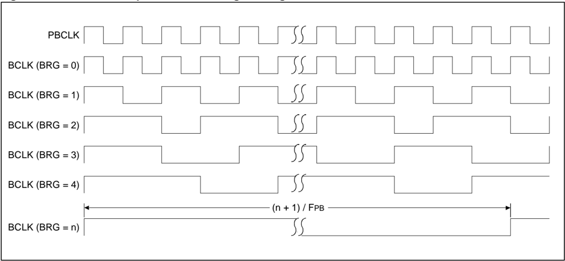

## 21.4 UART CONFIGURATION

The UART uses standard non-return-to-zero (NRZ) format (one Start bit, eight or nine data bits, and one or two Stop bits). Hardware supports the parity, and the user can configure it as even, odd or no parity. The most common data format is 8 bits, no parity, and one Stop bit (denoted as 8, N, 1), which is the default Power-on Reset (POR) setting. The number of data bits and Stop bits, and the parity, are specified in the PDSEL&lt;1:0&gt; bit (UxMODE&lt;2:1&gt;) and the STSEL bit (UxMODE&lt;0&gt;). The UART transmits and receives the Least Significant bit (LSb) first. The UART module's transmitter and receiver are functionally independent, but use the same data format and baud rate.

## 21.4.1 Enabling the UART

The UART module is enabled by setting the ON bit (UxMODE&lt;15&gt;). In addition, the UART transmitter and receiver are enabled by setting the UTXEN bit (UxSTA&lt;10&gt;) and the URXEN bit (UxSTA&lt;12&gt;), respectively. After setting these bits, the UxTX and UxRX pins are configured as an output and an input, respectively, overriding the bit settings of the TRISx and PORTx registers for the corresponding I/O port pins.

On devices that have the ACTIVE bit (UxMODE&lt;22&gt;), this bit will be set when the UART module becomes active. Refer to the 'UART' chapter in the specific device data sheet to determine availability.

## 21.4.2 Disabling the UART

The UART module is disabled by clearing the ON bit. This is the default state after any Reset. If the UART is disabled, all UART pins operate as port pins controlled by their corresponding bits in the PORTx and TRISx registers. On devices that have the ACTIVE bit (UxMODE&lt;22&gt;), once the ON bit has been set, it should not be cleared until the ACTIVE bit is set to allow for proper synchronization of the status and output signals.

Disabling the UART module resets the buffers to empty states. Any data in the buffers is lost when the module is disabled.

All  error  and  status  flags  associated  with  the  UART  module  are  Reset  when  the  module  is disabled. In the UxSTA register, the URXDA, OERR, FERR, PERR, UTXEN, URXEN, UTXBRK and UTXBF bits are cleared, whereas the RIDLE and TRMT bits are set. Other control bits (including ADDEN, URXISEL&lt;1:0&gt; and UTXISEL&lt;1:0&gt;) and the UxMODE and UxBRG registers are not affected.

Clearing the ON bit, while the UART module is active, aborts all pending transmissions and receptions, and resets the module as defined above. Re-enabling the UART module restarts the module with the same configuration. On devices that have the ACTIVE bit (UxMODE&lt;22&gt;), the ACTIVE bit will be cleared once the BRG clock is stopped. Before setting the ON bit, the user is expected to ensure that the ACTIVE bit is cleared.

## 21.5 UART TRANSMITTER

Figure 21-3 illustrates the UART transmitter block diagram. The heart of the transmitter is Transmit Shift register (UxTSR). The UxTSR register obtains its data from the transmit FIFO buffer, UxTXREG. The UxTXREG register is loaded with data in software. The UxTSR register is not loaded  until  the  Stop  bit  is  transmitted  from  the  previous  load. As  soon  as  the  Stop  bit  is transmitted, the UxTSR is loaded with new data from the UxTXREG register (if available).

Note: The UxTSR register is not mapped in memory, hence it is not available to the user.

Figure 21-3: UART Transmitter Block Diagram

Note 1: Refer to the 'UART' chapter in the specific device data sheet for availability of the 8-level-deep FIFO.

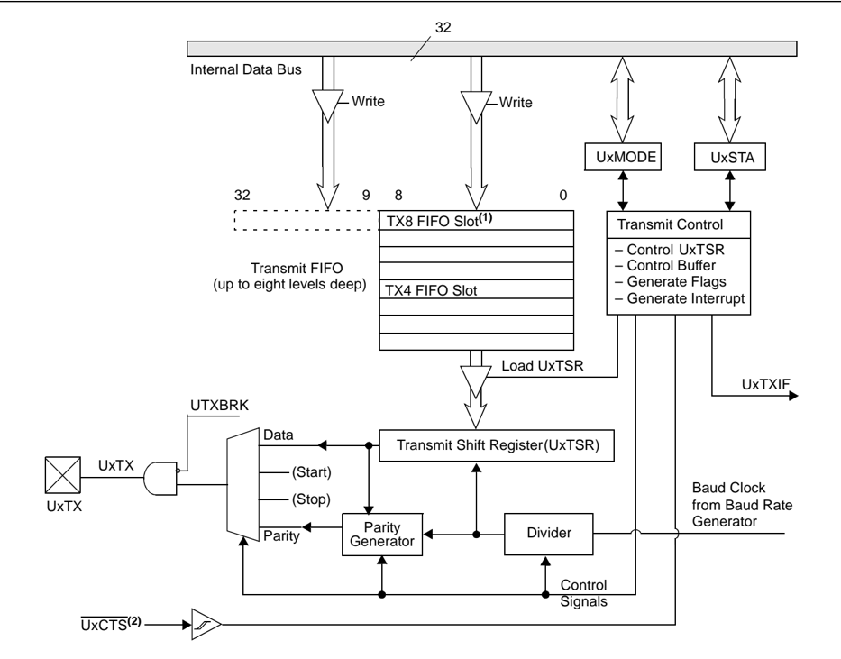

- 2: Refer to the 'Pin Tables' section in the specific device data sheet for availability of the UxCTS pin.

Transmission is enabled by setting the UTXEN bit (UxSTA&lt;10&gt;). The actual transmission does not occur until the UxTXREG register is loaded with data and the BRG, UxBRG has produced a shift clock (see Figure 21-3). The transmission can be started by loading the UxTXREG register, and then setting the UTXEN bit. Usually, when transmission is started, the UxTSR register is empty, so a transfer to the UxTXREG register results in an immediate transfer to the UxTSR register. Clearing the UTXEN bit during a transmission causes the transmission to be aborted and resets the transmitter. As a result, the UxTX pin reverts to a state defined by the UTXINV bit (UxSTA&lt;13&gt;).

To select 9-bit transmission, the PDSEL&lt;1:0&gt; bits (UxMODE&lt;2:1&gt;) should be set to ' 11 '.

Note: No parity in 9-bit data transmission.

## 21.5.1 Transmit Buffer (UxTXREG)

The transmit buffer is nine bits wide and up to eight levels deep. Together with the Transmit Shift registers (UxTSR), the user can have up to a 9-level-deep buffer. When the UxTXREG contents are transferred to the UxTSR register, the current buffer location will be available for new data to be written. The UTXBF status bit (UxSTA&lt;9&gt;) is set whenever the buffer is full. If a user attempts to write to a full buffer, the new data will not be accepted into the FIFO.

The  FIFO  is  Reset  during  any  device  Reset,  but  is  not  affected  when  the  device  enters  a Power-Saving mode or wakes up from a Power-Saving mode.

Note: Refer to the 'UART' chapter in the specific device data sheet for availability of 8-level-deep and 4-level-deep FIFO.

## 21.5.2 Transmit Interrupt

The Transmit Interrupt Flag Status bit (UxTXIF) is located in the corresponding Interrupt Flag Status register (IFS). The UTXISEL control bits (UxSTA&lt;15:14&gt;) determine when the UART will generate a transmit interrupt. The UxTXIF bit is set  when the module is  enabled. Switching between the interrupt modes during operation is possible, but it is not recommended unless the buffer is empty.

While  the  UxTXIF  flag  bit  indicates  the  status  of  the  UxTXREG  register,  the  TRMT  bit (UxSTA&lt;8&gt;) indicates the status of the UxTSR register. The TRMT status bit is a read-only bit and it is set when the UxTSR register is empty. No interrupt logic is tied to this bit, so the user has to poll this bit to determine if the UxTSR register is empty.

To clear an interrupt for UART modules with a 4-level-deep FIFO, the corresponding UxTXIF flag bit must be cleared in the associated IFSx register.

For UART modules with an 8-level-deep FIFO, an interrupt is generated and asserted when the interrupt condition specified by the UTXISEL control bits is true. This means, to clear an interrupt for these modules, before clearing the corresponding UxTXIF flag bit, the user application must ensure that the interrupt condition specified by the UTXISEL control bits is no longer true.

## 21.5.3 Setup for UART Transmit

Follow these steps to set up a UART transmission:

1. Initialize the UxBRG register for the appropriate baud rate (refer to 21.3 'UART Baud Rate Generator' ).
2. Set the number of data and Stop bits, and parity selection by writing to the PDSEL&lt;1:0&gt; bits (UxMODE&lt;2:1&gt;) and STSEL bit (UxMODE&lt;0&gt;).
3. If transmit interrupts are desired, set the UxTXIE control bit in the corresponding Interrupt Enable Control register (IEC). Specify the interrupt priority and subpriority for the transmit interrupt using the UxIP&lt;2:0&gt; and UxIS&lt;1:0&gt; control bits in the corresponding Interrupt Priority Control register (IPC). Also, select the Transmit Interrupt mode by writing to the UTXISEL bits (UxSTA&lt;15:14&gt;).
4. Enable the  transmission  by  setting  the  UTXEN  bit  (UxSTA&lt;10&gt;),  which  also  sets  the UxTXIF bit. The UxTXIF bit should be cleared in the software routine that services the UART transmit interrupt. The operation of the UxTXIF bit is controlled by the UTXISEL control bits.
5. Enable the UART module by setting the ON bit (UxMODE&lt;15&gt;).
6. Load data to the UxTXREG register (starts transmission).

## 21.5.4 Transmission of Break Characters

A Break character transmit consists of a Start bit, followed by twelve bits of ' 0 ', and a Stop bit. A Frame  Break  character  is  sent  whenever  the  UART  module  is  enabled,  and  the  UTXBRK (UxSTA&lt;11&gt;) and UTXEN (UxSTA&lt;10&gt;) bits are set while the UxTXREG register is loaded with data. A  dummy  write  to  the  UxTXREG  register  is  necessary  to  initiate  the  Break  character transmission. The data value written to the UxTXREG register for the Break character is ignored. The write merely initiates the proper sequence, so that all zeros are transmitted.

The UTXBRK bit is automatically reset by hardware after the corresponding break transmission is complete. This enables the user to preload the write FIFO with the next transmit byte while the break is being transmitted (typically, the Sync character in the LIN specification).

Note: The user should wait for the transmitter to be Idle (TRMT = 1 ) before setting the UTXBRK bit (UxSTA&lt;11&gt;). The UTXBRK bit overrides any other transmitter activity. If FIFO contains transmit data when the UTXBRK bit is set, a break character will be sent when data is transferred to the UxTSR register, instead of the actual transmit data that was transferred into the UxTSR register. If the user application clears the UTXBRK bit prior to sequence completion, unexpected module behavior can result.

The TRMT bit (UxSTA&lt;8&gt;) indicates whether the Transmit Shift register is empty or full, like it does  during  normal  transmission.  See  Figure 21-4  for  the  timing  of  the  Break  character sequence.

Figure 21-4: Send Break Sequence

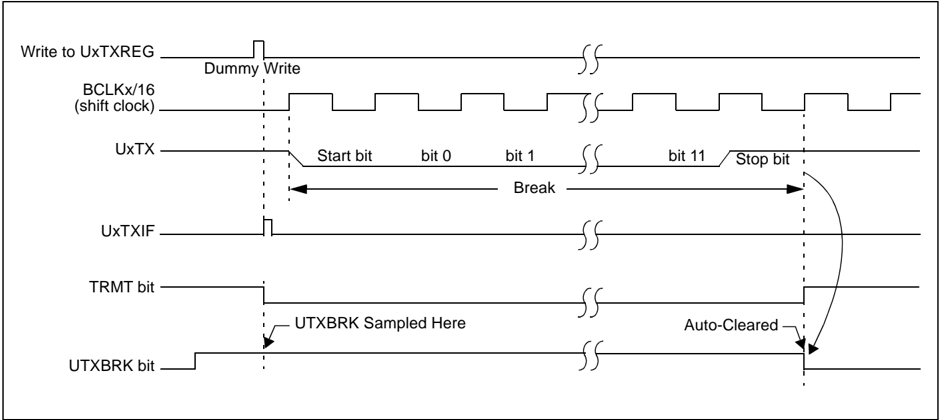

## 21.5.5 Break and Sync Transmit Sequence

The following sequence is performed to send a message frame header that is composed of a Break  character,  followed  by  an  auto-baud  Sync  byte.  This  sequence  is  typical  of  a  LIN bus master.

1. Configure the UART for the desired mode, refer to 21.5.3 'Setup for UART Transmit' for setup information.
2. If  data  is  currently  being  sent,  poll  the  TRMT  bit  (UxSTA&lt;8&gt;)  to  determine  when  the transmission ends.
3. Set the UTXEN (UxSTA&lt;10&gt;) and UTXBRK (UxSTA&lt;11&gt;) bits to set up the Break character.
4. Load the UxTXREG register with a dummy character to initiate transmission (value is ignored).
5. Write 0x55 to the UxTXREG register to load the Sync character into the transmit FIFO.

After the Break is sent, the UTXBRK bit is Reset by hardware. The Sync character now transmits.

## 21.6 DATA BIT DETECTION

## 21.6.1 16X Clock Mode (BRGH = 0 )

In 16x Clock mode, each bit of the received data is 16 clock pulses wide. To detect the value of an incoming data bit, the bit is sampled at the seventh, eighth, and ninth rising edges of the clock. These rising edges are called Majority Detection Edges. This mode is more robust than 4x Clock mode.

Figure 21-5: 16x Clock Mode with Majority Detection

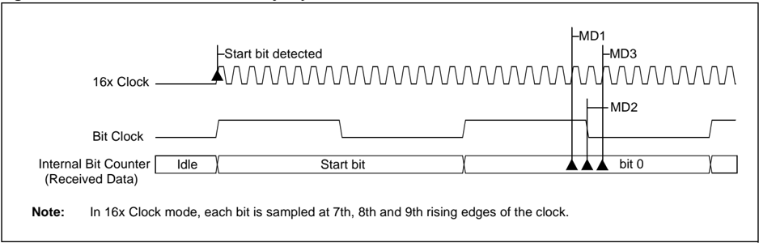

## 21.6.2 4X Clock Mode (BRGH = 1 )

In 4x Clock mode, each bit of the received data is four clock pulses wide. The 4x Clock mode does  not  provide  enough  edges  to  support the  Majority  Detection  Method.  Therefore,  the received data is sampled at the one-half bit width.

Figure 21-6: 4x Clock Mode without Majority Detection

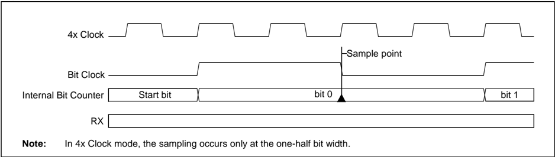

## 21.7 UART RECEIVER

The heart of the receiver is the Receive (Serial) Shift register (UxRSR). The data is received on the UxRX pin and is sent to the majority detect block. In BRGH = 0 mode, the majority detect block  operates  at  16  times  the  baud  rate,  and  a  majority  detect  circuit  is  implemented  to determine whether a high-level or a low-level is present at the UxRX pin. In BRGH = 1 mode, the majority detect block operates at 4 times the baud rate, and a single sample is used to determine whether a high-level or a low-level is present.

After  sampling  the  UxRX  pin  for  the  Stop  bit,  the  received  data  in  the  UxRSR  register  is transferred to the receive FIFO, if it is not full. Figure 21-7 illustrates a UART receiver block diagram. Reception is enabled by setting the URXEN bit (UxSTA&lt;12&gt;).

Note: The Receive Shift register (UxRSR) is not mapped in memory; therefore, it is not available to the user.

## 21.7.1 Receive Buffer (UxRXREG)

The UART receiver has a 9-bit-wide FIFO receive data buffer that is up to eight levels deep. The UxRXREG is a memory mapped register that provides access to the output of the FIFO. It is possible for the FIFO to be full and the next word to begin shifting to the UxRSR register before a buffer overrun occurs.

## 21.7.2 Receiver Error Handling

If the FIFO is full and a new character is fully received into the UxRSR register, the Overrun Error bit,  OERR  (UxSTA&lt;1&gt;),  is  set.  On  devices  that  have  the  RUNOVF  bit  (UxMODE&lt;16&gt;),  if RUNOVF = 1 , the UxRSR register continues to receive new data, but transfers to the receive FIFO are inhibited as long as the OERR bit is set. On devices that do not have the RUNOVF bit or on devices that have the RUNOVF bit but it is cleared, the UxRSR stops accepting new data and  transfers  to  the  receive  FIFO  are  inhibited  as  long  as  the  OERR  bit  is  set.  The  user application must clear the OERR bit in software to allow further data to be received. Refer to the 'UART' chapter in the specific device data sheet to determine availability of the RUNOVF bit.

To  keep  the  data  that  was  received  prior  to  the  overrun,  the  user  should  read  all  received characters and then clear the OERR bit. If the received characters can be discarded, the user can clear the OERR bit. This effectively resets the receive FIFO, and all data previously received is lost.

Note: The data in the receive FIFO should be read prior to clearing the OERR bit. The FIFO is reset when the OERR bit is cleared, which causes all data in the buffer to be lost.

The Framing Error Status bit, FERR (UxSTA&lt;2&gt;) is set when the received state of the Stop bit is incorrect.

The Parity Error Status bit, PERR (UxSTA&lt;3&gt;) is set if a parity error exists in the data word at the top of the buffer (that is, the current word). For example, a parity error occurs if the parity is set as even, but the total number of ones in the data has been detected as odd. The PERR bit is irrelevant in 9-bit mode. The FERR and PERR bits are buffered along with the corresponding word and should be read before reading the data word.

## 21.7.3 Receive Interrupt

The UART Receive Interrupt Flag Status bit (UxRXIF) is located in the corresponding Interrupt Flag Status register (IFSx). The URXISEL&lt;1:0&gt; control bits (UxSTA&lt;7:6&gt;) determine when the UART receiver generates an interrupt.

To clear an interrupt for UART modules having 4-level-deep FIFO, the corresponding UxRXIF flag bit must be cleared in the associated IFSx register.

For  UART  modules  having  8-level-deep  FIFO,  an  interrupt  is  generated  when  the  interrupt condition specified by the URXISEL control bits is true. This means, to clear an interrupt for these modules before clearing the corresponding UxRXIF flag bit, the user application must ensure that the interrupt condition specified by the URXISEL control bits is no longer true.

While the URXDA and UxRXIF bits indicate the status of the UxRXREG register, the RIDLE bit (UxSTA&lt;4&gt;) indicates the status of the UxRSR register. The RIDLE bit is a read-only bit, which is set when the receiver is Idle (that is, the UxRSR register is empty). No interrupt is tied to this bit, so the user application must poll this bit to determine whether the UxRSR is Idle.

The URXDA bit (UxSTA&lt;0&gt;) is a read-only bit which indicates whether the receive buffer has data or it is empty. This bit is set as long as there is one character to be read from the receive buffer.

A block diagram of the UART receiver is illustrated in Figure 21-7.

Figure 21-7: UART Receiver Block Diagram

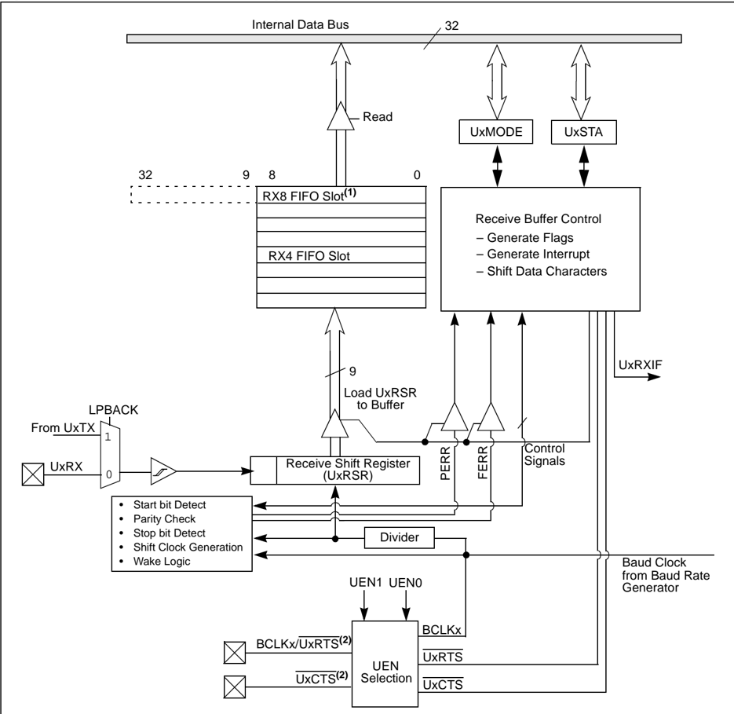

Note 1: Refer to the 'UART' chapter in the specific device data sheet for availability of the 8-level-deep FIFO.

- 2: Refer to the 'Pin Tables' section of the specific device data sheet for availability of the UxRTS and UxCTS pins.

## 21.7.4 Setup for UART Reception

The following steps are performed to set up a UART reception:

1. Initialize the UxBRG register for the appropriate baud rate (see 21.3 'UART Baud Rate Generator' ).
2. Set the number of data and Stop bits, and parity selection by writing to the PDSEL&lt;1:0&gt; (UxMODE&lt;2:1&gt;) and STSEL (UxMODE&lt;0&gt;) bits.
3. If interrupts are desired, set the UxRXIE bit in the corresponding Interrupt Enable Control register (IEC). Specify the priority and subpriority for the interrupt using the UxIP&lt;2:0&gt; and UxIS&lt;1:0&gt; control bits in the corresponding Interrupt Priority Control register (IPC). Also, select the Receive Interrupt mode by writing to the URXISEL&lt;1:0&gt; bits (UxSTA&lt;7:6&gt;).
4. Enable the UART receiver by setting the URXEN bit (UxSTA&lt;12&gt;).
5. Enable the UART module by setting the ON bit (UxMODE&lt;15&gt;).
6. Receive interrupts are dependent on the URXISEL&lt;1:0&gt; bit settings. If receive interrupts are not enabled, the user can poll the URXDA bit (UxSTA&lt;0&gt;). The UxRXIF bit should be cleared in the software routine that services the UART receive interrupt.
7. Read data from the receive buffer. If 9-bit transmission is selected, read a word; otherwise, read a byte. The URXDA bit is set whenever data is available in the buffer.

## 21.8 USING THE UART FOR 9-BIT COMMUNICATION

The  UART  receiver  in  9-bit  Data  mode  is  used  for  communication  in  a  multiprocessor environment. With the ADDEN bit (UxSTA&lt;5&gt;) set in 9-bit Data mode, the receiver can ignore the data when the ninth bit of the data is ' 0 '.

## 21.8.1 Multi-processor Communications

A  typical  multi-processor  communication  protocol  differentiates  between  data  bytes  and address/control bytes. A common scheme is to use a ninth data bit to identify whether a data byte is address or data information. If the ninth bit is set, the data is processed as address or control information. If the ninth bit is cleared, the received data word is processed as data associated with the previous address/control byte.

The protocol operates in the following sequence:

- The master device transmits a data word with the ninth bit set. The data word contains the address of a slave device and is considered the address word.
- All slave devices in the communication chain receive the address word and check the slave address value
- The slave device that is specified by the address word receives and processes subsequent data bytes sent by the master device. All other slave devices discard subsequent data bytes until a new address word is received.

## 21.8.1.1 ADDEN CONTROL BIT

The UART receiver has an Address Detect mode, which allows it to ignore data words with the ninth bit cleared. This reduces the interrupt overhead because the data words with the ninth bit cleared are not buffered. This feature is enabled by setting the ADDEN bit (UxSTA&lt;5&gt;).

The UART must be configured for 9-bit data to use the Address Detect mode. The ADDEN bit has no effect when the receiver is configured in 8-bit Data mode.

## 21.8.1.2 SETUP FOR 9-BIT TRANSMIT MODE

The setup procedure for 9-bit transmission is identical to the 8-bit transmit modes, except that the PDSEL&lt;1:0&gt; bits (UxMODE&lt;2:1) should be set to ' 11 '. Word writes should be performed to the UxTXREG register (starts transmission). Refer to 21.5.3 'Setup for UART Transmit' for more information on setting up for UART transmission.

## 21.8.1.3 SETUP FOR 9-BIT RECEPTION USING ADDRESS DETECT MODE

The setup procedure for 9-bit reception is identical to the 8-bit Receive modes, except that the PDSEL&lt;1:0&gt;  bits  (UxMODE&lt;2:1)  should  be  set  to  ' 11 '.  Refer  to 21.7.4 'Setup  for  UART Reception' for more information on setting up for UART reception.

Receive Interrupt mode  should be configured by writing to the URXISEL&lt;1:0&gt;  bits (UxSTA&lt;7:6&gt;).

Note:

A receive interrupt is generated when an Address character is detected and the Address Detect mode  is  enabled  (ADDEN  = 1 ), regardless of how  the URXISEL&lt;1:0&gt; bits are set.

For devices that have the ADM\_EN bit (UxSTA&lt;24&gt;), perform the following steps to use the Address Detect mode:

1. Set the PDSEL&lt;1:0&gt; bits (UxMODE&lt;2:1) to ' 11 ' to choose 9-bit mode.
2. Set the ADDEN bit (UxSTA&lt;5&gt;) to enable address detect.
3. Set the ADDR&lt;7:0&gt; bits (UxSTA&lt;23:16&gt;) to the desired device address character.
4. Set the ADM\_EN bit (UxSTA&lt;24&gt;) to enable Address Detect mode.
5. If this device has been addressed, the UxRXREG is discarded. All subsequent characters received with UxRXREG&lt;8&gt; = 0 are transferred to the UART receive buffer, and interrupts are generated according to the URXISEL&lt;1:0&gt; bits (UxSTA&lt;7:6&gt;).

For devices that have the MASK&lt;7:0&gt; bits (UxSTA&lt;31:24&gt;), perform the following steps to use the Address Detect mode:

1. Set the PDSEL&lt;1:0&gt; bits (UxMODE&lt;2:1) to ' 11 ' to choose 9-bit mode.
2. Set the ADDR&lt;7:0&gt; bits (UxSTA&lt;23:16&gt;) to the desired device address character.
3. Set the MASK&lt;7:0&gt; bits (UxSTA&lt;31:24&gt;) to mask the desired device address.
4. Set the ADDEN bit (UxSTA&lt;5&gt;) to enable address detect.
5. If this device has been addressed, the UxRXREG register is discarded. All subsequent characters received with UxRXREG&lt;8&gt; = 0 are transferred to the UART receive buffer, and interrupts are generated according to the URXISEL&lt;1:0&gt; bits (UxSTA&lt;7:6&gt;).

Figure 21-8: Reception with Address Detect (ADDEN = 1 )

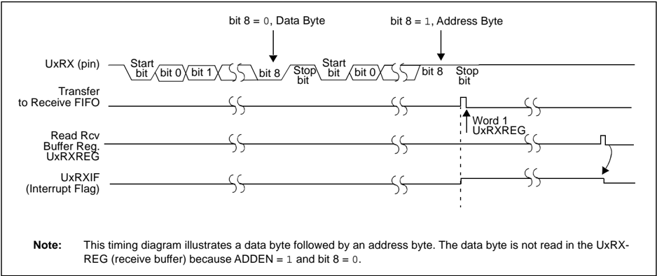

## 21.9 RECEIVING BREAK SEQUENCE

The wake-up feature is enabled by setting the WAKE bit (UxMODE &lt;7&gt;) = 1 . In this mode, the module receives the Start bit, data and invalid Stop bit (which sets the FERR bit); however, the receiver waits for a valid Stop bit before looking for the next Start bit. It will not assume that the Break condition on the line is the next Start bit. A Break is regarded as a character containing all zeros with the FERR bit set. The Break character is loaded into the buffer. No further reception can occur until a Stop bit is received. The WAKE bit is cleared when the Stop bit is received after the 13-bit Break character. RIDLE goes high when the Stop bit is received.

The receiver counts and expects a certain number of bit times based on the values programmed in the PDSEL&lt;1:0&gt; bits (UxMODE&lt;2:1&gt;) and the STSEL bits (UxMODE&lt;0&gt;).

If the Break is longer than 13 bit times, the reception is considered complete after the number of bit times specified by the PDSEL and STSEL bits elapses. The URXDA and FERR bits are set, zeros are loaded into the receive FIFO, and interrupts are generated.

If the wake-up feature is not set, the WAKE bit (UxMODE &lt;7&gt;) = 0 , Break reception is not special. The Break is counted as one character loaded into the buffer (all ' 0 ' bits) with the FERR bit set.

## 21.10 INITIALIZATION

An initialization routine for the transmitter/receiver in 8-bit mode is shown in Example 21-2. An initialization  routine  of  the  Addressable  UART  in  9-bit  Address  Detect  mode  is  shown  in Example 21-3 and Example 21-4. In the examples, the value to load into the UxBRG register is dependent on the desired baud rate and the device frequency.

## Example 21-2: 8-bit Transmit/Receive (UART1)

```
U1BRG = BaudRate; // Set Baud rate U1STA = 0; U1MODE = 0x8000; // Enable UART for 8-bit data // No Parity, 1 Stop bit U1STASET = 0x1400; // Enable Transmit and Receive
```

## Example 21-3: 8-bit Transmit/Receive (UART1), Address Detect Enabled

```
U1BRG = BaudRate; // Set Baud rate U1MODE = 0x8006; // Enable UART for 9-bit data // No Parity, 1 Stop bit U1STA = 0x1211420; // Address detect enabled // Device Address = 0x21 // Enable Automatic Address Detect mode // Enable Transmit and Receive
```

## Example 21-4: 8-bit Transmit/Receive (UART1), Address Detect Enabled with Mask

```
U1BRG = BaudRate; // Set Baud rate U1MODE = 0x8006; // Enable UART for 9-bit data // No Parity, 1 Stop bit U1STA = 0xFF211420; // Address detect enabled // Device Address = 0x21 // Device Address Mask = 0xFF // Enable Transmit and Receive
```

## 21.11 OTHER UART FEATURES

## 21.11.1 UART in Loopback Mode

Setting the LPBACK bit (UxMODE&lt;6&gt;) enables Loopback mode in which the UxTX output is internally connected to the UxRX input. When configured for the Loopback mode, the UxRX pin is disconnected from the internal UART  receive logic; however, the UxTX  pin still functions normally.

Perform the following steps to select Loopback mode:

1. Configure the UART for the desired mode of operation, refer to 21.5.3 'Setup for UART Transmit' .
2. Enable transmission as defined in 21.5 'UART Transmitter' .
3. Set the LPBACK bit (UxMODE&lt;6&gt;) = 1 to enable Loopback mode.

Table 21-3 shows how the Loopback mode is dependent on the setting of the UEN&lt;1:0&gt; bits.

Table 21-3: Loopback Mode Pin Function

|   UEN<1:0> | Pin Function, LPBACK = 1 (see Note 1)                                                                                                             |
|------------|---------------------------------------------------------------------------------------------------------------------------------------------------|
|         00 | UxRX input connected to UxTX UxTX pin functions UxRX pin ignored UxCTS/UxRTS unused (2)                                                           |
|         01 | UxRX input connected to UxTX UxTX pin functions UxRX pin ignored UxRTS pin functions (2) UxCTS unused (2)                                         |
|         10 | UxRX input connected to UxTX UxTX pin functions UxRX pin ignored UxRTS pin functions (2) UxCTS input connected to UxRTS (2) UxCTS pin ignored (2) |
|         11 | UxRX input connected to UxTX UxTX pin functions UxRX pin ignored BCLKx pin functions UxCTS/UxRTS unused (2)                                       |

- Note 1: LPBACK = 1 should be set only after enabling the other bits associated with the UART module.
- 2: Refer to the 'Pin Tables' section in the specific device data sheet to determine availability of the UxCTS and UxRTS pins.

## 21.11.2 Auto-Baud Support

The Auto-Baud  Rate  Detect  (ABAUD)  bit  (UxMODE&lt;5&gt;)  is  enabled  to  allow  the  system  to determine the baud rates of the received characters. The UART begins an automatic baud rate measurement sequence whenever a Start bit is received,  and  when the ABAUD  is enabled (ABAUD  = 1 ).  The  calculation  is  self-averaging.  This  feature  is  active  only  while  the auto-wake-up is disabled (WAKE = 0 ). In addition, the LPBACK bit (UxMODE&lt;6&gt;), must be ' 0 ' for the auto-baud operation. When the ABAUD bit is set, the BRG counter value clears and looks for a Start bit. In this case, Start bit is defined as a high-to-low transition followed by a low-to-high transition.

Following the Start bit, the auto-baud expects to receive an ASCII 'U' (0x55) to calculate the bit rate. The measurement is taken over both the low and the high bit time to minimize any effects caused by asymmetry of the incoming signal. At the end of the Start bit (rising edge), the BRG counter begins counting using a FPB/8 clock. On the fifth UxRX pin rising edge, an accumulated BRG counter value totaling the proper BRG period is transferred to the UxBRG register. The ABAUD bit automatically clears. If the user clears the ABAUD bit prior to sequence completion, unexpected module behavior can result. See Figure 21-1 for the ABD sequence.

Figure 21-9: Automatic Baud Rate Calculation

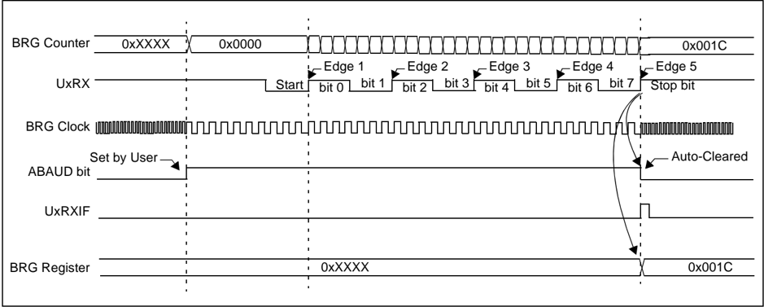

While the auto-baud sequence is in progress, the UART state machine is held in Idle mode. The UxRXIF  interrupt  is  set  on  the  fifth  UxRX  rising  edge,  independent  of  the  settings  of  the URXISEL&lt;1:0&gt; bits. The receiver FIFO is not updated.

## 21.11.3 Break Detect Sequence

The user can configure the auto-baud to occur immediately following the Break detect. This is done  by  setting  the  ABAUD  bit  (UxMODE&lt;5&gt;)  with  the  WAKE  bit  (UxMODE&lt;7&gt;)  set. Figure 21-10 illustrates a Break detect followed by an auto-baud sequence. The WAKE bit takes priority over the ABAUD bit setting.

Note: If the WAKE bit is set with the ABAUD bit, auto-baud rate detection occurs on the byte following the Break character. The user application must ensure that the baud rate  of  the  incoming  character  is  within  the  range  of  the  selected  UxBRG  clock source, considering the baud rate possible with the given clock.

The UART transmitter cannot be used during an auto-baud sequence. In addition to that, the user should ensure that the ABAUD bit is not set while a transmit sequence is already in progress. Otherwise, the UART module may exhibit unpredictable behavior.

Figure 21-10: Break Detect Followed by Auto-Baud Sequence

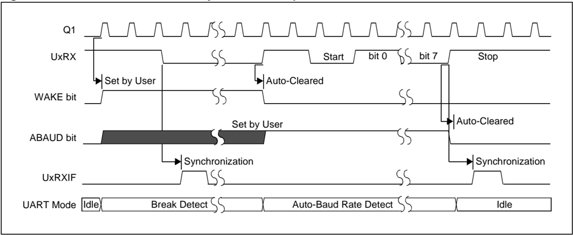

## 21.12 OPERATION OF UxCTS AND UxRTS CONTROL PINS

The UxCTS (Clear to Send) and UxRTS (Request to Send) pins are two hardware controlled pins associated with the UART module. These two pins allow the UART to operate in Flow Control and Simplex modes, which are explained in 21.12.2 'UxRTS Function in Flow Control Mode' and 21.12.3 'UxRTS  Function  in  Simplex  Mode' .  They  are  implemented  to  control  the transmission and reception among the Data Terminal Equipment (DTE).

Note: Refer to the 'Pin Tables' section in the specific device data sheet to determine availability of the UxCTS and UxRTS pins.

## 21.12.1 UxCTS Function

In the UART operation, the UxCTS acts as an input pin that can control the transmission. This pin  is  controlled  by  another  device  (typically  a  PC). The  UxCTS  pin  is  configured  using  the UEN&lt;1:0&gt; bits (UxMODE&lt;9:8&gt;). When UEN&lt;1:0&gt; = 10 , UxCTS is configured as an input pin. If UxCTS  = 1 ,  the  transmitter  loads  data  in  the  Transmit  Shift  register,  but  will  not  initiate  a transmission. This allows the DTE to control and receive the data accordingly from the controller, based on its requirement.

The UxCTS pin is sampled simultaneously with a transmit data change (that is, at the beginning of  the  16 baud clocks). Transmission begins only when the UxCTS pin is sampled low. The UxCTS pin is sampled internally with a Peripheral Bus Clock (PBCLK), which means there is a minimum pulse width on UxCTS of one peripheral clock. However, this cannot be a specification as the FPB can vary depending on the clock used.

The user can also read the status of the UxCTS pin by reading the associated port pin.

## 21.12.2 UxRTS Function in Flow Control Mode

In the Flow Control mode, the UxRTS pin of one DTE is connected to the UxCTS pin of the PIC32 and the UxCTS pin of the DTE is connected to the UxRTS pin of the PIC32, as  illustrated in Figure 21-11.

The UxRTS signal indicates that the device is ready to receive the data. The UxRTS is driven as an output pin whenever UEN&lt;1:0&gt; = 01 or 10 . The UxRTS pin is asserted (driven low) whenever the receiver is ready to receive data. When the device is in Flow Control mode and RTSMD (UxMODE&lt;11&gt;) = 0 , the UxRTS pin is driven low whenever the receive buffer is not full or the OERR bit (UxSTA&lt;1&gt;) is  not  set.  When  the  RTSMD  bit  = 0 ,  the  UxRTS  pin  is  driven  high whenever the device is not ready to receive (that is, when the receiver buffer is either full or in the process of shifting). The UxRTS pin is asserted (driven low) when the receiver has space for at least 2 characters in the FIFO.

As the UxRTS pin of the DTE is connected to the UxCTS pin of the PIC32, the UxRTS pin drives the UxCTS pin low whenever it is ready to receive the data. Transmission of the data begins when the UxCTS pin goes low, as explained in 21.12.1 'UxCTS Function' .

Figure 21-11: UxRTS/UxCTS Flow Control for DTE-DTE (RTSMD = 0 , Flow Control Mode)

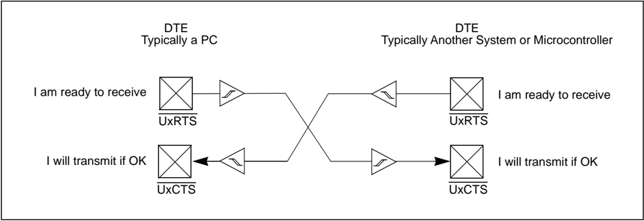

## 21.12.3 UxRTS Function in Simplex Mode

In the Simplex mode, the UxRTS pin of the DCE is connected to the UxRTS pin of the PIC32 and the  UxCTS  pin  of  the  DCE  is  connected  to  the  UxCTS  pin  of  the  PIC32,  as  illustrated  in Figure 21-12.

In the Simplex mode, the UxRTS signal indicates that the DTE is ready to transmit. The DCE replies to the UxRTS signal with the valid UxCTS signal when the DCE is ready to receive the transmission. When the DTE receives a valid UxCTS signal, it begins transmission.

Figure 21-13  illustrates  that  Simplex  mode  is  also  used  in  IEEE-485  systems  to  enable transmitters. When the UxRTS signal indicates that the DTE is ready to transmit, the UxRTS signal enables the driver.

The UxRTS pin is configured as an output and is driven whenever UEN&lt;1:0&gt; = 01 or 10 . When RTSMD = 1 , the UxRTS pin is asserted (driven low) whenever the data is available to transmit (TRMT = 0 ). When RTSMD = 1 , the UxRTS pin is deasserted (driven high) when the transmitter is empty (TRMT = 1 ).

Figure 21-12: UxRTS/UxCTS Handshake for DTE-DCE (RTSMD = 1 , Simplex Mode)

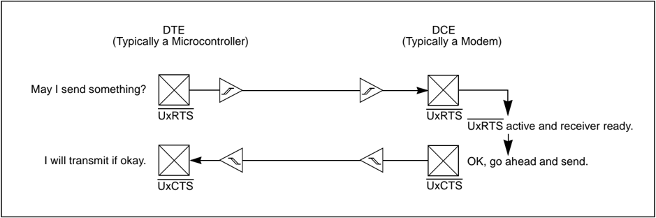

Figure 21-13: UxRTS/UxCTS Bus Enable for IEEE-485 Systems (RTSMD = 1 )

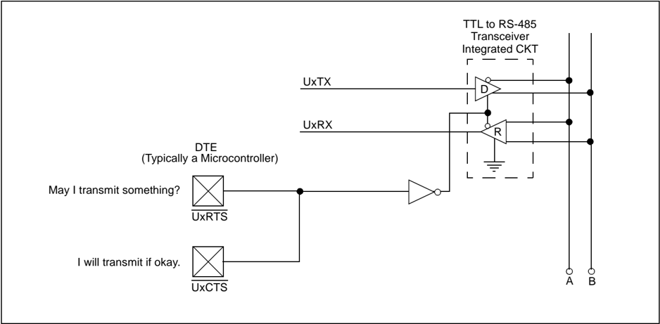

## 21.13 INFRARED SUPPORT

The UART module provides the following two infrared UART support features:

- IrDA clock output to support external IrDA encoder and decoder devices (legacy module support)

Note: Refer  to  the 'UART' chapter  in  the  specific  device  data  sheet  to  determine availability of this feature.

- Full implementation of the IrDA encoder and decoder

## 21.13.1 External IrDA Support - IrDA Clock Output

To support external IrDA encoder and decoder devices, the BCLKx pin can be configured to generate the 16x baud clock. When UEN&lt;1:0&gt; = 11 , the BCLKx pin will output the 16x baud clock if the UART module is enabled; it can be used to support the IrDA codec chip.

## 21.13.2 Built-In IrDA Encoder and Decoder

The UART has full implementation of the IrDA encoder and decoder as part of the UART module. The built-in IrDA encoder and decoder functionality is enabled using the IREN bit (UxMODE&lt;12&gt;). When enabled (IREN = 1 ), the receive pin UxRX acts as the input from the infrared receiver. The transmit pin UxTX acts as the output to the infrared transmitter.

## 21.13.2.1 IrDA ENCODER FUNCTION

The encoder works by taking the serial data from the UART and replacing it as follows:

- Transmit bit data of ' 1 ' gets encoded as ' 0 ' for the entire 16 periods of the 16x baud clock.
- Transmit bit data of ' 0 ' gets encoded as ' 0 ' for the first seven periods of the 16x baud clock, as ' 1 ' for the next three periods and as ' 0 ' for the remaining six periods.

For more information, see Figure 21-14 and Figure 21-16.

## 21.13.2.2 IrDA TRANSMIT POLARITY

The IrDA transmit polarity is selected using the UTXINV bit (UxSTA&lt;13&gt;). This bit only affects the module when the IrDA encoder and decoder are enabled (IREN = 1 ). The UTXINV bit does not affect  the  receiver  or  the  module  operation  for  normal  transmission  and  reception.  When UTXINV = 0 , the Idle state of the UxTX line is ' 0 ' (see Figure 21-14). When UTXINV = 1 , the Idle state of the UxTX line is ' 1 ' (see Figure 21-15).

Figure 21-14: IrDA ®  Encode Scheme

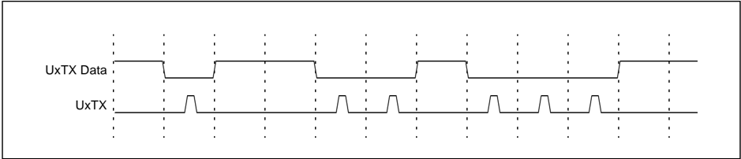

## Figure 21-15: IrDA ®  Encode Scheme for ' 0 ' bit Data

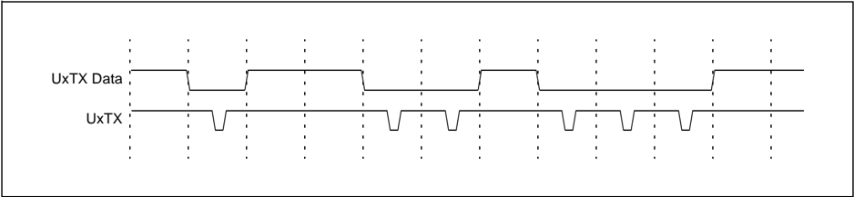

Figure 21-16: IrDA ®  Encode Scheme for ' 0 ' bit Data with Respect to 16x Baud Clock

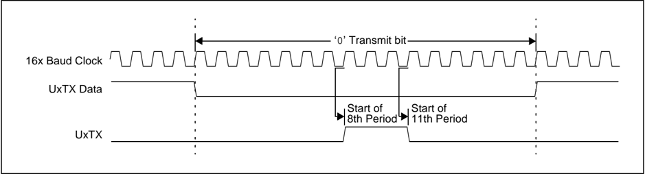

## 21.13.2.3 IrDA DECODER FUNCTION

The  decoder  works  by  taking  the  serial  data  from  the  UxRX  pin  and  replacing  it  with  the decoded  data  stream.  The  stream  is  decoded  based  on  falling  edge  detection  of  the UxRX input.

Each falling  edge  of  UxRX  causes  the decoded data  to  be  driven  low  for  16  periods  of  the 16x baud  clock.  If,  by  the  time  the  16  periods  expire,  another  falling  edge  is  detected,  the decoded data remains low for another 16 periods. If no falling edge is detected, the decoded data is driven high.

The data stream into the device is shifted anywhere from seven to eight periods of the 16x baud clock  from  the  actual  message  source. The  one  clock  uncertainty  is  due  to  the  clock  edge resolution, see Figure 21-17.

Figure 21-17: Macro View of IrDA ®  Decoding Scheme

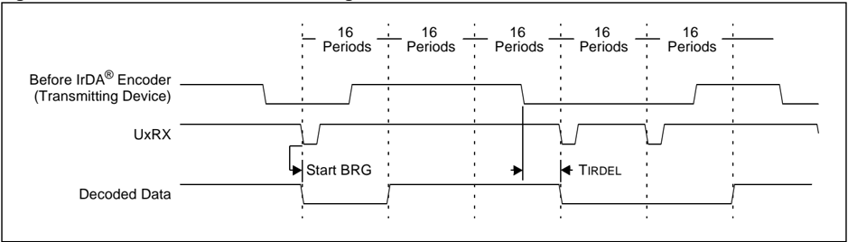

## 21.13.2.4 IrDA RECEIVE POLARITY

The input of the IrDA signal can have an inverted polarity. The same logic is able to decode the signal train, but in this case, the decoded data stream is shifted from 10 to 11 periods of the 16x baud clock from the original message source. Again, the one clock uncertainty is due to the clock edge resolution, see Figure 21-18.

Figure 21-18: Inverted Polarity Decoding Results

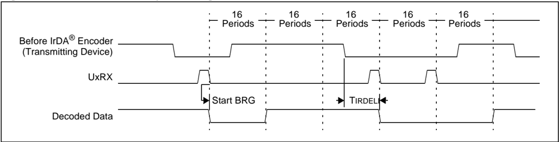

## 21.13.2.5 CLOCK JITTER

Due to jitter or slight frequency differences between devices, it is possible for the next falling bit edge to be missed for one of the 16x periods. In that case, a one clock-wide-pulse appears on the decoded data stream. Because the UART performs a majority detect around the bit center, this does not cause erroneous data, see Figure 21-19.

Figure 21-19: Clock Jitter Causing a Pulse Between Consecutive Zeros

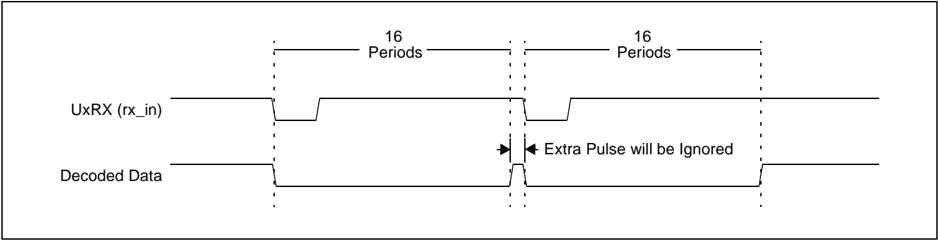

## 21.14 INTERRUPTS

The  UART  module  can  generate  interrupts  reflecting  the  events  that  occur  during  the  data communication. The following interrupts can be generated:

- Receiver-data-available interrupt, signaled by UxRXIF. This event occurs based on the URXISEL&lt;1:0&gt; control bits (UxSTA&lt;7:6&gt;). Refer to 21.7.3 'Receive Interrupt' for details.
- Transmitter buffer-empty interrupt, signaled by UxTXIF. This event occurs based on the UTXISEL&lt;1:0&gt; control bits (UxSTA&lt;15:14&gt;). Refer to 21.5.2 'Transmit Interrupt' for details.
- UART-error interrupt, signaled by UxEIF. This event occurs when any one of the following error conditions take place:
- -Parity error PERR (UxSTA&lt;3&gt;) is detected
- -Framing Error FERR (UxSTA&lt;2&gt;) is detected
- -Overflow condition for the receive buffer OERR (UxSTA&lt;1&gt;) occurs

All these interrupt flags must be cleared in software. Refer to 21.5.2 'Transmit Interrupt' and 21.7.3 'Receive Interrupt' for more information.

A  UART device is  enabled  as  a  source  of  interrupts  through  the  following  respective  UART interrupt enable bits:

- UxRXIE
- UxTXIE
- UxEIE

The interrupt priority-level bits and interrupt sub-priority-level bits must be configured:

- UxIP (IPC6&lt;4:2&gt;) and UxIS (IPC6&lt;1:0&gt;)

Refer to the Section 8. 'Interrupts' (DS60001108) for details about priority and subpriority bits.

## 21.15 I/O PIN CONTROL

When  enabling  the  UART  module  by  setting  the  ON  bit  (UxMODE&lt;15&gt;),  the  UTXEN  bit (UxSTA&lt;10&gt;), and the URXEN bit (UxSTA&lt;12&gt;), the UART module will control the I/O pins as defined by the UEN&lt;1:0&gt; bits (UxMODE&lt;9:8&gt;), overriding the port TRIS and LATCH register bit settings.

The UxTX pin is forced as an output and the UxRX pin as an input. Additionally, if the UxCTS and UxRTS pins are enabled, the UxCTS pin is forced as an input and the UxRTS/BLCKx pin functions as UxRTS output. If BLCKx is enabled, then the UxRTS/BLCKx output drives the 16x baud clock output.

## 21.16 UART OPERATION IN POWER-SAVING MODES

## 21.16.1 Operation in Sleep Mode

When the device enters Sleep mode, the system clock is disabled. On devices that have the SLPEN bit  (UxMODE&lt;23&gt;),  the  SLPEN bit  selects  whether  the  UART  module's  BRG  clock continues to run or stops operation when the device enters Sleep mode.

If SLPEN = 1 , the UART module's BRG clock continues to run if the CLKSEL = FRC. The UART module  will  finish  transmitting  the  remaining  data  in  the  transmit  FIFO  and  can  continue  to receive data bytes and assert interrupts.

If SLPEN = 0 or if SLPEN = 1 and UART module's BRG clock source CLKSEL is not set to FRC or on devices that do not have the SLPEN bit, the UART module's BRG clock stops operation. If entry into Sleep mode occurs while a transmission is in progress, the transmission is aborted and the UxTX pin is driven to logic ' 1 '. Similarly, if entry into Sleep mode occurs while a reception is in progress, the reception is aborted. The RTS and BCLK pins are driven to ' 0 '.

Optionally, the UART module can be used to wake the PIC32 device from Sleep mode on the detection of a Start bit. If the WAKE bit (UxMODE&lt;7&gt;) is set before the device enters Sleep mode and  the  UART  receive  interrupt  is  enabled  (UxRXIE  = 1 ),  a  falling  edge  on  the  UxRX  pin generates a receive interrupt and the device wakes up. The Receive Interrupt Mode Selection bit (RXISEL) has no effect on this function. The ON bit (UxMODE&lt;15&gt;) must be set to generate a wake-up interrupt.

Note: In Sleep mode, a falling edge on the UART receive pin generates a UART receive interrupt resulting in the device waking up from Sleep mode. The transmission right after waking up from Sleep mode will not be properly received. The user application should ignore the dummy byte in the first UART receive interrupt.

## 21.16.2 Operation in Idle Mode

When the device enters Idle mode, the system clock sources remain functional and the CPU stops executing code. The SIDL bit (UxMODE&lt;13&gt;) selects whether the UART module stops operation or continues normal operation when the device enters Idle mode.

- If SIDL = 1 , the module stops operation in Idle mode. The module performs the same procedures when stopped in Idle mode (SIDL = 1 ) as it does for Sleep mode.
- If SIDL = 0 , the module continues operation in Idle mode

## 21.16.3 Auto-Wake-up on Sync Break Character

The auto-wake-up feature is enabled using the WAKE bit (UxMODE&lt;7&gt;). When the WAKE bit is active, the typical receive sequence on the UxRX pin is disabled. Following the wake-up event, the module generates the UxRXIF interrupt. The LPBACK bit (UxMODE&lt;6&gt;) must be equal to ' 0 ' for wake-up to operate.

A wake-up event consists of a high-to-low transition on the UxRX line. This coincides with the start of a Sync Break or a Wake-up Signal character for the LIN protocol. When the WAKE bit is active, the UxRX line is monitored independently from the CPU mode. The UxRXIF interrupt is generated synchronously to the PBCLK in Normal User mode, and asynchronously, if the module is disabled due to Sleep or Sleep mode. To ensure that no actual data is lost, the WAKE bit should be set prior to entering the Sleep mode and while the UART module is in Idle mode.

The WAKE bit is automatically cleared after a low-to-high transition is observed on the UxRX line following the wake-up event. At this point, the UART module is in Idle mode and is returned to normal  operation.  This  signals  to  the  user  that  the  Sync  Break  event  is  over.  If  the  user application clears the WAKE bit prior to sequence completion, unexpected module behavior may result.

The wake-up event causes a receive interrupt by setting the UxRXIF bit. The Receive Interrupt Select mode bits, URXISEL&lt;1:0&gt; (UxSTA&lt;7:6&gt;), are ignored for this function. If the UxRXIF bit interrupt is enabled, it wakes up the device.

Note:

The Sync Break (or Wake-up Signal) character must be of sufficient length to allow time for the selected oscillator to start and provide proper initialization of the UART. To ensure that the part woke up in time, the user should read the value of the WAKE bit. If it is clear, it is possible that the UART was not ready in time to receive the next character and the module might need to be resynchronized to the bus.

Figure 21-20: Auto-Wake-up bit (WAKE) Timings During Normal Operation

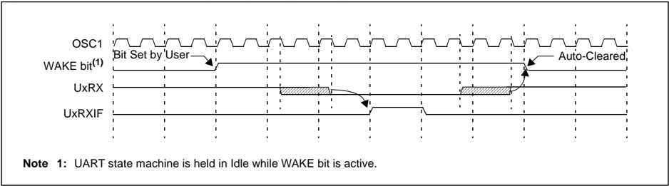

Figure 21-21: Auto-Wake-up bit (WAKE) Timings During Sleep

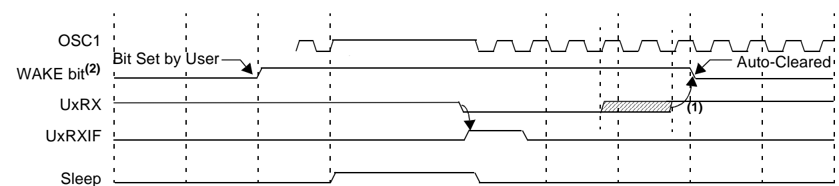

- Note  1: If the wake-up event requires long oscillator warm-up time, the auto-clear of the WAKE bit can occur while the system clocks are still active. This sequence should not depend on the presence of a PBCLK.
- 2: UART state machine is held in Idle while the WAKE bit is active.

## 21.17 EFFECTS OF VARIOUS RESETS

## 21.17.1 Device Reset

All UART module registers are forced to their reset states on a device Reset.

## 21.17.2 Power-on Reset

All UART module registers are forced to their reset states on a Power-on Reset (POR).

## 21.17.3 Watchdog Reset

All UART module registers are unchanged on a Watchdog Reset.

## 21.18 RELATED APPLICATION NOTES

This  section  lists  application  notes  that  are  related  to  this  section  of  the  manual.  These application notes may not be written specifically for the PIC32 device family, but the concepts are pertinent and could be used with modification and possible limitations. The current application notes related to the UART module are:

## Title

No related application notes are available.

Note:

Application Note #

N/A

Please visit the Microchip web site (http://www.microchip.com) for additional Application Notes and code examples for the PIC32 family of devices.

## PIC32 Family Reference Manual

## 21.19 REVISION HISTORY

## Revision A (August 2007)

This is the initial released version of the document.

## Revision B (October 2007)

Updated document to remove Confidential status.

## Revision C (April 2008)

Revised status to Preliminary; Revised U-0 to r-x; Revised Register 21-1 bit 10; Revised Table 21-1, IEC1; Revised Register 21-16, bit 25; Revised Register 21-18, bit 25; Revised bit names.

## Revision D (June 2008)

Revised Section 21.1; Added Footnote number to Registers 21-15-21-20; Change Reserved bits from 'Maintain as' to 'Write'; Added Note to ON bit (UxMODE Register).

## Revision E (November 2009)

This revision includes the following changes:

- Updated the UART module features in 21.1 'Introduction' to clarify which UART modules are available for a specific feature
- Updated Note 1 in Figure 21-1
- Updated register introductions in 21.2 'Control Registers'
- Changed all occurrences of UTXISEL0 to UTXISEL
- UART Register Summary (Table 21-1)
- -Removed references to the IFS0, IFS1, IEC0, IEC1, IPC6 and IPC8 registers
- -Added the Address Offset column
- -Added Notes 1, 2 and 3, which describe the Clear, Set and Invert registers
- -Added Note 4 regarding bit availability
- Added Notes describing the Clear, Set, and Invert registers associated with the following registers:
- UxMODE
- -UxSTA
- UxBRG
- Updated Note 4 in the UxMODE: UART 'x' Mode Register (Register 21-1)
- Updated Note 4 and the UTXISEL&lt;1:0&gt; and URXISEL&lt;1:0&gt; bit definitions in the UxSTA: UARTx Status and Control Register (Register 21-2)
- Updated the shaded note in 21.3.2 'BCLKx Output'
- Updated the paragraph in 21.4.1 'Enabling the UART'
- Updated the second paragraph in 21.4.2 'Disabling the UART'
- Updated the UART Transmitter Block Diagram (Figure 21-3)
- Updated the third paragraph in 21.5 'UART Transmitter'
- Updated the first paragraph and the shaded note in 21.5.1 'Transmit Buffer (UxTXREG)'
- Removed the three step process and shaded note and added two new paragraphs in 21.5.2 'Transmit Interrupt'
- Swapped steps 4 and 5, updated step 6, and removed the shaded note from 21.5.3 'Setup for UART Transmit'
- Updated 21.5.4 'Transmission of Break Characters'
- Added a new step 2 in 21.5.5 'Break and Sync Transmit Sequence'
- Removed Figure 21-4 and Figure 21-5
- Updated the first paragraph in 21.7 'UART Receiver' and removed the second paragraph
- Updated the third and fourth paragraphs in 21.7.2 'Receiver Error Handling'
- Added two new paragraphs after the first paragraph in 21.7.3 'Receive Interrupt'
- Updated the UART Receiver Block Diagram (Figure 21-7)

## Revision E (November 2009) (Continued)

- Changed the title of 21.9 'Receiving Break Sequence' , which was formerly 'Received Break Characters'
- Updated Note 2 in the Loopback Mode Pin Function table (Table 21-3)
- Updated the shaded note in 21.12 'Operation of UxCTS and UxRTS Control Pins' and 21.13 'Infrared Support'
- Removed Figure 21-8 and Figure 21-9
- Updated 21.14 'Interrupts'
- Removed 21.13.1 'Interrupt Configuration'
- Changed the title of 21.16.2 'Operation in Idle Mode' , which was formerly 'Operation in Sleep Mode' and corrected the erroneous references to Sleep mode, changing them to Idle mode
- Removed Table 21-5

## Revision F (November 2010)

This revision includes the following changes:

- Updated Note 1 in Figure 21-1
- Updated Note 4 in Table 21-1
- Updated Note 4 in UxMODE: UARTx Mode Register (see Register 21-1)
- Updated the UTXISEL&lt;1:0&gt; and URXISEL&lt;1:0&gt; bits definitions in the UxSTA: UARTx Status and Control Register (see Register 21-2)
- Updated Note 4 in Register 21-2
- Updated the shaded note in 21.3.2 'BCLKx Output'
- Updated Notes in Figure 21-3
- Updated shaded notes in 21.5.1 'Transmit Buffer (UxTXREG)'
- Updated the third and fourth paragraphs in 21.5.2 'Transmit Interrupt'
- Updated the second and third paragraphs in 21.7.3 'Receive Interrupt'
- Updated Notes in Figure 21-7
- Updated Note 2 in Table 21-3
- Updated shaded notes in 21.12 'Operation of UxCTS and UxRTS Control Pins' and 21.13 'Infrared Support'
- Added a shaded note in 21.16.2 'Operation in Idle Mode'
- Changes to the text and formatting have been incorporated throughout the document

## Revision G (May 2012)

This revision includes the following changes:

- All references to PIC32MX were changed to: PIC32
- Removed the FRZ bit from the UxMODE register (see Register 21-1)
- Added 21.6 'Data Bit Detection'
- Removed 21.16.3 'Operation in Debug Mode'
- Removed 21.18 'Design Tips'
- Minor updates to text and formatting were incorporated throughout the document

## PIC32 Family Reference Manual

## Revision H (February 2017)

This revision includes the following changes:

- The primary features were updated in 21.1 'Introduction'
- The UxMODE register was updated with the bits RUNOVF, CLKSEL&lt;1:0&gt;, ACTIVE, and SLPEN (see Table 21-1 and Register 21-1)
- The UxSTA register was updated with the MASK&lt;7:0&gt; bits (see Table 21-1 and Register 21-2)
- The following sections were updated:
- -21.4.1 'Enabling the UART'
- -21.4.2 'Disabling the UART'
- -21.7.2 'Receiver Error Handling'
- -21.8.1.3 'Setup for 9-bit Reception Using Address Detect Mode'
- -21.10 'Initialization'
- -21.16.1 'Operation in Sleep Mode'
- Minor updates to text and formatting were incorporated throughout the document

## Note the following details of the code protection feature on Microchip devices:

- Microchip products meet the specification contained in their particular Microchip Data Sheet.
- Microchip believes that its family of products is one of the most secure families of its kind on the market today, when used in the intended manner and under normal conditions.
- There are dishonest and possibly illegal methods used to breach the code protection feature. All of these methods, to our knowledge, require using the Microchip products in a manner outside the operating specifications contained in Microchip's Data Sheets. Most likely, the person doing so is engaged in theft of intellectual property.
- Microchip is willing to work with the customer who is concerned about the integrity of their code.
- Neither Microchip nor any other semiconductor manufacturer can guarantee the security of their code. Code protection does not mean that we are guaranteeing the product as 'unbreakable.'

Code protection is constantly evolving. We at Microchip are committed to continuously improving the code protection features of our products. Attempts to break Microchip's code protection feature may be a violation of the Digital Millennium Copyright Act. If such acts allow unauthorized access to your software or other copyrighted work, you may have a right to sue for relief under that Act.

Information  contained  in  this  publication  regarding  device applications and the like is provided only for your convenience and may be superseded by updates. It is your responsibility to ensure  that  your  application  meets  with  your  specifications. MICROCHIP MAKES NO REPRESENTATIONS OR WARRANTIES  OF  ANY  KIND  WHETHER  EXPRESS  OR IMPLIED, WRITTEN OR ORAL, STATUTORY OR OTHERWISE, RELATED TO THE INFORMATION, INCLUDING  BUT  NOT  LIMITED  TO ITS  CONDITION, QUALITY, PERFORMANCE, MERCHANTABILITY OR FITNESS  FOR  PURPOSE . Microchip  disclaims  all  liability arising  from  this  information  and  its  use.  Use  of  Microchip devices in life support and/or safety applications is entirely at the buyer's risk, and the buyer agrees to defend, indemnify and hold  harmless  Microchip  from  any  and  all  damages,  claims, suits,  or  expenses  resulting  from  such  use.  No  licenses  are conveyed, implicitly or otherwise, under any Microchip intellectual property rights unless otherwise stated.

Microchip received ISO/TS-16949:2009 certification for its worldwide headquarters, design and wafer fabrication facilities in Chandler and Tempe, Arizona; Gresham, Oregon and design centers in California and India. The Company's quality system processes and procedures are for its PIC ®  MCUs and dsPIC ®  DSCs, KEELOQ ®  code hopping devices, Serial EEPROMs, microperipherals, nonvolatile memory and analog products. In addition, Microchip's quality system for the design and manufacture of development systems is ISO 9001:2000 certified.

## QUALITY MANAGEMENT  SYSTEM CERTIFIED BY DNV

== ISO/TS 16949 ==

## Trademarks

The Microchip name and logo, the Microchip logo, AnyRate, AVR, AVR logo, AVR Freaks, BeaconThings, BitCloud, CryptoMemory, CryptoRF, dsPIC, FlashFlex, flexPWR, Heldo, JukeBlox, KEELOQ, KEELOQ logo, Kleer, LANCheck, LINK MD, maXStylus, maXTouch, MediaLB, megaAVR, MOST, MOST logo, MPLAB, OptoLyzer, PIC, picoPower, PICSTART, PIC32 logo, Prochip Designer, QTouch, RightTouch, SAM-BA, SpyNIC, SST, SST Logo, SuperFlash, tinyAVR, UNI/O, and XMEGA are registered trademarks of Microchip Technology Incorporated in the U.S.A. and other countries.

ClockWorks, The Embedded Control Solutions Company, EtherSynch, Hyper Speed Control, HyperLight Load, IntelliMOS, mTouch, Precision Edge, and Quiet-Wire are registered trademarks of Microchip Technology Incorporated in the U.S.A.

Adjacent Key Suppression, AKS, Analog-for-the-Digital Age, Any Capacitor, AnyIn, AnyOut, BodyCom, chipKIT, chipKIT logo, CodeGuard, CryptoAuthentication, CryptoCompanion, CryptoController, dsPICDEM, dsPICDEM.net, Dynamic Average Matching, DAM, ECAN, EtherGREEN, In-Circuit Serial Programming, ICSP, Inter-Chip Connectivity, JitterBlocker, KleerNet, KleerNet logo, Mindi, MiWi, motorBench, MPASM, MPF, MPLAB Certified logo, MPLIB, MPLINK, MultiTRAK, NetDetach, Omniscient Code Generation, PICDEM, PICDEM.net, PICkit, PICtail, PureSilicon, QMatrix, RightTouch logo, REAL ICE, Ripple Blocker, SAM-ICE, Serial Quad I/O, SMART-I.S., SQI, SuperSwitcher, SuperSwitcher II, Total Endurance, TSHARC, USBCheck, VariSense, ViewSpan, WiperLock, Wireless DNA, and ZENA are trademarks of Microchip Technology Incorporated in the U.S.A. and other countries.

SQTP is a service mark of Microchip Technology Incorporated in the U.S.A.

Silicon Storage Technology is a registered trademark of Microchip Technology Inc. in other countries.

GestIC is a registered trademark of Microchip Technology Germany II GmbH &amp; Co. KG, a subsidiary of Microchip Technology Inc., in other countries.

All other trademarks mentioned herein are property of their respective companies.

© 2007-2017, Microchip Technology Incorporated, All Rights Reserved.

ISBN: 978-1-5224-1369-1


## Worldwide Sales and Service

## ASIA/PACIFIC

Asia Pacific Office Suites 3707-14, 37th Floor Tower 6, The Gateway Harbour City, Kowloon

Hong Kong Tel: 852-2943-5100 Fax: 852-2401-3431

Australia - Sydney Tel: 61-2-9868-6733 Fax: 61-2-9868-6755

China - Beijing Tel: 86-10-8569-7000 Fax: 86-10-8528-2104

China - Chengdu Tel: 86-28-8665-5511 Fax: 86-28-8665-7889

China - Chongqing Tel: 86-23-8980-9588 Fax: 86-23-8980-9500

China - Dongguan Tel: 86-769-8702-9880

China - Guangzhou Tel: 86-20-8755-8029

China - Hangzhou Tel: 86-571-8792-8115 Fax: 86-571-8792-8116

China - Hong Kong SAR Tel: 852-2943-5100 Fax: 852-2401-3431

China - Nanjing Tel: 86-25-8473-2460 Fax: 86-25-8473-2470

China - Qingdao Tel: 86-532-8502-7355 Fax: 86-532-8502-7205

China - Shanghai Tel: 86-21-3326-8000 Fax: 86-21-3326-8021

China - Shenyang Tel: 86-24-2334-2829 Fax: 86-24-2334-2393

China - Shenzhen Tel: 86-755-8864-2200 Fax: 86-755-8203-1760

China - Wuhan Tel: 86-27-5980-5300 Fax: 86-27-5980-5118

China - Xian Tel: 86-29-8833-7252 Fax: 86-29-8833-7256

## ASIA/PACIFIC

China - Xiamen Tel: 86-592-2388138 Fax: 86-592-2388130

China - Zhuhai Tel: 86-756-3210040 Fax: 86-756-3210049

India - Bangalore Tel: 91-80-3090-4444 Fax: 91-80-3090-4123

India - New Delhi Tel: 91-11-4160-8631 Fax: 91-11-4160-8632

India - Pune Tel: 91-20-3019-1500

Japan - Osaka Tel: 81-6-6152-7160 Fax: 81-6-6152-9310

Japan - Tokyo Tel: 81-3-6880- 3770 Fax: 81-3-6880-3771

Korea - Daegu Tel: 82-53-744-4301 Fax: 82-53-744-4302

Korea - Seoul Tel: 82-2-554-7200 Fax: 82-2-558-5932 or 82-2-558-5934

Malaysia - Kuala Lumpur Tel: 60-3-6201-9857 Fax: 60-3-6201-9859

Malaysia - Penang Tel: 60-4-227-8870 Fax: 60-4-227-4068

Philippines - Manila Tel: 63-2-634-9065 Fax: 63-2-634-9069

Singapore Tel: 65-6334-8870 Fax: 65-6334-8850

Taiwan - Hsin Chu Tel: 886-3-5778-366 Fax: 886-3-5770-955

Taiwan - Kaohsiung Tel: 886-7-213-7830

Taiwan - Taipei Tel: 886-2-2508-8600 Fax: 886-2-2508-0102

Thailand - Bangkok Tel: 66-2-694-1351 Fax: 66-2-694-1350

## AMERICAS

Corporate Office 2355 West Chandler Blvd. Chandler, AZ 85224-6199 Tel: 480-792-7200 Fax: 480-792-7277 Technical Support:

http://www.microchip.com/ support Web Address:

www.microchip.com

Atlanta Duluth, GA Tel: 678-957-9614 Fax: 678-957-1455

Austin, TX Tel: 512-257-3370

Boston

Westborough, MA Tel: 774-760-0087 Fax: 774-760-0088

Chicago

Itasca, IL Tel: 630-285-0071 Fax: 630-285-0075

Dallas

Addison, TX Tel: 972-818-7423 Fax: 972-818-2924

Detroit Novi, MI Tel: 248-848-4000

Houston, TX Tel: 281-894-5983

Indianapolis Noblesville, IN Tel: 317-773-8323 Fax: 317-773-5453 Tel: 317-536-2380

## Los Angeles

Mission Viejo, CA Tel: 949-462-9523 Fax: 949-462-9608 Tel: 951-273-7800

Raleigh, NC Tel: 919-844-7510

New York, NY Tel: 631-435-6000

San Jose, CA Tel: 408-735-9110 Tel: 408-436-4270

Canada - Toronto Tel: 905-695-1980 Fax: 905-695-2078

## EUROPE

Austria - Wels Tel: 43-7242-2244-39 Fax: 43-7242-2244-393

Denmark - Copenhagen Tel: 45-4450-2828 Fax: 45-4485-2829

Finland - Espoo Tel: 358-9-4520-820

France - Paris Tel: 33-1-69-53-63-20 Fax: 33-1-69-30-90-79

France - Saint Cloud Tel: 33-1-30-60-70-00

Germany - Garching Tel: 49-8931-9700 Germany - Haan Tel: 49-2129-3766400

Germany - Heilbronn Tel: 49-7131-67-3636

Germany - Karlsruhe Tel: 49-721-625370

Germany - Munich Tel: 49-89-627-144-0 Fax: 49-89-627-144-44

Germany - Rosenheim Tel: 49-8031-354-560

Israel - Ra'anana Tel: 972-9-744-7705

Italy - Milan Tel: 39-0331-742611 Fax: 39-0331-466781

Italy - Padova Tel: 39-049-7625286

Netherlands - Drunen Tel: 31-416-690399 Fax: 31-416-690340

Norway - Trondheim Tel: 47-7289-7561

Poland - Warsaw Tel: 48-22-3325737

Romania - Bucharest Tel: 40-21-407-87-50

Spain - Madrid Tel: 34-91-708-08-90 Fax: 34-91-708-08-91

Sweden - Gothenberg Tel: 46-31-704-60-40

Sweden - Stockholm Tel: 46-8-5090-4654

UK - Wokingham Tel: 44-118-921-5800 Fax: 44-118-921-5820