Microchip

## Section 23. Serial Peripheral Interface (SPI)

## HIGHLIGHTS

This section of the manual contains the following topics:

|   23.1 | Introduction..............................................................................................................23-2   |
|--------|----------------------------------------------------------------------------------------------------------------------------------|
|   23.2 | Status and Control Registers...................................................................................23-7              |
|   23.3 | Modes of Operation...............................................................................................23-16           |
|   23.4 | Audio Protocol Interface Mode ..............................................................................23-30                |
|   23.5 | Interrupts................................................................................................................23-50  |
|   23.6 | Operation in Power-Saving and Debug Modes .....................................................23-53                             |
|   23.7 | Effects of Various Resets.......................................................................................23-54            |
|   23.8 | Peripherals Using SPI Modules.............................................................................23-54                  |
|   23.9 | Related Application Notes .....................................................................................23-55             |
|  23.10 | Revision History.....................................................................................................23-56       |

Note:

This family reference manual section is meant to serve as a complement to device data sheets. Depending on the device variant, this manual section may not apply to all PIC32 devices.

Please consult the note at the beginning of the 'Serial Peripheral Interface (SPI)' chapter in the current device data sheet to check whether this document supports the device you are using.

[Device  data  sheets  and  family  reference  manual  sections  are  available  for download from the Microchip Worldwide Web site at: http://www.microchip.com](http://www.microchip.com/)

## 23.1 INTRODUCTION

The  Serial  Peripheral  Interface  (SPI)  module  is  a  synchronous  serial  interface  useful  for communicating with external peripherals and other microcontroller devices. These peripheral devices  may  be  a  serial  EEPROM,  shift  register,  display  driver,  Analog-to-Digital  Converter (ADC), or an audio codec. The PIC32 family SPI module is compatible with Motorola ®  SPI and SIOP interfaces. Figure 23-1 shows a block diagram of the SPI module.

Some of the key features of this module are:

- Master and Slave modes support
- Four different clock formats
- Framed SPI protocol support
- Standard and Enhanced Buffering modes (Enhanced buffering mode is not available on all devices)
- User-configurable 8-bit, 16-bit, and 32-bit data width
- SPI receive and transmit buffers are FIFO buffers, which are 4/8/16 deep in Enhanced Buffering mode
- Programmable interrupt event on every 8-bit, 16-bit, and 32-bit data transfer
- Audio Protocol Interface mode

Some  PIC32  devices  support  audio  codec  serial  protocols  such  as  Inter-IC  Sound  (I 2 S), Left-Justified, Right-Justified, and PCM/DSP modes for 16, 24, and 32-bit audio data. Refer to the specific device data sheet for availability of these features.

The SPIx serial interface consists of four pins:

- SDIx: Serial Data Input
- SDOx: Serial Data Output
- SCKx: Shift Clock Input or Output
- SSx: Active-Low Slave Select or Frame Synchronization I/O Pulse

Table 23-1: SPI Features

| Available SPI Modes   | SPI Master   | SPI Slave   | Frame Master   | Frame Slave   | 8-bit, 16-bit, and 32-bit Modes   | Selectable Clock Pulses and Edges   | Selectable Frame Sync Pulses and Edges   | Slave Select Pulse   |
|-----------------------|--------------|-------------|----------------|---------------|-----------------------------------|-------------------------------------|------------------------------------------|----------------------|
| Normal                | Yes          | Yes         | -              | -             | Yes                               | Yes                                 | -                                        | Yes                  |
| Framed                | Yes          | Yes         | Yes            | Yes           | Yes                               | Yes                                 | Yes                                      | No                   |

Table 23-2: SPI Features in Audio Protocol Interface Mode

| Audio Protocol Support                          | SPI Master   | SPI Slave   | 16/24/32-bit Data Format   | 32/64-bit Frame   | Overflow/ Underflow Detection   | Mono/ Stereo Mode   | Master Clock (MCLK) Support   |
|-------------------------------------------------|--------------|-------------|----------------------------|-------------------|---------------------------------|---------------------|-------------------------------|
| I 2 S, Left-Justified, Right-Justified, PCM/DSP | Yes          | Yes         | Yes                        | Yes               | Yes                             | Yes                 | Yes                           |

Note 1: This feature is not available in all devices. Refer to the specific device data sheet for availability.

Figure 23-1: SPI Module Block Diagram

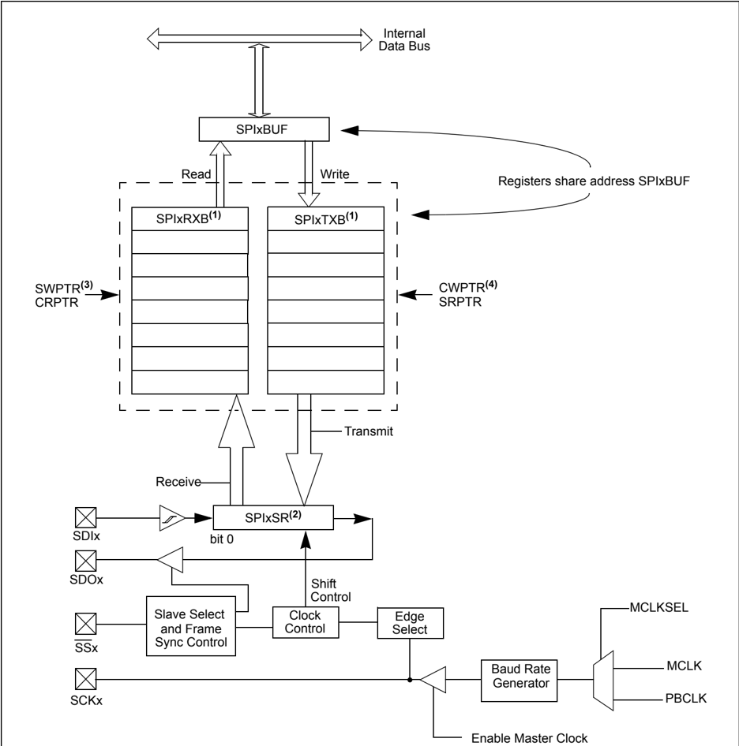

- Note 1: The SPIx Receive Buffer (SPIxRXB) and SPIx Transmit Buffer (SPIxTXB) registers are accessed via the SPIxBUF register and are multi-element FIFO buffers in Enhanced Buffer mode (pointer arithmetic is circular for these buffers). Enhanced Buffer mode is not available on all devices. Refer to the specific device data sheet for availability.
- 2: The SPIx Shift Register (SPIxSR) is not directly accessible by application software.
- 3: When the CPU Read Pointer (CRPTR) is less than or equal to the SPI Write Pointer (SWPTR). The CRPTR is incremented when the application reads a data element from the SPIxRXB register, and the SWPTR is incremented when a data element is moved from the SPIxSR register to the SPIxRXB register.
- 4: The SPI Read Pointer (SRPTR) is less than or equal to the CPU Write Pointer (CWPTR). The CWPTR is incremented when the application writes a new data element to the SPIxBUF register, and the SRPTR is incremented when data is moved from the SPIxTXB register to the SPIxSR register.

## 23.1.1 Normal Mode SPI Operation

In  Normal  mode  operation,  the  SPI  Master  controls  the  generation  of  the  serial  clock.  The number  of  output  clock  pulses  corresponds  to  the  transfer  data  width:  8,  16,  or  32  bits. Figure 23-2 and Figure 23-3 illustrate SPI Master-to-Slave and Slave-to-Master device connections.

Figure 23-2: Typical SPI Master-to-Slave Device Connection Diagram

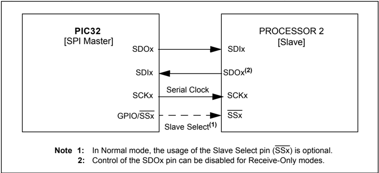

Figure 23-3: Typical SPI Slave-to-Master Device Connection Diagram

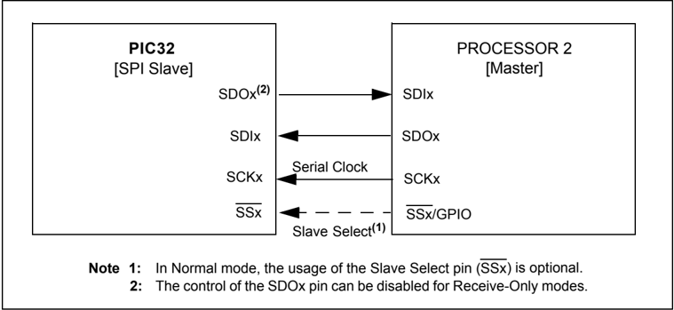

## 23.1.2 Framed Mode SPI Operation

In  Framed  mode  operation,  the Frame  Master  controls the generation of the frame synchronization pulse. The SPI clock is still generated by the SPI Master and is continuously running.  Figure 23-4  and  Figure 23-5  illustrate  SPI  Frame  Master  and  Frame  Slave  device connections.

Figure 23-4: Typical SPI Master, Frame Master Connection Diagram

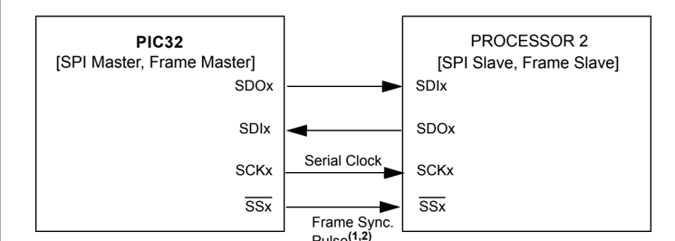

Pulse

- Note 1: In Framed SPI mode, the SSx pin is used to transmit/receive the frame synchronization pulse.
- 2: Framed SPI mode requires the use of all four pins (i.e., using the SSx pin is not optional).

Figure 23-5: Typical SPI Master, Frame Slave Connection Diagram

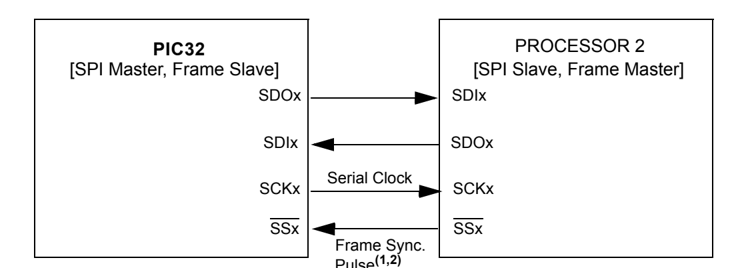

Pulse

- Note 1: In Framed SPI mode, the SSx pin is used to transmit/receive the frame synchronization pulse.
- 2: Framed SPI mode requires the use of all four pins (i.e., using the SSx pin is not optional).

## 23.1.3 Audio Protocol Interface Mode

## 23.1.3.1 SPI IN AUDIO MASTER MODE CONNECTED TO A CODEC SLAVE

Figure 23-6 shows the Bit Clock (BCLK) and Left/Right Channel Clock (LRCK) as generated by the PIC32 SPI module.

Figure 23-6: Master Generating its Own Clock - Output BCLK and LRCK

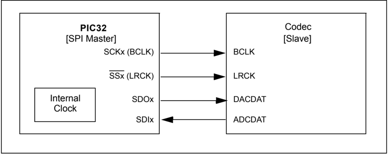

## 23.1.3.2 SPI IN AUDIO SLAVE MODE CONNECTED TO A CODEC MASTER

Figure 23-7 shows the BCLK and LRCK as generated by the codec master.

Figure 23-7: Codec Device as Master Generates Required Clock via External Crystal

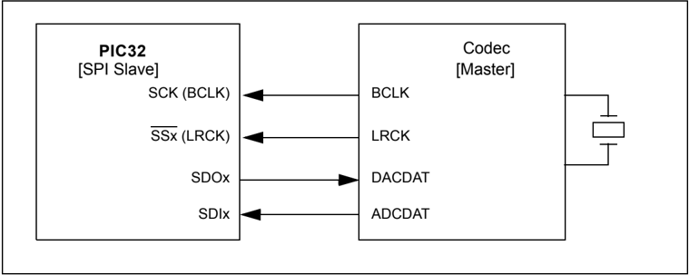

## 23.2 STATUS AND CONTROL REGISTERS

Note:

Each PIC32 family device variant may have one or more SPI modules. An 'x' used in  the  names  of  pins,  control/Status  bits,  and  registers  denotes  the  particular module. Refer to the specific device data sheets for more details.

The SPI module consists of the following Special Function Registers (SFRs):

- SPIxCON: SPI Control Register

- SPIxCON2: SPI Control Register 2

- SPIxSTAT: SPI Status Register

- SPIxBUF: SPI Buffer Register

- SPIxBRG: SPI Baud Rate Register

Table 23-3  summarizes  all  SPI-related  registers.  Corresponding  registers  appear  after  the summary, followed by a detailed description of each register.

Table 23-3: SPI SFR Summary

| Name               | Bit Range   | Bit 31/23/15/7   | Bit 30/22/14/6   | Bit 29/21/13/5   | Bit 28/20/12/4    | Bit 27/19/11/3    | Bit 26/18/10/2    | Bit 25/17/9/1     | Bit 24/16/8/0     |
|--------------------|-------------|------------------|------------------|------------------|-------------------|-------------------|-------------------|-------------------|-------------------|
| SPIxCON (1,2,3)    | 31:24       | FRMEN            | FRMSYNC          | FRMPOL           | MSSEN (4)         | FRMSYPW (4)       | FRMCNT<2:0> (4)   | FRMCNT<2:0> (4)   | FRMCNT<2:0> (4)   |
| SPIxCON (1,2,3)    | 23:16       | MCLKSEL (4)      | -                | -                | -                 | -                 | -                 | SPIFE             | ENHBUF (4)        |
| SPIxCON (1,2,3)    | 15:8        | ON               | -                | SIDL             | DISSDO            | MODE32            | MODE16            | SMP               | CKE               |
| SPIxCON (1,2,3)    | 7:0         | SSEN             | CKP              | MSTEN            | DISSDI (4)        | STXISEL<1:0> (4)  | STXISEL<1:0> (4)  | SRXISEL<1:0> (4)  | SRXISEL<1:0> (4)  |
| SPIxCON2 (1,2,3,5) | 31:24       | -                | -                | -                | -                 | -                 | -                 | -                 | -                 |
| SPIxCON2 (1,2,3,5) | 23:16       | -                | -                | -                | -                 | -                 | -                 | -                 | -                 |
| SPIxCON2 (1,2,3,5) | 15:8        | SPISGNEXT        | -                | -                | FRMERREN          | SPIROVEN          | SPITUREN          | IGNROV            | IGNTUR            |
| SPIxCON2 (1,2,3,5) | 7:0         | AUDEN            | -                | -                | -                 | AUDMONO           | -                 | AUDMOD<1:0>       | AUDMOD<1:0>       |
| SPIxSTAT (1,2,3)   | 31:24       | -                | -                | -                | RXBUFELM<4:0> (4) | RXBUFELM<4:0> (4) | RXBUFELM<4:0> (4) | RXBUFELM<4:0> (4) | RXBUFELM<4:0> (4) |
| SPIxSTAT (1,2,3)   | 23:16       | -                | -                | -                | TXBUFELM<4:0> (4) | TXBUFELM<4:0> (4) | TXBUFELM<4:0> (4) | TXBUFELM<4:0> (4) | TXBUFELM<4:0> (4) |
| SPIxSTAT (1,2,3)   | 15:8        | -                | -                | -                | FRMERR (4)        | SPIBUSY           | -                 | -                 | SPITUR            |
| SPIxSTAT (1,2,3)   | 7:0         | SRMT (4)         | SPIROV           | SPIRBE (4)       | -                 | SPITBE            | -                 | SPITBF (4)        | SPIRBF            |
| SPIxBUF            | 31:24       | DATA<31:24>      | DATA<31:24>      | DATA<31:24>      | DATA<31:24>       | DATA<31:24>       | DATA<31:24>       | DATA<31:24>       | DATA<31:24>       |
| SPIxBUF            | 23:16       | DATA<23:16>      | DATA<23:16>      | DATA<23:16>      | DATA<23:16>       | DATA<23:16>       | DATA<23:16>       | DATA<23:16>       | DATA<23:16>       |
| SPIxBUF            | 15:8        | DATA<15:8>       | DATA<15:8>       | DATA<15:8>       | DATA<15:8>        | DATA<15:8>        | DATA<15:8>        | DATA<15:8>        | DATA<15:8>        |
| SPIxBUF            | 7:0         | DATA<7:0>        | DATA<7:0>        | DATA<7:0>        | DATA<7:0>         | DATA<7:0>         | DATA<7:0>         | DATA<7:0>         | DATA<7:0>         |
| SPIxBRG (1,2,3)    | 31:24       | -                | -                | -                | -                 | -                 | -                 | -                 | -                 |
| SPIxBRG (1,2,3)    | 23:16       | -                | -                | -                | -                 | -                 | -                 | -                 | -                 |
| SPIxBRG (1,2,3)    | 15:8        | -                | -                | -                | BRG<12:8> (6)     | BRG<12:8> (6)     | BRG<12:8> (6)     | BRG<12:8> (6)     | BRG<12:8> (6)     |
| SPIxBRG (1,2,3)    | 7:0         | BRG<7:0> (6)     | BRG<7:0> (6)     | BRG<7:0> (6)     | BRG<7:0> (6)      | BRG<7:0> (6)      | BRG<7:0> (6)      | BRG<7:0> (6)      | BRG<7:0> (6)      |

## Legend:

- = unimplemented, read as ' 0 '. Address offset values are shown in hexadecimal.

- Note 1: This register has an associated Clear register at an offset of 0x4 bytes. These registers have the same name with CLR appended to the end of the register name (e.g., SPIxCONCLR). Writing a ' 1 ' to any bit position in the Clear register will clear valid bits in the associated register. Reads from the Clear register should be ignored.
- 2: This register has an associated Set register at an offset of 0x8 bytes. These registers have the same name with SET appended to the end of the register name (e.g., SPIxCONSET). Writing a ' 1 ' to any bit position in the Set register will set valid bits in the associated register. Reads from the Set register should be ignored.
- 3: This register has an associated Invert register at an offset of 0xC bytes. These registers have the same name with INV appended to the end of the register name (e.g., SPIxCONINV). Writing a ' 1 ' to any bit position in the Invert register will invert valid bits in the associated register. Reads from the Invert register should be ignored.
- 4: This bit is not available on all devices. Refer to the specific device data sheet for details.
- 5: This register is not available on all devices. Refer to the specific data sheet for details.
- 6: Depending on the device, BRG can have up to 13 bits. Refer to the specific device data sheet for details.

## PIC32 Family Reference Manual

## Register 23-1: SPIxCON: SPI Control Register

| Bit Range   | Bit 31/23/15/7   | Bit 30/22/14/6   | Bit 29/21/13/5   | Bit 28/20/12/4   | Bit 27/19/11/3     | Bit 26/18/10/2     | Bit 25/17/9/1      | Bit 24/16/8/0      |
|-------------|------------------|------------------|------------------|------------------|--------------------|--------------------|--------------------|--------------------|
| 31:24       | R/W-0            | R/W-0            | R/W-0            | R/W-0            | R/W-0              | R/W-0              | R/W-0              | R/W-0              |
|             | FRMEN            | FRMSYNC          | FRMPOL           | MSSEN (1,2)      | FRMSYPW (1)        | FRMCNT<2:0> (1)    | FRMCNT<2:0> (1)    | FRMCNT<2:0> (1)    |
| 23:16       | R/W-0            | U-0              | U-0              | U-0              | U-0                | U-0                | R/W-0              | R/W-0              |
|             | MCLKSEL          | -                | -                | -                | -                  | -                  | SPIFE              | ENHBUF (1)         |
| 15:8        | R/W-0            | U-0              | R/W-0            | R/W-0            | R/W-0              | R/W-0              | R/W-0              | R/W-0              |
|             | ON               | -                | SIDL             | DISSDO           | MODE32             | MODE16             | SMP                | CKE                |
| 7:0         | R/W-0            | R/W-0            | R/W-0            | R/W-0            | R/W-0              | R/W-0              | R/W-0              | R/W-0              |
|             | SSEN             | CKP              | MSTEN            | DISSDI           | STXISEL<1:0> (1,3) | STXISEL<1:0> (1,3) | SRXISEL<1:0> (1,3) | SRXISEL<1:0> (1,3) |

## Legend:

R = Readable bit

W = Writable bit

U = Unimplemented bit, read as '0'

-n = Value at POR

'1' = Bit is set

'0' = Bit is cleared

x = Bit is unknown

## bit 31 FRMEN: Framed SPI Support bit

- 1 = Framed SPI support is enabled (SSx pin used as FSYNC input/output)

0 = Framed SPI support is disabled

bit 30 FRMSYNC: Frame Sync Pulse Direction Control on SSx pin bit (Framed SPI mode only)

1 = Frame sync pulse input (Slave mode)

0 = Frame sync pulse output (Master mode)

bit 29 FRMPOL: Frame Sync Polarity bit (Framed SPI mode only)

1 = Frame pulse is active-high

0 = Frame pulse is active-low

## bit 28 MSSEN: Master Mode Slave Select Enable bit (1,2)

- 1 = Slave select SPI support enabled. The SS pin is automatically driven during transmission in Master mode. Polarity is determined by the FRMPOL bit

- 0 = Slave select SPI support is disabled

bit 27 FRMSYPW: Frame Sync Pulse Width bit (1)

- 1 = Frame sync pulse is one word length wide, as defined by MODE&lt;32,16&gt; bits (SPIxCON&lt;11:10&gt;)

- 0 = Frame sync pulse is one clock wide

## bit 26-24 FRMCNT&lt;2:0&gt;: Frame Sync Pulse Counter bits

This bit controls the number of data characters transmitted per pulse (1) .

111 = Reserved; do not use

110 = Reserved; do not use

101 = Generate a frame sync pulse on every 32 data characters

100 = Generate a frame sync pulse on every 16 data characters

011 = Generate a frame sync pulse on every 8 data characters

010 = Generate a frame sync pulse on every 4 data characters

001 = Generate a frame sync pulse on every 2 data characters

000 = Generate a frame sync pulse on every data character

This bit is only valid in Framed SPI mode (FRMEN = 1 ).

## bit 23 MCLKSEL: Master Clock Select bit (2)

- 1 = MCLK is used by the Baud Rate Generator

- 0 = PBCLK is used by the Baud Rate Generator

## bit 22-18 Unimplemented: Write ' 0 '; ignore read

- Note 1: These bits are not available on all devices. Refer to the specific device data sheet for availability.

- 2: When FRMEN = 1 , the MSSEN bit is not used.

- 3: Valid only when enhanced buffers are enabled (ENHBUF = 1 ).

## Section 23. Serial Peripheral Interface (SPI)

## Register 23-1: SPIxCON: SPI Control Register  (Continued)

bit 17

bit 16

bit 15

SPIFE: Frame Sync Pulse Edge Select bit (Framed SPI mode only)

- 1 = Frame synchronization pulse coincides with the first bit clock

0 = Frame synchronization pulse precedes the first bit clock

ENHBUF:

Enhanced Buffer Enable bit (1)

- 1 = Enhanced Buffer mode is enabled

0 = Enhanced Buffer mode is disabled

ON: SPI Peripheral On bit

1 = SPI Peripheral is enabled

0 = SPI Peripheral is disabled

When ON = 1 , DISSDO and DISSDI are the only other bits that can be modified. When using the 1:1 PBCLK divisor, the user's software should not read or write the peripheral's SFRs in the SYSCLK cycle immediately following the instruction that clears the module's ON bit.

bit 14 Unimplemented: Write ' 0 '; ignore read

bit 13 SIDL: Stop in Idle Mode bit

1 = Discontinue operation when CPU enters in Idle mode

0 = Continue operation in Idle mode

bit 12

DISSDO: Disable SDOx pin bit

1 = SDOx pin is not used by the module (pin is controlled by associated PORT register)

0 = SDOx pin is controlled by the module

bit 11-10 MODE&lt;32,16&gt;:

32/16-bit Communication Select bits

When AUDEN = 1 :

|   MODE32 |   MODE16 | Communication                                         |
|----------|----------|-------------------------------------------------------|
|        1 |        1 | 24-bit Data, 32-bit FIFO, 32-bit Channel/64-bit Frame |
|        1 |        0 | 32-bit Data, 32-bit FIFO, 32-bit Channel/64-bit Frame |
|        0 |        1 | 16-bit Data, 16-bit FIFO, 32-bit Channel/64-bit Frame |
|        0 |        0 | 16-bit Data, 16-bit FIFO, 16-bit Channel/32-bit Frame |

## When AUDEN = 0 :

|   MODE32 | MODE16   | Communication   |
|----------|----------|-----------------|
|        1 | x        | 32-bit          |
|        0 | 1        | 16-bit          |
|        0 | 0        | 8-bit           |

bit 9 SMP: SPI Data Input Sample Phase bit

Master mode (MSTEN = 1 ):

1 = Input data sampled at end of data output time

0 = Input data sampled at middle of data output time

Slave mode (MSTEN = 0 ):

SMP value is ignored when SPI is used in Slave mode. The module always uses SMP = 0 .

bit 8 CKE:

SPI Clock Edge Select bit

- 1 = Serial output data changes on transition from active clock state to idle clock state (see CKP bit)

0 = Serial output data changes on transition from idle clock state to active clock state (see CKP bit)

The CKE bit is not used in the Framed SPI mode. The user should program this bit to ' 0 ' for the Framed SPI mode (FRMEN = 1 ).

bit 7 SSEN: Slave Select Enable (Slave mode) bit

- 1 = SSx pin used for Slave mode
- 0 = SSx pin not used for Slave mode, pin controlled by port function.

bit 6 CKP: Clock Polarity Select bit

- 1 = Idle state for clock is a high level; active state is a low level
- 0 = Idle state for clock is a low level; active state is a high level
- Note 1: These bits are not available on all devices. Refer to the specific device data sheet for availability.
- 2: When FRMEN = 1 , the MSSEN bit is not used.
- 3: Valid only when enhanced buffers are enabled (ENHBUF = 1 ).

23

## PIC32 Family Reference Manual

## Register 23-1: SPIxCON: SPI Control Register  (Continued)

bit 5 MSTEN: Master Mode Enable bit

- 1 = Master mode
- 0 = Slave mode

DISSDI:

Disable SDI bit

- 1 = SDIx pin is not used by the SPI module (pin is controlled by PORT function)
- 0 = SDIx pin is controlled by the SPI module

bit 3-2 STXISEL&lt;1:0&gt;: SPI Transmit Buffer Empty Interrupt Mode bits (1,3)

- 11 = SPIxTXIF is set when the buffer is not full (has one or more empty elements)
- 10 = SPIxTXIF is set when the buffer is empty by one-half or more
- 01 = SPIxTXIF is set when the buffer is completely empty
- 00 = SPIxTXIF is set when the last transfer is shifted out of SPISR and transmit operations are complete

bit 1-0 SRXISEL&lt;1:0&gt;: SPI Receive Buffer Full Interrupt Mode bits (1,3)

- 11 = SPIxRXIF is set when the buffer is full
- 10 = SPIxRXIF is set when the buffer is full by one-half or more
- 01 = SPIxRXIF is set when the buffer is not empty
- 00 = SPIxRXIF is set when the last word in the receive buffer is read (i.e., buffer is empty)
- Note 1: These bits are not available on all devices. Refer to the specific device data sheet for availability.
- 2: When FRMEN = 1 , the MSSEN bit is not used.
- 3: Valid only when enhanced buffers are enabled (ENHBUF = 1 ).

bit 4

Register 23-2:

SPIxCON2: SPI Control Register 2

| Bit Range   | Bit 31/23/15/7   | Bit 30/22/14/6   | Bit 29/21/13/5   | Bit 28/20/12/4   | Bit 27/19/11/3   | Bit 26/18/10/2   | Bit 25/17/9/1     | Bit 24/16/8/0     |
|-------------|------------------|------------------|------------------|------------------|------------------|------------------|-------------------|-------------------|
| 31:24       | U-0              | U-0              | U-0              | U-0              | U-0              | U-0              | U-0               | U-0               |
|             | -                | -                | -                | -                | -                | -                | -                 | -                 |
| 23:16       | U-0              | U-0              | U-0              | U-0              | U-0              | U-0              | U-0               | U-0               |
|             | -                | -                | -                | -                | -                | -                | -                 | -                 |
| 15:8        | R/W-0            | R/W-0            | R/W-0            | R/W-0            | R/W-1            | R/W-1            | R/W-0             | R/W-0             |
|             | SPISGNEXT        | -                | -                | FRMERREN         | SPIROVEN         | SPITUREN         | IGNROV            | IGNTUR            |
| 7:0         | R/W-0            | R/W-0            | R/W-0            | R/W-0            | R/W-0            | R/W-0            | R/W-0             | R/W-0             |
|             | AUDEN (1,3)      | -                | -                | -                | AUDMONO (2)      | -                | AUDMOD<1:0> (2,4) | AUDMOD<1:0> (2,4) |

## Legend:

R = Readable bit

W = Writable bit

U = Unimplemented bit, read as '0'

-n = Value at POR

'1' = Bit is set

'0' = Bit is cleared

x = Bit is unknown

bit 31-16

Unimplemented: Write '

0 '; ignore read

bit 15

SPISGNEXT:

Sign Extend Read Data from the RX FIFO bit

- 1 = Data from RX FIFO is sign extended

0 = Data from RX FIFO is not sign extened

bit 14-13 Unimplemented: Write ' 0 '; ignore read

bit 12

FRMERREN: Enable Interrupt Events via FRMERR bit

1 = Frame Error overflow generates error interrupts

0 = Frame Error does not generate error interrupts

bit 11

SPIROVEN: Enable Interrupt Events via SPIROV bit

1 = Receive overflow generates error interrupts

0 = Receive overflow does not generate error interrupts

bit 10 SPITUREN: Enable Interrupt Events via SPITUR bit

1 = Transmit Underrun generates error interrupts

0 = Transmit Underrun does not generate error interrupts

bit 9

IGNROV: Ignore Receive Overflow bit (for Audio Data Transmissions)

1 = A ROV is not a critical error; during ROV data in the FIFO is not overwritten by receive data

0 = A ROV is a critical error which stop SPI operation

bit 8 IGNTUR: Ignore Transmit Underrun bit (for Audio Data Transmissions)

1 = A TUR is not a critical error and zeros are transmitted until the SPIxTXB is not empty

0 = A TUR is a critical error which stop SPI operation

bit 7

AUDEN: Enable Audio CODEC Support bit (1,3)

- 1 = Audio protocol enabled

0 = Audio protocol disabled

bit 6-5 Unimplemented: Write '

0 '; ignore read

Note

- 1: This bit can only be written when the ON bit = 0 .
- 2: This bit can only be written when the ON bit = 0 , and is only valid for AUDEN = 1 .
- 3: When Audio mode is enabled (i.e., AUDEN = 1 ), the following bits in the SPIxCON register are configured by the module internally:
- The direction of the Bit Clock (BCLK) and Left/Right Channel Clock (LRCK) are selected based on the MSTEN bit
- FRMEN = 1 , FRMCNT = 1 , SMP = 0
- In Slave mode (MSTN = 0 , FRMSYNC = 1 ) and in Master mode MSTN = 1 , FRMSYNC = 0
- 4: In I 2 S mode, SPIFE = 0 , in Right or Left-Justified mode, SPIFE = 1 , except in DSP/PCM mode when FRMSYPW = 0 .
- 5: This feature is not available on all devices. Refer to the specific device data sheet for availability.

23

## PIC32 Family Reference Manual

## Register 23-2: SPIxCON2: SPI Control Register 2 (Continued)

- 1 = Audio data is mono (Each data word is transmitted on both left and right channels)

bit 3 AUDMONO: Transmit Audio Data Format bit (2) 0 = Audio data is stereo bit 2 Unimplemented: Write ' 0 '; ignore read bit 1-0 AUDMOD&lt;1:0&gt;: Audio Protocol Mode bit (2,4) 11 = PCM/DSP mode 10 = Right-Justified mode 01 = Left-Justified mode 00 = I 2 S mode (5)

- Note 1: This bit can only be written when the ON bit = 0 .
- 2: This bit can only be written when the ON bit = 0 , and is only valid for AUDEN = 1 .
- 3: When Audio mode is enabled (i.e., AUDEN = 1 ), the following bits in the SPIxCON register are configured by the module internally:
- The direction of the Bit Clock (BCLK) and Left/Right Channel Clock (LRCK) are selected based on the MSTEN bit
- FRMEN = 1 , FRMCNT = 1 , SMP = 0
- In Slave mode (MSTN = 0 , FRMSYNC = 1 ) and in Master mode MSTN = 1 , FRMSYNC = 0
- 4: In I 2 S mode, SPIFE = 0 , in Right or Left-Justified mode, SPIFE = 1 , except in DSP/PCM mode when FRMSYPW = 0 .
- 5: This feature is not available on all devices. Refer to the specific device data sheet for availability.

Register 23-3:

SPIxSTAT: SPI Status Register

| Bit Range   | Bit 31/23/15/7   | Bit 30/22/14/6   | Bit 29/21/13/5   | Bit 28/20/12/4    | Bit 27/19/11/3    | Bit 26/18/10/2    | Bit 25/17/9/1     | Bit 24/16/8/0     |
|-------------|------------------|------------------|------------------|-------------------|-------------------|-------------------|-------------------|-------------------|
| 31:24       | U-0              | U-0              | U-0              | R-0               | R-0               | R-0               | R-0               | R-0               |
|             | -                | -                | -                | RXBUFELM<4:0> (1) | RXBUFELM<4:0> (1) | RXBUFELM<4:0> (1) | RXBUFELM<4:0> (1) | RXBUFELM<4:0> (1) |
| 23:16       | U-0              | U-0              | U-0              | R-0               | R-0               | R-0               | R-0               | R-0               |
|             | -                | -                | -                | TXBUFELM<4:0> (1) | TXBUFELM<4:0> (1) | TXBUFELM<4:0> (1) | TXBUFELM<4:0> (1) | TXBUFELM<4:0> (1) |
| 15:8        | U-0              | U-0              | U-0              | R/C-0, HS         | R-0               | U-0               | U-0               | R/C-0,HS          |
|             | -                | -                | -                | FRMERR            | SPIBUSY           | -                 | -                 | SPITUR (1)        |
| 7:0         | R-0              | R/C-0,HS         | R-0              | U-0               | R-1               | U-0               | R-0               | R-0               |
|             | SRMT (12)        | SPIROV           | SPIRBE (1)       | -                 | SPITBE            | -                 | SPITBF (1)        | SPIRBF            |

Legend:

C = Clearable bit

HS = Set in Hardware

R = Readable bit

W = Writable bit

U = Unimplemented bit, read as '0'

-n = Value at POR

'1' = Bit is set

'0' = Bit is cleared

x = Bit is unknown

bit 31-29 Unimplemented: Write ' 0 '; ignore read

bit 28-24 RXBUFELM&lt;4:0&gt;: Receive Buffer Element Count bits (valid only when ENHBUF = 1 ) (1)

Number of receive samples contained in the FIFO.

bit 23-21 Unimplemented: Write ' 0 '; ignore read

bit 20-16 TXBUFELM&lt;4:0&gt;: Transmit Buffer Element Count bits (valid only when ENHBUF = 1 ) (1)

Number of transmit samples remaining in the FIFO.

bit 15-13 Unimplemented: Write ' 0 '; ignore read

bit 12

bit 11

FRMERR:

SPI Frame Error status bit

- 1 = Frame error detected
- 0 = No Frame error detected

FRMERR is only valid when FRMEN = 1 . This bit is only set by hardware. It can be cleared by writing a zero, preferably with the command SPIxSTATCLR = 1&lt;&lt;12. It can also be cleared by disabling and re-enabling the module using the SPIxCON.ON bit.

SPIBUSY:

SPI Activity Status bit

1 = SPI peripheral is currently busy with some transactions

0 = SPI peripheral is currently idle

bit 10-9 Unimplemented: Write ' 0 '; ignore read

bit 8 SPITUR: Transmit Under Run bit (1)

- 1 = Transmit buffer has encountered an underrun condition
- 0 = Transmit buffer has no underrun condition

This bit is only valid in Framed Sync mode. This bit is only set by hardware. It can be cleared by writing a zero,  preferably  with  the  command  SPIxSTATCLR  =  1&lt;&lt;8.  It  can  also  be  cleared  by  disabling  and re-enabling the module using the SPIxCON.ON bit.

bit 7 SRMT: Shift Register Empty bit (valid only when ENHBUF = 1 ) (1)

- 1 = When SPI module shift register is empty
- 0 = When SPI module shift register is not empty

bit 6 SPIROV: Receive Overflow Flag bit

- 1 = A new data is completely received and discarded. The user software has not read the previous data  in the SPIxBUF register.
- 0 = No overflow has occurred

This  bit  is  only  set  by  hardware.  It  can  be  cleared  by  writing  a  zero,  preferably  with  the  command SPIxSTATCLR  =  1&lt;&lt;6.  It  can  also  be  cleared  by  disabling  and  re-enabling  the  module  using  the SPIxCON.ON bit.

- Note 1: These bits are not available on all devices. Refer to the specific device data sheet for availability.

## PIC32 Family Reference Manual

## Register 23-3: SPIxSTAT: SPI Status Register (Continued)

bit 5

SPIRBE: RX FIFO Empty bit (valid only when ENHBUF = 1 )

- 1 = RX FIFO is empty (CRPTR = SWPTR)

- 0 = RX FIFO is not empty (CRPTR &lt; SWPTR)

bit 4 Unimplemented:

Write ' 0 '; ignore read

## bit 3 SPITBE: SPI Transmit Buffer Empty Status bit (1)

- 1 = Transmit buffer, SPIxTXB is empty
- 0 = Transmit buffer, SPIxTXB is not empty

Automatically set in hardware when SPI transfers data from SPIxTXB to SPIxSR.

Automatically cleared in hardware when SPIxBUF is written to, loading SPIxTXB.

## bit 2 Unimplemented: Write '

bit 1

0 '; ignore read

SPITBF: SPI Transmit Buffer Full Status bit (1)

- 1 = Transmit not yet started, SPITXB is full
- 0 = Transmit buffer is not full

## Standard Buffer Mode:

Automatically set in hardware when the core writes to the SPIBUF location, loading SPITXB. Automatically cleared in hardware when the SPI module transfers data from SPITXB to SPISR.

## Enhanced Buffer Mode:

Set when there is no available space in the FIFO.

## bit 0 SPIRBF: SPI Receive Buffer Full Status bit

- 1 = Receive buffer, SPIxRXB is full
- 0 = Receive buffer, SPIxRXB is not full

## Standard Buffer Mode:

Automatically set in hardware when the SPI module transfers data from SPIxSR to SPIxRXB. Automatically cleared in hardware when SPIxBUF is read from, reading SPIxRXB.

## Enhanced Buffer Mode:

Set when there is no available space in the FIFO.

Note 1: These bits are not available on all devices. Refer to the specific device data sheet for availability.

## Register 23-4: SPIxBUF: SPI Buffer Register

| Bit Range   | Bit 31/23/15/7   | Bit 30/22/14/6   | Bit 29/21/13/5   | Bit 28/20/12/4   | Bit 27/19/11/3   | Bit 26/18/10/2   | Bit 25/17/9/1   | Bit 24/16/8/0   |
|-------------|------------------|------------------|------------------|------------------|------------------|------------------|-----------------|-----------------|
| 31:24       | R/W-0            | R/W-0            | R/W-0            | R/W-0            | R/W-0            | R/W-0            | R/W-0           | R/W-0           |
|             | DATA<31:24>      | DATA<31:24>      | DATA<31:24>      | DATA<31:24>      | DATA<31:24>      | DATA<31:24>      | DATA<31:24>     | DATA<31:24>     |
| 23:16       | R/W-0            | R/W-0            | R/W-0            | R/W-0            | R/W-0            | R/W-0            | R/W-0           | R/W-0           |
|             | DATA<23:16>      | DATA<23:16>      | DATA<23:16>      | DATA<23:16>      | DATA<23:16>      | DATA<23:16>      | DATA<23:16>     | DATA<23:16>     |
| 15:8        | R/W-0            | R/W-0            | R/W-0            | R/W-0            | R/W-0            | R/W-0            | R/W-0           | R/W-0           |
|             | DATA<15:8>       | DATA<15:8>       | DATA<15:8>       | DATA<15:8>       | DATA<15:8>       | DATA<15:8>       | DATA<15:8>      | DATA<15:8>      |
| 7:0         | R/W-0            | R/W-0            | R/W-0            | R/W-0            | R/W-0            | R/W-0            | R/W-0           | R/W-0           |
|             | DATA<7:0>        | DATA<7:0>        | DATA<7:0>        | DATA<7:0>        | DATA<7:0>        | DATA<7:0>        | DATA<7:0>       | DATA<7:0>       |

| Legend:           | Legend:          | Legend:                            | Legend:                            |
|-------------------|------------------|------------------------------------|------------------------------------|
| R = Readable bit  | W = Writable bit | U = Unimplemented bit, read as '0' | U = Unimplemented bit, read as '0' |
| -n = Value at POR | '1' = Bit is set | '0' = Bit is cleared               | x = Bit is unknown                 |

## bit 31-0 DATA &lt;31:0&gt; : SPI Transmit/Receive Buffer register

Serves as a memory-mapped value of Transmit (SPIxTXB) and Receive (SPIxRXB) registers.

When 32-bit Data mode is enabled (MODE&lt;32,16&gt; (SPIxCON&lt;11:10&gt;) = 1x ):

All 32 bits (SPIxBUF&lt;31:0&gt;) of this register are used to form a 32-bit character.

When 16-bit Data mode is enabled (MODE&lt;32,16&gt; (SPIxCON&lt;11:10&gt;) = 01 ):

Only the lower 16 bits (SPIxBUF&lt;15:0&gt;) of this register are used to form the 16-bit character.

When 8-bit Data mode is enabled (MODE&lt;32,16&gt; (SPIxCON&lt;11:10&gt;) = 00 ):

Only the lower 8 bits (SPIxBUF&lt;7:0&gt;) of this register are used to form the 8-bit character.

## Register 23-5: SPIXBRG: SPI Baud Rate Register

| Bit Range   | Bit 31/23/15/7   | Bit 30/22/14/6   | Bit 29/21/13/5   | Bit 28/20/12/4   | Bit 27/19/11/3   | Bit 26/18/10/2   | Bit 25/17/9/1   | Bit 24/16/8/0   |
|-------------|------------------|------------------|------------------|------------------|------------------|------------------|-----------------|-----------------|
| 31:24       | U-0              | U-0              | U-0              | U-0              | U-0              | U-0              | U-0             | U-0             |
|             | -                | -                | -                | -                | -                | -                | -               | -               |
| 23:16       | U-0              | U-0              | U-0              | U-0              | U-0              | U-0              | U-0             | U-0             |
|             | -                | -                | -                | -                | -                | -                | -               | -               |
| 15:8        | U-0              | U-0              | U-0              | R/W-0            | R/W-0            | R/W-0            | R/W-0           | R/W-0           |
|             | -                | -                | -                | BRG<12:8>        | BRG<12:8>        | BRG<12:8>        | BRG<12:8>       | BRG<12:8>       |
| 7:0         | R/W-0            | R/W-0            | R/W-0            | R/W-0            | R/W-0            | R/W-0            | R/W-0           | R/W-0           |
|             | BRG<7:0>         | BRG<7:0>         | BRG<7:0>         | BRG<7:0>         | BRG<7:0>         | BRG<7:0>         | BRG<7:0>        | BRG<7:0>        |

## Legend:

R = Readable bit

W = Writable bit

U = Unimplemented bit, read as '0'

-n = Value at POR

'1' = Bit is set

'0' = Bit is cleared

x = Bit is unknown

bit 31-13 Unimplemented:

Write ' 0 '; ignore read

bit 12-0 BRG&lt;12:0&gt;: Baud Rate Divisor bits

## 23.3 MODES OF OPERATION

The SPI module offers the following operating modes:

- 8-bit, 16-bit, and 32-bit data transmission modes
- 8-bit, 16-bit, and 32-bit data reception modes
- Master and Slave modes
- Framed SPI modes
- Audio Protocol Interface mode

Note 1: In Framed SPI mode, these four pins are used: SDIx, SDOx, SCKx, and SSx.

- 2: If the Slave Select feature is used, all four pins listed in Note 1 are used.
- 3: If Standard SPI is used, but CKE = 1 , enabling/using the Slave Select feature is mandatory, and therefore, all four pins listed in Note 1 are used.
- 4: If Standard SPI is used, but DISSDO = 1 , only two pins are used: SDIx and SCKx; unless Slave Select is also enabled.
- 5: In all other cases, three pins are used: SDIx, SDOx, and SCKx.

## 23.3.1 8-bit, 16-bit, and 32-bit Operation

The SPI module allows three types of data widths when transmitting and receiving data over an SPI bus. The selection of data width determines the minimum length of SPI data. For example, when the selected data width is 32,  all  transmission  and  receptions  are  performed  in  32-bit values. All reads and writes from the CPU are also performed in 32-bit values. Accordingly, the application software should select the appropriate data width to maximize its data throughput.

Two  control  bits,  MODE32  and  MODE16  (SPIxCON&lt;11:10&gt;),  which  are  referred  to  as MODE&lt;32,16&gt;, define the mode of operation. To change the mode of operation on the fly, the SPI module must be idle (i.e., not performing any transactions). If the SPI module is switched off (SPIxCON&lt;15&gt; = 0 ), the new mode will be available when the module is again switched on.

Additionally, the following items should be noted in this context:

- The MODE&lt;32,16&gt; bits should not be changed when a transaction is in progress
- The first bit to be shifted out from SPIxSR varies with the selected mode of operation:
- -8-bit mode, bit 7
- -16-bit mode, bit 15
- -32-bit mode, bit 31
- In each mode, data is shifted into bit 0 of the SPIxSR
- The number of clock pulses at the SCKx pin are also dependent on the selected mode of operation:
- -8-bit mode, 8 clocks
- -16-bit mode, 16 clocks
- -32-bit mode, 32 clocks

## 23.3.2 Buffer Modes

There are two SPI buffering modes: Standard and Enhanced.

Note: Enhanced Buffer mode is not available on all devices. Refer to the specific device data sheet for details.

## 23.3.2.1 STANDARD BUFFER MODE

The  SPI  Data  Receive/Transmit  Buffer  (SPIxBUF)  register  is  actually  two  separate  internal registers:  the  Transmit  Buffer  (SPIxTXB)  and  the  Receive  Buffer  (SPIxRXB).  These  two unidirectional registers share the SFR address of SPIxBUF.

When a complete byte/word is received, it  is  transferred  from  SPIxSR  to  SPIxRXB  and  the SPIxRBF flag is set. If the software reads the SPIxBUF buffer, the SPIRBF bit is cleared.

As the software writes to SPIxBUF, the data is loaded into the SPIxTXB bit and the SPIxTBF bit is set by hardware. As the data is transmitted out of SPIxSR, the SPIxTBF flag is cleared.

The SPI module double-buffers transmit/receive operations and allow continuous data transfers in the background. Transmission and reception occur simultaneously in SPIxSR.

## 23.3.2.2 ENHANCED BUFFER MODE

The Enhanced Buffer Enable (ENHBUF) bit in the SPI Control (SPIxCON&lt;16&gt;) register can be set to enable the Enhanced Buffer mode.

In Enhanced Buffer mode, two 128-bit FIFO buffers are used for the transmit buffer (SPIxTXB) and the receive buffer (SPIxRXB). SPIxBUF provides access to both the receive and transmit FIFOs and the data transmission and reception in the SPISR buffer in this mode is identical to that  in  Standard  Buffer  mode.  The  FIFO  depth  depends  on  the  data  width  chosen  by  the Word/Half-Word Byte Communication Select (MODE&lt;32,16&gt;)  bits in the SPI Control (SPIxCON&lt;11:10&gt;) register. If the MODE field selects 32-bit data lengths, the FIFO is 4 deep, if MODE selects 16-bit data lengths, the FIFO is 8 deep, or if MODE selects 8-bit data lengths the FIFO is 16 deep.

The SPITBF status bit is set when all of the elements in the transmit FIFO buffer are full and is cleared if one or more of those elements are empty. The SPIRBF status bit is set when all of the elements in the receive FIFO buffer are full and is cleared if the SPIxBUF buffer is read by the software.

The SPITBE status bit is set if all the elements in the transmit FIFO buffer are empty and is cleared otherwise. The SPIRBE bit is set if all of the elements in the receive FIFO buffer are empty and is cleared otherwise. The Shift Register Empty (SRMT) bit is valid only in Enhanced Buffer mode and is set when the shift register is empty and cleared otherwise.

There is no underrun or overflow protection against reading an empty receive FIFO element or writing  a  full  transmit  FIFO  element.  However,  the  SPIxSTAT  register  provides  the  Transmit Underrun  Status  bit  (SPITUR)  and  Receive  Overflow  Status  bit  (SPIROV),  which  can  be monitored along with the other status bits.

The Receive Buffer Element Count bits (RXBUFELM&lt;4:0&gt;) in the SPI Status (SPIxSTAT&lt;28:24&gt;) register indicate the number of unread elements in the receive FIFO. The Transmit Buffer Element Count bits (TXBUFELM&lt;4:0&gt;) in the SPI Status (SPIxSTAT&lt;20:16&gt;) register indicate the number of elements not transmitted in the transmit FIFO.

## 23.3.3 Master and Slave Modes

Figure 23-8: SPI Master/Slave Connection Diagram

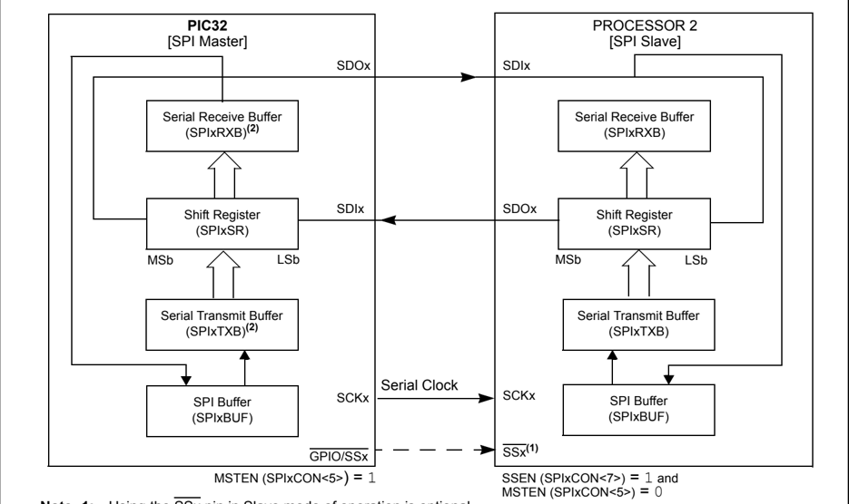

- Note 1: Using the SSx pin in Slave mode of operation is optional.
- 2: User must write transmit data to SPIxBUF and read received data from SPIxBUF. The SPIxTXB and SPIxRXB registers are memory mapped to SPIxBUF.

## 23.3.3.1 MASTER MODE OPERATION

Perform the following steps to set up the SPI module for the Master mode operation:

1. Disable the SPI interrupts in the respective IECx register.
2. Stop and reset the SPI module by clearing the ON bit.
3. Clear the receive buffer.
4. Clear the ENHBUF bit (SPIxCON&lt;16&gt;) if using Standard Buffer mode or set the bit if using Enhanced Buffer mode.
5. If SPI interrupts are not going to be used, skip this step and continue to step 5. Otherwise the following additional steps are performed:
- a) Clear the SPIx interrupt flags/events in the respective IFSx register.
- b) Write the SPIx interrupt priority and subpriority bits in the respective IPCx register.
- c) Set the SPIx interrupt enable bits in the respective IECx register.
6. Write the Baud Rate register, SPIxBRG.
7. Clear the SPIROV bit (SPIxSTAT&lt;6&gt;).
8. Write the desired settings to the SPIxCON register with MSTEN (SPIxCON&lt;5&gt;) = 1 .
9. Enable SPI operation by setting the ON bit (SPIxCON&lt;15&gt;).
10. Write the data to be transmitted to the SPIxBUF register. Transmission (and reception) will start as soon as data is written to the SPIxBUF register.

Note: The SPI device must be turned off prior to changing the mode from Slave to Master. (When using the Slave Select mode, the SSx or another GPIO pin is used to control the slave's SSx input. The pin must be controlled in software.)

In Master mode, the PBCLK is divided and then used as the serial clock. The division is based on the settings in the SPIxBRG register. The serial clock is output via the SCKx pin to slave devices. Clock pulses are only generated when there is data to be transmitted; except when in Framed mode, when clock is generated continuously. For further information, refer to 23.3.7 'SPI Master Mode Clock Frequency' .

The Master Mode Slave Select Enable (MSSEN) bit in the SPI Control register (SPIxCON&lt;28&gt;) can be set to automatically drive the slave select signal (SS) in Master mode. Clearing this bit disables  the  slave  select  signal  support  in  Master  mode.  The  FRMPOL  bit  (SPIxCON&lt;29&gt;) determines the polarity for the slave select signal in Master mode.

Note: The MSSEN bit is not available on all devices. Refer to the specific device data sheet for details. This bit should not be set the SPI Framed mode is enabled (i.e., FRMEN = 1 ).

In devices that do not feature the MSSEN bit, the Slave Select signal (in non-Framed SPI mode) must be generated by using the SSx pin or another general purpose I/O pin under software control.

The CKP (SPIxCON&lt;6&gt;) and CKE (SPIxCON&lt;8&gt;) bits determine on which edge of the clock data transmission occurs.

Note:

The user  must  turn  off  the  SPI  device  prior  to  changing  the  CKE  or  CKP  bits. Otherwise, the behavior of the device is not guaranteed.

Both data to be transmitted and data that is received are written to, or read from, the SPIxBUF register, respectively.

The following progression describes the SPI module operation in Master mode:

1. Once the module is set up for Master mode operation and enabled, data to be transmitted is written to SPIxBUF register. The SPITBE bit (SPIxSTAT&lt;3&gt;) is cleared.
2. The contents of SPIxTXB are moved to the shift register, SPIxSR (see Figure 23-8), and the SPITBE bit is set by the module.
3. A series of 8/16/32 clock pulses shifts 8/16/32 bits of transmit data from SPIxSR to the SDOx pin and simultaneously shifts the data at the SDIx pin into SPIxSR.

4. When the transfer is complete, the following events will occur:
- a) The SPIxRXIF interrupt flag bit is set. SPI interrupts can be enabled by setting the SPIxRXIE interrupt enable bit. The SPIxRXIF flag is not cleared automatically by the hardware.
- b) Also, when the ongoing transmit and receive operation is completed, the contents of SPIxSR are moved to SPIxRXB.
- c) The SPIRBF bit (SPIxSTAT&lt;0&gt;) is set by the module, indicating that the receive buffer  is  full.  Once  SPIxBUF  is  read  by  the  user  code,  the  hardware  clears  the SPIRBF bit. In Enhanced Buffer mode the SPIRBE bit (SPIxSTAT&lt;5&gt;) is set when the SPIxRXB FIFO buffer is completely empty and cleared when not empty.
5. If the SPIRBF bit is set (the receive buffer is full) when the SPI module needs to transfer data  from  SPIxSR  to  SPIxRXB,  the  module  will  set  the  SPIROV  bit  (SPIxSTAT&lt;6&gt;) indicating an overflow condition.
6. Data to be transmitted can be written to SPIxBUF by the user software at any time, if the SPITBE bit (SPIxSTAT&lt;3&gt;) is set. The write can occur while SPIxSR is shifting out the previously written data, allowing continuous transmission. In Enhanced Buffer mode the SPITBF bit (SPIxSTAT&lt;1&gt;) is set when the SPIxTXB FIFO buffer is completely full and clear when it is not full.

Note:

The SPIxSR register cannot be written to directly by the user.  All  writes  to  the SPIxSR register are performed through the SPIxBUF register.

## Example 23-1: Initialization Code for 16-bit SPI Master Mode

```
/* The following code example will initialize the SPI1 in Master mode. It assumes that none of the SPI1 input pins are shared with an analog input. If so, the AD1PCFG and corresponding TRIS registers have to be properly configured. */ int rData; IEC0CLR=0x03800000; // disable all interrupts SPI1CON = 0; // Stops and resets the SPI1. rData=SPI1BUF; // clears the receive buffer IFS0CLR=0x03800000; // clear any existing event IPC5CLR=0x1f000000; // clear the priority IPC5SET=0x0d000000; // Set IPL=3, Subpriority 1 IEC0SET=0x03800000; // Enable RX, TX and Error interrupts SPI1BRG=0x1; // use FPB/4 clock frequency SPI1STATCLR=0x40; // clear the Overflow SPI1CON=0x8220; // SPI ON, 8 bits transfer, SMP=1, Master mode // from now on, the device is ready to transmit and receive data SPI1BUF='A'; // transmit an A character
```

23

Figure 23-9: SPI Master Mode Operation in 8-bit Mode (MODE32 = 0 , MODE16 = 0 )

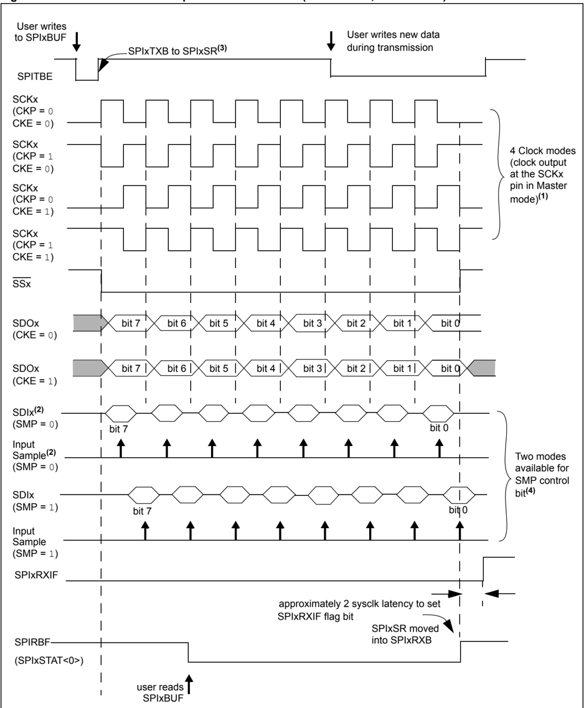

- Note 1: Four SPI Clock modes are shown here to demonstrate the functionality of bits CKP (SPIxCON&lt;6&gt;) and CKE (SPIxCON&lt;8&gt;). Only one of the four modes can be chosen for operation.
- 2: The SDI and input samples shown here for two different values of the SMP bit (SPIxCON&lt;9&gt;) are strictly for demonstration purposes. Only one of the two configurations of the SMP bit can be chosen during operation.
- 3: If there are no pending transmissions, SPIxTXB is transferred to SPIxSR as soon as the user writes to SPIxBUF.
- 4: Operation for 8-bit mode shown. 16-bit and 32-bit modes are similar.

## 23.3.3.2 SLAVE MODE OPERATION

The following steps are used to set up the SPI module for the Slave mode of operation:

1. If using interrupts, disable the SPI interrupts in the respective IECx register.
2. Stop and reset the SPI module by clearing the ON bit.
3. Clear the receive buffer.
4. Clear the ENHBUF bit (SPIxCON&lt;16&gt;) if using Standard Buffer mode or set the bit if using Enhanced Buffer mode.
5. If using interrupts, the following additional steps are performed:
- a) Clear the SPIx interrupt flags/events in the respective IFSx register.
- b) Write the SPIx interrupt priority and subpriority bits in the respective IPCx register.
- c) Set the SPIx interrupt enable bits in the respective IECx register.
6. Clear the SPIROV bit (SPIxSTAT&lt;6&gt;).
7. Write the desired settings to the SPIxCON register with MSTEN (SPIxCON&lt;5&gt;) = 0 .
8. Enable SPI operation by setting the ON bit (SPIxCON&lt;15&gt;).
9. Transmission (and reception) will start as soon as the master provides the serial clock.

Note:

The SPI module must be turned off prior to changing the mode from Master to Slave.

In Slave mode, data is transmitted and received as the external clock pulses appear on the SCKx pin. The CKP bit (SPIxCON&lt;6&gt;) and the CKE bit (SPIxCON&lt;8&gt;) determine on which edge of the clock data transmission occurs.

Both data to be transmitted and data that is received are respectively written into or read from the SPIxBUF register.

The rest of the operation of the module is identical to that in the Master mode including Enhanced Buffer mode.

## 23.3.3.2.1 Slave Mode Additional Features

The following additional features are provided in the Slave mode:

- Slave Select Synchronization

The SSx pin allows a Synchronous Slave mode. If the SSEN bit (SPIxCON&lt;7&gt;) is set, transmission and reception is enabled in Slave mode only if the SSx pin is driven to a low state. The port output or other peripheral outputs must not be driven in order to allow the SSx pin to function as an input. If the SSEN bit is set and the SSx pin is driven high, the SDOx pin is no longer driven and will tri-state even if the module is in the middle of a transmission. An aborted transmission will be retried the next time the SSx pin is driven low using the data held in the SPIxTXB register. If the SSEN bit is not set, the SSx pin does not affect the module operation in Slave mode.

- SPITBE Status Flag Operation

The SPITBE bit (SPIxSTAT&lt;3&gt;) has a different function in the Slave mode of operation. The following  describes  the  function  of  SPITBE  for  various  settings  of  the  Slave  mode  of operation:

- -If SSEN (SPIxCON&lt;7&gt;) is cleared, the SPITBE is cleared when SPIxBUF is loaded by the user code. It is set when the module transfers SPIxTXB to SPIxSR. This is similar to the SPITBE bit function in Master mode.
- -If SSEN is set, SPITBE is cleared when SPIxBUF is loaded by the user code. However, it is set only when the SPIx module completes data transmission. A transmission will be aborted when the SSx pin goes high and may be retried at a later time. So, each data Word is held in SPIxTXB until all bits are transmitted to the receiver.

Note:

Slave Select cannot be used when operating in Frame mode.

## PIC32 Family Reference Manual

## Example 23-2: Initialization Code for 16-bit SPI Slave Mode

```
/* The following code example will initialize the SPI1 in Slave mode. It assumes that none of the SPI1 input pins are shared with an analog input. If so, the AD1PCFG and corresponding TRIS registers have to be properly configured. */ int rData; IEC0CLR=0x03800000; // disable all interrupts SPI1CON = 0; // Stops and resets the SPI1. rData=SPI1BUF; // clears the receive buffer IFS0CLR=0x03800000; // clear any existing event IPC5CLR=0x1f000000; // clear the priority IPC5SET=0x0d000000; // Set IPL=3, Subpriority 1 IEC0SET=0x03800000; // Enable RX, TX and Error interrupts SPI1STATCLR=0x40; // clear the Overflow SPI1CON=0x8000; // SPI ON, 8 bits transfer, Slave mode // from now on, the device is ready to receive and transmit data
```

Figure 23-10: SPI Slave Mode Operation in 8-bit Mode with Slave Select Pin Disabled (MODE32 = 0 , MODE16 = 0 , SSEN = 0 )

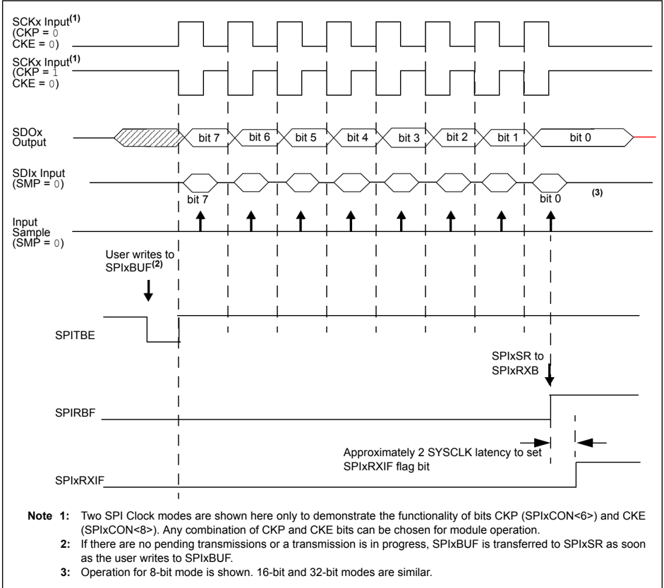

Figure 23-11: SPI Slave Mode Operation in 8-bit Mode with Slave Select Pin Enabled (MODE32 = 0 , MODE16 = 0 , SSEN = 1 )

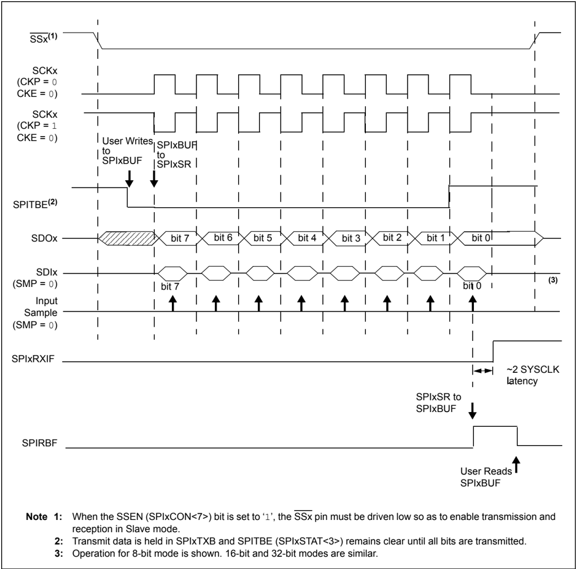

## 23.3.4 SPI Error Handling

When a new data word has been shifted into shift register SPIxSR and the previous contents of receive  register  SPIxRXB  have  not  been  read  by  the  user  software,  the  SPIROV  bit (SPIxSTAT&lt;6&gt;) will be set. The module will not transfer the received data from SPIxSR to the SPIxRXB. Further data reception is disabled until the SPIROV bit is cleared. The SPIROV bit is not cleared automatically by the module and must be cleared by the user software.

## 23.3.5 SPI Receive-Only Operation

Setting the DISSDO control bit (SPIxCON&lt;12&gt;) disables transmission at the SDOx pin. This allows the SPIx module to be configured for a Receive-Only mode of operation. The SDOx pin will be controlled by the respective port function if the DISSDO bit is set.

The DISSDO function is applicable to all SPI operating modes.

## 23.3.6 Framed SPI Modes

The module supports a very basic framed SPI protocol while operating in either Master or Slave modes. The following features are provided in the SPI module to support Framed SPI modes:

- The FRMEN control bit (SPIxCON&lt;31&gt;) enables Framed SPI mode and causes the SSx pin to be used as a frame synchronization pulse input or output pin. The state of SSEN (SPIxCON&lt;7&gt;) is ignored.
- The FRMSYNC control bit (SPIxCON&lt;30&gt;) determines whether the SSx pin is an input or an output (i.e., whether the module receives or generates the frame synchronization pulse)
- The FRMPOL control bit (SPIxCON&lt;29&gt;) determines the frame synchronization pulse polarity for a single SPI clock cycle.
- The FRMSYPW control bit (SPIxCON&lt;27&gt;) can be set to configure the width of the frame synchronization pulse to one character wide

Note:

The FRMSYPW bit is not available on all devices. Refer to the specific device data sheet for details.

- The FRMCNT&lt;2:0&gt; control bits (SPIxCON&lt;26:24&gt;) can be set to configure the number of data characters transmitted per frame synchronization pulse

The following Framed SPI modes are supported by the SPI module:

- Frame Master mode

The SPI module generates the frame synchronization pulse and provides this pulse to other devices at the SSx pin

- Frame Slave mode

The SPI module uses a frame synchronization pulse received at the SSx pin.

The  Framed  SPI  modes  are  supported  in  conjunction  with  the  Master  and  Slave  modes. Therefore, the following Framed SPI Configurations are available:

- SPI Master mode and Frame Master mode
- SPI Master mode and Frame Slave mode
- SPI Slave mode and Frame Master mode
- SPI Slave mode and Frame Slave mode

These four modes determine whether or not the SPIx module generates the serial clock and the frame synchronization pulse.

The ENHBUF bit (SPIxCON&lt;16&gt;) can be configured to use the Standard Buffering mode or Enhanced Buffering mode in Framed SPI mode.

In addition, the SPI module can be used to interface to external audio DAC/ADC and codec devices in Framed SPI mode.

Figure 23-12: SPI Master, Frame Master Connection Diagram

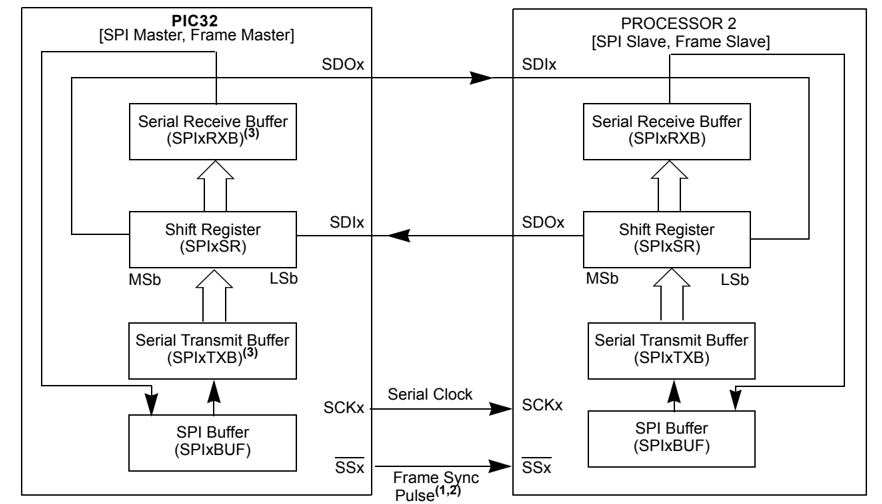

- Note 1: In Framed SPI modes, the SSx pin is used to transmit/receive the frame synchronization pulse.
- 2: Framed SPI modes require the use of all four pins (i.e., using the SSx pin is not optional).
- 3: The SPIxTXB and SPIxRXB registers are memory mapped to the SPIxBUF register.

## 23.3.6.1 SCKx IN FRAMED SPI MODES

When FRMEN (SPIxCON&lt;31&gt;) = 1 and MSTEN (SPIxCON&lt;5&gt;) = 1 , the SCKx pin becomes an output and the SPI clock at SCKx becomes a free-running clock.

When FRMEN = 1 and MSTEN = 0 , the SCKx pin becomes an input. The source clock provided to the SCKx pin is assumed to be a free-running clock.

The polarity of the clock is selected by the CKP bit (SPIxCON&lt;6&gt;). The CKE bit (SPIxCON&lt;8&gt;) is not used for the Framed SPI modes.

When CKP xor CKE = 0 , the frame sync pulse output and the SDOx data output change on the rising edge of the clock pulses at the SCKx pin. Input data is sampled at the SDIx input pin on the falling edge of the serial clock.

When CKP xor CKE = 1 , the frame sync pulse output and the SDOx data output change on the falling edge of the clock pulses at the SCKx pin. Input data is sampled at the SDIx input pin on the rising edge of the serial clock.

## 23.3.6.2 SPI BUFFERS IN FRAMED SPI MODES

When  FRMSYNC  (SPIxCON&lt;30&gt;) = 0 ,  the  SPIx  module  is  in  the  Frame  Master  mode  of operation. In this mode, the frame sync pulse is initiated by the module when the user software writes the transmit data to SPIxBUF location (thus writing the SPIxTXB register with transmit data).  At  the end  of  the  frame  sync  pulse,  SPIxTXB  is  transferred  to  SPIxSR  and  data transmission/reception begins.

When FRMSYNC = 1 , the module is in Frame Slave mode. In this mode, the frame sync pulse is  generated  by  an  external  source.  When  the  module samples  the frame  sync pulse,  it will transfer  the  contents  of  the  SPIxTXB  register  to  SPIxSR,  and  data  transmission/reception begins.  The  user  must  make  sure  that  the  correct  data  is  loaded  into  the  SPIxBUF  for transmission before the frame sync pulse is received.

Note: Receiving a frame sync pulse will start a transmission, regardless of whether or not data was written to SPIxBUF. If a write was not performed, zeros will be transmitted.

## 23.3.6.3 SPI MASTER MODE AND FRAME MASTER MODE

This Framed SPI mode is enabled by setting the MSTEN bit (SPIxCON&lt;5&gt;) and the FRMEN bit (SPIxCON&lt;31&gt;) to ' 1 ',  and the FRMSYNC bit (SPIxCON&lt;30&gt;) to ' 0 '.  In this mode, the serial clock  will  be  output  continuously  at  the  SCKx  pin,  regardless  of  whether  the  module  is transmitting. When SPIxBUF is written, the SSx pin will be driven active, high or low depending on the FRMPOL bit (SPIxCON&lt;29&gt;), on the next transmit edge of the SCKx clock. The SSx pin will be high for one SCKx clock cycle. The module will start transmitting data on the next transmit edge of the SCKx, as shown in Figure 23-13. A connection diagram indicating signal directions for this operating mode is shown in Figure 23-13.

Figure 23-13: SPI Master, Frame Master (MODE32 = 0 , MODE16 = 1 , SPIFE = 0 , FRMPOL = 1 )

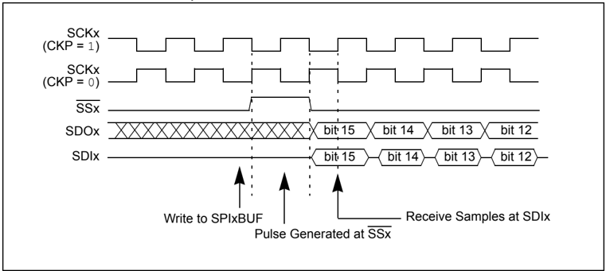

## 23.3.6.4 SPI MASTER MODE AND FRAME SLAVE MODE

This Framed SPI mode is enabled by setting the MSTEN bit (SPIxCON&lt;5&gt;), the FRMEN bit (SPIxCON&lt;31&gt;), and the FRMSYNC bit (SPIxCON&lt;30&gt;) to ' 1 '. The SSx pin is an input, and it is sampled on the sample edge of the SPI clock. When it is sampled active, high or low depending on the FRMPOL bit (SPIxCON&lt;29&gt;), data will be transmitted on the subsequent transmit edge of the SPI clock, as shown in Figure 23-14. The interrupt flag SPIxIF is set when the transmission is  complete.  The  user  must  make  sure  that  the  correct  data  is  loaded  into  SPIxBUF  for transmission before the signal is received at the SSx pin. A connection diagram indicating signal directions for this operating mode is shown in Figure 23-15.

Figure 23-14: SPI Master, Frame Slave (MODE32 = 0 , MODE16 = 1 , SPIFE = 0 , FRMPOL = 1 )

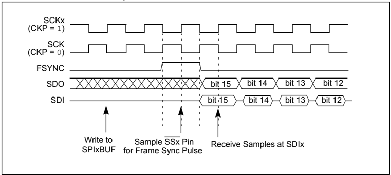

Figure 23-15: SPI Master, Frame Slave Connection Diagram

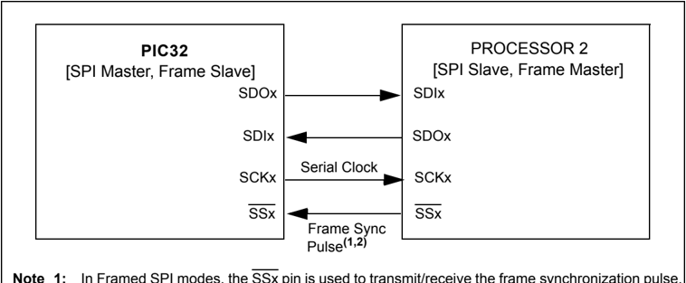

- Note 1: In Framed SPI modes, the SSx pin is used to transmit/receive the frame synchronization pulse.
- 2: Framed SPI modes require the use of all four pins (i.e., using the SSx pin is not optional).

## 23.3.6.5 SPI SLAVE MODE AND FRAME MASTER MODE

This Framed SPI mode is enabled by setting the MSTEN bit (SPIxCON&lt;5&gt;) to ' 0 ', the FRMEN bit (SPIxCON&lt;31&gt;) to ' 1 ', and the FRMSYNC bit (SPIxCON&lt;30&gt;) to ' 0 '. The input SPI clock will be continuous in Slave mode. The SSx pin will be an output when bit FRMSYNC is low. Therefore, when SPIBUF is written, the module will drive the SSx pin active, high or low depending on the FRMPOL bit (SPIxCON&lt;29&gt;), on the next transmit edge of the SPI clock. The SSx pin will be driven high for one SPI clock cycle. Data transmission will start on the next SPI clock transmit edge. A connection diagram indicating signal directions for this  operating  mode  is  shown  in Figure 23-16.

Figure 23-16: SPI Slave, Frame Master Connection Diagram

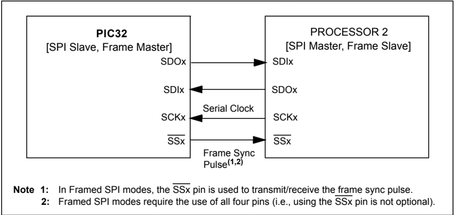

## 23.3.6.6 SPI SLAVE MODE AND FRAME SLAVE MODE

This Framed SPI mode is enabled by setting the MSTEN bit (SPIxCON&lt;5&gt;) to ' 0 ', the FRMEN bit  (SPIxCON&lt;31&gt;) to ' 1 ',  and the FRMSYNC bit (SPIxCON&lt;30&gt;) to ' 1 '.  Therefore, both the SCKx and SSx pins will be inputs. The SSx pin will be sampled on the sample edge of the SPI clock. When SSx is sampled active, high or low depending on the FRMPOL bit (SPIxCON&lt;29&gt;), data will be transmitted on the next transmit edge of SCKx. A connection diagram indicating signal directions for this operating mode is shown in Figure 23-17.

Figure 23-17: SPI Slave, Frame Slave Connection Diagram

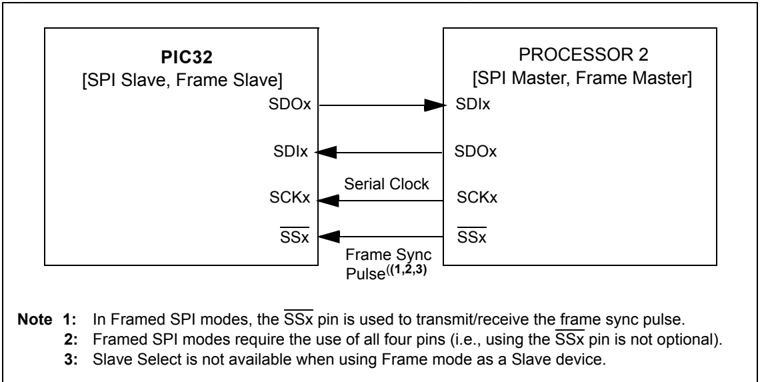

## 23.3.7 SPI Master Mode Clock Frequency

The SPI module allows flexibility in baud rate generation through the 9-bit SPIxBRG register. SPIxBRG is readable and writable, and determines the baud rate. The peripheral clock PBCLK provided to the SPI module is a divider function of the CPU core clock. This clock is divided based on the value loaded into SPIxBRG. The SCKx clock obtained by dividing PBCLK is of 50% duty cycle and it is provided to the external devices via the SCKx pin.

Note: The SCKx clock is not free running for non-framed SPI modes. It will only run for 8, 16, or 32 pulses when SPIxBUF is loaded with data. It will however, be continuous for Framed modes.

Equation 23-1 defines the SCKx clock frequency as a function of SPIxBRG settings.

## Equation 23-1:

<!-- formula-not-decoded -->

Therefore, the maximum baud rate possible is FPB/2 (SPIxBRG = 0 ), and the minimum baud rate possible is FPB/1024.

Some sample SPI clock frequencies (in kHz) are shown in Table 23-4.

Table 23-4: Sample SCKx Frequencies

| SPIxBRG Setting   | 0         | 15         | 31         | 63         | 85         | 127        | 255        | 511       |
|-------------------|-----------|------------|------------|------------|------------|------------|------------|-----------|
| FPB = 80 MHz      | 40.00 MHz | 2.5 MHz    | 1.25 kHz   | 625 kHz    | 465.11 kHz | 312.5 kHz  | 156.25 kHz | 78.13 kHz |
| FPB = 72 MHz      | 36.00 MHz | 2.25 MHz   | 1.13 kHz   | 562.5 kHz  | 418.60 kHz | 281.25 kHz | 140.63 kHz | 70.31 kHz |
| FPB = 60 MHz      | 30.00 MHz | 1.88 MHz   | 937.5 kHz  | 468.75 kHz | 348.83 kHz | 234.38 kHz | 117.19 kHz | 58.59 kHz |
| FPB = 50 MHz      | 25.00 MHz | 1.56 MHz   | 781.25 kHz | 390.63 kHz | 290.7 kHz  | 195.31 kHz | 97.66 kHz  | 48.83 kHz |
| FPB = 40 MHz      | 20.00 MHz | 1.25 MHz   | 625.00 kHz | 312.50 kHz | 232.56 kHz | 156.25 kHz | 78.13 kHz  | 39.06 kHz |
| FPB = 25 MHz      | 12.50 MHz | 781.25 kHz | 390.63 kHz | 195.31 kHz | 145.35 kHz | 97.66 kHz  | 48.83 kHz  | 24.41 kHz |
| FPB = 20 MHz      | 10.00 MHz | 625.00 kHz | 312.50 kHz | 156.25 kHz | 116.28 kHz | 78.13 kHz  | 39.06 kHz  | 19.53 kHz |
| FPB = 10 MHz      | 5.00 MHz  | 312.50 kHz | 156.25 kHz | 78.13 kHz  | 58.14 kHz  | 39.06 kHz  | 19.53 kHz  | 9.77 kHz  |

Note: Not all clock rates are supported. For further information, refer to the SPI timing specifications  in  the 'Electrical  Characteristics' chapter  of  the  specific  device data sheet.

## 23.4 AUDIO PROTOCOL INTERFACE MODE

The SPI module can be interfaced to most codec devices available today to provide PIC32 microcontroller-based audio solutions. The SPI module provides support to the audio protocol functionality via four standard I/O pins. The four pins that make up the audio protocol interface modes are:

- SDIx: Serial Data Input for receiving sample digital audio data (ADCDAT)
- SDOx: Serial Data Output for transmitting digital audio data (DACDAT)
- SCKx: Serial Clock, also known as bit clock (BCLK)
- SSx: Left/Right Channel Clock (LRCK)

BCLK provides the clock required to drive the data out or into the module, while LRCK provides the synchronization of the frame based on the protocol mode selected.

In  some  codecs,  Serial  Clock  (SCK)  refers  to  the  Baud/Bit  Clock  (BCLK).  Throughout  this section, the signal SSx is to referred to as LRCK to be consistent with codec naming conventions. The SPI module has the ability to function in Audio Protocol Master and Audio Protocol Slave modes. In Master mode, the module generates both the BCLK on the SCKx pin and the LRCK on the SSx pin. In certain devices, while in Slave mode, the module receives these two clocks from its I 2 S partner, which is operating in Master mode.

While in Master mode, the SPI module has the ability to generate its own clock internally via the Master Clock (MCLK) from various internal sources such as primary clock, PBCLK, USB clock, FRC and other internal sources. In addition, the SPI module has the ability to provide the MCLK to the codec device, which is a common requirement.

To  start the Audio  Protocol  mode,  first disable the peripheral by  setting the  ON  bit (SPIxCON&lt;15&gt;) = 0 .  Next,  set  the  AUDEN bit (SPIxCON2&lt;7&gt;) = 1 ,  and  then  re-enable the peripheral by setting the ON bit = 1 .

When configured in Master mode, the leading edge of SCK and the LRCK are driven out within one  SCK  period  of  starting  the  audio  protocol.  Serial  data  is  shifted  in  or  out  with  timings determined  by  the  protocol  mode  set  by  the  AUDMOD&lt;1:0&gt;  bits  (SPIxCON2&lt;1:0&gt;).  If  the transmit FIFO is empty, zeros are transmitted.

In Slave mode, the peripheral drives zeros out SDO, but does not transmit the contents of the transmit FIFO until it sees the leading edge of the LRCK, after which time starts receiving data (provided SDI has not been disabled). It will continue to transmit zeros as long as the transmit FIFO is empty.

While in Slave or Master mode, the SPI module does not generate an underrun on the TX FIFO after start-up. This allows software to set up the SPI, set up the DMA, turn on the SPI's audio protocol, and then turn on the DMA without getting an error.

After  the  first  write  to  the  TX  FIFO  (SPIxBUF),  the  SPI  enables  underrun  detection  and generation.  To  keep  the  RX  FIFO  empty  until  the  DMA  is  enabled,  set  DISSDI  = 1 (SPIxCON&lt;4&gt;). After enabling the DMA, set DISSDI = 0 to start receiving.

## 23.4.1 Master Mode

To  configure  the  PIC32  device  in  Audio  Protocol  Master  mode,  set  both  the  MSTEN  bit (SPIxCON&lt;5&gt;) and the AUDEN bit (SPIxCON2&lt;7&gt;) to ' 1 '.

A few characteristics in Master mode are:

- This mode enables the device to generate SCK and LRCK pulses as long as the ON bit (SPIxCON&lt;15&gt;) = 1
- The SPI module generates LRCK and SCK continuously in all the cases, regardless of the transmit data while in Master mode
- The SPI module drives the leading edge of LRCK and SCK within 1 SCK period and the serial data shifts in and out continuously even when the TX FIFO is empty

Figure 23-18 shows a typical interface between master and slave while in Master mode.

Figure 23-18: Master Generating its Own Clock - Output BCLK and LRCK

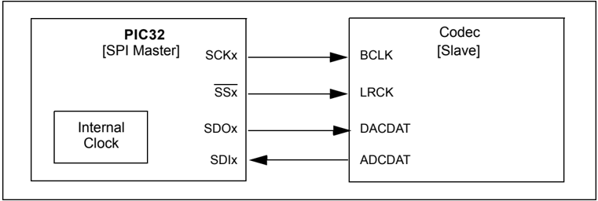

## 23.4.2 Slave Mode

The SPI module can be configured in audio protocol slave mode by setting the MSTEN bit = 0 (SPIxCON&lt;5&gt;) and the AUDEN bit = 1 (SPIxCON2&lt;7&gt;)

A few characteristics in Slave mode are:

- This mode enables the device to receive SCK and LRCK pulses as long as the ON bit = 1 (SPIxCON&lt;15&gt;)
- The SPI module drives zeros out of SDO, but does not shift data out or in (SDI) until the module receives the LRCK (i.e., the edge that precedes the left channel)
- Once the module receives the leading edge of LRCK, it starts receiving data if DISSDI = 0 (SPIxCON&lt;4&gt;) and the serial data shifts out continuously even when the TX FIFO is empty

Figure 23-19 shows the interface between a SPI module in Audio Slave Interface mode to a codec master device.

Figure 23-19: Codec Device as Master Generates Required Clock via External Crystal

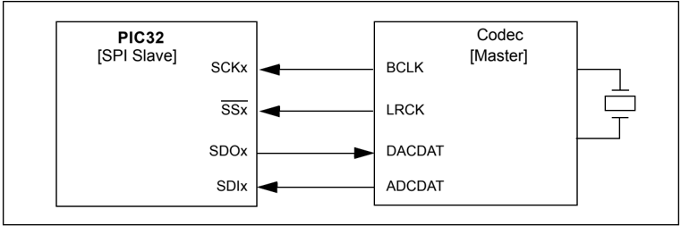

Figure 23-20 shows the interface between a SPI module in Audio Slave Interface mode to a codec master device, in this the master clock is being derived from SPI reference clock out function.

Figure 23-20: Codec Device as Master Derives MCLK from PIC32 Reference Clock Out

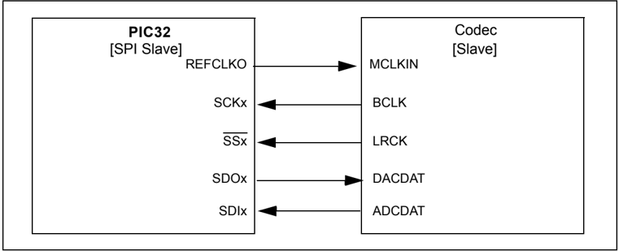

## 23.4.3 Audio Data Length and Frame Length

While codec devices may generate audio data samples of various word lengths of 8/16/20/24/32, the PIC32 SPI module supports transmit/receive audio data lengths of 16, 24, and 32.

Note: Actual sample data can be any length, with a maximum of 32 bits, and the data must be packed in one of three (16/24/32) formats.

Table 23-5  illustrates  how  the  MODE&lt;32,16&gt;  bits  (SPIxCON&lt;11:10&gt;)  control  the  maximum allowable sample length and frame length (LRCK period on SSx).

Table 23-5: Audio Data Length versus LRCK Period

| SPIxCON<11:10>   | SPIxCON<11:10>   |   Data Length (bits) |                   | Left/Right Channel Sample Length   | Enhanced Buffer FIFO Depth   | LRCK Period Frame   |
|------------------|------------------|----------------------|-------------------|------------------------------------|------------------------------|---------------------|
| MODE32           | MODE16           |                      | FIFO Width (bits) | (bits)                             | (samples)                    | Length (bits)       |
| 0                | 0                |                   16 | 16                | ≤ 16                               | 8                            | 32                  |
| 0                | 1                |                   16 | 16                | ≤ 32                               | 8                            | 64                  |
| 1                | 1                |                   24 | 32                | ≤ 32                               | 4                            | 64                  |
| 1                | 0                |                   32 | 32                | ≤ 32                               | 4                            | 64                  |

The parameters of the MODE&lt;32,16&gt; bits (SPIxCON&lt;11:10&gt;) have the following behavior:

- Controls Left/Right channel data length, frame length
- In 16-bit Sample mode, 32/64-bit frame length is supported
- In 24/32-bit Sample mode, 64-bit frame length is supported
- Defines FIFO width and depth (e.g., 24-bit data has a 32 bit wide and 4 location deep FIFO)
- If the written data is greater than the data selected, the upper bytes are ignored
- If the written data is less than the data selected, the FIFO pointers change on the write to the Most Significant Byte (MSB) of the selected length

If this data is written to the transmit FIFO in more than one write, the write order must be from least significant to most significant.

For example, assuming that audio data is 24 bits per sample with 8 bits available at a time. According to Table 23-5, the FIFO width is 32 bits per sample. Therefore, the 8 Most Significant bits (MSbs), bits 31:24, in each FIFO sample are ignored.

Bits 15:8 and 7:0 can be written to the SPIxBUF register in any order; however, bits 23:16 must be written last, as writing the Most Significant bit (MSb), bit 24, triggers a change in the pointers of the transmit buffer.

Data written to unused bytes is ignored. Also, transactions that are only to unused bytes are also ignored. Therefore, a byte write to address offset 0x0023 is completely ignored and does not cause a FIFO push if the data is less than 32 bits wide.

## 23.4.4 Frame Error/LRCK Errors

The SPI module provides detection of frame/LRCK errors for debugging. The frame/LRCK error occurs when the LRCK edge that is defining a channel start happens before the correct number of bits (as defined by MODE&lt;32,16&gt;).

The  SPI  module  immediately  sets  the  FRMERR  bit  (SPIxSTAT&lt;12&gt;),  pushes  data  in  from SPIxSR register into the SPIxRXB register, and pops data from the SPIxTXB register into the SPIxSR register. The module can be configured to detect frame/LRCK-related errors by setting the FRMERREN bit (SPIxCON2&lt;12&gt;).

Note: In Audio Protocol mode, both the BCLK (on the SCKx pin) and the LRCK (on the SSx pin) are free running, meaning they are continuous. Normally, the LRCK is a fixed number of BCLKs long. In all cases, the SPI module will realign to the new frame edge and will set the FRMERR bit. If operating in a non-PCM mode, the SPI module will also push the abbreviated data onto the FIFO when the frame is too short.

## 23.4.5 Audio Protocol Modes

The SPI module supports four audio protocol modes and can be operated in any one of these modes:

- I 2 S mode (not available on all devices; refer to the specific device data sheet for availability)
- Left-Justified mode
- Right-Justified mode
- PCM/DSP mode

These  audio  protocol  modes  can  be  enabled  by  configuring  the  AUDMOD&lt;1:0&gt;  bits (SPIxCON2&lt;1:0&gt;). These modes enable communication to different types of codecs and control the edge relationships of LRCK and SDI/SDO with respect to SCK.

With respect to data transmit, in all of the protocol modes, the MSB is first transmitted followed by MSB-1, and so on, until the Least Significant Byte (LSB) transmits. The length of the data is discussed in 23.4.3 'Audio Data Length and Frame Length' . If there are SCK periods left over after the LSb is transmitted, zeros are sent to fill up the frame.

When in Slave mode, the relationship between the BCLK (on the SCKx pin) and the period (or frame length) of the LRCK (on the SSx pin) is far less constrained than that of Master mode. In Master mode, the frame length equals 32 or 64 BCLKs depending on the MODE&lt;32,16&gt; bit (SPIxCON&lt;11:10&gt;) settings. However, in Slave mode, the frame length can be greater than or equal to 32 or 64 BCLKs, but the FRMERR bit (SPIxSTAT&lt;12&gt;) will be set if the frame LRCK edge arrives early.

Figure 23-21 illustrates the general interface between the codec device and the SPI module in audio mode.

Figure 23-21: SPI Module in Audio Slave Mode - BCLK and WS or LRCK Generated by Master

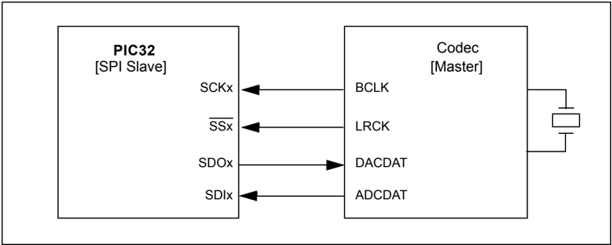

## 23.4.5.1 I 2 S MODE

Note:

This feature is not available on all devices. Refer to the specific device data sheet for availability.

The Inter-IC Sound (I 2 S) protocol enables transmission of two channels of digital audio data over a single serial interface. The I 2 S protocol defines a 3-wire interface that handles the stereo data using  the  WS/LRCK  line.  The  I 2 S  specification  defines  a  half-duplex  interface  that  supports transmit or receive, but not both at the same time. With both SDO and SDI available, full-duplex operation is supported by this peripheral, as shown in Figure 23-22.

- Data Transmit and Clocking:
- -The transmitter shifts the audio sample data's MSb on the first falling edge of SCK after an LRCK transition
- -The receiver samples the MSB on the second rising edge of SCK
- -The left channel data shifts out while LRCK is low and right channel data is shifted out while LRCK is high
- -The data in the left and right channel consists of a single frame
- Required Configuration Settings:

To set the module to I 2 S mode, the following bits must be set:

- -AUDMOD&lt;1:0&gt; = 00 (SPIxCON2&lt;1:0&gt;)
- -FRMPOL = 0 (SPIxCON&lt;29&gt;)
- -CKP = 1 (SPIxCON&lt;6&gt;)

Setting these bits enables the SDO and LRCK (SSx) transitions to occur on the falling edge of SCK (BCLK) and sampling of SDI to occur on the rising edge of SCK. Refer to the diagrams shown in Figure 23-22.

Figure 23-22: I 2 S with 16-bit Data/Channel or 32-bit Data/Channel

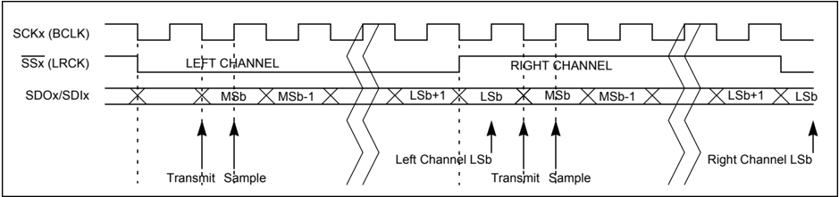

## Section 23. Serial Peripheral Interface (SPI)

## 23.4.5.1.1 I 2 S Audio Slave Mode of Operation

Use the following steps to set up the SPI module for the I 2 S Audio Slave mode of operation:

1. If using interrupts, disable the SPI interrupts in the respective IECx register.
2. Stop and reset the SPI module by clearing the ON bit (SPIxCON&lt;15&gt;).
3. Reset the SPI audio configuration register, SPIxCON2.
4. Clear the receive buffer.
5. Clear the ENHBUF bit (SPIxCON&lt;16&gt;) if using Standard Buffer mode or set the bit if using Enhanced Buffer mode.
6. If using interrupts, the following additional steps are performed:
- a) Clear the SPIx interrupt flags/events in the respective IFSx register.
- b) Write the SPIx interrupt priority and subpriority bits in the respective IPCx register.
- c) Set the SPIx interrupt enable bits in the respective IECx register.
7. Clear the SPIROV bit (SPIxSTAT&lt;6&gt;).
8. Write the desired settings to the SPIxCON2 register.
- a) AUDMOD&lt;1:0&gt; bits (SPIxCON2&lt;1:0&gt;) = 00
- b) AUDEN bit (SPIxCON2&lt;7&gt;) = 1
9. Write the desired settings to the SPIxCON register:
- a) MSTEN (SPIxCON&lt;5&gt;) = 0
- b) CKP (SPIxCON&lt;6&gt;) = 1
- c) MODE&lt;32,16&gt; (SPIxCON&lt;11:10&gt;) = 0 for 16-bit audio channel data.
- d) Enable SPI operation by setting the ON bit (SPIxCON&lt;15&gt;).
10. Transmission (and reception) will start as soon as the master provides the BCLK and LRCK.

## Example 23-3: I 2 S Slave Mode, 16-bit Channel Data, 32-bit Frame

```
/* The following code example will initialize the SPI1 Module in I2S Slave mode. */ /* It assumes that none of the SPI1 input pins are shared with an analog input.  */ unsigned int rData; IEC0CLR=0x03800000; // disable all interrupts SPI1CON = 0; // Stops and resets the SPI1. SPI1CON2 = 0; // Reset audio settings rData=SPI1BUF; // clears the receive buffer IFS0CLR=0x03800000; // clear any existing event IPC5CLR=0x1f000000; // clear the priority IPC5SET=0x0d000000; // Set IPL = 3, Subpriority 1 IEC0SET=0x03800000; // Enable RX, TX and Error interrupts SPI1STATCLR=0x40; // clear the Overflow SPI1CON2=0x00000080; // I2S Mode, AUDEN = 1, AUDMON = 0 SPI1CON =0x00008040; // Slave mode, SPI ON, CKP = 1, 16-bit audio data, 32 bits per frame // from here, the device is ready to receive and transmit data /* Note: A few of bits related to frame settings are not required to be set in the SPI1CON */ /* register during audio mode operation. Please refer to the notes in the SPIxCON2 register.*/
```

23

## 23.4.5.1.2  I 2 S Audio Master Mode of Operation

A typical application could be to play PCM data (8 kHz sample frequency, 16-bit data, 32-bit frame size) when interfaced to a codec slave device. In this case, the SPI module is initialized to generate BCLK @ 256 kbps. Assuming a 40 MHz peripheral bus clock, FPB = 40e6, the baud rate would be determined using Equation 23-2.

## Equation 23-2:

<!-- formula-not-decoded -->

Solving for the value of SPIxBRG is shown in Equation 23-3.

## Equation 23-3:

<!-- formula-not-decoded -->

The Baud Rate is now equal to 256e3. Equation 23-4 shows the resulting calculation.

## Equation 23-4:

<!-- formula-not-decoded -->

If  the  result  of  Equation 23-4 is rounded to the nearest integer, SPIxBRG is  now equal to 77; therefore, the effective Baud Rate is that of Equation 23-5.

## Equation 23-5:

<!-- formula-not-decoded -->

The result is 0.16% too fast; however, this is well within most system tolerances (0.16% is exactly 1/625). On certain devices, this error can be removed using the REFOTRIM register to provide a master clock output at the exact frequency needed.

The following steps can be used to set up the SPI module for operation in I 2 S Audio Master mode:

1. If using interrupts, disable the SPI interrupts in the respective IECx register.
2. Stop and reset the SPI module by clearing the ON bit (SPIxCON&lt;15&gt;).
3. Reset the SPI audio configuration register, SPIxCON2.
4. Reset the baud rate register, SPIxBRG.
5. Clear the receive buffer.
6. Clear the ENHBUF bit (SPIxCON&lt;16&gt;) if using Standard Buffer mode or set the bit if using Enhanced Buffer mode.
7. If using interrupts, perform these additional steps:
- a) Clear the SPIx interrupt flags/events in the respective IFSx register.
- b) Write the SPIx interrupt priority and subpriority bits in the respective IPCx register.
- c) Set the SPIx interrupt enable bits in the respective IECx register.
8. Clear the SPIROV bit (SPIxSTAT&lt;6&gt;).
9. Write the desired settings to  the  SPIxCON2  register.  The  AUDMOD&lt;1:0&gt;  bits (SPIxCON2&lt;1:0&gt;) must be set to ' 00 ' for I 2 S mode and the AUDEN bit (SPIxCON2&lt;7&gt;) must be set to ' 1 ' to enable the audio protocol.
10. Set the SPIxBRG baud rate register to 0x4D (to generate approximately 256 kbps sample rate, with PBCLK @ 40 MHz).

## Section 23. Serial Peripheral Interface (SPI)

11. Write the desired settings to the SPIxCON register:
- a) MSTEN (SPIxCON&lt;5&gt;) = 1 .
- b) CKP (SPIxCON&lt;6&gt;) = 1 .
- c) MODE&lt;32,16&gt; (SPIxCON&lt;11:10&gt;) = 0 for 16-bit audio channel data.
- d) Enable SPI operation by setting the ON bit (SPIxCON&lt;15&gt;).
12. Transmission (and reception) will start immediately after the ON bit is set.

## Example 23-4: I 2 S Master Mode, 256 kbps BCLK, 16-bit Channel Data, 32-bit Frame

```
/* The following code example will initialize the SPI1 Module in I2S Master mode. */ /* It assumes that none of the SPI1 input pins are shared with an analog input. */ unsigned int rData; IEC0CLR=0x03800000; // disable all interrupts SPI1CON = 0; // Stops and resets the SPI1. SPI1CON2 = 0; // Reset audio settings SPI1BRG=0; // Reset Baud rate register rData=SPI1BUF; // clears the receive buffer IFS0CLR=0x03800000; // clear any existing event IPC5CLR=0x1f000000; // clear the priority IPC5SET=0x0d000000; // Set IPL = 3, Subpriority 1 IEC0SET=0x03800000; // Enable RX, TX and Error interrupts SPI1STATCLR=0x40; // clear the Overflow SPI1CON2=0x00000080; // I2S Mode, AUDEN = 1, AUDMON = 0 SPI1BRG =0x4D; //(to generate 256 kbps sample rate, PBCLK @ 40 MHz) SPI1CON =0x00008060; // Master mode, SPI ON, CKP = 1, 16-bit audio channel // data, 32 bits per frame // from here, the device is ready to receive and transmit data /* Note: A few of bits related to frame settings are not required to be set in the SPI1CON */ /* register during audio mode operation. Please refer to the notes in the SPIxCON2 register.*/
```

## 23.4.5.2 LEFT-JUSTIFIED MODE

The Left-Justified mode is similar to I 2 S mode; however, in this mode, the SPI shifts the audio data's MSb on the first SCK edge that is coincident with an LRCK transition. On the receiver side, the SPI module samples the MSb on the next SCK edge.

In general, a codec using justified protocols defaults to transmitting data on the rising edge of SCK and receiving data on the falling edge of SCK.

- Required configuration settings

To set the module to Left-Justified mode, the following bits must to be set

- -AUDMOD&lt;1:0&gt; = 01 (SPIxCON2&lt;1:0&gt;)
- -FRMPOL = 1 (SPIxCON&lt;29&gt;)
- -CKP = 0 (SPIxCON&lt;6&gt;)

This enables the SDO and LRCK transitions to occur on the rising edge of SCK. Refer to the sample waveform diagrams shown in Figure 23-23 and Figure 23-24 for 16, 24, 32-bit audio data transfers.

Figure 23-23: Left-Justified with 16-bit Data/Channel or 32-bit Data/Channel

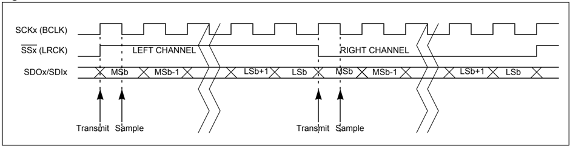

Figure 23-24: Left-Justified with 16/24-bit Data and 32-bit Channel

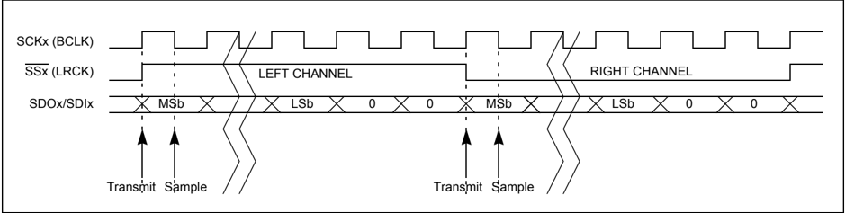

## 23.4.5.2.1 Left-Justified Audio Slave Mode Operation

Use the following steps to set up the SPI module for the Left-Justified Audio Slave mode of operation:

1. If using interrupts, disable the SPI interrupts in the respective IECx register.
2. Stop and reset the SPI module by clearing the ON bit (SPIxCON&lt;15&gt;).
3. Reset the SPI audio configuration register, SPIxCON2.
4. Clear the receive buffer.
5. Clear the ENHBUF bit (SPIxCON&lt;16&gt;) if using Standard Buffer mode or set the bit if using Enhanced Buffer mode.
6. If using interrupts, the following additional steps are performed:
- a) Clear the SPIx interrupt flags/events in the respective IFSx register.
- b) Write the SPIx interrupt priority and subpriority bits in the respective IPCx register.
- c) Set the SPIx interrupt enable bits in the respective IECx register.
7. Clear the SPIROV bit (SPIxSTAT&lt;6&gt;).
8. Write the desired settings in the  SPIxCON2  register.  The  AUDMOD&lt;1:0&gt;  bits (SPIxCON2&lt;1:0&gt;)  must  be  set  to  ' 01 '  for  Left-Justified  mode  and  the  AUDEN  bit (SPIxCON2&lt;7&gt;) must be set to ' 1 ' to enable the audio protocol.
9. Write the desired settings to the SPIxCON register:
- a) Set to Slave mode, MSTEN (SPIxCON&lt;5&gt;) = 0 .
- b) Set clock polarity, CKP (SPIxCON&lt;6&gt;) = 0 .
- c) Set frame polarity, FRMPOL (SPIxCON&lt;29&gt;) = 1 .
- d) Set MODE&lt;32,16&gt; (SPIxCON&lt;11:10&gt;) = 0 for 16-bit audio channel data
- e) Enable SPI operation by setting the ON bit (SPIxCON&lt;15&gt;).
10. Transmission (and reception) will start as soon as the master provides the BCLK and LRCK.

## Example 23-5: Left-Justified Slave Mode, 16-bit Channel Data, 32-bit Frame

```
/* The following code example will initialize the SPI1 Module in Left-Justified Slave mode. */ /* It assumes that none of the SPI1 input pins are shared with an analog input. */ unsigned int rData; IEC0CLR=0x03800000; // disable all interrupts SPI1CON = 0; // Stops and resets the SPI1. SPI1CON2 = 0; // Reset audio settings rData=SPI1BUF; // clears the receive buffer IFS0CLR=0x03800000; // clear any existing event IPC5CLR=0x1f000000; // clear the priority IPC5SET=0x0d000000; // Set IPL = 3, Subpriority 1 IEC0SET=0x03800000; // Enable RX, TX and Error interrupts SPI1STATCLR=0x40; // clear the Overflow SPI1CON2=0x00000081; // Left-Justified Mode, AUDEN = 1, AUDMON = 0 SPI1CON =0x20008000; // Slave mode, SPI ON, CKP = 0, FRMPOL = 1, // 16-bit audio data, 32 bits per frame // from here, the device is ready to receive and transmit data /* Note: A few of bits related to frame settings are not required to be set in the SPI1CON */ /* register during audio mode operation. Please refer to the notes in the SPIxCON2 register.*/
```

23

## 23.4.5.2.2 Left-Justified Audio Master Mode Operation

Use the following steps to set up the SPI module for the Left-Justified Audio Master mode of operation:

1. If using interrupts, disable the SPI interrupts in the respective IECx register.
2. Stop and reset the SPI module by clearing the ON bit (SPIxCON&lt;15&gt;).
3. Reset the SPI audio configuration register, SPIxCON2.
4. Reset the baud rate register, SPIxBRG.
5. Clear the receive buffer.
6. Clear the ENHBUF bit (SPIxCON&lt;16&gt;) if using Standard Buffer mode or set the bit if using Enhanced Buffer mode.
7. If using interrupts, the following additional steps are performed:
- a) Clear the SPIx interrupt flags/events in the respective IFSx register.
- b) Write the SPIx interrupt priority and subpriority bits in the respective IPCx register.
- c) Set the SPIx interrupt enable bits in the respective IECx register.
8. Clear the SPIROV bit (SPIxSTAT&lt;6&gt;).
9. Write the desired settings in the  SPIxCON2  register.  The  AUDMOD&lt;1:0&gt;  bits (SPIxCON2&lt;1:0&gt;) must be set to ' 01 ' for Left-Justified and the AUDEN  bit (SPIxCON2&lt;7&gt;) must be set to ' 1 ' to enable the audio protocol.
10. Set the SPIxBRG baud rate register to 0x4D (to generate approximately 256 kbps sample rate, with PBCLK @ 40 MHz)
11. Write the desired settings to the SPIxCON register:
- a) Set to Master mode, MSTEN (SPIxCON&lt;5&gt;) = 1 .
- b) Set clock polarity, CKP (SPIxCON&lt;6&gt;) = 0 .
- c) Set frame polarity, FRMPOL (SPIxCON&lt;29&gt;) = 1 .
- d) Set MODE&lt;32,16&gt; (SPIxCON&lt;11:10&gt;) = 0 for 16-bit audio channel data.
- e) Enable SPI operation by setting the ON bit (SPIxCON&lt;15&gt;).
12. Transmission (and reception) will start immediately after the ON bit is set.

## Example 23-6: Left-Justified Master Mode, 16-bit Channel Data, 32-bit Frame

```
/* The following code example will initialize the SPI1 Module in Left-Justified Master mode. */ /* It assumes that none of the SPI1 input pins are shared with an analog input. */ unsigned int rData; IEC0CLR=0x03800000; // disable all interrupts SPI1CON = 0; // Stops and resets the SPI1 SPI1CON2 = 0; // Reset audio settings SPI1BRG = 0; rData=SPI1BUF; // clears the receive buffer IFS0CLR=0x03800000; // clear any existing event IPC5CLR=0x1f000000; // clear the priority IPC5SET=0x0d000000; // Set IPL = 3, Subpriority 1 IEC0SET=0x03800000; // Enable RX, TX and Error interrupts SPI1STATCLR=0x40; // clear the Overflow SPI1CON2=0x00000081; // Left-Justified Mode, AUDEN = 1, AUDMON = 0 SPI1BRG =0x4D; // (to generate 256 kbps sample rate, PBCLK @ 40 MHz) SPI1CON =0x20008040; // Master mode, SPI ON, CKP = 0, FRMPOL = 1, MSTEN = 1 // 16-bit audio data, 32 bits per frame // from here, the device is ready to receive and transmit data /* Note: A few of bits related to frame settings are not required to be set in the SPI1CON */ /* register during audio mode operation. Please refer to the notes in the SPIxCON2 register.*/
```

## 23.4.5.3 RIGHT-JUSTIFIED MODE

In Right-Justified mode, the SPI module shifts the audio sample data's MSb after aligning the data to the last clock cycle. The bits preceding the audio sample data can be driven to logic level 0 by setting the DISSDO bit (SPIxCON&lt;12&gt;) to ' 0 '. When DISSDO = 0 , the module ignores the unused bit slot.

- Required configuration:

To set the module to Right-Justified mode, the following bits must to be set:

- -AUDMOD&lt;1:0&gt; (SPIxCON2&lt;1:0&gt;) = 10
- -FRMPOL (SPIxCON&lt;29&gt;) = 1
- -CKP (SPIxCON&lt;6&gt;) = 0

This enables the SDO and LRCK transitions to occur on the rising edge of SCK after the LSb being  aligned  to  the  last  clock  cycle.  Refer  to  the  sample  waveform  diagrams  shown  in Figure 23-25 and Figure 23-26 for 16, 24, 32-bit audio data transfers.

Figure 23-25: Right-Justified with 16-bit Data/Channel or 32-bit Data/Channel

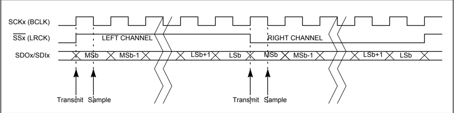

Figure 23-26: Right-Justified with 16/24-bit Data and 32-bit Channel

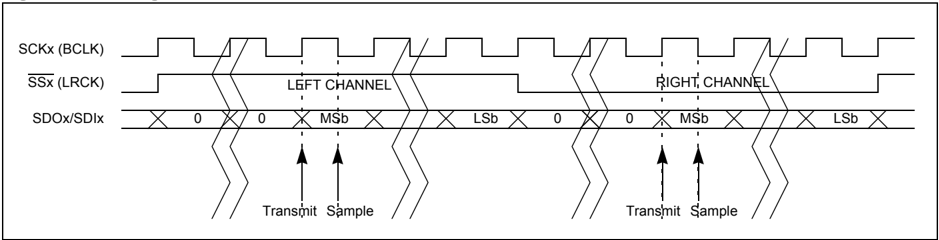

## PIC32 Family Reference Manual

## 23.4.5.3.1 Right-Justified Audio Slave Mode Operation

Use the following steps to set up the SPI module for the Right-Justified Audio Slave mode of operation:

1. If using interrupts, disable the SPI interrupts in the respective IECx register.
2. Stop and reset the SPI module by clearing the ON bit (SPIxCON&lt;15&gt;).
3. Reset the SPI audio configuration register, SPIxCON2.
4. Clear the receive buffer.
5. Clear the ENHBUF bit (SPIxCON&lt;16&gt;) if using Standard Buffer mode or set the bit if using Enhanced Buffer mode.
6. If using interrupts, perform the following steps:
- a) Clear the SPIx interrupt flags/events in the respective IFSx register.
- b) Write the SPIx interrupt priority and subpriority bits in the respective IPCx register.
- c) Set the SPIx interrupt enable bits in the respective IECx register.
7. Clear the SPIROV bit (SPIxSTAT&lt;6&gt;).
8. Write the desired settings in the  SPIxCON2  register.  The  AUDMOD&lt;1:0&gt;  bits (SPIxCON2&lt;1:0&gt;)  must  be  set  to  ' 10 '  for  Right-Justified  mode  and  the  AUDEN  bit (SPIxCON2&lt;7&gt;) must be set to ' 1 ' to enable the audio protocol.
9. Write the desired settings to the SPIxCON register:
- a) Set to slave mode, MSTEN (SPIxCON&lt;5&gt;) = 0 .
- b) Set clock polarity, CKP (SPIxCON&lt;6&gt;) = 0 .
- c) Set frame polarity, FRMPOL (SPIxCON&lt;29&gt; = 1 .
- d) Set MODE&lt;32,16&gt; (SPIxCON&lt;11:10&gt;) = 0 for 16-bit audio channel data.
- e) Enable SPI operation by setting the ON bit (SPIxCON&lt;15&gt;).
10. Transmission (and reception) will start as soon as the master provides the BCLK and LRCK.

## Example 23-7: Right-Justified Slave Mode, 16-bit Channel Data, 32-bit Frame

```
/* The following code example will initialize the SPI1 Module in Right-Justified Slave mode. */ /* It assumes that none of the SPI1 input pins are shared with an analog input. */ unsigned int rData; IEC0CLR=0x03800000; // disable all interrupts SPI1CON=0; // Stops and resets the SPI1. SPI1CON2=0; // Reset audio settings rData=SPI1BUF; // clears the receive buffer IFS0CLR=0x03800000; // clear any existing event IPC5CLR=0x1f000000; // clear the priority IPC5SET=0x0d000000; // Set IPL = 3, Subpriority 1 IEC0SET=0x03800000; // Enable RX, TX and Error interrupts SPI1STATCLR=0x40; // clear the Overflow SPI1CON2=0x00000082; // Right-Justified Mode, AUDEN = 1, AUDMON = 0 SPI1CON=0x20008000; // Slave mode, SPI ON, CKP = 0, FRMPOL = 1, // 16-bit audio data, 32 bits per frame // DISSDO = 0, transmit unused bit slots with logic level 0 // DISSDI = 0, receiver to ignore the unused bit slots // from here, the device is ready to receive and transmit data /* Note: A few of bits related to frame settings are not required to be set in the SPI1CON */ /* register during audio mode operation. Please refer to the notes in the SPIxCON2 register.*/
```

## 23.4.5.3.2 Right-Justified Audio Master Mode Operation

Use the following steps to set up the SPI module for the Right-Justified Audio Master mode of operation:

1. If using interrupts, disable the SPI interrupts in the respective IECx register.
2. Stop and reset the SPI module by clearing the ON bit (SPIxCON&lt;15&gt;).
3. Reset the SPI audio configuration register, SPIxCON2.
4. Reset the baud rate register, SPIxBRG.
5. Clear the receive buffer.
6. Clear the ENHBUF bit (SPIxCON&lt;16&gt;) if using Standard Buffer mode or set the bit if using Enhanced Buffer mode.
7. If using interrupts, the following additional steps are performed:
- a) Clear the SPIx interrupt flags/events in the respective IFSx register.
- b) Write the SPIx interrupt priority and subpriority bits in the respective IPCx register.
- c) Set the SPIx interrupt enable bits in the respective IECx register.
8. Clear the SPIROV bit (SPIxSTAT&lt;6&gt;).
9. Write the desired settings in the  SPIxCON2  register.  The  AUDMOD&lt;1:0&gt;  bits (SPIxCON2&lt;1:0&gt;)  must  be  set  to  ' 10 '  for  Right-Justified  mode  and  the  AUDEN  bit (SPIxCON2&lt;7&gt;) must be set to ' 1 ' to enable the audio protocol.
10. Set the SPIxBRG baud rate register to 0x4D (to generate approximately 256 kbps sample rate, with PBCLK @ 40 MHz).
11. Write the desired settings to the SPIxCON register:
- a) Set to master mode, MSTEN (SPIxCON&lt;5&gt;) = 1 .
- b) Set clock polarity, CKP (SPIxCON&lt;6&gt;) = 0 .
- c) Set frame polarity, FRMPOL (SPIxCON&lt;29&gt;) = 1 .
- d) Set MODE&lt;32,16&gt; (SPIxCON&lt;11:10&gt;) = 0 for 16-bit audio channel data.
- e) Enable SPI operation by setting the ON bit (SPIxCON&lt;15&gt;).
12. Transmission (and reception) will start immediately after the ON bit is set.

## Example 23-8: Right-Justified Master Mode, 16-bit Channel Data, 32-bit Frame

```
/* The following code example will initialize the SPI1 Module in Right-Justified Master mode. */ /* It assumes that none of the SPI1 input pins are shared with an analog input. */ unsigned int rData; IEC0CLR=0x03800000; // disable all interrupts SPI1CON = 0; // Stops and resets the SPI1. SPI1CON2 = 0; // Reset audio settings SPI1BRG=0; rData=SPI1BUF; // clears the receive buffer IFS0CLR=0x03800000; // clear any existing event IPC5CLR=0x1f000000; // clear the priority IPC5SET=0x0d000000; // Set IPL=3, Subpriority 1 IEC0SET=0x03800000; // Enable RX, TX and Error interrupts SPI1STATCLR=0x40; // clear the Overflow SPI1CON2=0x00000082; // Right-Justified Mode, AUDEN =1, AUDMON=0 SPI1BRG =0x4D; // (to generate 256 kbps sample rate, PBCLK @ 40 MHz) SPI1CON =0x20008020; // Master mode, SPI ON, CKP = 0, FRMPOL = 1, MSTN = 1 // 16-bit audio data, 32 bits per frame // DISSDO = 0, transmit unused bit slots with logic level 0 // DISSDI = 0, receiver to ignore the unused bit slots // from here, the device is ready to receive and transmit data /* Note: A few of bits related to frame settings are not required to be set in the SPI1CON */ /* register during audio mode operation. Please refer to the notes in the SPIxCON2 register.*/
```

23

## 23.4.5.4 PCM/DSP MODE

The PCM/DSP protocol mode is available for communication with some codecs and certain DSP devices. This mode modifies the behavior of LRCK and audio data spacing. In PCM/DSP mode, the LRCK can be a single bit wide (i.e., 1 SCK) or as wide as the audio data (16, 24, 32 bits). The audio data is packed in the frame with the left channel data immediately followed by the right channel data. The frame length is still either 32 or 64 clocks when this device is the master.

In  PCM/DSP mode, the transmitter drives the audio data's (left channel) MSb on the first or second transmit edge (see the SPIFE bit (SPIxCON&lt;17&gt;)) of SCK (after an LRCK transition). Immediately after the (left channel) LSb, the transmitter drives the (right channel) MSb.

- Required configuration settings:

To set the module to Left-Justified mode, the following bit must to be set:

- -AUDMOD&lt;1:0&gt; bits (SPIxCON2&lt;1:0&gt;) = 11

Refer to the sample waveform diagrams shown in Figure 23-27 and Figure 23-28 for 16, 24, 32-bit audio data transfers.

Figure 23-27: PCM/DSP with 16-bit Data/Channel or 32-bit Data/Channel

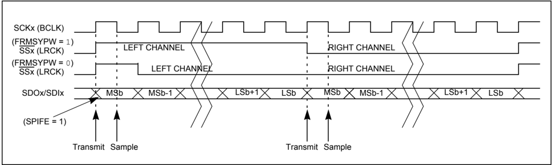

Figure 23-28: PCM/DSP with 16/24-bit Data and 32-bit Channel

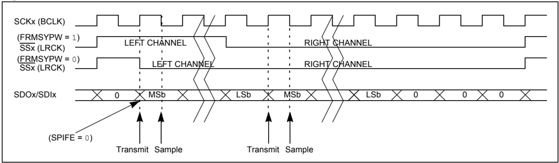

## Section 23. Serial Peripheral Interface (SPI)

## 23.4.5.4.1 PCM/DSP Audio Slave Mode of Operation

Use following steps to set up the SPI module for the PCM/DSP Audio Slave mode of operation:

1. If using interrupts, disable the SPI interrupts in the respective IECx register.
2. Stop and reset the SPI module by clearing the ON bit (SPIxCON&lt;15&gt;).
3. Reset the SPI audio configuration register, SPIxCON2.
4. Clear the receive buffer.
5. Clear the ENHBUF bit (SPIxCON&lt;16&gt;) if using Standard Buffer mode or set the bit if using Enhanced Buffer mode.
6. If using interrupts, the following additional steps are performed:
- a) Clear the SPIx interrupt flags/events in the respective IFSx register.
- b) Write the SPIx interrupt priority and subpriority bits in the respective IPCx register.
- c) Set the SPIx interrupt enable bits in the respective IECx register.
7. Clear the SPIROV bit (SPIxSTAT&lt;6&gt;).
8. Write the desired setting in the SPIxCON2  register. The AUDMOD&lt;1:0&gt;  bits (SPIxCON2&lt;1:0&gt;)  must  be  set  to  ' 11 '  for  DSP/PCM  mode  and  the  AUDEN  bit (SPIxCON2&lt;7&gt;) must be set to ' 1 ' to enable Audio protocol
9. Write the desired settings to the SPIxCON register:
- a) Set to slave mode, MSTEN (SPIxCON&lt;5&gt;) = 0 .
- b) Set MODE&lt;32,16&gt; (SPIxCON&lt;11:10&gt;) = 0 for 16-bit audio channel data.
- c) Enable SPI operation by setting the ON bit (SPIxCON&lt;15&gt;).
10. Transmission (and reception) will start as soon as the master provides the BCLK and LRCK.

## Example 23-9: PCM/DSP Slave Mode, 16-bit Channel Data, 32-bit Frame

```
/* The following code example will initialize the SPI1 Module in PCM/DSP Slave Mode. */ /* It assumes that none of the SPI1 input pins are shared with an analog input. */ unsigned int rData; IEC0CLR=0x03800000; // disable all interrupts SPI1CON = 0; // Stops and resets the SPI1. SPI1CON2 = 0; // Reset audio settings rData=SPI1BUF; // clears the receive buffer IFS0CLR=0x03800000; // clear any existing event IPC5CLR=0x1f000000; // clear the priority IPC5SET=0x0d000000; // Set IPL = 3, Subpriority 1 IEC0SET=0x03800000; // Enable RX, TX and Error interrupts SPI1STATCLR=0x40; // clear the Overflow SPI1CON2=0x00000083; // PCM/DSP Slave Mode, AUDEN = 1, AUDMON = 0 SPI1CON =0x00008000; // Slave mode, SPI ON, FRMSYPW = 0 // 16-bit audio data, 32 bits per frame // from here, the device is ready to receive and transmit data /* Note: A few of bits related to frame settings are not required to be set in the SPI1CON */ /* register during audio mode operation. Please refer to the notes in the SPIxCON2 register.*/
```

23

## PIC32 Family Reference Manual

## 23.4.5.4.2 PCM/DSP Audio Master Mode of Operation

Use the  following  steps  to  set  up  the  SPI  module  for  the  PCM/DSP  Audio  Master  mode  of operation:

1. If using interrupts, disable the SPI interrupts in the respective IECx register.
2. Stop and reset the SPI module by clearing the ON bit (SPIxCON&lt;15&gt;).
3. Reset the SPI audio configuration register SPI, CON2.
4. Reset the baud rate register, SPIxBRG.
5. Clear the receive buffer.
6. Clear the ENHBUF bit (SPIxCON&lt;16&gt;) if using Standard Buffer mode or set the bit if using Enhanced Buffer mode.
7. If using interrupts, perform the following steps:
- a) Clear the SPIx interrupt flags/events in the respective IFSx register.
- b) Write the SPIx interrupt priority and subpriority bits in the respective IPCx register.
- c) Set the SPIx interrupt enable bits in the respective IECx register.
8. Clear the SPIROV bit (SPIxSTAT&lt;6&gt;).
9. Write the desired settings in the  SPIxCON2  register.  The  AUDMOD&lt;1:0&gt;  bits (SPIxCON2&lt;1:0&gt;)  must  be  set  to  ' 11 '  for  DSP/PCM  mode  and  the  AUDEN  bit (SPIxCON&lt;7&gt;) must be set to ' 1 ' to enable the audio protocol.
10. Set the SPIxBRG baud rate register to 0x4D (to generate approximately 256 kbps sample rate, with PBCLK @ 40 MHz).
11. Write the desired settings to the SPIxCON register:
- a) Set to Master mode, MSTEN (SPIxCON&lt;5&gt;) = 1 .
- b) Set MODE&lt;32,16&gt; (SPIxCON&lt;11:10&gt;) = 0 for 16-bit audio channel data.
- c) Enable SPI operation by setting the ON bit (SPIxCON&lt;15&gt;).
12. Transmission (and reception) will start immediately after the ON bit is set.

## Example 23-10: PCM/DSP Master Mode, 16-bit Channel Data, 32-bit Frame

```
/* The following code example will initialize the SPI1 Module in PCM/DSP Master Mode. */ /* It assumes that none of the SPI1 input pins are shared with an analog input. */ unsigned int rData; IEC0CLR=0x03800000; // disable all interrupts SPI1CON = 0; // Stops and resets the SPI1. SPI1CON2 = 0; // Reset audio settings rData=SPI1BUF; // clears the receive buffer IFS0CLR=0x03800000; // clear any existing event IPC5CLR=0x1f000000; // clear the priority IPC5SET=0x0d000000; // Set IPL=3, Subpriority 1 IEC0SET=0x03800000; // Enable RX, TX and Error interrupts SPI1STATCLR=0x40; // clear the Overflow SPI1CON2=0x00000083; // PCM/DSP Master Mode, AUDEN =1, AUDMON=0 SPI1BRG =0x4D; // (to generate 256 kbps sample rate, PBCLK @ 40 MHz) SPI1CON =0x00008020; // Master mode, SPI ON, FRMSYPW = 0 // 16-bit audio data, 32 bits per frame // from here, the device is ready to receive and transmit data /* Note: A few of bits related to frame settings are not required to be set in the SPI1CON */ /* register during audio mode operation. Please refer to the notes in the SPIxCON2 register.*/
```

## 23.4.6 Audio Protocol Mode Features

## 23.4.6.1 BCLK/SCK AND LRCK GENERATION

BCLK and LRCK generation is a key requirement in Master mode. The frame frequency of SCK and LRCK is defined by the MODE&lt;32,16&gt; bits (SPIxCON&lt;11:10&gt;). When the frame is 64 bits, SCK is 64 times the frequency of LRCK. Similarly, when the frame is 32 bits, SCK is 32 times the frequency of LRCK. The frequency of SCK must be derived from the toggling rate of LRCK and the frame size.

For example, to sample a 16-bit channel data at 8 kHz with PBCLK = 36.864 MHz, set the SPIxBRG register to '0x47' to generate an 8 kHz LRCK.

## 23.4.6.2 MASTER MODE CLOCKING AND MCLK

The SPI module as a master has the ability to generate BCLK and LRCK by internally generating using  PBCLK  (MCLKSEL  = 0 ).  The  SPI  module  can  generate  the  clock  for  external  codec devices  using  the  reference  output  REFCLKO  function  (see  Figure 23-29),  although  some codecs may have the ability to generate their own MCLK from a crystal to provide accurate audio sample rates. Figure 23-30 shows that the REFCLKO clock can be used as MCLKIN by the codec.

Figure 23-29: SPI Master Clock Generation

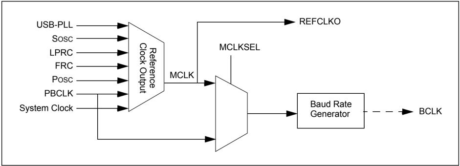

For more information on reference clock output interface refer to the specific device data sheet.

Figure 23-30 shows the interface between a SPI slave and a codec master, deriving the clock from the MCLK input interface.

Figure 23-30: SPI Slave and Codec Master - Clock Derived from MCLK

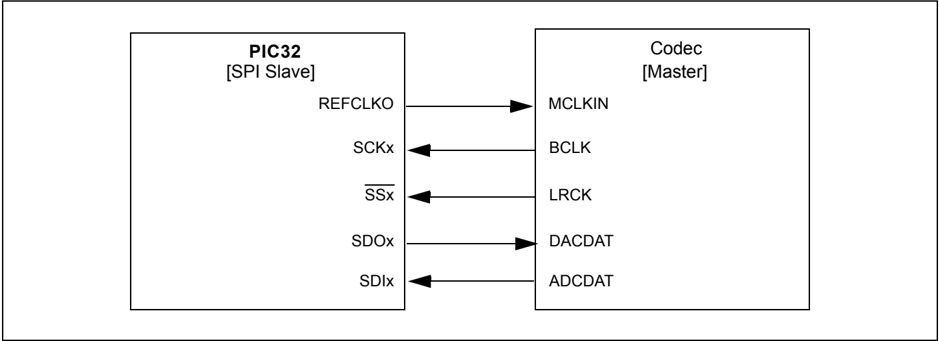

## 23.4.6.2.1 I 2 S Audio Master Mode of Operation Using REFCLKO

The following steps can be used to set up the SPI module for the I 2 S Audio Master mode of operation with MCLK enabled. The SPI module is initialized to generate BCLK @ 256 kbps and MCLK is derived  from  PBCLK  using  the  reference  oscillator  output  configuration  register.  A typical application could be to play PCM data (8 kHz sample frequency, 16-bit data, 32-bit frame) when interfaced to a codec slave device.

1. If using interrupts, disable the SPI interrupts in the respective IECx register.
2. Stop and reset the SPI module by clearing the ON bit (SPIxCON&lt;15&gt;).
3. Reset the SPI audio configuration register, SPIxCON2.
4. Reset the reference oscillator controller register, REFOCON.
5. Reset the baud rate register, SPIxBRG.
6. Clear the receive buffer.
7. Clear the ENHBUF bit (SPIxCON&lt;16&gt;) if using Standard Buffer mode or set the bit if using Enhanced Buffer mode.
8. If using interrupts, the following additional steps are performed:
- a) Clear the SPIx interrupt flags/events in the respective IFSx register.
- b) Write the SPIx interrupt priority and subpriority bits in the respective IPCx register.
- c) Set the SPIx interrupt enable bits in the respective IECx register.
- d) Clear the SPIROV bit (SPIxSTAT&lt;6&gt;).
9. Write the desired settings in the  SPIxCON2  register.  The  AUDMOD&lt;1:0&gt;  bits (SPIxCON2&lt;1:0&gt;) must be set to ' 00 ' for I 2 S mode and the AUDEN bit (SPIxCON2&lt;7&gt;) must be set to ' 1 ' to enable the audio protocol.
10. Set the reference oscillator controller register, REFOCON:
- a) RODIV&lt;14:0&gt; (REFOCON&lt;30:16&gt;) = 0 .
- b) ON (REFOCON&lt;15&gt;) = 1 , reference oscillator enabled.
- c) OE (REFOCON&lt;4&gt;) = 1 , output enabled.
11. Set the SPIxBRG baud rate register to 0x4D (to generate approximately 256 kbps sample rate, with PBCLK @ 40 MHz).
12. Write the desired settings to the SPIxCON register with
- a) MSTEN (SPIxCON&lt;5&gt;) = 1 .
- b) CKP (SPIxCON&lt;6&gt;) = 1 .
- c) MODE&lt;32,16&gt; (SPIxCON&lt;11:10&gt;) = 0 for 16-bit audio channel data.
- d) MCLKSEL (SPIxCON&lt;23&gt;) = 1 , master mode.
- e) Enable SPI operation by setting the ON bit (SPIxCON&lt;15&gt;).
13. Transmission (and reception) will start as soon as the master provides the BCLK and LRCK.

## Example 23-11: I 2 S Master Mode, 256 kbps BCLK, 16-bit Channel Data, 32-bit Frame

```
/* The following code example will initialize the SPI1 Module in I2S Slave mode. /* It assumes that none of the SPI1 input pins are shared with an analog input.  */ unsigned int rData; IEC0CLR=0x03800000; // disable all interrupts SPI1CON = 0; // Stops and resets the SPI1. SPI1CON2 = 0; // Reset audio settings REFOCON = 0x0; // Reset reference oscillator register SPI1BRG=0; // Reset Baud rate register rData=SPI1BUF; // clears the receive buffer IFS0CLR=0x03800000; // clear any existing event IPC5CLR=0x1f000000; // clear the priority IPC5SET=0x0d000000; // Set IPL = 3, Subpriority 1 IEC0SET=0x03800000; // Enable RX, TX and Error interrupts SPI1STATCLR=0x40; // clear the Overflow SPI1CON2=0x00000080; // I2S Mode, AUDEN =1, AUDMON=0 SPI1BRG =0x4D; // (to generate 256 kbps sample rate, PBCLK @ 40 MHz) REFOCON = 0x8001; // ON = 1, ROSEL = 1 for PBCLK SPI1CON =0x00808060; // MCLKSEL = 1, MSTEN = 1, ON = 1, CKP = 1, 16-bit audio channel // data, 32-bits per frame // from here, the device is ready to receive and transmit data /* Note: A few of bits related to frame settings are not required to be set in the SPI1CON */ /* register during audio mode operation. Please refer to the notes in the SPIxCON2 register.*/
```

Note:

The use of a reference clock output to generate MCLK for the codec may not be a perfect choice. Driving a clock out to an I/O pad induces jitter that may degrade audio fidelity of the codec. The best solution is for the codec to use a crystal and be the master I 2 S/Audio device.

## 23.4.7 Mono Mode versus Stereo Mode

The SPI module enables the audio data transmission in Mono or Stereo mode by setting the AUDMONO bit (SPIxCON2&lt;3&gt;). When the AUDMONO bit is set to ' 0 ' (Stereo mode), the shift register uses each FIFO location once, which gives each channel a unique stream of data for stereo data. When the AUDMONO bit is set to ' 1 ' (Mono mode), the shift register uses each FIFO location twice, to give each channel the same mono stream of audio data.

Note: Receive data is not affected by AUDMONO bit settings.

## 23.4.8 Streaming Data Support and Error Handling

Most of audio streaming applications transmit or receive data continuously. This is required to keep the channel active during the period of operation, and guarantees best possible accuracy. Due to streaming audio, the data feeds could be bursty or packet loss can occur causing the module to encounter situations like underrun. The software needs to be involved to recover from an underrun.

The Ignore Transmit Underrun (IGNTUR) bit (SPIxCON2&lt;8&gt;), when set to a ' 1 ',  ignores  an underrun condition. This is helpful for cases when software does not care or does not need to know about underrun conditions. When an underrun is encountered, the SPI module sets the SPITUR bit (SPIxSTAT&lt;8&gt;) when SPITUREN = 1 (SPIxCON2&lt;10&gt;), and remains in an error state until the software clears the state or the ON bit = 0 (SPIxCON&lt;15&gt;).

During the underrun condition, the SPI module loads the SPIxSR register with zeros instead of data from the SPIxTXB register, and the module continues to transmit zeros. When the error condition is cleared (i.e., when the SPIxTXB register is not empty), the SPI module loads the audio data from the transmit buffer into the SPIxSR register on the next LRCK frame boundary and software must make sure that the left and right audio data is always transferred to the FIFO in pairs.

The Ignore Receive Overflow (IGNROV) bit (SPIxCON2&lt;9&gt;), when set to a ' 1 ', ignores a receive overflow condition. This is useful when there is a general performance problem in the system that software must handle properly. An alternate method to handle the receive overflow is by setting the  DISSDI  bit  = 1 (SPIxCON&lt;4&gt;)  when  the  system  does  not  need  to  receive  audio  data. Changing the DISSDI bit on-the-fly and the receive shift register starts a receive on the leading LRCK edge.

23

## 23.5 INTERRUPTS

The SPI module has the ability to generate interrupts reflecting the events that occur during the data communication. The following types of interrupts can be generated:

- Receive data available interrupts are signalled by SPI1RXIF and SPI2RXIF. This event occurs when there is new data assembled in the SPIxBUF receive buffer.
- Transmit buffer empty interrupts are signalled by SPI1TXIF and SPI2TXIF. This event occurs when there is space available in the SPIxBUF transmit buffer and new data can be written.
- Error interrupts are signalled by SPI1EIF and SPI2EIF. This event occurs when there is an overflow condition for the SPIxBUF receive buffer (i.e., new receive data assembled but the previous one not read), when there is an underrun of the transmit buffer, or when a FRMERR event occurs.

All of these interrupt flags, which must be cleared in software, are located in the IFSx registers. Refer to the specific device data sheet for more information.

To enable the SPI interrupts, use the respective SPI interrupt enable bits, SPIxRXIE, SPIxTXIE, and SPIxFIE, in the corresponding IECx registers.

The interrupt priority level bits and interrupt subpriority level bits must be also be configured using the SPIxIP and SPIxIS bits in the corresponding IPCx registers.

When  using  Enhanced  Buffer  mode,  the  SPI  Transmit  Buffer  Empty  Interrupt  Mode  bits (STXISEL&lt;1:0&gt;)  in  the  SPI  Control  (SPIxCON&lt;3:2&gt;)  register  can  be  used  to  configure  the operation of the transmit buffer empty interrupts when the buffer is not full, empty by one-half or more, completely empty, or when the last transfer is shifted out.

Similarly, when using Enhanced Buffer mode, the SPI Receive Buffer Full Interrupt Mode bits (SRXISEL&lt;1:0&gt;)  in  the  SPI  Control  (SPIxCON&lt;1:0&gt;)  register  can  be  used  to  configure  the generation of receive buffer full interrupts when the buffer is full, full by one-half or more, is not empty, or when the last word is read.

Note: Enhanced Buffer mode is not available on all devices. Refer to the specific device data sheet for details.

Refer to Section 8. 'Interrupts' (DS61108) for further details.

## 23.5.1 Interrupt Configuration

Each SPI module has three dedicated interrupt flag bits: SPIxEIF, SPIxRXIF, and SPIxTXIF, and corresponding interrupt enable/mask bits SPIxEIE, SPIxRXIE, and SPIxTXIE. These bits are used to determine the source of an interrupt, and to enable or disable an individual interrupt source. Note that all the interrupt sources for a specific SPI module share one interrupt vector. Each SPI module can have its own priority level independent of other SPI modules.

SPIxTXIF is set when the SPI transmit buffer is empty and another character can be written to the SPIxBUF register. SPIxRXIF is set when there is a received character available in SPIxBUF. SPIxEIF is set when a Receive Overflow condition occurs.

Note that the SPIxTXIF, SPIxRXIF, and SPIxEIF bits will be set without regard to the state of the corresponding enable bit. The interrupt flag bits can be polled by software if desired.

The SPIxEIE, SPIxTXIE, SPIxRXIE bits are used to define the behavior of the Interrupt Controller when a  corresponding  SPIxEIF,  SPIxTXIF,  or  SPIxRXIF  bit  is  set.  When  the  corresponding interrupt enable bit is clear, the Interrupt Controller does not generate a CPU interrupt for the event. If the interrupt enable bit is set, the Interrupt Controller will generate an interrupt to the CPU when the corresponding interrupt flag bit is set (subject to the priority and subpriority as outlined below).

It is the responsibility of the user's software routine that services a particular interrupt to clear the appropriate interrupt flag bit before the service routine is complete.

The priority of each SPI module can be set independently with the SPIxIP&lt;2:0&gt; bits. This priority defines the priority group to which the interrupt source will be assigned. The priority groups range from a value of 7 (the highest priority), to a value of 0 (which does not generate an interrupt). An interrupt being serviced will be preempted by an interrupt in a higher priority group. The individual sources of error interrupts are controlled by the FRMERREN, SPIROVEN, and SPITUREN bits in the SPIxCON2 register.

## Section 23. Serial Peripheral Interface (SPI)

The subpriority bits allow setting the priority of an interrupt source within a priority group. The values of the subpriority SPIxIS&lt;1:0&gt; range from 3 (the highest priority) to 0, the lowest priority. An interrupt within the same priority group but having a higher subpriority value will not preempt a lower subpriority interrupt that is in progress.

The priority group and subpriority bits allow more than one interrupt source to share the same priority and subpriority. If simultaneous interrupts occur in this configuration the natural order of the interrupt sources within a Priority/subpriority group pair determine the interrupt generated. The natural priority is based on the vector numbers of the interrupt sources. The lower the vector number the higher the natural priority of the interrupt. Any interrupts that were overridden by natural  order  will  then  generate  their  respective  interrupts  based  on  Priority,  subpriority,  and natural order, after the interrupt flag for the current interrupt is cleared.

After an enabled interrupt is generated, the CPU will jump to the vector assigned to that interrupt. The vector number for the interrupt is the same as the natural order number. The CPU will then begin  executing  code  at  the  vector  address.  The  user's  code  at  this  vector  address  should perform  any  application-specific operations  required, and  clear interrupt flags  SPIxEIF, SPIxTXIF, or SPIxRXIF, and then exit. Refer to the vector address table details in the Section 8. 'Interrupts' (DS61108) for more information on interrupts.

## Example 23-12: SPI Initialization with Interrupts Enabled Code Example

```
/* The following code example illustrates an SPI1 interrupt configuration. When the SPI1 interrupt is generated, the cpu will jump to the vector assigned to SPI1 interrupt. It assumes that none of the SPI1 input pins are shared with an analog input. If so, the AD1PCFG and corresponding TRIS registers have to be properly configured. */ int rData; IEC0CLR=0x03800000; // disable all SPI interrupts SPI1CON = 0; // Stops and resets the SPI1. rData=SPI1BUF; // clears the receive buffer IFS0CLR=0x03800000; // clear any existing event IPC5CLR=0x1f000000; // clear the priority IPC5SET=0x0d000000; // Set IPL=3, Subpriority 1 IEC0SET=0x03800000; // Enable RX, TX and Error interrupts SPI1BRG=0x1; // use FPB/4 clock frequency SPI1STATCLR=0x40; // clear the Overflow SPI1CON=0x8220; // SPI ON, 8 bits transfer, SMP=1, Master mode
```

## Example 23-13: SPI1 ISR Code Example

```
/* The following code example demonstrates a simple interrupt service routine for SPI1 interrupts. The user's code at this vector should perform any application specific operations and must clear the SPI1 interrupt flags before exiting. */ void __ISR(_SPI_1_VECTOR, ipl3)__SPI1Interrupt(void) { // ... perform application specific operations in response to the // interrupt IFS0CLR = 0x03800000; // Be sure to clear the SPI1 interrupt flags // before exiting the service routine. }
```

For  devices  with  Enhanced  Buffering  mode,  the  user  application  should  clear  the  interrupt request flag after servicing the interrupt condition.

If an SPI interrupt has occurred, the ISR should read the SPI Data Buffer (SPIxBUF) register, and then clear the SPI interrupt flag, as shown in Example 23-14.

## PIC32 Family Reference Manual

## Example 23-14: SPI1 ISR Code Example for Devices with Enhanced Buffering Mode

```
/* The following code example demonstrates a simple interrupt service routine for SPI1 interrupts. The user's code at this vector should perform any application specific operations and must clear the SPI1 interrupt flags before exiting. */ void __ISR(_SPI_1_VECTOR, ipl3)__SPI1Interrupt(void) { int Data; // Read SPI data buffer Data = SPI1BUF; // ... perform application specific operations in response to the // interrupt IFS0CLR = 0x03800000; // Be sure to clear the SPI1 interrupt flags // before exiting the service routine. }
```

Note: The SPI1 ISR code examples show MPLAB ®  C32 C compiler specific syntax. Refer to your compiler manual regarding support for ISRs.

## 23.6 OPERATION IN POWER-SAVING AND DEBUG MODES

## 23.6.1 Sleep Mode

When the  device  enters  Sleep  mode,  the  system  clock  is  disabled.  The  exact  SPI  module operation  during  Sleep  mode  depends  on  the  current  mode  of  operation.  The  following subsections describe mode-specific behavior.

## 23.6.1.1 MASTER MODE IN SLEEP MODE

The following items should be noted in Sleep mode:

- The Baud Rate Generator is stopped and may be reset (check the device data sheet).
- On-going transmission and reception sequences are aborted. The module may not resume aborted sequences when Sleep mode is exited. (Again, check the device data sheet.)
- Once in Sleep mode, the module will not transmit or receive any new data

Note:

To prevent unintentional abort of transmit and receive sequences, you may need to wait for the current transmission to be completed before activating Sleep mode.

## 23.6.1.2 SLAVE MODE IN SLEEP MODE

In the Slave mode, the SPI module operates from the SCK provided by an external SPI Master. Since the clock pulses at SCKx are externally provided for Slave mode, the module will continue to function in Sleep mode. It will complete any transactions during the transition into Sleep. On completion of a transaction, the SPIRBF flag is set. Consequently, bit SPIxRXIF will be set. If SPI interrupts  are  enabled  (SPIxRXIE = 1 )  and  the  SPI  interrupt  priority  level  is  greater  than  the present CPU priority level, the device will wake from Sleep mode and the code execution will resume at the SPIx interrupt vector location. If the SPI interrupt priority level is lower than or equal to the present CPU priority level, the CPU will remain in Idle mode.

The module is not reset on entering Sleep mode if it is operating as a slave device. Register contents are not affected when the SPIx module is going into or coming out of Sleep mode.

## 23.6.2 Idle Mode

When the device enters Idle mode, the system clock sources remain functional.

## 23.6.2.1 MASTER MODE IN IDLE MODE

Bit SIDL (SPIxCON&lt;13&gt;) selects whether the module will stop or continue functioning in Idle mode.

- If SIDL = 1 , the module will discontinue operation in Idle mode. The module will perform the same procedures when stopped in Idle mode that it does for Sleep mode.
- If SIDL = 0 , the module will continue operation in Idle mode

## 23.6.2.2 SLAVE MODE IN IDLE MODE

The module will continue operation in Idle mode irrespective of the SIDL setting. The behavior is identical to the one in Sleep mode.

## 23.6.3 Debug Mode

## 23.6.3.1 OPERATION OF SPIxBUF

## 23.6.3.1.1 Reads During Debug Mode

During Debug mode, SPIxBUF can be read; but the read operation does not affect any Status bits. For example, if the SPIRBF bit (SPIxSTAT&lt;0&gt;) is set when Debug mode is entered, it will remain set on EXIT From Debug mode, even though the SPIxBUF register was read in Debug mode.

## 23.7 EFFECTS OF VARIOUS RESETS

## 23.7.1 Device Reset

All SPI registers are forced to their Reset states upon a device Reset. When the asynchronous Reset input goes active, the SPI logic:

- Resets all bits in SPIxCON and SPIxSTAT
- Resets the transmit and receive buffers (SPIxBUF) to the empty state
- Resets the Baud Rate Generator

## 23.7.2 Power-on Reset

All SPI registers are forced to their reset states when a Power-on Reset occurs.

## 23.7.3 Watchdog Timer Reset

All SPI registers are forced to their reset states when a Watchdog Timer Reset occurs.

## 23.8 PERIPHERALS USING SPI MODULES

There are no other peripherals using the SPI module.

## 23.9 RELATED APPLICATION NOTES

This  section  lists  application  notes  that  are  related  to  this  section  of  the  manual.  These application notes may not be written specifically for the PIC32 device family, but the concepts are pertinent and could be used with modification and possible limitations. The current application notes related to the SPI module are:

| Title                                                                                       | Application Note #   |
|---------------------------------------------------------------------------------------------|----------------------|
| Interfacing Microchip's MCP41XXX/MCP42XXX Digital Potentiometers to a PIC ® Microcontroller | AN746                |
| Interfacing Microchip's MCP3201 Analog-to-Digital Converter to the PIC ® Microcontroller    | AN719                |

Note:

Please visit the Microchip web site (www.microchip.com) for additional application notes and code examples for the PIC32 family of devices.

## 23.10 REVISION HISTORY

## Revision A (July 2007)

This is the initial released version of this document.

## Revision B (October 2007)

Revised Examples 23-1, 23-2, 23-3; Table 23-5.

## Revision C (October 2007)

Updated document to remove Confidential status.

## Revision D (April 2008)

Revised status to Preliminary; Revised U-0 to r-x.

## Revision E (June 2008)

Added  Footnote  number  to  Registers  12-17;  Revised  Example  23-4;  Revised  Figure  23-8; Change Reserved bits from 'Maintain as' to 'Write'; Added Note to ON bit (SPIxCON Register).

## Revision F (August 2009)

This revision includes the following changes:

- Minor changes to the text and formatting have been incorporated through the document
- Updated register introductions in 23.2 'Status and Control Registers'
- Register Summary (Table 23-2)
- -Removed references to the Clear, Set, Invert, IFS0, IFS1, IEC0, IEC1, IPC5, and IPC7 registers
- -Added the Address Offset column
- -Added Notes 1, 2, and 3, which describe the Clear, Set, and Invert registers
- -Added these bits: MSSEN, FRMSYPW, FRMCNT&lt;2:0&gt;, ENHBUF, STXISEL&lt;1:0&gt;, SRXISEL&lt;1:0&gt;, RXBUFELM&lt;4:0&gt;, SPITUR, SRMT, SPIRBE, AND SPITBF
- Removed the IFS0, IFS1, IEC0, IEC1, IPC5, and IPC7 registers
- Added Notes describing the Clear, Set, and Invert registers to the following registers:
- -SPIxCON
- -SPIxSTAT
- -SPIxBRG
- Added SPIxBRG settings for 60, 72, and 80 MHz in the Sample SCKx Frequencies table (see Table 23-3)
- Removed SPI Interrupt Vectors for Various Offsets table (Table 23-4)
- Added 23.3.2 'Buffer Modes'
- Added a paragraph that provides details on the MSSEN bit in 23.3.3.1 'Master Mode Operation'
- Added two bullets that provide details on the FRMSYPW and FRMCNT bits in 23.3.6 'Framed SPI Modes'
- Added two paragraphs that provide details on the STXISEL&lt;1:0&gt; and SRXISEL&lt;1:0&gt; bits in 23.4 'Interrupts'
- Added a paragraph on SPI1 ISR for devices with Enhanced Buffering mode after Example 23-4 in 23.4.1 'Interrupt Configuration'
- Added SPI1 ISR Code Example for Devices With Enhanced Buffering mode (see Example 23-5).
- Removed 23.8 'I/O Pin Control'

## Revision G (October 2011)

This revision includes the following updates:

- Added a note box that references companion documentation and updated the SPI module feature list (see 23.1 'Introduction' )
- Added SPI Features in Audio Protocol Interface Mode (see Table 23-2)
- Updated the SPI Module Block Diagram (see Figure 23-1)
- The following updates were made to the SPI Control register (see Register 23-1)
- -Added Note 5
- -Updated the Note for bits 26-24 (FRMCNT&lt;2:0&gt;)
- -Updated the definitions for bits 3-2 (STXISEL&lt;2:0&gt;)
- -Replaced all occurrences of SPI\_TBE\_EVENT and SPI\_RBF\_EVENT with SPIxTXIF and SPIxRXIF, respectively
- -Updated the bit values for the MODE32 and MODE16 bits (SPIxCON&lt;11:10&gt;)
- Added the SPIxCON2 register and the MCLKSEL, DISSDI and FRMERR bits (see Table 23-3, Register 23-1, and Register 23-2)
- Added note references to the CLR, SET, and INV registers to the SPI Status register (see Table 23-3 and Register 23-3)
- Updated the bit value definitions for the SRMT bit in the SPI Status register (see bit 7 in Register 23-3)
- Added a note box referencing pin usage to 23.3 'Modes of Operation'
- Updated the Sample SCKx Frequencies (see Table 23-4)
- Swapped sub-steps b) and c) in the Master mode operation sequence (see 23.3.3.1 'Master Mode Operation' )
- Added a new paragraph on the MSSEN bit after the second note box in 23.3.3.1 'Master Mode Operation' . In addition, the text in the second note box was updated.
- Added a new paragraph on the MSSEN bit
- Added the SSx pin to the SPI Master Mode Operation in 8-bit Mode timing diagram (see Figure 23-7)
- Swapped sub-steps b) and c) in the Slave mode operation sequence (see 23.3.3.2 'Slave Mode Operation' )
- Added a new paragraph that references additional interface options just before Figure 23-12 (see 23.3.6 'Framed SPI Modes' )
- Added section 23.4 'Audio Protocol Interface Mode'
- Updated the bit name and register references in the bulleted items of 23.5 'Interrupts'
- All sections, with the exception of 23.6.3.1 'Operation of SPIxBUF' were removed in 23.6.3 'Debug Mode'
- The section 23.9 'Design Tips' was removed
- References to LRC were updated to LRCK throughout the document
- All Untested Code watermarks were removed from the code examples
- Formatting updates and minor typographical changes have been made throughout the document

NOTES:

## Note the following details of the code protection feature on Microchip devices:

- Microchip products meet the specification contained in their particular Microchip Data Sheet.
- Microchip believes that its family of products is one of the most secure families of its kind on the market today, when used in the intended manner and under normal conditions.
- There are dishonest and possibly illegal methods used to breach the code protection feature. All of these methods, to our knowledge, require using the Microchip products in a manner outside the operating specifications contained in Microchip's Data Sheets. Most likely, the person doing so is engaged in theft of intellectual property.
- Microchip is willing to work with the customer who is concerned about the integrity of their code.
- Neither Microchip nor any other semiconductor manufacturer can guarantee the security of their code. Code protection does not mean that we are guaranteeing the product as 'unbreakable.'

Code protection is constantly evolving. We at Microchip are committed to continuously improving the code protection features of our products. Attempts to break Microchip's code protection feature may be a violation of the Digital Millennium Copyright Act. If such acts allow unauthorized access to your software or other copyrighted work, you may have a right to sue for relief under that Act.

Information  contained  in  this  publication  regarding  device applications and the like is provided only for your convenience and may be superseded by updates. It is your responsibility to ensure  that  your  application  meets  with  your  specifications. MICROCHIP MAKES NO REPRESENTATIONS OR WARRANTIES  OF  ANY  KIND  WHETHER  EXPRESS  OR IMPLIED, WRITTEN OR ORAL, STATUTORY OR OTHERWISE, RELATED TO THE INFORMATION, INCLUDING  BUT  NOT  LIMITED  TO  ITS  CONDITION, QUALITY, PERFORMANCE, MERCHANTABILITY OR FITNESS  FOR  PURPOSE . Microchip  disclaims  all  liability arising  from  this  information  and  its  use.  Use  of  Microchip devices in life support and/or safety applications is entirely at the buyer's risk, and the buyer agrees to defend, indemnify and hold  harmless  Microchip  from  any  and  all  damages,  claims, suits,  or  expenses  resulting  from  such  use.  No  licenses  are conveyed, implicitly or otherwise, under any Microchip intellectual property rights.

## QUALITY MANAGEMENT SYSTEM CERTIFIED BY DNV

ISO/TS 16949.2009

## Trademarks

The Microchip name and logo, the Microchip logo, dsPIC, KEELOQ, KEELOQ logo, MPLAB, PIC, PICmicro, PICSTART, PIC 32  logo, rfPIC and UNI/O are registered trademarks of Microchip Technology Incorporated in the U.S.A. and other countries.

FilterLab, Hampshire, HI-TECH C, Linear Active Thermistor, MXDEV, MXLAB, SEEVAL and The Embedded Control Solutions Company are registered trademarks of Microchip Technology Incorporated in the U.S.A.

Analog-for-the-Digital Age, Application Maestro, chipKIT, chipKIT logo, CodeGuard, dsPICDEM, dsPICDEM.net, dsPICworks, dsSPEAK, ECAN, ECONOMONITOR, FanSense, HI-TIDE, In-Circuit Serial Programming, ICSP, Mindi, MiWi, MPASM, MPLAB Certified logo, MPLIB, MPLINK, mTouch, Omniscient Code Generation, PICC, PICC-18, PICDEM, PICDEM.net, PICkit, PICtail, REAL ICE, rfLAB, Select Mode, Total Endurance, TSHARC, UniWinDriver, WiperLock and ZENA are trademarks of Microchip Technology Incorporated in the U.S.A. and other countries.

SQTP is a service mark of Microchip Technology Incorporated in the U.S.A.

All other trademarks mentioned herein are property of their respective companies.

© 2007-2011, Microchip Technology Incorporated, Printed in the U.S.A., All Rights Reserved.

Printed on recycled paper.


ISBN: 978-1-61341-689-1

Microchip received ISO/TS-16949:2009 certification for its worldwide headquarters, design and wafer fabrication facilities in Chandler and Tempe, Arizona; Gresham, Oregon and design centers in California and India. The Company's quality system processes and procedures are for its PIC ®  MCUs and dsPIC ®  DSCs, KEELOQ ®  code hopping devices, Serial EEPROMs, microperipherals, nonvolatile memory and analog products. In addition, Microchip's quality system for the design and manufacture of development systems is ISO 9001:2000 certified.


## Worldwide Sales and Service

## ASIA/PACIFIC

Asia Pacific Office Suites 3707-14, 37th Floor Tower 6, The Gateway Harbour City, Kowloon Hong Kong Tel: 852-2401-1200 Fax: 852-2401-3431

Australia - Sydney Tel: 61-2-9868-6733 Fax: 61-2-9868-6755

China - Beijing Tel: 86-10-8569-7000 Fax: 86-10-8528-2104

China - Chengdu Tel: 86-28-8665-5511 Fax: 86-28-8665-7889

China - Chongqing Tel: 86-23-8980-9588 Fax: 86-23-8980-9500

China - Hangzhou Tel: 86-571-2819-3187 Fax: 86-571-2819-3189

China - Hong Kong SAR Tel: 852-2401-1200 Fax: 852-2401-3431

China - Nanjing Tel: 86-25-8473-2460 Fax: 86-25-8473-2470

China - Qingdao Tel: 86-532-8502-7355 Fax: 86-532-8502-7205

China - Shanghai Tel: 86-21-5407-5533 Fax: 86-21-5407-5066

China - Shenyang Tel: 86-24-2334-2829 Fax: 86-24-2334-2393

China - Shenzhen Tel: 86-755-8203-2660 Fax: 86-755-8203-1760

China - Wuhan Tel: 86-27-5980-5300 Fax: 86-27-5980-5118

China - Xian Tel: 86-29-8833-7252 Fax: 86-29-8833-7256

China - Xiamen Tel: 86-592-2388138 Fax: 86-592-2388130

China - Zhuhai Tel: 86-756-3210040 Fax: 86-756-3210049

## ASIA/PACIFIC

India - Bangalore Tel: 91-80-3090-4444 Fax: 91-80-3090-4123

India - New Delhi Tel: 91-11-4160-8631 Fax: 91-11-4160-8632

India - Pune Tel: 91-20-2566-1512 Fax: 91-20-2566-1513

Japan - Yokohama Tel: 81-45-471- 6166 Fax: 81-45-471-6122

Korea - Daegu Tel: 82-53-744-4301 Fax: 82-53-744-4302

Korea - Seoul Tel: 82-2-554-7200 Fax: 82-2-558-5932 or 82-2-558-5934

Malaysia - Kuala Lumpur Tel: 60-3-6201-9857 Fax: 60-3-6201-9859

Malaysia - Penang Tel: 60-4-227-8870 Fax: 60-4-227-4068

Philippines - Manila Tel: 63-2-634-9065 Fax: 63-2-634-9069

Singapore Tel: 65-6334-8870 Fax: 65-6334-8850

Taiwan - Hsin Chu Tel: 886-3-5778-366 Fax: 886-3-5770-955

Taiwan - Kaohsiung Tel: 886-7-536-4818 Fax: 886-7-330-9305

Taiwan - Taipei Tel: 886-2-2500-6610 Fax: 886-2-2508-0102

Thailand - Bangkok Tel: 66-2-694-1351 Fax: 66-2-694-1350

## AMERICAS

Corporate Office 2355 West Chandler Blvd. Chandler, AZ 85224-6199 Tel: 480-792-7200 Fax: 480-792-7277 Technical Support:

[http://www.microchip.com/ support](http://support.microchip.com/)

Web Address:

www.microchip.com

Atlanta Duluth, GA Tel: 678-957-9614 Fax: 678-957-1455

## Boston

Westborough, MA Tel: 774-760-0087 Fax: 774-760-0088

## Chicago

Itasca, IL Tel: 630-285-0071 Fax: 630-285-0075

## Cleveland

Independence, OH Tel: 216-447-0464 Fax: 216-447-0643

Dallas

Addison, TX Tel: 972-818-7423 Fax: 972-818-2924

Detroit Farmington Hills, MI Tel: 248-538-2250 Fax: 248-538-2260

Indianapolis Noblesville, IN Tel: 317-773-8323 Fax: 317-773-5453

Los Angeles Mission Viejo, CA Tel: 949-462-9523 Fax: 949-462-9608

Santa Clara Santa Clara, CA Tel: 408-961-6444 Fax: 408-961-6445

Toronto Mississauga, Ontario, Canada Tel: 905-673-0699 Fax: 905-673-6509

## EUROPE

Austria - Wels Tel: 43-7242-2244-39 Fax: 43-7242-2244-393

Denmark - Copenhagen Tel: 45-4450-2828 Fax: 45-4485-2829

France - Paris Tel: 33-1-69-53-63-20 Fax: 33-1-69-30-90-79

Germany - Munich Tel: 49-89-627-144-0 Fax: 49-89-627-144-44

Italy - Milan Tel: 39-0331-742611 Fax: 39-0331-466781

Netherlands - Drunen Tel: 31-416-690399 Fax: 31-416-690340

Spain - Madrid Tel: 34-91-708-08-90 Fax: 34-91-708-08-91

UK - Wokingham Tel: 44-118-921-5869 Fax: 44-118-921-5820

08/02/11