Microchip

## Section 24. Inter-Integrated Circuit (I 2 C)

This section of the manual contains the following topics:

|   24.1 | Overview..................................................................................................................24-2   |
|--------|----------------------------------------------------------------------------------------------------------------------------------|
|   24.2 | Control and Status Registers...................................................................................24-4              |
|   24.3 | I 2 C Bus Characteristics .........................................................................................24-15         |
|   24.4 | Enabling I 2 C Operation..........................................................................................24-18          |
|   24.5 | Communicating as a Master in a Single Master Environment...............................24-22                                     |
|   24.6 | Communicating as a Master in a Multi-Master Environment .................................24-36                                   |
|   24.7 | Communicating as a Slave....................................................................................24-38                |
|   24.8 | I 2 C Bus Connection Considerations......................................................................24-54                   |
|   24.9 | I 2 C Operation in Power-Saving Modes..................................................................24-56                     |
|  24.10 | Effects of a Reset ..................................................................................................24-57       |
|  24.11 | Pin Configuration In I 2 C Mode...............................................................................24-57              |
|  24.12 | Using An External Buffer With The I 2 C Module.....................................................24-57                         |
|  24.13 | Related Application Notes .....................................................................................24-58             |
|  24.14 | Revision History.....................................................................................................24-59       |

Note: This family reference manual section is meant to serve as a complement to device data sheets. Depending on the device variant, this manual section may not apply to all PIC32 devices.

[Please consult the note at the beginning of the 'Inter-Integrated Circuit (I 2 C)' chapter in the current device data sheet to check whether this document supports the device you are using.](http://www.microchip.com/)

Device  data  sheets  and  family  reference  manual  sections  are  available  for download from the Microchip Worldwide Web site at: http://www.microchip.com

## 24.1 OVERVIEW

The Inter-Integrated Circuit (I 2 C) module is a serial interface useful for communicating with other peripheral or microcontroller devices. These peripheral devices may be serial EEPROMs, display drivers, analog-to-digital converters, etc.

The I 2 C module can operate in any one of the following I 2 C systems:

- As a slave device
- As a master device in a single master system (slave may also be active)
- As a master or slave device in a multi-master system (bus collision detection and arbitration available)

The I 2 C module contains independent I 2 C master logic and I 2 C slave logic, each generating interrupts based on their events. In multi-master systems, the software is simply partitioned into a master controller and a slave controller.

When the I 2 C master logic is active, the slave logic also remains active, detecting the state of the bus  and  potentially  receiving  messages  from  itself  in  a  single  master  system  or  from  other masters in a multi-master system. No messages are lost during multi-master bus arbitration.

In a multi-master system, bus collision conflicts with other masters in the system are detected and reported to the application (BCOL interrupt). The software can terminate, and then restart the message transmission.

The I 2 C module contains a Baud Rate Generator (BRG). The I 2 C BRG does not consume other timer resources in the device.

Key features of the I 2 C module include the following:

- Independent master and slave logic
- Multi-master support, which prevents message losses in arbitration
- Detects 7-bit and 10-bit device addresses with configurable address masking in Slave mode
- Detects general call addresses as defined in the I 2 C protocol
- Automatic SCLx clock stretching provides delays for the processor to respond to a slave data request
- Supports 100 kHz and 400 kHz bus specifications
- Supports strict I 2 C reserved address rule

## Section 24. Inter-Integrated Circuit (I 2 C)

Figure 24-1 shows the I 2 C module block diagram.

Figure 24-1: I 2 C Block Diagram

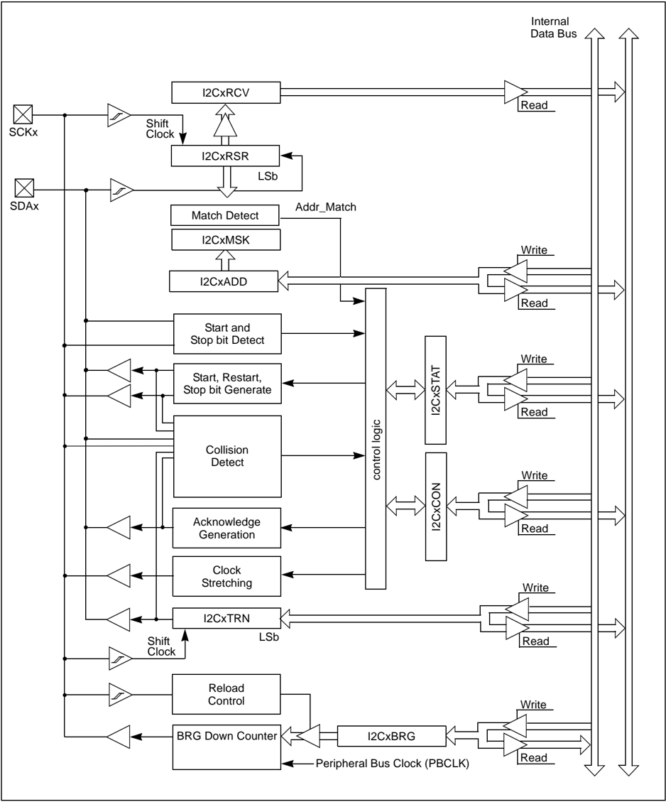

## 24.2 CONTROL AND STATUS REGISTERS

Note:

The PIC32 family of devices may have one or more I 2 C modules. An 'x' used in the pin names, Control/Status bits, and registers denotes the particular module. Refer to the 'Inter-Integrated Circuit (I 2 C)' chapter in the specific device data sheet for more details.

The I 2 C module consists of the following Special Function Registers (SFRs):

- I2CxCON: I 2 C Control Register

This register enables operational control of the I 2 C module.

- I2CxSTAT: I 2 C Status Register

This register contains status flags indicating the state of the I 2 C module during operation.

- I2CxADD: I 2 C Slave Address Register

This register holds the slave device address.

- I2CxMSK: I 2 C Address Mask Register

This register designates the bit positions in the I2CxADD register that can be ignored, which allows for multiple address support.

- I2CxBRG: I 2 C Baud Rate Generator Register

This register holds the Baud Rate Generator (BRG) reload value for the I 2 C module Baud Rate Generator.

- I2CxTRN: I 2 C Transmit Data Register

This read-only register is the transmit register. Bytes are written to this register during a transmit operation.

- I2CxRCV: I 2 C Receive Data Register

This read-only register is the buffer register from which data bytes can be read.

Table 24-1 summarizes all registers related to the I 2 C module. Corresponding registers appear after the summary, which include detailed bit descriptions for each register.

## Table 24-1:

I 2 C SFR Summary

| Register Name (1)   | Bit Range          | Bit 31/15          | Bit 30/14          | Bit 29/13          | Bit 28/12          | Bit 27/11          | Bit 26/10          | Bit 25/9           | Bit 24/8           | Bit 23/7           | Bit 22/6           | Bit 21/5           | Bit 20/4           | Bit 19/3           | Bit 118/2          | Bit 17/1           | Bit 16/0           |
|---------------------|--------------------|--------------------|--------------------|--------------------|--------------------|--------------------|--------------------|--------------------|--------------------|--------------------|--------------------|--------------------|--------------------|--------------------|--------------------|--------------------|--------------------|
| I2CxCON             | 31:16              | -                  | -                  | -                  | -                  | -                  | -                  | -                  | -                  | -                  | PCIE               | SCIE               | BOEN               | SDAHT              | SBCDE              | AHEN               | DHEN               |
| I2CxCON             | 15:0               | ON                 | -                  | SIDL               | SCLREL             | STRICT             | A10M               | DISSLW             | SMEN               | GCEN               | STREN              | ACKDT              | ACKEN              | RCEN               | PEN                | RSEN               | SEN                |
| I2CxSTAT            | 31:16              | -                  | -                  | -                  | -                  | -                  | -                  | -                  | -                  | -                  | -                  | -                  | -                  | -                  | -                  | -                  | -                  |
| I2CxSTAT            | 15:0               | ACKSTAT            | TRSTAT             | ACKTIM             | -                  | -                  | BCL                | GCSTAT             | ADD10              | IWCOL              | I2COV              | D/A                | P                  | S                  | R/W                | RBF                | TBF                |
| I2CxADD             | 31:16              | -                  | -                  | -                  | -                  | -                  | -                  | -                  | -                  | -                  | -                  | -                  | -                  | -                  | -                  | -                  | -                  |
| I2CxADD             | 15:0               | -                  | -                  | -                  | -                  | -                  | -                  | ADD<9:0>           | ADD<9:0>           | ADD<9:0>           | ADD<9:0>           | ADD<9:0>           | ADD<9:0>           | ADD<9:0>           | ADD<9:0>           | ADD<9:0>           | ADD<9:0>           |
| I2CxMSK             | 31:16              | -                  | -                  | -                  | -                  | -                  | -                  | -                  | -                  | -                  | -                  | -                  | -                  | -                  | -                  | -                  | -                  |
| I2CxMSK             | 15:0               | -                  | -                  | -                  | -                  | -                  | -                  | MSK<9:0>           | MSK<9:0>           | MSK<9:0>           | MSK<9:0>           | MSK<9:0>           | MSK<9:0>           | MSK<9:0>           | MSK<9:0>           | MSK<9:0>           | MSK<9:0>           |
| I2CxBRG             | 31:16              | -                  | -                  | -                  | -                  | -                  | -                  | -                  | -                  | -                  | -                  | -                  | -                  | -                  | -                  | -                  | -                  |
| I2CxBRG             | 15:0 I2CxBRG<15:0> | 15:0 I2CxBRG<15:0> | 15:0 I2CxBRG<15:0> | 15:0 I2CxBRG<15:0> | 15:0 I2CxBRG<15:0> | 15:0 I2CxBRG<15:0> | 15:0 I2CxBRG<15:0> | 15:0 I2CxBRG<15:0> | 15:0 I2CxBRG<15:0> | 15:0 I2CxBRG<15:0> | 15:0 I2CxBRG<15:0> | 15:0 I2CxBRG<15:0> | 15:0 I2CxBRG<15:0> | 15:0 I2CxBRG<15:0> | 15:0 I2CxBRG<15:0> | 15:0 I2CxBRG<15:0> | 15:0 I2CxBRG<15:0> |
| I2CxTRN             | 31:16              | -                  | -                  | -                  | -                  | -                  | -                  | -                  | -                  | -                  | -                  | -                  | -                  | -                  | -                  | -                  | -                  |
| I2CxTRN             | 15:0               | -                  | -                  | -                  | -                  | -                  | -                  | -                  | - I2CxTXDATA<7:0>  | - I2CxTXDATA<7:0>  | - I2CxTXDATA<7:0>  | - I2CxTXDATA<7:0>  | - I2CxTXDATA<7:0>  | - I2CxTXDATA<7:0>  | - I2CxTXDATA<7:0>  | - I2CxTXDATA<7:0>  | - I2CxTXDATA<7:0>  |
| I2CxRCV             | 31:16              | -                  | -                  | -                  | -                  | -                  | -                  | -                  | -                  | -                  | -                  | -                  | -                  | -                  | -                  | -                  | -                  |
| I2CxRCV             | 15:0               | -                  | -                  | -                  | -                  | -                  | -                  | -                  | - I2CxRXDATA<7:0>  | - I2CxRXDATA<7:0>  | - I2CxRXDATA<7:0>  | - I2CxRXDATA<7:0>  | - I2CxRXDATA<7:0>  | - I2CxRXDATA<7:0>  | - I2CxRXDATA<7:0>  | - I2CxRXDATA<7:0>  | - I2CxRXDATA<7:0>  |

Note 1: With the exception of the I2CxRCV register, all registers have an associated Clear, Set, and Invert register at an offset of 0x4, 0x8, and 0xCbytes, respectively. These registers have the same name with CLR, SET, or INV appended to the end of the register name (e.g., I2CxCONCLR). Writing a ' 1 ' to any bit position in these registers will clear valid bits in the associated register. Reads from these registers should be ignored.

## PIC32 Family Reference Manual

## Register 24-1: I2CXCON: I 2 C Control Register

| Bit Range   | Bit 31/23/15/7   | Bit 30/22/14/6   | Bit 29/21/13/5   | Bit 28/20/12/4   | Bit 27/19/11/3   | Bit 26/18/10/2   | Bit 25/17/9/1   | Bit 24/16/8/0   |
|-------------|------------------|------------------|------------------|------------------|------------------|------------------|-----------------|-----------------|
| 31:24       | U-0              | U-0              | U-0              | U-0              | U-0              | U-0              | U-0             | U-0             |
| 31:24       | -                | -                | -                | -                | -                | -                | -               | -               |
| 23:16       | U-0              | R/W-0            | R/W-0            | R/W-0            | R/W-0            | R/W-0            | R/W-0           | R/W-0           |
| 23:16       | -                | PCIE (1)         | SCIE (1)         | BOEN (1,3)       | SDAHT (1)        | SBCDE (1,3)      | AHEN (1)        | DHEN (1)        |
| 15:8        | R/W-0            | U-0              | R/W-0            | R/W-1            | R/W-0            | R/W-0            | R/W-0           | R/W-0           |
| 15:8        | ON (2)           | -                | SIDL             | SCLREL           | STRICT (3)       | A10M (3)         | DISSLW          | SMEN            |
| 7:0         | R/W-0            | R/W-0            | R/W-0            | R/W-0            | R/W-0            | R/W-0            | R/W-0           | R/W-0           |
| 7:0         | GCEN (3)         | STREN (3)        | ACKDT            | ACKEN (4)        | RCEN (4)         | PEN (4)          | RSEN (4)        | SEN (4)         |

## Legend:

R = Readable bit

W = Writable bit

U = Unimplemented bit, read as '0'

-n = Value at POR

'1' = Bit is set

'0' = Bit is cleared

x = Bit is unknown

bit 31-23 Unimplemented: Read as ' 0 '

bit 22 PCIE: Stop Condition Interrupt Enable bit (I 2 C Slave mode only) (1)

- 1 = Enable interrupt on detection of Stop condition
- 0 = Stop detection interrupts are disabled

bit 21 SCIE: Start Condition Interrupt Enable bit (I 2 C Slave mode only) (1)

1 = Enable interrupt on detection of Start or Restart conditions

0 = Start detection interrupts are disabled

bit 20 BOEN: Buffer Overwrite Enable bit (I 2 C Slave mode only) (1,3)

This bit determines the automatic acknowledgment response of the slave with respect to the receive buffer state when receiving a byte from the master, unless receiving an address byte. When receiving an address byte, the acknowledgment response is determine by the values of ADD and MSK.

- 1 = Ignore the value of the receive overflow status bit, I2COV. ACK the received byte if RBF = 0 . NACK the received byte if RBF = 1 .
- 0 = Use both RBF and I2COV to determine the acknowledgment response. ACK the received byte if both RBF and I2COV = 0 . NACK the byte if either RBF or I2COV = 1 .

bit 19 SDAHT: SDAx Hold Time Selection bit (1)

- = Minimum of 300 ns hold time on SDAx after the falling edge of SCLx (required to support SMBus v2.0)

1 0 = Minimum of 100 ns hold time on SDAx after the falling edge of SCLx

bit 18 SBCDE: Slave Mode Bus Collision Detect Enable bit (I 2 C Slave mode only) (1,3)

If on the rising edge of SCLx, SDAx is sampled low when the module is outputting a high state, the BCL bit is set, and the bus goes idle. This detection mode is only valid during data bit transmission on a read and during acknowledgment bit transmission on a write (data byte). Slave mode collision detection is not enabled during acknowledgment bit transmission on the address, as the slave ignores addresses that do not trigger an address match.

- 1 = Enable slave bus collision interrupts
- 0 = Slave bus collision interrupts are disabled
- Note 1: This bit is not available on all devices, refer to the 'Inter-Integrated Circuit (I 2 C)' chapter in the specific device data sheet for availability.
- 2: When using the 1:1 PBCLK divisor, the user's software should not read or write the peripheral's SFRs in the SYSCLK cycle immediately following the instruction that clears the module's ON bit.
- 3: The value of this bit must not be changed when the I 2 C module is active. It is safe to change the value of this bit when ON = 0 when idle, or waiting in master mode, or when the SCLx clock is held low after receiving an address or data byte in slave mode (when AHEN or DHEN = 1 , respectively).

.

- 4: Because queuing of events is not allowed, writing to this bit is not allowed when the module is busy. In Master mode, the module is busy whenever any of the five least-significant bits of the I2CxCON register are set. Software should verify that the five least-significant bits of the I2CxCON register are all cleared (zero) before initiating a new event. The the I 2 C module is idle when it is waiting for an I 2 C transfer to begin (SDAx and SCLx are both high) and the module is waiting between byte operations, when SCL = 0

## Register 24-1: I2CXCON: I 2 C Control Register (Continued)

bit 17 AHEN: Address Hold Enable bit (I 2 C Slave mode only) (1)

- 1 = Following the eighth falling edge of SCLx for a matching received address byte; the SCLREL bit will be cleared and the SCLx will be held low.

- 0 = Address holding is disabled

- bit 16 DHEN: Data Hold Enable bit (I 2 C Slave mode only) (1)

- 1 = Following the eighth falling edge of SCLx for a received data byte; slave hardware clears the SCLREL bit and SCLx is held low.

- 0 = Data holding is disabled

bit 15 ON: I 2 C Enable bit (2)

- 1 = Enables the I 2 C module and configures the SDAx and SCLx pins as serial port pins

- 0 = Disables I 2 C module; all I 2 C pins are controlled by PORT functions

bit 14 Unimplemented: Read as ' 0 '

bit 13 SIDL: Stop in Idle Mode bit

- 1 = Discontinue module operation when the device enters Idle mode

- 0 = Continue module operation when the device enters Idle mode

bit 12 SCLREL: SCLx Release Control bit

In I 2 C Slave mode only; module Reset and (ON = 0 ) sets SCLREL = 1 .

If STREN = 0 :

- 1 = Release clock

0 = Has no effect

Bit is automatically cleared to ' 0 ' at beginning of slave transmission.

## If STREN = 1 :

1 = Release clock

- 0 = Holds clock low (clock stretch). The user application may program this bit to ' 0 ' after the ninth falling edge (and before the ninth rising edge) of the SCLx pin to force the clock to stretch.

Bit is automatically cleared to ' 0 ' at beginning of slave transmission; automatically cleared to ' 0 ' at end of slave reception.

Slave software is responsible for waiting the appropriate setup time before setting the SCLREL bit to release the SCL clock. This requirement occurs after writing either the ACKDT bit to ACK or NACK a receive byte and after writing the I2CxTRN register to transmit a byte. Slave hardware does not guarantee the appropriate setup time before releasing the clock.

- bit 11 STRICT: Strict I 2 C Reserved Address Rule Enable bit (3)

This bit only operates in I 2 C Slave mode.

- 1 = Strict reserved addressing is enforced. Device does not respond to reserved address space.
- 0 = Strict I 2 C Reserved Address Rule is not enabled
- bit 10 A10M: 10-bit Slave Address Flag bit (3)
- 1 = I2CxADD register is a 10-bit slave address
- 0 = I2CxADD register is a 7-bit slave address
- bit 9 DISSLW: Slew Rate Control Disable bit
- 1 = Slew rate control disabled for Standard Speed mode (100 kHz); also disabled for 1 MHz mode
- 0 = Slew rate control enabled for High Speed mode (400 kHz)
- Note 1: This bit is not available on all devices, refer to the 'Inter-Integrated Circuit (I 2 C)' chapter in the specific device data sheet for availability.
- 2: When using the 1:1 PBCLK divisor, the user's software should not read or write the peripheral's SFRs in the SYSCLK cycle immediately following the instruction that clears the module's ON bit.
- 3: The value of this bit must not be changed when the I 2 C module is active. It is safe to change the value of this bit when ON = 0 when idle, or waiting in master mode, or when the SCLx clock is held low after receiving an address or data byte in slave mode (when AHEN or DHEN = 1 , respectively).
- 4: Because queuing of events is not allowed, writing to this bit is not allowed when the module is busy. In Master mode, the module is busy whenever any of the five least-significant bits of the I2CxCON register are set. Software should verify that the five least-significant bits of the I2CxCON register are all cleared (zero) before initiating a new event. The the I 2 C module is idle when it is waiting for an I 2 C transfer to begin (SDAx and SCLx are both high) and the module is waiting between byte operations, when SCL = 0 .

## PIC32 Family Reference Manual

## Register 24-1: I2CXCON: I 2 C Control Register (Continued)

bit 8 SMEN:

SMBus Input Levels Disable bit

- 1 = Enable input logic so that thresholds are compliant with the SMBus specification

0 = Disable SMBus specific inputs

bit 7

GCEN: General Call Enable bit (3)



In I 2 C Slave mode only.

- 1 = Enable interrupt when a general call address is received in I2CSR. Module is enabled for reception

- 0 = General call address disabled

## bit 6 STREN: SCLx Clock Stretch Enable bit (3)

This bit, which operates in I 2 C Slave mode only, determines if software is allowed to stretch the I 2 C clock in Slave mode by clearing the SCLREL bit. Also, when clock stretching is enabled, the I 2 C module will automatically stretch the SCL clock and clear the SCLREL bit on the ninth falling edge of SCL after receiving the acknowledgment bit when the receiver buffer is full (RBF = 1 ). Software will then need to set the SCLREL bit to continue I 2 C activity.

- 1 = Enable clock stretching
- 0 = Disable clock stretching

## bit 5 ACKDT: Acknowledge Data bit



This  bit  determines  the  value  of  the  acknowledgment  bit  that  will  be  transmitted  during  acknowledge sequence (the ninth clock cycle) after receiving a byte in either slave or master operation. In Master mode, the value of this bit will be transmitted after setting the ACKEN bit. In Slave mode, if AHEN or DHEN = 1 , software must wait the appropriate setup time after writing this bit before setting the SCLREL bit to begin the acknowledge sequence.

1 = A NACK is sent

0 = ACK is sent

## bit 4 ACKEN: Acknowledge Sequence Enable bit (4)



In I 2 C Master mode only; applicable during master receive.

- 1 = Initiate Acknowledge sequence on SDAx and SCLx pins, and transmit ACKDT data bit; automatically cleared by the I 2 C module when completed.
- 0 = Acknowledge sequence idle

## bit 3 RCEN: Receive Enable bit (4) 

In I 2 C Master mode only

- 1 = Enables Receive mode for I 2 C, automatically cleared by the I 2 C module after reception of the eighth bit of the received data byte
- 0 = Receive sequence not in progress
- bit 2 PEN: Stop Condition Enable bit (4) In I 2 C Master mode only.



- 1 = Initiate  Stop  condition  on  SDAx  and  SCLx  pins;  automatically  cleared  by  the  I 2 C  module  when completed.
- 0 = Stop condition is idle
- Note 1: This bit is not available on all devices, refer to the 'Inter-Integrated Circuit (I 2 C)' chapter in the specific device data sheet for availability.
- 2: When using the 1:1 PBCLK divisor, the user's software should not read or write the peripheral's SFRs in the SYSCLK cycle immediately following the instruction that clears the module's ON bit.
- 3: The value of this bit must not be changed when the I 2 C module is active. It is safe to change the value of this bit when ON = 0 when idle, or waiting in master mode, or when the SCLx clock is held low after receiving an address or data byte in slave mode (when AHEN or DHEN = 1 , respectively).
- 4: Because queuing of events is not allowed, writing to this bit is not allowed when the module is busy. In Master mode, the module is busy whenever any of the five least-significant bits of the I2CxCON register are set. Software should verify that the five least-significant bits of the I2CxCON register are all cleared (zero) before initiating a new event. The the I 2 C module is idle when it is waiting for an I 2 C transfer to begin (SDAx and SCLx are both high) and the module is waiting between byte operations, when SCL = 0 .



## Section 24. Inter-Integrated Circuit (I 2 C)

## Register 24-1: I2CXCON: I 2 C Control Register (Continued)

- bit 1 RSEN: Restart Condition Enable bit (4) In I 2 C Master mode only.



- 1 = Initiate  Restart  condition  on  SDAx  and  SCLx  pins;  automatically  cleared  by  the  I 2 C  module  when completed.
- 0 = Restart condition is idle
- bit 0 SEN: Start Condition Enable bit In I 2 C Master mode only.

(4)



- 1 = Initiate  Start  condition  on  SDAx  and  SCLx  pins;  automatically  cleared  by  the  I 2 C  module  when completed.
- 0 = Start condition is idle
- Note 1: This bit is not available on all devices, refer to the 'Inter-Integrated Circuit (I 2 C)' chapter in the specific device data sheet for availability.
- 2: When using the 1:1 PBCLK divisor, the user's software should not read or write the peripheral's SFRs in the SYSCLK cycle immediately following the instruction that clears the module's ON bit.
- 3: The value of this bit must not be changed when the I 2 C module is active. It is safe to change the value of this bit when ON = 0 when idle, or waiting in master mode, or when the SCLx clock is held low after receiving an address or data byte in slave mode (when AHEN or DHEN = 1 , respectively).
- 4: Because queuing of events is not allowed, writing to this bit is not allowed when the module is busy. In Master mode, the module is busy whenever any of the five least-significant bits of the I2CxCON register are set. Software should verify that the five least-significant bits of the I2CxCON register are all cleared (zero) before initiating a new event. The the I 2 C module is idle when it is waiting for an I 2 C transfer to begin (SDAx and SCLx are both high) and the module is waiting between byte operations, when SCL = 0 .

## PIC32 Family Reference Manual

## Register 24-2: I2CXSTAT: I 2 C Status Register

| Bit Range   | Bit 31/23/15/7   | Bit 30/22/14/6   | Bit 29/21/13/5   | Bit 28/20/12/4   | Bit 27/19/11/3   | Bit 26/18/10/2   | Bit 25/17/9/1   | Bit 24/16/8/0   |
|-------------|------------------|------------------|------------------|------------------|------------------|------------------|-----------------|-----------------|
| 31:24       | U-0              | U-0              | U-0              | U-0              | U-0              | U-0              | U-0             | U-0             |
| 31:24       | -                | -                | -                | -                | -                | -                | -               | -               |
| 23:16       | U-0              | U-0              | U-0              | U-0              | U-0              | U-0              | U-0             | U-0             |
| 23:16       | -                | -                | -                | -                | -                | -                | -               | -               |
| 15:8        | R-0              | R-0              | R-0, HS, HC      | U-0              | U-0              | R/W-0            | R-0             | R-0             |
| 15:8        | ACKSTAT          | TRSTAT           | ACKTIM (1)       | -                | -                | BCL              | GCSTAT          | ADD10           |
| 7:0         | R/W-0            | R/W-0            | R-0              | R/W-0            | R/W-0            | R-0              | R-0             | R-0             |
| 7:0         | IWCOL            | I2COV            | D/A              | P                | S                | R/W              | RBF             | TBF             |

| Legend:           | HS = Set by hardware   | HC = Cleared by hardware           | HC = Cleared by hardware           |
|-------------------|------------------------|------------------------------------|------------------------------------|
| R = Readable bit  | W = Writable bit       | U = Unimplemented bit, read as '0' | U = Unimplemented bit, read as '0' |
| -n = Value at POR | '1' = Bit is set       | '0' = Bit is cleared               | x = Bit is unknown                 |

## bit 31-16 Unimplemented: Read as ' 0 '

bit 15

ACKSTAT:

Acknowledge Status bit



In both I 2 C Master and Slave modes; applicable to both transmit and receive.

1 = Not Acknowledge (NACK) was received

0 = Acknowledge (ACK) was received

Note:

When in Slave mode, the value of the ACKSTAT bit is only valid while the I 2 C module is the active slave on the bus. The ACKSTAT bit value is not valid at other times when in Slave mode.

## bit 14 TRSTAT: Transmit Status bit



In I 2 C Master mode only; applicable to Master Transmit mode.

- 1 = Master transmission is in progress (includes eight data or address bits and one acknowledge bit)
- 0 = Master transmission is not in progress

bit 13 ACKTIM: Acknowledge Time Status bit (Valid in I 2 C Slave mode only) (1)

- 1 = Indicates I 2 C bus is in an Acknowledge sequence, set on the eighth falling edge of SCLx clock
- 0 = Not an Acknowledge sequence, cleared on the ninth falling edge of SCLx clock

bit 12-11 Unimplemented: Read as ' 0 '

bit 10

BCL:

Master Bus Collision Detect bit



Cleared when the I 2 C module is disabled (ON = 0 ).

1 = A bus collision has been detected during a master or slave transmit operation

0 = No collision has been detected

## bit 9 GCSTAT: General Call Status bit



Cleared after Stop detection.

1 = General call address was received

0 = General call address was not received

## bit 8 ADD10:

10-bit Address Status bit

Cleared after Stop detection.

1 = 10-bit address was matched

0 = 10-bit address was not matched

bit 7 IWCOL: Write Collision Detect bit

- 1 = An attempt to write the I2CxTRN register collided because the I 2 C module is busy. This bit must be cleared by software.

0 = No collision

Note 1: This bit is not available on all devices, refer to the 'Inter-Integrated Circuit (I 2 C)' chapter in the specific device data sheet for availability.





## Register 24-2: I2CXSTAT: I 2 C Status Register (Continued)

- bit 6 I2COV: I 2 C Receive Overflow Status bit

- 1 = A byte was received while the I2CxRCV register was still holding the previous byte. This bit must be cleared in software.



0 = No overflow

bit 5 D/A: Data/Address bit



Valid only for Slave mode operation.

- 1 = Indicates that the last byte received or transmitted was data

- 0 = Indicates that the last byte received or transmitted was address

bit 4 P: Stop bit



Updated when a Start, Restart, or Stop is detected; cleared when the I 2 C module is disabled (ON = 0 ).

1 = Indicates that a Stop bit has been detected last

- 0 = Stop bit was not detected last

bit 3 S: Start bit



Updated when a Start, Restart, or Stop is detected; cleared when the I 2 C module is disabled (ON = 0 ).

1 = Indicates that a start (or restart) bit has been detected last

0 = Start bit was not detected last

bit 2 R/W: Read/Write Information bit



Valid only for Slave mode operation.

1 = Read - indicates data transfer is output from slave

0 = Write - indicates data transfer is input to slave

bit 1 RBF: Receive Buffer Full Status bit

- 1 = Receive complete; the I2CxRCV register is full

- 0 = Receive not complete; the I2CxRCV register is empty

bit 0 TBF: Transmit Buffer Full Status bit

- 1 = Transmit in progress; the I2CxTRN register is full (8-bits of data)

- 0 = Transmit complete; the I2CxTRN register is empty

Note 1: This bit is not available on all devices, refer to the 'Inter-Integrated Circuit (I 2 C)' chapter in the specific device data sheet for availability.

## PIC32 Family Reference Manual

## Register 24-3: I2CXADD: I 2 C Slave Address Register

| Bit Range   | Bit 31/23/15/7   | Bit 30/22/14/6   | Bit 29/21/13/5   | Bit 28/20/12/4   | Bit 27/19/11/3   | Bit 26/18/10/2   | Bit 25/17/9/1   | Bit 24/16/8/0   |
|-------------|------------------|------------------|------------------|------------------|------------------|------------------|-----------------|-----------------|
| 31:24       | U-0              | U-0              | U-0              | U-0              | U-0              | U-0              | U-0             | U-0             |
| 31:24       | -                | -                | -                | -                | -                | -                | -               | -               |
| 23:16       | U-0              | U-0              | U-0              | U-0              | U-0              | U-0              | U-0             | U-0             |
| 23:16       | -                | -                | -                | -                | -                | -                | -               | -               |
| 15:8        | U-0              | U-0              | U-0              | U-0              | U-0              | U-0              | R/W-0           | R/W-0           |
| 15:8        | -                | -                | -                | -                | -                | -                | ADD<9:8> (1)    | ADD<9:8> (1)    |
| 7:0         | R/W-0            | R/W-0            | R/W-0            | R/W-0            | R/W-0            | R/W-0            | R/W-0           | R/W-0           |
| 7:0         | ADD<7:0> (1)     | ADD<7:0> (1)     | ADD<7:0> (1)     | ADD<7:0> (1)     | ADD<7:0> (1)     | ADD<7:0> (1)     | ADD<7:0> (1)    | ADD<7:0> (1)    |

## Legend:

R = Readable bit

W = Writable bit

U = Unimplemented bit, read as '0'

-n = Value at POR

'1' = Bit is set

'0' = Bit is cleared

x = Bit is unknown

## bit 31-10 Unimplemented: Read as ' 0 '

bit 9-0

ADD&lt;9:0&gt;:

I 2 C Slave Device Address

Either Master or Slave mode.

- Note 1: The value of these bits must not be changed when the I 2 C module is active. It is safe to change the value when ON = 0 , when idle or waiting in master mode, or when the SCLx clock is held low after receiving an address or data byte in Slave mode (when AHEN or DHEN = 1 , respectively).

## Register 24-4: I2CXMSK: I 2 C Address Mask Register

| Bit Range   | Bit 31/23/15/7   | Bit 30/22/14/6   | Bit 29/21/13/5   | Bit 28/20/12/4   | Bit 27/19/11/3   | Bit 26/18/10/2   | Bit 25/17/9/1   | Bit 24/16/8/0   |
|-------------|------------------|------------------|------------------|------------------|------------------|------------------|-----------------|-----------------|
| 31:24       | U-0              | U-0              | U-0              | U-0              | U-0              | U-0              | U-0             | U-0             |
| 31:24       | -                | -                | -                | -                | -                | -                | -               | -               |
| 23:16       | U-0              | U-0              | U-0              | U-0              | U-0              | U-0              | U-0             | U-0             |
| 23:16       | -                | -                | -                | -                | -                | -                | -               | -               |
| 15:8        | U-0              | U-0              | U-0              | U-0              | U-0              | U-0              | R/W-0           | R/W-0           |
| 15:8        | -                | -                | -                | -                | -                | -                | MSK<9:8> (1,2)  | MSK<9:8> (1,2)  |
| 7:0         | R/W-0            | R/W-0            | R/W-0            | R/W-0            | R/W-0            | R/W-0            | R/W-0           | R/W-0           |
| 7:0         | MSK<7:0> (1,2)   | MSK<7:0> (1,2)   | MSK<7:0> (1,2)   | MSK<7:0> (1,2)   | MSK<7:0> (1,2)   | MSK<7:0> (1,2)   | MSK<7:0> (1,2)  | MSK<7:0> (1,2)  |

## Legend:

R = Readable bit

W = Writable bit

U = Unimplemented bit, read as '0'

-n = Value at POR

'1' = Bit is set

'0' = Bit is cleared

x = Bit is unknown

## bit 31-10 Unimplemented: Read as ' 0 '

## bit 9-0 MSK&lt;9:0&gt;: I 2 C Address Mask bits

(1,2)

- 1 = Forces a 'don't care' in the particular bit position on the incoming address match sequence.
- 0 = Address bit position must match the incoming I 2 C address match sequence.
- Note 1: MSK&lt;9:8&gt; and MSK&lt;0&gt; are only used in I 2 C 10-bit mode.
- 2: The value of these bits must not be changed when the I 2 C module is active. It is safe to change the value when ON = 0 , when idle or waiting in master mode, or when the SCLx clock is held low after receiving an address or data byte in Slave mode (when AHEN or DHEN = 1 , respectively).

bits

(1)

## Section 24. Inter-Integrated Circuit (I 2 C)

## Register 24-5: I2CXBRG: I 2 C Baud Rate Generator Register

| Bit Range   | Bit 31/23/15/7      | Bit 30/22/14/6      | Bit 29/21/13/5      | Bit 28/20/12/4      | Bit 27/19/11/3      | Bit 26/18/10/2      | Bit 25/17/9/1       | Bit 24/16/8/0       |
|-------------|---------------------|---------------------|---------------------|---------------------|---------------------|---------------------|---------------------|---------------------|
| 31:24       | U-0                 | U-0                 | U-0                 | U-0                 | U-0                 | U-0                 | U-0                 | U-0                 |
| 31:24       | -                   | -                   | -                   | -                   | -                   | -                   | -                   | -                   |
| 23:16       | U-0                 | U-0                 | U-0                 | U-0                 | U-0                 | U-0                 | U-0                 | U-0                 |
| 23:16       | -                   | -                   | -                   | -                   | -                   | -                   | -                   | -                   |
| 15:8        | R/W-0               | R/W-0               | R/W-0               | R/W-0               | R/W-0               | R/W-0               | R/W-0               | R/W-0               |
| 15:8        | I2CxBRG<15:8> (1,2) | I2CxBRG<15:8> (1,2) | I2CxBRG<15:8> (1,2) | I2CxBRG<15:8> (1,2) | I2CxBRG<15:8> (1,2) | I2CxBRG<15:8> (1,2) | I2CxBRG<15:8> (1,2) | I2CxBRG<15:8> (1,2) |
| 7:0         | R/W-0               | R/W-0               | R/W-0               | R/W-0               | R/W-0               | R/W-0               | R/W-0               | R/W-0               |
| 7:0         | I2CxBRG<7:0> (1,2)  | I2CxBRG<7:0> (1,2)  | I2CxBRG<7:0> (1,2)  | I2CxBRG<7:0> (1,2)  | I2CxBRG<7:0> (1,2)  | I2CxBRG<7:0> (1,2)  | I2CxBRG<7:0> (1,2)  | I2CxBRG<7:0> (1,2)  |

## Legend:

R = Readable bit

W = Writable bit

U = Unimplemented bit, read as '0'

-n = Value at POR

'1' = Bit is set

'0' = Bit is cleared

x = Bit is unknown

bit 31-16 Unimplemented: Read as ' 0 '

bit 15-0 I2CxBRG&lt;15:0&gt;: I 2 C Baud Rate Generator Value bits (1,2)

These bits control the divider function of the Peripheral Clock.

- Note 1: I2CxBRG&lt;15:12&gt; are not available on all devices, refer to the 'Inter-Integrated Circuit (I 2 C)' chapter in the specific device data sheet for availability.
- 2: The value of these bits must not be changed when the I 2 C module is active. It is safe to change the value when ON = 0 , when idle or waiting in master mode.
- 3: I2CxBRG values of 0x0 through 0x3 are expressly prohibited. Do not program the I2CxBRG register to any of these values, as indeterminate results may occur.

## PIC32 Family Reference Manual

## Register 24-6: I2CXTRN: I 2 C Transmit Data Register

| Bit Range   | Bit 31/23/15/7      | Bit 30/22/14/6      | Bit 29/21/13/5      | Bit 28/20/12/4      | Bit 27/19/11/3      | Bit 26/18/10/2      | Bit 25/17/9/1       | Bit 24/16/8/0       |
|-------------|---------------------|---------------------|---------------------|---------------------|---------------------|---------------------|---------------------|---------------------|
| 31:24       | U-0                 | U-0                 | U-0                 | U-0                 | U-0                 | U-0                 | U-0                 | U-0                 |
| 31:24       | -                   | -                   | -                   | -                   | -                   | -                   | -                   | -                   |
| 23:16       | U-0                 | U-0                 | U-0                 | U-0                 | U-0                 | U-0                 | U-0                 | U-0                 |
| 23:16       | -                   | -                   | -                   | -                   | -                   | -                   | -                   | -                   |
| 15:8        | U-0                 | U-0                 | U-0                 | U-0                 | U-0                 | U-0                 | U-0                 | U-0                 |
| 15:8        | -                   | -                   | -                   | -                   | -                   | -                   | -                   | -                   |
| 7:0         | R/W-0               | R/W-0               | R/W-0               | R/W-0               | R/W-0               | R/W-0               | R/W-0               | R/W-0               |
| 7:0         | I2CxTXDATA<7:0> (1) | I2CxTXDATA<7:0> (1) | I2CxTXDATA<7:0> (1) | I2CxTXDATA<7:0> (1) | I2CxTXDATA<7:0> (1) | I2CxTXDATA<7:0> (1) | I2CxTXDATA<7:0> (1) | I2CxTXDATA<7:0> (1) |

## Legend:

R = Readable bit

W = Writable bit

U = Unimplemented bit, read as '0'

-n = Value at POR

'1' = Bit is set

'0' = Bit is cleared

x = Bit is unknown

bit 31-8 Unimplemented: Read as ' 0 '

bit 7-0 I2CxTXDATA&lt;7:0&gt;: I 2 C Transmit Data Buffer bits (1)

Note 1: In Slave mode, after writing the I2CxTXDATA register, software is responsible for waiting the appropriate setup time before setting the SCLREL bit to begin data transmission (see 24.8.3 'Rise and Setup Time Considerations' for additional information).

## Register 24-7: I2CxRCV: I 2 C Receive Data Register

| Bit Range   | Bit 31/23/15/7   | Bit 30/22/14/6   | Bit 29/21/13/5   | Bit 28/20/12/4   | Bit 27/19/11/3   | Bit 26/18/10/2   | Bit 25/17/9/1   | Bit 24/16/8/0   |
|-------------|------------------|------------------|------------------|------------------|------------------|------------------|-----------------|-----------------|
| 31:24       | U-0              | U-0              | U-0              | U-0              | U-0              | U-0              | U-0             | U-0             |
| 31:24       | -                | -                | -                | -                | -                | -                | -               | -               |
| 23:16       | U-0              | U-0              | U-0              | U-0              | U-0              | U-0              | U-0             | U-0             |
| 23:16       | -                | -                | -                | -                | -                | -                | -               | -               |
| 15:8        | U-0              | U-0              | U-0              | U-0              | U-0              | U-0              | U-0             | U-0             |
| 15:8        | -                | -                | -                | -                | -                | -                | -               | -               |
| 7:0         | R-0              | R-0              | R-0              | R-0              | R-0              | R-0              | R-0             | R-0             |
| 7:0         | I2CxRXDATA<7:0>  | I2CxRXDATA<7:0>  | I2CxRXDATA<7:0>  | I2CxRXDATA<7:0>  | I2CxRXDATA<7:0>  | I2CxRXDATA<7:0>  | I2CxRXDATA<7:0> | I2CxRXDATA<7:0> |

## Legend:

R = Readable bit

W = Writable bit

U = Unimplemented bit, read as '0'

-n = Value at POR

'1' = Bit is set

'0' = Bit is cleared

x = Bit is unknown

bit 31-8 Unimplemented:

Read as ' 0 '

bit 7-0 I2CxRXDATA&lt;7:0&gt;:

I 2 C Receive Data Buffer bits

## 24.3 I 2 C BUS CHARACTERISTICS

The I 2 C bus is a two-wire serial interface. Figure 24-2 shows a schematic of an I 2 C connection between a PIC32 device and a 24LC256 I 2 C serial EEPROM, which is a typical example for any I 2 C interface.

Figure 24-2: Typical I 2 C Interconnection Block Diagram

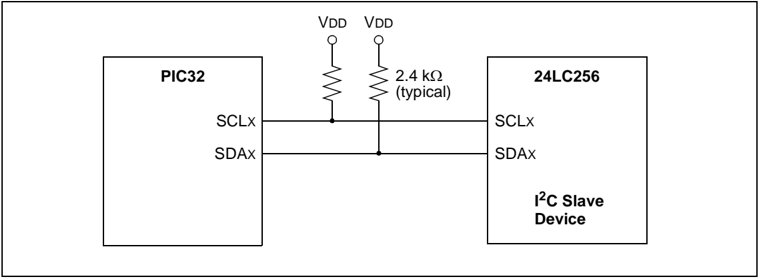

The interface employs a comprehensive protocol to ensure reliable transmission and reception of data. When communicating, one device is the 'master' which initiates transfer on the bus and generates the clock signals to permit that transfer, while the other device(s) acts as the 'slave' responding to the transfer. The clock line, SCLx, is output from the master and input to the slave, although occasionally the slave drives the SCLx line to stretch the clock. The data line, SDAx, may be output and input from both the master and the slave.

Because the SDAx and SCLx lines are bidirectional, the output stages of the devices driving the SDAx and SCLx lines must have an open drain in order to perform the wired AND function of the bus. External pull-up resistors are used to ensure a high level when no device is pulling the line down.

In the I 2 C interface protocol, each device has an address. When a master wishes to initiate a data transfer, it first transmits the address of the device that it wants to 'talk' to. All devices 'listen' to see if this is their address. Within this address, bit 0 specifies if the master wants to read from or write to the slave device. The master and slave are always in opposite modes of operation (transmitter/receiver) during a data transfer. That is, they can be thought of as operating in either of the following two relations:

- Master-transmitter and slave-receiver
- Slave-transmitter and master-receiver

In both cases, the master originates the SCLx clock signal.

The following modes and features specified in the V2.1 I 2 C specifications are not supported:

- HS mode and switching between F/S modes and HS mode
- Start byte
- CBUS compatibility
- Second byte of the general call address

## 24.3.1 Bus Protocol

The following I 2 C bus protocol has been defined:

- Data transfer may be initiated only when the bus is not busy
- During data transfer, the data line must remain stable whenever the SCLx clock line is high. Changes in the data line while the SCLx clock line is high will be interpreted as a Start or Stop condition.

Accordingly, the following bus conditions have been defined and are shown in Figure 24-3.

Figure 24-3: I 2 C Bus Protocol States

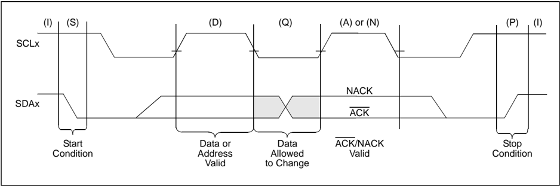

## 24.3.1.1 START DATA TRANSFER (S)

After a bus Idle state, a high-to-low transition of the SDAx line while the clock (SCLx) is high determines a Start condition. All data transfers must be preceded by a Start condition.

## 24.3.1.2 STOP DATA TRANSFER (P)

A  low-to-high  transition  of  the  SDAx  line  while  the  clock  (SCLx)  is  high  determines  a  Stop condition. All data transfers must end with a Stop condition.

## 24.3.1.3 REPEATED START (R)

After a wait state, a high-to-low transition of the SDAx line while the clock (SCLx) is high determines a Repeated Start condition. Repeated Starts allow a master to change bus direction of addressed slave device without relinquishing control of the bus.

## 24.3.1.4 DATA VALID (D)

The state of the SDAx line represents valid data when, after a Start condition, the SDAx line is stable for the duration of the high period of the clock signal. There is one bit of data per SCLx clock.

## 24.3.1.5 ACKNOWLEDGE (A) OR NOT ACKNOWLEDGE (N)

All data byte transmissions must be Acknowledged (ACK) or Not Acknowledged (NACK) by the receiver. The receiver will pull the SDAx line low for an ACK or release the SDAx line for a NACK. The Acknowledge is a one-bit period using one SCLx clock.

## 24.3.1.6 WAIT/DATA INVALID (Q)

The data on the line must be changed during the low period of the clock signal. Devices may also stretch the clock low time by asserting a low on the SCLx line, causing a wait on the bus.

## 24.3.1.7 BUS IDLE (I)

Both data and clock lines remain high at those times after a Stop condition and before a Start condition.

## 24.3.2 Message Protocol

A typical I 2 C message is shown in Figure 24-4. In this example, the message will read a specified byte from a 24LC256 I 2 C serial EEPROM. The PIC32 device will act as the master and the 24LC256 device will act as the slave.

Figure 24-4 indicates the data as driven by the master device and the data as driven by the slave device, considering the combined SDAx line is a wired AND of the master and slave data. The master device controls and sequences the protocol. The slave device will only drive the bus at specifically determined times.

Figure 24-4: A Typical I 2 C Message: Read of Serial EEPROM (Random Address Mode)

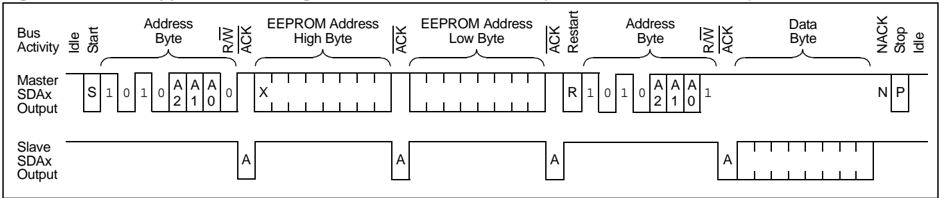

## 24.3.2.1 START MESSAGE

Each message is initiated with a Start condition and terminated with a Stop condition. The number of data bytes transferred between the Start and Stop conditions is determined by the master device. As defined by the system protocol, the bytes of the message may have special meaning, such as device address byte or data byte.

## 24.3.2.2 ADDRESS SLAVE

In Figure 24-4, the first byte is the device address byte, that must be the first part of any I 2 C message. It contains a device address and a R/W bit (IC2xSTAT&lt;2&gt;). Note that R/W = 0 for this first address byte, indicating that the master will be a transmitter and the slave will be a receiver.

## 24.3.2.3 SLAVE ACKNOWLEDGE

The receiving device is obliged to generate an Acknowledge signal, ACK, after the reception of each byte. The master device must generate an extra SCLx clock which is associated with this Acknowledge bit.

## 24.3.2.4 MASTER TRANSMIT

The next two bytes, sent by the master to the slave, are data bytes containing the location of the requested EEPROM data byte. The slave must Acknowledge each of the data bytes.

## 24.3.2.5 REPEATED START

The slave EEPROM now has the address information necessary to return the requested data byte to the master. However, the R/W bit from the first device address byte specified master transmission and slave reception. The bus must be turned in the other direction for the slave to send data to the master.

To perform this function without ending the message, the master sends a Repeated Start. The Repeated Start is followed with a device address byte containing the same device address as before and with the R/W = 1 to indicate slave transmission and master reception.

## 24.3.2.6 SLAVE REPLY

Now, the slave transmits the data byte by driving the SDAx line, while the master continues to originate clocks but releases its SDAx drive.

## 24.3.2.7 MASTER ACKNOWLEDGE

During reads, a master must terminate data requests to the slave by Not Acknowledging (generating a 'NACK') on the last byte of the message. Data is 'Acked' for each byte, except for the last byte.

## 24.3.2.8 STOP MESSAGE

The master sends a Stop to terminate the message and return the bus to an Idle state.

## 24.4 ENABLING I 2 C OPERATION

The I 2 C module fully implements all master and slave functions and is enabled by setting the ON bit (I2CxCON&lt;15&gt;). When the module is enabled, the master and slave functions are active simultaneously and will respond according to the software or bus events.

When initially enabled, the module will release the SDAx and SCLx pins, putting the bus into the Idle state. The master functions will remain in the Idle state unless software sets a control bit to initiate a master event. The slave functions will begin to monitor the bus. If the slave logic detects a Start event and a valid address on the bus, the slave logic will begin a slave transaction.

## 24.4.1 Enabling I 2 C I/O

Two pins are used for bus operation: the SCLx pin, which is the clock, and the SDAx pin, which is the data. When the I 2 C module is enabled, assuming no other module with higher priority has control, the module will assume control of the SDAx and SCLx pins. The module software need not be concerned with the state of the port I/O of the pins, the module overrides, the port state, and direction. At initialization, the pins are tri-state (released).

## 24.4.2 I 2 C Interrupts

The I 2 C module generates three interrupt signals:

- Master interrupt
- Slave interrupt
- Bus collision interrupt

These three signals will set the corresponding interrupt flag bits and will interrupt the CPU if the corresponding interrupt enable bits are set and the corresponding interrupt priorities are high enough.

## 24.4.2.1 MASTER INTERRUPTS

Master mode operations that generate a master interrupt are:

- Start Condition - 1 BRG time after falling edge of SDAx
- Repeated Start Sequence - 1 BRG time after falling edge of SDAx
- Stop Condition - 1 BRG time after the rising edge of SDAx
- Data transfer byte received - eighth falling edge of SCLx (after receiving eight bits of data from slave)
- During send ACK sequence - ninth falling edge of SCLx (after sending ACK or NACK to slave)
- Data transfer byte transmitted - ninth falling edge of SCLx (regardless of receiving ACK from slave)
- During a slave-detected Stop - When slave sets the P bit (I2CxSTAT&lt;4&gt;)

## 24.4.2.2 SLAVE INTERRUPTS

Slave mode operations that generate a slave interrupt are:

- Detection of a valid device address (including general call) - Ninth falling edge of SCLx (after sending ACK to master. Address must match unless the STRICT bit = 1 (I2CxCON&lt;11&gt;) or the GCEN bit = 1 (I2CxCON&lt;7&gt;)



- Reception of data - Ninth falling edge of SCLx (after sending the ACK to master)
- Request to transmit data - Ninth falling edge of SCLx (regardless of receiving an ACK from the master)

For devices with the PCIE (I2CxCON&lt;22&gt;), SCIE (I2CxCON&lt;21&gt;), AHEN (I2CxCON&lt;17&gt;), and DHEN (I2CxCON&lt;16&gt;) bits, the following Slave mode operations generate a slave interrupt:

- During Start sequence (if SCIE = 1 ) - 1 BRG time after falling edge of SDAx
- During Restart sequence (if SCIE = 1 ) - 1 BRG time after falling edge of SDAx
- During Stop sequence (if PCIE = 1 ) - 1 BRG time after the Rising edge of SDAx
- During Receive Address sequence (AHEN = 1 ) - eighth falling edge of SCLx (address must match unless STRICT = 1 or GCEN = 1 )
- During Receive Data sequence (DHEN = 1 ) - eighth falling edge of SCLx

## 24.4.2.3 BUS COLLISION INTERRUPTS

Bus Collision events that generate an interrupt can occur during master transmission of any one of the following:

- Start condition
- Repeated Start condition
- Address bit
- Data bit
- Acknowledge bit
- Stop condition

## 24.4.3 I 2 C Transmit and Receive Registers

I2CxTRN is the register to which transmit data is written. This register is used when the I 2 C module operates as a master transmitting data to the slave, or as a slave sending reply data to the master. As the message progresses, the I2CxTRN register shifts out the individual bits. As a result,  the  I2CxTRN  register  may  not  be  written  to  while  the  transmitter  is  busy  (TBF  bit (I2CxSTAT&lt;0&gt;) = 1 ) or a write collision will occur setting the IWCOL bit (I2CxStat&lt;7&gt;).

Data  being  received  by  either  the  master  or  the  slave  is  shifted  into  a  non-accessible  shift register, I2CxRSR. When a complete byte is received, the byte transfers to the I2CxRCV register. In receive operations, the I2CxRSR and I2CxRCV registers create a double-buffered receiver. This allows reception of the next byte to begin before the current byte of received data is read.

If the I 2 C module receives another complete byte before the software reads the previous byte from  the  I2CxRCV  register,  a  receiver  overflow  occurs,  the  module  sets  the  I2COV  bit (I2CxSTAT&lt;6&gt;), and the data in the I2CxRSR register is lost. The I2CCOV bit must be cleared by software.

Acknowledge bit generation may occur automatically in some situations when operating in Slave mode  or  manually, under  software control (see 24.7.4.1 'Acknowledge  Generation' ). Acknowledge  bit  generation  always  occurs  under  software  control  in  master  mode  (see 24.5.4 'Acknowledge Generation' ). Additionally, acknowledge bit behavior may be modified for devices with the BOEN bit (I2CxCON&lt;20&gt;). Setting BOEN = 1 causes the state of the I2COV bit to be ignored when determining the value of the acknowledge bit.

The I2CxADD register holds the slave device address. In 10-bit Addressing mode, all bits are relevant.  In  7-bit  Addressing  mode,  only  the  I2CxADD&lt;6:0&gt;  bits  are  relevant.  The  A10M  bit (I2CxCON&lt;10&gt;) specifies  the  expected  mode  of  the  slave  address.  By  using  the  I2CxMSK register with the I2CxADD register in either Slave Addressing mode, one or more bit positions can be removed from exact address matching, allowing the module in Slave mode to respond to multiple addresses.

## 24.4.4 I 2 C Baud Rate Generator

The Baud Rate Generator (BRG) used for I 2 C Master mode operation is used to set the SCLx clock frequency for 100 kHz, 400 kHz, and 1 MHz. The BRG reload value is contained in the I2CxBRG register. The BRG will automatically begin counting on a write to the I2CxTRN register or by setting any one of the five Least Significant bits of the I2CxCON register. After the given operation is complete (including transmission of the acknowledgment bit following the last bit of an address or data byte) the internal clock will automatically stop counting and the SCLx pin will remain in its last state.

The BRG is not used in Slave mode operations as the slave state machine is driven by the external SCL clock.

## 24.4.5 Baud Rate Generator in I 2 C Master Mode

In I 2 C Master mode, the reload value for the BRG is located in the I2CxBRG register. When the BRG is loaded with this value, the BRG counts down to zero and stops until another reload has taken place. In I 2 C Master mode, the BRG reload may not occur immediately. If clock arbitration is taking place, for instance, the BRG will be reloaded when the SCLx pin is sampled high (see Figure 24-6). Table 24-2 shows device frequency versus the I2CxBRG setting for standard baud rates.

Note: I2CxBRG values of 0x0 through 0x3 are expressly prohibited. Do not program the

I2CxBRG register to any of these values, as indeterminate results may occur.

To compute the BRG reload value, use the formula in Equation 24-1:

## Equation 24-1: Baud Rate Generator Reload Value Calculation

<!-- formula-not-decoded -->

Note 1: TPGOB is nominally 130 ns.

Table 24-2: I2C Clock Rate with BRG

| PBCLK   | FSCK (Two Rollovers of I2CxBRG)   | Calculated I2CxBRG<15:0>   |
|---------|-----------------------------------|----------------------------|
| 200 MHz | 1000 kHz                          | 0x0056                     |
| 200 MHz | 400 kHz                           | 0x00EC                     |
| 200 MHz | 100 kHz                           | 0x03DA                     |
| 120 MHz | 1000 kHz                          | 0x0034                     |
| 120 MHz | 400 kHz                           | 0x008E                     |
| 120 MHz | 100 kHz                           | 0x0250                     |
| 100 MHz | 1 MHz                             | 0x002B                     |
| 100 MHz | 400 kHz                           | 0x0076                     |
| 100 MHz | 100 kHz                           | 0x01ED                     |
| 80MHz   | 1000 kHz                          | 0x0022                     |
| 80MHz   | 400 kHz                           | 0x005E                     |
| 80MHz   | 100 kHz                           | 0x018A                     |
| 60MHz   | 1000 kHz                          | 0x001A                     |
| 60MHz   | 400 kHz                           | 0x0047                     |
| 60MHz   | 100 kHz                           | 0x0128                     |
| 50 MHz  | 1 MHz                             | 0x0015                     |
| 50 MHz  | 400 kHz                           | 0x003A                     |
| 50 MHz  | 100 kHz                           | 0x00F6                     |
| 40 MHz  | 1 MHz                             | 0x0011                     |
| 40 MHz  | 400 kHz                           | 0x002F                     |
| 40 MHz  | 100 kHz                           | 0x00C5                     |
| 30 MHz  | 1 MHz                             | 0x000C                     |
| 30 MHz  | 400 kHz                           | 0x0022                     |
| 30 MHz  | 100 kHz                           | 0x0093                     |
| 20 MHz  | 1 MHz                             | 0x0008                     |
| 20 MHz  | 400 kHz                           | 0x0017                     |
| 20 MHz  | 100 kHz                           | 0x0062                     |
| 10 MHz  | 1 MHz                             | 0x0004                     |
| 10 MHz  | 400 kHz                           | 0x000B                     |
| 10 MHz  | 100 kHz                           | 0x0031                     |

## Section 24. Inter-Integrated Circuit (I 2 C)

Equation 24-1  and  Table 24-2  are  provided  as  design  guidelines.  Due  to  system-dependent parameters, the actual baud rate may differ slightly. Testing is required to confirm that the actual baud rate meets the system requirements.

## Equation 24-2: SCK Frequency

<!-- formula-not-decoded -->

Figure 24-5: Baud Rate Generator Block Diagram

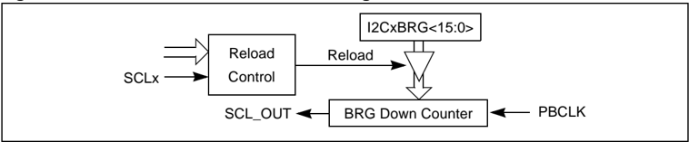

Figure 24-6: Baud Rate Generator Timing with Clock Arbitration

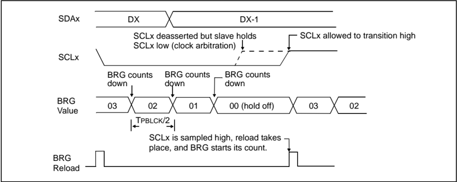

## 24.5 COMMUNICATING AS A MASTER IN A SINGLE MASTER ENVIRONMENT

Typical operation of an I 2 C module in a system is using the module to communicate with an I 2 C peripheral, such as an I 2 C serial memory. In an I 2 C system, the master controls the sequence of all data communication on the bus. In this example, the PIC32 device and its I 2 C module have the role of the single master in the system. As the single master, it is responsible for generating the SCLx clock and controlling the message protocol.

In the I 2 C module, the module controls individual portions of the I 2 C message protocol; however, sequencing of the components of the protocol to construct a complete message is a software task.

For example, a typical operation in a single master environment may be to read a byte from an I 2 C serial EEPROM is shown in Figure 24-7.

To accomplish this message, the software will sequence through the following steps:

1. Turn on the I 2 C module by setting the ON bit (I2CxCON&lt;15&gt;) to ' 1 '.
2. Assert a Start condition on SDAx and SCLx.
3. Send the I 2 C device address byte to the slave with a write indication.
4. Wait for and verify an Acknowledge from the slave.
5. Send the serial memory address high byte to the slave.
6. Wait for and verify an Acknowledge from the slave.
7. Send the serial memory address low byte to the slave.
8. Wait for and verify an Acknowledge from the slave.
9. Assert a Repeated Start condition on SDAx and SCLx.
10. Send the device address byte to the slave with a read indication.
11. Wait for and verify an Acknowledge from the slave.
12. Enable master reception to receive serial memory data.
13. Generate an ACK or NACK condition at the end of a received byte of data.
14. Generate a Stop condition on SDAx and SCLx.

Figure 24-7: Typical I 2 C Message: Read of Serial EEPROM (Random Address Mode)

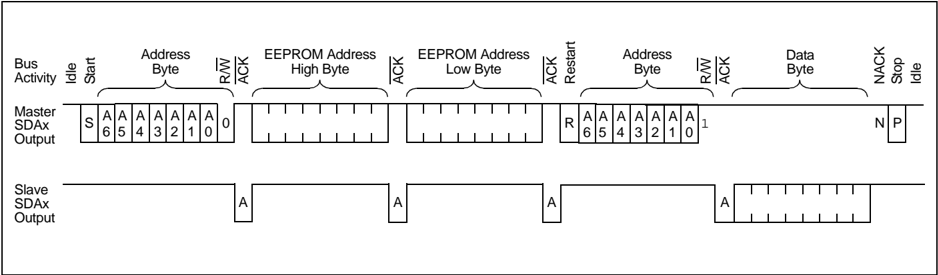

The  I 2 C  module  supports  Master  mode  communication  with  the  inclusion  of  Start  and  Stop generators, data byte transmission, data byte reception, an Acknowledge generator and a BRG. Generally, the software will write to a control register to start a particular step, and then wait for an  interrupt  or  poll  status  to  wait  for  completion.  Subsequent  sections  detail  each  of  these operations.

Note:

The I 2 C module does not allow queuing of events. For instance, the software is not allowed to initiate a Start condition and then immediately write the I2CxTRN register to  initiate  transmission  before  the  Start  condition  is  complete.  In  this  case,  the I2CxTRN register will not be written to and the IWCOL bit (I2CxSTAT&lt;7&gt;) will be set, indicating that this write to the I2CxTRN register did not occur.

## 24.5.1 Generating a Start Bus Event

To initiate a Start event, the software sets the Start Enable bit, SEN (I2CxCON&lt;0&gt;). Prior to setting the Start (S) bit (I2CxSTAT&lt;3&gt;), the software can check the Stop (P) bit (I2CxSTAT&lt;4&gt;) to ensure that the bus is in an Idle state.

Figure 24-8 shows the timing of the Start condition.

- Slave logic detects the Start condition, sets the S bit and clears the P bit
- The SEN bit is automatically cleared at completion of the Start condition
- A master interrupt is generated at completion of the Start condition
- After the Start condition, the SDAx line and SCLx line are left low (Q state)

## 24.5.1.1 IWCOL STATUS FLAG

If the software writes to the I2CxTRN register when a Start sequence is in progress, the IWCOL bit (I2CxSTAT&lt;7&gt;) is set and the contents of the transmit buffer are unchanged (the write does not occur).

Note: Because queuing of events is not allowed, writing to the five Least Significant bits of the I2CxCON register is disabled until the Start condition is complete.

Figure 24-8: Master Start Timing Diagram

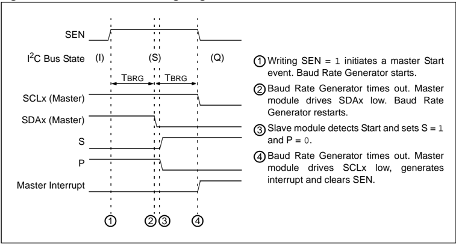

## 24.5.2 Sending Data to a Slave Device

Figure 24-9 shows the timing diagram of master to slave transmission. Transmission of a data byte or address byte is accomplished by writing the appropriate value to the I2CxTRN register. Loading this register will start the following process:

1. The software loads the I2CxTRN register with the byte to transmit.
2. Writing the I2CxTRN register sets the buffer full flag bit, TBF (I2CxSTAT&lt;0&gt;).
3. The byte is shifted out the SDAx pin until all eight bits are transmitted. Each bit will be shifted out onto the SDAx pin after the falling edge of SCLx.
4. On the ninth SCLx clock, the I 2 C master shifts in the acknowledgment bit from the slave device and writes its value into the ACKSTAT bit (I2CxSTAT&lt;15&gt;).
5. The I 2 C master generates the master interrupt at the end of the ninth SCLx clock cycle.

Note: The I 2 C master does not generate or validate the bytes. The contents and usage of the bytes are dependent on the state of the message protocol maintained by the software.

## 24.5.2.1 SENDING A 7-BIT ADDRESS TO THE SLAVE

Sending a 7-bit device address involves sending one byte to the slave. A 7-bit address byte must contain the 7 bits of the I 2 C device address and a R/W bit that defines if the message will be a write  to  the  slave  (master  transmission  and  slave  reception)  or  a  read  from  the  slave (slave transmission and master reception).

- Note 1: When  using  7-bit  Addressing  mode,  each  slave  device  using  the  I 2 C  protocol should be configured with a unique address.
- 2: While transmitting the address byte, the master must shift the address bits &lt;7:0&gt; left by one bit, and configure bit 0 as the R/W bit, as shown in Figure 24-21.

## 24.5.2.2 SENDING A 10-BIT ADDRESS TO THE SLAVE

Sending a 10-bit device address involves sending two bytes to the slave. The first byte contains five bits of the I 2 C device address reserved for 10-bit Addressing modes and two bits of the 10-bit address. Because the next byte, which contains the remaining eight bits of the 10-bit address, must  be  received  by  the  slave,  the  R/W  bit  in  the  first  byte  must  be  ' 0 ',  indicating  master transmission and slave reception. If the message data is also directed toward the slave, the master can continue sending the data. However, if the master expects a reply from the slave, a Repeated Start sequence with the R/W bit at ' 1 ' will change the R/W state of the message to a read of the slave.

- Note 1: When  using  10-bit  Addressing  mode,  each  slave  device  using  the  I 2 C  10-bit addressing protocol should be configured with a unique 10-bit address.
- 2: While transmitting the address byte, the master must shift the address bits &lt;9:8&gt; left by one bit, and configure bit 0 as the R/W bit, as shown in Figure 24-25.

## 24.5.2.3 RECEIVING ACKNOWLEDGE FROM THE SLAVE

On the falling edge of the eighth SCLx clock, the TBF bit (I2CxSTAT&lt;0&gt;) is cleared and the master will deassert the SDAx pin, allowing the slave to respond with an Acknowledge. The master will then generate a ninth SCLx clock.

This allows the slave device being addressed to respond with an ACK during the ninth bit time if an address match occurs or data was received properly. A slave sends an Acknowledge when it has recognized its device address (including a general call) or when the slave has properly received its data.

The status of ACK is written into the Acknowledge Status bit, ACKSTAT (I2CxSTAT&lt;15&gt;), on the falling edge of the ninth SCLx clock. After the ninth SCLx clock, the I 2 C master generates the master interrupt and enters an Idle state until the next data byte is loaded into the I2CxTRN register or the next I 2 C bus event is started by software.

## 24.5.2.4 ACKSTAT STATUS FLAG

The ACKSTAT bit (I2CxSTAT&lt;15&gt;) is updated in both Master and Slave modes on the ninth SCLx clock irrespective of Transmit or Receive modes. ACKSTAT is cleared when a transmitted byte is acknowledged by the receiver (SDAx is ' 0 ' on the ninth clock pulse), and is set when a transmitted byte is not acknowledged by the receiver (SDAx is ' 1 ' on the ninth clock pulse) by the receiver of the byte transmitted.

## 24.5.2.5 TBF STATUS FLAG

When transmitting, the TBF bit is set when the CPU writes to the I2CxTRN register, and is cleared when all eight bits are shifted out.

## Section 24. Inter-Integrated Circuit (I 2 C)

## 24.5.2.6 IWCOL STATUS FLAG

If the software writes to the I2CxTRN register when a transmit is already in progress (i.e., when TBF = 1 , because the I 2 C module is still shifting out a data byte), the IWCOL bit (I2CxSTAT&lt;7&gt;) is set and the contents of the buffer are unchanged (the write does not occur). The IWCOL bit must be cleared in software.

## Note:

Because queuing of events is not allowed, writing to the five Least Significant bits of the I2CxCON register is disabled until the transmit condition is complete. It is not cleared automatically.

Figure 24-9: Master Transmission Timing Diagram

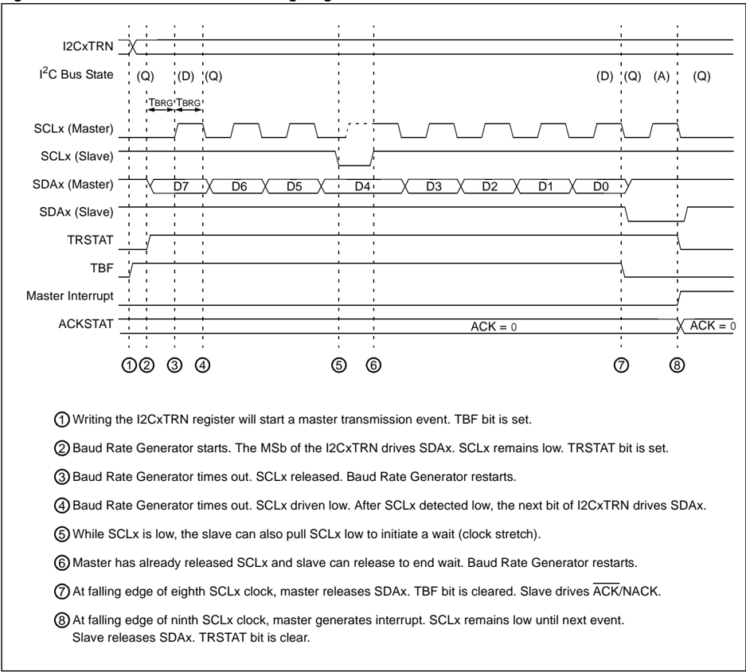

## 24.5.3 Receiving Data from a Slave Device

Figure 24-10 shows the timing diagram of master reception. The master can receive data from a slave device after the master has transmitted the slave address with an R/W bit value of ' 1 '. Reception of a byte is enabled by setting the Receive Enable bit, RCEN (I2CxCON&lt;3&gt;). The master logic begins to generate clocks, and before each falling edge of the SCLx, the SDAx line is sampled and data is shifted into the I2CxRSR register.

Note:

The five Least Significant bits of I2CxCON must be ' 0 ' before attempting to set the RCEN bit. This ensures the master logic is inactive.

After the falling edge of the eighth SCLx clock, the following events occur:

- The RCEN bit is automatically cleared
- The contents of the I2CxRSR register transfer into the I2CxRCV register
- The RBF flag bit (I2CxSTAT&lt;1&gt;) is set
- The I 2 C master generates the master interrupt

When the  CPU  reads  the  I2CxRCV  register,  the  RBF  flag  bit  is  automatically  cleared.  The software can then process the data and perform an Acknowledge sequence.

## 24.5.3.1 RBF STATUS FLAG

When receiving data, the RBF bit (I2CxSTAT&lt;1&gt;) is set when a device address or data byte is loaded into the I2CxRCV register from the I2CxRSR register. It is cleared when software reads the I2CxRCV register.

## 24.5.3.2 I2COV STATUS FLAG

If another byte is received in the I2CxRSR register while the RBF bit remains set and the previous byte remains in the I2CxRCV register, the I2COV bit (I2CxSTAT&lt;6&gt;) is set and the data in the I2CxRSR register is lost.

Leaving the I2COV bit set does not inhibit further reception. If the RBF bit is cleared by reading the  I2CxRCV  register  and  the  I2CxRSR  register  receives  another  byte,  that  byte  will  be transferred to the I2CxRCV register.

For devices with the BOEN bit (I2CxCON&lt;20&gt;), the master's ACK or NACK response to receiving a byte when I2COV = 1 depends on the value of the BOEN bit. If BOEN = 1 , the module ignores the value of the I2COV bit and ACKs the byte if RBF = 0 or NACKs the byte if RBF = 1 . If BOEN = 0 , the module ACKs the byte if both RBF and I2COV = 0 and it NACKs the byte if either RBF or I2COV = 1 .

Note:

The I2CxRCV register is only updated when RBF = 0 , hence its value is never lost. Only the hidden I2CxRSR register is allowed to overflow and lose newly received bytes when RBF = 1 .

## 24.5.3.3 IWCOL STATUS FLAG

If  the  software  writes  the  I2CxTRN  register  when  a  receive  is  already  in  progress  (i.e.,  the I2CxRSR register is still shifting in a data byte), the IWCOL bit (I2CxSTAT&lt;7&gt;) is set and the contents of the buffer are unchanged (the write does not occur).

Note:

Since queuing of events is not allowed, writing to the five Least Significant bits of the I2CxCON register is disabled until the data reception condition is complete. The IWCOL bit must be cleared by software, as it is not cleared automatically.

## Section 24. Inter-Integrated Circuit (I 2 C)

## Figure 24-10: Master Reception Timing Diagram

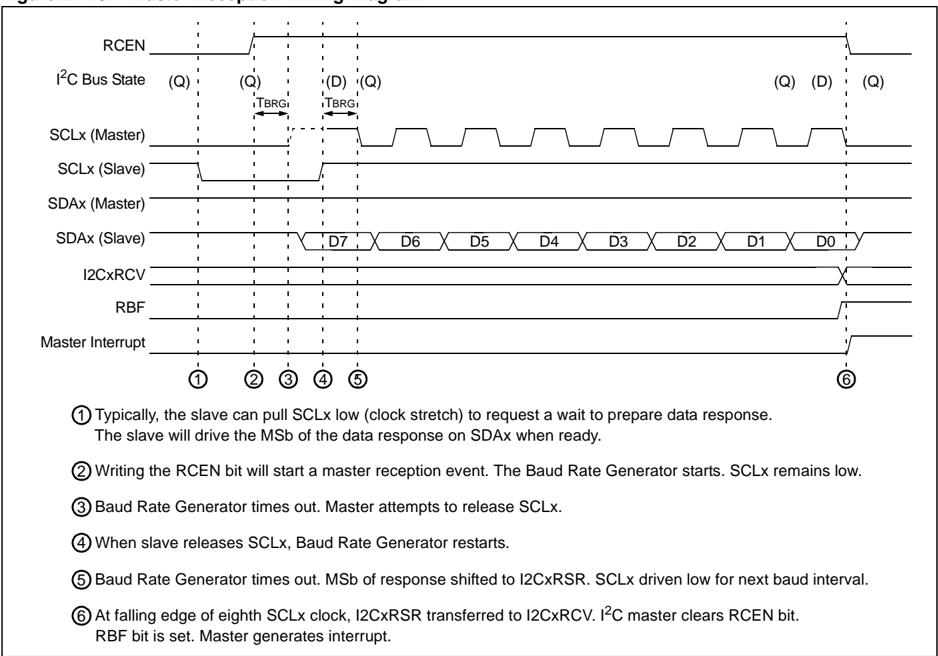

## 24.5.4 Acknowledge Generation

Setting  the  Acknowledge  Enable  bit,  ACKEN  (I2CxCON&lt;4&gt;),  enables  generating  a  master Acknowledge sequence.

Note: The five Least Significant bits of I2CxCON must be ' 0 ' (master logic inactive) before attempting to set the ACKEN bit.

Figure 24-11  shows  an  ACK  sequence  and  Figure 24-12  shows  a  NACK  sequence.  The Acknowledge Data bit, ACKDT (I2CxCON&lt;5&gt;), specifies ACK or NACK. If ACKDT = 0, an ACK is sent. If ACKDT = 1, a NACK is sent.

After two baud periods, the ACKEN bit is automatically cleared and the I 2 C master generates the master interrupt.

## 24.5.4.1 IWCOL STATUS FLAG

If the software writes to the I2CxTRN register when an Acknowledge sequence is in progress, the IWCOL bit (I2CxSTAT&lt;7&gt;) is set and the contents of the buffer are unchanged (the write does not occur).

Note:

Because queuing of events is not allowed, writing to the five Least Significant bits of the I2CxCON register is disabled until the Acknowledge condition is complete.

Figure 24-11: Master Acknowledge (ACK) Timing Diagram

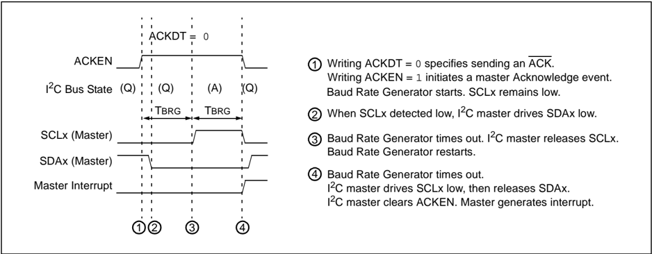

Figure 24-12: Master Not Acknowledge (NACK) Timing Diagram

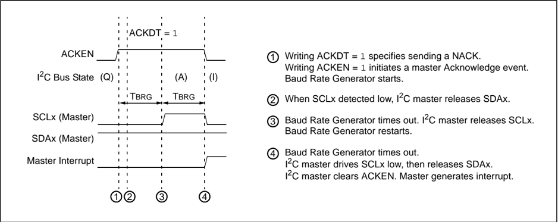

## Section 24. Inter-Integrated Circuit (I 2 C)

## 24.5.5 Generating Stop Bus Event

Setting the Stop Enable bit, PEN (I2CxCON&lt;2&gt;), enables generating a master Stop sequence.

Note: The five Least Significant bits of the I2CxCON register must be ' 0 '  (master logic inactive) before attempting to set the PEN bit.

When the PEN bit is set, the master generates the Stop sequence as shown in Figure 24-13.

- The slave detects the Stop condition, sets the Stop (P) bit (I2CxSTAT&lt;4&gt;) and clears the Start (S) bit (I2CxSTAT&lt;3&gt;)
- The PEN bit is automatically cleared
- The I 2 C master generates the master interrupt

## 24.5.5.1 IWCOL STATUS FLAG

If the software writes to the I2CxTRN register when a Stop sequence is in progress, the IWCOL bit (I2CxSTAT&lt;7&gt;) is set and the contents of the buffer are unchanged (the write does not occur).

Note: Because queuing of events is not allowed, writing to the five Least Significant bits of the I2CxCON register is disabled until the Stop condition is complete.

Figure 24-13: Master Stop Timing Diagram

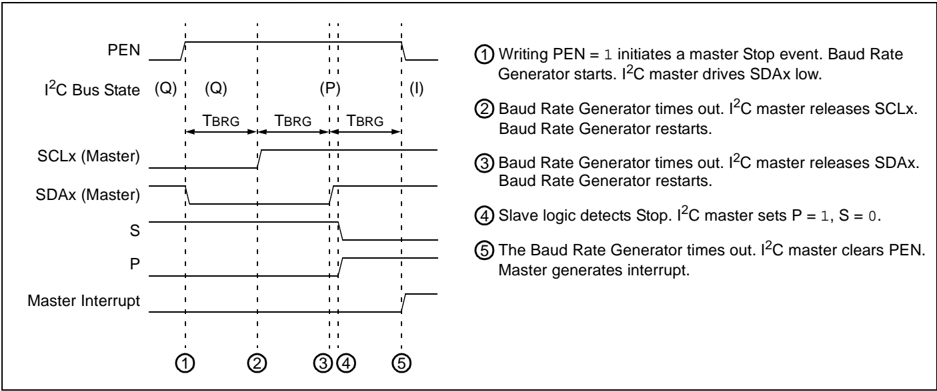

## 24.5.6 Generating a Repeated Start Bus Event

Setting  the  Repeated  Start  Enable  bit,  RSEN  (I2CxCON&lt;1&gt;),  enables  generating  a  master Repeated Start sequence (see Figure 24-14).

Note: The five Least Significant bits of I2CxCON must be ' 0 ' (master logic inactive) before attempting to set the RSEN bit.

To generate a repeated Start condition, software sets the RSEN bit (I2CxCON&lt;1&gt;) when the master is in a state where it is waiting after having previously completed a byte transfer. The I 2 C master asserts the SCLx pin low. When the I 2 C master samples the SCLx pin low, the module releases the SDAx pin for one BRG count (TBRG). When the BRG times out and the I 2 C master samples the SDAx pin high, the I 2 C master deasserts the SCLx pin. When the I 2 C master samples the SCLx pin high, the BRG reloads and begins counting. The SDAx and SCLx pins must be sampled high for one TBRG. This action is then followed by assertion of the SDAx pin low for one TBRG while the SCLx pin is high.

The following is the Repeated Start sequence:

1. The slave detects the Start condition, sets the S bit (I2CxSTAT&lt;3&gt;) and clears the P bit (I2CxSTAT&lt;4&gt;).
2. The RSEN bit is automatically cleared.
3. The I 2 C master generates the master interrupt.

## 24.5.6.1 IWCOL STATUS FLAG

If the software writes to the I2CxTRN register when a Repeated Start sequence is in progress, the IWCOL bit (I2CxSTAT&lt;7&gt;) is set and the contents of the buffer are unchanged (the write does not occur).

Note:

Because queuing of events is not allowed, writing of the five Least Significant bits of the I2CxCON register is disabled until the Repeated Start condition is complete.

Figure 24-14: Master Repeated Start Timing Diagram

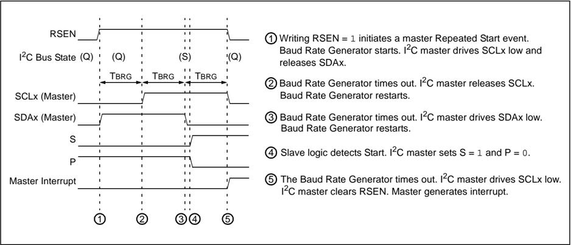

## 24.5.7 Building Complete Master Messages

As described in the 24.5 'Communicating as a Master in a Single Master Environment' , the software is responsible for constructing messages with the correct message protocol. The I 2 C  master  controls  individual  portions  of  the  I 2 C  protocol;  however,  sequencing  of  the components of the protocol to correctly constructing messages is a software responsibility.

The software can use polling or interrupt methods while using the I 2 C master. The examples shown use interrupts.

The software can use the SEN, RSEN, PEN, RCEN and ACKEN bits (five Least Significant bits of  the  I2CxCON  register)  and  the  TRSTAT  bit  as  'state'  flags  when  progressing  through  a message. Table 24-3 provides some example state numbers associated with bus states.

Table 24-3: Master Message Protocol States

|   Example State Number |   I2CxCON<4:0> | TRSTAT (I2CxSTAT<14>)   | State                        |
|------------------------|----------------|-------------------------|------------------------------|
|                      0 |          00000 | 0                       | Bus Idle or Wait             |
|                      1 |          00001 | N/A                     | Sending Start Event          |
|                      2 |          00000 | 1                       | Master Transmitting          |
|                      3 |          00010 | N/A                     | Sending Repeated Start Event |
|                      4 |          00100 | N/A                     | Sending Stop Event           |
|                      5 |          01000 | N/A                     | Master Reception             |
|                      6 |          10000 | N/A                     | Master Acknowledgment        |



Note: Example state numbers are for reference only. User software may assign state numbers as desired.

The software will begin a message by issuing a Start command. The software will record the state number corresponding to the Start.

As each event completes and generates an interrupt, the interrupt handler may check the state number.  Therefore,  for  a  Start  state,  the  interrupt  handler  will  confirm  execution  of  the  Start sequence and then start a master transmission event to send the I 2 C device address, changing the state number to correspond to the master transmission.

On the next interrupt, the interrupt handler will again check the state, determining that a master transmission just completed. The interrupt handler will confirm successful transmission of the data, then move on to the next event, depending on the contents of the message. In this manner, on each interrupt,  the  interrupt  handler  will  progress  through  the  message  protocol  until  the complete message is sent.

Figure 24-15 provides a more detailed examination of the same message sequence shown in Figure 24-7.

Figure 24-16 shows some simple examples of messages using 7-bit addressing format.

Figure 24-17 shows an example of a 10-bit addressing format message sending data to a slave.

Figure 24-18 shows an example of a 10-bit addressing format message receiving data from a slave.

Figure 24-15: Master Message (Typical I 2 C Message: Read of Serial EEPROM)

| ACKDT ACKEN SEN SCLx SDAx SCLx SDAx I2CxTRN TBF I2CxRCV RBF Master ACKSTAT 1 2 3 4 5 6 7 8 A1 A0 9 A PEN RCEN A11 A10 A9 A8 1 2 3 4 5 6 7 8 9 W 1 1 RSEN 1 2 3 4 5 6 7 1 3 2 A 4 0 0 A2 A7 A6 A5 A4 A2 A1 0 0 0 0 (Master) (Master) (Slave) (Slave) A3 Master interrupt cleared Interrupt by user software.   | 1 2 3 4 5 6 7 8 8 9 9 A 1 2 3 4 5 6 7 8 D3 D2 D1 D0 D7 D6 D5 D4 9 N A 5 7 8 9 A0 A1 A0 R 1 1 0 0 A2 6                                                                                                                                                                                                                                                                               |
|---------------------------------------------------------------------------------------------------------------------------------------------------------------------------------------------------------------------------------------------------------------------------------------------------------------|-------------------------------------------------------------------------------------------------------------------------------------------------------------------------------------------------------------------------------------------------------------------------------------------------------------------------------------------------------------------------------------|
| 1 Setting the SEN bit starts a Start event. 2 Writing the I2CxTRN register starts a master transmission. The data is the serial EEPROM device address byte, with R/W clear, indicating a write.                                                                                                               | Writing the I2CxTRN register starts a master transmission. The data is a resend of 6 Setting the RCEN bit starts a master reception. On interrupt, the software reads 7 Setting the ACKEN bit starts an Acknowledge event. ACKDT = 1 to send NACK. the serial EEPROM device address byte, but with R/W bit set, indicating a read. the I2CxRCV register, which clears the RBF flag. |
| 3 Writing the I2CxTRN register starts a master transmission. The data is the first 4 - byte of the EEPROM data address. Writing the I2CxTRN register starts a master transmission. The data is the second                                                                                                     | 9 Setting the PEN bit starts a master Stop event. 8                                                                                                                                                                                                                                                                                                                                 |

Figure 24-16: Master Message (7-bit Address: Transmission and Reception)

| ACKDT ACKEN SEN SCLx SDAx SCLx SDAx I2CxTRN TBF I2CxRCV RBF Master ACKSTAT 1 2 3 4 5 6 7 8 A2 A1 9 A PEN RCEN D7 D6 D5 D4 D3 D2 D1 D0 1 2 3 4 5 6 7 8 9 W RSEN 1 3 2 A 4 A7 A6 A5 A4 A3 (Master) (Master) (Slave) (Slave) Master interrupt cleared Interrupt by user software.                                                                     | 1 2 3 4 5 6 7 8 9 1 2 3 4 5 6 7 8 D3 D2 D1 D0 D7 D6 D5 D4 9 N 6 9 7 8 A A2 A1 R A7 A6 A5 A4 A3                                                                                                                                                                                               |
|----------------------------------------------------------------------------------------------------------------------------------------------------------------------------------------------------------------------------------------------------------------------------------------------------------------------------------------------------|----------------------------------------------------------------------------------------------------------------------------------------------------------------------------------------------------------------------------------------------------------------------------------------------|
| 1 Setting the SEN bit starts a Start event. 2 Writing the I2CxTRN register starts a master transmission. The data is the 3 Writing the I2CxTRN register starts a master transmission. The data is the 4 Setting the PEN bit starts a master Stop event. 5 Setting the SEN bit starts a Start event. address byte with R/W bit clear. message byte. | 6 Writing the I2CxTRN register starts a master transmission. The data is the 7 Setting the RCEN bit starts a master reception. 8 Setting the ACKEN bit starts an Acknowledge event. ACKDT = 1 to send NACK. Setting the PEN bit starts a master Stop event. address byte with R/W bit set. 9 |

Figure 24-17: Master Message (10-bit Transmission)

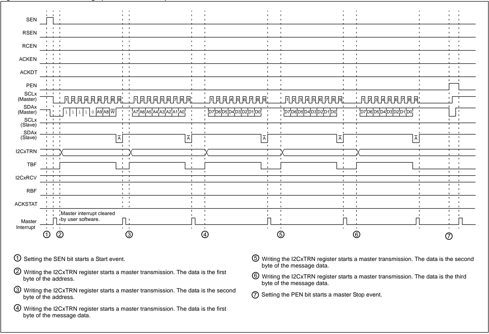

Figure 24-18: Master Message (10-bit Reception)

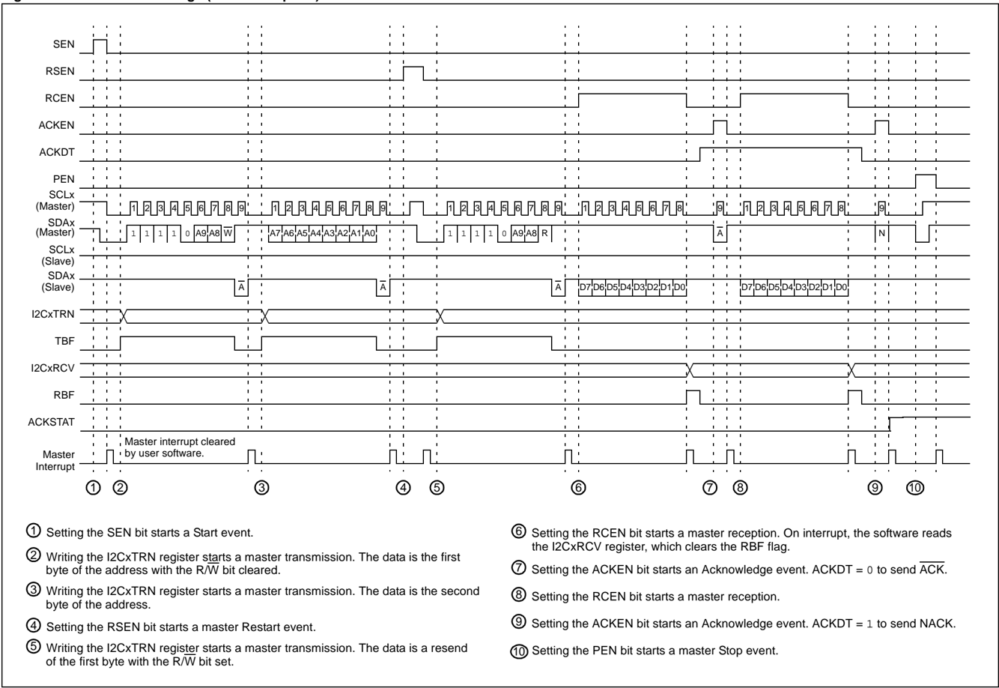

## 24.6 COMMUNICATING AS A MASTER IN A MULTI-MASTER ENVIRONMENT

The I 2 C protocol allows for more than one master to be attached to a system bus. Considering that a master can initiate message transactions and generate clocks for the bus, the protocol has methods to account for situations where more than one master is attempting to control the bus. Clock synchronization ensures that multiple nodes can synchronize their SCLx clocks to result in one common clock on the SCLx line. Bus arbitration ensures that if more than one node  attempts  a  message  transaction,  one  node,  and  only  one  node,  will  be  successful  in completing the message. The other nodes will lose bus arbitration and will be left with a bus collision.

## 24.6.1 Multi-Master Operation

The  Master  module  has  no  special  settings  to  enable  multi-master  operation.  The  module performs clock synchronization and bus arbitration at all times. If the module is used in a single master environment, clock synchronization will only occur between the master and slaves, and bus arbitration will not occur.

## 24.6.2 Master Clock Synchronization

In a multi-master system, different masters may have different baud rates. Clock synchronization will ensure that their clocks will be coordinated.

Clock synchronization occurs when the master deasserts the SCLx pin (SCLx intended to float high). When the SCLx pin is released, the BRG is suspended from counting until the SCLx pin is actually  sampled  high.  When  the  SCLx  pin  is  sampled  high,  the  BRG  is  reloaded  with  the contents of I2CxBRG&lt;15:0&gt; and begins counting. This ensures that the SCLx high time will always be at least one BRG rollover count in the event that the clock is held low by an external device, as shown in Figure 24-6.

## 24.6.3 Bus Arbitration and Bus Collision

Bus arbitration supports multi-master system operation.

The wired AND nature of the SDAx line permits arbitration. Arbitration takes place when the first master outputs a ' 1 ' on SDAx by letting SDAx float high and simultaneously, the second master outputs a ' 0 ' on SDAx by driving SDAx low. The SDAx signal will go low. In this case, the second master has won bus arbitration. The first master has lost bus arbitration.

For the first master, the expected data on SDAx is a ' 1 ', but the data sampled on SDAx is a ' 0 '. This is the definition of a bus collision. When a bus collision occurs, the first master will set the Bus  Collision  bit,  BCL  (I2CxSTAT&lt;10&gt;),  and  generate  a  bus  collision  interrupt.  The  Master module will reset the I 2 C port to its Idle state.

In multi-master operation, the SDAx line must be monitored for arbitration to see if the signal level is the expected output level. This check is performed by the Master module, with the result placed in the BCL bit.

The states where arbitration can be lost are:

- A Start condition
- A Repeated Start condition
- An Address, Data or Acknowledge bit
- A Stop condition

## 24.6.4 Detecting Bus Collisions and Resending Messages

When a bus collision occurs, the I 2 C master sets the BCL bit and generates a bus collision interrupt. If bus collision occurs during a byte transmission, the transmission is halted, the TBF bit (I2CxSTAT&lt;0&gt;) is cleared and the SDAx and SCLx pins are deasserted. If bus collision occurs during a Start, Repeated Start,  Stop or Acknowledge condition, the condition is  aborted, the respective control bits in the I2CxCON register are cleared and the SDAx and SCLx lines are deasserted.

## Section 24. Inter-Integrated Circuit (I 2 C)

The software is expecting an interrupt at the completion of the master event. The software can check the BCL bit to determine whether the master event completed successfully or a collision occurred. If a collision occurs, the software must abort sending the rest of the pending message and prepare to resend the entire message sequence, beginning with the Start condition, after the bus  returns  to  an  Idle  state.  The  software  can  monitor  the  S  (I2CxSTAT&lt;3&gt;)  and  P (I2CxSTAT&lt;4&gt;) bits to wait for an Idle bus. When the software services the bus collision Interrupt Service Routine and the I 2 C bus is free, the software can resume communication by asserting a Start condition.

## 24.6.5 Bus Collision During a Start Condition

Before issuing a Start command, the software should verify an Idle state of the bus using the S and P Status bits. Two masters may attempt to initiate a message simultaneously. Typically, the masters will synchronize clocks and continue arbitration into the message until one loses arbitration. However, certain conditions can cause a bus collision to occur during a Start. In this case, the master that loses arbitration during the Start (S) bit generates a bus collision interrupt.

## 24.6.6 Bus Collision During a Repeated Start Condition

Should two masters not collide throughout an address byte, a bus collision may occur when one master attempts to assert a Repeated Start while another transmits data. In this case, the master generating the Repeated Start will lose arbitration and generate a bus collision interrupt.

## 24.6.7 Bus Collision During Message Bit Transmission

The most typical case of data collision occurs while the master is attempting to transmit the device address byte, a data byte, or an Acknowledge bit.

If the software is checking the bus state, it is unlikely that a bus collision will occur on a Start condition.  However, because another master can, at a very similar time, check the bus and initiate its own Start condition, it is likely that SDAx arbitration will occur and synchronize the Start of two masters. In this condition, both masters will begin and continue to transmit their messages until  one  master  loses  arbitration  on  a  message  bit.  Remember  that  the  SCLx  clock synchronization will keep the two masters synchronized until one loses arbitration. Figure 24-19 shows an example of message bit arbitration.

Figure 24-19: Bus Collision During Message Bit Transmission

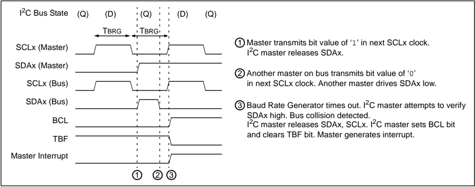

## 24.6.8 Bus Collision During a Stop Condition

If the master software loses track of the state of the I 2 C bus, there are conditions that cause a bus collision during a Stop condition. In this case, the master generating the Stop condition will lose arbitration and generate a bus collision interrupt.

## 24.7 COMMUNICATING AS A SLAVE

In  some  systems,  particularly  where  multiple  processors  communicate  with  each  other,  the PIC32 device may communicate as a slave, see Figure 24-20. When the I 2 C slave is enabled, the  Slave  module  is  active.  The  slave  may  not  initiate  a  message,  it  can  only  respond  to  a message sequence initiated by a master. The master requests a response from a particular slave as defined by the device address byte in the I 2 C protocol. The Slave module replies to the master at the appropriate times as defined by the protocol.

As with the Master module, sequencing the components of the protocol for the reply is a software task.  However,  the  Slave  module  detects  when  the  device  address  matches  the  address specified by the software for that slave.

Figure 24-20: A Typical Slave I 2 C Message: Multiprocessor Command/Status

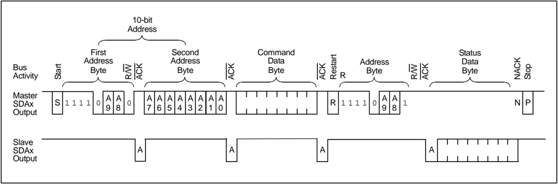

After a Start condition, the Slave module will receive and check the device address. The slave may match either a 7-bit address or a 10-bit address. When a device address is matched, the I 2 C slave will generate an interrupt to notify the software that its device is selected. Based on the R/W bit (IC2xSTAT&lt;2&gt;) sent by the master, the slave will either receive or transmit data. If the slave is to receive data, the Slave module automatically generates the Acknowledge (ACK), loads the I2CxRCV register with the received value currently in the I2CxRSR register, and then notifies the software through an interrupt. For devices with address hold enable option the AHEN bit (I2CxCON&lt;17&gt;) should be clear for automatic generation of ACK.

Refer  to 24.7.4.1 'Acknowledge  Generation' for  more  information  on  the  acknowledge sequence when the I 2 C module is a slave and on the AHEN and DHEN bits. If the slave is to transmit data, user software must load the I2CxTRN register.

## 24.7.1 Sampling Receive Data

All incoming bits are sampled with the rising edge of the clock (SCLx) line.

## 24.7.2 Detecting Start and Stop Conditions

The Slave module will detect Start and Stop conditions on the bus and indicate that status on the S bit (I2CxSTAT&lt;3&gt;) and P bit (I2CxSTAT&lt;4&gt;). The Start (S) and Stop (P) bits are cleared when a Reset occurs or when the I 2 C slave is disabled. After detection of a Start or Repeated Start event, the S bit is set and the P bit is cleared. After detection of a Stop event, the P bit is set and the S bit is cleared.

The Slave module can also generate interrupts to notify the Start and Stop conditions. These Start and Stop detection interrupts can be enabled using the SCIE bit (I2CxCON&lt;21&gt;) and the PCIE bit (I2CxCON&lt;22&gt;).

## 24.7.3 Detecting the Address

Once the ON bit (I2CxCON&lt;15&gt;) is set, the Slave module waits for a Start condition to occur. After a Start, depending on the A10M bit (I2CxCON&lt;10&gt;), the slave will attempt to detect a 7-bit or 10-bit address. The Slave module will compare one received byte for a 7-bit address or two received bytes for a 10-bit address. The first address byte contains a R/W bit that specifies the direction of data transfer of any bytes that follow it. If R/W = 0 , a write is specified and the slave will receive data from the master. If R/W = 1 , a read is specified and the slave will send data to the master. The first byte of a 10-bit address contains an R/W bit; however, by definition, it is always R/W = 0 because the slave must receive the second byte of the 10-bit address.

## 24.7.3.1 SLAVE ADDRESS MASKING

The I2CxMSK register masks address bit positions, designating them as 'don't care' bits for both 10-bit and 7-bit Addressing modes. When a bit in the I2CxMSK register is set (= 1 ), it means 'don't care'. The Slave module will respond when the bit in the corresponding location of the address is a ' 0 ' or ' 1 '. For example, in 7-bit Slave mode with the I2CxMSK register = 0110000 , the I 2 C slave will Acknowledge addresses ' 0010000 ' and ' 0100000 ' as valid.

## 24.7.3.2 LIMITATIONS OF ADDRESS MASK

By default, the device will respond to addresses in the reserved address space with the address mask enabled (see Table 24-4 for the reserved address spaces). When using the address mask and the STRICT bit (I2CxCON&lt;11&gt;) is cleared, reserved addresses may be acknowledged. If the user wants to enforce the reserved address space, the STRICT bit must be set to a ' 1 '. Once  the  bit  is  set,  the  device  will  not  acknowledge  reserved  addresses  regardless  of  the address mask settings.

## 24.7.3.3 7-BIT ADDRESS AND SLAVE WRITE

Following  the  Start  condition,  the  I 2 C  slave  shifts  eight  bits  into  the  I2CxRSR  register  (see Figure 24-21).  The  value  of  the  I2CxRSR&lt;7:1&gt;  bits  are  evaluated  against  that  of  the I2CxADD&lt;6:0&gt; and I2CxMSK&lt;6:0&gt; bits on the falling edge of the eighth clock (SCLx). If the address is valid (i.e.,  an  exact  match between unmasked bit positions), the following events occur:

1. An  ACK  is  generated  (for  devices  with  the  AHEN  bit  (I2CxCON&lt;17&gt;),  an  ACK  is generated if the AHEN bit is clear).
2. The D/A (IC2xSTAT&lt;5&gt;) bit and the R/W bit (IC2xSTAT&lt;2&gt;) are cleared.
3. The I 2 C slave generates the slave interrupt on the falling edge of the ninth SCLx clock.
4. The I 2 C slave will wait for the master to send data.

Figure 24-21: Slave Write 7-bit Address Detection Timing Diagram

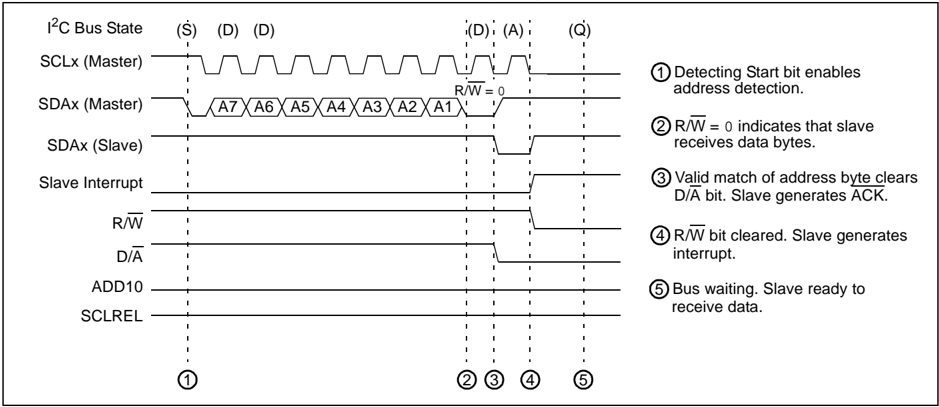

## 24.7.3.4 7-BIT ADDRESS AND SLAVE READ

When a slave read is specified by having R/W (IC2xSTAT&lt;2&gt;) = 1 in a 7-bit address byte, the process of detecting the device address is similar to that for a slave write (see Figure 24-22). If the addresses match, the following events occur:

1. An  ACK  is  generated  (for  devices  with  the  AHEN  bit  (I2CxCON&lt;17&gt;),  an  ACK  is generated if the AHEN bit = 0 ).
2. The D/A bit (I2CxSTAT&lt;5&gt;) is cleared and the R/W bit (I2CxSTAT&lt;2&gt;) is set.
3. The I 2 C slave generates the slave interrupt on the falling edge of the ninth SCLx clock.

Since  the  Slave  module  is  now  expected  to  reply  with  data,  it  is  necessary  to  suspend  the operation of the I 2 C bus to allow the software to prepare a response. This is done automatically when the I 2 C slave clears the SCLREL bit (I2CxCON&lt;12&gt;). With SCLREL low, the Slave module will pull down the SCLx clock line, causing a wait on the I 2 C bus. The Slave module and the I 2 C bus will remain in this state until the software writes the I2CxTRN register with the response data and sets the SCLREL bit.

Note: The SCLREL bit will automatically clear after detection of a slave read address, regardless of the state of the STREN bit.

Figure 24-22: Slave Read 7-bit Address Detection Timing Diagram

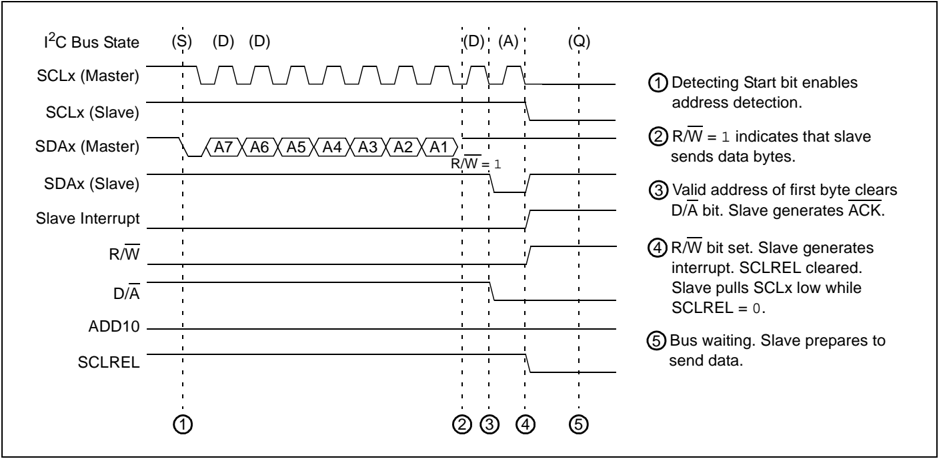

When a slave read occurs with address hold enabled (AHEN = 1 ), the I 2 C module stretches the SCLx clock after the eighth falling edge when it has received a matching address byte. The I 2 C module clears the SCLREL bit and the clock is asserted low. Slave software is responsible for clearing the ACKDT bit to acknowledge the byte and for waiting the appropriate setup time before setting the SCLREL bit. This sequence is shown in Figure 24-23. Refer to 24.8.3 'Rise and Setup Time Considerations' for additional information.

Figure 24-23: Slave Read with AHEN = 1 AND DHEN = 1

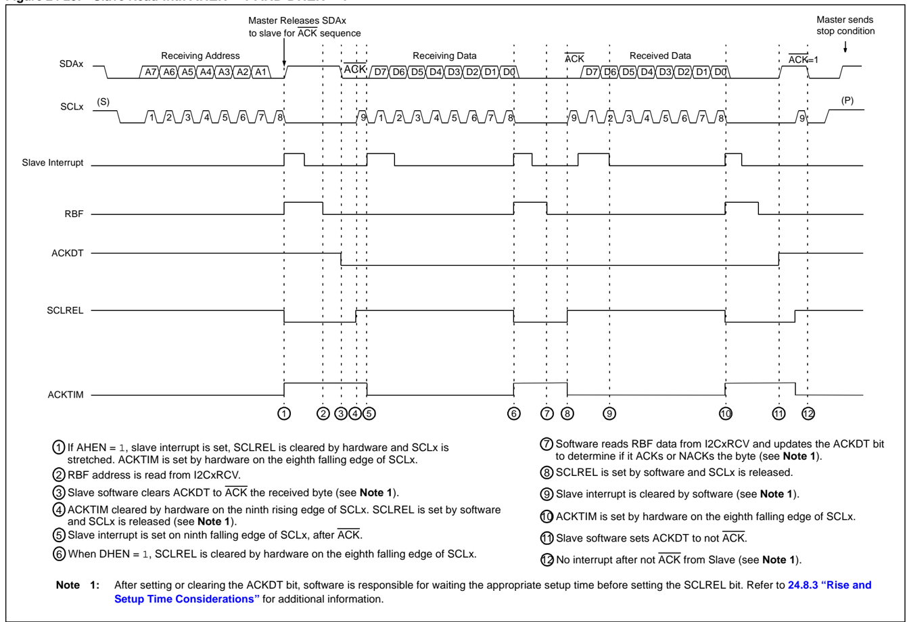

## 24.7.3.5 10-BIT ADDRESSING MODE

Figure 24-24 shows the sequence of address bytes on the bus in 10-bit Address mode when the A10M bit (I2CxCON&lt;10&gt;) is set. In this mode, the slave must receive two device address bytes (see  Figure 24-25).  The  five  Most  Significant  bits  of  the  first  address  byte  specify  a  10-bit address. The R/W bit of the address must specify a write, causing the slave device to receive the second address byte. For a 10-bit address, the first byte would equal ' 11110 A9 A8 0 ', where ' A9 ' and ' A8 ' are the two Most Significant bits of the address.

The I2CxMSK register can mask any bit position in a 10-bit address. The two Most Significant bits of the I2CxMSK register are used to mask the Most Significant bits of the incoming address received in the first byte. The remaining byte of the register is then used to mask the lower byte of the address received in the second byte.

Following the Start condition, the I 2 C slave shifts eight bits into the I2CxRSR register. The value of  the  I2CxRSR&lt;2:1&gt;  bits  are  evaluated  against  the  value  of  the  I2CxADD&lt;9:8&gt;  and I2CxMSK&lt;9:8&gt;  bits,  while  the  value  of  the  I2CxRSR&lt;7:3&gt;  bits  are  compared  to ' 11110 '. Address evaluation occurs on the falling edge of the eighth clock (SCLx). For the address to be valid, the I2CxRSR&lt;7:3&gt; bits must equal ' 11110 ',  while the I2CxRSR&lt;2:1&gt; bits must exactly match any unmasked bits in the I2CxADD&lt;9:8&gt; bits. (If both bits are masked, a match is not needed.) If the address is valid, the following events occur:

1. An  ACK  is  generated  (for  devices  with  the  AHEN  bit  (I2CxCON&lt;17&gt;),  an  ACK  is generated if the AHEN bit is clear).
2. The D/A bit (I2CxSTAT&lt;5&gt;) bit and the R/W bit (IC2xSTAT&lt;2&gt;) are cleared.
3. The I 2 C slave generates the slave interrupt on the falling edge of the ninth SCLx clock.

The I 2 C slave does generate an interrupt after the reception of the first byte of a 10-bit address and software must read the I2CxRCV register to clear the buffer and obtain the value of the two high-order address bits.

The I 2 C slave will continue to receive the second byte into the I2CxRSR register. This time, the I2CxRSR&lt;7:0&gt; bits are evaluated against the I2CADD&lt;7:0&gt; and I2CxMSK&lt;7:0&gt; bits. If the lower byte of the address is valid as previously described, the following events occur:

1. An  ACK  is  generated  (for  devices  with  the  AHEN  bit  (I2CxCON&lt;17&gt;),  an  ACK  is generated if the AHEN bit is clear).
2. The ADD10 bit (I2CxSTAT&lt;8&gt;) is set.
3. The I 2 C slave generates the slave interrupt on the falling edge of the ninth SCLx clock.
4. The I 2 C slave will wait for the master to send data or initiate a Repeated Start condition.

Note: Following a Repeated Start condition in 10-bit Addressing mode, the Slave module

only matches the first 7-bit address, ' 11110 A9 A8 0 '.

## Figure 24-24: 10-bit Address Sequence

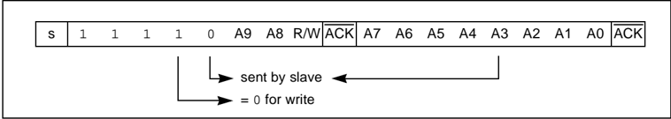

## Section 24. Inter-Integrated Circuit (I 2 C)

## Figure 24-25: 10-bit Address Detection Timing Diagram

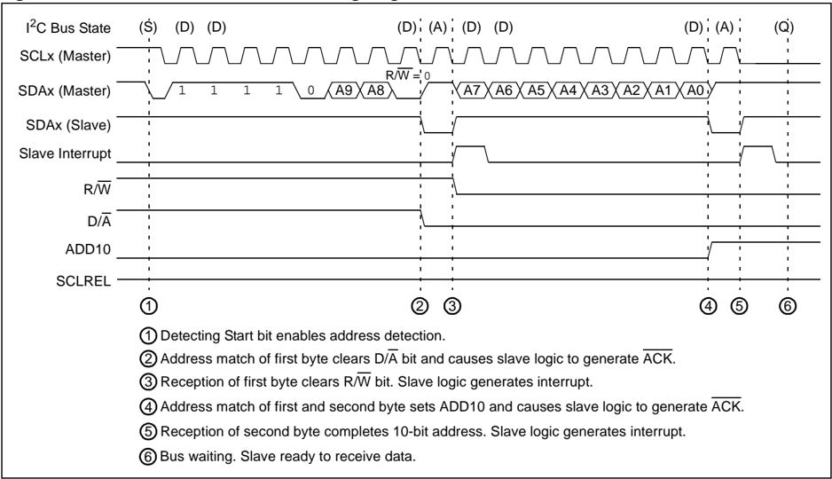

## 24.7.3.6 GENERAL CALL OPERATION

The addressing procedure for the I 2 C bus is such that the first byte (or first two bytes in case of 10-bit Addressing mode) after a Start condition usually determines which slave device the master is addressing. The exception is the general call address, which can address all devices. When this address is used, all enabled devices should respond with an Acknowledge. The general call address is one of eight addresses reserved for specific purposes by the I 2 C protocol. It consists of all zeros with R/W (IC2xSTAT&lt;2&gt;) = 0 . The general call is always a slave write operation.

The general call address is recognized when the General Call Enable bit, GCEN (I2CxCON&lt;7&gt;), is set, see Figure 24-26. Following a Start (S) bit (I2CxSTAT&lt;3&gt;) detect, eight bits are shifted into the  I2CxRSR  register  and  the  address  is  compared  against  the  I2CxADD  register  and  the general call address. If the general call address matches, the following events occur:

1. An  ACK  is  generated  (for  devices  with  the  AHEN  bit  (I2CxCON&lt;17&gt;),  an  ACK  is generated if the AHEN bit is clear).
2. The Slave module will set the GCSTAT bit (I2CxSTAT&lt;9&gt;).
3. The D/A (IC2xSTAT&lt;5&gt;) and R/W bits are cleared.
4. The I 2 C slave generates the slave interrupt on the falling edge of the ninth SCLx clock.
5. The I2CxRSR register is transferred to the I2CxRCV register and the RBF flag bit (I2CxSTAT&lt;1&gt;) is set (on the falling edge of the eighth SCLx clock).
6. The I 2 C slave will wait for the master to send data.

When the interrupt is serviced, the cause for the interrupt can be checked by reading the contents of the GCSTAT bit to determine whether the device address was device-specific or a general call address.

## Note:

General  call  addresses  are  7-bit  addresses.  If  configuring  the  Slave  module  for 10-bit addresses and the A10M bit (I2CxCON&lt;10&gt;) and the GCEN bit are set, the Slave module will continue to detect the 7-bit general call address.

## PIC32 Family Reference Manual

Figure 24-26: General Call Address Detection Timing Diagram (GCEN = 1 )

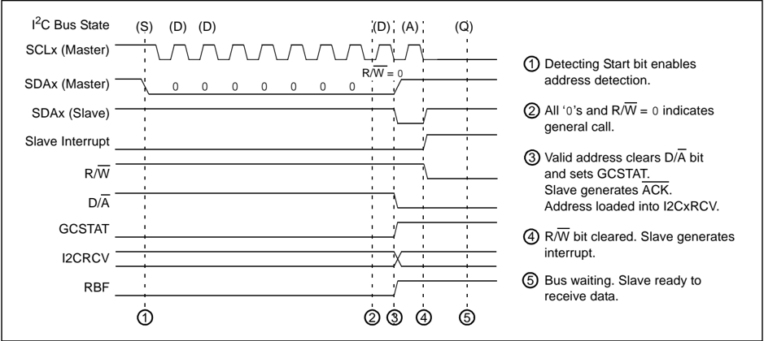

## 24.7.3.7 STRICT ADDRESS SUPPORT

When the STRICT bit (I2CxCON&lt;11&gt;) is set, it enables the I 2 C slave to enforce all reserved addressing and will not acknowledge any addresses if they fall within the reserved address table.

## 24.7.3.8 WHEN AN ADDRESS IS INVALID

If a 7-bit address does not match the contents of the I2CxADD&lt;6:0&gt; bits, the Slave module will return to an Idle state and ignore all bus activity until after the Stop condition.

If the first byte of a 10-bit address does not match the contents of the I2CxADD&lt;9:8&gt; bits, the Slave module will return to an Idle state and ignore all bus activity until after the Stop condition.

If the first byte of a 10-bit address matches the contents of the I2CxADD&lt;9:8&gt; bits, but the second byte of the 10-bit address does not match the I2CxADD&lt;7:0&gt; bits, the Slave module will return to an Idle state and ignore all bus activity until after the Stop condition.

## 24.7.3.9 STRICT SUPPORT FOR RESERVED ADDRESSES

When the STRICT bit (I2CxCON&lt;11&gt;) is set, several addresses are excluded in hardware from masking. For these addresses, an Acknowledge will not be issued independent of the mask setting. These addresses are listed in Table 24-4.

Table 24-4: Reserved I 2 C Bus Addresses (1)

| 7-bit Address Mode:   | 7-bit Address Mode:   | 7-bit Address Mode:         |
|-----------------------|-----------------------|-----------------------------|
| Slave Address         | R/W bit (IC2xSTAT<2>) | Description                 |
| 0000 000              | 0                     | General Call Address (1)    |
| 0000 000              | 1                     | Start Byte (3)              |
| 0000 001              | x                     | CBUS Address                |
| 0000 010              | x                     | Reserved                    |
| 0000 011              | x                     | Reserved                    |
| 0000 1xx              | x                     | HS Mode Master Code         |
| 1111 1xx              | x                     | Reserved                    |
| 1111 0xx              | x                     | 10-bit Slave Upper Byte (2) |

Note 1: The Address will be Acknowledged only if GCEN (I2CxCON&lt;7&gt;) = 1 , regardless of the value of the STRICT bit (I2CxCON&lt;11&gt;).

- 2: The match on this address can only occur as the upper byte in the 10-bit Addressing mode, regardless of the setting of the STRICT bit.
- 3: The Start Byte will never be acknowledged, regardless of the setting of the STRICT bit.

## 24.7.4 Receiving Data from a Master Device

When the R/W bit of the device address byte is zero and an address match occurs, the R/W bit (I2CxSTAT&lt;2&gt;) is cleared. The Slave module enters a state waiting for data to be sent by the master. After the device address byte, the contents of the data byte are defined by the system protocol and are only received by the Slave module; they are not interpreted in any way.

The Slave module shifts eight bits into the I2CxRSR register. On the falling edge of the eighth clock (SCLx), the following events occur:

1. The I 2 C slave begins to generate an ACK or NACK.
2. The RBF bit (I2CxSTAT&lt;1&gt;) is set to indicate received data.
3. The  I2CxRSR  register  byte  is  transferred  to  the  I2CxRCV  register  for  access  by  the software.
4. The D/A bit (I2CxSTAT&lt;5&gt;) is set.
5. A slave interrupt is generated. Software may check the status of the I2CxSTAT register to determine the cause of the event, and then clear the slave interrupt flag.
6. The I 2 C slave will wait for the next data byte.

## 24.7.4.1 ACKNOWLEDGE GENERATION

Normally, the Slave module will Acknowledge all received bytes by sending an ACK on the ninth SCLx clock.

For  devices  with  the  BOEN  bit  (I2CxCON&lt;20&gt;),  if  this  bit  is  set,  the  state  of  the  I2COV  bit (I2CxSTAT&lt;6&gt;) is ignored and the acknowledge is generated for the received data/address if the RBF bit is clear. When the BOEN bit is clear, and if the receive buffer is overrun, the Slave module does not generate this ACK. Overrun is indicated if either (or both):

- The buffer full bit, RBF (I2CxSTAT&lt;1&gt;), was set before the transfer was received
- The overflow bit, I2COV (I2CxSTAT&lt;6&gt;), was set before the transfer was received

Table 24-5 summarizes the actions taken when a data byte is received, based upon the values of the BOEN bit (I2CxCON&lt;20&gt;), the RBF bit (I2CxSTAT&lt;1&gt;), and the I2COV bit (I2CxSTAT&lt;6&gt;. In all cases, a slave interrupt is generated (if enabled). The data byte is transferred from the I2CxRSR register to the I2CxRCV register only if the RBF bit is clear. The BOEN bit has no affect on  the  transfer  of  data  to  the  I2CxRCV  register,  as  it  only  affects  automatic  ACK  or  NACK generation. And, unless the DHEN bit is set, the slave automatically generates an ACK only if both  RBF  and  I2COV  = 0 (when  BOEN  = 0 ).  However,  when  BOEN  = 1 ,  ACK  or  NACK generation is determined by the value of the RBF bit.

Reading the I2CxRCV register clears the RBF bit. The I2COV bit is cleared by writing to a ' 0 ' through software.

Table 24-5: Data Transfer Received Byte Actions

| Control & Status Bits   | Control & Status Bits   | Control & Status Bits   | I2CxRSR Transferred To I2CxRCV   | ACK or NACK   | Set RBF   | Set I2COV   |
|-------------------------|-------------------------|-------------------------|----------------------------------|---------------|-----------|-------------|
| BOEN                    | RBF                     | I2COV                   | I2CxRSR Transferred To I2CxRCV   | ACK or NACK   | Set RBF   | Set I2COV   |
| 0                       | 0                       | 0                       | Yes                              | ACK           | Yes       | No Change   |
| 0                       | 0                       | 1                       | Yes                              | NACK          | Yes       | No Change   |
| 0                       | 1                       | 0                       | No                               | NACK          | No Change | Yes         |
| 0                       | 1                       | 1                       | No                               | NACK          | No Change | Yes         |
| 1                       | 0                       | 0                       | Yes                              | ACK           | Yes       | No Change   |
| 1                       | 0                       | 1                       | Yes                              | ACK           | Yes       | No Change   |
| 1                       | 1                       | 0                       | No                               | NACK          | No Change | Yes         |
| 1                       | 1                       | 1                       | No                               | NACK          | No Change | Yes         |

Some devices have the Acknowledge Sequence Status bit, ACKTIM. During an acknowledge sequence of a Slave I 2 C device, the ACKTIM bit is set. The Acknowledge sequence for I 2 C communication is from the eighth falling edge to the ninth falling edge of SCLx. This Status bit will  allow  the  user  software  to  determine  the  source  of  an  I 2 C  interrupt,  and  how  far  the communication has progressed.

## 24.7.4.2 ADDRESS AND DATA HOLD

In some devices, the AHEN bit (I2CxCON&lt;17&gt;) and the DHEN bit (I2CxCON&lt;16&gt;) are available to allow the software to determine the ACK or NACK response to bytes received.

When the AHEN and DHEN bits are set, the Slave module automatically stretches the SCLx clock after bytes are received. When the AHEN bit is set, after the eighth falling edge of SCLx, the clock is stretched by hardware when a matching address byte is received. Following the eighth falling edge, the SCLREL bit is cleared and the clock is asserted low until the user sets the SCLREL bit, releasing SCLx. This will allow the user software to choose which incoming addresses to ACK or NACK. When the DHEN bit is set, after the eighth falling edge of SCLx, the clock  is  stretched  by  hardware  when  a  data  byte  is  received.  The  received  data  must  be preceded  by  a  matching  address  byte  that  was  acknowledged.  For  both  data  and  address holding,  the  slave  software  can  set  or  clear  the  ACKDT  bit  (I2CxCON&lt;5&gt;).  To  control  the acknowledgment bit value, the master will clock in once SCLx is released by the slave. Software is  responsible  for  waiting  an  appropriate  setup  and/or  rise  time  after  setting  or  clearing  the ACKDT bit, before setting the SCLREL bit to allow the master to correctly clock and latch the acknowledgment bit. If software NACKs a data byte, that is the signal to the master that the slave intends to end the transfer and the slave will release the bus and wait for the next matching address.

When the AHEN and DHEN bits are clear, the Slave module will automatically generate the acknowledgment response, as shown in Table 24-5.

## 24.7.4.3 CLOCK STRETCHING

In Slave mode, clock stretching allows the slave to synchronize transfers to the master to avoid overflows or underflows when transmitting or receiving data. Software can initiate clock stretching  by  clearing  the  SCLREL  bit  after  the  ninth  falling  edge  of  the  previous  byte,  but  clock stretching will occur automatically in specific circumstances.

When transmitting, if the Slave module detects that the TBF bit (I2CxSTAT&lt;0&gt;) is clear on the falling edge of the ninth clock of the previous byte, no data is available to transmit the next byte and it will automatically clear the SCLREL bit (I2CxCON&lt;12&gt;) and drive the SCLx line low to stretch  the  clock  and  allow  software  time  to  provide  the  data. When  this  occurs,  software  is responsible for writing the I2CxTRN register and (after doing so) for waiting the appropriate rise and  setup  time  (see 24.8.3 'Rise  and  Setup  Time  Considerations' )  before  setting  the SCLREL bit to release the SCLx line. When polling, user software must ensure the SCLREL bit is cleared before setting it to release the SCLx line. However, the SCLREL bit is cleared before the interrupt is triggered, so that is not a concern when responding to the slave interrupt.

When receiving bytes in Slave mode, software can enable clock stretching by setting the STREN bit (I2CxCON&lt;6&gt;). When STREN = 1 , the Slave module will automatically clear the SCLREL bit (I2CxCON&lt;12&gt;) and drive the SCLx line low to stretch the clock if the RBF bit (I2CxSTAT&lt;1&gt;) is set on the falling edge of the ninth clock of the previously received byte. This allows software time to  read the I2CxRCV register before the master can send another byte, preventing overflow conditions from occurring. If software reads the I2CxRCV register while SCLREL = 0 (before the falling edge of the ninth clock), the SCLREL bit will not be cleared and clock stretching will not occur. Software can set the SCLREL bit regardless of the value of the RBF bit. However, it must take care to read the I2CxRCV register to clear the RBF bit before the falling edge of the eighth clock of the next byte to avoid an overflow condition.

The clock stretching described in this section occurs on the ninth falling edge of the clock, after a byte and its acknowledgment bit have both been transferred. It is independent of the clock stretching that occurs after the eighth falling edge of the clock when the AHEN bit and/or the DHEN bit are set, as described in 24.7.4.2 'Address and Data Hold' .

## 24.7.4.4 EXAMPLE MESSAGES OF SLAVE RECEPTION

Receiving  a  slave  message  is  a  rather  automatic  process.  The  software  handling  the  slave protocol can use the slave interrupt to synchronize to the events.

When the slave detects the valid address, the associated interrupt will notify the software to expect a message. On receive data, as each byte transfers to the I2CxRCV register, an interrupt notifies the software to unload the buffer.

Figure 24-27 shows a receive message. Because it is a 7-bit address message, only one interrupt occurs for the address byte. Then, interrupts occur for each of four data bytes. At an interrupt, the software may monitor the RBF, D/A (IC2xSTAT&lt;5&gt;) and R/W (IC2xSTAT&lt;2&gt;) bits to determine the condition of the byte received.

Figure 24-28  shows  a  similar  message  using  a  10-bit  address.  In  this  case,  two  bytes  are required for the address.

Figure 24-29 shows a message where the software does not respond to the received byte and the buffer overruns. On receipt of the second byte, the I 2 C slave will automatically NACK the master transmission. Generally, this causes the master to resend the previous byte. The I2COV bit (I2CxSTAT&lt;6&gt;) indicates that the buffer has overrun. The I2CxRCV register buffer retains the contents of the first byte. On receipt of the third byte, the buffer is still full, and again, the I 2 C slave will NACK the master. After this, the software finally reads the buffer. Reading the buffer will clear the RBF bit (I2CxSTAT&lt;1&gt;); however, the I2COV bit remains set. The software must clear the I2COV bit. The next received byte will be moved to the I2CxRCV register buffer and the I 2 C slave will respond with an ACK.

## 24.7.5 Slave Bus Collision Detect

For devices with the SBCDE bit (I2CxCON&lt;18&gt;), this bit when enabled, will set the BCL bit (I2CxSTAT&lt;10&gt;) interrupt flag any time the SDAx pin is sampled low when the slave is driving a high (see the following Note ). This allows the slave module to detect a bus collision. The two scenarios when a bus collision can occur for a slave are during a data acknowledge sequence and a read request to the master. This may be a useful feature to be used when a slave is responding to a General Call address.

Note: The Slave module ignores addresses that do not trigger an address match, allowing SDA to be pulled high externally. It does not actively drive SDA high, and therefore, does not enable collision detection during the address NACK bit time.

Figure 24-27: Slave Message (Write Data to Slave: 7-bit Address; Address Matches; A10M = 0 ; GCEN = 0 ; STRICT = 0 )

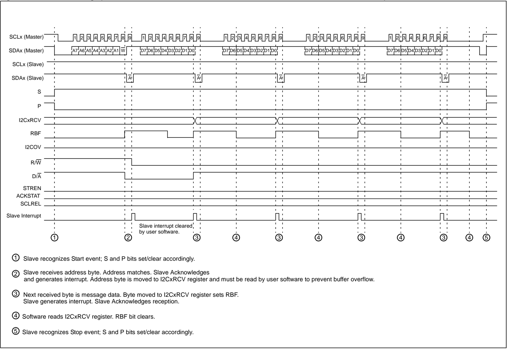

Figure 24-28: Slave Message (Write Data to Slave: 10-bit Address; Address Matches; A10M = 1 ; GCEN = 0 ; STRICT = 0 )

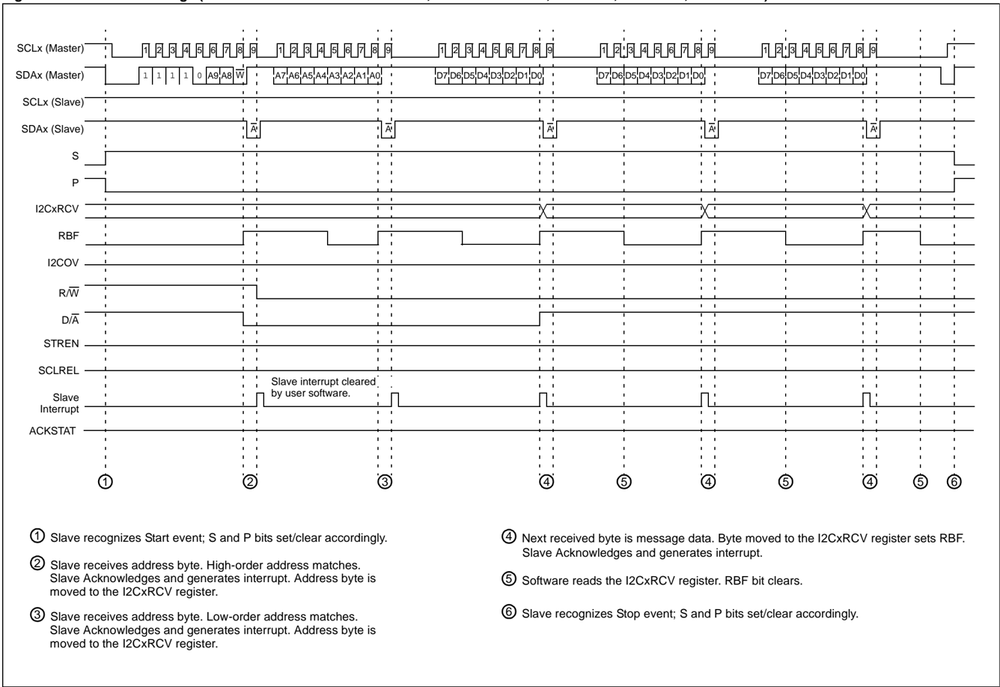

Figure 24-29: Slave Message (Write Data to Slave: 7-bit Address; Buffer Overrun; A10M = 0 ; GCEN = 0 ; STRICT = 0 )

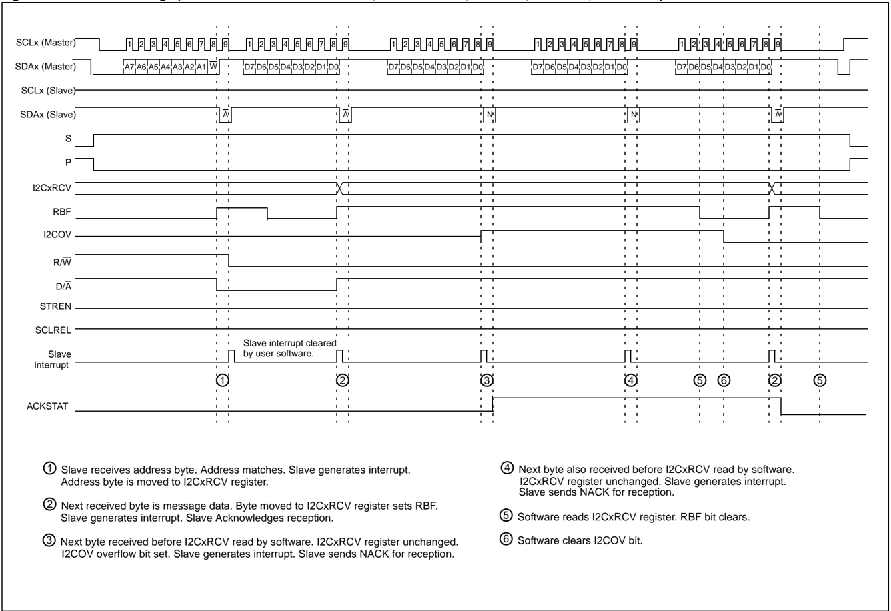

## 24.7.6 Sending Data to a Master Device

When the R/W bit of the incoming device address byte is ' 1 ' and an address match occurs, the R/W bit (I2CxSTAT&lt;2&gt;) is set. Now, the master device is expecting the slave to respond by sending a byte of data. The contents of the byte are defined by the system protocol and are only transmitted by the Slave module.

When the interrupt from the address detection occurs, the software can write a byte to the I2CxTRN register to start the data transmission.

The Slave module sets the TBF bit (I2CxSTAT&lt;0&gt;). The eight data bits are shifted out on the falling edge of the SCLx input. This ensures that the SDAx signal is valid during the SCLx high time. When all eight bits have been shifted out, the TBF bit will be cleared.

The Slave module detects the Acknowledge from the master-receiver on the rising edge of the ninth SCLx clock.

If the SDAx line is low, indicating an Acknowledge (ACK), the master is expecting more data and the message is not complete. The I 2 C slave generates a slave interrupt to signal more data is requested.

A slave interrupt is generated on the falling edge of the ninth SCLx clock. Software must check the status of the I2CxSTAT register and clear the slave interrupt flag.

If the SDAx line is high, indicating a Not Acknowledge (NACK), then the data transfer is complete. The Slave module resets and does not generate an interrupt. The Slave module will wait for detection of the next Start (S) bit (I2CxSTAT&lt;3&gt;).

## 24.7.6.1 WAIT STATES DURING SLAVE TRANSMISSIONS

During  a  slave  transmission  message,  the  master  expects  return  data  immediately  after detection of the valid address with R/W = 1 . Because of this, the Slave module will automatically generate a bus wait whenever the slave returns data.

The automatic wait occurs at the falling edge of the ninth SCLx clock of a valid device address byte or transmitted byte Acknowledged by the master, indicating expectation of more transmit data.

The Slave module clears the SCLREL bit (I2CxCON&lt;12&gt;). Clearing the SCLREL bit causes the Slave module to pull the SCLx line low, initiating a wait. The SCLx clock of the master and slave will synchronize as shown in 24.6.2 'Master Clock Synchronization' .

When the software loads the I2CxTRN register and is ready to resume transmission, the software sets the SCLREL bit. This causes the Slave module to release the SCLx line and the master resumes clocking.

Note: The user software must provide a delay between writing to the Transmit buffer and setting the SCLREL bit. This delay must be greater than the minimum set up time for slave transmissions, as specified in the 'Electrical Characteristics' section of the specific device data sheet. Also refer to 24.8.3 'Rise and Setup Time Considerations' .

## 24.7.6.2 EXAMPLE MESSAGES OF SLAVE TRANSMISSION

Slave transmissions for 7-bit address messages are shown in Figure 24-30. When the address matches  and  the  R/W  bit  of  the  address  indicates  a  slave  transmission,  the  I 2 C  slave  will automatically initiate clock stretching by clearing the SCLREL bit and generates an interrupt to indicate a response byte is required. The software will write the response byte into the I2CxTRN register. As the transmission completes, the master will respond with an Acknowledge. If the master replies with an ACK, the master expects more data and the I 2 C slave will again clear the SCLREL bit and generate another interrupt. If the master responds with a NACK, no more data is required and the I 2 C slave will not stretch the clock nor generate an interrupt.

Slave transmissions for 10-bit address messages require the slave to first recognize a 10-bit address. Because the master must send two bytes for the address, the R/W bit in the first byte of  the  address  specifies  a  write.  To  change  the  message  to  a  read,  the  master  will  send  a Repeated Start and repeat the first byte of the address with the R/W bit specifying a read. The slave transmission begins as shown in Figure 24-31.

Figure 24-30: Slave Message (Read Data from Slave: 7-bit Address)

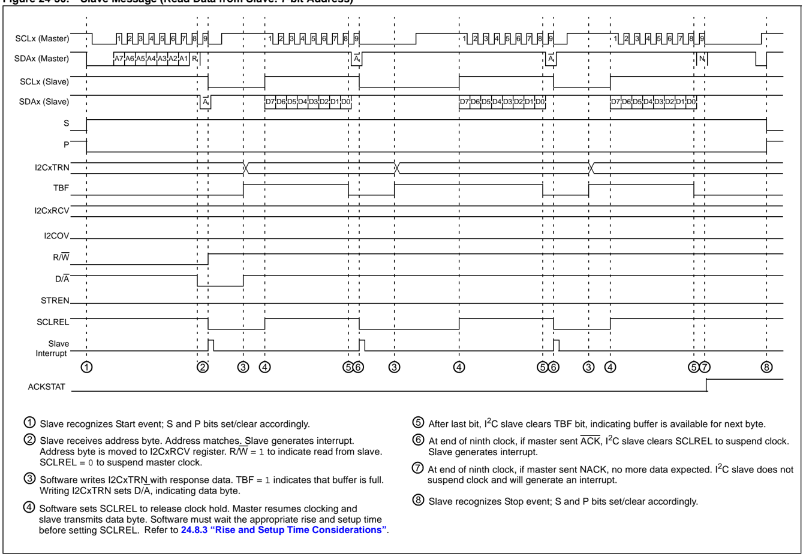

Figure 24-31: Slave Message (Read Data from Slave: 10-bit Address)

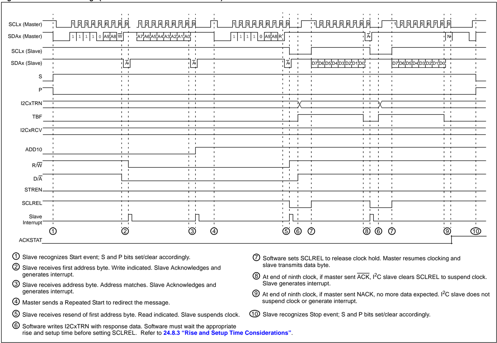

## 24.8 I 2 C BUS CONNECTION CONSIDERATIONS

Because the I 2 C bus is a wired Boolean AND bus connection, pull-up resistors on the bus are required, shown as RP in Figure 24-32. Series resistors, shown as RS, are optional and are used to improve Electrostatic Discharge (ESD) susceptibility. The values of the RP and RS resistors depend on the following parameters:

- Supply voltage
- Bus capacitance
- Number of connected devices (input current + leakage current)
- Input level selection (I 2 C or SMBus)

To get an accurate SCLx clock, the rise time should be as small as possible. The limitation factor is the maximum current sink available on the SCLx pad. Equation 24-3 calculates the minimum value for RP, which is based on a 3.3V supply and a 6.6 mA sink current at VOLMAX = 0.4V.

## Equation 24-3: RPMIN Calculation

<!-- formula-not-decoded -->

The maximum value for RS is determined by the desired noise margin for the low level. RS cannot drop enough voltage to make the device VOL plus the voltage across RS more than the maximum VIL. This is expressed mathematically in Equation 24-3.

## Equation 24-4: RSMAX Calculation

<!-- formula-not-decoded -->

The SCLx clock input must have a minimum high and low time for proper operation. The high and low times of the I 2 C specification, and the requirements of the I 2 C module, are provided in the 'Electrical Characteristics' chapter in the specific device data sheet.

Figure 24-32: Sample Device Configuration for I 2 C Bus

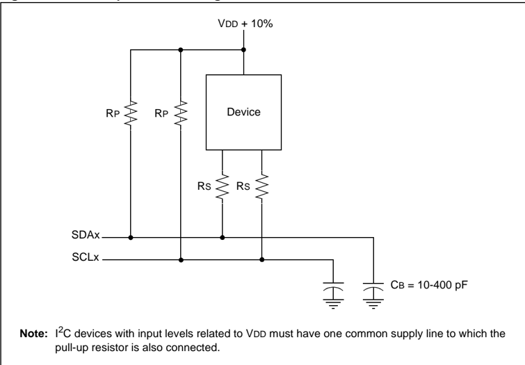

## 24.8.1 Integrated Signal Conditioning and Slope Control

The SCLx and SDAx pins have an input glitch filter. The I 2 C bus requires this filter in both the 100 kHz and 400 kHz systems.

When operating on a 400 kHz bus, the I 2 C specification requires a slew rate control of the device pin output. This slew rate control is integrated into the device. If the DISSLW bit (I2CxCON&lt;9&gt;) is cleared, the slew rate control is active. For other bus speeds, the I 2 C specification does not require slew rate control and the DISSLW bit should be set.

Some system implementations of I 2 C busses require different input levels for VILMAX and VIHMIN. In  a  normal  I 2 C  system,  VILMAX  is  0.3  VDD;  VIHMIN  is  0.7 VDD.  By  contrast,  in  a  System Management Bus (SMBus) system, VILMAX is set at 0.8V, while VIHMIN is set at 2.1V.

The SMEN bit (I2CxCON&lt;8&gt;) controls the input levels. Setting the SMEN bit (= 1 ) changes the input levels to SMBus specifications.

## 24.8.2 SDAx Hold Time Selection

For devices with the SDAHT bit (I2CxCON&lt;19&gt;), the user can configure the hold time on the SDAx pin after the falling edge of SCLx pin using the SDAHT bit. When the SDAHT bit is set, the hold time on the SDAx pin after the falling edge of the SCLx pin will be set to a minimum of 300 ns. The hold time will be set to a minimum of 100 ns if the SDAHT bit is clear.

## 24.8.3 Rise and Setup Time Considerations

When operating in Master mode, the I 2 C module automatically manages I 2 C bus SDAx signal rise  and  setup  (and  other)  timing.  However,  in  slave  mode  the  I 2 C  module's  internal  state machine is driven from the SCLx clock generated by the master, and therefore, when clock stretching, software must ensure that the appropriate SDAx rise and setup times are respected.

It  is  necessary for user software to delay a minimum appropriate amount between taking the action that determines the value of the SDAx line and setting of the SCLREL bit (I2CxCON&lt;12&gt;) to allow the master to continue driving the SCLx line. This occurs in two different situations. The first is when receiving an address or data byte and the clock is stretched when after the eighth falling edge of the SCLx line when AHEN or DHEN = 1 , as described in 24.7.4.2 'Address and Data Hold' . The second is when transmitting a byte and the clock is stretched on the ninth falling edge of SCLx if user software clears the SCLREL bit or if the slave module does so automatically because  of  an  impending  overflow  or  underflow,  as  described  in 24.7.3 'Detecting  the Address' .

When stretching the clock on the eighth falling edge (when AHEN or DHEN = 1 ), user software must delay the appropriate rise time plus setup time after setting the ACKDT bit (I2CxCON&lt;5&gt;), or just the setup time after clearing the ACKDT bit, and before setting the SCLREL bit. When stretching the clock after the ninth falling edge of SCLx, software must delay the appropriate rise plus setup time after writing the I2CxTRN register and before setting the SCLREL bit.

The rise and setup times that are appropriate depend upon the I 2 C baud rate, as shown in Table 24-6: 'Rise and Setup Times' and upon whether the SDAx signal is being driven low or is allowed to float high. If the SDAx signal is being driven low, only the setup delay time is required. However, if the signal may be allowed to float high (for example, if it is unknown because the value  of  the  SDAx  line  is  data  dependent),  the  delay  must  be  at  least  the  sum  of  both  the maximum rise time and minimum setup time. Refer to the I 2 C Specification for additional I 2 C timing information.

Table 24-6: Rise and Setup Times

| Parameter                                | 100 kHz   | 400 kHz   | 1 MHz   |
|------------------------------------------|-----------|-----------|---------|
| Minimum Data Setup Time (T SU; DAT ) (1) | 250 ns    | 100 ns    | 50 ns   |
| Maximum Rise Time (T R)                  | 1000 ns   | 300 ns    | 120 ns  |

Note 1: When the slave stretches the clock, software is responsible for waiting the rise and setup time (TR + TSU;DAT) before setting the SCLREL bit (I2CxCON&lt;12&gt;) to release the SCL line. Refer to the I2C Bus Specification and User Manual (Rev. 6-4 or later) for additional information.

## 24.9 I 2 C OPERATION IN POWER-SAVING MODES

Two power-saving modes are available to the I 2 C module in PIC32 devices:

- Idle - when the device is in Idle mode, the core and selected peripherals are shut down
- Sleep - when the device is in Sleep mode, the entire device is shut down

## 24.9.1 Sleep in Master Mode Operation

When the device enters Sleep mode, all clock sources to the I 2 C master are shut down. The BRG stops because the clocks stop. It may have to be reset to prevent partial clock detection.

If Sleep occurs in the middle of a transmission, and the master state machine is partially into a transmission as the clocks stop, the Master mode transmission is aborted.

There is no automatic way to prevent entry into Sleep mode if a transmission or reception is pending. The user software must synchronize Sleep mode entry with I 2 C operation to avoid aborted transmissions.

Register contents are not affected by going into Sleep mode or coming out of Sleep mode.

## 24.9.2 Sleep in Slave Mode Operation

The I 2 C module can still function in Slave mode operation while the device is in Sleep mode.

When operating in Slave mode and the device is put into Sleep mode, the master-generated clock will run the slave state machine. This feature provides an interrupt to the device upon reception of the address match to wake-up the device.

Register contents are not affected by entering into Sleep mode or coming out of Sleep mode.

It is an error condition to set Sleep mode in the middle of a slave data transmit operation, as indeterminate results may occur.

Note:

As per the slave I 2 C behavior, a slave interrupt is generated only on an address match. Therefore, when an I 2 C slave is in Sleep mode and it receives a message from the master, the clock required to match the received address is derived from the master. Only on an address match will the interrupt be generated and the device can wake up, provided the interrupt has been enabled and an Interrupt Service Request (ISR) has been defined.

## 24.9.3 Idle Mode

When  the  device  enters  Idle  mode,  all  PBCLK  clock  sources  remain  functional.  If  the  I 2 C module intends to power down, it disables its own clocks.

For the I 2 C module, the I2CxSIDL bit (I2CxCON&lt;13&gt;) selects whether the module will stop on Idle mode or continue on Idle. If I2CxSIDL = 0 , the module will continue operation in Idle mode. If I2CxSIDL = 1 , the module will stop on Idle.

The I 2 C module will perform the same procedures for stop on Idle mode as for Sleep mode. The module state machines must be reset.

## 24.10 EFFECTS OF A RESET

A Reset (Power-on Reset, Watchdog Timer, etc.) disables the I 2 C module and terminates any active  or  pending  message  activity.  Refer  to  the  I2CxCON  (Register 24-1)  and  I2CxSTAT (Register 24-2) register definitions for the Reset conditions of those registers.

Note: Idle refers to the CPU Power-Saving mode. The word idle in all lowercase letters refers to the time when the I 2 C module is not transferring data on the bus.

## 24.11 PIN CONFIGURATION IN I 2 C MODE

In I 2 C mode, the SCLx pin is the clock and the SDAx pin is data. The I 2 C module will override the data direction bits (TRISx bits) for these pins. The pins that are used for I 2 C modes are configured as open drain. Table 24-7 lists the pin usage in different modes.

Table 24-7: Required I/O Pin Resources

| I/O Pin Name   | Master Mode   | Slave Mode   |
|----------------|---------------|--------------|
| SDAx           | Yes           | Yes          |
| SCLx           | Yes           | Yes          |

## 24.12 USING AN EXTERNAL BUFFER WITH THE I 2 C MODULE

It is not recommended to use external buffers on the I 2 C pins. However, if the external buffer must be used, the application firmware must adhere to the following software flow:

On the slave acknowledgment bit clock cycle, issue a dummy write using the I2CxTRN register buffer, ensuring that the MSB of the data is set. This will cause a collision (IWCOL bit = 1 ), which must be cleared within the acknowledgment clock cycle.

This can be done using one of the following methods:

- Enable an available timer immediately when the data is written to the I2CxTRN register buffer. On a timer interrupt designed to coincide with the slave acknowledgment bit clock cycle, perform a dummy write to the I2CxTRN register buffer, ensuring that the MSB of the data is set. Clear the collision status bit, IWCOL, before leaving the timer Interrupt Service Routine. Because the I 2 C rate is known, the user software can calculate the timer period required to intersect the slave ACK/NACK cycle near the rising edge of the ninth SCLx clock cycle after data is written to the I2CxTRN register buffer.
- Alternately, the user software can poll for the TBF status bit, and then perform the dummy write to the I2CxTRN register with the MSB of the data set, followed by clearing IWCOL bit.

## 24.13 RELATED APPLICATION NOTES

This  section  lists  application  notes  that  are  related  to  this  section  of  the  manual.  These application notes may not be written specifically for the PIC32 device family, but the concepts are pertinent and could be used with modification and possible limitations. The current application notes related to the Inter-Integrated Circuit (I 2 C) module include the following:

| Title                                                                       | Application Note #   |
|-----------------------------------------------------------------------------|----------------------|
| Use of the SSP Module in the I 2 C Multi-Master Environment                 | AN578                |
| Using the PIC ® Microcontroller SSP for Slave I 2 C Communication           | AN734                |
| Using the PIC ® Microcontroller MSSP Module for Master I 2 C Communications | AN735                |
| An I 2 C Network Protocol for Environmental Monitoring                      | AN736                |

Note:

Please visit the Microchip web site (www.microchip.com) for additional application notes and code examples for the PIC32 family of devices.

## 24.14 REVISION HISTORY

## Revision A (October 2007)

This is the initial released version of this document.

## Revision B (October 2007)

Updated document to remove Confidential status.

## Revision C (April 2008)

Revised status to Preliminary; Revised U-0 to r-x.

## Revision D (July 2008)

Revised Figure 24-1; Section 24.2; Register 24-1; Revised Register 24-26-24-29; Revised Table 24-1, I2CxCON; Change Reserved bits from 'Maintain as' to 'Write'; Added Note to ON bit (I2CXCON Register); Deleted Section 24.12 (Electrical Characteristics).

## Revision E (October 2011)

This revision includes the following updates:

- Updated the I 2 C Block Diagram (see Figure 24-1)
- I 2 C Special Function Register Summary (see Table 24-1):
- -Removed the Clear, Set, and Invert registers and their references
- -Updated the name for bits &lt;7:0&gt; in the I2CxTRN and I2CxRCV registers to I2CxTXDATA and I2CxRXDATA, respectively
- -Removed the interrupt registers (IFS0, IEC0, IPC6, and IPC8) and their references
- -Added Notes 3, 4, and 5, which describe the Clear, Set, and Invert registers
- Changed all occurrences of r-x to U-0 in all registers
- Updated the name for bits &lt;7:0&gt; in the I2CxTRN and I2CxRCV registers to I2CxTXDATA and I2CxRXDATA, respectively (see Register 24-6 and Register 24-7)
- Updated the Baud Rate Generator Reload Value Calculation (see Equation 24-1)
- Updated all I2CxBRG values and added the PTG column and Note 1 to I 2 C Clock Rate with BRG (see Table 24-2)
- Added a note (or notes) to the following sections:
- -24.5.2.1 'Sending a 7-bit Address to the Slave'
- -24.5.2.2 'Sending a 10-bit Address to the Slave'
- -24.7.6.1 'Wait States During Slave Transmissions'
- -24.9.2 'Sleep in Slave Mode Operation'
- Updated Master Message (7-bit Address: Transmission and Reception) (see Figure 24-16)
- Removed 24.12 'Design Tips'
- The Preliminary document status was removed
- Additional updates to text and formatting were incorporated throughout the document

## PIC32 Family Reference Manual

## Revision F (March 2013)

This revision includes the following updates:

- Added new bits to the I2CxCON, I2CxSTAT, and I2CxBRG registers and updated the footnotes in the SFR Summary (see Table 24-1)
- Updated the following registers: I2CxCON (Register 24-1), I2CxSTAT (Register 24-2), and I2CxBRG (Register 24-5)
- Updated 24.4.2 'I 2 C Interrupts'
- Updated the third paragraph in 24.4.3 'I 2 C Transmit and Receive Registers'
- Updated 24.5.3.2 'I2COV Status Flag'
- Updated the third paragraph in 24.7 'Communicating as a Slave'
- Updated 24.7.2 'Detecting Start and Stop Conditions'
- Updated Step 1 in 24.7.3.3 '7-bit Address and Slave Write'
- Updated Step 1 in 24.7.3.4 '7-bit Address and Slave Read'
- Added the I 2 C Slave, 7-Bit Address, Reception (STREN = 0, AHEN = 1, DHEN = 1) timing diagram (see Figure 24-24)
- Updated Step 1 in both processes shown in 24.7.3.5 '10-bit Addressing Mode'
- Updated Step 1 in 24.7.3.6 'General Call Operation'
- Updated 24.7.4.1 'Acknowledge Generation'
- Added 24.7.4.2 'Address and Data Hold'
- Updated 24.7.4.3 'Wait States During Slave Receptions'
- Added 24.7.5 'Slave Bus Collision Detect'
- Added 24.8.2 'SDAx Hold Time Selection'
- Added 24.12 'Using An External Buffer With The I 2 C Module'
- All instances of 'lower 5 bits' and 'lower five bits' were changed to: five Least Significant bits
- Minor updates to text and formatting were incorporated throughout the document

## Revision G (August 2016)

This revision includes the following updates:

- All instances of SCKREL were changed to SCLREL throughout the document
- Some instances of ACK were changed to acknowledgment for clarification purposes
- The following registers were updated:
- -I 2 C Control (Register 24-1)
- -I 2 C Status (Register 24-2)
- -I 2 C Slave Address (Register 24-3)
- -I 2 C Address Mask (Register 24-4)
- 24.4.2 'I 2 C Interrupts' was updated
- 24.4.2.3 'Bus Collision Interrupts' was updated
- 24.4.3 'I 2 C Transmit and Receive Registers' was updated
- 24.4.4 'I 2 C Baud Rate Generator' was updated
- 24.4.5 'Baud Rate Generator in I 2 C Master Mode' was updated
- 24.5.2 'Sending Data to a Slave Device' was updated
- 24.5.3 'Receiving Data from a Slave Device' was updated
- 24.7.3 'Detecting the Address' was updated
- 24.7.4 'Receiving Data from a Master Device' was updated
- Table 24-5 was updated
- Figure 31 was removed
- 24.8.3 'Rise and Setup Time Considerations' was added
- Minor updates to text and formatting were incorporated throughout the document

## Note the following details of the code protection feature on Microchip devices:

- Microchip products meet the specification contained in their particular Microchip Data Sheet.
- Microchip believes that its family of products is one of the most secure families of its kind on the market today, when used in the intended manner and under normal conditions.
- There are dishonest and possibly illegal methods used to breach the code protection feature. All of these methods, to our knowledge, require using the Microchip products in a manner outside the operating specifications contained in Microchip's Data Sheets. Most likely, the person doing so is engaged in theft of intellectual property.
- Microchip is willing to work with the customer who is concerned about the integrity of their code.
- Neither Microchip nor any other semiconductor manufacturer can guarantee the security of their code. Code protection does not mean that we are guaranteeing the product as 'unbreakable.'

Code protection is constantly evolving. We at Microchip are committed to continuously improving the code protection features of our products. Attempts to break Microchip's code protection feature may be a violation of the Digital Millennium Copyright Act. If such acts allow unauthorized access to your software or other copyrighted work, you may have a right to sue for relief under that Act.

Information  contained  in  this  publication  regarding  device applications and the like is provided only for your convenience and may be superseded by updates. It is your responsibility to ensure  that  your  application  meets  with  your  specifications. MICROCHIP MAKES NO REPRESENTATIONS OR WARRANTIES  OF  ANY  KIND  WHETHER  EXPRESS  OR IMPLIED, WRITTEN OR ORAL, STATUTORY OR OTHERWISE, RELATED TO THE INFORMATION, INCLUDING  BUT  NOT  LIMITED  TO  ITS  CONDITION, QUALITY, PERFORMANCE, MERCHANTABILITY OR FITNESS  FOR  PURPOSE . Microchip  disclaims  all  liability arising  from  this  information  and  its  use.  Use  of  Microchip devices in life support and/or safety applications is entirely at the buyer's risk, and the buyer agrees to defend, indemnify and hold  harmless  Microchip  from  any  and  all  damages,  claims, suits,  or  expenses  resulting  from  such  use.  No  licenses  are conveyed, implicitly or otherwise, under any Microchip intellectual property rights unless otherwise stated.

Microchip received ISO/TS-16949:2009 certification for its worldwide headquarters, design and wafer fabrication facilities in Chandler and Tempe, Arizona; Gresham, Oregon and design centers in California and India. The Company's quality system processes and procedures are for its PIC ®  MCUs and dsPIC ®  DSCs, KEELOQ ®  code hopping devices, Serial EEPROMs, microperipherals, nonvolatile memory and analog products. In addition, Microchip's quality system for the design and manufacture of development systems is ISO 9001:2000 certified.

## QUALITY MANAGEMENT  SYSTEM CERTIFIED BY DNV

== ISO/TS 16949 ==

## Trademarks

The Microchip name and logo, the Microchip logo, AnyRate, dsPIC, FlashFlex, flexPWR, Heldo, JukeBlox, KeeLoq, KeeLoq logo, Kleer, LANCheck, LINK MD, MediaLB, MOST, MOST logo, MPLAB, OptoLyzer, PIC, PICSTART, PIC32 logo, RightTouch, SpyNIC, SST, SST Logo, SuperFlash and UNI/O are registered trademarks of Microchip Technology Incorporated in the U.S.A. and other countries.

ClockWorks, The Embedded Control Solutions Company, ETHERSYNCH, Hyper Speed Control, HyperLight Load, IntelliMOS, mTouch, Precision Edge, and QUIET-WIRE are registered trademarks of Microchip Technology Incorporated in the U.S.A.

Analog-for-the-Digital Age, Any Capacitor, AnyIn, AnyOut, BodyCom, chipKIT, chipKIT logo, CodeGuard, dsPICDEM, dsPICDEM.net, Dynamic Average Matching, DAM, ECAN, EtherGREEN, In-Circuit Serial Programming, ICSP, Inter-Chip Connectivity, JitterBlocker, KleerNet, KleerNet logo, MiWi, motorBench, MPASM, MPF, MPLAB Certified logo, MPLIB, MPLINK, MultiTRAK, NetDetach, Omniscient Code Generation, PICDEM, PICDEM.net, PICkit, PICtail, PureSilicon, RightTouch logo, REAL ICE, Ripple Blocker, Serial Quad I/O, SQI, SuperSwitcher, SuperSwitcher II, Total Endurance, TSHARC, USBCheck, VariSense, ViewSpan, WiperLock, Wireless DNA, and ZENA are trademarks of Microchip Technology Incorporated in the U.S.A. and other countries.

SQTP is a service mark of Microchip Technology Incorporated in the U.S.A.

Silicon Storage Technology is a registered trademark of Microchip Technology Inc. in other countries.

GestIC is a registered trademarks of Microchip Technology Germany II GmbH &amp; Co. KG, a subsidiary of Microchip Technology Inc., in other countries.

All other trademarks mentioned herein are property of their respective companies.

© 2007-2016, Microchip Technology Incorporated, Printed in the U.S.A., All Rights Reserved.

ISBN: 978-1-5224-0851-2

## Worldwide Sales and Service

## ASIA/PACIFIC

Asia Pacific Office Suites 3707-14, 37th Floor Tower 6, The Gateway Harbour City, Kowloon

Hong Kong Tel: 852-2943-5100 Fax: 852-2401-3431

Australia - Sydney Tel: 61-2-9868-6733 Fax: 61-2-9868-6755

China - Beijing Tel: 86-10-8569-7000 Fax: 86-10-8528-2104

China - Chengdu Tel: 86-28-8665-5511 Fax: 86-28-8665-7889

China - Chongqing Tel: 86-23-8980-9588 Fax: 86-23-8980-9500

China - Dongguan Tel: 86-769-8702-9880

China - Guangzhou Tel: 86-20-8755-8029

China - Hangzhou Tel: 86-571-8792-8115 Fax: 86-571-8792-8116

China - Hong Kong SAR Tel: 852-2943-5100 Fax: 852-2401-3431

China - Nanjing Tel: 86-25-8473-2460 Fax: 86-25-8473-2470

China - Qingdao Tel: 86-532-8502-7355 Fax: 86-532-8502-7205

China - Shanghai Tel: 86-21-5407-5533 Fax: 86-21-5407-5066

China - Shenyang Tel: 86-24-2334-2829 Fax: 86-24-2334-2393

China - Shenzhen Tel: 86-755-8864-2200 Fax: 86-755-8203-1760

China - Wuhan Tel: 86-27-5980-5300 Fax: 86-27-5980-5118

China - Xian Tel: 86-29-8833-7252 Fax: 86-29-8833-7256

## ASIA/PACIFIC

China - Xiamen Tel: 86-592-2388138 Fax: 86-592-2388130

China - Zhuhai Tel: 86-756-3210040 Fax: 86-756-3210049

India - Bangalore Tel: 91-80-3090-4444 Fax: 91-80-3090-4123

India - New Delhi Tel: 91-11-4160-8631 Fax: 91-11-4160-8632

India - Pune Tel: 91-20-3019-1500

Japan - Osaka Tel: 81-6-6152-7160 Fax: 81-6-6152-9310

Japan - Tokyo Tel: 81-3-6880- 3770 Fax: 81-3-6880-3771

Korea - Daegu Tel: 82-53-744-4301 Fax: 82-53-744-4302

Korea - Seoul Tel: 82-2-554-7200 Fax: 82-2-558-5932 or 82-2-558-5934

Malaysia - Kuala Lumpur Tel: 60-3-6201-9857 Fax: 60-3-6201-9859

Malaysia - Penang Tel: 60-4-227-8870 Fax: 60-4-227-4068

Philippines - Manila Tel: 63-2-634-9065 Fax: 63-2-634-9069

Singapore Tel: 65-6334-8870 Fax: 65-6334-8850

Taiwan - Hsin Chu Tel: 886-3-5778-366 Fax: 886-3-5770-955

Taiwan - Kaohsiung Tel: 886-7-213-7828

Taiwan - Taipei Tel: 886-2-2508-8600 Fax: 886-2-2508-0102

Thailand - Bangkok Tel: 66-2-694-1351 Fax: 66-2-694-1350

## AMERICAS

Corporate Office 2355 West Chandler Blvd. Chandler, AZ 85224-6199 Tel: 480-792-7200 Fax: 480-792-7277 Technical Support:

http://www.microchip.com/ support Web Address:

www.microchip.com

Atlanta Duluth, GA Tel: 678-957-9614 Fax: 678-957-1455

Austin, TX Tel: 512-257-3370

Boston

Westborough, MA Tel: 774-760-0087 Fax: 774-760-0088

Chicago

Itasca, IL Tel: 630-285-0071 Fax: 630-285-0075

Cleveland Independence, OH Tel: 216-447-0464 Fax: 216-447-0643

Dallas Addison, TX Tel: 972-818-7423 Fax: 972-818-2924

Detroit Novi, MI Tel: 248-848-4000

Houston, TX Tel: 281-894-5983

Indianapolis Noblesville, IN Tel: 317-773-8323 Fax: 317-773-5453

Los Angeles Mission Viejo, CA Tel: 949-462-9523 Fax: 949-462-9608

New York, NY Tel: 631-435-6000

San Jose, CA Tel: 408-735-9110

Canada - Toronto Tel: 905-695-1980 Fax: 905-695-2078

## EUROPE

Austria - Wels Tel: 43-7242-2244-39 Fax: 43-7242-2244-393

Denmark - Copenhagen Tel: 45-4450-2828 Fax: 45-4485-2829

France - Paris Tel: 33-1-69-53-63-20 Fax: 33-1-69-30-90-79

Germany - Dusseldorf Tel: 49-2129-3766400

Germany - Karlsruhe Tel: 49-721-625370

Germany - Munich Tel: 49-89-627-144-0 Fax: 49-89-627-144-44

Italy - Milan Tel: 39-0331-742611 Fax: 39-0331-466781

Italy - Venice Tel: 39-049-7625286

Netherlands - Drunen Tel: 31-416-690399 Fax: 31-416-690340

Poland - Warsaw Tel: 48-22-3325737

Spain - Madrid Tel: 34-91-708-08-90 Fax: 34-91-708-08-91

Sweden - Stockholm Tel: 46-8-5090-4654

UK - Wokingham Tel: 44-118-921-5800 Fax: 44-118-921-5820

06/23/16