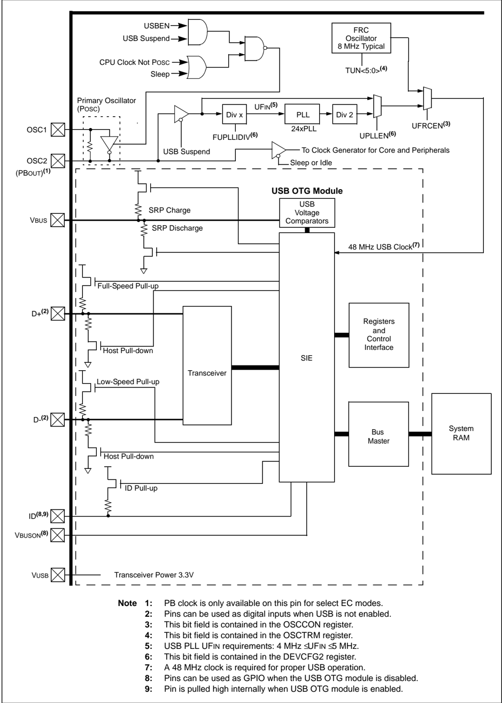
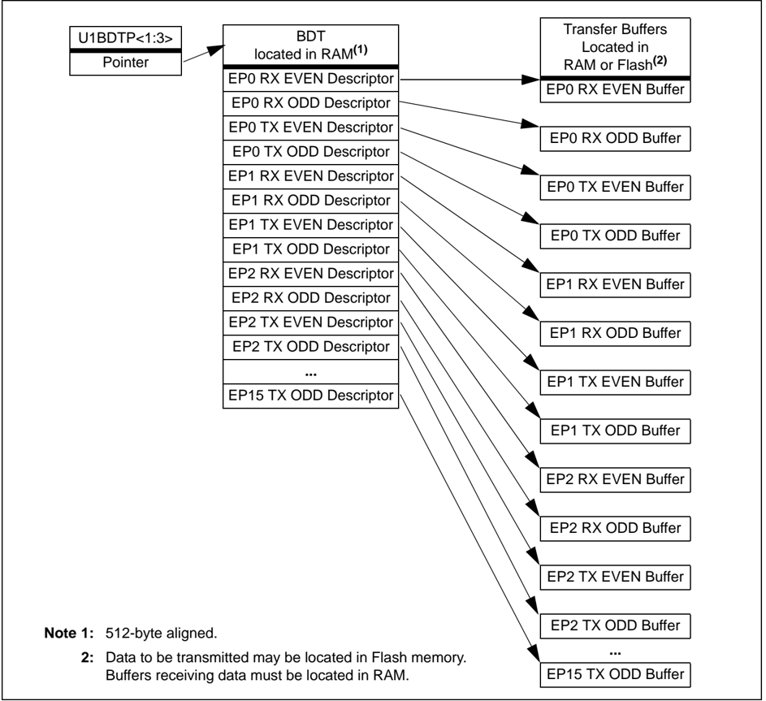
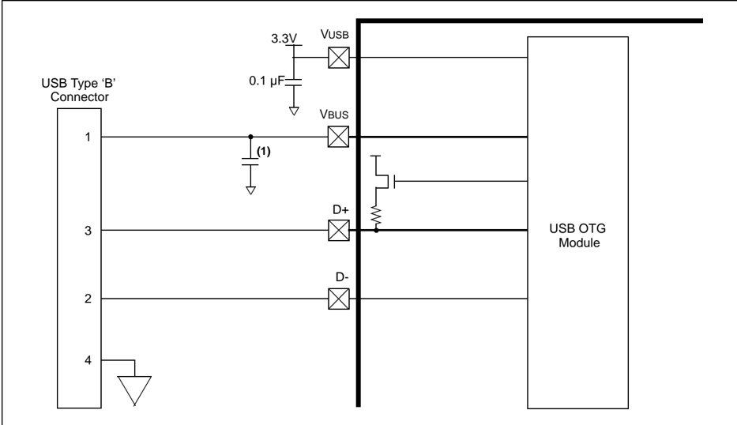
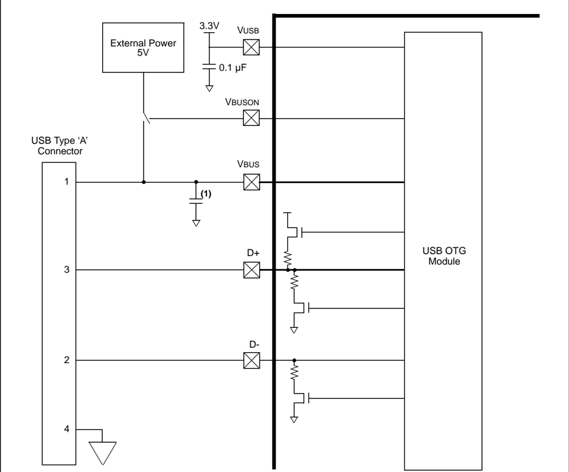
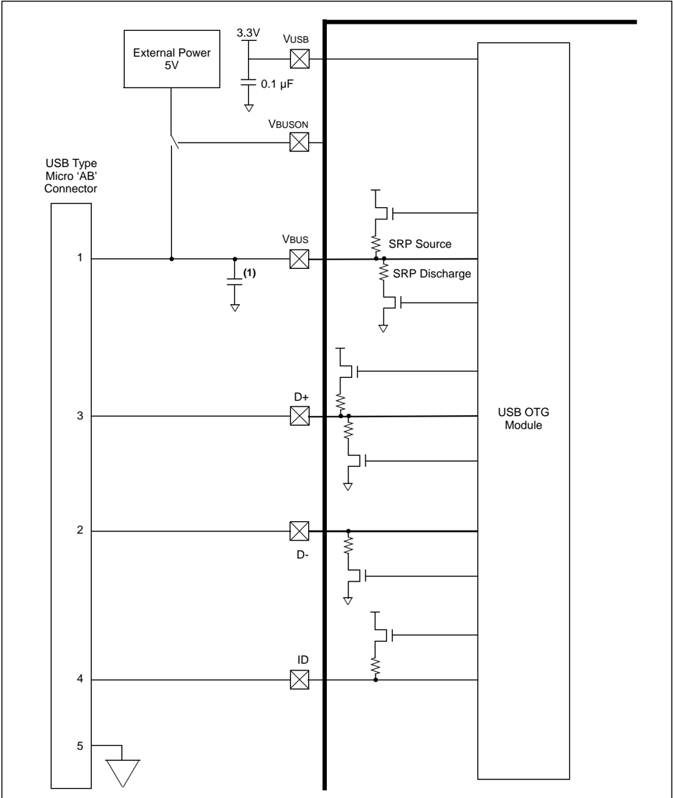
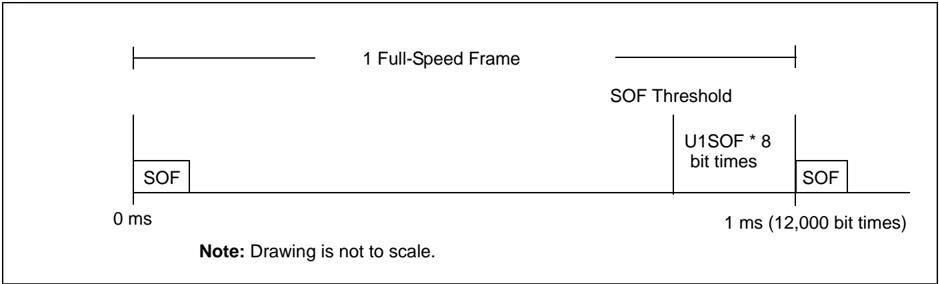
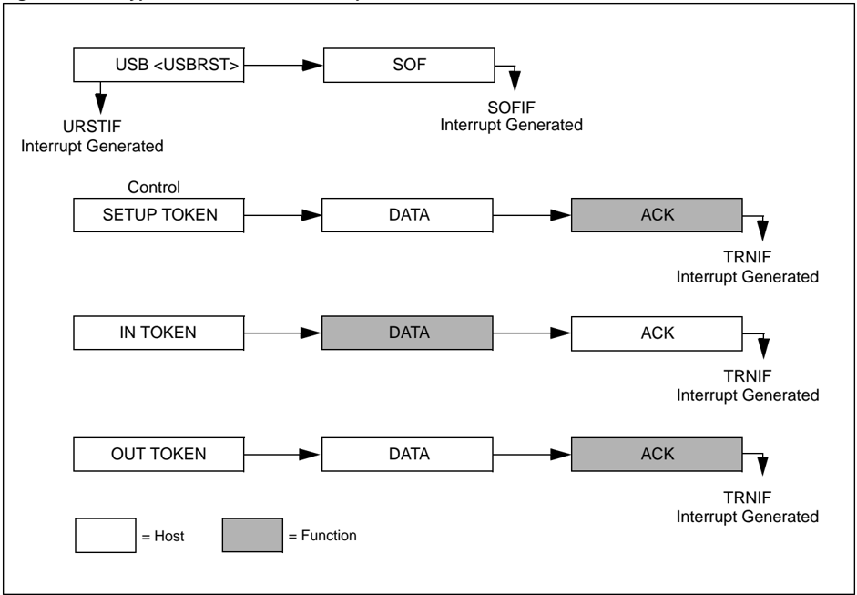
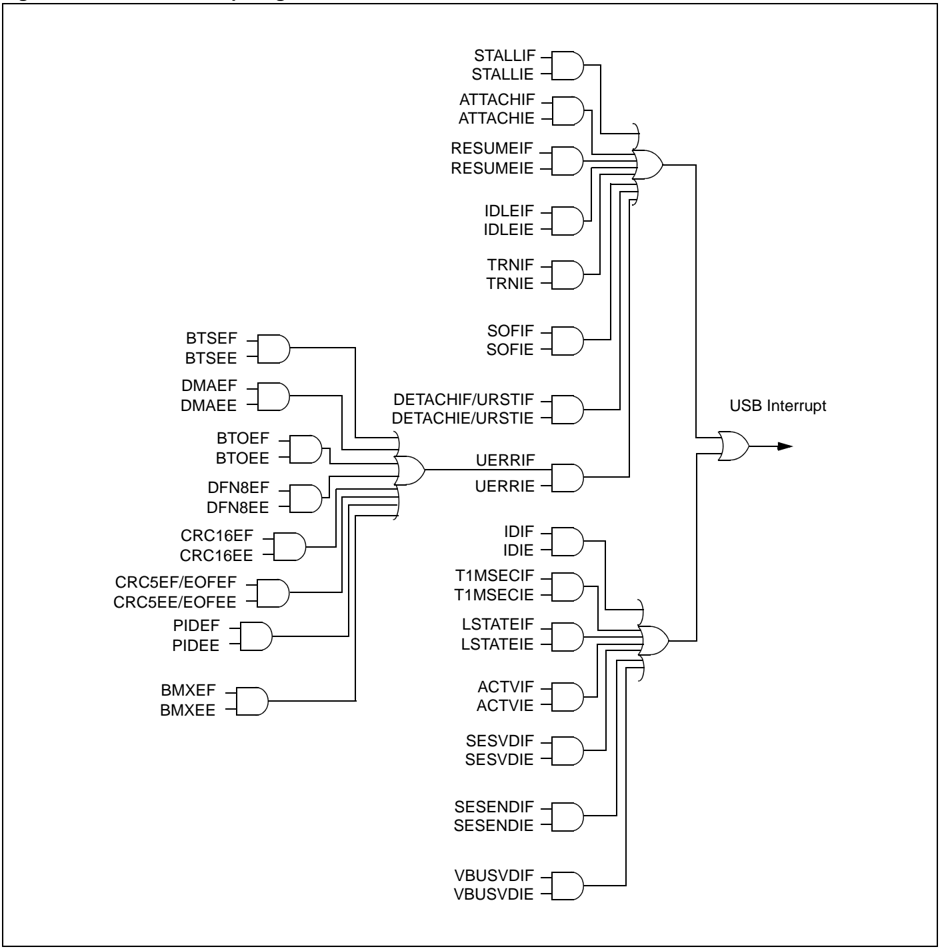
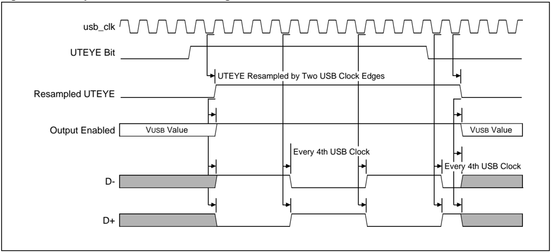

Microchip

## Section 27. USB On-The-Go (OTG)

This section of the manual contains the following major topics:

|   27.1 | Introduction ..................................................................................................................27-2   |
|--------|---------------------------------------------------------------------------------------------------------------------------------------|
|   27.2 | Control Registers .........................................................................................................27-4       |
|   27.3 | Operation ...................................................................................................................27-36    |
|   27.4 | Host Mode Operation.................................................................................................27-51             |
|   27.5 | Interrupts....................................................................................................................27-59   |
|   27.6 | I/O Pins ......................................................................................................................27-62  |
|   27.7 | Operation in Debug and Power-Saving Modes..........................................................27-64                              |
|   27.8 | Effects of a Reset.......................................................................................................27-66        |
|   27.9 | Related Application Notes..........................................................................................27-67              |

## HIGHLIGHTS

27

| Note:   | This family reference manual section is meant to serve as a complement to device data sheets. Depending on the device variant, this manual section may not apply to all PIC32 devices.   |
|---------|------------------------------------------------------------------------------------------------------------------------------------------------------------------------------------------|
|         | Please consult the note at the beginning of the 'USB On-The-Go (OTG)' chapter in the current device data sheet to check whether this document supports the device you are using.         |
|         | Device data sheets and family reference manual sections are available for download from the Microchip Worldwide Web site at: http://www.microchip.com                                    |

## 27.1 INTRODUCTION

The PIC32 USB OTG module includes the following features:

- USB Full-Speed Support for Host and Device
- Low-Speed Host Support
- USB On-The-Go (OTG) Support
- Integrated Signaling Resistors
- Integrated Analog Comparators for VBUS Monitoring
- Integrated USB Transceiver
- Transaction Handshaking Performed by Hardware
- Endpoint Buffering Anywhere in System RAM
- Integrated Bus Master to Access System RAM and Flash
- USB OTG module does not require the PIC32 DMA module for its operation

The USB OTG module contains analog and digital components to provide a USB 2.0 full-speed and low-speed embedded host, full-speed device, or OTG implementation with a minimum of external components. This module in Host mode is intended for use as an embedded host and therefore does not implement a UHCI or OHCI controller.

The USB OTG module consists of the clock generator, the USB voltage comparators, the transceiver, the Serial Interface Engine (SIE), a dedicated USB Bus Master, pull-up and pull-down resistors and the register interface. A block diagram of the USB OTG module is presented in Figure 27-1.

The  clock  generator  provides  the  48  MHz  clock,  which  is  required  for  USB  full-speed  and low-speed communication. The voltage comparators monitor the voltage on the VBUS pin to determine the state of the bus. The transceiver provides the analog translation between the USB bus and the digital logic. The SIE is a state machine that transfers data to and from the endpoint buffers, and generates the hardware protocol for data transfers. The USB Bus Master transfers data between the data buffers in RAM and the SIE. The integrated pull-up and pull-down resistors eliminate the need for external signaling components. The register interface allows the CPU to configure and communicate with the module.

IMPORTANT: The  implementation  and  use  of  the  USB  specifications,  as  well  as  other third-party specifications or technologies, may require licensing; including, but not limited to, USB Implementers Forum, Inc. (also referred to as USB-IF). The user is fully responsible for investigating and satisfying any applicable licensing obligations.

Figure 27-1: PIC32 USB OTG Interface Diagram

## 27.2 CONTROL REGISTERS

The USB OTG module includes the following Special Function Registers (SFRs):

- U1OTGIR: USB OTG Interrupt Status Register

This register records changes on the ID, data and VBUS pins, enabling software to determine which event caused an interrupt. The interrupt bits are cleared by writing a ' 1 '  to  the corresponding interrupt.

## · U1OTGIE: USB OTG Interrupt Enable Register

This register enables the corresponding interrupt status bits defined in the U1OTGIR register to generate an interrupt.

## · U1OTGSTAT: USB OTG Status Register

This  register  provides  access  to  the  status  of  the  VBUS  voltage  comparators  and  the debounced status of the ID pin.

## · U1OTGCON: USB OTG Control Register

This register controls the operation of the VBUS pin, and the pull-up and pull-down resistors.

## · U1PWRC: USB Power Control Register

This  register  controls  the  power-saving  modes,  as  well  as  the  module  enable/disable control.

## · U1IR: USB Interrupt Register

This register contains information on pending interrupts. Once an interrupt bit is set, it can be cleared by writing a ' 1 ' to the corresponding bit.

## · U1IE: USB Interrupt Enable Register (1)

The values in this register provide gating of the various interrupt signals onto the USB interrupt signal. These values do not interact with the USB OTG module. Setting any of these bits enables the corresponding interrupt source in the U1IR register.

## · U1EIR: USB Error Interrupt Status Register

This register contains information on pending error interrupt values. Once an interrupt bit is set, it can be cleared by writing a ' 1 ' to the corresponding bit.

- U1EIE: USB Error Interrupt Enable Register (1)

The values  in  this  register  provide  gating  of  the  various  interrupt  signals  onto  the  USB interrupt signal. These values do not interact with the USB OTG module. Setting any of these bits enables the respective interrupt source in the U1EIR register, if the UERRIE bit (U1IE&lt;1&gt;) is also set.

## · U1STAT: USB Status Register (1)

U1STAT is a 16-deep First In, First Out register (FIFO). It is read-only by the CPU and read/write by the USB OTG module. U1STAT is only valid when the TRNIF bit (U1IR&lt;3&gt;) is set.

## · U1CON: USB Control Register

This register provides miscellaneous control and information about the module.

- U1ADDR: USB Address Register

U1ADDR is a read/write register from the CPU side and read-only from the USB OTG module  side.  Although  the  register  values  affect  the  settings  of  the  USB  OTG  module,  the content of the registers does not change during access.

In Device mode, this address defines the USB device address as assigned by the host during the SETUP phase. The firmware writes the address in response to the SETUP request. The address is automatically reset when a USB bus Reset is detected. In Host mode, the module transmits the address provided in this register with the corresponding token packet. This allows the USB OTG module to uniquely address the connected device.

- U1FRML: USB Frame Number Low Register and U1FRMH: USB Frame Number High Register

U1FRML and U1FRMH are read-only registers. The frame number is formed by concatenating the two 8-bit registers. The high-order byte is in the U1FRMH register, and the low-order byte is in U1FRML.

- U1TOK: USB Token Register

U1TOK is a read/write register required when the module operates as a host. It is used to specify the token type, PID&lt;3:0&gt; (Packet ID), and the endpoint, EP&lt;3:0&gt;, being addressed by the host processor. Writing to this register triggers a host transaction.

- U1SOF: USB SOF Threshold Register

U1SOF is a read/write register that contains the count bits of the Start of Frame (SOF) threshold value, and are used in Host mode only.

To prevent colliding a packet data with the SOF token that is sent every 1 ms, the USB OTG module will not send any new transactions within the last U1SOF byte times. The USB OTG module will complete any transactions that are in progress. In Host mode, the SOF interrupt occurs when this threshold is reached, not when the SOF occurs. In Device mode, the interrupt occurs when a SOF is received. Transactions started within the SOF threshold are held by the USB OTG module until after the SOF token is sent.

- U1BDTP1: USB BDT Register , U1BDTP2: USB BDT PAGE 2 Register , and U1BDTP3: USB BDT PAGE 3 Register

These registers are read/write registers that define the upper 23 bits of the 32-bit base address of the Buffer Descriptor Table (BDT) in the system memory. The BDT is forced to be 512 byte-aligned. This register allows relocation of the BDT in real time.

- U1CNFG1: USB Configuration 1 Register

U1CNFG1 is a read/write register that controls the Debug and Idle behavior of the module. The register must be preprogrammed prior to enabling the module.

- U1EP0-U1EP15: USB Endpoint Control Registers

These registers control the behavior of the corresponding endpoint.

## 27.2.1 Associated Registers

Refer to Section 6. 'Oscillators' (DS61112) for information on the register bits used to enable the USB PLL and/or USB FRC clock sources.

Refer to Section 8. 'Interrupts' (DS61108) for information on the register bits used to enable and identify the USB OTG module interrupts.

Refer to Section 32. 'Configuration' (DS61124) for information on the configuration bits used to enable the USB PLL and set the appropriate divisor. This section also describes the bits that can be used to reclaim the USBID and VBUSON pins if the USB OTG module will only be operated in a mode that does not require them.

## 27.2.2 Clearing USB OTG Interrupts

Unlike other device-level interrupts, the USB OTG interrupt status flags are not freely writable in software. All USB OTG flag bits are implemented as hardware-set-only bits. These bits can only be cleared in software by writing a ' 1 ' to their locations. Writing a ' 0 ' to a flag bit has no effect.

Note: Throughout this section, a bit that can only be cleared by writing a ' 1 ' to its location is  referred  to  as  'Write  ' 1 '  to  clear  bit'.  In  register  descriptions,  this  function  is indicated by the descriptor 'K'.

## 27.2.3 Register Summary

All USB OTG registers are summarized in Table 27-1.

Table 27-1: USB OTG Register Summary (1)

| Register Name   | Bit Range   | Bit 31/23/15/7   | Bit 30/22/14/6   | Bit 29/21/13/5   | Bit 28/20/12/4   | Bit 27/19/11/3   | Bit 26/18/10/2   | Bit 25/17/9/1   | Bit 24/16/8/0   |
|-----------------|-------------|------------------|------------------|------------------|------------------|------------------|------------------|-----------------|-----------------|
| U1OTGIR         | 31:24       | -                | -                | -                | -                | -                | -                | -               | -               |
|                 | 23:16       | -                | -                | -                | -                | -                | -                | -               | -               |
|                 | 15:8        | -                | -                | -                | -                | -                | -                | -               | -               |
|                 | 7:0         | IDIF             | T1MSECIF         | LSTATEIF         | ACTVIF           | SESVDIF          | SESENDIF         | -               | VBUSVDIF        |
| U1OTGIE         | 31:24       | -                | -                | -                | -                | -                | -                | -               | -               |
| U1OTGIE         | 23:16       | -                | -                | -                | -                | -                | -                | -               | -               |
| U1OTGIE         | 15:8        | -                | -                | -                | -                | -                | -                | -               | -               |
| U1OTGIE         | 7:0         | IDIE             | T1MSECIE         | LSTATEIE         | ACTVIE           | SESVDIE          | SESENDIE         | -               | VBUSVDIE        |
| U1OTGSTAT       | 31:24       | -                | -                | -                | -                | -                | -                | -               | -               |
| U1OTGSTAT       | 23:16       | -                | -                | -                | -                | -                | -                | -               | -               |
| U1OTGSTAT       | 15:8        | -                | -                | -                | -                | -                | -                | -               | -               |
| U1OTGSTAT       | 7:0         | ID               | -                | LSTATE           | -                | SESVD            | SESEND           | -               | VBUSVD          |
| U1OTGCON        | 31:24       | -                | -                | -                | -                | -                | -                | -               | -               |
| U1OTGCON        | 23:16       | -                | -                | -                | -                | -                | -                | -               | -               |
| U1OTGCON        | 15:8        | -                | -                | -                | -                | -                | -                | -               | -               |
| U1OTGCON        | 7:0         | DPPULUP          | DMPULUP          | DPPULDWN         | DMPULDWN         | VBUSON           | OTGEN            | VBUSCHG         | VBUSDIS         |
| U1PWRC          | 31:24       | -                | -                | -                | -                | -                | -                | -               | -               |
| U1PWRC          | 23:16       | -                | -                | -                | -                | -                | -                | -               | -               |
| U1PWRC          | 15:8        | -                | -                | -                | -                | -                | -                | -               | -               |
| U1PWRC          | 7:0         | UACTPND          | -                | -                | USLPGRD          | USBBUSY (2)      | -                | USUS- PEND      | USBPWR          |
| U1IR            | 31:24       | -                | -                | -                | -                | -                | -                | -               | -               |
| U1IR            | 23:16       | -                | -                | -                | -                | -                | -                | -               | -               |
| U1IR            | 15:8        | -                | -                | -                | -                | -                | -                | -               | -               |
| U1IR            | 7:0         | STALLIF          | ATTACHIF         | RESUMEIF         | IDLEIF           | TRNIF            | SOFIF            | UERRIF          | URSTIF DETACHIF |
| U1IE            | 31:24       | -                | -                | -                | -                | -                | -                | -               | -               |
| U1IE            | 23:16       | -                | -                | -                | -                | -                | -                | -               | -               |
| U1IE            | 15:8        | -                | -                | -                | -                | -                | -                | -               | -               |
| U1IE            | 7:0         | STALLIE          | ATTACHIE         | RESUMEIE         | IDLEIE           | TRNIE            | SOFIE            | UERRIE          | URSTIE DETACHIE |
| U1EIR           | 31:24       | -                | -                | -                | -                | -                | -                | -               | -               |
| U1EIR           | 23:16       | -                | -                | -                | -                | -                | -                | -               | -               |
| U1EIR           | 15:8        | -                | -                | -                | -                | -                | -                | -               | -               |
| U1EIR           | 7:0         | BTSEF            | BMXEF            | DMAEF            | BTOEF            | DFN8EF           | CRC16EF          | CRC5EF EOFEF    | PIDEF           |
| U1EIE           | 31:24       | -                | -                | -                | -                | -                | -                | -               | -               |
| U1EIE           | 23:16       | -                | -                | -                | -                | -                | -                | -               | -               |
| U1EIE           | 15:8        | -                | -                | -                | -                | -                | -                | -               | -               |
| U1EIE           | 7:0         | BTSEE            | BMXEE            | DMAEE            | BTOEE            | DFN8EE           | CRC16EE          | CRC5EE EOFEE    | PIDEE           |
| U1STAT          | 31:24       | -                | -                | -                | -                | -                | -                | -               | -               |
|                 | 23:16       | -                | -                | -                | -                | -                | -                | -               | -               |
|                 | 15:8        | -                | -                | -                | -                | -                | -                | -               | -               |
|                 | 7:0         |                  |                  | ENDPT<3:0>       |                  | DIR              | PPBI             | -               | -               |

Legend: - = unimplemented, read as ' 0 '. Address offset values are shown in hexadecimal.

Note 1: Not all registers may have associated SET, CLR, INV registers. Refer to the specific device data sheet for details.

2: This bit is not available on all devices. Refer to the specific device data sheet for details.

| Table 27-1: Register   | USB OTG Register Summary (1) (Continued)   | USB OTG Register Summary (1) (Continued)   | USB OTG Register Summary (1) (Continued)   | USB OTG Register Summary (1) (Continued)   | USB OTG Register Summary (1) (Continued)   | USB OTG Register Summary (1) (Continued)   | USB OTG Register Summary (1) (Continued)   | USB OTG Register Summary (1) (Continued)   |
|------------------------|--------------------------------------------|--------------------------------------------|--------------------------------------------|--------------------------------------------|--------------------------------------------|--------------------------------------------|--------------------------------------------|--------------------------------------------|
| Name                   | Bit Range                                  | Bit 31/23/15/7                             | Bit 30/22/14/6                             | Bit 29/21/13/5                             | Bit 28/20/12/4 Bit                         | 27/19/11/3 Bit 26/18/10/2                  | Bit 25/17/9/1                              | Bit 24/16/8/0                              |
| U1CON                  | 31:24                                      | -                                          | -                                          | -                                          | - -                                        | -                                          | -                                          | -                                          |
| U1CON                  | 23:16                                      | -                                          | -                                          | -                                          | - -                                        | -                                          | -                                          | -                                          |
| U1CON                  | 15:8                                       | -                                          | -                                          | -                                          | - -                                        | -                                          | -                                          | -                                          |
| U1CON                  | 7:0                                        |                                            |                                            | PKTDIS                                     | USBRST                                     | RESUME                                     | PPBRST                                     | USBEN                                      |
|                        |                                            | JSTATE                                     | SE0                                        | TOKBUSY                                    | HOSTEN                                     |                                            |                                            | SOFEN                                      |
| U1ADDR                 | 31:24                                      | -                                          | -                                          | -                                          | - -                                        | -                                          | -                                          | -                                          |
| U1ADDR                 | 23:16                                      | -                                          | -                                          | -                                          | - - -                                      | -                                          | -                                          | -                                          |
| U1ADDR                 | 15:8                                       | -                                          | -                                          | -                                          | -                                          | -                                          | -                                          | -                                          |
|                        | 7:0                                        | LSPDEN                                     |                                            |                                            |                                            |                                            |                                            |                                            |
| U1BDTP1                | 31:24                                      | -                                          | -                                          | -                                          | - -                                        | -                                          | -                                          | -                                          |
| U1BDTP1                | 23:16                                      | -                                          | -                                          | -                                          | - -                                        | -                                          | -                                          | -                                          |
| U1BDTP1                | 15:8                                       | -                                          | -                                          | -                                          | - -                                        | -                                          | -                                          | -                                          |
|                        | 7:0                                        |                                            |                                            |                                            | BDTPTRL<15:9>                              |                                            |                                            | -                                          |
| U1FRML                 | 31:24                                      | -                                          | -                                          | -                                          | - -                                        | -                                          | -                                          | -                                          |
| U1FRML                 | 23:16                                      | -                                          | -                                          | -                                          | - -                                        | -                                          | -                                          | -                                          |
| U1FRML                 | 15:8                                       | -                                          | -                                          | -                                          | - -                                        | -                                          | -                                          | -                                          |
|                        | 7:0                                        |                                            |                                            |                                            | FRML<7:0>                                  |                                            |                                            |                                            |
| U1FRMH                 | 31:24                                      | -                                          | -                                          | -                                          | - -                                        | -                                          | -                                          | -                                          |
| U1FRMH                 | 23:16                                      | -                                          | -                                          | -                                          | - -                                        | -                                          | -                                          | -                                          |
| U1FRMH                 | 15:8                                       | -                                          | -                                          | -                                          | - -                                        | -                                          | -                                          | -                                          |
| U1FRMH                 | 7:0                                        | -                                          | -                                          | -                                          | - -                                        |                                            | FRMH<2:0>                                  |                                            |
| U1TOK                  | 31:24                                      | -                                          | -                                          | -                                          | - -                                        | -                                          | -                                          | -                                          |
| U1TOK                  | 23:16                                      | -                                          | -                                          | -                                          | - -                                        | -                                          | -                                          | -                                          |
| U1TOK                  | 15:8                                       | -                                          | -                                          | -                                          | - -                                        | -                                          | -                                          | -                                          |
|                        | 7:0                                        |                                            |                                            | PID<3:0>                                   |                                            |                                            | EP<3:0>                                    |                                            |
| U1SOF                  | 31:24                                      | -                                          | -                                          | -                                          | - -                                        | -                                          | -                                          | -                                          |
| U1SOF                  | 23:16                                      | -                                          | -                                          | -                                          | - -                                        | -                                          | -                                          | -                                          |
| U1SOF                  | 15:8                                       | -                                          | -                                          | -                                          | - -                                        | -                                          | -                                          | -                                          |
|                        | 7:0                                        |                                            |                                            |                                            | CNT<7:0>                                   |                                            |                                            |                                            |
| U1BDTP2                | 31:24                                      | -                                          | -                                          | -                                          | - -                                        | -                                          | -                                          | -                                          |
| U1BDTP2                | 23:16                                      | -                                          | -                                          | -                                          | - -                                        | -                                          | -                                          | -                                          |
| U1BDTP2                | 15:8                                       | -                                          | -                                          | -                                          | - -                                        | -                                          | -                                          | -                                          |
|                        | 7:0                                        |                                            |                                            |                                            | BDTPTRH<23:16>                             |                                            |                                            |                                            |
| U1BDTP3                | 31:24                                      | -                                          | -                                          | -                                          | - -                                        | -                                          | -                                          | -                                          |
| U1BDTP3                | 23:16                                      | -                                          | -                                          | -                                          | - -                                        | -                                          | -                                          | -                                          |
| U1BDTP3                | 15:8                                       | -                                          | -                                          | -                                          | - -                                        | -                                          | -                                          | -                                          |
|                        | 7:0                                        |                                            |                                            |                                            | BDTPTRU<31:24>                             |                                            |                                            |                                            |
| U1CNFG1                | 31:24                                      | -                                          | -                                          | -                                          | - -                                        | -                                          | -                                          | -                                          |
| U1CNFG1                | 23:16                                      | -                                          | -                                          | -                                          | - -                                        | -                                          | -                                          | -                                          |
| U1CNFG1                | 15:8                                       | -                                          | -                                          | -                                          | - -                                        | -                                          | -                                          | -                                          |
|                        | 7:0                                        | UTEYE                                      | UOEMON                                     | USBFRZ                                     | USBSIDL -                                  | -                                          | -                                          | UASUSPND (2)                               |
| U1EP0                  | 31:24                                      | -                                          | -                                          | -                                          | -                                          | -                                          | -                                          | -                                          |
|                        | 23:16                                      |                                            |                                            |                                            | -                                          |                                            |                                            |                                            |
|                        |                                            | -                                          | -                                          | -                                          | - -                                        | -                                          | -                                          | -                                          |
|                        | 15:8                                       | -                                          | -                                          | -                                          | - -                                        | -                                          | -                                          | -                                          |
| U1EP1                  | 7:0                                        | LSPD                                       | RETRYDIS                                   | -                                          | EPCONDIS EPRXEN                            | EPTXEN                                     | EPSTALL                                    | EPHSHK                                     |
|                        | 31:24                                      | -                                          | -                                          | - -                                        | - - - -                                    | - -                                        | - -                                        | - -                                        |
|                        | 23:16 15:8                                 | - -                                        | - -                                        | -                                          | - -                                        | -                                          | -                                          | -                                          |
|                        | 7:0                                        | -                                          | -                                          | -                                          | EPCONDIS EPRXEN                            | EPTXEN                                     | EPSTALL                                    | EPHSHK                                     |

## Legend:

Note

- = unimplemented, read as ' 0 '. Address offset values are shown in hexadecimal.

1: Not all registers may have associated SET, CLR, INV registers. Refer to the specific device data sheet for details.

2: This bit is not available on all devices. Refer to the specific device data sheet for details.

## PIC32 Family Reference Manual

Table 27-1:

| Register Name   | Bit Range   | Bit 31/23/15/7   | Bit 30/22/14/6   | Bit 29/21/13/5   | Bit 28/20/12/4   | Bit 27/19/11/3   | Bit 26/18/10/2   | Bit 25/17/9/1   | Bit 24/16/8/0   |
|-----------------|-------------|------------------|------------------|------------------|------------------|------------------|------------------|-----------------|-----------------|
| U1EP2           | 31:24       | -                | -                | -                | -                | -                | -                | -               | -               |
|                 | 23:16       | -                | -                | -                | -                | -                | -                | -               | -               |
|                 | 15:8        | -                | -                | -                | -                | -                | -                | -               | -               |
|                 | 7:0         | -                | -                | -                | EPCONDIS         | EPRXEN           | EPTXEN           | EPSTALL         | EPHSHK          |
| U1EP3           | 31:24       | -                | -                | -                | -                | -                | -                | -               | -               |
| U1EP3           | 23:16       | -                | -                | -                | -                | -                | -                | -               | -               |
| U1EP3           | 15:8        | -                | -                | -                | -                | -                | -                | -               | -               |
| U1EP3           | 7:0         | -                | -                | -                | EPCONDIS         | EPRXEN           | EPTXEN           | EPSTALL         | EPHSHK          |
| U1EP4           | 31:24       | -                | -                | -                | -                | -                | -                | -               | -               |
| U1EP4           | 23:16       | -                | -                | -                | -                | -                | -                | -               | -               |
| U1EP4           | 15:8        | -                | -                | -                | -                | -                | -                | -               | -               |
| U1EP4           | 7:0         | -                | -                | -                | EPCONDIS         | EPRXEN           | EPTXEN           | EPSTALL         | EPHSHK          |
| U1EP5           | 31:24       | -                | -                | -                | -                | -                | -                | -               | -               |
| U1EP5           | 23:16       | -                | -                | -                | -                | -                | -                | -               | -               |
| U1EP5           | 15:8        | -                | -                | -                | -                | -                | -                | -               | -               |
| U1EP5           | 7:0         | -                | -                | -                | EPCONDIS         | EPRXEN           | EPTXEN           | EPSTALL         | EPHSHK          |
| U1EP6           | 31:24       | -                | -                | -                | -                | -                | -                | -               | -               |
| U1EP6           | 23:16       | -                | -                | -                | -                | -                | -                | -               | -               |
| U1EP6           | 15:8        | -                | -                | -                | -                | -                | -                | -               | -               |
| U1EP7           | 31:24       | -                | -                | -                | -                | -                | -                | -               | -               |
| U1EP7           | 23:16       | -                | -                | -                | -                | -                | -                | -               | -               |
| U1EP7           | 15:8        | -                | -                | -                | -                | -                | -                | -               | -               |
| U1EP7           | 7:0         | -                | -                | -                | EPCONDIS         | EPRXEN           | EPTXEN           | EPSTALL         | EPHSHK          |
| U1EP8           | 31:24       | -                | -                | -                | -                | -                | -                | -               | -               |
| U1EP8           | 23:16       | -                | -                | -                | -                | -                | -                | -               | -               |
| U1EP8           | 15:8        | -                | -                | -                | -                | -                | -                | -               | -               |
| U1EP8           | 7:0         | -                | -                | -                | EPCONDIS         | EPRXEN           | EPTXEN           | EPSTALL         | EPHSHK          |
| U1EP9           | 31:24       | -                | -                | -                | -                | -                | -                | -               | -               |
| U1EP9           | 23:16       | -                | -                | -                | -                | -                | -                | -               | -               |
| U1EP9           | 15:8        | -                | - -              | - -              | - EPCONDIS       | - EPRXEN         | - EPTXEN         | - EPSTALL       | - EPHSHK        |
| U1EP10          | 7:0 31:24   | - -              | -                | -                | -                | -                | -                | -               | -               |
| U1EP10          | 23:16       | -                | -                | -                | -                | -                | -                | -               | -               |
| U1EP10          | 15:8        | -                | -                | -                | -                | -                | -                | -               | -               |
| U1EP10          | 7:0         | -                | -                | -                | EPCONDIS         | EPRXEN           | EPTXEN           | EPSTALL         | EPHSHK          |
| U1EP11          | 31:24       | -                | -                | -                | -                | -                | -                | -               | -               |
| U1EP11          | 23:16       | -                | -                | -                | -                | -                | -                | -               | -               |
| U1EP11          | 15:8        | -                | -                | -                | -                | -                | -                | -               | -               |
|                 | 7:0         | -                | -                | -                | EPCONDIS         | EPRXEN           | EPTXEN           | EPSTALL         | EPHSHK          |
| U1EP12          | 31:24       | -                | -                | -                | -                | -                | -                | -               | -               |
| U1EP12          | 23:16       | -                | -                | -                | -                | -                | -                | -               | -               |
| U1EP12          | 15:8        | -                | -                | -                | -                | -                | -                | -               | -               |
| U1EP12          | 7:0         | -                | -                | -                | EPCONDIS         | EPRXEN           | EPTXEN           | EPSTALL         | EPHSHK          |
| U1EP13          | 31:24       | -                | -                | -                | -                | -                | -                | -               | -               |
|                 | 23:16       | -                | -                | -                | -                | -                | -                | -               | -               |
|                 | 15:8        | -                | -                | -                | -                | -                | -                | -               | -               |
|                 | 7:0         |                  |                  |                  |                  |                  |                  |                 |                 |
|                 |             | -                | -                | -                | EPCONDIS         | EPRXEN           | EPTXEN           | EPSTALL         | EPHSHK          |

USB OTG Register Summary (1)  (Continued)

## Legend:

Note

- = unimplemented, read as ' 0 '. Address offset values are shown in hexadecimal.

- 1: Not all registers may have associated SET, CLR, INV registers. Refer to the specific device data sheet for details.

2: This bit is not available on all devices. Refer to the specific device data sheet for details.

Table 27-1:

| Register Name   | Bit Range   | Bit 31/23/15/7   | Bit 30/22/14/6   | Bit 29/21/13/5   | Bit 28/20/12/4   | Bit 27/19/11/3   | Bit 26/18/10/2   | Bit 25/17/9/1   | Bit 24/16/8/0   |
|-----------------|-------------|------------------|------------------|------------------|------------------|------------------|------------------|-----------------|-----------------|
| U1EP14          | 31:24       | -                | -                | -                | -                | -                | -                | -               | -               |
| U1EP14          | 23:16       | -                | -                | -                | -                | -                | -                | -               | -               |
| U1EP14          | 15:8        | -                | -                | -                | -                | -                | -                | -               | -               |
| U1EP14          | 7:0         | -                | -                | -                | EPCONDIS         | EPRXEN           | EPTXEN           | EPSTALL         | EPHSHK          |
| U1EP15          | 31:24       | -                | -                | -                | -                | -                | -                | -               | -               |
| U1EP15          | 23:16       | -                | -                | -                | -                | -                | -                | -               | -               |
| U1EP15          | 15:8        | -                | -                | -                | -                | -                | -                | -               | -               |
| U1EP15          | 7:0         | -                | -                | -                | EPCONDIS         | EPRXEN           | EPTXEN           | EPSTALL         | EPHSHK          |

Legend:

Note 1:

USB OTG Register Summary (1)  (Continued)

- = unimplemented, read as ' 0 '. Address offset values are shown in hexadecimal.

Not all registers may have associated SET, CLR, INV registers. Refer to the specific device data sheet for details.

2: This bit is not available on all devices. Refer to the specific device data sheet for details.

## PIC32 Family Reference Manual

## 27.2.4 Register Definitions

This section provides a detailed description of each USB OTG register.

## Register 27-1: U1OTGIR: USB OTG Interrupt Status Register

| U-0    | U-0   | U-0   | U-0   | U-0   | U-0   | U-0   | U-0    |
|--------|-------|-------|-------|-------|-------|-------|--------|
| -      | -     | -     | -     | -     | -     | -     | -      |
| bit 31 |       |       |       |       |       |       | bit 24 |

| U-0    | U-0   | U-0   | U-0   | U-0   | U-0   | U-0   | U-0    |
|--------|-------|-------|-------|-------|-------|-------|--------|
| -      | -     | -     | -     | -     | -     | -     | -      |
| bit 23 |       |       |       |       |       |       | bit 16 |

| U-0    | U-0   | U-0   | U-0   | U-0   | U-0   | U-0   | U-0   |
|--------|-------|-------|-------|-------|-------|-------|-------|
| -      | -     | -     | -     | -     | -     | -     | -     |
| bit 15 |       |       |       |       |       |       | bit 8 |

| R/K-0   | R/K-0    | R/K-0    | R/K-0   | R/K-0   | R/K-0    | U-0   | R/K-0    |
|---------|----------|----------|---------|---------|----------|-------|----------|
| IDIF    | T1MSECIF | LSTATEIF | ACTVIF  | SESVDIF | SESENDIF | -     | VBUSVDIF |
| bit 7   |          |          |         |         |          |       | bit 0    |

## Legend:

R = Readable bit

W=Writable bit

P = Programmable bit

r = Reserved bit

U = Unimplemented bit

K = Write '1' to clear

-n = Bit Value at POR: ('0', '1',

x = unknown)

bit 31-8

Unimplemented:

Read as ' 0 '

bit 7

IDIF:

ID State Change Indicator bit

Write a ' 1 ' to this bit to clear the interrupt.

1 = Change in ID state detected

0 = No change in ID state detected

bit 6

T1MSECIF:

1 Millisecond Timer bit

Write a ' 1

' to this bit to clear the interrupt.

1 = 1 millisecond timer has expired

0 = 1 millisecond timer has not expired

bit 5

LSTATEIF:

Line State Stable Indicator bit

Write a ' 1 ' to this bit to clear the interrupt.

1

=

USB line state has been stable for 1 ms, but different from last time

0 = USB line state has not been stable for 1 ms

bit 4

ACTVIF: Bus Activity Indicator bit

Write a ' 1 ' to this bit to clear the interrupt.

1 = Activity on the D+, D-, ID or VBUS pins has caused the device to wake-up

0 = Activity has not been detected

bit 3

SESVDIF:

Session Valid Change Indicator bit

Write a ' 1 ' to this bit to clear the interrupt.

1 = VBUS voltage has dropped below the session end level

0 = VBUS voltage has not dropped below the session end level

bit 2

SESENDIF:

B-Device VBUS Change Indicator bit

Write a ' 1 ' to this bit to clear the interrupt.

1 = A change on the session end input was detected

0 = No change on the session end input was detected

bit 1

Unimplemented:

Read as ' 0 '

bit 0

VBUSVDIF: A-Device VBUS Change Indicator bit

Write a ' 1 ' to this bit to clear the interrupt.

1 = Change on the session valid input detected

0 = No change on the session valid input detected

## Section 27. USB On-The-Go (OTG)

## Register 27-2:

U1OTGIE: USB OTG Interrupt Enable Register

| U-0    | U-0   | U-0   | U-0   | U-0   | U-0   | U-0   | U-0    |
|--------|-------|-------|-------|-------|-------|-------|--------|
| -      | -     | -     | -     | -     | -     | -     | -      |
| bit 31 |       |       |       |       |       |       | bit 24 |

| U-0    | U-0   | U-0   | U-0   | U-0   | U-0   | U-0   | U-0    |
|--------|-------|-------|-------|-------|-------|-------|--------|
| -      | -     | -     | -     | -     | -     | -     | -      |
| bit 23 |       |       |       |       |       |       | bit 16 |

| U-0    | U-0   | U-0   | U-0   | U-0   | U-0   | U-0   | U-0   |
|--------|-------|-------|-------|-------|-------|-------|-------|
| -      | -     | -     | -     | -     | -     | -     | -     |
| bit 15 |       |       |       |       |       |       | bit 8 |

| R/W-0       | R/W-0       | R/W-0       | R/W-0       | R/W-0       | R/W-0       | U-0         | R/W-0       |
|-------------|-------------|-------------|-------------|-------------|-------------|-------------|-------------|
| IDIE        | T1MSECIE    | LSTATEIE    | ACTVIE      | SESVDIE     | SESENDIE    | -           | VBUSVDIE    |
| bit 7 bit 0 | bit 7 bit 0 | bit 7 bit 0 | bit 7 bit 0 | bit 7 bit 0 | bit 7 bit 0 | bit 7 bit 0 | bit 7 bit 0 |

## Legend:

R = Readable bit

W=Writable bit

P = Programmable bit

r = Reserved bit

U = Unimplemented bit

-n = Bit Value at POR: ('0', '1', x = Unknown)

bit 31-8

Unimplemented:

Read as ' 0 '

bit 7

IDIE:

ID Interrupt Enable bit

1 =

ID interrupt enabled

0 =

ID interrupt disabled

bit 6

T1MSECIE: 1 Millisecond Timer Interrupt Enable bit

1 = 1 millisecond timer interrupt enabled

0 = 1 millisecond timer interrupt disabled

bit 5

LSTATEIE: Line State Interrupt Enable bit

1 = Line state interrupt enabled

0 = Line state interrupt disabled

bit 4

ACTVIE: Bus Activity Interrupt Enable bit

1 = ACTIVITY interrupt enabled

0 = ACTIVITY interrupt disabled

bit 3

SESVDIE: Session Valid Interrupt Enable bit

1 = Session valid interrupt enabled

0 = Session valid interrupt disabled

bit 2

SESENDIE: B-Session End Interrupt Enable bit

1 = B-session end interrupt enabled

0 = B-session end interrupt disabled

bit 1

Unimplemented:

Read as ' 0 '

bit 0

VBUSVDIE: A-VBUS Valid Interrupt Enable bit

1 = A-VBUS valid interrupt enabled

0 = A-VBUS valid interrupt disabled

## PIC32 Family Reference Manual

## Register 27-3: U1OTGSTAT: USB OTG Status Register

| U-0    | U-0   | U-0   | U-0   | U-0   | U-0   | U-0   | U-0    |
|--------|-------|-------|-------|-------|-------|-------|--------|
| -      | -     | -     | -     | -     | -     | -     | -      |
| bit 31 |       |       |       |       |       |       | bit 24 |

| U-0    | U-0   | U-0   | U-0   | U-0   | U-0   | U-0   | U-0    |
|--------|-------|-------|-------|-------|-------|-------|--------|
| -      | -     | -     | -     | -     | -     | -     | -      |
| bit 23 |       |       |       |       |       |       | bit 16 |

| U-0    | U-0   | U-0   | U-0   | U-0   | U-0   | U-0   | U-0   |
|--------|-------|-------|-------|-------|-------|-------|-------|
| -      | -     | -     | -     | -     | -     | -     | -     |
| bit 15 |       |       |       |       |       |       | bit 8 |

| R-0   | U-0   | R-0    | U-0   | R-0   | R-0    | U-0   | R-0    |
|-------|-------|--------|-------|-------|--------|-------|--------|
| ID    | -     | LSTATE | -     | SESVD | SESEND | -     | VBUSVD |
| bit 7 |       |        |       |       |        |       | bit 0  |

## Legend:

R = Readable bit

W=Writable bit

P = Programmable bit

r = Reserved bit

U = Unimplemented bit

-n = Bit Value at POR: ('0', '1', x = Unknown)

| bit 31-8   | Unimplemented: Read as ' 0 '                                                                                                                                                                                                |
|------------|-----------------------------------------------------------------------------------------------------------------------------------------------------------------------------------------------------------------------------|
| bit 7      | ID: ID Pin State Indicator bit 1 = No cable is attached or a type B cable has been plugged into the USB receptacle 0 = A 'type A' OTG cable has been plugged into the USB receptacle                                        |
| bit 6      | Unimplemented: Read as ' 0 '                                                                                                                                                                                                |
| bit 5      | LSTATE: Line State Stable Indicator bit 1 = USB line state (U1CON<SE0> and U1CON<JSTATE>) has been stable for the previous 1 ms 0 = USB line state (U1CON<SE0> and U1CON<JSTATE>) has not been stable for the previous 1 ms |
| bit 4      | Unimplemented: Read as ' 0 '                                                                                                                                                                                                |
| bit 3      | SESVD: Session Valid Indicator bit 1 = VBUS voltage is above Session Valid on the A or B device 0 = VBUS voltage is below Session Valid on the A or B device                                                                |
| bit 2      | SESEND: B-Session End Indicator bit 1 = VBUS voltage is below Session Valid on the B device 0 = VBUS voltage is above Session Valid on the B device                                                                         |
| bit 1      | Unimplemented: Read as ' 0 '                                                                                                                                                                                                |
| bit 0      | VBUSVD: A-VBUS Valid Indicator bit 1 = VBUS voltage is above Session Valid on the A device 0 = VBUS voltage is below Session Valid on the A device                                                                          |

Register 27-4:

## Section 27. USB On-The-Go (OTG)

U1OTGCON: USB OTG Control Register

| U-0    | U-0   | U-0   | U-0   | U-0   | U-0   | U-0   | U-0    |
|--------|-------|-------|-------|-------|-------|-------|--------|
| -      | -     | -     | -     | -     | -     | -     | -      |
| bit 31 |       |       |       |       |       |       | bit 24 |

| U-0    | U-0   | U-0   | U-0   | U-0   | U-0   | U-0   | U-0    |
|--------|-------|-------|-------|-------|-------|-------|--------|
| -      | -     | -     | -     | -     | -     | -     | -      |
| bit 23 |       |       |       |       |       |       | bit 16 |

| U-0    | U-0   | U-0   | U-0   | U-0   | U-0   | U-0   | U-0   |
|--------|-------|-------|-------|-------|-------|-------|-------|
| -      | -     | -     | -     | -     | -     | -     | -     |
| bit 15 |       |       |       |       |       |       | bit 8 |

| R/W-0   | R/W-0   | R/W-0    | R/W-0    | R/W-0   | R/W-0   | R/W-0   | R/W-0   |
|---------|---------|----------|----------|---------|---------|---------|---------|
| DPPULUP | DMPULUP | DPPULDWN | DMPULDWN | VBUSON  | OTGEN   | VBUSCHG | VBUSDIS |
| bit 7   | bit 7   | bit 7    | bit 7    | bit 7   | bit 7   | bit 7   | bit 0   |

## Legend:

R = Readable bit

W=Writable bit

P = Programmable bit

r = Reserved bit

U = Unimplemented bit

-n = Bit Value at POR: ('0', '1', x = Unknown)

bit 31-8

Unimplemented:

Read as ' 0 '

bit 7

DPPULUP: D+ Pull-Up Enable bit

1 = D+ data line pull-up resistor is enabled

0 = D+ data line pull-up resistor is disabled

bit 6

DMPULUP: D- Pull-Up Enable bit

1 = D- data line pull-up resistor is enabled

0 = D- data line pull-up resistor is disabled

bit 5

DPPULDWN: D+ Pull-Down Enable bit

1 = D+ data line pull-down resistor is enabled

0 = D+ data line pull-down resistor is disabled

bit 4

DMPULDWN: D- Pull-Down Enable bit

1 = D- data line pull-down resistor is enabled

0

=

D- data line pull-down resistor is disabled

bit 3

VBUSON: VBUS Power-on bit

1 = VBUS line is powered

0 = VBUS line is not powered

bit 2

OTGEN:

OTG Functionality Enable bit

1 = DPPULUP, DMPULUP, DPPULDWN and DMPULDWN bits are under software control

0 = DPPULUP, DMPULUP, DPPULDWN and DMPULDWN bits are under USB hardware control

bit 1

VBUSCHG: VBUS Charge Enable bit

1 = VBUS line is charged through a pull-up resistor

0 = VBUS line is not charged through a resistor

bit 0

VBUSDIS: VBUS Discharge Enable bit

1 = VBUS line is discharged through a pull-down resistor

0 = VBUS line is not discharged through a resistor

## PIC32 Family Reference Manual

## Register 27-5: U1PWRC: USB Power Control Register

| U-0    | U-0   | U-0   | U-0   | U-0   | U-0   | U-0   | U-0    |
|--------|-------|-------|-------|-------|-------|-------|--------|
| -      | -     | -     | -     | -     | -     | -     | -      |
| bit 31 |       |       |       |       |       |       | bit 24 |

| U-0    | U-0   | U-0   | U-0   | U-0   | U-0   | U-0   | U-0    |
|--------|-------|-------|-------|-------|-------|-------|--------|
| -      | -     | -     | -     | -     | -     | -     | -      |
| bit 23 |       |       |       |       |       |       | bit 16 |

| U-0    | U-0   | U-0   | U-0   | U-0   | U-0   | U-0   | U-0   |
|--------|-------|-------|-------|-------|-------|-------|-------|
| -      | -     | -     | -     | -     | -     | -     | -     |
| bit 15 |       |       |       |       |       |       | bit 8 |

| HS, HC-x   | U-0   | U-0   | R/W-0   | R/W-0       | U-0   | R/W-0    | R/W-0   |
|------------|-------|-------|---------|-------------|-------|----------|---------|
| UACTPND    | -     | -     | USLPGRD | USBBUSY (1) | -     | USUSPEND | USBPWR  |
| bit 7      | bit 7 | bit 7 | bit 7   | bit 7       | bit 7 | bit 7    | bit 0   |

## Legend:

HC = Cleared by hardware

HS = Set by hardware

R = Readable bit

W=Writable bit

P = Programmable bit

r = Reserved bit

U = Unimplemented bit

-n = Bit Value at POR: ('0', '1', x = Unknown)

bit 31-8 Unimplemented:

Read as ' 0 '

bit 7

UACTPND:

USB Activity Pending bit

1 = USB bus activity has been detected; but an interrupt is pending, it has not been generated yet

0 = An interrupt is not pending

bit 6-5 Unimplemented:

Read as ' 0 '

bit 4

USLPGRD:

USB Sleep Entry Guard bit

1 = Sleep entry is blocked if USB bus activity is detected or if a notification is pending

0 = USB OTG module does not block Sleep entry

bit 3

USBBUSY: USB OTG module Busy bit (1)

1 = USB OTG module is active or disabled, but not ready to be enabled

0 = USB OTG module is not active and is ready to be enabled

Note :

When USBPWR = 0 and USBBUSY = 1 , status from all other registers is invalid and writes to all USB OTG module registers produce undefined results.

bit 2 Unimplemented:

Read as ' 0 '

bit 1

USUSPEND:

USB Suspend Mode bit

1 = USB OTG module is placed in Suspend mode

(The 48 MHz USB clock will be gated off. The transceiver is placed in a low-power state.)

0 = USB OTG module operates normally

bit 0

USBPWR:

USB Operation Enable bit

1 = USB OTG module is turned on

0 = USB OTG module is disabled

(Outputs held inactive, device pins not used by USB, analog features are shut down to reduce power consumption.)

Note 1: This bit is not available on all devices. Refer to the specific device data sheet for details.

## Register 27-6: U1IR: USB Interrupt Register

| U-0    | U-0   | U-0   | U-0   | U-0   | U-0   | U-0   | U-0    |
|--------|-------|-------|-------|-------|-------|-------|--------|
| -      | -     | -     | -     | -     | -     | -     | -      |
| bit 31 |       |       |       |       |       |       | bit 24 |

| U-0    | U-0   | U-0   | U-0   | U-0   | U-0   | U-0   | U-0    |
|--------|-------|-------|-------|-------|-------|-------|--------|
| -      | -     | -     | -     | -     | -     | -     | -      |
| bit 23 |       |       |       |       |       |       | bit 16 |

| U-0    | U-0   | U-0   | U-0   | U-0   | U-0   | U-0   | U-0   |
|--------|-------|-------|-------|-------|-------|-------|-------|
| -      | -     | -     | -     | -     | -     | -     | -     |
| bit 15 |       |       |       |       |       |       | bit 8 |

| R/K-0   | R/K-0        | R/K-0        | R/K-0   | R/K-0     | R/K-0   | R/K-0      | R/K-0                   |
|---------|--------------|--------------|---------|-----------|---------|------------|-------------------------|
| STALLIF | ATTACHIF (1) | RESUMEIF (2) | IDLEIF  | TRNIF (3) | SOFIF   | UERRIF (4) | URSTIF (5) DETACHIF (6) |
| bit 7   | bit 7        | bit 7        | bit 7   | bit 7     | bit 7   | bit 7      | bit 0                   |

## Legend:

R = Readable bit

W=Writable bit

P = Programmable bit

r = Reserved bit

U = Unimplemented bit

K = Write '1' to clear

-n = Bit Value at POR: (0, 1, x = unknown)

bit 31-8

Unimplemented:

Read as ' 0 '

bit 7

STALLIF: STALL Handshake Interrupt bit

Write a ' 1 ' to this bit to clear the interrupt.

1 = In Host mode a STALL handshake was received during the handshake phase of the transaction In Device mode a STALL handshake was transmitted during the handshake phase of the transaction. 0 = STALL handshake has not been sent

bit 6 ATTACHIF: Peripheral Attach Interrupt bit (1)

Write a ' 1 ' to this bit to clear the interrupt.

1 = Peripheral attachment was detected by the USB OTG module

0 = Peripheral attachment was not detected

bit 5

RESUMEIF:

Resume Interrupt bit (2)

Write a ' 1 ' to this bit to clear the interrupt.

1 = K-State is observed on the D+ or D- pin for 2.5 µs

0 = K-State is not observed

## bit 4

IDLEIF: Idle Detect Interrupt bit

Write a ' 1 ' to this bit to clear the interrupt.

1 = Idle condition detected (constant Idle state of 3 ms or more)

0 = No Idle condition detected

- Note 1: This bit is valid only if the HOSTEN bit is set (see Register 27-11), there is no activity on the USB for 2.5 µs, and the current bus state is not SE0.
- 2: When not in Suspend mode, this interrupt should be disabled.
- 3: Clearing this bit will cause the STAT FIFO to advance.
- 4: Only error conditions enabled through the U1EIE register will set this bit.
- 5: Device mode.
- 6: Host mode.

## PIC32 Family Reference Manual

bit 3

TRNIF: Token Processing Complete Interrupt bit (3)

Write a ' 1 ' to this bit to clear the interrupt.

- 1 = Processing  of  current  token  is  complete;  a  read  of  the  U1STAT  register  will  provide  endpoint information

- 0 = Processing of current token not complete

bit 2 SOFIF: SOF Token Interrupt bit

Write a ' 1 ' to this bit to clear the interrupt.

1 = SOF token received by the peripheral or the SOF threshold reached by the host

0 = SOF token was not received nor threshold reached

bit 1 UERRIF: USB Error Condition Interrupt bit (4)

Write a ' 1 ' to this bit to clear the interrupt.

1 = Unmasked error condition has occurred

0 = Unmasked error condition has not occurred

bit 0 URSTIF: USB Reset Interrupt bit (Device mode)

(5)

1 = Valid USB Reset has occurred

0 = No USB Reset has occurred

DETACHIF: USB Detach Interrupt bit (Host mode)

(6)

- 1 = Peripheral detachment was detected by the USB OTG module

- 0 = Peripheral detachment was not detected

## Register 27-6: U1IR: USB Interrupt Register (Continued)

- Note 1: This bit is valid only if the HOSTEN bit is set (see Register 27-11), there is no activity on the USB for 2.5 µs, and the current bus state is not SE0.
- 2: When not in Suspend mode, this interrupt should be disabled.
- 3: Clearing this bit will cause the STAT FIFO to advance.
- 4: Only error conditions enabled through the U1EIE register will set this bit.
- 5: Device mode.
- 6: Host mode.

## Section 27. USB On-The-Go (OTG)

## Register 27-7: U1IE: USB Interrupt Enable Register (1)

| U-0    | U-0   | U-0   | U-0   | U-0   | U-0   | U-0   | U-0    |
|--------|-------|-------|-------|-------|-------|-------|--------|
| -      | -     | -     | -     | -     | -     | -     | -      |
| bit 31 |       |       |       |       |       |       | bit 24 |

| U-0    | U-0   | U-0   | U-0   | U-0   | U-0   | U-0   | U-0    |
|--------|-------|-------|-------|-------|-------|-------|--------|
| -      | -     | -     | -     | -     | -     | -     | -      |
| bit 23 |       |       |       |       |       |       | bit 16 |

| U-0    | U-0   | U-0   | U-0   | U-0   | U-0   | U-0   | U-0   |
|--------|-------|-------|-------|-------|-------|-------|-------|
| -      | -     | -     | -     | -     | -     | -     | -     |
| bit 15 |       |       |       |       |       |       | bit 8 |

| R/W-0       | R/W-0       | R/W-0       | R/W-0       | R/W-0       | R/W-0       | R/W-0       | R/W-0                   |
|-------------|-------------|-------------|-------------|-------------|-------------|-------------|-------------------------|
| STALLIE     | ATTACHIE    | RESUMEIE    | IDLEIE      | TRNIE       | SOFIE       | UERRIE      | URSTIE (2) DETACHIE (3) |
| bit 7 bit 0 | bit 7 bit 0 | bit 7 bit 0 | bit 7 bit 0 | bit 7 bit 0 | bit 7 bit 0 | bit 7 bit 0 | bit 7 bit 0             |

## Legend:

R = Readable bit

W=Writable bit

P = Programmable bit

r = Reserved bit

U = Unimplemented bit

-n = Bit Value at POR: ('0', '1', x = Unknown)

bit 31-8

Unimplemented:

Read as ' 0 '

bit 7

STALLIE: STALL Handshake Interrupt Enable bit

1 = STALL interrupt enabled

0 = STALL interrupt disabled

bit 6

ATTACHIE:

ATTACH Interrupt Enable bit

1 = ATTACH interrupt enabled

0 = ATTACH interrupt disabled

bit 5

RESUMEIE:

RESUME Interrupt Enable bit

1 = RESUME interrupt enabled

0 = RESUME interrupt disabled

bit 4

IDLEIE:

Idle Detect Interrupt Enable bit

1 = Idle interrupt enabled

0 = Idle interrupt disabled

bit 3

TRNIE:

Token Processing Complete Interrupt Enable bit

1 = TRNIF interrupt enabled

0 = TRNIF interrupt disabled

bit 2

SOFIE: SOF Token Interrupt Enable bit

1 = SOFIF interrupt enabled

0 = SOFIF interrupt disabled

bit 1

UERRIE: USB Error Interrupt Enable bit

1 = USB Error interrupt enabled

0 = USB Error interrupt disabled

Note 1: For an interrupt to propagate to the USBIF bit (IFS1&lt;25&gt;), the UERRIE bit (U1IE&lt;1&gt;) must be set.

- 2: Device mode.
- 3: Host mode.

## PIC32 Family Reference Manual

bit 0

URSTIE: USB Reset Interrupt Enable bit (2)

1 = URSTIF interrupt enabled

0 = URSTIF interrupt disabled

DETACHIE: USB Detach Interrupt Enable bit

(3)

- 1 = DATTCHIF interrupt enabled

- 0 = DATTCHIF interrupt disabled

## Register 27-7: U1IE: USB Interrupt Enable Register (1) (Continued)

- Note 1: For an interrupt to propagate to the USBIF bit (IFS1&lt;25&gt;), the UERRIE bit (U1IE&lt;1&gt;) must be set.
- 2: Device mode.
- 3: Host mode.

## Section 27. USB On-The-Go (OTG)

## Register 27-8:

U1EIR: USB Error Interrupt Status Register

| U-0    | U-0   | U-0   | U-0   | U-0   | U-0   | U-0   | U-0    |
|--------|-------|-------|-------|-------|-------|-------|--------|
| -      | -     | -     | -     | -     | -     | -     | -      |
| bit 31 |       |       |       |       |       |       | bit 24 |

| U-0    | U-0   | U-0   | U-0   | U-0   | U-0   | U-0   | U-0    |
|--------|-------|-------|-------|-------|-------|-------|--------|
| -      | -     | -     | -     | -     | -     | -     | -      |
| bit 23 |       |       |       |       |       |       | bit 16 |

| U-0    | U-0   | U-0   | U-0   | U-0   | U-0   | U-0   | U-0   |
|--------|-------|-------|-------|-------|-------|-------|-------|
| -      | -     | -     | -     | -     | -     | -     | -     |
| bit 15 |       |       |       |       |       |       | bit 8 |

| R/K-0   | R/K-0   | R/K-0     | R/K-0     | R/K-0   | R/K-0   | R/K-0                  | R/K-0   |
|---------|---------|-----------|-----------|---------|---------|------------------------|---------|
| BTSEF   | BMXEF   | DMAEF (1) | BTOEF (2) | DFN8EF  | CRC16EF | CRC5EF (3,4) EOFEF (5) | PIDEF   |
| bit 7   | bit 7   | bit 7     | bit 7     | bit 7   | bit 7   | bit 7                  | bit 0   |

| Legend:               |                        | P = Programmable bit                  | r = Reserved   |
|-----------------------|------------------------|---------------------------------------|----------------|
| U = Unimplemented bit | K = Write '1' to clear | -n = Bit Value at POR: ('0', '1', x = | unknown)       |

bit 31-8

Unimplemented:

Read as ' 0 '

bit 7

BTSEF:

Bit Stuff Error Flag bit

Write a ' 1 ' to this bit to clear the interrupt.

1 = Packet rejected due to bit stuff error

0 = Packet accepted

bit 6

BMXEF:

Bus Matrix Error Flag bit

Write a ' 1 ' to this bit to clear the interrupt.

- 1 = The base address, of the BDT, or the address of an individual buffer pointed to by a BDT entry, is invalid.

0 = No address error

bit 5

DMAEF:

DMA Error Flag bit (1)

Write a ' 1 ' to this bit to clear the interrupt.

1 = USB DMA error condition detected

0 = No DMA error

- Note 1: This type of error occurs when the module's request for the DMA bus is not granted in time to service the module's demand for memory, resulting in an overflow or underflow condition, and/or the allocated buffer size is not sufficient to store the received data packet causing it to be truncated.
- 2: This type of error occurs when more than 16-bit-times of Idle from the previous End-of-Packet (EOP) has elapsed.
- 3: This type of error occurs when the module is transmitting or receiving data and the SOF counter has reached zero.
- 4: Device mode.
- 5: Host mode.

## PIC32 Family Reference Manual

bit 4

BTOEF: Bus Turnaround Time-Out Error Flag bit

(2)

Write a '

1 ' to this bit to clear the interrupt.

1 = Bus turnaround time-out has occurred

0 = No bus turnaround time-out

bit 3

DFN8EF: Data Field Size Error Flag bit

Write a ' 1 ' to this bit to clear the interrupt.

1 = Data field received is not an integral number of bytes

0 = Data field received is an integral number of bytes

bit 2

CRC16EF: CRC16 Failure Flag bit

Write a ' 1 ' to this bit to clear the interrupt. 1 = Data packet rejected due to CRC16 error 0 = Data packet accepted

bit 1

CRC5EF:

CRC5 Host Error Flag bit (3,4)

Write a ' 1 ' to this bit to clear the interrupt. 1 = Token packet rejected due to CRC5 error 0 = Token packet accepted

EOFEF: EOF Error Flag bit (5)

1 = EOF error condition detected 0 = No EOF error condition

bit 0

PIDEF: PID Check Failure Flag bit

1 = PID check failed 0 = PID check passed

## Register 27-8:

U1EIR: USB Error Interrupt Status Register (Continued)

- Note 1: This type of error occurs when the module's request for the DMA bus is not granted in time to service the module's demand for memory, resulting in an overflow or underflow condition, and/or the allocated buffer size is not sufficient to store the received data packet causing it to be truncated.
- 2: This type of error occurs when more than 16-bit-times of Idle from the previous End-of-Packet (EOP) has elapsed.
- 3: This type of error occurs when the module is transmitting or receiving data and the SOF counter has reached zero.
- 4: Device mode.
- 5: Host mode.

## Section 27. USB On-The-Go (OTG)

## Register 27-9: U1EIE: USB Error Interrupt Enable Register (1)

| U-0    | U-0   | U-0   | U-0   | U-0   | U-0   | U-0   | U-0    |
|--------|-------|-------|-------|-------|-------|-------|--------|
| -      | -     | -     | -     | -     | -     | -     | -      |
| bit 31 |       |       |       |       |       |       | bit 24 |

| U-0    | U-0   | U-0   | U-0   | U-0   | U-0   | U-0   | U-0    |
|--------|-------|-------|-------|-------|-------|-------|--------|
| -      | -     | -     | -     | -     | -     | -     | -      |
| bit 23 |       |       |       |       |       |       | bit 16 |

| U-0    | U-0   | U-0   | U-0   | U-0   | U-0   | U-0   | U-0   |
|--------|-------|-------|-------|-------|-------|-------|-------|
| -      | -     | -     | -     | -     | -     | -     | -     |
| bit 15 |       |       |       |       |       |       | bit 8 |

| R/W-0   | R/W-0   | R/W-0   | R/W-0   | R/W-0   | R/W-0   | R/W-0                | R/W-0   |
|---------|---------|---------|---------|---------|---------|----------------------|---------|
| BTSEE   | BMXEE   | DMAEE   | BTOEE   | DFN8EE  | CRC16EE | CRC5EE (2) EOFEE (3) | PIDEE   |
| bit 7   | bit 7   | bit 7   | bit 7   | bit 7   | bit 7   | bit 7                | bit 0   |

## Legend:

R = Readable bit

W=Writable bit

P = Programmable bit

r = Reserved bit

U = Unimplemented bit

-n = Bit Value at POR: ('0', '1', x = Unknown)

bit 31-8

Unimplemented:

Read as ' 0 '

bit 7

BTSEE:

Bit Stuff Error Interrupt Enable bit

1 = BTSEF interrupt enabled

0 = BTSEF interrupt disabled

bit 6

BMXEE:

Bus Matrix Error Interrupt Enable bit

1 =

BMXEF interrupt enabled

0 = BMXEF interrupt disabled

bit 5

DMAEE:

DMA Error Interrupt Enable bit

1 = DMAEF interrupt enabled

0 =

DMAEF interrupt disabled

bit 4

BTOEE:

Bus Turnaround Time-out Error Interrupt Enable bit

1 = BTOEF interrupt enabled

0 = BTOEF interrupt disabled

bit 3

DFN8EE:

Data Field Size Error Interrupt Enable bit

1 = DFN8EF interrupt enabled

0 = DFN8EF interrupt disabled

bit 2

CRC16EE:

CRC16 Failure Interrupt Enable bit

1 = CRC16EF interrupt enabled

0 = CRC16EF interrupt disabled

For an interrupt to propagate USBIF bit (IFS1&lt;25&gt;), the UERRIE bit (U1IE&lt;1&gt;) must be set.

Note 1:

- 2: Device mode.

- 3: Host mode.

## PIC32 Family Reference Manual

Register 27-9:

## U1EIE: USB Error Interrupt Enable Register (1) (Continued)

bit 1

CRC5EE: CRC5 Host Error Interrupt Enable bit (2)

1 = CRC5EF interrupt enabled

0 = CRC5EF interrupt disabled

EOFEE: EOF Error Interrupt Enable bit

(3)

1 = EOF interrupt enabled

0 = EOF interrupt disabled

bit 0

PIDEE:

PID Check Failure Interrupt Enable bit

- 1 = PIDEF interrupt enabled

- 0 = PIDEF interrupt disabled

- Note 1: For an interrupt to propagate USBIF bit (IFS1&lt;25&gt;), the UERRIE bit (U1IE&lt;1&gt;) must be set.
- 2: Device mode.
- 3: Host mode.

## Register 27-10: U1STAT: USB Status Register (1)

| U-0    | U-0   | U-0   | U-0   | U-0   | U-0   | U-0   | U-0    |
|--------|-------|-------|-------|-------|-------|-------|--------|
| -      | -     | -     | -     | -     | -     | -     | -      |
| bit 31 |       |       |       |       |       |       | bit 24 |

| U-0    | U-0   | U-0   | U-0   | U-0   | U-0   | U-0   | U-0    |
|--------|-------|-------|-------|-------|-------|-------|--------|
| -      | -     | -     | -     | -     | -     | -     | -      |
| bit 23 |       |       |       |       |       |       | bit 16 |

| U-0    | U-0   | U-0   | U-0   | U-0   | U-0   | U-0   | U-0   |
|--------|-------|-------|-------|-------|-------|-------|-------|
| -      | -     | -     | -     | -     | -     | -     | -     |
| bit 15 |       |       |       |       |       |       | bit 8 |

| R-x        | R-x   | R-x   | R-x   | R-x   | R-x   | U-0   | U-0   |
|------------|-------|-------|-------|-------|-------|-------|-------|
| ENDPT<3:0> |       |       |       | DIR   | PPBI  | -     | -     |
| bit 7      |       |       |       |       |       |       | bit 0 |

## Legend:

R = Readable bit

U = Unimplemented bit W=Writable bit P = Programmable bit

-n = Bit Value at POR: ('0', '1', x = Unknown)

bit 31-8

Unimplemented:

Read as ' 0 '

bit 7-4

ENDPT&lt;3:0&gt;:

Encoded Number of Last Endpoint Activity bits

(Represents the number of the BDT, updated by the last USB transfer.)

1111 = Endpoint 15

1110 = Endpoint 14

•

•

•

0001 = Endpoint 1

0000 = Endpoint 0

bit 3

DIR: Last BD Direction Indicator bit

1 = Last transaction was a transmit transfer (TX)

0 = Last transaction was a receive transfer (RX)

bit 2

PPBI: Ping-Pong BD Pointer Indicator bit

1 = The last transaction was to the ODD BD bank

0 = The last transaction was to the EVEN BD bank

bit 1-0

Unimplemented: Read as ' 0 '

Note 1: The U1STAT register is a window into a 4 byte FIFO maintained by the USB OTG module. U1STAT value is only valid when the TRNIF bit (U1IR&lt;3&gt;) is active. Clearing the TRNIF bit (U1IR&lt;3&gt;) advances the FIFO. Data in register is invalid when the TRNIF bit (U1IR&lt;3&gt;) = 0 .

## Section 27. USB On-The-Go (OTG)

r = Reserved bit

## PIC32 Family Reference Manual

## Register 27-11: U1CON: USB Control Register

| U-0    | U-0   | U-0   | U-0   | U-0   | U-0   | U-0   | U-0    |
|--------|-------|-------|-------|-------|-------|-------|--------|
| -      | -     | -     | -     | -     | -     | -     | -      |
| bit 31 |       |       |       |       |       |       | bit 24 |

| U-0    | U-0   | U-0   | U-0   | U-0   | U-0   | U-0   | U-0    |
|--------|-------|-------|-------|-------|-------|-------|--------|
| -      | -     | -     | -     | -     | -     | -     | -      |
| bit 23 |       |       |       |       |       |       | bit 16 |

| U-0    | U-0   | U-0   | U-0   | U-0   | U-0   | U-0   | U-0   |
|--------|-------|-------|-------|-------|-------|-------|-------|
| -      | -     | -     | -     | -     | -     | -     | -     |
| bit 15 |       |       |       |       |       |       | bit 8 |

| R-x         | R-x         | R/W-0         | R/W-0       | R/W-0       | R/W-0       | R/W-0       | R/W-0       |
|-------------|-------------|---------------|-------------|-------------|-------------|-------------|-------------|
| JSTATE      | SE0         | PKTDIS (4)    | USBRST      | HOSTEN (2)  | RESUME (3)  | PPBRST      | USBEN (4)   |
| JSTATE      | SE0         | TOKBUSY (1,5) | USBRST      | HOSTEN (2)  | RESUME (3)  | PPBRST      | SOFEN (5)   |
| bit 7 bit 0 | bit 7 bit 0 | bit 7 bit 0   | bit 7 bit 0 | bit 7 bit 0 | bit 7 bit 0 | bit 7 bit 0 | bit 7 bit 0 |

## Legend:

R = Readable bit

W=Writable bit

P = Programmable bit

r = Reserved bit

U = Unimplemented bit

-n = Bit Value at POR: ('0', '1', x = Unknown)

bit 31-8

Unimplemented:

Read as ' 0 '

bit 7

JSTATE:

Live Differential Receiver JSTATE flag bit

1 = JSTATE detected on the USB

0 = No JSTATE detected

bit 6

SE0: Live Single-Ended Zero flag bit

1 = Single Ended Zero detected on the USB

0 = No Single Ended Zero detected

bit 5

PKTDIS:

Packet Transfer Disable bit (4)

1 = Token and packet processing disabled (set upon SETUP token received)

0 = Token and packet processing enabled

TOKBUSY: Token Busy Indicator bit (1,5)

1 = Token being executed by the USB OTG module

0 = No token being executed

bit 4 USBRST: Module Reset bit

(5)

1 = USB reset generated

0 = USB reset terminated

Note 1: Software is required to check this bit before issuing another token command to the U1TOK register, see Register 27-15.

- 2: All host control logic is reset any time that the value of this bit is toggled.
- 3: Software must set RESUME for 10 ms if the part is a function, or for 25 ms if the part is a host, and then clear it to enable remote wake-up. In Host mode, the USB OTG module will append a low-speed EOP to the RESUME signaling when this bit is cleared.
- 4: Device mode.
- 5: Host mode.

## Register 27-11: U1CON: USB Control Register (Continued)

bit 3

HOSTEN: Host Mode Enable bit (2)

1 = USB host capability enabled

0 = USB host capability disabled

bit 2

RESUME: RESUME Signaling Enable bit (3)

1 = RESUME signaling activated

0 = RESUME signaling disabled

bit 1

PPBRST: Ping-Pong Buffers Reset bit

1 = Reset all Even/Odd buffer pointers to the EVEN BD banks

0 = Even/Odd buffer pointers not being Reset

bit 0

USBEN: USB OTG Module Enable bit (4)

1 = USB OTG module and supporting circuitry enabled

0 = USB OTG module and supporting circuitry disabled

SOFEN: SOF Enable bit (5)

1 = SOF token sent every 1 ms

0 = SOF token disabled

- Note 1: Software is required to check this bit before issuing another token command to the U1TOK register, see Register 27-15.
- 2: All host control logic is reset any time that the value of this bit is toggled.
- 3: Software must set RESUME for 10 ms if the part is a function, or for 25 ms if the part is a host, and then clear it to enable remote wake-up. In Host mode, the USB OTG module will append a low-speed EOP to the RESUME signaling when this bit is cleared.
- 4: Device mode.
- 5: Host mode.

## PIC32 Family Reference Manual

## Register 27-12: U1ADDR: USB Address Register

| U-0    | U-0   | U-0   | U-0   | U-0   | U-0   | U-0   | U-0    |
|--------|-------|-------|-------|-------|-------|-------|--------|
| -      | -     | -     | -     | -     | -     | -     | -      |
| bit 31 |       |       |       |       |       |       | bit 24 |

| U-0    | U-0   | U-0   | U-0   | U-0   | U-0   | U-0   | U-0    |
|--------|-------|-------|-------|-------|-------|-------|--------|
| -      | -     | -     | -     | -     | -     | -     | -      |
| bit 23 |       |       |       |       |       |       | bit 16 |

| U-0    | U-0   | U-0   | U-0   | U-0   | U-0   | U-0   | U-0   |
|--------|-------|-------|-------|-------|-------|-------|-------|
| -      | -     | -     | -     | -     | -     | -     | -     |
| bit 15 |       |       |       |       |       |       | bit 8 |

| R/W-0   | R/W-0        | R/W-0        | R/W-0        | R/W-0        | R/W-0        | R/W-0        | R/W-0        |
|---------|--------------|--------------|--------------|--------------|--------------|--------------|--------------|
| LSPDEN  | DEVADDR<6:0> | DEVADDR<6:0> | DEVADDR<6:0> | DEVADDR<6:0> | DEVADDR<6:0> | DEVADDR<6:0> | DEVADDR<6:0> |
| bit 7   |              |              |              |              |              |              | bit 0        |

## Legend:

R = Readable bit

W=Writable bit

P = Programmable bit

r = Reserved bit

U = Unimplemented bit

-n = Bit Value at POR: ('0', '1', x = Unknown)

bit 31-8

Unimplemented:

Read as ' 0 '

bit 7

LSPDEN: Low-Speed Enable Indicator bit

1 = Next token command to be executed at low-speed

0 =  Next token command to be executed at full-speed

bit 6-0

DEVADDR&lt;6:0&gt;:

7-bit USB Device Address bits

## Section 27. USB On-The-Go (OTG)

## Register 27-13: U1FRML: USB Frame Number Low Register

| U-0    | U-0   | U-0   | U-0   | U-0   | U-0   | U-0   | U-0    |
|--------|-------|-------|-------|-------|-------|-------|--------|
| -      | -     | -     | -     | -     | -     | -     | -      |
| bit 31 |       |       |       |       |       |       | bit 24 |

| U-0    | U-0   | U-0   | U-0   | U-0   | U-0   | U-0   | U-0    |
|--------|-------|-------|-------|-------|-------|-------|--------|
| -      | -     | -     | -     | -     | -     | -     | -      |
| bit 23 |       |       |       |       |       |       | bit 16 |

| U-0    | U-0   | U-0   | U-0   | U-0   | U-0   | U-0   | U-0   |
|--------|-------|-------|-------|-------|-------|-------|-------|
| -      | -     | -     | -     | -     | -     | -     | -     |
| bit 15 |       |       |       |       |       |       | bit 8 |

| R-0       | R-0       | R-0       | R-0       | R-0       | R-0       | R-0       | R-0       |
|-----------|-----------|-----------|-----------|-----------|-----------|-----------|-----------|
| FRML<7:0> | FRML<7:0> | FRML<7:0> | FRML<7:0> | FRML<7:0> | FRML<7:0> | FRML<7:0> | FRML<7:0> |
| bit 7     |           |           |           |           |           |           | bit 0     |

## Legend:

R = Readable bit

W=Writable bit

P = Programmable bit

r = Reserved bit

U = Unimplemented bit

-n = Bit Value at POR: ('0', '1', x = Unknown)

bit 31-8

Unimplemented:

Read as ' 0 '

bit 7-0

FRML&lt;7:0&gt;: The 11-bit Frame Number Lower bits

The register bits are updated with the current frame number whenever a SOF TOKEN is received.

## PIC32 Family Reference Manual

## Register 27-14: U1FRMH: USB Frame Number High Register

| U-0    | U-0   | U-0   | U-0   | U-0   | U-0   | U-0   | U-0    |
|--------|-------|-------|-------|-------|-------|-------|--------|
| -      | -     | -     | -     | -     | -     | -     | -      |
| bit 31 |       |       |       |       |       |       | bit 24 |

| U-0    | U-0   | U-0   | U-0   | U-0   | U-0   | U-0   | U-0    |
|--------|-------|-------|-------|-------|-------|-------|--------|
| -      | -     | -     | -     | -     | -     | -     | -      |
| bit 23 |       |       |       |       |       |       | bit 16 |

| U-0    | U-0   | U-0   | U-0   | U-0   | U-0   | U-0   | U-0   |
|--------|-------|-------|-------|-------|-------|-------|-------|
| -      | -     | -     | -     | -     | -     | -     | -     |
| bit 15 |       |       |       |       |       |       | bit 8 |

| U-0   | U-0   | U-0   | U-0   | U-0   | R-0       | R-0       | R-0       |
|-------|-------|-------|-------|-------|-----------|-----------|-----------|
| -     | -     | -     | -     | -     | FRMH<2:0> | FRMH<2:0> | FRMH<2:0> |
| bit 7 |       |       |       |       |           |           | bit 0     |

## Legend:

R = Readable bit

W=Writable bit

P = Programmable bit

r = Reserved bit

U = Unimplemented bit

-n = Bit Value at POR: ('0', '1', x = Unknown)

bit 31-3 Unimplemented:

Read as ' 0 '

bit 2-0

FRMH&lt;2:0&gt;: The Upper 3 bits of the Frame Number bits

The register bits are updated with the current frame number whenever a SOF TOKEN is received.

## Register 27-15: U1TOK: USB Token Register

| U-0    | U-0   | U-0   | U-0   | U-0   | U-0   | U-0   | U-0    |
|--------|-------|-------|-------|-------|-------|-------|--------|
| -      | -     | -     | -     | -     | -     | -     | -      |
| bit 31 |       |       |       |       |       |       | bit 24 |

| U-0    | U-0   | U-0   | U-0   | U-0   | U-0   | U-0   | U-0    |
|--------|-------|-------|-------|-------|-------|-------|--------|
| -      | -     | -     | -     | -     | -     | -     | -      |
| bit 23 |       |       |       |       |       |       | bit 16 |

| U-0    | U-0   | U-0   | U-0   | U-0   | U-0   | U-0   | U-0   |
|--------|-------|-------|-------|-------|-------|-------|-------|
| -      | -     | -     | -     | -     | -     | -     | -     |
| bit 15 |       |       |       |       |       |       | bit 8 |

| R/W-0        | R/W-0        | R/W-0        | R/W-0   | R/W-0   | R/W-0   | R/W-0   | R/W-0   |
|--------------|--------------|--------------|---------|---------|---------|---------|---------|
| PID<3:0> (1) | PID<3:0> (1) | PID<3:0> (1) |         | EP<3:0> | EP<3:0> | EP<3:0> |         |
| bit 7        |              |              |         |         |         |         | bit 0   |

## Legend:

R = Readable bit

W=Writable bit

P = Programmable bit

r = Reserved bit

U = Unimplemented bit

-n = Bit Value at POR: ('0', '1', x = Unknown)

bit 31-8

Unimplemented:

Read as ' 0 '

bit 7-4

PID&lt;3:0&gt;:

Token Type Indicator bits (1)

0001 = OUT (TX) token type transaction

1001 = IN (RX) token type transaction

1101 = SETUP (TX) token type transaction

Note:

All other values are reserved and must not be used.

bit 3-0

EP&lt;3:0&gt;:

Token Command Endpoint Address bits

The four bit value must specify a valid endpoint.

Note 1: All other values are reserved and must not be used.

## Section 27. USB On-The-Go (OTG)

## PIC32 Family Reference Manual

## Register 27-16: U1SOF: USB SOF Threshold Register

| U-0    | U-0   | U-0   | U-0   | U-0   | U-0   | U-0   | U-0    |
|--------|-------|-------|-------|-------|-------|-------|--------|
| -      | -     | -     | -     | -     | -     | -     | -      |
| bit 31 |       |       |       |       |       |       | bit 24 |

| U-0    | U-0   | U-0   | U-0   | U-0   | U-0   | U-0   | U-0    |
|--------|-------|-------|-------|-------|-------|-------|--------|
| -      | -     | -     | -     | -     | -     | -     | -      |
| bit 23 |       |       |       |       |       |       | bit 16 |

| U-0    | U-0   | U-0   | U-0   | U-0   | U-0   | U-0   | U-0   |
|--------|-------|-------|-------|-------|-------|-------|-------|
| -      | -     | -     | -     | -     | -     | -     | -     |
| bit 15 |       |       |       |       |       |       | bit 8 |

| R/W-0   | R/W-0   | R/W-0   | R/W-0    | R/W-0   | R/W-0   | R/W-0   | R/W-0   |
|---------|---------|---------|----------|---------|---------|---------|---------|
|         |         |         | CNT<7:0> |         |         |         |         |
| bit 7   |         |         |          |         |         |         | bit 0   |

## Legend:

R = Readable bit

W=Writable bit

P = Programmable bit

r = Reserved bit

U = Unimplemented bit

-n = Bit Value at POR: ('0', '1', x = Unknown)

bit 31-8

Unimplemented:

Read as ' 0 '

bit 7-0

CNT&lt;7:0&gt;:

SOF Threshold Value bits

Typical values of the threshold are:

0100 1010 = 64-byte packet

0010 1010 = 32-byte packet

0001 1010 = 16-byte packet

0001 0010 = 8-byte packet

## Register 27-17: U1BDTP1: USB BDT Register

| U-0    | U-0   | U-0   | U-0   | U-0   | U-0   | U-0   | U-0    |
|--------|-------|-------|-------|-------|-------|-------|--------|
| -      | -     | -     | -     | -     | -     | -     | -      |
| bit 31 |       |       |       |       |       |       | bit 24 |

| U-0    | U-0   | U-0   | U-0   | U-0   | U-0   | U-0   | U-0    |
|--------|-------|-------|-------|-------|-------|-------|--------|
| -      | -     | -     | -     | -     | -     | -     | -      |
| bit 23 |       |       |       |       |       |       | bit 16 |

| U-0    | U-0   | U-0   | U-0   | U-0   | U-0   | U-0   | U-0   |
|--------|-------|-------|-------|-------|-------|-------|-------|
| -      | -     | -     | -     | -     | -     | -     | -     |
| bit 15 |       |       |       |       |       |       | bit 8 |

| R/W-0   | R/W-0         | R/W-0   | R/W-0   | R/W-0   | R/W-0   | R/W-0   | U-0   |
|---------|---------------|---------|---------|---------|---------|---------|-------|
|         | BDTPTRL<15:9> |         |         |         |         |         | -     |
| bit 7   |               |         |         |         |         |         | bit 0 |

## Legend:

R = Readable bit

W=Writable bit

P = Programmable bit

r = Reserved bit

U = Unimplemented bit

-n = Bit Value at POR: ('0', '1', x = Unknown)

bit 31-8

Unimplemented:

Read as ' 0 '

bit 7-1

BDTPTRL&lt;15:9&gt;:

BDT Base Address Low bits

This 7-bit value provides address bits 15 through 9 of the BDT base address, which defines the BDT's starting location in the system memory.

The 32-bit BDT base address is 512 byte aligned.

bit 0

Unimplemented:

Read as ' 0 '

## Section 27. USB On-The-Go (OTG)

## PIC32 Family Reference Manual

## Register 27-18: U1BDTP2: USB BDT PAGE 2 Register

| U-0    | U-0   | U-0   | U-0   | U-0   | U-0   | U-0   | U-0    |
|--------|-------|-------|-------|-------|-------|-------|--------|
| -      | -     | -     | -     | -     | -     | -     | -      |
| bit 31 |       |       |       |       |       |       | bit 24 |

| U-0    | U-0   | U-0   | U-0   | U-0   | U-0   | U-0   | U-0    |
|--------|-------|-------|-------|-------|-------|-------|--------|
| -      | -     | -     | -     | -     | -     | -     | -      |
| bit 23 |       |       |       |       |       |       | bit 16 |

| U-0    | U-0   | U-0   | U-0   | U-0   | U-0   | U-0   | U-0   |
|--------|-------|-------|-------|-------|-------|-------|-------|
| -      | -     | -     | -     | -     | -     | -     | -     |
| bit 15 |       |       |       |       |       |       | bit 8 |

| R/W-0          | R/W-0          | R/W-0          | R/W-0          | R/W-0          | R/W-0          | R/W-0          | R/W-0          |
|----------------|----------------|----------------|----------------|----------------|----------------|----------------|----------------|
| BDTPTRH<23:16> | BDTPTRH<23:16> | BDTPTRH<23:16> | BDTPTRH<23:16> | BDTPTRH<23:16> | BDTPTRH<23:16> | BDTPTRH<23:16> | BDTPTRH<23:16> |
| bit 7          |                |                |                |                |                |                | bit 0          |

## Legend:

R = Readable bit

W=Writable bit

P = Programmable bit

r = Reserved bit

U = Unimplemented bit

-n = Bit Value at POR: ('0', '1', x = Unknown)

bit 31-8

Unimplemented:

Read as ' 0 '

bit 7-0

BDTPTRH&lt;23:16&gt;:

BDT Base Address High bits

This 8-bit value provides address bits 23 through 16 of the BDT base address, which defines the BDT's starting location in the system memory.

The 32-bit BDT base address is 512 byte aligned.

## Section 27. USB On-The-Go (OTG)

## Register 27-19: U1BDTP3: USB BDT PAGE 3 Register

| U-0    | U-0   | U-0   | U-0   | U-0   | U-0   | U-0   | U-0    |
|--------|-------|-------|-------|-------|-------|-------|--------|
| -      | -     | -     | -     | -     | -     | -     | -      |
| bit 31 |       |       |       |       |       |       | bit 24 |

| U-0    | U-0   | U-0   | U-0   | U-0   | U-0   | U-0   | U-0    |
|--------|-------|-------|-------|-------|-------|-------|--------|
| -      | -     | -     | -     | -     | -     | -     | -      |
| bit 23 |       |       |       |       |       |       | bit 16 |

| U-0    | U-0   | U-0   | U-0   | U-0   | U-0   | U-0   | U-0   |
|--------|-------|-------|-------|-------|-------|-------|-------|
| -      | -     | -     | -     | -     | -     | -     | -     |
| bit 15 |       |       |       |       |       |       | bit 8 |

| R/W-0          | R/W-0          | R/W-0          | R/W-0          | R/W-0          | R/W-0          | R/W-0          | R/W-0          |
|----------------|----------------|----------------|----------------|----------------|----------------|----------------|----------------|
| BDTPTRU<31:24> | BDTPTRU<31:24> | BDTPTRU<31:24> | BDTPTRU<31:24> | BDTPTRU<31:24> | BDTPTRU<31:24> | BDTPTRU<31:24> | BDTPTRU<31:24> |
| bit 7          |                |                |                |                |                |                | bit 0          |

## Legend:

R = Readable bit

W=Writable bit

P = Programmable bit

r = Reserved bit

U = Unimplemented bit

-n = Bit Value at POR: ('0', '1', x = Unknown)

bit 31-8

Unimplemented:

Read as ' 0 '

bit 7-0

BDTPTRU&lt;31:24&gt;:

BDT Base Address Upper bits

This 8-bit value provides address bits 31 through 24 of the BDT base address, which defines the BDT's starting location in the system memory.

The 32-bit BDT base address is 512 byte aligned.

## PIC32 Family Reference Manual

## Register 27-20: U1CNFG1: USB Configuration 1 Register

| U-0    | U-0   | U-0   | U-0   | U-0   | U-0   | U-0   | U-0    |
|--------|-------|-------|-------|-------|-------|-------|--------|
| -      | -     | -     | -     | -     | -     | -     | -      |
| bit 31 |       |       |       |       |       |       | bit 24 |

| U-0    | U-0   | U-0   | U-0   | U-0   | U-0   | U-0   | U-0    |
|--------|-------|-------|-------|-------|-------|-------|--------|
| -      | -     | -     | -     | -     | -     | -     | -      |
| bit 23 |       |       |       |       |       |       | bit 16 |

| U-0    | U-0   | U-0   | U-0   | U-0   | U-0   | U-0   | U-0   |
|--------|-------|-------|-------|-------|-------|-------|-------|
| -      | -     | -     | -     | -     | -     | -     | -     |
| bit 15 |       |       |       |       |       |       | bit 8 |

| R/W-0       | R/W-0       | R/W-0       | R/W-0       | U-0         | U-0         | U-0         | R/W-0        |
|-------------|-------------|-------------|-------------|-------------|-------------|-------------|--------------|
| UTEYE       | UOEMON      | USBFRZ      | USBSIDL     | -           | -           | -           | UASUSPND (1) |
| bit 7 bit 0 | bit 7 bit 0 | bit 7 bit 0 | bit 7 bit 0 | bit 7 bit 0 | bit 7 bit 0 | bit 7 bit 0 | bit 7 bit 0  |

## Legend:

R = Readable bit

W=Writable bit

P = Programmable bit

r = Reserved bit

U = Unimplemented bit

-n = Bit Value at POR: ('0', '1', x = Unknown)

bit 31-8

Unimplemented:

Read as ' 0 '

bit 7

UTEYE:

USB Eye-Pattern Test Enable bit

1 = Eye-Pattern Test enabled

0 = Eye-Pattern Test disabled

bit 6

UOEMON: USB OE Monitor Enable bit

1 = OE signal active; it indicates intervals during which the D+/D- lines are driving

0 = OE signal inactive

bit 5

USBFRZ: Freeze in Debug Mode bit

1 = When emulator is in Debug mode, module freezes operation

0 = When emulator is in Debug mode, module continues operation

bit 4

USBSIDL: Stop in Idle Mode bit

1 = Discontinue module operation when device enters Idle mode

0 = Continue module operation in Idle mode

bit 3-1

Unimplemented: Read as ' 0 '

bit 0

UASUSPND: Automatic Suspend Enable bit (1)

- 1 = USB OTG module automatically suspends upon entry to Sleep mode. See the USUSPEND bit (U1PWRC&lt;1&gt;) in Register 27-5.

- 0 = USB OTG module does not automatically suspend upon entry to Sleep mode. Software must use the USUSPEND bit (U1PWRC&lt;1&gt;) to suspend the module, including the USB 48 MHz clock

Note 1: This bit is not available on all devices. Refer to the specific device data sheet for details.

## Register 27-21: U1EP0-U1EP15: USB Endpoint Control Registers

| U-0    | U-0   | U-0   | U-0   | U-0   | U-0   | U-0   | U-0    |
|--------|-------|-------|-------|-------|-------|-------|--------|
| -      | -     | -     | -     | -     | -     | -     | -      |
| bit 31 |       |       |       |       |       |       | bit 24 |

| U-0    | U-0   | U-0   | U-0   | U-0   | U-0   | U-0   | U-0    |
|--------|-------|-------|-------|-------|-------|-------|--------|
| -      | -     | -     | -     | -     | -     | -     | -      |
| bit 23 |       |       |       |       |       |       | bit 16 |

| U-0    | U-0   | U-0   | U-0   | U-0   | U-0   | U-0   | U-0   |
|--------|-------|-------|-------|-------|-------|-------|-------|
| -      | -     | -     | -     | -     | -     | -     | -     |
| bit 15 |       |       |       |       |       |       | bit 8 |

| R/W-0   | R/W-0    | U-0   | R/W-0    | R/W-0   | R/W-0   | R/W-0   | R/W-0   |
|---------|----------|-------|----------|---------|---------|---------|---------|
| LSPD    | RETRYDIS | -     | EPCONDIS | EPRXEN  | EPTXEN  | EPSTALL | EPHSHK  |
| bit 7   | bit 7    | bit 7 | bit 7    | bit 7   | bit 7   | bit 7   | bit 0   |

## Legend:

R = Readable bit

W=Writable bit

P = Programmable bit

r = Reserved bit

U = Unimplemented bit

-n = Bit Value at POR: ('0', '1', x = Unknown)

bit 31-8

Unimplemented: Read as ' 0 '

bit 7

LSPD:

Low-Speed Direct Connection Enable bit (Host mode and U1EP0 only)

1 = Direct connection to a low-speed device enabled

0 = Direct connection to a low-speed device disabled; hub required with PRE\_PID

bit 6

RETRYDIS: Retry Disable bit (Host mode and U1EP0 only)

1 = Retry NAK'd transactions disabled

0 = Retry NAK'd transactions enabled; retry done in hardware

bit 5

Unimplemented:

Read as ' 0 '

bit 4

EPCONDIS:

Bidirectional Endpoint Control bit

If EPTXEN = 1 and EPRXEN = 1 :

1 = Disable Endpoint n from Control transfers; only TX and RX transfers allowed

0 = Enable Endpoint n for Control (SETUP) transfers; TX and RX transfers also allowed

Otherwise, this bit is ignored.

bit 3

EPRXEN:

Endpoint Receive Enable bit

1 = Endpoint n receive enabled

0 = Endpoint n receive disabled

bit 2

EPTXEN:

Endpoint Transmit Enable bit

1 = Endpoint n transmit enabled

0 = Endpoint n transmit disabled

bit 1

EPSTALL: Endpoint Stall Status bit

1 = Endpoint n was stalled

0 = Endpoint n was not stalled

bit 0

EPHSHK: Endpoint Handshake Enable bit

1 = Endpoint Handshake enabled

0 = Endpoint Handshake disabled (typically used for isochronous endpoints)

## 27.3 OPERATION

This  section  contains  a  brief  overview  of  USB  operation,  followed  by  USB  OTG  module implementation specifics, and module initialization requirements.

Note: A good understanding of USB can be gained from documents that are available on the  USB  implementers  web  site.  In  particular,  refer  to 'Universal  Serial  Bus Specification, Revision 2.0' (http://www.usb.org/developers/docs).

## 27.3.1 USB 2.0 Operation Overview

USB is an asynchronous serial interface with a tiered star configuration. USB is implemented as a master/slave configuration. On a given bus, there can be multiple (up to 127) slaves (devices), but there is only one master (host).

## 27.3.2 Modes of Operation

The following USB implementation modes are described in this overview:

- Host mode
- -USB Standard Host mode: The USB implementation that is typically used for a personal computer
- -Embedded Host mode: The USB implementation that is typically used for a microcontroller
- Device mode - the USB implementation that is typically used for a peripheral such as a thumb drive, keyboard or mouse
- OTG Dual Role mode - the USB implementation in which an application may dynamically switch its role as either host or device

## 27.3.2.1 HOST MODE

The host is the master in a USB system and is responsible for identifying all devices connected to it (enumeration), initiating all transfers, allocating bus bandwidth and supplying power to any bus-powered USB devices connected directly to it.

## 27.3.2.1.1 USB Standard Host

In USB Standard Host mode, the following features and requirements are relevant:

- Large variety of devices are supported
- Supports all USB transfer types
- USB hubs are supported (allows connection of multiple devices simultaneously)
- Device drivers can be updated to support new devices
- Type 'A' receptacle is used for each port
- Each port must be able to deliver a minimum of 100 mA for a configured or unconfigured device, and optionally, up to 500 mA for a configured device
- Full-speed and low-speed protocols must be supported (high-speed can be supported)

Note:

High-speed mode is not supported by the USB OTG module.

## 27.3.2.1.2 Embedded Host

In Embedded Host mode, the following features and requirements are relevant:

- Only supports a specific list of devices, referred to as a Targeted Peripheral List (TPL)
- Only required to support those transfer types that are required by devices in the TPL
- USB hub support is optional
- Device drivers are not required to be updatable
- Type 'A' receptacle is used for each port
- Only those speeds required by devices in the TPL must be supported
- Each port must be able to deliver a minimum of 100 mA for a configured or unconfigured device, and optionally, up to 500 mA for a configured device

## 27.3.2.2 DEVICE MODE

USB devices accept commands and data from the host and respond to requests for data. USB devices perform peripheral functions, e.g., a mouse or other I/O, or data storage.

The following characteristics generally describe a USB device:

- Functionality may be class-specific or vendor-specific
- Draws 100 mA or less from the bus before configuration
- Can draw up to 500 mA from the bus after successful negotiation with the host
- Can support low-speed, full-speed, or high-speed protocol (high-speed support requires implementation of full-speed protocol to enumerate)
- Supports control and data transfers as required for implementation
- Optionally supports Session Request Protocol (SRP)
- Can be bus-powered or self-powered

## 27.3.2.3 OTG DUAL ROLE MODE

An OTG dual role device supports both USB host and device functionality. OTG dual role devices use a micro-AB receptacle. This allows a micro-A or a micro-B plug to be attached. Both the micro-A and micro-B plugs have an additional pin, the ID pin, to signify which plug type was connected. The plug type connected to the receptacle determines the default role of the host or device. An OTG device will perform the role of a host when a micro-A plug is detected. When a micro-B plug is detected, the role of a USB device is performed.

When an OTG device is directly connected to another OTG device using an OTG cable (micro-A to micro-B), Host Negotiation Protocol (HNP) can be used to swap the roles of host and device between the two without disconnecting and reconnecting the cable. To differentiate between the two OTG devices, the term 'A-device' refers to the device connected to the micro-A plug and 'B-device' refers to the device connected to the micro-B plug.

## 27.3.2.3.1 A-Device, the Default Host

In  OTG dual role,  operating  as  a  host,  the  following  features  and  requirements  describe  an A-device:

- Supports the devices on the TPL (class support is not allowed)
- Required to support those transaction types that are required by devices in the TPL
- USB hub support is optional
- Device drivers are not required to be updatable
- A single micro-AB receptacle is used
- Full-speed protocol must be supported (high-speed and/or low-speed protocol can be supported)
- USB port must be able to deliver a minimum of 8 mA for a configured or unconfigured device, and optionally, up to 500 mA for a configured device
- Supports HNP; the host can switch roles to become a device
- Supports at least one form of SRP
- A-device supplies VBUS power when the bus is powered, even if the roles are swapped using HNP

## 27.3.2.3.2 B-Device, the Default Device

In OTG dual role, operating as a USB device, the following features and requirements describe a B-Device:

- Class- or vendor-specific functionality
- Draws 8 mA or less before configuration
- Is typically self-powered, due to low-current requirements, but can draw up to 500 mA after successful negotiation with the host
- A single micro-AB receptacle is used
- Must support full-speed protocol (support of low-speed and/or high-speed protocol is optional
- Supports control transfers, and supports data transfers as they are required for implementation
- Supports both forms of SRP - VBUS pulsing and data-line pulsing
- Supports HNP
- B-device does not supply VBUS power, even if the roles are swapped using HNP

Note:

Dual-role  devices  that  do  not  support  full  OTG  functionality  are  possible  using multiple  USB  receptacles;  however,  there  may  be  special  requirements  if  these devices are to be made USB-compliant. Refer to the USB IF (implementers forum) for details.

## 27.3.3 Protocol

USB communication requires the use of specific protocols. The following subsections provide an overview of communication via USB.

## 27.3.3.1 BUS TRANSFERS

Communication on the USB bus occurs through transfers between a host and a device. Each transfer type has unique features. An embedded or OTG host can implement only the control and the data transfer(s) it will use.

The following four transfer types are possible on the bus:

- Control

Control transfer is used to identify a device during enumeration and to control it during operation. A percentage of the USB bandwidth is ensured to be available to control transfers. The data is verified by a cyclic redundancy check (CRC) and reception by the target is verified.

- Interrupt

Interrupt transfer is a scheduled transfer of data in which the host allocates time slots for the transfers as required by the device's configuration. This time slot allocation results in the device being polled in a periodic manner. The data is verified by a CRC and reception by the target is acknowledged.

- Isochronous

Isochronous transfer is a scheduled transfer of data in which the host allocates time slots for the  transactions  as  required  by  the  device's  configuration.  Reception  of  the  data  is  not acknowledged, but the data integrity is verified by the device using a CRC. This transfer type is typically used for audio and video.

- Bulk

Bulk transfer is used to move large amounts of data where the time of the transaction is not ensured. Time for this type of transfer is allocated from time that has not been allocated to the other three transfer types. The data is verified by a CRC and reception is acknowledged.

The following transfer speeds are defined in 'Universal Serial Bus Specification, Revision 2.0' :

- 480 Mbps - high-speed
- 12 Mbps - full-speed
- 1.5 Mbps - low-speed

The USB OTG module supports full-speed operation in Host and Device modes, and supports low-speed operation in Host mode.

Information contrasting the timeliness, data integrity, data size and speed of each transfer, or transaction, type is shown in Table 27-2.

Table 27-2: Transaction Types (Full-Speed Operation)

| Transaction Type   | Timeliness Ensured   | Data Integrity Ensured   |   Maximum Packet Size | Maximum Throughput (1)   |
|--------------------|----------------------|--------------------------|-----------------------|--------------------------|
| Control            | Yes                  | Yes                      |                    64 | 0.83 MB/s                |
| Interrupt          | Yes                  | Yes                      |                    64 | 1.22 MB/s                |
| Isochronous        | Yes                  | No                       |                  1023 | 1.28 MB/s                |
| Bulk               | No                   | Yes                      |                    64 | 1.22 MB/s                |

Note 1: These numbers reflect the theoretical maximum data throughput, including protocol overhead, on an otherwise empty bus. The bit stuffing overhead required by the Non-Return to Zero Inverted (NRZI) encoding is not included in the calculations.

## 27.3.3.2 BANDWIDTH ALLOCATION

Control transfers, or transactions, are guaranteed to be at least 10% of the available bandwidth within a given frame. The remainder is available for allocation to Interrupt and Isochronous transfers. Bulk transfers are allocated from any bandwidth not allocated to control, interrupt or isochronous transfers. Bulk transfers are not assured bandwidth. However, in practice, they have the greatest bandwidth since frames are rarely completely allocated.

## 27.3.3.3 ENDPOINTS AND USB DESCRIPTORS

All data transferred on the bus is sent or received through endpoints. USB supports devices with up to 16 endpoints. Each endpoint can have transmit (TX) and/or receive (RX) functionality. Each endpoint uses one transaction type. Endpoint 0 is the default control transfer endpoint.

## 27.3.4 Physical Bus Interface

## 27.3.4.1 BUS SPEED SELECTION

The USB specification defines full-speed operation as 12 Mbps and low-speed operation as 1.5 Mbps. A data line pull-up resistor is used to identify a device as full-speed or low-speed. For full-speed operation, the D+ line is pulled up; for low-speed operation, the D- line is pulled up.

## 27.3.4.2 VBUS CONTROL

VBUS is the 5V USB power supplied by the host, or a hub, to operate bus-powered devices. The need for VBUS control depends on the role of the application. If VBUS power must be enabled and disabled, the control must be managed by firmware.

The following list describes the VBUS operation:

- Standard host typically supplies power to the bus at all times
- Host may switch off VBUS to save power
- USB device never powers the bus - VBUS pulsing may be supported as part of the SRP
- OTG A-device supplies power to the bus, and typically turns off VBUS to conserve power
- OTG B-device can pulse VBUS for SRP

Note:

The PIC32 device does not supply the VBUS power. Refer to the specific device data sheet for VBUS electrical parameters.

## 27.3.5 PIC32 USB OTG Implementation Specifics

This section details how the USB specification requirements are implemented in the PIC32 USB OTG module.

## 27.3.5.1 BUS SPEED

The PIC32 USB OTG module supports the following speeds:

- Full-speed operation as a host and a device
- Low-speed operation as a host

## 27.3.5.2 ENDPOINTS AND DESCRIPTORS

All USB endpoints are implemented as buffers in RAM. The CPU and USB OTG module have access to the buffers. To arbitrate access to these buffers between the USB OTG module and CPU, a semaphore flag system is used. Each endpoint can be configured for TX and/or RX, and each has an ODD and an EVEN buffer, resulting in up to four buffers per endpoint.

Use of the Buffer Descriptor Table (BDT) allows the buffers to be located anywhere in RAM, and provides status flags and control bits. The BDT contains the address of each endpoint data buffer,  as  well  as  information about each buffer (see Figure 27-2, Figure 27-3 and Figure 27-4). Each BDT entry is called a Buffer Descriptor (BD) and is 8 bytes long. Four descriptor entries are used for each endpoint. All endpoints, ranging from endpoint 0 to the highest endpoint in use, must have four descriptor entries. Even if all of the buffers for an endpoint are not used, four descriptor entries are required for each endpoint.

The USB OTG module calculates a buffer's location in memory using the BDT Pointer registers. The base of  the  BDT  is  held  in  registers  U1BDTP1  through  U1BDTP3.  The  address  of  the desired buffer is found by using the endpoint number, the type (RX/TX) and the ODD/EVEN bit to index into the BDT. The address held by this entry is the address of the desired data buffer. See 27.3.5.3 'Buffer Management' .

Note: The contents of the U1BDTP1-U1BDTP3 registers provide the upper 23 bits of the 32-bit address; therefore, the BDT must be aligned to a 512 byte boundary (see Figure 27-2). This address must be the physical (not virtual) memory address.

Each of the 16 endpoints owns two descriptor pairs: two for packets to transmit, and two for packets received. Each pair manages two buffers, an EVEN and an ODD, requiring a maximum of 64 descriptors (16*2*2).

Having EVEN and ODD buffers for each direction allows the CPU to access data in one buffer while the USB OTG module transfers data to or from the other buffer. The USB OTG module alternates between buffers, clearing the UOWN bit in the buffer descriptor automatically when the transaction for that buffer is complete. The use of alternating buffers maximizes data throughput by allowing CPU data access in parallel with data transfer. This technique is referred to as ping-pong buffering. Figure 27-5 illustrates how the endpoints are mapped in the BDT.

## 27.3.5.2.1 Endpoint Control

Each endpoint is controlled by an Endpoint Control register, U1EPn, that configures the transfer direction,  the  handshake,  and  the  stalling  properties  of  the  endpoint.  The  Endpoint  Control register also allows support of control transfers.

## 27.3.5.2.2 Host Endpoints

The host performs all transactions through a single endpoint (Endpoint 0). All other endpoints should be disabled and other endpoint buffers are not be used.

Note: In Host mode, Endpoint 0 has additional bits for auto-retry and hub support.

## 27.3.5.2.3 Device Endpoints

Endpoint 0 must be implemented for a USB device to be enumerated and controlled. Devices typically implement additional endpoints to transfer data.

## 27.3.5.3 BUFFER MANAGEMENT

The buffers are shared between the CPU and the USB OTG module, and are implemented in system memory. So, a simple semaphore mechanism is used to distinguish current ownership of the BD, and associated buffers, in memory. This semaphore mechanism is implemented by the UOWN bit in each BD.

The USB OTG module clears the UOWN bit automatically when the transaction for that buffer is complete. When the UOWN bit is clear, the descriptor is owned by the CPU - which may modify the descriptor and buffer as necessary.

Software must configure the BDT entry for the next transaction, then set the UOWN bit to return control to the USB OTG module.

A BD is only valid if the corresponding endpoint has been enabled in the U1EPn register. The BDT is implemented in data memory, and the BDs are not modified when the USB OTG module is reset. Initialize the BDs prior to enabling them through the U1EPn. At a minimum, the UOWN bits must be cleared prior to being enabled.

In Host mode, BDT initialization is required before the U1TOK register is written, which triggers a transfer.

## Figure 27-2: BDT Address Generation

| BDTBA<22:0>   | ENDPOINT<3:0>   |   DIR |   PPBI | FIELD   |
|---------------|-----------------|-------|--------|---------|
| 31:9          | 8:5             |     4 |      3 | 2:0     |

## bit 31-9 BDTBA&lt;22:0&gt;: BDT Base Address bits

The 23-bit value is made up of the contents of the U1BDTP3, U1BDTP2 and U1BDTP1 registers.

bit 8-5

ENDPOINT&lt;3:0&gt;: Transfer Endpoint Number bits

1111 = Endpoint 15

1110 = Endpoint 14

•

•

•

0001 = Endpoint 1

0000 = Endpoint 0

bit 4

DIR:

Transfer Direction bit

1 = Transmit: SETUP/OUT for host, IN for function

0 = Receive: IN for host, SETUP/OUT for function

bit 3

PPBI:

Ping-Pong Pointer bit

1 = ODD buffer

0 = EVEN buffer

## bit 2-0

Manipulated by the USB OTG module

Used to access fields within the BD.

## PIC32 Family Reference Manual

## 27.3.5.3.4 Buffer Descriptor Format

The buffer descriptor is used in the following formats:

- Control
- Status

Buffer descriptor control format, in which software writes the descriptor and hands it to hardware, is shown in Figure 27-3.

Figure 27-3: USB Buffer Descriptor Control Format: Software to Hardware

## Address Offset +0

| 31   | 26 25           | 16 15   | 8            | 7            | 6         | 5   | 4   |     | 3      | 2   | 1 0   |
|------|-----------------|---------|--------------|--------------|-----------|-----|-----|-----|--------|-----|-------|
| -    | BYTE_COUNT<9:0> | -       | UOWN DATA0/1 | UOWN DATA0/1 | KEEP NINC | -   | -   | DTS | BSTALL |     | -     |

## Address Offset +4

31

0

BUFFER\_ADDRESS&lt;31:0&gt; (1)

## Address Offset +0

bit 31-26 Reserved

bit 25-16 BYTE\_COUNT&lt;9:0&gt;: Byte Count bits

Byte count represents the number of bytes to be transmitted or the maximum number of bytes to be received during a transfer.

bit 15-8

## Reserved

## bit 7 UOWN: USB Own bit

- 1 = USB OTG module owns the BD and its corresponding buffer
- CPU must not modify the BD or the buffer.
- 0 =  CPU owns the BD and its corresponding buffer

USB OTG module ignores all other fields in the BD.

USBFRZ is writable in Debug Exception mode only, it is forced to ' 0 ' in normal mode.

Note: This bit can be programmed by either the CPU or the USB OTG module, and it must be initialized by the user to the desired value prior to enabling the USB endpoint.

## bit 6 DATA0/1: Data Toggle Packet bit

- 1 = Transmit a Data 1 packet or Check received PID = DATA1, if DTS = 1
- 0 = Transmit a Data 0 packet or Check received PID = DATA0, if DTS = 1

## bit 5 KEEP: BD Keep Enable bit

- 1 = USB will keep the BD indefinitely once UOWN is set

U1STAT FIFO will not be updated and TRNIF bit will not be set at the end of each transaction.

- 0 = USB will hand back the BD once a token has been processed

## bit 4 NINC: DMA Address Increment Disable bit

- 1 = DMA address increment disabled
- 0 = DMA address increment enabled

## bit 3 DTS: Data Toggle Synchronization Enable bit

- 1 = Data Toggle Synchronization is enabled - data packets with incorrect sync value will be ignored
- 0 = No Data Toggle Synchronization is performed

Note:

Expected value of DATA PID (DATA0/DATA1) specified in the DATA0/1 field.

bit 2 BSTALL: Buffer Stall Enable bit

STALL handshake issued if a token is received that would use the BD in the given location (UOWN bit remains set, BD value is unchanged).

- 1 = Buffer STALL enabled Corresponding EPSTALL bit will get set on any STALL handshake.
- 0 = Buffer STALL disabled

bit 1-0 Reserved

## Address Offset +4

- bit 31-0 BUFFER\_ADDRESS&lt;31:0&gt;: Buffer Address bits Starting point address of the endpoint packet data buffer.
- (1)

Note 1: The individual buffer addresses in the BDT must be physical memory addresses.

27

Buffer descriptor status format, in which hardware writes the descriptor and hands it back to software, is shown in Figure 27-4.

Figure 27-4: USB Buffer Descriptor Status Format: Hardware to Software

## Address Offset +0

| 31                                        | 26 25   | 16 15   | 8   | 7   | 6   | 5 4   | 3   | 2   | 1 0   |
|-------------------------------------------|---------|---------|-----|-----|-----|-------|-----|-----|-------|
| - BYTE_COUNT<9:0> - UOWN DATA0/1 PID<3:0> |         |         |     |     |     |       |     |     | -     |

## Address Offset +4

31

## Address Offset +0

bit 31-26

Reserved

bit 25-16 BYTE\_COUNT&lt;9:0&gt;:

Byte Count bits

Byte count reflects the actual number of bytes received or transmitted.

bit 15-8

Reserved

bit 7

UOWN:

USB Own bit

- 1 = USB OTG module owns the BD and its corresponding buffer

CPU must not modify the BD or the buffer.

- 0 = CPU owns the BD and its corresponding buffer

Note:

This bit can be programmed by either the CPU or the USB OTG module, and it must be initialized by the user to the desired value prior to enabling the USB endpoint.

## bit 6 DATA0/1: Data Toggle Packet bit

- 1 = Data 1 packet received

- 0 = Data 0 packet received

Note: This bit is unchanged when a packet is transmitted.

## bit 5-2 PID&lt;3:0&gt;: Packet Identifier bits

The current token PID when a transfer completes.

The values written back are the token PID values from the USB specification: 0x1 for an OUT token, 0x9 for an IN token or 0xd for a SETUP token.

In Host mode, this field is used to report the last returned PID or a transfer status indication.

The possible values returned are: 0x3 DATA0, 0xb DATA1, 0x2 ACK, 0xe STALL, 0xa NAK, 0x0 Bus Time-out and 0xf Data Error.

bit 1-0

Reserved

## Address Offset +4

## bit 31-0 BUFFER\_ADDRESS&lt;31:0&gt;: Buffer Address bits

Starting point address of the endpoint packet data buffer.

BUFFER\_ADDRESS&lt;31:0&gt;

0

Figure 27-5: Buffer Management Overview

## 27.3.5.4 BUFFER DESCRIPTOR CONFIGURATION

The UOWN, DTS and BSTALL bits in each BDT entry control the data transfer for the associated buffer and endpoint.

Setting the DTS bit enables the USB OTG module to perform data toggle synchronization. When DTS is enabled: if a packet arrives with an incorrect DTS, it will be ignored, the buffer remains unchanged, and the packet will be NAK'd (Negatively Acknowledged).

Setting the BSTALL bit causes the USB to issue a STALL handshake if a token is received by the SIE that would use the BD in this location - the corresponding EPSTALL bit is set and a STALLIF interrupt is generated. When the BSTALL bit is set, the BD is not consumed by the USB OTG module (the UOWN bit remains set and the rest of the BD values are unchanged). If a SETUP token is sent to the stalled endpoint, the module automatically clears the corresponding BSTALL bit.

The byte count represents the total number of bytes that are transmitted or received. Valid byte counts range from 0 to 1023. For all endpoint transfers, the byte count is updated by the USB OTG module, with the actual number of bytes transmitted or received, after the transfer is completed. If number of bytes received exceeds the corresponding byte count value written by the firmware, the overflow bit is set and the data is truncated to fit the size of the buffer (as given in the BDT).

## 27.3.6 Hardware Interface

## 27.3.6.1 POWER SUPPLY REQUIREMENTS

Power supply requirements for USB implementation vary with the type of application, and are outlined below.

- Device:

Operation as a device requires a power supply for the PIC32 and the USB transceiver, see Figure 27-6 for an overview of USB implementation as a device.

- Embedded Host:

Operation as a host requires a power supply for the PIC32, the USB transceiver, and a 5V nominal supply for the USB VBUS. The power supply must be able to deliver 100 mA, or up to 500 mA, depending on the requirements of the devices in the TPL. The application dictates whether the VBUS power supply can be disabled or disconnected from the bus by the PIC32 application. Figure 27-7 illustrates an overview of USB implementation as a host.

- OTG Dual Role:

Operation as an OTG dual role requires a power supply for the PIC32, the USB transceiver, and a switchable 5V nominal supply for the USB VBUS. An overview of USB implementation as OTG is presented in Figure 27-8.

When acting as an A-device, power must be supplied to VBUS. The power supply must be able to deliver 8 mA, 100 mA or up to 500 mA, depending on the requirements of the devices in the TPL.

When acting as a B-device, power must not be supplied to VBUS. VBUS pulsing can be performed by the USB OTG module or by a capable power supply.

## 27.3.6.2 VBUS REGULATOR INTERFACE

The VBUSON output can be used to control an off-chip 5V VBUS regulator. The VBUSON pin is controlled  by  the  VBUSON  bit  (U1OTGCON&lt;3&gt;).  VBUSON  appears  in  Figure 27-7  and Figure 27-8.

Figure 27-6: Overview of USB Implementation as a Device

Note 1: See Section 7.3 'Physical Layer' in 'Universal Serial Bus Specification, Revision 2.0' for the VBUS capacitance value in a device implementation.

Figure 27-7: Overview of USB Implementation as a Host

Note 1: See Section 7.3 'Physical Layer' in 'Universal Serial Bus Specification, Revision 2.0' for the VBUS capacitance value in a host implementation.

27

Figure 27-8: Overview of USB Implementation for OTG (Dual Role)

Note 1: See Section 7.3 'Physical Layer' and Section 5. 'Electrical Requirements' in 'Universal Serial Bus Specification, Revision 2.0' for the VBUS capacitance value in an OTG implementation.

## 27.3.7 Module Initialization

This section describes the steps that must be taken to properly initialize the USB OTG module.

## 27.3.7.1 ENABLING THE USB HARDWARE

In order to use the USB peripheral, software must set the USBPWR bit (U1PWRC&lt;0&gt;) to ' 1 '. This may be done in start-up boot sequence.

USBPWR is used to initiate the following actions:

- Start the USB clock
- Allow the USB interrupt to be activated
- Select USB as the owner of the necessary I/O pins
- Enable the USB transceiver
- Enable the USB comparators

The USB OTG module and internal registers are reset when USBPWR is cleared. Consequently, the  appropriate  initialization  process  must  be  performed  whenever  the  USB  OTG  module  is enabled, as described in the following subsections. Otherwise, any configuration packet sent to the USB OTG module will be NAK'd, by hardware, until the module is configured.

Note: If  the  USB  OTG  module  was  previously  active  and  was  quickly  disabled  and re-enabled, there is a chance that the module may still be finishing the previous bus activity. In this situation, the firmware should wait  for  the  USBBUSY  bit (U1PWRC&lt;3&gt;) to become cleared before attempting to configure and enable the module. Please note that this feature is not available in all devices. Refer to the specific device data sheet for details.

## 27.3.7.2 INITIALIZING THE BDT

All descriptors for a given endpoint and direction must be initialized prior to enabling the endpoint (for that direction). After a reset, all endpoints are disabled and start with the EVEN buffer for transmit and receive directions.

Transmit descriptors must be written with the UOWN bit cleared to ' 0 ' (owned by software). All other transmit descriptor setup may be performed anytime prior to setting the UOWN bit to ' 1 '.

Receive descriptors must be fully initialized to receive data. This means that memory must be reserved for received packet data. The pointer to that memory (Physical Address), and the size reserved in bytes, must be written to the descriptor. The receive descriptor UOWN bit should be initialized  to  ' 1 '  (owned  by  Hardware).  The  DTS  and  STALL  bits  should  also  be  configured appropriately.

If a transaction is received and the descriptor's UOWN bit is ' 0 ' (owned by software), the USB OTG module returns a NAK handshake to the host. Usually, this causes the host to retry the transaction.

## 27.3.7.3 USB ENABLE/MODE BITS

USB mode of operation is controlled by the following enable bits: OTGEN (U1OTGCON&lt;2&gt;), HOSTEN (U1CON&lt;3&gt;) and USBEN/SOFEN (U1CON&lt;0&gt;).

- OTGEN: Selects whether the PIC32 is to act as an OTG part (OTGEN = 1 ) or not. OTG devices support SRP and HNP in hardware with Firmware management and have direct control over the data-line pull-up and pull-down resistors.
- HOSTEN: Controls whether the part is acting in the role of USB Host (HOSTEN = 1 ) or USB Device (HOSTEN = 0 ). Note that this role may change dynamically in an OTG application.
- USBEN/SOFEN: Controls the connection to USB by enabling the D+ pull-up resistor when the USB OTG module is not configured as a host.

If the USB OTG module is configured as a host, SOFEN controls whether the host is active on the USB link and sends SOF tokens every 1 ms.

Note:

The other USB OTG module control registers should be properly initialized before enabling USB via these bits.

## 27.3.8 Device Operation

All communication on the USB is initiated by the host. Therefore, in device mode, when USB is enabled USBEN = 1 (U1CON&lt;0&gt;), endpoint 0 must be ready to receive control transfers. Initialization of the remaining endpoints, descriptors and buffers can be delayed until the host selects a  configuration  for  the  device.  Refer  to  Chapter  9  of  ' Universal  Serial  Bus  Specification, Revision 2.0 ' for more information on this subject.

The following steps are performed to respond to a USB transaction:

1. Software pre-initializes the appropriate BDs, and sets the UOWN bits to ' 1 ' to be ready for a transaction.
2. Hardware receives a TOKEN PID (IN, OUT, SETUP) from the USB host, and checks the appropriate BD.
3. If the transaction will be transmitted (IN), the module reads packet data from data memory.
4. Hardware receives a DATA PID (DATA0/1), and sends or receives the packet data.
5. If a transaction is received (SETUP, OUT), the module writes packet data to data memory.
6. The module issues, or waits for, a handshake PID (ACK, NAK, STALL), unless the endpoint is setup as an isochronous endpoint (EPHSHK bit UEPMx&lt;0&gt; is cleared).
7. The module updates the BD, and writes the UOWN bit to ' 0 ' (SW owned).
8. The module updates the U1STAT register, and sets the TRNIF interrupt.
9. Software reads the U1STAT register, and determines the endpoint and direction for the transaction.
10. Software reads the appropriate BD, completes all necessary processing, and clears the TRNIF interrupt.

Note:

For transmitted (IN) transactions (host reading data from the device), the read data must be ready when the Host begins USB signaling. Otherwise, the USB OTG module will send a NAK handshake if UOWN is ' 0 '.

## 27.3.8.1 RECEIVING AN IN TOKEN IN DEVICE MODE

Perform the following steps when an IN token is received in Device mode:

1. Attach to a USB host and enumerate as described in Chapter 9 of 'Universal Serial Bus Specification, Revision 2.0' .
2. Populate the data buffer with the data to send to the host.
3. In the appropriate (EVEN or ODD) transmit buffer descriptor for the desired endpoint:
- a) Set up the control bit fields with the correct data toggle (DATA0/1) value and the byte count of the data buffer.
- b) Set up the address bit field with the starting address of the data buffer.
- c) Set the UOWN bit field to ' 1 '.
4. When the USB OTG module receives an IN token, it automatically transmits the data in the buffer. Upon completion, the module updates the status bit fields, and sets the transfer complete interrupt bit, TRNIF(U1IR&lt;3&gt;).

## 27.3.8.2 RECEIVING AN OUT TOKEN IN DEVICE MODE

Perform the following steps when an OUT token is received in Device mode:

1. Attach to a USB host and enumerate as described in Chapter 9 of 'Universal Serial Bus Specification, Revision 2.0' .
2. Create a data buffer with the amount of data you are expecting from the host.
3. In the appropriate (EVEN or ODD) transmit buffer descriptor for the desired endpoint:
- a) Set up the control bit fields with the correct data toggle (DATA0/1) value and the byte count of the data buffer.
- b) Set up the address bit field with the starting address of the data buffer.
- c) Set the UOWN bit of the control bit field to ' 1 '.
4. When the USB OTG module receives an OUT token, it will automatically transfer the data the host sent into the buffer. Upon completion, the module updates the status bit fields, and sets the transfer complete interrupt bit, TRNIF(U1IR&lt;3&gt;).

## 27.4 HOST MODE OPERATION

In Host mode, only endpoint 0 is used (all other endpoints should be disabled). Since the host initiates all transfers, the BD does not require immediate initialization. However, the BDs must be configured before a transfer is initiated - which is done by writing to the U1TOK register.

The following sections describe how to perform common Host mode tasks. In Host mode, USB transfers are invoked explicitly by the host software. The host software is responsible for initiating the setup, data, and status stages of all control transfers. The acknowledge (ACK or NAK) is generated automatically by the hardware, based on the CRC. Host software is also responsible for scheduling packets so that they do not violate USB protocol. All transfers are performed using the Endpoint 0 Control register (U1EP0) and BDs.

## 27.4.1 Configuring the SOF Threshold

The module counts down the number of bits that could be transmitted within the current USB full-speed frame. Since 12,000 bits can be transmitted during the 1 ms frame time, a counter (not visible  to  software)  is  loaded  with  the  value  '12,000'  at  the  start  of  each  frame.  The  counter decrements once for each bit time in the frame. When the counter reaches zero, the next frame's SOF packet is transmitted, see Figure 27-9.

The SOF threshold register (U1SOF) is used to ensure that no new tokens are started too close to the end of a frame. This prevents a conflict with the next frame's SOF packet. When the counter reaches the threshold value of the U1SOF register (the value in the U1SOF register is in terms of bytes), no new tokens are started until after the SOF has been transmitted. Thus, the USB OTG module attempts to ensure that the USB link is idle when the SOF token needs to be transmitted.

This implies that the value programmed into the U1SOF register must reserve enough time to ensure the completion of the worst-case transaction. Typically, the worst-case transaction is an IN token followed by a maximum-sized data packet from the target, followed by the response from the host. If the host is targeting a low-speed device that is bridging through a full-speed hub, the transaction will also include the special PRE token packets.

Figure 27-9: Allocation of Bits for a Full-Speed Frame

Note:

Drawing is not to scale.

Table 27-3 and Table 27-4 show examples of calculating worst-case bit times.

- Note 1: While the U1SOF register value is described in terms of bytes, these examples show the result in terms of bits.
- 2: In  Table 27-4,  the  IN,  DATA  and  HANDSHAKE  packets  are  transmitted  at low-speed (8 times slower than full-speed).
- 3: These calculations do not take the possibility  that  the  packet  data  needs  to  be bit-stuffed for NRZI encoding into account.

## PIC32 Family Reference Manual

. Table 27-3: Example of SOF Threshold Calculation: Full-Speed

| Packet         | Fields                           |   Bits |
|----------------|----------------------------------|--------|
| IN             | SYNC, PID, ADDR, ENDP, CRC5, EOP |     35 |
| Turnaround (1) | -                                |      8 |
| DATA           | SYNC, PID, DATA (2) , CRC16, EOP |    547 |
| Turnaround     | -                                |      2 |
| HANDSHAKE      | SYNC, PID, EOP                   |     19 |
| Inter-packet   | -                                |      2 |
| Total          | Total                            |    613 |

Note 1: Inter-packet delay of 2. An additional 5.5 bit times of latency is added to represent a worst-case propagation delay through 5 hubs.

- 2: Using 64 bytes maximum packet size for this example calculation.

Table 27-4: Example of SOF Threshold Calculation: Low-Speed Via Hub

| Packet         | Fields                           | Bits   |   FS Bits |
|----------------|----------------------------------|--------|-----------|
| PRE            | SYNC, PID                        | 16     |        16 |
| Hub setup      | -                                | 4      |         4 |
| IN             | SYNC, PID, ADDR, ENDP, CRC5, EOP | 35     |       280 |
| Turnaround (1) | -                                | 8      |         8 |
| DATA           | SYNC, PID, DATA (2) , CRC16, EOP | 99     |       792 |
| Turnaround     | -                                | 2      |         2 |
| PRE            | SYNC, PID                        | 16     |        16 |
| HANDSHAKE      | SYNC, PID, EOP                   | 19     |       152 |
| Inter-packet   | -                                | 2      |         2 |
| Total          | Total                            | Total  |      1272 |

Note: Refer to Section 5.11.3 'Calculating Bus Transaction Times' in 'Universal Serial Bus Specification, Revision 2.0' for details on calculating bus transaction time.

## 27.4.2 Enabling Host Mode and Discovering a Connected Device

To enable Host mode, perform the following steps:

1. Enable Host mode, the HOSTEN bit (U1CON&lt;3&gt;) = 1 . This enables the D+ and D- pull-down resistors, and disables the D+ and D- pull-up resistors. To reduce noise on the bus, disable the SOF packet generation by writing the SOF enable bit to ' 0 ', the SOFEN bit (U1CON&lt;0&gt;) = 0 .
2. Enable the device attach interrupt, the ATTACHIE bit (U1IE&lt;6&gt; = 1 ).
3. Wait for the device attach interrupt, the ATTACHIF bit (U1IR&lt;6&gt;). This is signaled by the USB device changing the state of D+ or D- from ' 0 ' to ' 1 ' (SE0 to JSTATE). After it occurs, wait for the device power to stabilize (10 ms is minimum, 100 ms is recommended).
4. Check the state of the JSTATE and SE0 bits in the control register U1CON. If the JSTATE bit (U1CON&lt;7&gt;) is ' 0 ', the connecting device is low-speed; otherwise, the device is full-speed.
5. If the connecting device is low-speed, set the low-speed enable bit in the address register, the  LSPDEN  bit  (U1ADDR&lt;7&gt;= 1 ),  and  the  low-speed  bit  in  the  Endpoint  0  Control register, the LSPD bit (U1EP0&lt;7&gt; = 1 ). But, if the device is full-speed, clear these bits.
6. Reset the USB device by sending the Reset signaling for at least 50 ms (USBRST bit (U1CON&lt;4&gt;) = 1) . After 50 ms, terminate the Reset (USBRST bit (U1CON&lt;4&gt;) = 0 ).
7. Enable SOF packet generation to keep the connected device from going into Suspend (SOFEN bit (U1CON&lt;0&gt;) = 1 ).
8. Wait 10 ms for the device to recover from Reset.
9. Perform enumeration as described in Chapter 9 of 'Universal Serial Bus Specification, Revision 2.0' .

## 27.4.2.1 HOST TRANSACTIONS

When acting as a host, a transaction consists of the following:

1. Software configures the appropriate BD, and sets the UOWN bit to ' 1 ' (HW owned).
2. Software checks the state of the TOKBUSY bit (U1CON&lt;5&gt;) to verify that any previous transaction has completed.
3. Software writes the address of the target device in the U1ADDR register.
4. Software writes the endpoint number and the desired TOKEN PID (IN, OUT or SETUP) to the U1TOK register.
5. Hardware reads the BD to determine the appropriate action, and to obtain the pointer to data memory.
6. Hardware issues the correct TOKEN PID (IN, OUT, SETUP) on the USB link.
7. If the transaction is a transmit transaction (OUT, SETUP), the USB OTG module reads the packet data out of data memory. Then the module follows with the desired DATA PID (DATA0/DATA1) and packet data.
8. If the transaction is a receive transaction (IN), the USB OTG module waits to receive the DATA PID and packet data. Hardware writes the packet data to memory.
9. Hardware issues or waits for a Handshake PID (ACK, NAK or STALL), unless the endpoint is set up as an Isochronous Endpoint (EPHSHK bit (U1EPx&lt;0&gt;) is cleared).
10. Hardware updates the BD, and writes the UOWN bit to ' 0 ' (SW owned).
11. Hardware updates the U1STAT register, and sets the TRNIF bit (U1IR&lt;3&gt;) interrupt.
12. Hardware reads the next BD (EVEN or ODD) to see whether it is owned by the USB OTG module. If it is, hardware begins the next transaction.
13. Software should read the U1STAT register, and then clear the TRNIF interrupt.

If Software does not set the UOWN bit to ' 1 ' in the appropriate BD prior to writing the U1TOK register, the module will read the descriptor and do nothing.

## 27.4.3 Completing a Control Transaction to a Connected Device

Complete all of the following steps to discover a connected device:

1. Set up the Endpoint Control register for bidirectional control transfers, U1EP0&lt;4:0&gt; = 0x0D.
2. Place an 8-byte device setup packet in the appropriate memory buffer. See Chapter 9 of 'Universal Serial Bus Specification, Revision 2.0' for information on the device framework command set.
3. Initialize the current (EVEN or ODD) TX EP0 BD to transfer the 8-byte device framework command (for example, a GET DEVICE DESCRIPTOR command).
- a) Set the BD control offset 0 to 0x8008 (UOWN bit set, byte count of 8).
- b) Set  the  BD  data  buffer  address  (BD0ADR)  to  the  starting  address  of  the  8-byte memory buffer containing the command, if it is not already initialized.
4. Set the USB address of the target device in the address register U1ADDR&lt;6:0&gt;. After a USB bus Reset, the device USB address will be zero. After enumeration, it must be set to another value, between 1 and 127, by the host software.
5. Write the token register with a SETUP command to Endpoint 0, the target device's default control pipe (U1TOK = 0xD0). This will initiate a SETUP token on the bus followed by a data packet. The device handshake will be returned in the PID field of BD status after the packets complete. When the module updates BD status, a transfer done interrupt will be asserted  (U1IR&lt;TRNIF&gt;).  This  completes  the  setup  stage  of  the  setup  transfer  as described in Chapter 9 of the USB specification.
6. To initiate the data stage of the setup transaction (for example, get the data for the GET DEVICE DESCRIPTOR command), set up a buffer in memory to store the received data.
7. Initialize the current (EVEN or ODD) RX or TX (RX for IN, TX for OUT) EP0 BD to transfer the data.
- a) Set the BD control UOWN bit to ' 1 ', data toggle (DTS) to DATA1 and byte count to the length of the data buffer.
- b) Set the BD data buffer address (BD0ADR) to the starting address of the data buffer if it is not already initialized.
8. Write the Token register with the appropriate IN or OUT token to Endpoint 0 (the target device's default control pipe), for example, an IN token for a GET DEVICE DESCRIPTOR command (U1TOK = 0x90). This will initiate an IN token on the bus followed by a data packet from the device to the host. When the data packet completes, the BD status is written and a transfer done interrupt will be asserted (TRNIF bit (U1IR&lt;3&gt;)). For control transfers with a single packet data phase, this completes the data phase of the setup transaction. If more data needs to be transferred, return to step 6.
9. To initiate the status stage of the setup transaction, set up a buffer in memory to receive or send the zero length status phase data packet.
10. Initialize the current (EVEN or ODD) TX EP0 BD to transfer the status data.
- a) Set the BD control to 0x8000 (UOWN bit to ' 1 ', data toggle (DTS) to DATA0 and byte count to ' 0 ').
- b) Set the BDT buffer address field to the start address of the data buffer.
11. Write the Token register with the appropriate IN or OUT token to Endpoint 0, (the target device's default control pipe) for example, an OUT token for a GET DEVICE DESCRIPTOR command (U1TOK = 0x10). This will initiate a token on the bus, followed by a zero length data packet from the host to the device. When the data packet completes, the BD is updated with the handshake from the device, and a transfer done interrupt (TRNIF bit (U1IR&lt;3&gt;)) will be asserted . This completes the status phase of the setup transaction.

Note:

Some devices can only effectively respond to one transaction per frame.

## 27.4.4 Data Transfer with a Target Device

Complete all of the following steps to discover and configure a connected device.

1. Write the EP0 Control register (U1EPn) to enable transmit and receive transfers as appropriate with handshaking enabled (unless isochronous transfers are to be used). If the target  device  is  a  low-speed  device,  also  set  the  Low-Speed  Enable  bit,  the  LSPD  bit (U1EPn&lt;7&gt;).  If  you  want  the  hardware  to  automatically  retry  indefinitely  if  the  target device asserts a NAK on the transfer, clear the Retry Disable bit, RETRYDIS (U1EPn&lt;6&gt;).

Note:

Use of automatic indefinite retries can lead to a deadlock condition if the device never responds.

2. Set up the current Buffer Descriptor (EVEN or ODD) in the appropriate direction to transfer the desired number of bytes.
3. Set the address of the target device in the address register (U1ADDR&lt;6:0&gt;).
4. Write the Token register (U1TOK) with an IN or OUT token as appropriate for the desired endpoint. This triggers the module's transmit state machines to begin transmitting the token and the data.
5. Wait for the transfer done interrupt (TRNIF bit (U1IR&lt;3&gt;)). This will indicate that the BD has been released back to the microprocessor and the transfer has completed. If the retry disable bit is set, the handshake (ACK, NAK, STALL or ERROR (0xf)) will be returned in the BD PID field. If a stall interrupt occurs, then the pending packet must be dequeued and the error condition in the target device cleared. If a detach interrupt occurs (SE0 for more than 2.5 μ s), then the target has detached (DETACHIF bit (U1IR&lt;0&gt;)).
6. Once the transfer done interrupt (TRNIF bit (U1IR&lt;3&gt;)) occurs, the BD can be examined and the next data packet queued by returning to step 2.

Note:

USB speed, transceiver and pull-ups should only be configured during the module setup phase. It is not recommended to change these settings while the module is enabled.

## 27.4.4.1 USB LINK STATES

Three possible link states are described in the following subsections:

- Reset
- Idle and Suspend
- Resume Signaling

## 27.4.4.1.1 Reset

As a host, software is required to drive Reset signaling. It may do this by setting the USBRST bit (U1CON&lt;4&gt;). As per the USB specification, the host must drive the Reset for at least 50 ms. (This does not have to be continuous Reset signaling. Refer to 'Universal Serial Bus Specification, Revision 2.0' for more information.) Following Reset, the host must not initiate any downstream traffic for another 10 ms.

As a device, the USB OTG module will assert the URSTIF bit (U1IR&lt;0&gt;) interrupt when it has detected Reset signaling for 2.5 μ s. Software must perform any Reset initialization processing at this  time.  This  includes  setting  the  Address  register  to  0x00  and  enabling  Endpoint  0.  The URSTIF interrupt will not be set again until the Reset signaling has gone away and then has been detected again for 2.5 μ s.

## 27.4.4.1.2 Idle and Suspend

The Idle state of the USB is a constant J state. When the USB has been Idle for 3 ms, a device should go into Suspend state. During active operation, the USB host will send a SOF token every 1 ms, preventing a device from going into Suspend state.

Once the USB link is in the Suspend state, a USB host or device must drive resume signaling prior to initiating any bus activity. (The USB link may also be disconnected).

As a USB host, software should consider the link in Suspend state as soon as software clears the SOFEN bit (U1CON&lt;0&gt;).

As a USB device, hardware will set the IDLEIF bit (U1IR&lt;4&gt;) interrupt when it detects a constant Idle on the bus for 3 ms. Software should consider the link in Suspend state when the IDLEIF interrupt is set.

When a Suspend condition has been detected, the software may wish to place the USB hardware in a Suspend mode by setting the USUSPEND bit (U1PWRC&lt;1&gt;). The hardware Suspend mode  gates  the  USB  OTG  module's  48  MHz  clock  and  places  the  USB  transceiver  in  a Low-Power mode.

Additionally, the user may put the PIC32 into Sleep mode while the link is suspended.

## 27.4.4.1.3 Driving Resume Signaling

If software wants to wake the USB from Suspend state, it may do so by setting the RESUME bit (U1CON&lt;2&gt;). This will cause the hardware to generate the proper resume signaling (including finishing with a low-speed EOP if in host mode).

A USB device should not drive resume signaling unless the Idle state has persisted for at least 5 ms. The USB host also must have enabled the function for remote wake-up.

Software must set RESUME for 1-15 ms if a USB device, or greater than 20 ms if a USB host, then  clear  it  to  enable  remote  wake-up.  For  more  information  on  RESUME  signaling,  see Section 7.1.7.7 , 11.9 , and 11.4.4 in 'Universal Serial Bus Specification, Revision 2.0' .

Writing RESUME will automatically clear the special hardware Suspend (low-power) state.

If the part is acting as a USB host, software should, at minimum, set the SOFEN bit (U1CON&lt;0&gt;) after driving its resume signaling. Otherwise, the USB link would return right back to the Suspend state after 3 ms of inactivity. Also, software must not initiate any downstream traffic for 10 ms following the end of resume signaling.

## 27.4.4.1.4 Receiving Resume Signaling

When the USB logic detects resume signaling on the USB bus for 2.5 μ s, hardware will set the resume interrupt bit, RESUMEIF (U1IR&lt;5&gt;).

A device receiving resume signaling must prepare itself to receive normal USB activity. A host receiving  resume  signaling  must  immediately  start  driving  resume  signaling  of  its  own.  The special hardware Suspend (low-power) state is automatically cleared upon receiving any activity on the USB link.

Reception of any activity on the USB link (this may be due to resume signaling or a link disconnect) while the PIC32 is in Sleep mode will cause the ACTVIF bit (U1OTGIR&lt;4&gt;) interrupt to be set. This will cause wake-up from Sleep.

## 27.4.4.2 SRP SUPPORT

SRP support is not required by non-OTG applications. SRP may only be initiated at full-speed. Refer to the On-The-Go Supplement specification for more information regarding SRP.

An OTG A-device or embedded host may decide to power-down the VBUS supply when it is not using the USB link. Software may do this by clearing the VBUSON bit (U1OTGCON&lt;3&gt;). When the VBUS supply is powered down, the A-device is said to have ended a USB session.

Note: When the A-device powers down the VBUS supply, the B-device must disconnect its pull-up resistor.

An OTG A-device or embedded host may repower the VBUS supply at any time to initiate a new session. An OTG B-device may also request that the OTG A-device repower the VBUS supply to initiate a new session. This is the purpose of the SRP.

Prior to requesting a new session, the B-device must first check that the previous session has definitely ended. To do this, the B-device must check that:

1. VBUS supply is below the session end voltage.
2. Both D+ and D- have been low for at least 2 ms.

The B-device will be notified of condition 1 by the SESENDIF bit (U1OTGIR&lt;2&gt;) interrupt.

Software can use the LSTATEIF bit (U1OTGIR&lt;5&gt;) and the 1 ms timer to identify condition 2.

The B-device may aid in achieving condition 1 by discharging the VBUS supply through a resistor. Software may do this by setting the VBUSDIS bit (U1OTGCON&lt;0&gt;).

After  these  initial  conditions  are  met,  the  B-device  may  begin  requesting  the  new  session.  The B-device then proceeds by pulsing the D+ data line. Software should do this by setting the DPPULUP bit (U1OTGCON&lt;7&gt;). The data line should be held high for 5-10 ms.

After data line pulsing, the B-device should complete SRP signaling by pulsing the VBUS supply. This should be done in software by setting the VBUSCHG bit (U1OTGCON&lt;1&gt;).

When an A-device detects SRP signaling (either via the ATTACHIF bit (U1IR&lt;6&gt;) interrupt or via the SESVDIF bit (U1OTGIR&lt;3&gt;) interrupt), the A-device must restore the VBUS supply by setting the VBUSON bit (U1OTGCON&lt;3&gt;).

The B-device should not monitor the state of the VBUS supply while performing VBUS supply pulsing. Afterwards, if the B-device does detect that the VBUS supply has been restored (via the SESVDIF bit (U1OTGIR&lt;3&gt;) interrupt), it must reconnect to the USB link by pulling up D+. The A-device must complete the SRP by enabling VBUS and driving Reset signaling.

Refer to the On-The-Go supplement in 'Universal Serial Bus Specification, Revision 2.0' for additional details.

## 27.4.4.3 HNP

An OTG application with a micro-AB receptacle must support HNP. The HNP allows an OTG B-device  to  temporarily  become  the  USB  host.  The  A-device  must  first  enable  HNP  in  the B-device. The HNP may only be initiated at full-speed.

After being enabled for HNP by the A-device, the B-device can request to become the host any time  that  the  USB  link  is  in  Suspend  state  by  simply  indicating  a  disconnect.  Software  may accomplish this by clearing the DPPULUP bit (U1OTGCON&lt;7&gt;).

When the A-device detects the disconnect condition (via the URSTIF (U1IR&lt;0&gt;) interrupt), the A-device  may  allow  the  B-device  to  take  over  as  host.  The  A-device  does  this  by  signaling connect  as  a  full-speed  device.  Software  may  accomplish  this  by  disabling  host  operation, HOSTEN = 0 (U1CON&lt;3&gt;), and connecting as a device (USB\_EN = 1 ). If the A-device instead responds with resume signaling, the A-device will remain as host.

When  the  B-device  detects  the  connect  condition  (via  the  ATTACHIF  bit  (U1IR&lt;6&gt;)),  the B-device becomes host. The B-device drives Reset signaling prior to using the bus.

When the B-device has finished in its role as host, it stops all bus activity and turns on its D+ pull-up  resistor  by  disabling  host  operations  (HOSTEN  = 0 )  and  reconnecting  as  a  device (USB\_EN = 1 ).

Then the A-device detects a Suspend condition (Idle for 3 ms), the A-device turns off its D+ pull-up. Alternatively the A-device may also power-down the VBUS supply to end the session. Otherwise, the A-device continues to provide the VBUS throughout this process.

When the A-device detects the connect condition (via ATTACHIF), the A-device resumes host operation, and drives Reset signaling.

Refer to the On-The-Go supplement for more information regarding HNP.

## 27.4.4.4 CLOCK REQUIREMENTS

For proper USB operation, the USB OTG module must be clocked with a 48 MHz clock. This clock source is used to generate the timing for USB transfers; it is the clock source for the SIE. The control registers are clocked at the same speed as the CPU (refer to Figure 27-1).

The USB OTG module clock is derived from the Primary Oscillator (POSC) for USB operation. A USB PLL and input prescalers are provided to allow 48 MHz clock generation from a wide variety of input frequencies. The USB PLL allows the CPU and the USB OTG module to operate at different frequencies while both use the POSC as a clock source. To prevent buffer overruns and timing issues, the CPU core must be clocked at a minimum of 16 MHz.

The USB OTG module can also use the on-board Fast RC oscillator (FRC) as a clock source. When using this clock source, the USB OTG module will not meet the USB timing requirements. The FRC clock source is intended to allow the USB OTG module to detect a USB wake-up and report it to the interrupt controller when operating in low-power modes. The USB OTG module must be running from the Primary oscillator before beginning USB transmissions.

## 27.5 INTERRUPTS

The USB OTG module uses interrupts to signal USB events such as a change in status, data received and buffer empty events, to the CPU. Software must be able to respond to these interrupts in a timely manner.

## 27.5.1 Interrupt Control

Each interrupt source in the USB OTG module has an interrupt flag bit and a corresponding enable bit. In addition, the UERRIF bit (U1IR&lt;1&gt;) is a logical OR of all the enabled error flags and is read-only. The UERRIF bit can be used to check the USB OTG module for events while in an Interrupt Service Routine (ISR).

## 27.5.2 USB OTG module Interrupt Request Generation

The USB OTG module can generate interrupt requests from a variety of events. To interface these interrupts to the CPU, the USB interrupts are combined such that any enabled USB interrupt will cause a generic USB interrupt (if the USB interrupt is enabled) to the interrupt controller, see Figure 27-11. The USB ISR must then determine which USB event(s) caused the CPU interrupt and service them appropriately. There are two layers of interrupt registers in the USB OTG module. The top level of bits consists of overall USB status interrupts in the U1OTGIR and U1IR registers. The U1OTGIR and U1IR bits are individually enabled through the corresponding bits in the U1OTGIE and U1IE registers. In addition, the USB Error Condition bit (UERRIF) passes through any interrupt conditions in the U1EIR register enabled via the U1EIE register bits.

## 27.5.3 Interrupt Timing

Interrupts for transfers are generated at the end of the transfer. Figure 27-10 illustrates some typical event sequences that can generate a USB interrupt and when that interrupt is generated. There is no mechanism by which software can manually set an interrupt bit.

The values in the Interrupt Enable registers (U1IE, U1EIE, U1OTGIE) only affect the propagation of an interrupt condition to the CPU's interrupt controller. Even though an interrupt is not enabled, interrupt flag bits can still be polled and serviced.

## 27.5.4 Interrupt Servicing

Once an interrupt bit has been set by the USB OTG module (in U1IR, U1EIR or U1OTGIR), it must be cleared by software by writing a ' 1 ' to the appropriate bit position to clear the interrupt. The USB Interrupt bit, USBIF (IFS1&lt;25&gt;), must be cleared before the end of the ISR.

Figure 27-10: Typical Events for USB Interrupts

Figure 27-11: USB Interrupt Logic

## 27.6 I/O PINS

Table 27-5 summarizes the use of pins relating to the USB OTG module.

Table 27-5: Pins Associated with the USB OTG Module

| Mode              | Pin Name          | Module Control    | Controlling Bit Field (1)   | Required TRIS Bit Setting   | Pin Type          | Description                       |
|-------------------|-------------------|-------------------|-----------------------------|-----------------------------|-------------------|-----------------------------------|
| Embedded Host (4) | Embedded Host (4) | Embedded Host (4) | Embedded Host (4)           | Embedded Host (4)           | Embedded Host (4) | Embedded Host (4)                 |
|                   | D+                | USBEN             | -                           | -                           | U                 | Data line +                       |
|                   | D-                | USBEN             | -                           | -                           | U                 | Data line -                       |
|                   | VBUS              | USBEN             | -                           | -                           | A, I              | USB bus power monitor             |
|                   | VBUSON            | USBEN             | VBUSON                      | -                           | D, O              | Output to control supply for VBUS |
|                   | VBUSON            | USBEN             | FVBUSONIO (2,3)             | 1                           | D, I              | General purpose digital input     |
|                   | VBUSON            | USBEN             | FVBUSONIO (2,3)             | 0                           | D, O              | General purpose digital output    |
|                   | VUSB              | -                 | -                           | -                           | P                 | Power in for USB transceiver      |
|                   | ID                | USBEN             | -                           | -                           | R                 | Reserved; do not connect          |
|                   | ID                | USBEN             | FUSBIDIO (2,3)              | 1                           | D, I              | General purpose digital input     |
|                   | ID                | USBEN             | FUSBIDIO (2,3)              | 0                           | D, O              | General purpose digital output    |
| Device            | Device            | Device            | Device                      | Device                      | Device            | Device                            |
|                   | D+                | USBEN             | -                           | -                           | U                 | Data line +                       |
|                   | D-                | USBEN             | -                           | -                           | U                 | Data line -                       |
|                   | VBUS              | USBEN             | -                           | -                           | A, I              | USB bus power monitor             |
|                   | VBUSON            | -                 | -                           | -                           | R                 | Reserved                          |
|                   | VBUSON            | USBEN             | FVBUSONIO (2,3)             | 1                           | D, I              | General purpose digital input     |
|                   | VBUSON            | USBEN             | FVBUSONIO (2,3)             | 0                           | D, O              | General purpose digital output    |
|                   | VUSB              | -                 | -                           | -                           | P                 | USB internal transceiver supply   |
|                   | ID                | -                 | -                           | -                           | R                 | Reserved                          |
|                   | ID                | USBEN             | FUSBIDIO (2,3)              | 1                           | D, I              | General purpose digital input     |
|                   | ID                | USBEN             | FUSBIDIO (2,3)              | 0                           | D, O              | General purpose digital output    |

Legend:

I = Input

O = Output

A = Analog

D = Digital

U = USB

P = Power

R = Reserved

Note 1: All pins are subject to the device pin priority control. See the specific device data sheet for further details.

- 2: Refer to Section 32. 'Configuration' (DS61124) for information on these bits.
- 3: These bits are not available on all devices. Refer to the specific device data sheet for details.
- 4: The VBUSON pin cannot be reclaimed for I/O usage when operating in Host mode or OTG mode, as it is required for USB operation.
- 5: The ID pin cannot be reclaimed for I/O usage when operating in OTG mode, as it is required for USB operation.

Table 27-5: Pins Associated with the USB OTG Module (Continued)

| Mode         | Pin Name     | Module Control   | Controlling Bit Field (1)   | Required TRIS Bit Setting   | Pin Type     | Description                               |
|--------------|--------------|------------------|-----------------------------|-----------------------------|--------------|-------------------------------------------|
| OTG (4,5)    | OTG (4,5)    | OTG (4,5)        | OTG (4,5)                   | OTG (4,5)                   | OTG (4,5)    | OTG (4,5)                                 |
|              | D+           | USBEN            | -                           | -                           | U            | Data line +                               |
|              | D-           | USBEN            | -                           | -                           | U            | Data line -                               |
|              | VBUS         | USBEN            | VBUSCHG, VBUSDIS            | -                           | A, I/O       | USB bus power monitor                     |
|              | VBUSON       | USBEN            | VBUSCHG, VBUSDIS, VBUSON    | -                           | D, O         | USB Host and OTG bus power control output |
|              | VBUSON       | USBEN            | FVBUSONIO (2,3)             | 1                           | D, I         | General purpose digital input             |
|              | VBUSON       | USBEN            | FVBUSONIO (2,3)             | 0                           | D, O         | General purpose digital output            |
|              | VUSB         | -                | -                           | -                           | P            | Power in for USB transceiver              |
|              | ID           | USBEN            | -                           | -                           | D, I         | OTG mode host/device select input         |
|              | ID           | USBEN            | FUSBIDIO (2,3)              | 1                           | D, I         | General purpose digital input             |
|              | ID           | USBEN            | FUSBIDIO (2,3)              | 0                           | D, O         | General purpose digital output            |
| USB Disabled | USB Disabled | USB Disabled     | USB Disabled                | USB Disabled                | USB Disabled | USB Disabled                              |
|              | D+           | USBEN            | -                           | 1                           | D, I         | General purpose digital input             |
|              | D-           | USBEN            | -                           | 1                           | D, I         | General purpose digital input             |
|              | VBUS         | USBEN            | -                           | -                           | R            | Reserved                                  |
|              | VBUSON       | USBEN            | -                           | 0                           | D, O         | General purpose digital input             |
|              | VBUSON       | USBEN            | -                           | 1                           | D, I         | General purpose digital output            |
|              | VUSB         | USBEN            | -                           | -                           | R            | Reserved                                  |
|              | ID           | USBEN            | -                           | 1                           | D, I         | General purpose digital input             |
|              | ID           | USBEN            | -                           | 0                           | D, O         | General purpose digital output            |

Legend:

I = Input

O = Output

A = Analog

D = Digital

U = USB

P = Power

R = Reserved

- Note 1: All pins are subject to the device pin priority control. See the specific device data sheet for further details.
- 2: Refer to Section 32. 'Configuration' (DS61124) for information on these bits.
- 3: These bits are not available on all devices. Refer to the specific device data sheet for details.
- 4: The VBUSON pin cannot be reclaimed for I/O usage when operating in Host mode or OTG mode, as it is required for USB operation.
- 5: The ID pin cannot be reclaimed for I/O usage when operating in OTG mode, as it is required for USB operation.

## 27.7 OPERATION IN DEBUG AND POWER-SAVING MODES

## 27.7.1 Operation in Sleep

Use of Sleep mode is only recommended in two cases:

- USB OTG module is disabled
- USB OTG module is in a Suspend state

Placing  the  USB  OTG  module  in  Sleep  mode  while  the  bus  is  active  can  result  in  violating USB protocol.

When the device enters Sleep mode, the clock to the USB OTG module is maintained. The effect on the CPU clock source is dependent on the USB and CPU clock configuration.

- If the CPU and USB were using the Primary Oscillator (POSC) source, the CPU is disconnected from the clock source when entering Sleep and the oscillator is left in Enabled state for the USB OTG module.
- If the CPU was using a different clock source, that clock source is disabled on entering Sleep, and the USB clock source is left Enabled.

To further reduce power consumption, the USB OTG module can be placed in Suspend mode. This can be done prior to placing the CPU in Sleep using the USUSPEND bit (U1PWRC&lt;1&gt;) or it  can  be  done  automatically  when  the  CPU  enters  Sleep  using  the  UASUSPND  bit (U1CNFG1&lt;0&gt;).

Note: The UASUSPND feature is not available on all devices. Refer to the specific device data sheet for details.

- If the CPU and USB were using the Primary Oscillator (POSC) source, the oscillator is disabled when the CPU enters Sleep.
- If the CPU was not sharing POSC with the USB OTG module, POSC will be disabled when the USB OTG module enters Suspend. The CPU clock source will be disabled when the CPU enters Sleep.

## 27.7.1.1 BUS ACTIVITY COINCIDENT WITH ENTERING SLEEP MODE

Software is unable to predict bus activity therefore even when software has determined that the USB link is in a state safe for entering Sleep, bus activity can still occur, potentially placing USB in a non-safe link state. The bits, USLPGRD (U1PWRC&lt;4&gt;) and UACTPND (U1PWRC&lt;7&gt;) can be used to prevent this. Before entering the sensitive code region, software can set the GUARD bit so that hardware will prevent the device from entering Sleep mode (by generating a wake-up event) if activity is detected or if there is a notification pending. UACTPND should be polled to ensure no interrupt is pending before attempting to enter Sleep.

## 27.7.2 Operation in Idle Mode

When the device enters Idle mode, the behavior of the USB OTG module is determined by the PSIDL bit.

## 27.7.2.1 IDLE OPERATION WITH PSIDL CLEARED

When the bit is clear, the clock to the CPU is gated off but the clock to the USB OTG module is maintained when in Idle mode. The USB OTG module can therefore continue operation while the CPU is Idle. When enabled USB interrupts are generated they will bring the CPU out of Idle.

## 27.7.2.2 IDLE OPERATION WITH PSIDL SET

When the PSIDL bit is set, the clock to the CPU and the clock to the USB OTG module are both gated off. In this mode the USB OTG module does not continue normal operation and has lower power consumption. Any USB activity can be used to generate an interrupt to bring the CPU out of Idle.

To  further  increase  power  savings,  the  CPU  clock  source  and  USB  clock  sources  can  be switched to FRC before entering Idle mode. This will cause the POSC module to power down. When the POSC module is re-enabled, start-up delays will apply. This mode of operation should only be used when the bus is idle.

## 27.7.3 Operation in Debug Modes

## 27.7.3.1 EYE PATTERN

To assist with USB hardware debugging and testing, an eye pattern test generator is incorporated  into  the  module.  This  pattern  is  generated  by  the  module  when  the  UTEYE  bit (U1CNFG1&lt;7&gt;) is set. The USB OTG module must be enabled, USBPWR bit (PWRC&lt;0&gt; = 1 ), the USB 48 MHz clock must be enabled, SUSPEND bit (U1PWRC&lt;1&gt;) = 0 , and the module is not in Freeze mode.

Once the UTEYE bit is set, the module will start transmitting a J-K-J-K bit sequence. The bit sequence will be repeated indefinitely while the Eye Pattern Test mode is enabled, as shown in Figure 27-12.

Note: The UTEYE bit should never be set while the module is connected to an actual USB system. The Eye Pattern Test mode is intended for board verification to aid with USB certification tests.

Figure 27-12: Eye Pattern Generation Timing

## 27.8 EFFECTS OF A RESET

All forms of Reset force the USB OTG module registers to the default state.

Note: The USB OTG module cannot ensure the state of the BDT, nor that of the packet data buffers contained in RAM, following a Reset.

## 27.8.1 Device Reset (MCLR)

A device Reset forces all USB OTG module registers to their Reset state. This turns the USB OTG module off.

## 27.8.2 Power-on Reset (POR)

A POR forces all USB OTG module registers to their Reset state. This turns the USB OTG module off.

## 27.8.3 Watchdog Timer Reset (WDT)

A WDT Reset forces all USB OTG module registers to their Reset state. This turns the USB OTG module off.

## 27.9 RELATED APPLICATION NOTES

This  section  lists  application  notes  that  are  related  to  this  section  of  the  manual.  These application notes may not be written specifically for the PIC32 device family, but the concepts are pertinent and could be used with modification and possible limitations. The current application notes related to the USB On-The-Go (OTG) module are:

| Title                                         | Application Note #   |
|-----------------------------------------------|----------------------|
| USB Embedded Host Stack                       | AN1140               |
| USB Embedded Host Stack Programmer's Guide    | AN1141               |
| USB Mass Storage Class on an Embedded Host    | AN1142               |
| Using a USB Flash Drive with an Embedded Host | AN1145               |
| USB HID Class on an Embedded Device           | AN1163               |
| USB CDC Class on an Embedded Device           | AN1164               |
| USB Generic Function on an Embedded Device    | AN1166               |
| USB Mass Storage Class on an Embedded Device  | AN1169               |
| USB Device Stack for PIC32 Programmer's Guide | AN1176               |

## Note:

Please visit the Microchip web site (www.microchip.com) for additional application notes and code examples for the PIC32 family of devices.

## 27.10 REVISION HISTORY

## Revision A (February 2008)

This is the initial released version of this document.

## Revision B (April 2008)

Revised status to Preliminary; Revised U-0 to r-x; Revised Figure 27-1; Revised Table 27-5.

## Revision C (July 2008)

Revised Registers 27-23 (IFS1) and 27-24 (IEC1); Revised Figures 27-3 and 27-4; Change Reserved bits from 'Maintain as' to 'Write'.

## Revision D (July 2009)

This revision includes the following changes:

- Changed all references to DMA Controller to Bus Master
- Updated Section 27.2.19 'Associated Registers'
- USB Register Summary (Table 27-1):
- -Removed all references to the Clear, Set and Invert registers
- -Removed references to the OSCON, IFS1, IEC1 and DEVCFG2 registers
- -Added the USBBUSY and UASUSPND bits
- -Added the Address Offset column
- -Added Notes 1, 2 and 3, which describe the Clear, Set and Invert registers
- Added Notes describing the Clear, Set and Invert registers to the following registers:
- -U1OTGIR
- -U1OTGIE
- U1OTGCON
- U1PWRC
- -U1IR
- -U1IE
- -U1EIR
- -U1EIE
- -U1STAT
- U1CON
- U1ADDR
- -U1FRML
- U1FRMH
- -U1TOK
- -U1SOF
- -U1BDTP1, U1BDTP2 and U1BDTP3
- -U1CNFG1
- -U1EPn (where n = 0 through 15)
- Added the USBBUSY bit definition to the U1PWRC: USB Power Control Register (Register 27-5)
- Added the UASUSPND bit definition to the U1CNFG1: USB Configuration 1 Register (Register 27-20)
- Removed these registers: OSCCON, IFS1, IEC1 and DEVCFG2
- Updated the last column of BDT Address Generation (Figure 27-2) from FSOTG to FIELD
- Added Note 1 and Note 2 to Buffer Management Overview (Figure 27-5)
- Added a note after the last paragraph in 27.3.7 'Module Initialization'
- Added the FVBUSONIO and FUSBIDIO controlling bit fields to Table 27-5: Pins Associated with the USB Module
- Changed references to the USBSIDL bit to PSIDL in 27.7.2 'Operation in Idle Mode'

## Section 27. USB On-The-Go (OTG)

## Revision D (July 2009) (Continued)

- Removed Section 27.7.3.2 'USB OE Monitor'
- Added Note 4 and Note 5 to Table 27-5
- Added applications note AN1140, AN1142 and AN1145 to 27.9 'Related Application Notes'

## Revision E (August 2009)

This revision includes the following changes:

- USB Register Summary (Table 27-1):
- -Removed Notes 1, 2 and 3, which described the Clear, Set and Invert registers
- Removed Notes describing the Clear, Set and Invert registers from the following registers:
- -U1OTGIR
- -U1OTGIE
- U1OTGCON
- U1PWRC
- -U1IR
- -U1IE
- -U1EIR
- -U1EIE
- -U1STAT
- U1CON
- U1ADDR
- -U1FRML
- U1FRMH
- -U1TOK
- -U1SOF
- -U1BDTP1, U1BDTP2 and U1BDTP3
- -U1CNFG1
- -U1EPn (where n = 0 through 15)

## Revision F (April 2011)

This revision includes the following changes:

- Changed the document running header from PIC32MX Family Reference Manual to PIC32 Family Reference Manual
- Changed all occurrences of PIC32MX to PIC32
- Updated all r-0 and r-x bits as U-0 bits in Register 27-1 through Register 27-21
- Updated UACTPND bit as HS, HC-x in Register 27-5
- Added a note in Figure 27-1 indicating that the ID pin is pulled high internally when the USB OTG module is enabled
- Reorganized the Control Register section (see 27.2 'Control Registers' )
- Added a note to the Table 27-1 about the Set, Clear and Invert registers and removed the Address column
- Minor updates to text and formatting have been incorporated throughout the document

27

NOTES:

## Note the following details of the code protection feature on Microchip devices:

- Microchip products meet the specification contained in their particular Microchip Data Sheet.
- Microchip believes that its family of products is one of the most secure families of its kind on the market today, when used in the intended manner and under normal conditions.
- There are dishonest and possibly illegal methods used to breach the code protection feature. All of these methods, to our knowledge, require using the Microchip products in a manner outside the operating specifications contained in Microchip's Data Sheets. Most likely, the person doing so is engaged in theft of intellectual property.
- Microchip is willing to work with the customer who is concerned about the integrity of their code.
- Neither Microchip nor any other semiconductor manufacturer can guarantee the security of their code. Code protection does not mean that we are guaranteeing the product as 'unbreakable.'

Code protection is constantly evolving. We at Microchip are committed to continuously improving the code protection features of our products. Attempts to break Microchip's code protection feature may be a violation of the Digital Millennium Copyright Act. If such acts allow unauthorized access to your software or other copyrighted work, you may have a right to sue for relief under that Act.

Information  contained  in  this  publication  regarding  device applications and the like is provided only for your convenience and may be superseded by updates. It is your responsibility to ensure  that  your  application  meets  with  your  specifications. MICROCHIP MAKES NO REPRESENTATIONS OR WARRANTIES  OF  ANY  KIND  WHETHER  EXPRESS  OR IMPLIED, WRITTEN OR ORAL, STATUTORY OR OTHERWISE, RELATED TO THE INFORMATION, INCLUDING  BUT  NOT  LIMITED  TO  ITS  CONDITION, QUALITY, PERFORMANCE, MERCHANTABILITY OR FITNESS  FOR  PURPOSE . Microchip  disclaims  all  liability arising  from  this  information  and  its  use.  Use  of  Microchip devices in life support and/or safety applications is entirely at the buyer's risk, and the buyer agrees to defend, indemnify and hold  harmless  Microchip  from  any  and  all  damages,  claims, suits,  or  expenses  resulting  from  such  use.  No  licenses  are conveyed, implicitly or otherwise, under any Microchip intellectual property rights.

## QUALITY MANAGEMENT SYSTEM CERTIFIED BY DNV

ISO/TS 16949.2002

## Trademarks

The Microchip name and logo, the Microchip logo, dsPIC, KEELOQ, KEELOQ logo, MPLAB, PIC, PICmicro, PICSTART, PIC 32  logo, rfPIC and UNI/O are registered trademarks of Microchip Technology Incorporated in the U.S.A. and other countries.

FilterLab, Hampshire, HI-TECH C, Linear Active Thermistor, MXDEV, MXLAB, SEEVAL and The Embedded Control Solutions Company are registered trademarks of Microchip Technology Incorporated in the U.S.A.

Analog-for-the-Digital Age, Application Maestro, CodeGuard, dsPICDEM, dsPICDEM.net, dsPICworks, dsSPEAK, ECAN, ECONOMONITOR, FanSense, HI-TIDE, In-Circuit Serial Programming, ICSP, Mindi, MiWi, MPASM, MPLAB Certified logo, MPLIB, MPLINK, mTouch, Omniscient Code Generation, PICC, PICC-18, PICDEM, PICDEM.net, PICkit, PICtail, REAL ICE, rfLAB, Select Mode, Total Endurance, TSHARC, UniWinDriver, WiperLock and ZENA are trademarks of Microchip Technology Incorporated in the U.S.A. and other countries.

SQTP is a service mark of Microchip Technology Incorporated in the U.S.A.

All other trademarks mentioned herein are property of their respective companies.

© 2011, Microchip Technology Incorporated, Printed in the U.S.A., All Rights Reserved.

Printed on recycled paper.

ISBN: 978-1-61341-090-5

Microchip received ISO/TS-16949:2002 certification for its worldwide headquarters, design and wafer fabrication facilities in Chandler and Tempe, Arizona; Gresham, Oregon and design centers in California and India. The Company's quality system processes and procedures are for its PIC ®  MCUs and dsPIC ®  DSCs, KEELOQ ®  code hopping devices, Serial EEPROMs, microperipherals, nonvolatile memory and analog products. In addition, Microchip's quality system for the design and manufacture of development systems is ISO 9001:2000 certified.

## Worldwide Sales and Service

## ASIA/PACIFIC

Asia Pacific Office Suites 3707-14, 37th Floor Tower 6, The Gateway Harbour City, Kowloon Hong Kong Tel: 852-2401-1200 Fax: 852-2401-3431

Australia - Sydney Tel: 61-2-9868-6733 Fax: 61-2-9868-6755

China - Beijing Tel: 86-10-8528-2100 Fax: 86-10-8528-2104

China - Chengdu Tel: 86-28-8665-5511 Fax: 86-28-8665-7889

China - Chongqing Tel: 86-23-8980-9588 Fax: 86-23-8980-9500

China - Hong Kong SAR Tel: 852-2401-1200 Fax: 852-2401-3431

China - Nanjing Tel: 86-25-8473-2460 Fax: 86-25-8473-2470

China - Qingdao Tel: 86-532-8502-7355 Fax: 86-532-8502-7205

China - Shanghai Tel: 86-21-5407-5533 Fax: 86-21-5407-5066

China - Shenyang Tel: 86-24-2334-2829 Fax: 86-24-2334-2393

China - Shenzhen Tel: 86-755-8203-2660 Fax: 86-755-8203-1760

China - Wuhan Tel: 86-27-5980-5300 Fax: 86-27-5980-5118

China - Xian Tel: 86-29-8833-7252 Fax: 86-29-8833-7256

China - Xiamen Tel: 86-592-2388138 Fax: 86-592-2388130

China - Zhuhai Tel: 86-756-3210040 Fax: 86-756-3210049

## ASIA/PACIFIC

India - Bangalore Tel: 91-80-3090-4444 Fax: 91-80-3090-4123

India - New Delhi Tel: 91-11-4160-8631 Fax: 91-11-4160-8632

India - Pune Tel: 91-20-2566-1512 Fax: 91-20-2566-1513

Japan - Yokohama Tel: 81-45-471- 6166 Fax: 81-45-471-6122

Korea - Daegu Tel: 82-53-744-4301 Fax: 82-53-744-4302

Korea - Seoul Tel: 82-2-554-7200 Fax: 82-2-558-5932 or 82-2-558-5934

Malaysia - Kuala Lumpur Tel: 60-3-6201-9857 Fax: 60-3-6201-9859

Malaysia - Penang Tel: 60-4-227-8870 Fax: 60-4-227-4068

Philippines - Manila Tel: 63-2-634-9065 Fax: 63-2-634-9069

Singapore Tel: 65-6334-8870 Fax: 65-6334-8850

Taiwan - Hsin Chu Tel: 886-3-6578-300 Fax: 886-3-6578-370

Taiwan - Kaohsiung Tel: 886-7-213-7830 Fax: 886-7-330-9305

Taiwan - Taipei Tel: 886-2-2500-6610 Fax: 886-2-2508-0102

Thailand - Bangkok Tel: 66-2-694-1351 Fax: 66-2-694-1350

## AMERICAS

Corporate Office 2355 West Chandler Blvd. Chandler, AZ 85224-6199 Tel: 480-792-7200 Fax: 480-792-7277 Technical Support:

[http://www.microchip.com/ support](http://support.microchip.com/)

Web Address:

www.microchip.com

Atlanta Duluth, GA Tel: 678-957-9614 Fax: 678-957-1455

Boston

Westborough, MA Tel: 774-760-0087 Fax: 774-760-0088

## Chicago

Itasca, IL Tel: 630-285-0071 Fax: 630-285-0075

## Cleveland

Independence, OH Tel: 216-447-0464 Fax: 216-447-0643

Dallas

Addison, TX Tel: 972-818-7423 Fax: 972-818-2924

Detroit Farmington Hills, MI Tel: 248-538-2250 Fax: 248-538-2260

Indianapolis Noblesville, IN Tel: 317-773-8323 Fax: 317-773-5453

Los Angeles Mission Viejo, CA Tel: 949-462-9523 Fax: 949-462-9608

Santa Clara Santa Clara, CA Tel: 408-961-6444 Fax: 408-961-6445

Toronto Mississauga, Ontario, Canada Tel: 905-673-0699 Fax: 905-673-6509

## EUROPE

Austria - Wels Tel: 43-7242-2244-39 Fax: 43-7242-2244-393

Denmark - Copenhagen Tel: 45-4450-2828 Fax: 45-4485-2829

France - Paris Tel: 33-1-69-53-63-20 Fax: 33-1-69-30-90-79

Germany - Munich Tel: 49-89-627-144-0 Fax: 49-89-627-144-44

Italy - Milan Tel: 39-0331-742611 Fax: 39-0331-466781

Netherlands - Drunen Tel: 31-416-690399 Fax: 31-416-690340

Spain - Madrid Tel: 34-91-708-08-90 Fax: 34-91-708-08-91

UK - Wokingham Tel: 44-118-921-5869 Fax: 44-118-921-5820

02/18/11