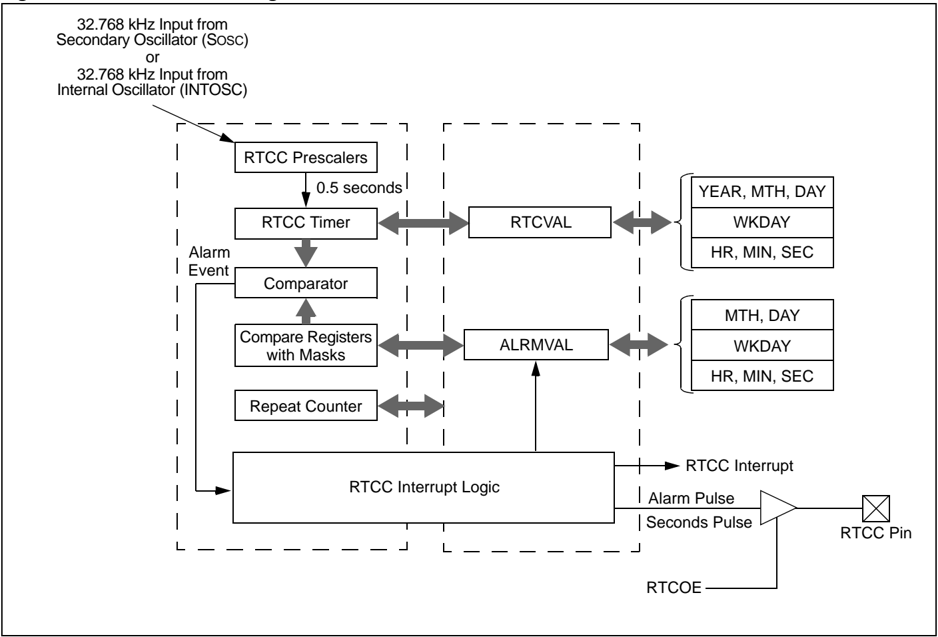
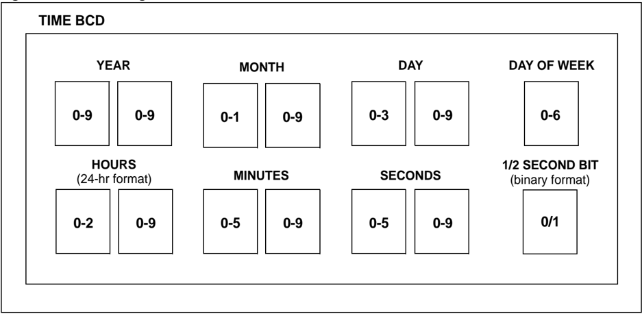
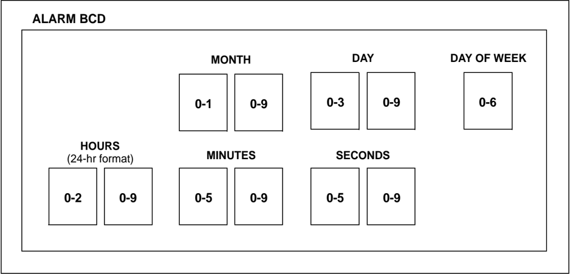
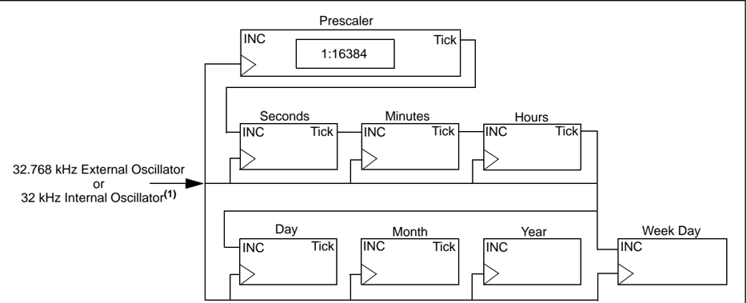
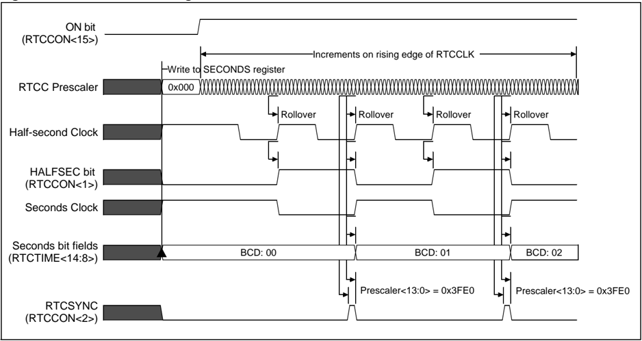
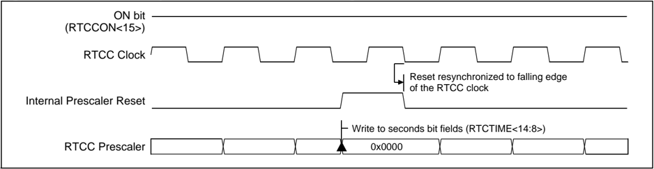
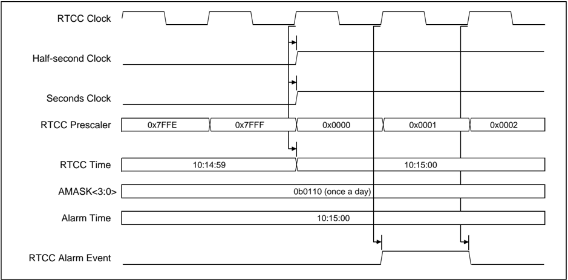
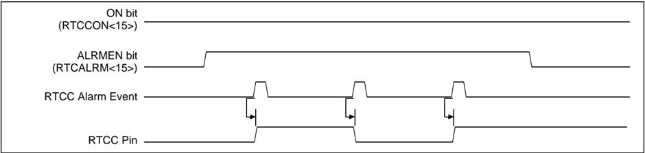

Microchip

## Section 29. Real-Time Clock and Calendar (RTCC)

| HIGHLIGHTS   |                                                           |                                                                                                                                  |
|--------------|-----------------------------------------------------------|----------------------------------------------------------------------------------------------------------------------------------|
|              | This section of the manual contains the following topics: | This section of the manual contains the following topics:                                                                        |
|              | 29.1                                                      | Introduction..............................................................................................................29-2   |
|              | 29.2                                                      | Status and Control Registers...................................................................................29-3              |
|              | 29.3                                                      | Modes of Operation...............................................................................................29-13           |
|              | 29.4                                                      | Alarm .....................................................................................................................29-21 |
|              | 29.5                                                      | Interrupts................................................................................................................29-25  |
|              | 29.6                                                      | Operation in Power-Saving modes........................................................................29-27                     |
|              | 29.7                                                      | Effects of Various Resets.......................................................................................29-28            |
|              | 29.8                                                      | Related Application Notes .....................................................................................29-29             |
|              | 29.9                                                      | Revision History.....................................................................................................29-30       |

Note: This family reference manual section is meant to serve as a complement to device data sheets. Depending on the device variant, this manual section may not apply to all PIC32 devices.

Please consult the note at the beginning of the 'Real-Time Clock and Calendar (RTCC)' chapter in the current device data sheet to check whether this document supports the device you are using.

Device  data  sheets  and  family  reference  manual  sections  are  available  for download from the Microchip Worldwide Web site at: http://www.microchip.com

## 29.1 INTRODUCTION

This section discusses the Real-Time Clock and Calendar (RTCC) hardware module, available on PIC32 devices, and its operation. Listed below are some of the key features of this module:

- Time in hours, minutes and seconds
- 24-hour format (military time)
- Visibility of one-half second period
- Provides calendar for weekday, date, month and year
- Alarm configurable for half a second, one second, 10 seconds, one minute, 10 minutes, one hour, one day, one week, one month, one year
- Alarm repeat with decrementing counter
- Alarm with indefinite repeat
- Year range from 2000 to 2099
- Leap year correction
- Binary Coded Decimal (BCD) format for smaller firmware overhead
- Optimized for long term battery operation
- Fractional second synchronization
- User calibration of the clock crystal frequency with auto-adjust
- Calibration range of ± 0.66 seconds error per month
- Calibrates up to 260 ppm of crystal error
- Uses external 32.768 kHz clock crystal or internal 32 kHz internal oscillator
- Alarm pulse, seconds clock, or RTCC clock output on the RTCC pin

This  module  provides  real-time  clock  and  calendar  functions.  The  RTCC  is  intended  for applications where accurate time must be maintained for extended periods with minimum to no intervention from the CPU. The module is optimized for low-power usage in order to provide extended battery life while keeping track of time.

The RTCC module is a 100-year clock and calendar with automatic leap year detection. The range of the clock is from 00:00:00 (midnight) on January 1, 2000 to 23:59:59 on December 31, 2099. The hours are available in 24-hour (military time) format. The clock provides a granularity of one second with half-second visibility to the user.

Figure 29-1 illustrates the block diagram of the RTCC module.

Figure 29-1: RTCC Block Diagram



## 29.2 STATUS AND CONTROL REGISTERS

The RTCC module includes the following Special Function Registers (SFRs):

- RTCCON: RTC Control Register

The RTCCON register controls the operation of the RTCC module.

- RTCALRM: RTC ALARM Control Register (1)

The RTCALRM register controls the alarm functions of the RTCC module.

- RTCTIME: RTC Time Value Register

The RTCC Time register sets the Hour, Minutes and Seconds fields.

- RTCDATE :  RTC Date Value Register

The RTCC Date register sets the Year, Month, Day and Weekday fields.

- ALRMTIME: Alarm Time Value Register

The RTCC Alarm Time register sets the Alarm Hour, Minutes and Seconds fields.

- ALRMDATE: Alarm Date Value Register

The RTCC Alarm Date register sets the Alarm Month, Day and Weekday fields.

29

The following table summarizes all related RTCC registers. Corresponding registers appear after the summary, followed by a detailed description of each register.

.

Table 29-1: RTCC SFR Summary

| Name         | Name   | Bit 31/23/15/7                | Bit 30/22/14/6   | Bit 29/21/13/5   | Bit 28/20/12/4   | Bit 27/19/11/3   | Bit 26/18/10/2     | Bit 25/17/9/1      | Bit 24/16/8/0    |
|--------------|--------|-------------------------------|------------------|------------------|------------------|------------------|--------------------|--------------------|------------------|
| RTCCON (1)   | 31:24  | -                             | -                | -                | -                | -                | -                  | CAL<9:8>           | CAL<9:8>         |
| RTCCON (1)   | 23:16  | CAL<7:0>                      | CAL<7:0>         | CAL<7:0>         | CAL<7:0>         | CAL<7:0>         | CAL<7:0>           | CAL<7:0>           | CAL<7:0>         |
| RTCCON (1)   | 15:8   | ON                            | -                | SIDL             | -                | -                | -                  | -                  | -                |
| RTCCON (1)   |        | ON                            | -                | SIDL             | -                | -                | RTCCLKSEL<1:0> (2) | RTCCLKSEL<1:0> (2) | RTCOUTSEL<1> (2) |
| RTCCON (1)   | 7:0    | RTSECSEL (2) RTCOUTSEL<0> (2) | RTCCLKON         | -                | -                | RTCWREN          | RTCSYNC            | HALFSEC            | RTCOE            |
| RTCALRM (1)  | 31:24  | -                             | -                | -                | -                | -                | -                  | -                  | -                |
| RTCALRM (1)  | 23:16  | -                             | -                | -                | -                | -                | -                  | -                  | -                |
| RTCALRM (1)  | 15:8   | ALRMEN                        | CHIME            | PIV              | ALRMSYNC         | ALRMSYNC         | AMASK<3:0>         | AMASK<3:0>         | AMASK<3:0>       |
| RTCALRM (1)  | 7:0    | ARPT<7:0>                     | ARPT<7:0>        | ARPT<7:0>        | ARPT<7:0>        | ARPT<7:0>        | ARPT<7:0>          | ARPT<7:0>          | ARPT<7:0>        |
| RTCTIME (1)  | 31:24  | -                             | -                | HR10<1:0>        | HR10<1:0>        | HR01<3:0>        | HR01<3:0>          | HR01<3:0>          | HR01<3:0>        |
| RTCTIME (1)  | 23:16  | -                             | MIN10<2:0>       | MIN10<2:0>       | MIN10<2:0>       | MIN01<3:0>       | MIN01<3:0>         | MIN01<3:0>         | MIN01<3:0>       |
| RTCTIME (1)  | 15:8   | -                             | SEC10<2:0>       | SEC10<2:0>       | SEC10<2:0>       | SEC01<3:0>       | SEC01<3:0>         | SEC01<3:0>         | SEC01<3:0>       |
| RTCTIME (1)  | 7:0    | -                             | -                | -                | -                | -                | -                  | -                  | -                |
| RTCDATE (1)  | 31:24  | YEAR10<3:0>                   | YEAR10<3:0>      | YEAR10<3:0>      | YEAR10<3:0>      | YEAR01<3:0>      | YEAR01<3:0>        | YEAR01<3:0>        | YEAR01<3:0>      |
| RTCDATE (1)  | 23:16  | -                             | -                | -                | MONTH10          | MONTH01<3:0>     | MONTH01<3:0>       | MONTH01<3:0>       | MONTH01<3:0>     |
| RTCDATE (1)  | 15:8   | -                             | -                | DAY10<1:0>       | DAY10<1:0>       | DAY01<3:0>       | DAY01<3:0>         | DAY01<3:0>         | DAY01<3:0>       |
| RTCDATE (1)  | 7:0    | -                             | -                | -                | -                | -                | WDAY01<2:0>        | WDAY01<2:0>        | WDAY01<2:0>      |
| ALRMTIME (1) | 31:24  | -                             | -                | HR10<1:0>        | HR10<1:0>        | HR01<3:0>        | HR01<3:0>          | HR01<3:0>          | HR01<3:0>        |
| ALRMTIME (1) | 23:16  | -                             | MIN10<2:0>       | MIN10<2:0>       | MIN10<2:0>       | MIN01<3:0>       | MIN01<3:0>         | MIN01<3:0>         | MIN01<3:0>       |
| ALRMTIME (1) | 15:8   | -                             | SEC10<2:0>       | SEC10<2:0>       | SEC10<2:0>       | SEC01<3:0>       | SEC01<3:0>         | SEC01<3:0>         | SEC01<3:0>       |
| ALRMTIME (1) | 7:0    | -                             | -                | -                | -                | -                | -                  | -                  | -                |
| ALRMDATE (1) | 31:24  | -                             | -                | -                | -                | -                | -                  | -                  | -                |
| ALRMDATE (1) | 23:16  | -                             | -                | -                | MONTH10          | MONTH01<3:0>     | MONTH01<3:0>       | MONTH01<3:0>       | MONTH01<3:0>     |
| ALRMDATE (1) | 15:8   | -                             | -                | DAY10<1:0>       | DAY10<1:0>       | DAY01<3:0>       | DAY01<3:0>         | DAY01<3:0>         | DAY01<3:0>       |
| ALRMDATE (1) | 7:0    | -                             | -                | -                | -                | -                | WDAY01<2:0>        | WDAY01<2:0>        | WDAY01<2:0>      |

## Legend:

- = unimplemented, read as ' 0 '. Address offset values are shown in hexadecimal.

Note 1: This register has an associated Clear, Set, and Invert register at an offset of 0x4, 0x8, and 0xC bytes, respectively. These registers have the same name with CLR, SET, or INV appended to the end of the register name (e.g., RTCCONCLR). Writing a ' 1 ' to any bit position in these registers will clear valid bits in the associated register. Reads from these registers should be ignored.

2: These bits are not available on all devices. If the bit is not available, the field is unimplemented and is read as '0'. Refer to the 'RTCC' chapter in the specific device data sheet for availability.

## Section 29. Real-Time Clock and Calendar (RTCC)

## Register 29-1: RTCCON: RTC Control Register

| Bit Range   | Bit 31/23/15/7    | Bit 30/22/14/6   | Bit 29/21/13/5   | Bit 28/20/12/4   | Bit 27/19/11/3   | Bit 26/18/10/2      | Bit 25/17/9/1       | Bit 24/16/8/0     |
|-------------|-------------------|------------------|------------------|------------------|------------------|---------------------|---------------------|-------------------|
| 31:24       | U-0               | U-0              | U-0              | U-0              | U-0              | U-0                 | R/W-0               | R/W-0             |
| 31:24       | -                 | -                | -                | -                | -                | -                   | CAL<9:8>            | CAL<9:8>          |
| 23:16       | R/W-0             | R/W-0            | R/W-0            | R/W-0            | R/W-0            | R/W-0               | R/W-0               | R/W-0             |
| 23:16       | CAL<7:0>          | CAL<7:0>         | CAL<7:0>         | CAL<7:0>         | CAL<7:0>         | CAL<7:0>            | CAL<7:0>            | CAL<7:0>          |
| 15:8        | R/W-0             | U-0              | R/W-0            | U-0              | U-0              | R/W-0               | R/W-0               | R/W-0             |
| 15:8        | (1,2)             | -                | SIDL             | -                | -                | -                   | -                   | -                 |
| 15:8        | ON                |                  |                  |                  |                  | RTC CLKSEL<1:0> (7) | RTC CLKSEL<1:0> (7) | RTC OUTSEL<1> (7) |
| 7:0         | R/W-0             | R-0              | U-0              | U-0              | R/W-0            | R-0                 | R-0                 | R/W-0             |
| 7:0         | RTSECSEL (3.7)    | RTCCLKON         | -                | -                | RTC WREN (4)     | RTCSYNC             | HALF SEC (5)        | RTCOE (6)         |
| 7:0         | RTC OUTSEL<0> (7) | RTCCLKON         |                  | -                |                  | RTCSYNC             |                     | RTCOE (6)         |

## Legend:

R = Readable bit

W = Writable bit

U = Unimplemented bit, read as '0'

-n = Value at POR

'1' = Bit is set

'0' = Bit is cleared

x = Bit is unknown

bit 31-26

Unimplemented: Read as ' 0 '

bit 25-16 CAL&lt;9:0&gt;:

RTC Drift Calibration bits, which contain a signed 10-bit integer value 0111111111 = Maximum positive adjustment, adds 511 RTC clock pulses every one minute

•

•

•

0000000001 0000000000 = No adjustment

= Minimum positive adjustment, adds 1 RTC clock pulse every one minute

1111111111 = Minimum negative adjustment, subtracts 1 RTC clock pulse every one minute

•

•

•

1000000000 = Minimum negative adjustment, subtracts 512 clock pulses every one minute

bit 15

ON: RTCC On bit

(1,2)

1 = RTCC module is enabled

0 = RTCC module is disabled

bit 14 Unimplemented: Read as ' 0 '

## Note 1: The ON bit is only writable when RTCWREN = 1 .

- 2: When using the 1:1 PBCLK divisor, the user's software should not read/write the peripheral's SFRs in the SYSCLK cycle immediately following the instruction that clears the module's ON bit.
- 3: Requires RTCOE == 1 (RTCCON&lt;0&gt;) for the output to be active.
- 4: The RTCWREN bit can be set only when the write sequence is enabled.
- 5: This bit is read-only. It is cleared to ' 0 ' on a write to the seconds bit fields (RTCTIME&lt;14:8&gt;).
- 6: This bit is ANDed with the ON bit (RTCCON&lt;15&gt;) to produce the effective RTCC output enable.
- 7: This bit is not available on all devices. If the bit is not available, the field is Unimplemented and is read as ' 0 '. Refer to the 'RTCC' chapter in the specific device data sheet for availability.

Note:

This register is reset only on a Power-on Reset (POR).

29

## PIC32 Family Reference Manual

## Register 29-1: RTCCON: RTC Control Register  (Continued)

## bit 13 SIDL: Stop in Idle Mode bit

- 1 = Disables the PBCLK to the RTCC when CPU enters in Idle mode
- 0 = Continue normal operation in Idle mode

## bit 12-11 Unimplemented: Read as ' 0 ' (7)

## bit 10-9 RTCCLKSEL&lt;1:0&gt;: RTCC Clock Select bits (7)

- 11 = Reserved; do not use
- 10 = Reserved, do not use
- 01 = RTCC uses the external 32.768 kHz Secondary Oscillator (SOSC)
- 00 = RTCC uses the internal 32 kHz oscillator (INTOSC)

When a new value is written to these bits, the Seconds Value register should also be written to properly reset the clock prescalers in the RTCC.

## bit 8-7 RTCOUTSEL&lt;1:0&gt;: RTCC Output Data Select bits (7)

- 11 = Reserved, do not use
- 10 = RTCC Clock is presented on the RTCC pin
- 01 = Seconds Clock is presented on the RTCC pin
- 00 = Alarm Pulse is presented on the RTCC pin when the alarm interrupt is triggered

## bit 7 RTSECSEL: RTCC Seconds Clock Output Select bit (3,7)

- 1 = RTCC Seconds Clock is selected for the RTCC pin
- 0 = RTCC Alarm Pulse is selected for the RTCC pin

## bit 6 RTCCLKON: RTCC Clock Enable Status bit

- 1 = RTCC Clock is actively running
- 0 = RTCC Clock is not running

## bit 5-4 Unimplemented: Read as ' 0 '

## bit 3 RTCWREN: RTC Value Registers Write Enable bit (4)

- 1 = RTC Value registers can be written to by the user
- 0 = RTC Value registers are locked out from being written to by the user

## bit 2 RTCSYNC: RTCC Value Registers Read Synchronization bit

1

=

RTC Value registers can change while reading, due to a rollover ripple that results in an invalid data read

If the register is read twice and results in the same data, the data can be assumed to be valid

- 0 = RTC Value registers can be read without concern about a rollover ripple

## bit 1 HALFSEC: Half-Second Status bit (5)

- 1 = Second half period of a second
- 0 = First half period of a second

## bit 0 RTCOE: RTCC Output Enable bit (6)

- 1 = RTCC clock output enabled - clock presented onto an I/O
- 0 = RTCC clock output disabled

## Note 1: The ON bit is only writable when RTCWREN = 1 .

- 2: When using the 1:1 PBCLK divisor, the user's software should not read/write the peripheral's SFRs in the SYSCLK cycle immediately following the instruction that clears the module's ON bit.
- 3: Requires RTCOE == 1 (RTCCON&lt;0&gt;) for the output to be active.
- 4: The RTCWREN bit can be set only when the write sequence is enabled.
- 5: This bit is read-only. It is cleared to ' 0 ' on a write to the seconds bit fields (RTCTIME&lt;14:8&gt;).
- 6: This bit is ANDed with the ON bit (RTCCON&lt;15&gt;) to produce the effective RTCC output enable.
- 7: This bit is not available on all devices. If the bit is not available, the field is Unimplemented and is read as ' 0 '. Refer to the 'RTCC' chapter in the specific device data sheet for availability.

Note: This register is reset only on a Power-on Reset (POR).

## Section 29. Real-Time Clock and Calendar (RTCC)

## Register 29-2: RTCALRM: RTC ALARM Control Register (1)

| Bit Range   | Bit 31/23/15/7   | Bit 30/22/14/6   | Bit 29/21/13/5   | Bit 28/20/12/4   | Bit 27/19/11/3   | Bit 26/18/10/2   | Bit 25/17/9/1   | Bit 24/16/8/0   |
|-------------|------------------|------------------|------------------|------------------|------------------|------------------|-----------------|-----------------|
| 31:24       | U-0              | U-0              | U-0              | U-0              | U-0              | U-0              | U-0             | U-0             |
| 31:24       | -                | -                | -                | -                | -                | -                | -               | -               |
| 23:16       | U-0              | U-0              | U-0              | U-0              | U-0              | U-0              | U-0             | U-0             |
| 23:16       | -                | -                | -                | -                | -                | -                | -               | -               |
| 15:8        | R/W-0            | R/W-0            | R/W-0            | R-0              | R/W-0            | R/W-0            | R/W-0           | R/W-0           |
| 15:8        | ALRMEN (1,2)     | CHIME (2)        | PIV (2)          | ALRMSYNC (3)     | AMASK<3:0> (2)   | AMASK<3:0> (2)   | AMASK<3:0> (2)  | AMASK<3:0> (2)  |
| 7:0         | R/W-0            | R/W-0            | R/W-0            | R/W-0            | R/W-0            | R/W-0            | R/W-0           | R/W-0           |
| 7:0         | ARPT<7:0> (2)    | ARPT<7:0> (2)    | ARPT<7:0> (2)    | ARPT<7:0> (2)    | ARPT<7:0> (2)    | ARPT<7:0> (2)    | ARPT<7:0> (2)   | ARPT<7:0> (2)   |

## Legend:

R = Readable bit

W = Writable bit

U = Unimplemented bit, read as '0'

-n = Value at POR

'1' = Bit is set

'0' = Bit is cleared

x = Bit is unknown

bit 31-16

bit 15

Unimplemented: Read as ' 0 '

ALRMEN:

Alarm Enable bit (2,3)

1 = Alarm is enabled

0 = Alarm is disabled

bit 14 CHIME:

Chime Enable bit (3)

1 = Chime is enabled - ARPT&lt;7:0&gt; is allowed to rollover from 0x00 to 0xFF

0 = Chime is disabled - ARPT&lt;7:0&gt; stops once it reaches 0x00

bit 13 PIV: Alarm Pulse Initial Value bit (3)

When ALRMEN = 0 , PIV is writable and determines the initial value of the Alarm Pulse.

When ALRMEN = 1 , PIV is read-only and returns the state of the Alarm Pulse.

## bit 12 ALRMSYNC: Alarm Sync bit

(4)

- 1 = ARPT&lt;7:0&gt; and ALRMEN may change as a result of a half second rollover during a read. The ARPT must be read repeatedly until the same value is read twice. This must be done since multiple bits may be changing, which are then synchronized to the PB clock domain
- 0 = ARPT&lt;7:0&gt; and ALRMEN can be read without concerns of rollover because the prescaler is &gt; 32 RTC clocks away from a half-second rollover

## bit 11-8 AMASK&lt;3:0&gt;: Alarm Mask Configuration bits (3)

0000 = Every half-second

0001 = Every second

0010 = Every 10 seconds

0011 = Every minute

0100 = Every 10 minutes

0101 = Every hour

0110 = Once a day

0111 = Once a week

1000 = Once a month

1001 = Once a year (except when configured for February 29, once every four years)

1010 = Reserved; do not use

1011 = Reserved; do not use

11xx = Reserved; do not use

- Note 1: Hardware clears the ALRMEN bit anytime the alarm event occurs, when ARPT&lt;7:0&gt; = 00 and CHIME = 0 .
- 2: This field should not be written when the RTCC ON bit = ' 1 ' (RTCCON&lt;15&gt;) and ALRMSYNC = 1 .
- 3: This assumes a CPU read will execute in less than 32 PBCLKs.

Note: This register is reset only on a Power-on Reset (POR).

29

## PIC32 Family Reference Manual

## Register 29-2: RTCALRM: RTC ALARM Control Register (1)   (Continued)

bit 7-0 ARPT&lt;7:0&gt;: Alarm Repeat Counter Value bits (3)

11111111 = Alarm will trigger 256 times

·

·

·

00000000 = Alarm will trigger one time

The counter decrements on any alarm event. The counter only rolls over from 0x00 to 0xFF if CHIME = 1 .

- Note 1: Hardware clears the ALRMEN bit anytime the alarm event occurs, when ARPT&lt;7:0&gt; = 00 and CHIME = 0 .
- 2: This field should not be written when the RTCC ON bit = ' 1 ' (RTCCON&lt;15&gt;) and ALRMSYNC = 1 .
- 3: This assumes a CPU read will execute in less than 32 PBCLKs.

Note: This register is reset only on a Power-on Reset (POR).

## Section 29. Real-Time Clock and Calendar (RTCC)

Register 29-3:

RTCTIME: RTC Time Value Register

| Bit Range   | Bit 31/23/15/7   | Bit 30/22/14/6   | Bit 29/21/13/5   | Bit 28/20/12/4   | Bit 27/19/11/3   | Bit 26/18/10/2   | Bit 25/17/9/1   | Bit 24/16/8/0   |
|-------------|------------------|------------------|------------------|------------------|------------------|------------------|-----------------|-----------------|
| 31:24       | U-0              | U-0              | R/W-x            | R/W-x            | R/W-x            | R/W-x            | R/W-x           | R/W-x           |
| 31:24       | -                | -                | HR10<1:0>        | HR10<1:0>        | HR01<3:0>        | HR01<3:0>        | HR01<3:0>       | HR01<3:0>       |
| 23:16       | U-0              | R/W-x            | R/W-x            | R/W-x            | R/W-x            | R/W-x            | R/W-x           | R/W-x           |
| 23:16       | -                | MIN10<2:0>       | MIN10<2:0>       | MIN10<2:0>       | MIN01<3:0>       | MIN01<3:0>       | MIN01<3:0>      | MIN01<3:0>      |
| 15:8        | U-0              | R/W-x            | R/W-x            | R/W-x            | R/W-x            | R/W-x            | R/W-x           | R/W-x           |
| 15:8        | -                | SEC10<2:0>       | SEC10<2:0>       | SEC10<2:0>       | SEC01<3:0>       | SEC01<3:0>       | SEC01<3:0>      | SEC01<3:0>      |
| 7:0         | U-0              | U-0              | U-0              | U-0              | U-0              | U-0              | U-0             | U-0             |
| 7:0         | -                | -                | -                | -                | -                | -                | -               | -               |

## Legend:

R = Readable bit

W = Writable bit

U = Unimplemented bit, read as '0'

-n = Value at POR

'1' = Bit is set

'0' = Bit is cleared

x = Bit is unknown

bit 31-30 Unimplemented: Read as ' 0 '

bit 29-28 HR10&lt;1:0&gt;: Binary-Coded Decimal Value of Hours bits, 10 digits; contains a value from 0 to 2

bit 27-24 HR01&lt;3:0&gt;: Binary-Coded Decimal Value of Hours bits, 1 digit; contains a value from 0 to 9

bit 23 Unimplemented: Read as ' 0 '

bit 22-20 MIN10&lt;2:0&gt;: Binary-Coded Decimal Value of Minutes bits, 10 digits; contains a value from 0 to 5

bit 19-16 MIN01&lt;3:0&gt;: Binary-Coded Decimal Value of Minutes bits, 1 digit; contains a value from 0 to 9

bit 15 Unimplemented: Read as ' 0 '

bit 14-12 SEC10&lt;2:0&gt;: Binary-Coded Decimal Value of Seconds bits, 10 digits; contains a value from 0 to 5

bit 11-8 SEC01&lt;3:0&gt;: Binary-Coded Decimal Value of Seconds bits, 1 digit; contains a value from 0 to 9

bit 7-0 Unimplemented: Read as ' 0 '

Note:

This register is only writable when RTCWREN = 1 (RTCCON&lt;3&gt;).

## PIC32 Family Reference Manual

## Register 29-4: RTCDATE: RTC Date Value Register

| Bit Range   | Bit 31/23/15/7   | Bit 30/22/14/6   | Bit 29/21/13/5   | Bit 28/20/12/4   | Bit 27/19/11/3   | Bit 26/18/10/2   | Bit 25/17/9/1   | Bit 24/16/8/0   |
|-------------|------------------|------------------|------------------|------------------|------------------|------------------|-----------------|-----------------|
| 31:24       | R/W-x            | R/W-x            | R/W-x            | R/W-x            | R/W-x            | R/W-x            | R/W-x           | R/W-x           |
| 31:24       | YEAR10<3:0>      | YEAR10<3:0>      | YEAR10<3:0>      | YEAR10<3:0>      | YEAR01<3:0>      | YEAR01<3:0>      | YEAR01<3:0>     | YEAR01<3:0>     |
| 23:16       | U-0              | U-0              | U-0              | R/W-x            | R/W-x            | R/W-x            | R/W-x           | R/W-x           |
| 23:16       | -                | -                | -                | MONTH10          | MONTH01<3:0>     | MONTH01<3:0>     | MONTH01<3:0>    | MONTH01<3:0>    |
| 15:8        | U-0              | U-0              | R/W-x            | R/W-x            | R/W-x            | R/W-x            | R/W-x           | R/W-x           |
| 15:8        | -                | -                | DAY10<1:0>       | DAY10<1:0>       | DAY01<3:0>       | DAY01<3:0>       | DAY01<3:0>      | DAY01<3:0>      |
| 7:0         | U-0              | U-0              | U-0              | U-0              | U-0              | R/W-x            | R/W-x           | R/W-x           |
| 7:0         | -                | -                | -                | -                | -                | WDAY01<2:0>      | WDAY01<2:0>     | WDAY01<2:0>     |

## Legend:

R = Readable bit

W = Writable bit

U = Unimplemented bit, read as '0'

-n = Value at POR

'1' = Bit is set

'0' = Bit is cleared

x = Bit is unknown

bit 31-28 YEAR10&lt;3:0&gt;:

Binary-Coded Decimal Value of Years bits, 10 digits

bit 27-24 YEAR01&lt;3:0&gt;: Binary-Coded Decimal Value of Years bits, 1 digit

bit 23-21 Unimplemented: Read as ' 0 '

bit 20

MONTH10: Binary-Coded Decimal Value of Months bits, 10 digits; contains a value from 0 to 1

bit 19-16 MONTH01&lt;3:0&gt;: Binary-Coded Decimal Value of Months bits, 1 digit; contains a value from 0 to 9

bit 15-14 Unimplemented: Read as ' 0 '

bit 13-12 DAY10&lt;1:0&gt;: Binary-Coded Decimal Value of Days bits, 10 digits; contains a value from 0 to 3

bit 11-8

DAY01&lt;3:0&gt;: Binary-Coded Decimal Value of Days bits, 1 digit; contains a value from 0 to 9

bit 7-3 Unimplemented: Read as ' 0 '

bit 2-0 WDAY01&lt;2:0&gt;:

Binary-Coded Decimal Value of Weekdays bits,1 digit; contains a value from 0 to 6

Note: This register is only writable when RTCWREN = 1 (RTCCON&lt;3&gt;).

## Section 29. Real-Time Clock and Calendar (RTCC)

## Register 29-5: ALRMTIME: Alarm Time Value Register

| Bit Range   | Bit 31/23/15/7   | Bit 30/22/14/6   | Bit 29/21/13/5   | Bit 28/20/12/4   | Bit 27/19/11/3   | Bit 26/18/10/2   | Bit 25/17/9/1   | Bit 24/16/8/0   |
|-------------|------------------|------------------|------------------|------------------|------------------|------------------|-----------------|-----------------|
| 31:24       | U-0              | U-0              | R/W-x            | R/W-x            | R/W-x            | R/W-x            | R/W-x           | R/W-x           |
| 31:24       | -                | -                | HR10<1:0>        | HR10<1:0>        | HR01<3:0>        | HR01<3:0>        | HR01<3:0>       | HR01<3:0>       |
| 23:16       | U-0              | R/W-x            | R/W-x            | R/W-x            | R/W-x            | R/W-x            | R/W-x           | R/W-x           |
| 23:16       | -                | MIN10<2:0>       | MIN10<2:0>       | MIN10<2:0>       | MIN01<3:0>       | MIN01<3:0>       | MIN01<3:0>      | MIN01<3:0>      |
| 15:8        | U-0              | R/W-x            | R/W-x            | R/W-x            | R/W-x            | R/W-x            | R/W-x           | R/W-x           |
| 15:8        | -                | SEC10<2:0>       | SEC10<2:0>       | SEC10<2:0>       | SEC01<3:0>       | SEC01<3:0>       | SEC01<3:0>      | SEC01<3:0>      |
| 7:0         | U-0              | U-0              | U-0              | U-0              | U-0              | U-0              | U-0             | U-0             |
| 7:0         | -                | -                | -                | -                | -                | -                | -               | -               |

## Legend:

R = Readable bit

W = Writable bit

U = Unimplemented bit, read as '0'

-n = Value at POR

'1' = Bit is set

'0' = Bit is cleared

x = Bit is unknown

bit 31-30 Unimplemented: Read as ' 0 '

bit 29-28 HR10&lt;1:0&gt;: Binary Coded Decimal value of hours bits, 10 digits; contains a value from 0 to 2

bit 27-24 HR01&lt;3:0&gt;: Binary Coded Decimal value of hours bits, 1 digit; contains a value from 0 to 9

bit 23 Unimplemented: Read as ' 0 '

bit 22-20 MIN10&lt;2:0&gt;: Binary Coded Decimal value of minutes bits, 10 digits; contains a value from 0 to 5

bit 19-16 MIN01&lt;3:0&gt;: Binary Coded Decimal value of minutes bits, 1 digit; contains a value from 0 to 9

bit 15 Unimplemented: Read as ' 0 '

bit 14-12 SEC10&lt;2:0&gt;: Binary Coded Decimal value of seconds bits, 10 digits; contains a value from 0 to 5

bit 11-8 SEC01&lt;3:0&gt;: Binary Coded Decimal value of seconds bits, 1 digit; contains a value from 0 to 9

bit 7-0 Unimplemented: Read as ' 0 '

## PIC32 Family Reference Manual

## Register 29-6: ALRMDATE: Alarm Date Value Register

| Bit Range   | Bit 31/23/15/7   | Bit 30/22/14/6   | Bit 29/21/13/5   | Bit 28/20/12/4   | Bit 27/19/11/3   | Bit 26/18/10/2   | Bit 25/17/9/1   | Bit 24/16/8/0   |
|-------------|------------------|------------------|------------------|------------------|------------------|------------------|-----------------|-----------------|
| 31:24       | U-0              | U-0              | U-0              | U-0              | U-0              | U-0              | U-0             | U-0             |
| 31:24       | -                | -                | -                | -                | -                | -                | -               | -               |
| 23:16       | U-0              | U-0              | U-0              | R/W-x            | R/W-x            | R/W-x            | R/W-x           | R/W-x           |
| 23:16       | -                | -                | -                | MONTH10          | MONTH01<3:0>     | MONTH01<3:0>     | MONTH01<3:0>    | MONTH01<3:0>    |
| 15:8        | U-0              | U-0              | R/W-x            | R/W-x            | R/W-x            | R/W-x            | R/W-x           | R/W-x           |
| 15:8        | -                | -                | DAY10<1:0>       | DAY10<1:0>       | DAY01<3:0>       | DAY01<3:0>       | DAY01<3:0>      | DAY01<3:0>      |
| 7:0         | U-0              | U-0              | U-0              | U-0              | U-0              | R/W-x            | R/W-x           | R/W-x           |
| 7:0         | -                | -                | -                | -                | -                | WDAY01<2:0>      | WDAY01<2:0>     | WDAY01<2:0>     |

## Legend:

R = Readable bit

W = Writable bit

U = Unimplemented bit, read as '0'

-n = Value at POR

'1' = Bit is set

'0' = Bit is cleared

x = Bit is unknown

bit 31-21 Unimplemented: Read as ' 0 '

bit 20 MONTH10: Binary Coded Decimal value of months bits, 10 digits; contains a value from 0 to 1

bit 19-16 MONTH01&lt;3:0&gt;: Binary Coded Decimal value of months bits, 1 digit; contains a value from 0 to 9

bit 15-14 Unimplemented: Read as ' 0 '

bit 13-12 DAY10&lt;1:0&gt;: Binary Coded Decimal value of days bits, 10 digits; contains a value from 0 to 3

bit 11-8 DAY01&lt;3:0&gt;: Binary Coded Decimal value of days bits, 1 digit; contains a value from 0 to 9

bit 7-3 Unimplemented: Read as ' 0 '

bit 2-0 WDAY01&lt;2:0&gt;: Binary Coded Decimal value of weekdays bits, 1 digit; contains a value from 0 to 6

## 29.3 MODES OF OPERATION

The RTCC module offers the following operating modes:

- Real-Time Clock and Calendar (RTCC)
- Alarm

## 29.3.1 RTCC Mode of Operation

The RTCC is a 100-year clock and calendar with automatic leap year detection. The range of the clock is from 00:00:00 (midnight) on January 1, 2000, to 23:59:59 on December 31, 2099. The hours use the 24-hour time format (military time) with no hardware provisions for regular time format (AM/PM).

The  RTCC  provides  a  programming  granularity  of  one second,  but  has  visibility  of  the half-second field.

The register interface for the RTCC values (RTCTIME and RTCDATE) is implemented using the BCD format. This simplifies the firmware when using the module, as each of the digit values is contained within its own 4-bit value, as illustrated in Figure 29-2.

Figure 29-2: Timer Digit Format



## 29.3.2 Alarm Mode of Operation

The RTCC module provides an alarm function configurable anywhere from a half-second to one year. However, only the half-second alarm has half-second resolution. After the alarm is enabled, the  module  can  be  configured  to  repeat  the  alarm  at  preconfigured  intervals.The  indefinite repetition of the alarm is provided through the Chime feature.

The module provides an interrupt at every alarm pulse event. In addition to the alarm interrupt, an alarm pulse output is provided that operates at half the frequency of the alarm (the alarm pulse toggles at every alarm match). This output is completely synchronous with the RTCC clock and can be used to provide a trigger clock to other devices. The initial value of this output pin is controlled  by  the  PIV  bit  (RTCALRM&lt;13&gt;).  For  more  information  on  the  RTC  Alarm  control register, RTCALRM, see Register 29-2.

The register interface for the Alarm values (ALRMTIME and ALRMDATE) is implemented using the BCD format. This simplifies the firmware when using the module, as each of the digit values is contained within its own 4-bit value, as illustrated in Figure 29-3.

Figure 29-3: Timer and Alarm Digit Format



## 29.3.3 Clock Source

Depending on the device, the RTCC module can be clocked from two different clock sources: an external real-time clock crystal (SOSC) that is oscillating at 32.768 kHz or through an internal 32 kHz clock source (INTOSC) from the clock module. The internal oscillator, INTOSC, does not use the external crystal, and does not operate during Deep Sleep modes. Calibration of the external crystal (SOSC) can be accomplished through the RTCC module, yielding an accuracy of ±0.66 seconds per month. For more information, see 29.3.10 'Calibration' . When using the LPRC as the oscillator source for the RTCC, the accuracy can vary. Refer to the 'Oscillators' chapter of the specific device data sheet for details on the accuracy of the LPRC.

Note: Not all devices have an external and internal oscillator. Refer to the chapter in the specific device data sheet for availability.

'Oscillators'

For devices with an external and internal oscillator, to decide which source the RTCC module will use  for  clocking,  the  RTCCLKSEL&lt;1:0&gt;  bits  (RTCCON&lt;10:9&gt;)  must  be  configured.  Setting these bits to ' 00 ' selects the internal 32 kHz oscillator (INTOSC). Setting the bits to ' 01 ' selects the external Secondary Oscillator (SOSC). The settings ' 11 ' and ' 10 ' are reserved and should not be used.

When selecting the external oscillator, the SOSCEN bit (OSCCON&lt;1&gt;) must also be set (refer to the 'Oscillators' chapter in the specific device data sheet for details). This is the only bit outside of the RTCC module with which the user must be concerned for enabling the RTCC. The status  bit,  SOSCRDY  (OSCCON&lt;22&gt;), can be used to check that the Secondary Oscillator (SOSC) is running.

Figure 29-4: Clock Source and Counting

Note 1: This oscillator is not available on all devices. Refer to the 'Oscillators' chapter in the specific device data sheet for availability.



## 29.3.4 Digit Carry Rules

This section explains which timer values are affected when there is a rollover.

- Time of Day - from 23:59:59 to 00:00:00, with a carry to the Day field
- Day - the carry from the day field to the month field is dependent on the current month (see Table 29-3 for the day to month rollover schedule).
- Month - from 12/31 to 01/01, with a carry to the Year field
- Day of Week - from 6 to 0, without a carry (see Table 29-2)
- Year - from 99 to 00, without a carry (this surpasses the intended use of the RTCC)

Considering that the following values are in BCD format, the carry to the upper BCD digit will occur at a count of 10, and not a count of 16 (SECONDS, MINUTES, HOURS, WEEKDAY, DAYS, MONTHS).

Table 29-2: Day of Week Schedule

| Day of Week   |   Day of Week |
|---------------|---------------|
| Sunday        |             0 |
| Monday        |             1 |
| Tuesday       |             2 |
| Wednesday     |             3 |
| Thursday      |             4 |
| Friday        |             5 |
| Saturday      |             6 |

Table 29-3: Day to Month Rollover Schedule (1)

| Month          | Maximum Day Field   |
|----------------|---------------------|
| 01 (January)   | 31                  |
| 02 (February)  | 28 or 29 (1)        |
| 03 (March)     | 31                  |
| 04 (April)     | 30                  |
| 05 (May)       | 31                  |
| 06 (June)      | 30                  |
| 07 (July)      | 31                  |
| 08 (August)    | 31                  |
| 09 (September) | 30                  |
| 10 (October)   | 31                  |
| 11 (November)  | 30                  |
| 12 (December)  | 31                  |

Note 1: See 29.3.5 'Leap Year' .

## 29.3.5 Leap Year

The year range on the RTCC module is from 2000 to 2099; therefore, the leap year calculation is determined by any year divisible by 4 in the above range. The only month to be affected in a leap year is February, which has 29 days, but only 28 days in all other years.

## 29.3.6 RTCC General Functionality

All  timer  registers  containing  a  time  value  of  seconds  or  greater  are  writable.  The  user  can configure the current time by simply writing to these registers the desired year, month, day, hour, minutes and seconds. The timer will then use the newly written values to proceed with the count from the desired starting point.

Note that if the RTCC is enabled by setting the ON bit = 1 (RTCCON&lt;15&gt;), the timer will continue incrementing even while the registers are being adjusted. However, any time the seconds bit fields (RTCTIME&lt;14:8&gt;) are written, the prescaler is reset to ' 0 '. This provides a known prescaler value after timer adjustments.

## Section 29. Real-Time Clock and Calendar (RTCC)

If an update (CPU write) of the timer register occurs, it is the user's responsibility to ensure that when ON = 1 (RTCCON&lt;15&gt;), a timer increment will not occur to the registers that are being updated. This can be done by observing the value of the RTCSYNC bit (RTCCON&lt;2&gt;), or the preceding  digits  from  which  a  carry  can  occur,  or  by  only  updating  the  registers  immediately following the seconds pulse (or alarm interrupt). Note that the corresponding counters are clocked based on their defined intervals (i.e., the days bit fields (RTCDATE&lt;13:8&gt;) are clocked once a day, the months bit fields (RTCDATE&lt;20:16&gt;) are only clocked once a month, etc). This leaves large windows of time in which registers can be safely updated.

The timer also provides visibility into the half-second field of the counter. However, this value is read-only and can only be reset by writing to the seconds bit fields (RTCTIME&lt;14:8&gt;).

## 29.3.7 Safety Window for Register Reads and Writes

The RTCSYNC bit (RTCCON&lt;2&gt;) indicates a time window during which an update to the RTCC time registers (RTCTIME and RTCDATE) is not imminent, and the registers can be safely read and  written.  When  RTCSYNC = 0 ,  the  registers  can  be  safely  accessed  by  the  CPU.  When RTCSYNC = 1 , the user must employ a firmware solution to assure that the data read did not fall on an update boundary, resulting in an invalid or partial read.

The RTCSYNC bit is set 32 RTCC clock edges before an update is about to occur. It is cleared one clock later, after the update occurs (thus, RTCSYNC is asserted for a total of 33 clocks).

Note that, independent of the RTCSYNC value the user can, by reading and comparing a timer register value twice, ensure in code that the register read did not span an RTCC clock update.

Writes to the ALRMTIME  and  ALRMDATE  registers should not be performed  when RTCSYNC = 1 . This restriction exists for two reasons:

1. A write could cause a timing violation in the alarm match logic, leading to an invalid alarm event and a corruption of the ARPT register. This event can occur during the low time of an RTCC clock, following a rollover event.
2. A write during a rollover event, when the RTCC clock is high, will be ignored by hardware.

## Example 29-1: Updating the RTCC Time and Date

```
/*  The following code example will update the RTCC time and date. */ /*assume the secondary oscillator is enabled and ready, i.e. OSCCON<1>=1, OSCCON<22>=1, and RTCC write is enabled i.e. RTCWREN (RTCCON<3>) =1;*/ unsigned long time=0x04153300;// set time to 04 hr, 15 min, 33 sec unsigned long date=0x06102705;// set date to Friday 27 Oct 2006 RTCCONCLR=0x8000; // turn off the RTCC while(RTCCON&0x40); // wait for clock to be turned off RTCTIME=time; // safe to update the time RTCDATE=date; // update the date RTCCONSET=0x8000; // turn on the RTCC while(!(RTCCON&0x40)); // wait for clock to be turned on // can disable the RTCC write
```

## Example 29-2: Updating the RTCC Time Using the RTCSYNC Window

```
/*  The following code example will update the RTCC time and date. */ /*assume RTCC write is enabled i.e. RTCWREN (RTCCON<3>) =1; */ unsigned long time=0x04153300;// set time to 04 hr, 15 min, 33 sec unsigned long date=0x06102705;// set date to Friday 27 Oct 2006 asm volatile ('di'); // disable interrupts, critical section follows while((RTCCON&0x4)!=0); // wait for not RTCSYNC RTCTIME=time; // safe to update the time RTCDATE=date; // update the date asm volatile ('ei'); // restore interrupts, critical section ended // can disable the RTCC write
```

29

## 29.3.8 Synchronization

The RTCC module provides a single RTCSYNC bit (RTCCON&lt;2&gt;) that the user must use to determine when it is safe to read and update the time and date registers. In addition, the RTCC module  provides  synchronization  for  reset  conditions  (i.e.,  a  write  to  the  seconds  bit  fields (RTCTIME&lt;14:8&gt;)), and for the ON bit (RTCCON&lt;15&gt;).

## 29.3.8.1 RTCSYNC BIT GENERATION

The RTCSYNC bit is a read-only bit that is set when ON = 1 and the RTCC Prescaler counter equals 0x7FE0 (32 clocks away from a one-second rollover). Logic clears the RTCSYNC bit for any of the following conditions:

- On a Power-on Reset (POR)
- Whenever the ON bit = 0
- On a write to the seconds bit fields (RTCTIME&lt;14:8&gt;)
- On the rising edge of the RTCC clock, when the prescaler is 0x0000

The RTCSYNC bit timings are illustrated in Figure 29-5.

Figure 29-5: RTCSYNC Timing



## 29.3.8.2 PRESCALER RESET SYNCHRONIZATION

A write to the seconds bit fields (RTCTIME&lt;14:8&gt;) asynchronously resets the RTCC Prescaler (including the HALFSEC bit (RTCCON&lt;1&gt;)). The Reset remains active until a falling edge of the RTCC clock is detected, as illustrated in Figure 29-6.

Figure 29-6: Prescaler Synchronization to SECONDS Register Write



## 29.3.8.3 MASKING OFF THE RTCC CLOCK

To mask off the RTCC clock, set the ON bit (RTCCON&lt;15&gt;) to ' 0 '.  Stopping the RTCC clock does not affect reading and writing registers from the peripheral bus interface.

## 29.3.9 Write Lock

In order to perform a write to any of the RTCC timer registers, the RTCWREN bit (RTCCON&lt;3&gt;) must  be  set.  Setting  of  the  RTCWREN  bit  is  only  allowed  once  the  device  level  unlocking sequence has been executed. The unlocking sequence is as follows:

1. Load 0xAA996655 to CPU register X.
2. Load 0x556699AA to CPU register Y.
3. Load 0x00000008 to CPU register Z (the RTCWREN bit number).
4. Suspend or disable all Initiators  that  can  access  the  Peripheral  Bus  and  interrupt  the unlock sequence. (i.e., DMA and Interrupts).
5. Store CPU register X to SYSKEY.
6. Store CPU register Y to SYSKEY.
7. Store CPU register Z to RTCCONSET.
8. Re-enable DMA and interrupts.

See Example 29-3 for an assembly language implementation of the Write Unlock operation.

Note: Steps 5 through 7 must be followed exactly to unlock RTCC write operations. If the sequence is not followed exactly, the RTCWREN bit will not be set.

## Example 29-3: Write Unlock Sequence

```
# assume interrupts are disabled # assume the DMA controller is suspended # assume the device is locked #starting critical sequence SYSKEY = 0xaa996655; // write first unlock key to SYSKEY SYSKEY = 0x556699aa; // write second unlock key to SYSKEY RTCCONSET = 0x8;  // set RTCWREN in RTCCONSET #end critical sequence # re-enable interrupts # re-enable the DMA controller
```

Note: To avoid accidental writes to the RTCC time values, it is recommended that the RTCWREN bit (RTCCON&lt;3&gt;) is kept clear at any other time. For RTCWREN bit to be set, there is only one instruction cycle time window allowed between the key1, key2 sequence and the setting of RTCWREN bit. Therefore, it is recommended to follow the code in Example 29-3.

## 29.3.10 Calibration

The  real-time  crystal  input  can  be  calibrated  using  the  periodic  auto-adjust  feature.  When properly  calibrated,  the  RTCC  can  provide  an  error  of  less  than  0.66  seconds  per  month. Calibration has the ability to eliminate an error of up to 260 ppm.

The calibration is accomplished by finding the number of error clock pulses and writing this value into the calibration bit fields (RTCCON&lt;9:0&gt;). This 10-bit signed value will be either added or subtracted  from  the  RTCC  timer  once  every  minute.  Use  the  following  procedure  for  RTCC calibration:

1. Using another timer resource on the device, the user must find the error of the 32.768 kHz crystal.
2. Once the error is known, it must be converted to the number of error clock pulses per minute, as shown in Equation 29-1.

## Equation 29-1: Calculating Error Clocks Per Minute

(Ideal Frequency (32,758) - Measured Frequency) * 60 = Error Clocks per Minute

3. Based on the result from step 2, the following options are available:
- a) If the oscillator is faster than ideal (negative result from step 2), the calibration bit fields (RTCCON&lt;9:0&gt;) value needs to be negative. This causes the specified number of clock pulses to be subtracted from the timer counter once every minute.
- b) If the oscillator is slower than ideal (positive result from step 2), the calibration bit fields (RTCCON&lt;9:0&gt;) value needs to be positive. This causes the specified number of clock pulses to be added to the timer counter once every minute.
4. Load the calibration bit fields (RTCCON&lt;9:0&gt;) with the correct value.

Writes to the calibration bit fields (RTCCON&lt;9:0&gt;) should only occur when the timer is turned off, or immediately after the rising edge of the seconds pulse (except when the seconds bit fields (RTCTIME&lt;14:8&gt;) are 0x00, due to the possibility of the auto-adjust event).

Notes: It is up to the user to include in the error value the initial error of the crystal, drift due to temperature, and drift due to crystal aging.

A write to the SECONDS register resets the state of calibration (not its value). If an adjustment just occurred, it will occur again because of the minute rollover.

## Example 29-4: Updating the RTCC Calibration Value

```
/* The following code example will update the RTCC calibration. */ int cal=0x3FD; // 10 bits adjustment, -3 in value if(RTCCON&0x8000) { // RTCC is ON unsigned intt0, t1; do { t0=RTCTIME; t1=RTCTIME; }while(t0!=t1); // read valid time value if((t0&0xFF)==00) { // we're at second 00, wait auto-adjust to be performed while(!(RTCCON&0x2)); // wait until second half... } } RTCCONCLR=0x03FF0000; // clear the calibration RTCCONSET=cal;
```

## 29.4 ALARM

The RTCC module provides an alarm function with the following features:

- Configurable from a half-second to one year
- Enabled using the ALRMEN bit (RTCALRM&lt;15&gt;)
- One-time alarm, repeat alarms, and indefinite repetition of the alarm

## 29.4.1 Configuring the Alarm

The alarm feature is enabled using the ALRMEN bit.

The interval selection is made based on the settings of the Alarm Mask bits, AMASK&lt;3:0&gt; (RTCALRM&lt;11:8&gt;). The AMASK&lt;3:0&gt; bits determine which and how many digits of the alarm must match the clock value for the alarm to occur, as illustrated in Figure 29-7.

Note: Once the timer value reaches the alarm setting, one RTCC clock period will elapse prior to setting the alarm interrupt. The result is that, for a short period, the user will see the timer value at the alarm setting without the interrupt having occurred.

## 29.4.1.1 CONFIGURING THE ONE-TIME ALARM

When the alarm is issued, with the ARPT bit = 0 (RTCALRM&lt;7:0&gt;) and the CHIME bit = 0 (RTCALRM&lt;14&gt;), the ALRMEN bit automatically clears.

## Example 29-5: Configuring the RTCC for a One-Time One-Per-Day Alarm

```
/* The following code example will update the RTCC one-time alarm. Assumes the interrupts are disabled. */ unsigned long alTime=0x16153300;// set time to 04 hr, 15 min, 33 sec unsigned long alDate=0x06102705;// set date to Friday 27 Oct 2006 // turn off the alarm, chime and alarm repeats; clear // the alarm mask while(RTCALRM&0x1000); // wait ALRMSYNC to be off RTCALRMCLR=0xCFFF; // clear ALRMEN, CHIME, AMASK and ARPT; ALRMTIME=alTime; ALRMDATE=alDate; // update the alarm time and date RTCALRMSET=0x8000|0x00000600; // re-enable the alarm, set alarm mask at once per day
```

## 29.4.1.2 CONFIGURING THE REPEAT ALARM

In addition to providing a one-time alarm, the RTCC module can be configured to repeat the alarm at a preconfigured interval. The ARPT&lt;7:0&gt; bits (RTCALRM&lt;7:0&gt;) contain the number of times the alarm repeats after the alarm is enabled. When ARPT&lt;7:0&gt; = 0 and CHIME = 0 , the repeat function is disabled and only a single alarm pulse will be produced. The alarm can be generated up to 256 times by setting ARPT&lt;7:0&gt; = 0xFF.

Each time, after the alarm is issued, the ARPT&lt;7:0&gt; bits are decremented by one. Once they reaches ' 0 ', the alarm will be generated one last time; after which point, ALRMEN bit is cleared automatically and the alarm will turn off.

29

## PIC32 Family Reference Manual

## Example 29-6: Configuring the RTCC for a Ten-Times One-Per-Hour Alarm

```
/* The following code example will update the RTCC repeat alarm. Assumes the interrupts are disabled. */ unsigned long alTime=0x23352300; // set time to 23hr, 35 min, 23 sec unsigned long alDate=0x06111301; // set date to Monday 13 Nov 2006 // turn off the alarm, chime and alarm repeats; clear // the alarm mask while(RTCALRM&0x1000); // wait ALRMSYNC to be off RTCALRMCLR=0xCFFF; // clear the ALRMEN, CHIME, AMASK and ARPT; ALRMTIME=alTime; ALRMDATE=alDate; // update the alarm time and date RTCALRMSET=0x8000|0x0509; // re-enable the alarm, set alarm mask at once per hour // for 10 times repeat
```

## 29.4.1.3 CONFIGURING THE INDEFINITE ALARM

To  provide  an  indefinite  repetition  of  the  alarm,  the  Chime  feature  can  be  enabled  using  the CHIME bit (RTCALRM&lt;14&gt;). When CHIME = 1 ,  rather  than  disabling  the  alarm  when  the  last repeat has been performed, the ARPT&lt;7:0&gt; bits (RTCALRM&lt;7:0&gt;) rollover from 0x00 to 0xFF and continue counting indefinitely.

## Example 29-7: Configuring the RTCC for Indefinite One-Per-Day Alarm

```
/* The following code example will update the RTCC indefinite alarm. Assumes the interrupts are disabled. */ unsigned long alTime=0x23352300; // set time to 23hr, 35 min, 23 sec unsigned long alDate=0x06111301; // set date to Monday 13 Nov 2006 // turn off the alarm, chime and alarm repeats; clear // the alarm mask while(RTCALRM&0x1000); // wait ALRMSYNC to be off RTCALRMCLR=0xCFFF; // clear ALRMEN, CHIME, AMASK, ARPT; ALRMTIME=alTime; ALRMDATE=alDate; // update the alarm time and date RTCALRMSET=0xC600; // re-enable the alarm, set alarm mask at once per // hour, enable CHIME
```

## Section 29. Real-Time Clock and Calendar (RTCC)

Figure 29-7: Alarm Mask Settings

| Alarm Mask Setting AMASK<3:0>                                         | Day of the Week                                                       | Month                                                                 | Day                                                                   | Hours                                                                 | Minutes                                                               | Seconds                                                               |
|-----------------------------------------------------------------------|-----------------------------------------------------------------------|-----------------------------------------------------------------------|-----------------------------------------------------------------------|-----------------------------------------------------------------------|-----------------------------------------------------------------------|-----------------------------------------------------------------------|
| 0000 - Every half second 0001 - Every second                          |                                                                       |                                                                       |                                                                       |                                                                       |                                                                       |                                                                       |
| 0010 - Every 10 seconds                                               |                                                                       |                                                                       |                                                                       |                                                                       |                                                                       | s                                                                     |
| 0011 - Every minute                                                   |                                                                       |                                                                       |                                                                       |                                                                       |                                                                       | s s                                                                   |
| 0100 - Every 10 minutes                                               |                                                                       |                                                                       |                                                                       |                                                                       | m                                                                     | s s                                                                   |
| 0101 - Every hour                                                     |                                                                       |                                                                       |                                                                       |                                                                       | m m                                                                   | s s                                                                   |
| 0110 - Every day                                                      |                                                                       |                                                                       |                                                                       | h h                                                                   | m m                                                                   | s s                                                                   |
| 0111 - Every week                                                     | d                                                                     |                                                                       |                                                                       | h h                                                                   | m m                                                                   | s s                                                                   |
| 1000 - Every month                                                    |                                                                       |                                                                       | d d                                                                   | h h                                                                   | m m                                                                   | s s                                                                   |
| 1001 - Every year (1)                                                 |                                                                       | m m                                                                   | d d                                                                   | h h                                                                   | m m                                                                   | s s                                                                   |
| Note 1: Annually, except when configured for February 29 (leap year). | Note 1: Annually, except when configured for February 29 (leap year). | Note 1: Annually, except when configured for February 29 (leap year). | Note 1: Annually, except when configured for February 29 (leap year). | Note 1: Annually, except when configured for February 29 (leap year). | Note 1: Annually, except when configured for February 29 (leap year). | Note 1: Annually, except when configured for February 29 (leap year). |

## 29.4.2 Alarm Interrupt

The alarm event is generated when the RTCC timer matches the alarm registers. The match must only occur on the unmasked portion of the time/date registers, according to the settings of the AMASK&lt;3:0&gt; bits (RTCALRM&lt;11:8&gt;), as illustrated in Figure 29-7.

At every alarm event, an interrupt is generated. In addition, an alarm pulse output is provided that operates at half the frequency of the alarm. This output is completely synchronous to the RTCC clock and can be used as a trigger clock to other peripherals. This output is available on the RTCC pin. The output pulse is a clock with a 50% duty cycle and a frequency half that of the alarm event, as illustrated in Figure 29-8. The alarm must be enabled for the pulse to be active, by setting the ALRMEN bit (RTCALRM&lt;15&gt;) = 1 . The initial value of the alarm pulse at the RTCC output pin is programmable using the PIV bit (RTCALRM&lt;13&gt;).

The RTCC pin is also capable of outputting the seconds clock. The user can select between the alarm  pulse,  which  is  generated  by  the  RTCC  module,  or  the  seconds  clock  output.  The RTSECSEL bit (RTCCON&lt;7&gt;) selects between these two outputs. When RTSECSEL = 0 , the alarm pulse is selected. When RTSECSEL = 1 , the seconds clock is selected, as illustrated in Figure 29-9. Depending on the device, the RTCC pin can also output the RTCC clock, showing the exact clock the RTCC is using going into the prescaler.

Note: Changing any of the alarm time, date and alarm registers, other than the RTCOE bit (RTCCON&lt;0&gt;) while the alarm is enabled (ALRMEN = 1 ), can result in a false alarm event leading to a false alarm interrupt. To avoid a false alarm event and to perform a safe write to the alarm registers, the timer and alarm values should only be  changed  while  the  RTCC  is  disabled  (RTCCON&lt;15&gt;  = 0 ),  or  when  the ALRMSYNC bit (RTCALRM&lt;12&gt;) = 0 .

Figure 29-8: Alarm Event Generation



Figure 29-9: Alarm Pulse Generation



## 29.5 INTERRUPTS

The RTCC module has the ability to generate interrupts reflecting the alarm event that occurs when the RTCC timer matches the alarm registers. The match occurs on the unmasked portion of the time/date registers according to the settings of the AMASK&lt;3:0&gt; bits.

At  every  alarm  event, an interrupt can be generated. The alarm interrupt is signalled by the RTCCIF bit. This interrupt flag must be cleared in software. To enable the RTCC interrupts, use the respective RTCC interrupt enable bit, RTCCIE. The interrupt priority level bits, RTCCIP&lt;2:0&gt;, and the interrupt subpriority level bits, RTCCIS&lt;1:0&gt;, must also be configured.

For more information, refer to the 'Interrupts' chapter in the specific device data sheet and Section 8. 'Interrupts' (DS61108) in the 'PIC32 Family Reference Manual' for details on these bits and their actual register locations.

## 29.5.1 Interrupt Configuration

The RTCC module has one dedicated interrupt flag bit, RTCCIF, and a corresponding interrupt enable/mask bit, RTCCIE. RTCCIE is used to enable or disable the RTCC interrupt source. There is one specific RTCC interrupt vector.

The RTCCIF bit is set when the RTCC alarm registers match the RTCC time registers. The RTCCIF bit will be set without regard to the state of the corresponding enable bit. The RTCCIF bit can be polled by software if desired.

The RTCCIE bit is used to define the behavior of the Interrupts module when the corresponding RTCCIF bit is set. When the RTCCIE bit is clear, the Interrupts module does not generate a CPU interrupt for the event. If the RTCCIE bit is set, the Interrupts module will generate an interrupt to the CPU when the RTCCIF bit is set (subject to the priority and subpriority as outlined in the following paragraphs).

It is the responsibility of the user's software routine that services a particular interrupt to clear the appropriate interrupt flag bit before the service routine is complete.

The priority of the RTCC peripheral can be set with the RTCCIP&lt;2:0&gt; bits (IPC8&lt;28:26&gt;). This priority  defines  the  priority  group  to  which  the  interrupt  source  will  be  assigned.  The  priority groups range from a value of 7 (the highest priority) to a value of 0 (which does not generate an interrupt). An interrupt being serviced will be preempted by an interrupt in a higher priority group.

The subpriority bits allow setting the priority of an interrupt source within a priority group. The values of the subpriority RTCCIS&lt;1:0&gt; bits, which range from 3 (the highest priority) to 0 (the lowest priority). An interrupt within the same priority group, but having a higher subpriority value, will not preempt a lower subpriority interrupt that is in progress.

The priority group and subpriority bits allow more than one interrupt source to share the same priority and subpriority. If simultaneous interrupts occur in this configuration, the natural order of the interrupt sources within a priority/subpriority group pair determine the interrupt generated. The natural priority is based on the vector numbers of the interrupt sources. The lower the vector number the higher the natural priority of the interrupt. Any interrupts that were overridden by natural  order  will  then  generate  their  respective  interrupts  based  on  priority,  subpriority,  and natural order after the interrupt flag for the current interrupt is cleared.

After an enabled interrupt is generated, the CPU will jump to the vector assigned to that interrupt. The vector number for the interrupt is the same as the natural order number. The CPU will then begin  executing  code  at  the  vector  address.  The  user's  code  at  this  vector  address  should perform any application specific operations and clear the RTCCIF interrupt flag, and then exit. Refer  to  the  vector  address  table  details  in Section  8. 'Interrupts' (DS61108)  for  more information on interrupts.

## PIC32 Family Reference Manual

## Example 29-8: RTCC Initialization with Interrupts Enabled Code Example

```
/* The following code example illustrates an RTCC initialization with interrupts enabled. When the RTCC alarm interrupt is generated, the cpu will jump to the vector assigned to RTCC interrupt. */ /*// assume RTCC write is enabled i.e. RTCWREN (RTCCON<3>) =1;*/ IEC1CLR=0x00008000; // disable RTCC interrupts RTCCONCLR=0x8000; // turn off the RTCC while(RTCCON&0x40); // wait for clock to be turned off IFS1CLR=0x00008000; // clear RTCC existing event IPC8CLR=0x1f000000; // clear the priority IPC8SET=0x0d000000; // Set IPL=3, subpriority 1 IEC1SET=0x00008000; // Enable RTCC interrupts RTCTIME=0x16153300; // safe to update time to 16 hr, 15 min, 33 sec RTCDATE=0x06102705; // update the date to Friday 27 Oct 2006 RTCALRMCLR=0xCFFF; // clear ALRMEN, CHIME, AMASK and ARPT; ALRMTIME=0x16154300; // set alarm time to 16 hr, 15 min, 43 sec ALRMDATE=0x06102705; // set alarm date to Friday 27 Oct 2006 RTCALRMSET=0x8000|0x00000600; // re-enable the alarm, set alarm mask at once per day RTCCONSET=0x8000; // turn on the RTCC while(!(RTCCON&0x40)); // wait for clock to be turned on
```

## Example 29-9: RTCC ISR Code Example

```
/* The following code example demonstrates a simple interrupt service routine for RTCC interrupts. The user's code at this vector should perform any application specific operations and must clear the RTCC interrupt flag before exiting. */ void__ISR(_RTCC_VECTOR, ipl3) __RTCCInterrupt(void) { // ... perform application specific operations // in response to the interrupt IFS1CLR=0x00008000; // be sure to clear RTCC interrupt flag // before exiting the service routine. }
```

Note: The RTCC ISR code example shows MPLAB ®  C32 C compiler specific syntax. Refer to your compiler manual regarding support for ISRs.

## 29.6 OPERATION IN POWER-SAVING MODES

Note: Not all power-saving modes  are available on all devices. Refer to the 'Power-Saving Features' chapter in the specific device data sheet for availability.

## 29.6.1 RTCC Operation in Sleep Mode

When  the  device  enters  Sleep  mode,  the  system  clock  is  disabled.  The  RTCC  and  alarm continue to operate while in Sleep mode. The operation of the alarm is not affected by Sleep. An alarm event can wake-up the CPU if the alarm interrupt has a higher priority than the current CPU IPL.

## 29.6.2 RTCC Operation in Deep Sleep Mode

When the device enters Deep Sleep mode, the system clock is disabled. The RTCC and alarm continue to operate while in Deep Sleep. An alarm event can wake the CPU.

The alarm interrupt cannot be masked in Deep Sleep mode; therefore, it will wake the CPU when it triggers.

## 29.6.3 RTCC Operation in VBAT Mode

In PIC32 devices with VBAT power-saving features, the RTCC module is capable of continued operation during VBAT mode. While the alarm still functions, it will not wake the device. While in VBAT mode, the RTCC clock source selected by the RTCCLKSEL&lt;1:0&gt; bits (RTCCON&lt;10:9&gt;) remains active.

Power must be applied to the VBAT pin for the RTCC module to continue operation. Refer to the 'Power-Saving  Features' chapter  in  the  specific  device  data  sheet  and Section  10. 'Power-Saving Modes' (DS61130) in the 'PIC32 Family Reference Manual' for details.

## 29.6.4 RTCC Operation in Idle Mode

When the device enters Idle mode, the system clock sources remain functional. The RTCC and alarm continue to operate while in Idle mode. The operation of the alarm is not affected by Idle. An alarm event can wake-up the CPU if the alarm interrupt has a higher priority than the current CPU IPL.

The SIDL bit (RTCCON&lt;13&gt;) selects Idle mode behavior:

- If SIDL = 1 , the PBCLK to the RTCC will be disabled

The  PBCLK  is  the  clock  source  for  the  AMASK  bits  (RTCALRM&lt;11:8&gt;),  CHIME  bit (RTCALRM&lt;14&gt;), ALRMTIME, ALRMDATE and all of the synchronizers that provide the read  data  for  RTCTIME,  and  some  other  bits  such  as,  ALRMSYNC  (RTCALRM&lt;12&gt;), ALRMEN (RTCALRM&lt;15&gt;) and RTCSYNC (RTCCON&lt;2&gt;). Therefore, the SIDL functionality can be used to reduce the RTCC power consumption without affecting the functionality of the RTCC module.

- If SIDL = 0 , the module will continue normal operation in Idle mode

## 29.7 EFFECTS OF VARIOUS RESETS

## 29.7.1 Device Reset

When a device Reset occurs, the RTCALRM register is forced to its reset state, causing the alarm to be disabled (if enabled prior to the reset). However, note that if the RTCC is enabled, it will continue to operate when a device Reset occurs.

## 29.7.2 Power-on Reset

The RTCTIME and RTCDATE registers are not affected by a Power-on Reset (POR). A POR forces the device to its inactive state. Once the device exits the POR state, the clock registers should be reloaded with the desired values.

The timer prescaler values can only be reset by writing to the seconds bit fields (RTCTIME&lt;14:8&gt;). No device Reset can affect the prescalers.

## 29.7.3 Watchdog Timer Reset

The Watchdog Timer Reset is equivalent to the device Reset.

## 29.7.4 Effects of the ON Bit

When  the ON  bit = 0 (RTCCON&lt;15&gt;),  the  RTCSYNC  (RTCCON&lt;2&gt;),  HALFSEC (RTCCON&lt;1&gt;) and ALRMSYNC bits (RTCALRM&lt;4&gt;) are asynchronously reset and held in reset.  Also,  the  RTCC  pin  output  is  determined  by  the  RTCOE  bit  (RTCCON&lt;0&gt;),  which  is masked by the ON bit.

## 29.7.5 MCLR Reset

The RTCC module and the Secondary Oscillator (SOSC) will continue to function when the device is held under reset by pulling the MCLR pin low.

## 29.8 RELATED APPLICATION NOTES

This  section  lists  application  notes  that  are  related  to  this  section  of  the  manual.  These application notes may not be written specifically for the PIC32 device family, but the concepts are pertinent and could be used with modification and possible limitations. The current application notes related to the Real-Time Clock and Calendar (RTCC) module are:

## Title

No related application notes at this time

Note:

Application Note #

N/A

Visit the Microchip web site (www.microchip.com) for additional application notes and code examples for the PIC32 family of devices.

## PIC32 Family Reference Manual

## 29.9 REVISION HISTORY

## Revision A (October 2007)

This is the initial released version of the document.

## Revision B (October 2007)

Updated document to remove Confidential status.

## Revision C (April 2008)

Revised status to Preliminary; Revised U-0 to r-x.

## Revision D (June 2008)

Revised Registers 29-1, bit 14; Revised Registers 29-26, 29-27, Footnote; Revised Examples 29-1  and  29-9;  Change  Reserved  bits  from  'Maintain  as'  to  'Write';  Added  Note  to  ON  bit (RTCCON Register).

## Revision E (December 2010)

This revision includes the following changes:

- Sections:
- -Updated 29.7 'Effects of Various Resets' with the following point:

The RTCC and the Secondary Oscillator (SOSC) will continue to function when the device is held under reset by pulling the MCLR pin low.

- -Removed 29.9 'I/O Pin Control'.
- Notes:
- -Added a Note at the beginning of the section, which provides information on complementary documentation.
- Registers:
- -Revised Register 29-1 through Register 29-6
- -All SET, CLR, and INV registers were removed
- -The IFS1, IEC1, and IPC8 registers were removed
- Minor changes to the text and formatting have been incorporated throughout the document

## Revision F (August 2012)

This revision includes the following updates:

- The list of features were updated (see 29.1 'Introduction' )
- The RTCC block diagram was updated (see Figure 29-1)
- The RTCOUTSEL&lt;1:0&gt; and RTCCLKSEL&lt;1:0&gt; bits were added and the FRZ bit was removed (see Table 29-1 and Register 29-1)
- 29.3.3 'Clock Source' was updated
- 29.4.2 'Alarm Interrupt' was updated
- 29.5 'Interrupts' was updated
- 29.6.2 'RTCC Operation in Deep Sleep Mode' was added
- 29.6.3 'RTCC Operation in VBAT Mode' was added
- 29.6.3 'RTCC Operation in Debug Mode' was removed
- 29.8 'Peripherals Using the RTCC Module' was removed
- 29.9 'Design Tips' was removed
- Minor updates to text and formatting were incorporated throughout the document

## Note the following details of the code protection feature on Microchip devices:

- Microchip products meet the specification contained in their particular Microchip Data Sheet.
- Microchip believes that its family of products is one of the most secure families of its kind on the market today, when used in the intended manner and under normal conditions.
- There are dishonest and possibly illegal methods used to breach the code protection feature. All of these methods, to our knowledge, require using the Microchip products in a manner outside the operating specifications contained in Microchip's Data Sheets. Most likely, the person doing so is engaged in theft of intellectual property.
- Microchip is willing to work with the customer who is concerned about the integrity of their code.
- Neither Microchip nor any other semiconductor manufacturer can guarantee the security of their code. Code protection does not mean that we are guaranteeing the product as 'unbreakable.'

Code protection is constantly evolving. We at Microchip are committed to continuously improving the code protection features of our products. Attempts to break Microchip's code protection feature may be a violation of the Digital Millennium Copyright Act. If such acts allow unauthorized access to your software or other copyrighted work, you may have a right to sue for relief under that Act.

Information  contained  in  this  publication  regarding  device applications and the like is provided only for your convenience and may be superseded by updates. It is your responsibility to ensure  that  your  application  meets  with  your  specifications. MICROCHIP MAKES NO REPRESENTATIONS OR WARRANTIES  OF  ANY  KIND  WHETHER  EXPRESS  OR IMPLIED, WRITTEN OR ORAL, STATUTORY OR OTHERWISE, RELATED TO THE INFORMATION, INCLUDING  BUT  NOT  LIMITED  TO  ITS  CONDITION, QUALITY, PERFORMANCE, MERCHANTABILITY OR FITNESS  FOR  PURPOSE . Microchip  disclaims  all  liability arising  from  this  information  and  its  use.  Use  of  Microchip devices in life support and/or safety applications is entirely at the buyer's risk, and the buyer agrees to defend, indemnify and hold  harmless  Microchip  from  any  and  all  damages,  claims, suits,  or  expenses  resulting  from  such  use.  No  licenses  are conveyed, implicitly or otherwise, under any Microchip intellectual property rights.

## QUALITY MANAGEMENT SYSTEM CERTIFIED BY DNV


== ISO/TS 16949 ==

## Trademarks

The Microchip name and logo, the Microchip logo, dsPIC, KEELOQ, KEELOQ logo, MPLAB, PIC, PICmicro, PICSTART, PIC 32  logo, rfPIC and UNI/O are registered trademarks of Microchip Technology Incorporated in the U.S.A. and other countries.

FilterLab, Hampshire, HI-TECH C, Linear Active Thermistor, MXDEV, MXLAB, SEEVAL and The Embedded Control Solutions Company are registered trademarks of Microchip Technology Incorporated in the U.S.A.

Analog-for-the-Digital Age, Application Maestro, chipKIT, chipKIT logo, CodeGuard, dsPICDEM, dsPICDEM.net, dsPICworks, dsSPEAK, ECAN, ECONOMONITOR, FanSense, HI-TIDE, In-Circuit Serial Programming, ICSP, Mindi, MiWi, MPASM, MPLAB Certified logo, MPLIB, MPLINK, mTouch, Omniscient Code Generation, PICC, PICC-18, PICDEM, PICDEM.net, PICkit, PICtail, REAL ICE, rfLAB, Select Mode, Total Endurance, TSHARC, UniWinDriver, WiperLock and ZENA are trademarks of Microchip Technology Incorporated in the U.S.A. and other countries.

SQTP is a service mark of Microchip Technology Incorporated in the U.S.A.

All other trademarks mentioned herein are property of their respective companies.

© 2007-2012, Microchip Technology Incorporated, Printed in the U.S.A., All Rights Reserved.

Printed on recycled paper.


ISBN: 978-1-62076-469-5

Microchip received ISO/TS-16949:2009 certification for its worldwide headquarters, design and wafer fabrication facilities in Chandler and Tempe, Arizona; Gresham, Oregon and design centers in California and India. The Company's quality system processes and procedures are for its PIC ®  MCUs and dsPIC ®  DSCs, KEELOQ ®  code hopping devices, Serial EEPROMs, microperipherals, nonvolatile memory and analog products. In addition, Microchip's quality system for the design and manufacture of development systems is ISO 9001:2000 certified.


Microchip

## Worldwide Sales and Service

## ASIA/PACIFIC

Asia Pacific Office Suites 3707-14, 37th Floor Tower 6, The Gateway Harbour City, Kowloon Hong Kong Tel: 852-2401-1200 Fax: 852-2401-3431

Australia - Sydney Tel: 61-2-9868-6733 Fax: 61-2-9868-6755

China - Beijing Tel: 86-10-8569-7000 Fax: 86-10-8528-2104

China - Chengdu Tel: 86-28-8665-5511 Fax: 86-28-8665-7889

China - Chongqing Tel: 86-23-8980-9588 Fax: 86-23-8980-9500

China - Hangzhou Tel: 86-571-2819-3187 Fax: 86-571-2819-3189

China - Hong Kong SAR Tel: 852-2401-1200 Fax: 852-2401-3431

China - Nanjing Tel: 86-25-8473-2460 Fax: 86-25-8473-2470

China - Qingdao Tel: 86-532-8502-7355 Fax: 86-532-8502-7205

China - Shanghai Tel: 86-21-5407-5533 Fax: 86-21-5407-5066

China - Shenyang Tel: 86-24-2334-2829 Fax: 86-24-2334-2393

China - Shenzhen Tel: 86-755-8203-2660 Fax: 86-755-8203-1760

China - Wuhan Tel: 86-27-5980-5300 Fax: 86-27-5980-5118

China - Xian Tel: 86-29-8833-7252 Fax: 86-29-8833-7256

China - Xiamen Tel: 86-592-2388138 Fax: 86-592-2388130

China - Zhuhai Tel: 86-756-3210040 Fax: 86-756-3210049

## ASIA/PACIFIC

India - Bangalore Tel: 91-80-3090-4444 Fax: 91-80-3090-4123

India - New Delhi Tel: 91-11-4160-8631 Fax: 91-11-4160-8632

India - Pune Tel: 91-20-2566-1512 Fax: 91-20-2566-1513

Japan - Osaka Tel: 81-66-152-7160 Fax: 81-66-152-9310

Japan - Yokohama Tel: 81-45-471- 6166 Fax: 81-45-471-6122

Korea - Daegu Tel: 82-53-744-4301 Fax: 82-53-744-4302

Korea - Seoul Tel: 82-2-554-7200 Fax: 82-2-558-5932 or 82-2-558-5934

Malaysia - Kuala Lumpur Tel: 60-3-6201-9857 Fax: 60-3-6201-9859

Malaysia - Penang Tel: 60-4-227-8870 Fax: 60-4-227-4068

Philippines - Manila Tel: 63-2-634-9065 Fax: 63-2-634-9069

Singapore Tel: 65-6334-8870 Fax: 65-6334-8850

Taiwan - Hsin Chu Tel: 886-3-5778-366 Fax: 886-3-5770-955

Taiwan - Kaohsiung Tel: 886-7-536-4818 Fax: 886-7-330-9305

Taiwan - Taipei Tel: 886-2-2500-6610 Fax: 886-2-2508-0102

Thailand - Bangkok Tel: 66-2-694-1351 Fax: 66-2-694-1350

## AMERICAS

Corporate Office 2355 West Chandler Blvd. Chandler, AZ 85224-6199 Tel: 480-792-7200 Fax: 480-792-7277 Technical Support:

http://www.microchip.com/ support

Web Address:

www.microchip.com

Atlanta Duluth, GA Tel: 678-957-9614 Fax: 678-957-1455

Boston

Westborough, MA Tel: 774-760-0087 Fax: 774-760-0088

## Chicago

Itasca, IL Tel: 630-285-0071 Fax: 630-285-0075

Cleveland Independence, OH Tel: 216-447-0464 Fax: 216-447-0643

Dallas

Addison, TX Tel: 972-818-7423 Fax: 972-818-2924

Detroit

Farmington Hills, MI Tel: 248-538-2250 Fax: 248-538-2260

Indianapolis Noblesville, IN Tel: 317-773-8323 Fax: 317-773-5453

## Los Angeles

Mission Viejo, CA Tel: 949-462-9523 Fax: 949-462-9608

## Santa Clara

Santa Clara, CA Tel: 408-961-6444 Fax: 408-961-6445

Toronto Mississauga, Ontario, Canada Tel: 905-673-0699 Fax: 905-673-6509

## EUROPE

Austria - Wels Tel: 43-7242-2244-39 Fax: 43-7242-2244-393

Denmark - Copenhagen Tel: 45-4450-2828 Fax: 45-4485-2829

France - Paris Tel: 33-1-69-53-63-20 Fax: 33-1-69-30-90-79

Germany - Munich Tel: 49-89-627-144-0 Fax: 49-89-627-144-44

Italy - Milan Tel: 39-0331-742611 Fax: 39-0331-466781

Netherlands - Drunen Tel: 31-416-690399 Fax: 31-416-690340

Spain - Madrid Tel: 34-91-708-08-90 Fax: 34-91-708-08-91

UK - Wokingham Tel: 44-118-921-5869 Fax: 44-118-921-5820

11/29/11