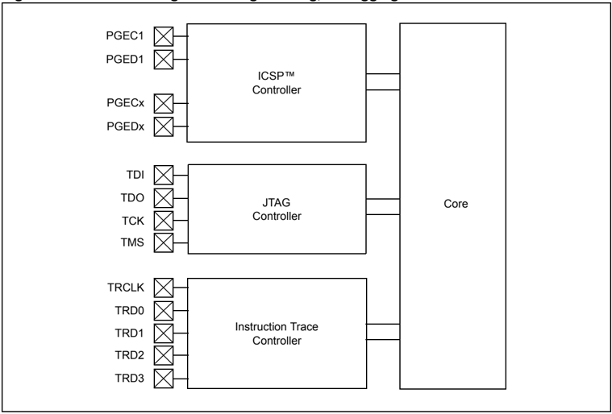
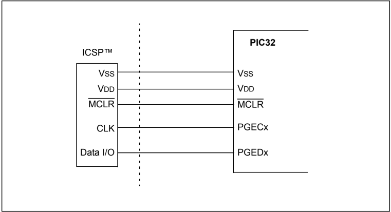
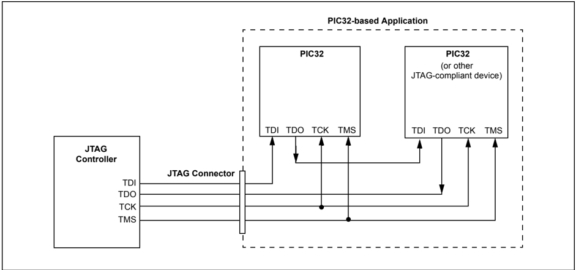
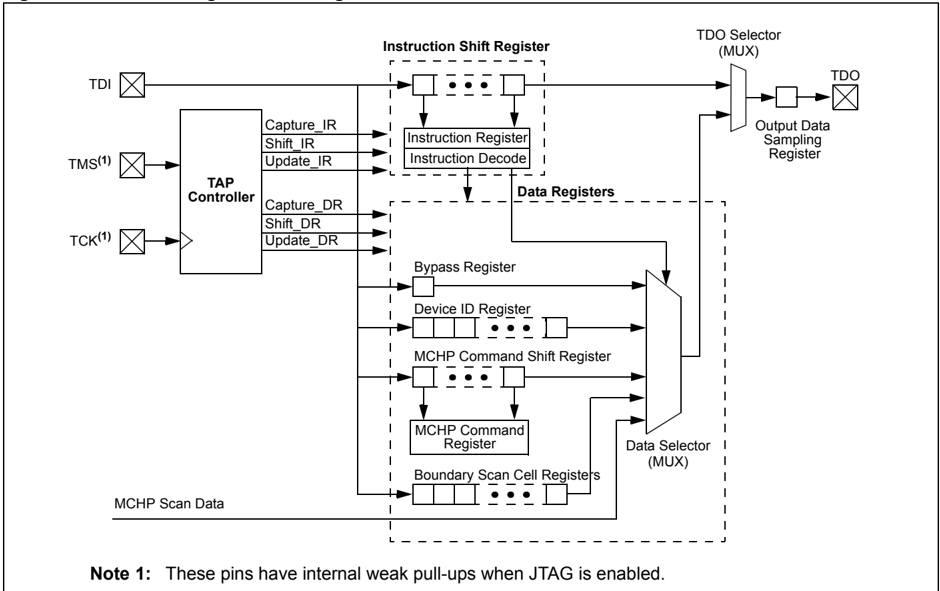
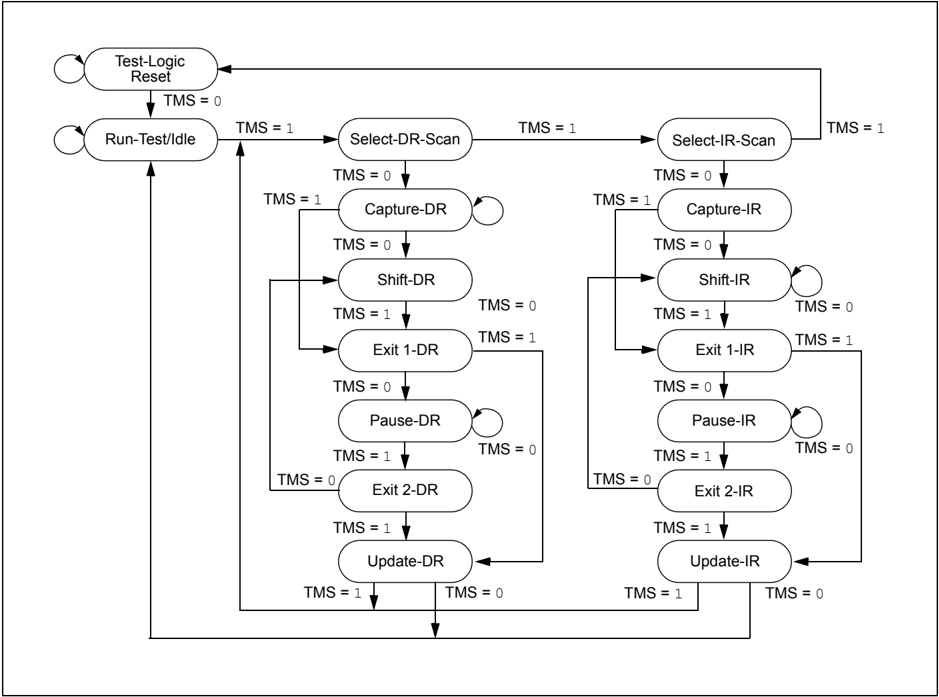
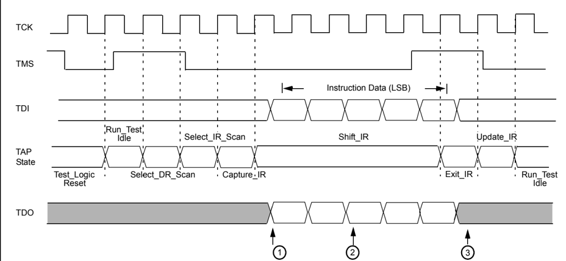
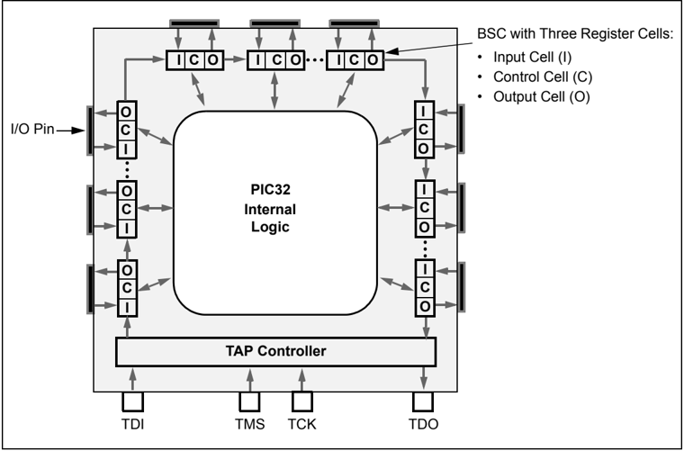
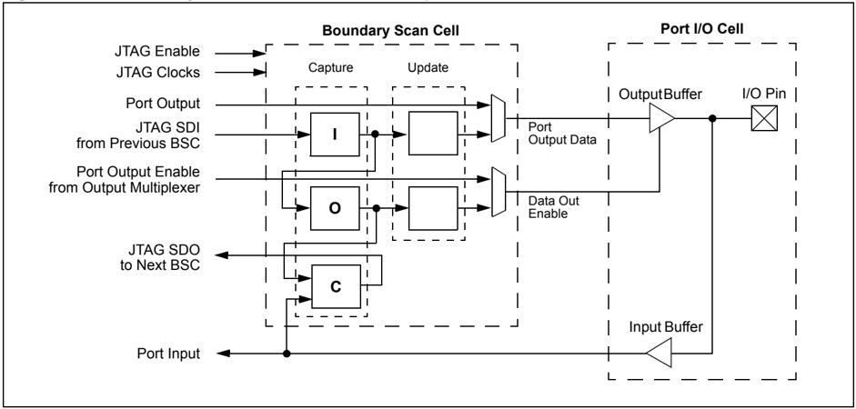

Microchip

## Section 33. Programming and Diagnostics

| HIGHLIGHTS   |                                                           |                                                                                                                                 |
|--------------|-----------------------------------------------------------|---------------------------------------------------------------------------------------------------------------------------------|
|              | This section of the manual contains the following topics: | This section of the manual contains the following topics:                                                                       |
|              | 33.1                                                      | Introduction..............................................................................................................33-2  |
|              | 33.2                                                      | Operation.................................................................................................................33-3  |
|              | 33.3                                                      | Interrupts................................................................................................................33-13 |
|              | 33.4                                                      | Operation in Power-Saving Modes........................................................................33-13                    |
|              | 33.5                                                      | Effects of Resets....................................................................................................33-13      |
|              | 33.6                                                      | Related Application Notes .....................................................................................33-14            |
|              | 33.7                                                      | Revision History.....................................................................................................33-15      |

Note:

This family reference manual section is meant to serve as a complement to device data sheets. Depending on the device variant, this manual section may not apply to all PIC32 devices.

Please consult the note at the beginning of the 'Special Features' chapter in the current device data sheet to check whether this document supports the device you are using.

Device  data  sheets  and  family  reference  manual  sections  are  available  for download from the Microchip Worldwide Web site at: http://www.microchip.com

## 33.1 INTRODUCTION

The PIC32 family of devices provides a complete range of programming and diagnostic features that  can  increase  the  flexibility  of  any  application  using  them.  These  features  allow  system designers to include:

- Simplified field programming using 2-wire In-Circuit Serial Programming™ (ICSP™) interfaces
- Debugging using standard ICSP and Enhanced ICSP
- Programming and debugging capabilities using the Enhanced Joint Test Action Group (Enhanced JTAG) extension of Joint Test Action Group (JTAG) interfaces
- JTAG Boundary scan testing for device and board diagnostics

The PIC32 family of devices incorporates two programming and diagnostic modules, and a trace controller,  which provide a range of functions to the application developer (see Figure 33-1). They are summarized in Table 33-1.

Note: Not all programming and diagnostic features are available on all devices. Refer to the specific device data sheet for availability.

Figure 33-1: Block Diagram of Programming, Debugging and Trace Ports

Table 33-1: Comparison of PIC32 Programming and Diagnostic Features

| Functions                 | Pins Used                  | Interface     |
|---------------------------|----------------------------|---------------|
| Boundary Scan             | TDI, TDO, TMS and TCK pins | JTAG          |
| Programming and Debugging | TDI, TDO, TMS and TCK pins | Enhanced JTAG |
| Programming and Debugging | PGECx and PGEDx pins       | ICSP™         |

## 33.2 OPERATION

This section provides a brief overview of operation for each programming option. For detailed information, refer to the 'PIC32MX Flash Programming Specification' (DS61145). Also, for all device programming options, a minimum VDD requirement for Flash erase and programming operations is required. Refer to the specific device data sheet for further details.

## 33.2.1 Device Programming Options

## 33.2.1.1 IN-CIRCUIT SERIAL PROGRAMMING™ (ICSP™)

ICSP is Microchip's proprietary solution to providing microcontroller programming in the target application. ICSP is also the most direct method to program the device, whether the controller is embedded in a system or loaded into a device programmer.

## 33.2.1.1.1 ICSP Interface

ICSP uses two pins as the core of its interface. The programming data line (PGD) functions as both an input and an output, allowing programming data to be read in and device information to be read out on command. The programming clock line (PGC) is used to clock in data and control the overall process.

Most PIC32 devices have more than one pair of PGECx and PGEDx pins, which are multiplexed with other I/O or peripheral functions. Individual ICSP pin pairs are indicated by number, such as PGEC1/PGED1, and so on. The multiple PGECx/PGEDx pin pairs provide additional flexibility in system design by allowing users to incorporate ICSP on the pair of pins that is least constrained by the circuit design. All PGECx and PGEDx pins are functionally tied together and behave identically, and any one pair can be used for successful device programming. The only limitation is that both pins from the same pair must be used.

In addition to the PGECx and PGEDx pins, ICSP requires that all voltage supply (including the voltage regulator pin, ENVREG) and ground pins on the device must be connected. The MCLR pin, which is used with the PGECx pin to enter and control the programming process, must also be connected to the programmer.

A typical ICSP connection is shown in Figure 33-2.

Figure 33-2: Typical ICSP™ Connection

## 33.2.1.1.2 ICSP Operation

ICSP uses a combination of internal hardware and external control to program the target device. Programming  data  and  instructions  are  provided  on  the  PGD.  ICSP  uses  a  special  set  of commands to control the overall process, combined with standard PIC32 instructions to execute the actual writing of the program memory. The PGD also returns data to the external programmer when responding to queries.

Control of the programming process is achieved by manipulating the PGC and MCLR. Entry into and  exit  from  Programming  mode  involves  applying  (or  removing)  voltage  to  MCLR  while supplying a code sequence to the PGD and a clock to the PGC. Any one of the PGECx/PGEDx pin pairs can be used to enter programming.

The internal process is regulated by a state machine built into the core logic of PIC32 devices; however, overall control of the process must be provided by the external programming device. Microchip programming devices, such as the MPLAB ® PM 3 (used with MPLAB IDE software), include the necessary hardware and algorithms to manage the programming process for PIC32 devices. Users who are interested in a detailed description, or who are considering designing their  own  programming  interface  for  PIC32  devices,  should  refer  to  the 'PIC32MX  Flash Programming Specification' (DS61145).

## 33.2.1.2 ENHANCED ICSP

The Enhanced ICSP protocol is an extension of the standard version of ICSP. It uses the same physical interface as the original, but changes the location and execution of programming control to a software application written to a PIC32 device. Use of Enhanced ICSP results in a significant decrease in overall programming time.

Standard ICSP uses a simple state machine to control each step of the programming process; however, that state machine is controlled by an external programmer. In contrast, Enhanced ICSP  uses  an  on-board  bootloader,  known  as  the  program  executive,  to  manage  the programming  process.  While  overall  device  programming  is  still  controlled  by  an  external programmer, the program executive manages most of the tasks that must be directly controlled by the programmer in standard ICSP.

The program executive implements its own command set, wider in range than standard ICSP, that can directly erase, program and verify the device program memory. This avoids the need to repeatedly run ICSP command sequences to perform simple tasks. As a result, Enhanced ICSP is capable of programming or reprogramming a device faster than standard ICSP.

The program executive is not preprogrammed into a PIC32 device. If Enhanced ICSP is needed, the user must use standard ICSP to program the executive to the executive memory space in RAM. This can be done directly by the user, or automatically, using a compatible Microchip programming system. After the programming executive is written the device can be programmed using Enhanced ICSP.

For additional information on Enhanced ICSP and the program executive, refer to the 'PIC32MX Flash Programming Specification' (DS61145).

## 33.2.1.3 DEVICE PROGRAMMING USING THE JTAG INTERFACE

The JTAG interface can also be used to program PIC32 devices in their target applications. The JTAG interface allows application designers to include a dedicated test and programming port into their applications, with a single 4-pin interface, without imposing the circuit constraints that the ICSP interface may require.

## 33.2.1.4 DEVICE PROGRAMMING USING THE ENHANCED JTAG INTERFACE

Enhanced JTAG programming uses the standard JTAG interface but utilizes a programming executive written to RAM. Use of the programming executive with the JTAG interface provides a significant improvement in programming speed.

## 33.2.2 Debugging

## 33.2.2.1 ICSP AND IN-CIRCUIT DEBUGGING

ICSP  also  provides  a  hardware  channel  for  the  In-Circuit  Debugger  (ICD),  which  allows externally  controlled  debugging  of  software.  Using  the  appropriate  hardware  interface  and software environment, users can force the device to single-step through its code, track the actual content of multiple registers, and set software breakpoints.

To use ICD, an external system that supports ICD must load a debugger executive program into the microcontroller. This is automatically handled by many debugger tools, such as the MPLAB IDE. For PIC32 devices, the program is loaded into the last page of the boot Flash memory space. When not debugging, the application is free to use the last page of boot Flash memory.

ICSP for PIC32 devices supports standard debugging functions including memory and register viewing and modification. Breakpoints can be set and the program execution may be stopped or started. In addition to these functions, registers or memory contents can be viewed and modified while the CPU is running.

In contrast with programming, only one of the ICSP ports may be used for ICD. If more than one ICSP port is implemented, a Configuration bit determines which port is available. Depending on the particular PIC32 device, there may be two or more ICSP ports that can be selected for this function. The active ICSP debugger port is selected by the ICESEL Configuration bit(s). For information on a particular device, refer to the specific device data sheet.

## 33.2.2.2 ENHANCED JTAG DEBUGGING

The industry standard Enhanced JTAG interface allows third-party Enhanced JTAG tools to be used for debugging. Using the Enhanced JTAG interface, memory and registers can be viewed and modified. Breakpoints can be set and the program execution may be stopped, started or single-stepped.

## 33.2.3 JTAG Boundary Scan

As the complexity and density of board designs increases, testing electrical connections between the components on fully assembled circuit boards poses many challenges. To address these challenges, a method for boundary scan testing was developed by the Joint Test Action Group that  was  later  standardized  as  IEEE  1149.1-2001, 'IEEE  Standard  Test  Access  Port  and Boundary  Scan  Architecture' .  Since  its  adoption,  many  microcontroller  manufacturers  have added device programming to the capabilities of the test port.

The JTAG boundary scan method is the process of adding a shift register stage adjacent to each of the component's I/O pins. This permits signals at the component boundaries to be controlled and observed, using a defined set of scan test principles. An external tester or controller provides instructions and reads the results in a serial fashion. The external device also provides common clock and control signals. Depending on the implementation, access to all test signals is provided through a standardized 4-pin interface.

In system-level applications, individual JTAG-enabled components are connected through their individual testing interfaces (in addition to their more standard application-specific connections). Devices are connected in a series or daisy-chained fashion, with the test output of one device connected exclusively to the test input of the next device in the chain. Instructions in the JTAG boundary scan protocol allow the testing of any one device in the chain, or any combination of devices, without testing the entire chain. In this method, connections between components, as well as connections at the boundary of the application, may be tested.

A typical application incorporating the JTAG boundary scan interface is shown in Figure 33-3. In this  example,  a  PIC32  family  microcontroller  is  daisy-chained  to  a  second  JTAG-compliant device. Note that the TDI line from the external tester supplies data to the TDI pin of the first device in the chain (in this case, the microcontroller). The resulting test data for this two-device chain is provided from the TDO pin of the second device to the TDO line of the tester.

Figure 33-3: Overview of PIC32 Family-based JTAG-compliant Application Showing Daisy-chaining of Components

In PIC32 devices, the hardware for the JTAG boundary scan is implemented as a peripheral module (i.e., outside of the CPU core) with additional integrated logic in all I/O ports. A logical block  diagram  of  the  JTAG  module  is  shown  in  Figure 33-4.  It  consists  of  the  following  key elements:

- Test Access Port (TAP) Interface Pins (TDI, TMS, TCK and TDO)
- TAP Controller
- Instruction Shift Register and Instruction Register (IR)
- Data Registers (DR)

Figure 33-4: JTAG Logical Block Diagram

## 33.2.3.1 TEST ACCESS PORT (TAP) AND TAP CONTROLLER

The  Test  Access  Port  (TAP)  on  the  PIC32  family  of  devices  is  a  general  purpose  port  that provides  test  access  to  many  built-in  support  functions  and  test  logic  defined  in  the  IEEE Standard 1149.1.

The PIC32 family of devices implements a 4-pin JTAG interface with these pins:

- TCK (Test Clock Input): Provides the clock for test logic
- TMS (Test Mode Select Input): Used by the TAP to control test operations
- TDI (Test Data Input): Serial input for test instructions and data
- TDO (Test Data Output): Serial output for test instructions and data

To minimize I/O loss due to JTAG, the optional TAP reset input pin, specified in the standard, is not implemented on the PIC32 family of devices. For convenience, a 'soft' TAP reset has been included in the TAP controller, using the TMS and TCK pins. To force a port reset, apply a logic high to the TMS pin for at least five rising edges of TCK. Note that device Resets (including POR) do not automatically result in a TAP reset; this must be done by the external JTAG controller using the soft TAP reset.

The TAP controller on the PIC32 family of devices is a synchronous finite state machine that implements the standard 16 states for JTAG. Figure 33-5 shows all of the module states of the TAP controller. All Boundary Scan Testing (BST) instructions and test results are communicated through the TAP via the TDI pin in a serial format, Least Significant bit (LSb) first.

Figure 33-5: TAP Controller Module State Diagram

By manipulating the state of TMS and the clock pulses on TCK, the TAP controller can be moved through all of the defined module states to capture, shift, and update various instruction and/or data registers. Figure 33-5 shows the state changes on TMS as the controller cycles through its state machine. Figure 33-6 shows the timing of TMS and TCK while transitioning the controller through the appropriate module states for shifting in an instruction. In this example, the sequence shown demonstrates how an instruction is read by the TAP controller.

All TAP controller states are entered on the rising edge of the TCK pin. In this example, the TAP controller starts in the Test\_Logic Reset state. Since the state of the TAP controller is dependent on the previous instruction, and therefore could be unknown, it is good programing practice to begin in the Test\_Logic Reset state.

When TMS is asserted low on the next rising edge of TCK, the TAP controller will move into the Run\_Test/Idle state. On the next two rising edges of TCK, TMS is high, which moves the TAP controller to the Select\_IR\_Scan state.

On the next two rising edges of TCK, TMS is held low, which moves the TAP controller into the Shift\_IR state. An instruction is shifted into the instruction register (IR) via the TDI on the next four rising edges of TCK. After the TAP controller enters this state, the TDO pin goes from a high-impedance state to active. The controller shifts out the initial state of the IR on the TDO pin, on the falling edges of TCK, and continues to shift out the contents of the instruction register while in the Shift\_IR state. The TDO returns to the high-impedance state on the first falling edge of TCK upon exiting the shift state.

On the next three rising edges of TCK, the TAP controller exits the Shift\_IR state, updates the Instruction Register and then moves back to the Run\_Test/Idle state. Data, or another instruction, can now be shifted into the appropriate data or instruction register.

Figure 33-6: TAP State Transitions for Shifting in an Instruction

- Note 1: The TDO pin is always in a high-impedance state until the first falling edge of TCK in either the Shift\_IR or Shift\_DR states.
- 2: The TDO pin is no longer high-impedance; the initial state of the Instruction Register (IR) is shifted out on the falling edge of TCK.
- 3: The TDO pin returns to high-impedance on the first falling edge of TCK in the Exit\_IR state.

## 33.2.3.2 JTAG REGISTERS

The JTAG module uses a number of registers of various sizes as part of its operation. In terms of bit count, most of the JTAG registers are single-bit register cells, integrated into the I/O ports. Regardless of their location within the module, none of the JTAG registers are located within the device data memory space, and cannot be directly accessed by the user in normal operating modes.

## 33.2.3.2.1 Instruction Register

The instruction register is a 5-bit shift register used for selecting the actions to be performed and/or what data registers to be accessed. Instructions are shifted in, Least Significant bit first, and then decoded.

A list and description of implemented instructions are provided in 33.2.3.4 'JTAG Instructions' .

## 33.2.3.2.2 Data Registers

Once an instruction is shifted in and updated into the instruction register, the TAP controller places certain data registers between the TDI and TDO pins. Additional data values can then be shifted into these data registers as needed.

The PIC32 family of devices supports three data registers:

- BYPASS Register: A single-bit register which allows the boundary scan test data to pass through the selected device to adjacent devices. The BYPASS register is placed between the TDI and TDO pins when the BYPASS instruction is active.
- Device ID Register: A 32-bit part identifier. It consists of an 11-bit manufacturer ID assigned by the IEEE (0x29 for Microchip Technology), device part number and device revision identifier. When the IDCODE instruction is active, the device ID register is placed between the TDI and TDO pins. The device data ID is then shifted out on to the TDO pin, on the next 32 falling edges of TCK, after the TAP controller is in the Shift\_DR.
- MCHP Command Shift Register: An 8-bit shift register that is placed between the TDI and TDO pins when the MCHP\_CMD instruction is active. This shift register is used to shift in Microchip commands.

## 33.2.3.3 BOUNDARY SCAN REGISTER (BSR)

The BSR is a large shift register that is comprised of all the I/O Boundary Scan Cells (BSCs), daisy-chained together (Figure 33-7). Each I/O pin has one BSC, each containing three BSC registers: an input cell, an output cell, and a control cell. When the SAMPLE / PRELOAD or EXTEST instructions are active, the BSR is placed between the TDI and TDO pins, with the TDI pin as the input and the TDO pin as the output.

The size of the BSR depends on the number of I/O pins on the device. For example, the 100-pin PIC32 general purpose devices have 82 I/O pins. With three BSC registers for each of the 82 I/Os, this yields a Boundary Scan register length of 244 bits. This is due to the MCLR pin being an input-only BSR cell. Information on the I/O port pin count of other PIC32 devices can be found in their specific device data sheets.

Figure 33-7: Daisy-chained Boundary Scan Cell Registers on a PIC32 Microcontroller

## 33.2.3.3.1 Boundary Scan Cell (BSC)

The function of the BSC is to capture and override I/O data values when JTAG is active. The BSC consists of three single-bit capture register cells and two single-bit holding register cells. The capture cells are daisy-chained to capture the port's input, output, and control (output-enable) data, as well as pass JTAG data along the Boundary Scan register. Command signals from the TAP controller determine if the port of JTAG data is captured, and how and when it is clocked out of the BSC.

The first register either captures internal data destined to the output driver, or provides serially scanned in data for the output driver. The second register captures internal output-enable control from the output driver  and  also  provides  serially  scanned  in  output-enable  values.  The  third register captures the input data from the I/O's input buffer.

Figure 33-8 shows a typical BSC and its relationship to the I/O port's structure.

Figure 33-8: Boundary Scan Cell and Its Relationship to the I/O Port

## 33.2.3.4 JTAG INSTRUCTIONS

The PIC32 family of devices supports the mandatory instruction set specified by IEEE 1149.1, as well  as  several  optional  public  instructions  defined  in  the  specification.  These  devices  also implement instructions that are specific to Microchip devices.

The mandatory JTAG instructions are:

- BYPASS (0x1F): Used for bypassing a device in a test chain, which allows the testing of off-chip circuitry and board-level interconnections
- SAMPLE/PRELOAD (0x02): Captures the I/O states of the component, providing a snapshot of its operation
- EXTEST (0x06): Allows the external circuitry and interconnections to be tested, by either forcing various test patterns on the output pins, or capturing test results from the input pins

Microchip  has  implemented  optional  JTAG  instructions  and  manufacturer-specific  JTAG commands in the PIC32 family of devices. For more information, refer to Table 33-2, Table 33-3, Table 33-4, and Table 33-5.

Table 33-2: JTAG Commands

| OPCODE   | Name           | Device Integration                                                      |
|----------|----------------|-------------------------------------------------------------------------|
| 0x1F     | Bypass         | Bypasses device in test chain.                                          |
| 0x00     | HIGHZ          | Places device in a high-impedance state, all pins are forced to inputs. |
| 0x01     | ID Code        | Shifts out the device's ID code.                                        |
| 0x02     | Sample/Preload | Samples all pins or loads a specific value into output latch.           |
| 0x06     | EXTEST         | Boundary Scan.                                                          |

## Table 33-3: Microchip TAP IR Commands

| OPCODE   | Name         | Device Integration                                  |
|----------|--------------|-----------------------------------------------------|
| 0x01     | MTAP_IDCODE  | Shifts out the device's ID code.                    |
| 0x07     | MTAP_COMMAND | Configure Microchip TAP controller for DR commands. |
| 0x04     | MTAP_SW_MTAP | Select Microchip TAP controller.                    |
| 0x05     | MTAP_SW_ETAP | Select Enhanced JTAG TAP controller.                |

## Table 33-4: Microchip TAP 8-bit DR Commands

| OPCODE   | Name               | Device Integration                                                             |
|----------|--------------------|--------------------------------------------------------------------------------|
| 0x00     | MCHP_STATUS        | Perform NOP and return status.                                                 |
| 0xD1     | MCHP_ASERT_RST     | Request assert device Reset.                                                   |
| 0xD0     | MCHP_DE_ASSERT_RST | Request deassert device Reset.                                                 |
| 0xFC     | MCHP_ERASE         | Perform a Chip Erase.                                                          |
| 0xFE     | MCHP_FLASH_ENABLE  | Enables fetches and loads to the Flash from the CPU.                           |
| 0xFD     | MCHP_FLASH_DISABLE | Disables fetches and loads to the Flash from the CPU.                          |
| 0xFF     | MCHP_READ_CONFIG   | Forces device to reread the configuration settings and initialize accordingly. |

Table 33-5: Enhanced JTAG Commands

| OPCODE    | Name         | Device Integration                                              | Data Length for the Following DR   |
|-----------|--------------|-----------------------------------------------------------------|------------------------------------|
| 0x00      | -            | Not used.                                                       | -                                  |
| 0x01      | IDCODE       | Selects the device's ID code register.                          | 32 bits                            |
| 0x02      | -            | Not used.                                                       | -                                  |
| 0x03      | IMPCODE      | Selects the implementation register.                            | -                                  |
| 0x04 (2)  | MTAP_SW_MTAP | Selects the Microchip TAP controller.                           | -                                  |
| 0x05 (2)  | MTAP_SW_ETAP | Selects the Enhanced JTAG TAP controller.                       | -                                  |
| 0x06-0x07 | -            | Not used.                                                       | -                                  |
| 0x08      | ADDRESS      | Selects the address register.                                   | 32 bits                            |
| 0x09      | DATA         | Selects the data register.                                      | 32 bits                            |
| 0x0A      | CONTROL      | Selects the Enhanced JTAG control register                      | 32 bits                            |
| 0x0B      | ALL          | Selects the address, data, and Enhanced JTAG control registers. | 96 bits                            |
| 0x0C      | EJTAGBOOT    | Forces the CPU to take a debug exception after a boot.          | 1-bit                              |
| 0x0D      | NORMALBOOT   | Makes the CPU execute the reset handler after a boot.           | 1-bit                              |
| 0x0E      | FASTDATA     | Selects the data and fast data registers.                       | 1-bit                              |
| 0x0F-0x1B | -            | Reserved.                                                       | -                                  |
| 0x1C-0xFE | -            | Not used.                                                       | -                                  |
| 0xFF      | -            | Selects the BYPASS register.                                    | -                                  |

[Note 1: Refer to the Enhanced JTAG Specification for information about this protocol and its commands, which is available from MIPS Technologies (www.mips.com).](http://www.mips.com/)

- 2: This opcode is not an Enhanced JTAG command, but is recognized by the Microchip implementation.

## 33.2.4 Boundary Scan Testing (BST)

BST is the method of controlling and observing the boundary pins of the JTAG-compliant device, such as PIC32 devices, utilizing software control. BST can be used to test connectivity between devices by daisy-chaining JTAG compliant devices to form a single scan chain. Several scan chains can exist on a PCB to form multiple scan chains. These multiple scan chains can then be driven  simultaneously  to  test  many  components  in  parallel.  Scan  chains  can  contain  both JTAG-compliant devices and non-JTAG-compliant devices.

A key advantage of BST is that it can be implemented without physical test probes; all that is needed is a 4-wire interface and an appropriate test platform. Since JTAG boundary scan has been available for many years, many software tools exist for testing scan chains without the need for extensive physical probing. The main drawback to BST is that it can only evaluate digital signals and circuit continuity; it cannot measure input or output voltage levels or currents.

## 33.2.4.1 RELATED JTAG FILES

To  implement  BST,  all  JTAG  test  tools  will  require  a  Boundary  Scan  Description  Language (BSDL)  file.  BSDL  is  a  subset  of  VHDL  (VHSIC  Hardware  Description  Language),  and  is described as part of IEEE Std. 1149.1. The device-specific BSDL file describes how the standard is implemented on a particular device and how it operates.

The BSDL file for a particular device includes the following:

- The pinout and package configuration for the particular device
- The physical location of the TAP pins
- The Device ID register and the device ID
- The length of the Instruction Register
- The supported BST instructions and their binary codes
- The length and structure of the Boundary Scan register
- The boundary scan cell definition

## 33.3 INTERRUPTS

Programming  and  debugging  operations  are  not  performed  during  code  execution  and  are therefore not affected by interrupts. Trace operations will report the change in code execution when an interrupt occurs but the trace controller is not affected by interrupts.

## 33.4 OPERATION IN POWER-SAVING MODES

PIC32 devices must be awake for all programming and debugging operations.

## 33.5 EFFECTS OF RESETS

## 33.5.1 Device Reset

A device Reset by asserting MCLR while in ICSP mode will force the ICSP to exit. Asserting MCLR will force an exit from Enhanced JTAG mode.

## 33.5.2 Watchdog Timer Reset

A Watchdog Timer (WDT) Reset during erase will not abort the erase cycle. The WDT event flag will be set to show that a WDT Reset has occurred.

A WDT Reset during an Enhanced JTAG session will reset the TAP controller to the Microchip TAP controller.

A WDT Reset during programming will abort the programming sequence.

## 33.6 RELATED APPLICATION NOTES

This  section  lists  application  notes  that  are  related  to  this  section  of  the  manual.  These application notes may not be written specifically for the PIC32 family of devices, but the concepts are  pertinent  and  could  be  used  with  modification  and  possible  limitations.  The  current application notes related to Programming and Diagnostics are:

## Title

No related application notes at this time.

Note:

Application Note #

N/A

Please visit the Microchip web site (www.microchip.com) for additional application notes and code examples for the PIC32 family of devices.

## 33.7 REVISION HISTORY

## Revision A (September 2007)

This is the initial released version of this document.

## Revision B (October 2007)

Updated document to remove Confidential status.

## Revision C (April 2008)

Revised document status to Preliminary; Revised U-0 to r-x.

## Revision D (June 2008)

This revision includes the following updates:

- Added a Note to 33.3.1 'Device Programming Options'
- Revised 33.3.2.1 'ICSP and In-Circuit Debugging'
- Revised Table 33-7
- Change Reserved bits from 'Maintain as' to 'Write' in all registers

## Revision E (August 2009)

This revision includes the following updates:

- Minor updates to text and formatting have been incorporated throughout the document
- Added the FJTAGEN bit and removed bits DDPU1, DDPU2 and DDPSPI1 from Table 33-2: Programming and Diagnostics SFR Summary
- Added FJTAGEN bit and removed bits DDPUSB, DDPU1, DDPU2 and DDPSPI1 from Register 33-1: DDPCON: Debug Data Port Control Register

## Revision F (February 2012)

This revision includes the following updates:

- Updated the Programming, Debugging, and Trace Ports Block Diagram (see Figure 33-1)
- Added Note 1 to the JTAG Logical Block Diagram (see Figure 33-4)
- Removed the Programming and Diagnostics SFR Summary (Table 33-2)
- Removed the DDPCON and DEVCFG0 registers (Register 33-1 and Register 33-2)
- Removed 33.3.3 'Special Debug Modes for Select Communication Peripherals'
- Updated the first paragraph of 33.2.3.1 'Test Access Port (TAP) and TAP Controller'
- Updated 33.2.4.1 'Related JTAG Files'
- Removed 33.2 'Control Registers'
- Removed 33.5 'I/O Pins'
- Removed 33.8 'Application Ideas'
- All references to the PGC and PGD pins have been updated to: PGECx and PGEDx
- All references to EJTAG were updated to: Enhanced JTAG
- All references to EICSP were updated to: Enhanced ICSP
- All occurrences of PIC32MX have been replaced with PIC32, with the exception of references to the 'PIC32MX Flash Programming Specification' (DS61145)
- Formatting modifications and text updates were incorporated throughout the document

NOTES:

## Note the following details of the code protection feature on Microchip devices:

- Microchip products meet the specification contained in their particular Microchip Data Sheet.
- Microchip believes that its family of products is one of the most secure families of its kind on the market today, when used in the intended manner and under normal conditions.
- There are dishonest and possibly illegal methods used to breach the code protection feature. All of these methods, to our knowledge, require using the Microchip products in a manner outside the operating specifications contained in Microchip's Data Sheets. Most likely, the person doing so is engaged in theft of intellectual property.
- Microchip is willing to work with the customer who is concerned about the integrity of their code.
- Neither Microchip nor any other semiconductor manufacturer can guarantee the security of their code. Code protection does not mean that we are guaranteeing the product as 'unbreakable.'

Code protection is constantly evolving. We at Microchip are committed to continuously improving the code protection features of our products. Attempts to break Microchip's code protection feature may be a violation of the Digital Millennium Copyright Act. If such acts allow unauthorized access to your software or other copyrighted work, you may have a right to sue for relief under that Act.

Information  contained  in  this  publication  regarding  device applications and the like is provided only for your convenience and may be superseded by updates. It is your responsibility to ensure  that  your  application  meets  with  your  specifications. MICROCHIP MAKES NO REPRESENTATIONS OR WARRANTIES  OF  ANY  KIND  WHETHER  EXPRESS  OR IMPLIED, WRITTEN OR ORAL, STATUTORY OR OTHERWISE, RELATED TO THE INFORMATION, INCLUDING  BUT  NOT  LIMITED  TO  ITS  CONDITION, QUALITY, PERFORMANCE, MERCHANTABILITY OR FITNESS  FOR  PURPOSE . Microchip  disclaims  all  liability arising  from  this  information  and  its  use.  Use  of  Microchip devices in life support and/or safety applications is entirely at the buyer's risk, and the buyer agrees to defend, indemnify and hold  harmless  Microchip  from  any  and  all  damages,  claims, suits,  or  expenses  resulting  from  such  use.  No  licenses  are conveyed, implicitly or otherwise, under any Microchip intellectual property rights.

## QUALITY MANAGEMENT SYSTEM CERTIFIED BY DNV

ISO/TS 16949.2009

## Trademarks

The Microchip name and logo, the Microchip logo, dsPIC, KEELOQ, KEELOQ logo, MPLAB, PIC, PICmicro, PICSTART, PIC 32  logo, rfPIC and UNI/O are registered trademarks of Microchip Technology Incorporated in the U.S.A. and other countries.

FilterLab, Hampshire, HI-TECH C, Linear Active Thermistor, MXDEV, MXLAB, SEEVAL and The Embedded Control Solutions Company are registered trademarks of Microchip Technology Incorporated in the U.S.A.

Analog-for-the-Digital Age, Application Maestro, chipKIT, chipKIT logo, CodeGuard, dsPICDEM, dsPICDEM.net, dsPICworks, dsSPEAK, ECAN, ECONOMONITOR, FanSense, HI-TIDE, In-Circuit Serial Programming, ICSP, Mindi, MiWi, MPASM, MPLAB Certified logo, MPLIB, MPLINK, mTouch, Omniscient Code Generation, PICC, PICC-18, PICDEM, PICDEM.net, PICkit, PICtail, REAL ICE, rfLAB, Select Mode, Total Endurance, TSHARC, UniWinDriver, WiperLock and ZENA are trademarks of Microchip Technology Incorporated in the U.S.A. and other countries.

SQTP is a service mark of Microchip Technology Incorporated in the U.S.A.

All other trademarks mentioned herein are property of their respective companies.

© 2007-2012, Microchip Technology Incorporated, Printed in the U.S.A., All Rights Reserved.

Printed on recycled paper.

ISBN: 978-1-62076-034-5

Microchip received ISO/TS-16949:2009 certification for its worldwide headquarters, design and wafer fabrication facilities in Chandler and Tempe, Arizona; Gresham, Oregon and design centers in California and India. The Company's quality system processes and procedures are for its PIC ®  MCUs and dsPIC ®  DSCs, KEELOQ ®  code hopping devices, Serial EEPROMs, microperipherals, nonvolatile memory and analog products. In addition, Microchip's quality system for the design and manufacture of development systems is ISO 9001:2000 certified.

## Worldwide Sales and Service

## ASIA/PACIFIC

Asia Pacific Office Suites 3707-14, 37th Floor Tower 6, The Gateway Harbour City, Kowloon Hong Kong Tel: 852-2401-1200 Fax: 852-2401-3431

Australia - Sydney Tel: 61-2-9868-6733 Fax: 61-2-9868-6755

China - Beijing Tel: 86-10-8569-7000 Fax: 86-10-8528-2104

China - Chengdu Tel: 86-28-8665-5511 Fax: 86-28-8665-7889

China - Chongqing Tel: 86-23-8980-9588 Fax: 86-23-8980-9500

China - Hangzhou Tel: 86-571-2819-3187 Fax: 86-571-2819-3189

China - Hong Kong SAR Tel: 852-2401-1200 Fax: 852-2401-3431

China - Nanjing Tel: 86-25-8473-2460 Fax: 86-25-8473-2470

China - Qingdao Tel: 86-532-8502-7355 Fax: 86-532-8502-7205

China - Shanghai Tel: 86-21-5407-5533 Fax: 86-21-5407-5066

China - Shenyang Tel: 86-24-2334-2829 Fax: 86-24-2334-2393

China - Shenzhen Tel: 86-755-8203-2660 Fax: 86-755-8203-1760

China - Wuhan Tel: 86-27-5980-5300 Fax: 86-27-5980-5118

China - Xian Tel: 86-29-8833-7252 Fax: 86-29-8833-7256

China - Xiamen Tel: 86-592-2388138 Fax: 86-592-2388130

China - Zhuhai Tel: 86-756-3210040 Fax: 86-756-3210049

## ASIA/PACIFIC

India - Bangalore Tel: 91-80-3090-4444 Fax: 91-80-3090-4123

India - New Delhi Tel: 91-11-4160-8631 Fax: 91-11-4160-8632

India - Pune Tel: 91-20-2566-1512 Fax: 91-20-2566-1513

Japan - Osaka Tel: 81-66-152-7160 Fax: 81-66-152-9310

Japan - Yokohama Tel: 81-45-471- 6166 Fax: 81-45-471-6122

Korea - Daegu Tel: 82-53-744-4301 Fax: 82-53-744-4302

Korea - Seoul Tel: 82-2-554-7200 Fax: 82-2-558-5932 or 82-2-558-5934

Malaysia - Kuala Lumpur Tel: 60-3-6201-9857 Fax: 60-3-6201-9859

Malaysia - Penang Tel: 60-4-227-8870 Fax: 60-4-227-4068

Philippines - Manila Tel: 63-2-634-9065 Fax: 63-2-634-9069

Singapore Tel: 65-6334-8870 Fax: 65-6334-8850

Taiwan - Hsin Chu Tel: 886-3-5778-366 Fax: 886-3-5770-955

Taiwan - Kaohsiung Tel: 886-7-536-4818 Fax: 886-7-330-9305

Taiwan - Taipei Tel: 886-2-2500-6610 Fax: 886-2-2508-0102

Thailand - Bangkok Tel: 66-2-694-1351 Fax: 66-2-694-1350

## AMERICAS

Corporate Office 2355 West Chandler Blvd. Chandler, AZ 85224-6199 Tel: 480-792-7200 Fax: 480-792-7277 Technical Support:

[http://www.microchip.com/ support](http://support.microchip.com/)

Web Address:

www.microchip.com

Atlanta Duluth, GA Tel: 678-957-9614 Fax: 678-957-1455

Boston Westborough, MA Tel: 774-760-0087 Fax: 774-760-0088

## Chicago

Itasca, IL Tel: 630-285-0071 Fax: 630-285-0075

## Cleveland

Independence, OH Tel: 216-447-0464 Fax: 216-447-0643

Dallas

Addison, TX Tel: 972-818-7423 Fax: 972-818-2924

Detroit Farmington Hills, MI Tel: 248-538-2250 Fax: 248-538-2260

Indianapolis Noblesville, IN Tel: 317-773-8323 Fax: 317-773-5453

Los Angeles Mission Viejo, CA Tel: 949-462-9523 Fax: 949-462-9608

Santa Clara Santa Clara, CA Tel: 408-961-6444 Fax: 408-961-6445

Toronto Mississauga, Ontario, Canada Tel: 905-673-0699 Fax: 905-673-6509

## EUROPE

Austria - Wels Tel: 43-7242-2244-39 Fax: 43-7242-2244-393

Denmark - Copenhagen Tel: 45-4450-2828 Fax: 45-4485-2829

France - Paris Tel: 33-1-69-53-63-20 Fax: 33-1-69-30-90-79

Germany - Munich Tel: 49-89-627-144-0 Fax: 49-89-627-144-44

Italy - Milan Tel: 39-0331-742611 Fax: 39-0331-466781

Netherlands - Drunen Tel: 31-416-690399 Fax: 31-416-690340

Spain - Madrid Tel: 34-91-708-08-90 Fax: 34-91-708-08-91

UK - Wokingham Tel: 44-118-921-5869 Fax: 44-118-921-5820

11/29/11