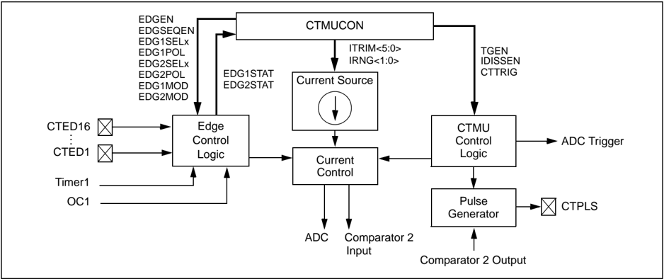
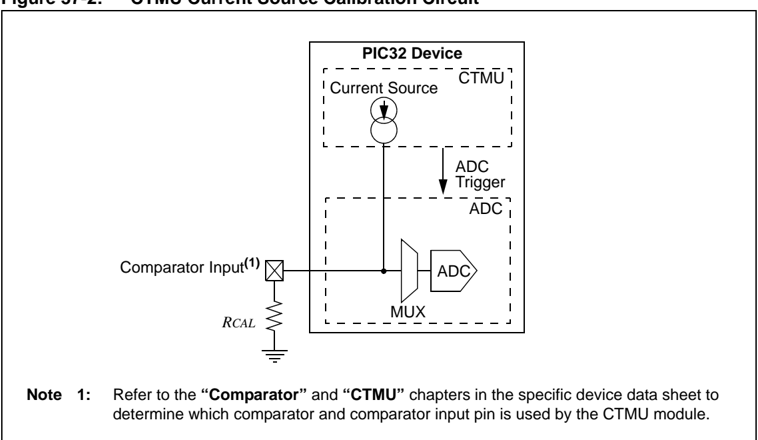
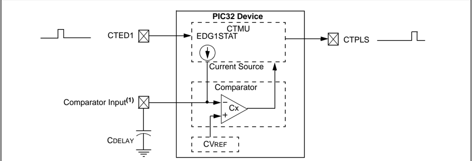
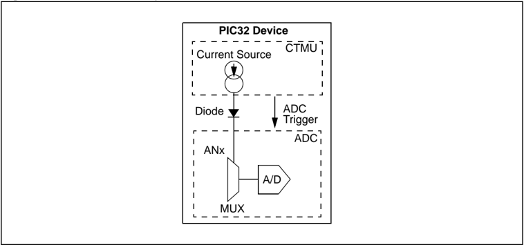

Microchip

## Section 37. Charge Time Measurement Unit (CTMU)

## HIGHLIGHTS

This section of the manual contains the following major topics:

|   37.1 | Introduction ..................................................................................................................37-2   |
|--------|---------------------------------------------------------------------------------------------------------------------------------------|
|   37.2 | Registers......................................................................................................................37-3   |
|   37.3 | CTMU Operation..........................................................................................................37-6          |
|   37.4 | CTMU Module Initialization ..........................................................................................37-8             |
|   37.5 | Calibrating the CTMU Module......................................................................................37-9                 |
|   37.6 | Measuring Capacitance with the CTMU.....................................................................37-15                         |
|   37.7 | Measuring Time with the CTMU Module....................................................................37-18                          |
|   37.8 | Creating a Delay with the CTMU Module...................................................................37-18                         |
|   37.9 | Measuring On-Chip Temperature with the CTMU......................................................37-19                                |
|  37.10 | Operation During Sleep/Idle Modes...........................................................................37-20                     |
|  37.11 | Effects of a Reset on CTMU......................................................................................37-20                 |
|  37.12 | Related Application Notes..........................................................................................37-21              |
|  37.13 | Revision History.........................................................................................................37-22        |

Note:

This family reference manual section is meant to serve as a complement to device data sheets. Depending on the device variant, this manual section may not apply to all PIC32 devices.

[Please consult the note at the beginning of the 'Charge Time Measurement Unit (CTMU)' chapter in the current device data sheet to check whether this document supports the device you are using.](http://www.microchip.com/)

Device  data  sheets  and  family  reference  manual  sections  are  available  for download from the Microchip Worldwide Web site at: http://www.microchip.com

## 37.1 INTRODUCTION

The Charge Time Measurement Unit (CTMU) is a flexible analog module that has a configurable current  source  with  a  digital  configuration  circuit  built  around  it.  The  CTMU  can  be  used  for differential time measurement between pulse sources and can be used for generating an asynchronous pulse. By working with other on-chip analog modules, the CTMU can be used for high resolution time measurement, measure capacitance, measure relative changes in capacitance or  generate  output  pulses  with  a  specific  time  delay.  The  CTMU  is  ideal  for  interfacing  with capacitive-based sensors.

The module includes the following key features:

- Up to 32 channels available for capacitive or time measurement input
- On-chip precision current source
- 16-edge input trigger sources
- Selection of edge or level-sensitive inputs
- Polarity control for each edge source
- Control of edge sequence
- Control of response to edges
- High precision time measurement
- Time delay of external or internal signal asynchronous to system clock
- Integrated temperature sensing diode
- Control of current source during auto-sampling
- Four current source ranges
- Time measurement resolution of one nanosecond

The CTMU works in conjunction with the Analog-to-Digital Converter (ADC) to provide up to 32 channels for time or charge measurement, depending on the specific device and the number of ADC channels available. When configured for time delay, the CTMU is connected to one of the analog comparators. The level-sensitive input edge sources can be selected from four sources: two external inputs, Timer1 or Output Compare Module 1. For information on available input sources, refer to the specific device data sheet.

A block diagram of the CTMU is shown in Figure 37-1.

Figure 37-1: CTMU Block Diagram



## Section 37. Charge Time Measurement Unit (CTMU)

## 37.2 REGISTERS

The CTMUCON register contains control bits for configuring the CTMU module edge source selection, edge source polarity selection, edge sequencing, ADC trigger, analog circuit capacitor discharge and enables. In addition, this register has bits for selecting the current source range and current source trim.

Table 37-1 summarizes the CTMU-related register. A detailed description of the register follows the summary.

Table 37-1: CTMU SFR Summary (1)

| Name    | Bit Range   | Bit 31/23/15/7   | Bit 30/22/14/6   | Bit 29/21/13/5   | Bit 28/20/12/4   | Bit 27/19/11/3   | Bit 26/18/10/2   | Bit 25/17/9/1   | Bit 24/16/8/0   |
|---------|-------------|------------------|------------------|------------------|------------------|------------------|------------------|-----------------|-----------------|
| CTMUCON | 31:24       | EDG1MOD          | EDG1POL          | EDG1SEL<3:0>     | EDG1SEL<3:0>     | EDG1SEL<3:0>     | EDG1SEL<3:0>     | EDG2STAT        | EDG1STAT        |
| CTMUCON | 23:16       | EDG2MOD          | EDG2POL          | EDG2SEL<3:0>     | EDG2SEL<3:0>     | EDG2SEL<3:0>     | EDG2SEL<3:0>     | -               | -               |
| CTMUCON | 15:8        | ON               | -                | CTMUSIDL         | TGEN             | EDGEN            | EDGSEQEN         | IDISSEN         | CTTRIG          |
| CTMUCON | 7:0         | ITRIM<5:0>       | ITRIM<5:0>       | ITRIM<5:0>       | ITRIM<5:0>       | ITRIM<5:0>       | ITRIM<5:0>       | IRNG<1:0>       | IRNG<1:0>       |

Legend: - = unimplemented, read as ' 0 '. Address offset values are shown in hexadecimal.

Note

1: Not all registers have associated SET, CLR, and INV registers. Refer to the specific device data sheet for details.

## PIC32 Family Reference Manual

Register 37-1:

## CTMUCON: CTMU Control Register

| Bit Range   | Bit 31/23/15/7   | Bit 30/22/14/6   | Bit 29/21/13/5   | Bit 28/20/12/4   | Bit 27/19/11/3   | Bit 26/18/10/2   | Bit 25/17/9/1   | Bit 24/16/8/0   |
|-------------|------------------|------------------|------------------|------------------|------------------|------------------|-----------------|-----------------|
| 31:24       | R/W-0            | R/W-0            | R/W-0            | R/W-0            | R/W-0            | R/W-0            | R/W-0           | R/W-0           |
| 31:24       | EDG1MOD          | EDG1POL          | EDG1SEL<3:0> (1) | EDG1SEL<3:0> (1) | EDG1SEL<3:0> (1) | EDG1SEL<3:0> (1) | EDG2STAT        | EDG1STAT        |
| 23:16       | R/W-0            | R/W-0            | R/W-0            | R/W-0            | R/W-0            | R/W-0            | U-0             | U-0             |
| 23:16       | EDG2MOD          | EDG2POL          | EDG2SEL<3:0> (1) | EDG2SEL<3:0> (1) | EDG2SEL<3:0> (1) | EDG2SEL<3:0> (1) | -               | -               |
| 15:8        | R/W-0            | U-0              | R/W-0            | R/W-0            | R/W-0            | R/W-0            | R/W-0           | R/W-0           |
| 15:8        | ON               | -                | CTMUSIDL         | TGEN             | EDGEN            | EDGSEQEN         | IDISSEN         | CTTRIG          |
| 7:0         | R/W-0            | R/W-0            | R/W-0            | R/W-0            | R/W-0            | R/W-0            | R/W-0           | R/W-0           |
| 7:0         | ITRIM<5:0>       | ITRIM<5:0>       | ITRIM<5:0>       | ITRIM<5:0>       | ITRIM<5:0>       | ITRIM<5:0>       | IRNG<1:0>       | IRNG<1:0>       |

## Legend:

R = Readable bit

W = Writable bit

U = Unimplemented bit, read as '0'

-n = Value at POR

'1' = Bit is set

'0' = Bit is cleared

x = Bit is unknown

bit 31

EDG1MOD:

Edge1 Edge Sampling Select bit

1 = Input is edge-sensitive

0 = Input is level-sensitive

bit 30

EDG1POL: Edge 1 Polarity Select bit

1 = Edge1 programmed for a positive edge response

0 = Edge1 programmed for a negative edge response

bit 29-26 EDG1SEL&lt;3:0&gt;: Edge 1 Source Select bits (1)

1111 = CTED16 selected

•

•

•

0000 = CTED1 selected

bit 25

EDG2STAT: Edge2 Status bit

Indicates the status of Edge2 and can be written to control edge source

1 = Edge2 has occurred

0 = Edge2 has not occurred

bit 24 EDG1STAT: Edge1 Status bit

Indicates the status of Edge1 and can be written to control edge source

1 = Edge1 has occurred

0 = Edge1 has not occurred

bit 23

EDG2MOD:

Edge2 Edge Sampling Select bit

1 = Input is edge-sensitive

0 = Input is level-sensitive

bit 22

EDG2POL: Edge 2 Polarity Select bit

1 = Edge2 programmed for a positive edge response

0 = Edge2 programmed for a negative edge response

bit 21-18 EDG2SEL&lt;3:0&gt;: Edge 2 Source Select bits (1)

1111 = CTED16 selected

•

•

•

0000 = CTED1 selected

bit 17-16 Unimplemented:

Read as '0'

bit 15 ON: ON Enable bit

1 = Module is enabled

0 = Module is disabled

Note 1: Refer to the 'CTMU' chapter in the specific device data sheet for the list of available trigger sources.

## Section 37. Charge Time Measurement Unit (CTMU)

## Register 37-1: CTMUCON: CTMU Control Register (Continued)

```
bit 14 Unimplemented: Read as '0' bit 13 CTMUSIDL: Stop in Idle Mode bit 1 = Discontinue module operation when device enters Idle mode 0 = Continue module operation in Idle mode bit 12 TGEN: Time Generation Enable bit 1 = Enables edge delay generation 0 = Disables edge delay generation bit 11 EDGEN: Edge Enable bit 1 = Edges are not blocked 0 = Edges are blocked bit 10 EDGSEQEN: Edge Sequence Enable bit 1 = Edge1 must occur before Edge2 can occur 0 = No edge sequence is needed bit 9 IDISSEN: Current Discharge Enable bit 1 = Analog current source output is grounded 0 = Analog current source output is not grounded bit 8 CTTRIG: Trigger Control bit 1 = Trigger output is enabled 0 = Trigger output is disabled bit 7-2 ITRIM<5:0>: Current Source Trim bits 111111 = Minimum negative change from nominal current · · · 100010 100001 = Maximum negative change from nominal current 011111 = Maximum positive change from nominal current 011110 · · · 000001 = Minimum positive change from nominal current 000000 = Nominal current output specified by IRNG<1:0> bit 1-0 IRNG<1:0>: Current Range Select bits 11 = 100 times base current 10 = 10 times base current 01 = Base current level (0.55 μ A nominal) 00 = 1000 times base current
```

Note 1: Refer to the 'CTMU' chapter in the specific device data sheet for the list of available trigger sources.

## 37.3 CTMU OPERATION

The CTMU works by using a constant current source to charge a circuit. The type of circuit depends on the type of measurement being made. In the case of capacitance measurement, the current is fixed and the amount of time the current is applied to the circuit is fixed. The amount of voltage read by the ADC is then a measurement of the capacitance of the circuit. In the case of time measurement, the current, as well as the capacitance of the circuit, is fixed and charge time varies. In this case, the voltage read by the ADC is then representative of the amount of time elapsed from the time the current source starts and stops charging the circuit.

If the CTMU is being used as a time delay, both capacitance and current source are fixed, as well as the voltage supplied to the comparator circuit. The delay of a signal is determined by the amount of time taken for the voltage to charge to the comparator threshold voltage.

## 37.3.1 Theory of Operation

The operation of the CTMU is based on the equation for charge, as shown in Equation 37-1.

## Equation 37-1:

<!-- formula-not-decoded -->

More simply, the amount of charge measured in coulombs in a circuit is defined as current in amperes ( I ) multiplied by the amount of time in seconds that the current flows ( t ). Charge is also defined as the capacitance in farads ( C ) multiplied by the voltage of the circuit ( V ), as shown in Equation 37-2.

## Equation 37-2:

<!-- formula-not-decoded -->

The CTMU module provides a constant, known current source. The ADC is used to measure ( V ) in the equation, leaving two unknowns: capacitance ( C ) and time ( t ). Equation 37-2 can be used to calculate capacitance or time, by either the relationship shown in Equation 37-3 and using the known fixed capacitance of the circuit, or by Equation 37-4 using a fixed time that the current source is applied to the circuit.

## Equation 37-3:

## Equation 37-4:

<!-- formula-not-decoded -->

<!-- formula-not-decoded -->

## 37.3.2 Current Source

At the heart of the CTMU is a precision current source, designed to provide a constant reference for measurements. The level of current is user-selectable across four ranges, or a total of two orders of magnitude, with the ability to trim the output in ±2% increments (nominal). The current range is selected by the IRNG&lt;1:0&gt; bits (CTMUCON&lt;1:0&gt;) with a value of ' 01 ' representing the lowest range.

Current trim is provided by the ITRIM&lt;5:0&gt; bits (CTMUCON&lt;7:2&gt;). These six bits allow trimming of the current source in steps of approximately 2% per step. Note that half of the range adjusts the current source positively and the other half reduces the current source. A value of ' 000000 ' is the neutral position (no change). A value of ' 100001 ' (see Note 1 ) is the maximum negative adjustment  (approximately  -62%)  and  ' 011111 '  (see Note  2 )  is  the  maximum  positive adjustment (approximately +62%).

- Note 1: The value ' 100001 ' = -31 &amp; 0x3F → iTRIM = -31 * Delta I, approximately -62% of nominal.
- 2: The value ' 011111 ' = +31 &amp; 0x3F → iTRIM = +31 * Delta I, approximately +62% of nominal.

## 37.3.3 Edge Selection and Control

CTMU  measurements  are  controlled  by  edge  events  occurring  on  the  module's  two  input channels. Each channel, referred as Edge 1 and Edge 2, can be configured to receive input pulses from one  of the sixteen edge  input pins. The  inputs are selected using  the EDG1SEL&lt;3:0&gt; and EDG2SEL&lt;3:0&gt; bit pairs (CTMUCON&lt;29:26&gt; and CTMUCON&lt;21:18&gt;).

In addition to source, each channel can be configured for event polarity using the EDG1POL and EDG2POL bits (CTMUCON&lt;30&gt;and CTMUCON&lt;22&gt;). The input channels can also be filtered for an edge event sequence (Edge 1 occurring before Edge 2) by setting the EDGSEQEN bit (CTMUCON&lt;10&gt;).

## 37.3.4 Edge Status

The  CTMUCON  register  also  contains  two  status  bits:  EDG1STAT  (CTMUCON&lt;24&gt;)  and EDG2STAT  (CTMUCON&lt;25&gt;).  Their  primary  function  is  to  show  if  an  edge  response  has occurred on the corresponding channel. The CTMU automatically sets a particular bit when an edge response is detected on its channel. The level-sensitive or edge-sensitive nature of the input  channels  means  that  the  status  bits  are  set  immediately  if  the  channel's  configuration changes and remains in the new state.

The CTMU module uses the edge status bits to control the current source output to external analog modules (such as the ADC). Current is supplied to external modules only when one (but not both) of the status bits is set and shuts current off when both bits are either set or cleared. This allows the CTMU to measure current only during the interval between edges. After both the status bits are set, it is necessary to clear them before another measurement is taken. Both the bits should be cleared simultaneously, if possible, to avoid re-enabling the CTMU current source.

In addition to being set by the CTMU hardware, the edge status bits can also be set by software. This allows the user's application to manually enable or disable the current source. Setting either one (but not both) of the bits enables the current source. Setting or clearing both bits at once disables the source.

## 37.3.5 Interrupts

The CTMU sets its interrupt flag (CTMUIF) whenever the current source is enabled and then disabled.  If  edge  sequencing  is  not  enabled  (i.e.,  Edge  1  must  occur  before  Edge  2),  it  is necessary to monitor the edge status bits and determine which edge occurred last and caused the interrupt.

## 37.4 CTMU MODULE INITIALIZATION

The following sequence is a general guideline used to initialize the CTMU module:

1. Select the current source range using the IRNG&lt;1:0&gt; bits (CTMUCON&lt;1:0&gt;).
2. Adjust the current source trim using the ITRIM&lt;5:0&gt; bits (CTMUCON&lt;7:2&gt;).
3. Configure the edge input sources for Edge 1 and Edge 2 by setting the EDG1SEL and EDG2SEL bits (CTMUCON&lt;29:26&gt; and CTMUCON&lt;21:18&gt;).
4. Configure the input polarities for the edge inputs using the EDG1POL bit (CTMUCON&lt;30&gt;) and EDG2POL bit (CTMUCON&lt;22&gt;). The default configuration is for negative edge polarity (high-to-low transitions).
5. Enable edge sequencing using the EDGSEQEN bit (CTMUCON&lt;10&gt;). By default, edge sequencing is disabled.
6. Select the operating mode  (Measurement  or Time Delay) with the TGEN  bit (CTMUCON&lt;12&gt;). By default, the time delay mode is disabled.
7. Configure the module to automatically trigger an analog-to-digital conversion when the second edge event has occurred using the CTTRIG bit (CTMUCON&lt;8&gt;). The conversion trigger is disabled by default.
8. Discharge the connected circuit by setting the IDISSEN bit (CTMUCON&lt;9&gt;). After waiting a sufficient time for the circuit to discharge, clear the IDISSEN bit.
9. Disable the module by clearing the ON bit (CTMUCON&lt;15&gt;).
10. Clear the Edge Status bits, EDG2STAT&lt;3:0&gt; and EDG1STAT&lt;3:0&gt; (CTMUCON&lt;29:26&gt; and CTMUCON&lt;21:18&gt;).
11. Enable both edge inputs by setting the EDGEN bit (CTMUCON&lt;11&gt;).
12. Enable the module by setting the ON bit (CTMUCON&lt;15&gt;).

Depending  on  the  type  of  measurement  or  pulse  generation  being  performed,  one  or  more additional modules may also need to be initialized and configured with the CTMU module:

- Edge Source Generation: In addition to the external edge input pins, other modules, such as ICx, OCx, and Timer1 can be used as edge sources for the CTMU. Refer to the specific device data sheet for available sources.
- Capacitance or Time Measurement: The CTMU module uses the ADC to measure the voltage across a capacitor that is connected to one of the analog input channels.
- Pulse Generation: When generating system clock independent output pulses, the CTMU module uses Comparator 2 and the associated comparator voltage reference.

For specific information on initializing these modules, refer to the applicable section in the 'PIC32 Family Reference Manual' for the appropriate module.

## 37.5 CALIBRATING THE CTMU MODULE

The CTMU requires calibration for precise measurements of capacitance and time, as well as for accurate time delay. If the application requires only measurement of a relative change in capacitance or time, calibration is usually not necessary. An example of this type of application would include a capacitive touch switch, in which the touch circuit has a baseline capacitance and the added capacitance of the human body changes the overall capacitance of a circuit.

If  actual  capacitance  or  time  measurement  is  required,  two  hardware  calibrations  must  take place: the current source needs calibration to set it to a precise current, and the circuit being measured needs calibration to measure and/or nullify all other capacitance other than that to be measured.

## 37.5.1 Current Source Calibration

The current source on-board the CTMU module has a range of ±62% nominal for each of four current ranges. Therefore, for precise measurements, it is possible to measure and adjust this current source by placing a high precision resistor, RCAL ,  onto  a  special  analog  channel.  An example circuit is shown in Figure 37-2. The current source measurement is performed using the following steps:

1. Initialize the ADC.
2. Initialize the CTMU by configuring the module for Pulse Generation (TGEN = 1 ) mode.
3. Enable the current source by setting the EDG1STAT bit (CTMUCON&lt;24&gt;).
4. Issue settling time delay.
5. Perform analog-to-digital conversion.
6. Calculate the current source current using I  = V/RCAL ,  where RCAL is  a  high  precision resistance and V is measured by performing an analog-to-digital conversion.

The CTMU current source may be trimmed with the trim bits in the CTMUCON register using an iterative process to get an exact desired current. Alternatively, the nominal value without adjustment may be used. It may be stored by the software for use in all subsequent capacitive or time measurements.

Figure 37-2 shows the external connections for current source calibration, as well as the relationship of the different analog modules required.

CTMU charge pump calibration should be done only on the special pin that connects to the Comparator module associated with the CTMU. Use of any other ANx pin will add around 2.5 k Ω of series resistance to the measurement from the analog multiplexer in front of the ADC.  This effect can be ignored only for the smallest current settings.  For larger current settings, the uncertainty in the extra series resistance overwhelms the overall resistance accuracy from the calibration resistor.

To calculate the value for RCAL , the nominal current must be chosen and then the resistance can be calculated. For example, if the ADC reference voltage is 3.3V, use 70% of full scale, or 2.31V as the desired approximate voltage to be read by the ADC. If the range of the CTMU current source is selected to be 0.55 μ A, the required resistor value is calculated as RCAL = 2.31V / 0.55 µA, for  a  value  of  4.2 M Ω .  Similarly,  if  the  current  source  is  chosen  to  be 5.5 µA, RCAL would be 420,000 Ω and 42,000 Ω if the current source is set to 55 µA.

Figure 37-2: CTMU Current Source Calibration Circuit



Choose a value of 70% full-scale voltage to ensure that the ADC is in a range that is above the noise  floor.  If  exact  current  is  chosen  to  incorporate  the  trimming  bits  from  the  CTMUCON register, the resistor value of RCAL must be adjusted accordingly. RCAL may be adjusted to allow for available resistor values. RCAL should be of the highest precision available, the amount of precision  required  for  the  circuit  that  the  CTMU  will  be  used  to  measure.  A  recommended minimum precision would be 0.1% tolerance.

Example 37-1 shows a typical method for performing a CTMU current calibration. This method manually triggers the ADC and it is performed to demonstrate the process. It is also possible to automatically trigger the conversion by setting the CTTRIG bit (CTMUCON&lt;8&gt;).

Note: A complete MPLAB project based on this calibration routine is available on the Microchip website at: http://www.microchip.com/CodeExamplesByFunc.aspx. From the landing page, scroll down and select Touch Sense (mTouch) as  the application.

## Section 37. Charge Time Measurement Unit (CTMU)

## Example 37-1: Current Calibration Routine

```
// Device setup - TO DO: Set up device with #pragma's int main(void) { unsigned long int  ADC_Sum; // For averaging multiple ADC measurements unsigned short int iAvg, // Averaging index Naverages = 1024, // Number of averages < 2^22 (22=32-10 bits of ADC) Log2Naverages = 10; // Right shift equal to 1/Naverages short int          iTrim; // Current trim index unsigned short int VmeasADC, VavgADC; // Measured Voltages, 65536 = Full Scale // TO DO: Disable JTAG and enable multivector interrupt table // Set up UART2 for transmission of button data // TO DO: Set up pins // CTMU Setup CTMUCONbits.TGEN = 1; // Enable direct output to C2INB/AN2 pin CTMUCONbits.IRNG = 0x3; // Current Range // Turn on CTMU after setting current trim below // ADC Setup AD1CON2 = 0x0; // VR+ = AVDD, V- = AVSS, Don't scan, MUX A only // ADC clock derived from peripheral buss clock // Tadc = 4 * Tpbus = 4 * 25 ns = 100 ns > 65 ns required // Tadc = 2*(1+1)*Tpbus // Tadc = 2*(AD1CON3<7:0>+1)*Tpbus AD1CON3 =        1; AD1CSSL = 0x0; // No channels scanned AD1CHSbits.CH0SA = 2; // Select channel AN2 (PG1D/AN2/C2INB) ANSELA = 0x0000; // No ADC pins ANSELB = 1<<0; // RB0: for AN2/C2INB, which is connected to Rcal ANSELC = 0x0000; // No ADC pins IEC0bits.AD1IE = 0; // Disable ADC interrupts AD1CON1bits.ON = 1; // Turn on ADC // Sweep over all possible current trim values for ( iTrim = -31; iTrim < 32; iTrim++ ) { CTMUCONbits.ITRIM = iTrim & 0x3F; // Set current trim value CTMUCONbits.ON = 1;               // Turn on CTMU // TO DO: Add delay of 1 ms ADC_Sum = 0; for ( iAvg = 0; iAvg < Naverages; iAvg++ ) { CTMUCONCLR = 0x03000000; // Clear Status bits at same time AD1CON1bits.SAMP = 1; // Manual sampling start CTMUCONbits.IDISSEN = 1; // Ground charge pump // TO DO: Add delay of 500 us; CTMUCONbits.IDISSEN = 0; // End drain of circuit LATASET = 1<<8; // Turn on RA8 CTMUCONbits.EDG1STAT = 1; // Begin charging the circuit LATASET = 1<<7; // Turn on RA7 // TO DO: Wait 25 us AD1CON1bits.SAMP = 0; // Begin analog-to-digital conversion CTMUCONbits.EDG2STAT = 1; // Stop charging circuit while (!AD1CON1bits.DONE) // Wait for ADC conversion { // Do Nothing } AD1CON1bits.DONE = 0; // ADC conversion done, clear flag VmeasADC = ADC1BUF0; // Get the value from the ADC ADC_Sum += VmeasADC; // Update averaging sum }//end for ( iAvg = 0; iAvg < Naverages; iAvg++ ) CTMUCONbits.ON = 0; // Turn off CTMU VavgADC = ADC_Sum >> (Log2Naverages-6); // Full scale = 2^10<<6 = 65536 // TO DO: Transmit iTrim and VavgADC using UART }// end for ( iTrim = -31; iTrim < 32; iTrim++ ) }// end main()
```

## 37.5.2 Capacitance Calibration

A small amount of capacitance from the internal ADC sample capacitor as well as stray capacitance from the circuit board traces and pads that affect the precision of capacitance measurements. The measurement of the stray capacitance can be taken by making sure the desired capacitance to be measured has been removed. The measurement is then performed using the following steps:

1. Initialize the ADC and the CTMU.
2. Set the EDG1STAT bit (= 1 ).
3. Wait for a fixed delay of time, t .
4. Clear the EDG1STAT bit.
5. Perform an analog-to-digital conversion.
6. Calculate the stray and analog-to-digital sample capacitances using Equation 37-5.

## Equation 37-5:

Where:

I is known from the current source measurement step

t is a fixed delay

V is measured by performing an analog-to-digital conversion.

This measured value is then stored and used for calculations of time measurement or subtracted for capacitance measurement. For calibration, it is expected that the capacitance of CSTRAY + CAD is approximately known. CAD is approximately 4 pF.

An iterative process may need to be used to adjust the time, t , that the circuit is charged to obtain a reasonable voltage reading from the ADC. The value of t may be determined by setting COFFSET to a theoretical value, and then solving for t . For example, if CSTRAY is theoretically calculated to be 11 pF, and V is expected to be 70% of VDD or 2.31V, t would be equal to Equation 37-6 or 63 µs.

## Equation 37-6:

<!-- formula-not-decoded -->

<!-- formula-not-decoded -->

A charge delay of 63 µs represents 2520 instructions when the system is operating at 40 MHz (2520 = 40 MHz * 63 µs).  If the CTMU charge pump is set to 100 x base current (55 µA), the charge time is cut by a factor of 100, or 25.2 instructions.  This can easily be implemented by 25 NOP instructions in the code.

[Example 37-2 shows a typical method for measuring capacitance after the CTMU's charge pump has been calibrated.](http://www.microchip.com/CodeExamplesByFunc.aspx)

Note: A complete MPLAB project based on this calibration routine is available on the Microchip website at: http://www.microchip.com/CodeExamplesByFunc.aspx. From the landing page, scroll down and select Touch Sense (mTouch) as  the application.

## Section 37. Charge Time Measurement Unit (CTMU)

## Example 37-2: Capacitance Calibration Routine

```
// Device setup - TO DO: Set up device with #pragma's int main(void) { unsigned long int  ADC_Sum; // For averaging multiple ADC measurements unsigned short int iAvg, // Averaging index Naverages = 1024, // Number of averages < 2^22 (22=32-10 bits of ADC) Log2Naverages = 10; // Right shift equal to 1/Naverages short int          iTrim; // Current trim index unsigned short int VmeasADC, VavgADC; // Measured Voltages, 65536 = Full Scale // TO DO: Disable JTAG and enable multivector interrupt table // Set up UART2 for transmission of button data. // TO DO: Set up pins // CTMU Setup CTMUCONbits.TGEN = 1; // Enable direct output to C2INB/AN2 pin CTMUCONbits.IRNG = PLIB_CTMU_CurrentRange_100xBase; //Current Range: 100 x 0.55 = 55 uA // ADC Setup AD1CON2 = 0x0; // VR+ = AVDD, V- = AVSS, Don't scan, MUX A only // ADC clock derived from peripheral buss clock // Tadc = 4 * Tpbus = 4 * 25 ns = 100 ns > 65 ns required // Tadc = 2*(1 +1)*Tpbus // Tadc = 2*(AD1CON3<7:0>+1)*Tpbus AD1CON3 =        1; AD1CSSL = 0x0; // No channels scanned AD1CHSbits.CH0SA = 2; // Select channel AN2 ANSELA = 0x0000; // No ADC pins ANSELB = 1<<0; // RB0: for AN2/C2INB, which is connected to Rcal ANSELC = 0x0000; // No ADC pins IEC0bits.AD1IE = 0; // Disable ADC interrupts AD1CON1bits.ON = 1; // Turn on ADC // Sweep over all possible current trim values for ( iTrim = -31; iTrim < 32; iTrim++ ) { CTMUCONbits.ITRIM = iTrim & 0x3F; // Set current trim value CTMUCONbits.ON = 1; // Turn on CTMU // TO DO: Wait 1 ms for CTMU start-up ADC_Sum = 0; for ( iAvg = 0; iAvg < Naverages; iAvg++ ) { AD1CON1bits.SAMP = 1; // Manual sampling start CTMUCONbits.IDISSEN = 1; // Ground charge pump // TO DO: Wait 1 ms for grounding CTMUCONbits.IDISSEN = 0; // End drain of circuit CTMUCONbits.EDG1STAT = 1; // Begin charging the circuit // Use Equation 37-6 to solve for charge time with current = 55 uA // Charge time =  0.63 us, or 25.2 NOPs at 40 MHz system clock // TO DO: Wait 25 NOPs AD1CON1bits.SAMP = 0; // Begin analog-to-digital conversion CTMUCONbits.EDG1STAT = 0; // Stop charging circuit while (!AD1CON1bits.DONE) // Wait for ADC conversion { // Do Nothing } AD1CON1bits.DONE = 0; // ADC conversion done, clear flag VmeasADC = ADC1BUF0; // Get the value from the ADC ADC_Sum += VmeasADC; // Update averaging sum }// end for ( iAvg = 0; iAvg < Naverages; iAvg++ )
```

## PIC32 Family Reference Manual

## Example 37-2: Capacitance Calibration Routine (Continued)

```
CTMUCONbits.ON = 0; // Turn off CTMU VavgADC = ADC_Sum >> (Log2Naverages-6); //Full scale = 2^10<<6 = 65536 // TO DO: Transmit iTrim and VavgADC using UART if ( VavgADC > 50000 ) // Stop, ADC voltage too high { break; } }// end for ( iTrim = -31; iTrim < 32; iTrim++ ) return 0; }// end main()
```

## 37.6 MEASURING CAPACITANCE WITH THE CTMU

There  are  two  separate  methods  of  measuring  capacitance  with  the  CTMU.  The  first  is  the absolute method, in which the actual capacitance value is required. The second is the relative method, in which the actual capacitance is not required, rather an indication of a change in capacitance is required.

## 37.6.1 Absolute Capacitance Measurement

Note: The ADC must be configured correctly for proper CTMU functionality. If necessary, ensure that the ADC is pointing to an unused pin.

For absolute capacitance measurements, both the current and capacitance calibration steps found in 37.5 'Calibrating the CTMU Module' should be followed. Capacitance measurements are performed using the following steps:

1. Initialize the ADC.
2. Initialize the CTMU.
3. Set the EDG1STAT bit.
4. Wait for a fixed delay, T .
5. Clear the EDG1STAT bit.
6. Perform an analog-to-digital conversion.
7. Calculate the total capacitance, CTOTAL = (I * T)/V ,  where I is  known from the current source measurement step ( 37.5.1 'Current Source Calibration' ), T is a fixed delay and V is measured by performing an analog-to-digital conversion.
8. Subtract the stray and analog-to-digital capacitance ( C OFFSET from 37.5.2 'Capacitance Calibration' ) from CTOTAL to determine the measured capacitance.

## 37.6.2 Relative Charge Measurement

Note: The ADC must be configured correctly for proper CTMU functionality. If necessary, ensure that the ADC is pointing to an unused pin.

An application may not require precise capacitance measurements. For example, when detecting a valid press of a capacitance-based switch, detecting a relative change of capacitance is of interest. In this type of application, when the switch is open (or not touched), the total capacitance is the capacitance of the combination of the board traces, the ADC, etc. A larger voltage will be measured by the ADC. When the switch is closed (or is touched), the total capacitance is larger due to the addition of the capacitance of the human body to the above listed capacitances and a smaller voltage will be measured by the ADC.

Detecting capacitance changes can be accomplished with the CTMU using these steps:

1. Initialize the ADC and the CTMU.
2. Set the EDG1STAT bit.
3. Wait for a fixed delay.
4. Clear the EDG1STAT bit.
5. Perform an analog-to-digital conversion.

The voltage  measured by  performing  the  analog-to-digital  conversion  is  an  indication  of  the relative capacitance. In this case, no calibration of the current source or circuit capacitance measurement is needed.

A sample software routine for a capacitive touch switch is shown in Example 37-3. In this example, the prior calibration of the 8-Key Direct Sensor Daughter Board can be used to equalize the measured voltages by adjusting charge time for variations in each button circuit's capacitance. Alternatively, a fixed charge time can be used if the software supports separate trigger levels for each button. For simplicity, the routine only checks the second button (9) on the 8-Key Direct Sensor Daughter Board.

Note: A  more  advanced  version  that  measures  all  eight  buttons  is  available  on  the Microchip website at: http://www.microchip.com/CodeExamplesByFunc.aspx. From the landing page, scroll down and select Touch Sense (mTouch) as  the application.

## PIC32 Family Reference Manual

## Example 37-3: Routine for Capacitive Touch Switch

```
// Taken from HardwareProfile.h #define NUM_DIRECT_KEYS  8 static unsigned short int ButtonADCChannels[NUM_DIRECT_KEYS] = {0,1,4,5,6,7,8,9}; // Device setup //TO DO: Setup up device with #pragma's int main(void) { unsigned long int  ADC_Sum; // For averaging multiple ADC measurements unsigned short int iAvg, // Averaging index Naverages = 32, // Number of averages < 2^22 Log2Naverages = 5; // Right shift equal to 1/Naverages short int          iButton, // Button Index iChan, // ADC channel index CurrentButtonStatus; // Bit field of buttons that are pressed unsigned short int VmeasADC, VavgADC; // Measured Voltages, 65536 = Full Scale unsigned short int ButtonVmeasADC[NUM_DIRECT_KEYS]; // Report out all voltages at once // TO DO: Disable JTAG and enable multivector interrupt table // Set up UART2 for transmission of button data. // TO DO: Set up pins // CTMU Setup CTMUCONbits.IRNG = 0x3; // Current Range CTMUCONbits.ON = 1; // Turn on CTMU // TO DO: Wait 1 ms for CTMU to warm-up // ADC Setup AD1CON2 = 0x0; // VR+ = AVDD, V- = AVSS, Don't scan, MUX A only // ADC clock derived from peripheral buss clock // Tadc = 4 * Tpbus = 4 * 25 ns = 100 ns > 65 ns required // Tadc = 2*(1+1)*Tpbus // Tadc = 2*(AD1CON3<7:0>+1)*Tpbus AD1CON3 =        1; AD1CSSL = 0x0; // No channels scanned // Taken from mTouchCapADC.c ANSELA = (1<<0) | (1<<1); //RA0,1 ANSELB = (1<<2) | (1<<3) | (1<<13) | (1<<14) | (1<<15); //RB2,3,13,14,15 ANSELC = (1<<0) | (1<<1) | (1<<2) | (1<<3); //RC0,1,2,3 IEC0bits.AD1IE = 0; // Disable ADC interrupts AD1CON1bits.ON = 1; // Turn on ADC while ( 1 ) { CurrentButtonStatus = 0; for ( iButton = 0; iButton < NUM_DIRECT_KEYS; iButton++ ) { iChan = ButtonADCChannels[iButton]; AD1CHSbits.CH0SA = iChan; ADC_Sum = 0; iButton = 2; AD1CON1bits.SAMP = 1; // Manual sampling start CTMUCONbits.IDISSEN = 1; // Ground charge pump DelayMs(1); // Wait 1 ms for grounding CTMUCONbits.IDISSEN = 0; // End drain of circuit
```

## Section 37. Charge Time Measurement Unit (CTMU)

## Example 37-3: Routine for Capacitive Touch Switch (Continued)

```
switch (iButton) CTMUCONbits.EDG1STAT = 1; // Begin charging the circuit // TO DO: Wait 33 NOPs for Button 2 charge AD1CON1bits.SAMP = 0; // Begin analog-to-digital conversion CTMUCONbits.EDG1STAT = 0; // Stop charging circuit while (!AD1CON1bits.DONE) // Wait for ADC conversion { // Do Nothing } AD1CON1bits.DONE = 0; // ADC conversion done, clear flag VmeasADC = ADC1BUF0; // Get the value from the ADC ADC_Sum += VmeasADC; // Update averaging sum }// end for ( iAvg = 0; iAvg < Naverages; iAvg++ ) if ( Log2Naverages-6 > 0 ) { VavgADC = ADC_Sum >> (Log2Naverages-6); // Full scale = 2^10<<6 = 65536 } else { VavgADC = ADC_Sum << (6-Log2Naverages); // Full scale = 2^10<<6 = 65536 } if ( VavgADC < 32768 ) // Button is being pressed { CurrentButtonStatus += 1<<iButton; } ButtonVmeasADC[iButton] = VavgADC; }//end while ( 1 ) }//end main()
```

## 37.7 MEASURING TIME WITH THE CTMU MODULE

Time  can  be  precisely  measured  after  the  ratio  ( C/I )  is  measured  from  the  current  and capacitance calibration step by following these steps:

1. Initialize the ADC and the CTMU.
2. Set the EDG1STAT bit.
3. Set the EDG2STAT bit.
4. Perform an analog-to-digital conversion.
5. Calculate the time between edges as T = (C/I) * V , where I is calculated in the current calibration step ( 37.5.1 'Current Source Calibration' ), C is calculated in the capacitance calibration step ( 37.5.2 'Capacitance Calibration' ) and V is measured by performing the analog-to-digital conversion.

It is assumed that the time measured is small enough that the capacitance, COFFSET , provides a valid  voltage to the ADC. For the smallest time measurement, always set the ADC Channel Select register (AD1CHS) to the ADC input channel named Open. This minimizes any stray capacitance, keeping the total circuit capacitance close to that of the ADC itself (4-5 pF). To measure longer time intervals, an external capacitor may be connected to an ADC channel and this channel is selected when making a time measurement.

## 37.8 CREATING A DELAY WITH THE CTMU MODULE

A unique feature on board the CTMU module is its ability to generate system clock independent output pulses based on an external capacitor value. This is accomplished using the internal comparator voltage reference module, Comparator 2 input pin and an external capacitor. The pulse is output onto the CTPLS pin. To enable this mode, set the TGEN bit.

An example circuit is shown in Figure 37-3. CDELAY is chosen by the user to determine the output pulse width on CTPLS. The pulse width is calculated by T = ( CDELAY / I )* V , where I is known from the  current  source  measurement  step  ( 37.5.1 'Current  Source  Calibration' )  and V is  the internal reference voltage (CVREF).

An example use of this feature is for interfacing with variable capacitive-based sensors, such as a humidity sensor. As the humidity varies, the pulse-width output on CTPLS will vary. The CTPLS output pin can be connected to an input capture pin and the varying pulse width is measured to determine the humidity in the application.

Follow these steps to use this feature:

1. Initialize Comparator 2.
2. Initialize the comparator voltage reference.
3. Initialize the CTMU and enable time delay generation by setting the TGEN bit.
4. Set the EDG1STAT bit.
5. When CDELAY charges to the value of the voltage reference trip point, an output pulse is generated on CTPLS.

Figure 37-3: Typical Connections and Internal Configuration for Pulse Delay Generation



Note 1: Please refer to the specific device data sheet for information related to the comparator input used in this mode.

## 37.9 MEASURING ON-CHIP TEMPERATURE WITH THE CTMU

The CTMU module can be used to measure the internal temperature of the device through an internal diode that is available. When EDG1STAT is not equal to EDG2STAT and TGEN = 0 , the current is steered into the temperature sensing diode. The voltage across the diode is available as an input to the ADC module.

Figure 37-4 shows how this module can be used for temperature measurement. As the temperature rises, the voltage across the diode will drop by about 300 mV over a 150ºC range. Selecting a higher current drive strength will raise the voltage value by a few 100 mV.

## 37.9.1 Basic Principle

The forward voltage ( Vf ) of a P-N junction, such as a diode, is an extension of the equation for the junction's thermal voltage, as shown in Equation 37-7:

## Equation 37-7:

## Where:

k is the Boltzmann constant (1.38 x 10-23 J K-1)

T is the absolute junction temperature in kelvin

q is the electron charge (1.6 x 10-19 C)

If is the forward current applied to the diode

Is is the diode's characteristic saturation current

Since k and q are physical constants, and I s is a constant for the device, this only leaves T and If as independent variables. If If is held constant, it follows from the equation that Vf will vary as a function of T . As the natural log term of the equation will always be negative, the temperature will be negatively proportional to Vf .

In other words, as temperature increases, Vf decreases.

Figure 37-4: CTMU Temperature Measurement Circuit



<!-- formula-not-decoded -->

## 37.10 OPERATION DURING SLEEP/IDLE MODES

## 37.10.1 Sleep Mode

When the device enters any Sleep mode, the CTMU module's current source is always disabled. If the CTMU is performing an operation that depends on the current source when Sleep mode is invoked, the operation may not terminate correctly. Capacitance and time measurements may return erroneous values.

## 37.10.2 Idle Mode

The behavior of the CTMU in Idle mode is determined by the CTMUSIDL bit (CTMUCON&lt;13&gt;). If  the  CTMUSIDL  bit  is  cleared,  the  module  will  continue  to  operate  in  Idle  mode.  If  the CTMUSIDL bit is set, the module's current source is disabled when the device enters Idle mode. If the module is performing an operation when Idle mode is invoked, in this case, the results will be similar to those with Sleep mode.

## 37.11 EFFECTS OF A RESET ON CTMU

Upon Reset, all registers of the CTMU are cleared. This leaves the CTMU module disabled, its current source is turned off and all configuration options return to their default settings. The module needs to be re-initialized following any Reset.

If the CTMU is in the process of taking a measurement at the time of Reset, the measurement will be lost. A partial charge may exist on the circuit that was being measured and should be properly discharged before the CTMU makes subsequent attempts to make a measurement. The circuit is discharged by setting, and then clearing, the IDISSEN bit (CTMUCON&lt;9&gt;) while the ADC is connected to the appropriate channel.

## Section 37. Charge Time Measurement Unit (CTMU)

## 37.12 RELATED APPLICATION NOTES

This  section  lists  application  notes  that  are  related  to  this  section  of  the  manual.  These application notes may not be written specifically for the PIC32 device family, but the concepts are pertinent and could be used with modification and possible limitations. The current application notes related to the Charge Time Measurement Unit (CTMU) module are:

## Title

No related application notes at this time.

Note:

Application Note #

[N/A](http://www.microchip.com/)

Please visit the Microchip web site (www.microchip.com) for additional application notes and code examples for the PIC32 family of devices.

## PIC32 Family Reference Manual

## 37.13 REVISION HISTORY

## Revision A (March 2011)

This is the initial released revision of this document.

## Revision B (February 2012)

This revision includes the following updates:

- Added Note 1 and Note 2 to 37.3.2 'Current Source'
- Updated the last sentence of the first paragraph in 37.3.4 'Edge Status'
- Added Note 1 to the CTMU Current Source Calibration Circuit (see Figure 37-2)
- Removed Setup for CTMU Calibration Routines (formerly Example 37-1)
- Updated the code in the Current Calibration Routine (see Example 37-1)
- Updated the code in the Capacitance Calibration Routine (see Example 37-2)
- Updated the code in the Routine for Capacitive Touch Switch Routine (see Example 37-3)
- Minor updates to text and formatting were incorporated throughout the document

## Note the following details of the code protection feature on Microchip devices:

- Microchip products meet the specification contained in their particular Microchip Data Sheet.
- Microchip believes that its family of products is one of the most secure families of its kind on the market today, when used in the intended manner and under normal conditions.
- There are dishonest and possibly illegal methods used to breach the code protection feature. All of these methods, to our knowledge, require using the Microchip products in a manner outside the operating specifications contained in Microchip's Data Sheets. Most likely, the person doing so is engaged in theft of intellectual property.
- Microchip is willing to work with the customer who is concerned about the integrity of their code.
- Neither Microchip nor any other semiconductor manufacturer can guarantee the security of their code. Code protection does not mean that we are guaranteeing the product as 'unbreakable.'

Code protection is constantly evolving. We at Microchip are committed to continuously improving the code protection features of our products. Attempts to break Microchip's code protection feature may be a violation of the Digital Millennium Copyright Act. If such acts allow unauthorized access to your software or other copyrighted work, you may have a right to sue for relief under that Act.

Information  contained  in  this  publication  regarding  device applications and the like is provided only for your convenience and may be superseded by updates. It is your responsibility to ensure  that  your  application  meets  with  your  specifications. MICROCHIP MAKES NO REPRESENTATIONS OR WARRANTIES  OF  ANY  KIND  WHETHER  EXPRESS  OR IMPLIED, WRITTEN OR ORAL, STATUTORY OR OTHERWISE, RELATED TO THE INFORMATION, INCLUDING  BUT  NOT  LIMITED  TO  ITS  CONDITION, QUALITY, PERFORMANCE, MERCHANTABILITY OR FITNESS  FOR  PURPOSE . Microchip  disclaims  all  liability arising  from  this  information  and  its  use.  Use  of  Microchip devices in life support and/or safety applications is entirely at the buyer's risk, and the buyer agrees to defend, indemnify and hold  harmless  Microchip  from  any  and  all  damages,  claims, suits,  or  expenses  resulting  from  such  use.  No  licenses  are conveyed, implicitly or otherwise, under any Microchip intellectual property rights.

## QUALITY MANAGEMENT SYSTEM CERTIFIED BY DNV

ISO/TS 16949.2009

## Trademarks

The Microchip name and logo, the Microchip logo, dsPIC, KEELOQ, KEELOQ logo, MPLAB, PIC, PICmicro, PICSTART, PIC 32  logo, rfPIC and UNI/O are registered trademarks of Microchip Technology Incorporated in the U.S.A. and other countries.

FilterLab, Hampshire, HI-TECH C, Linear Active Thermistor, MXDEV, MXLAB, SEEVAL and The Embedded Control Solutions Company are registered trademarks of Microchip Technology Incorporated in the U.S.A.

Analog-for-the-Digital Age, Application Maestro, chipKIT, chipKIT logo, CodeGuard, dsPICDEM, dsPICDEM.net, dsPICworks, dsSPEAK, ECAN, ECONOMONITOR, FanSense, HI-TIDE, In-Circuit Serial Programming, ICSP, Mindi, MiWi, MPASM, MPLAB Certified logo, MPLIB, MPLINK, mTouch, Omniscient Code Generation, PICC, PICC-18, PICDEM, PICDEM.net, PICkit, PICtail, REAL ICE, rfLAB, Select Mode, Total Endurance, TSHARC, UniWinDriver, WiperLock and ZENA are trademarks of Microchip Technology Incorporated in the U.S.A. and other countries.

SQTP is a service mark of Microchip Technology Incorporated in the U.S.A.

All other trademarks mentioned herein are property of their respective companies.

© 2011-2012, Microchip Technology Incorporated, Printed in the U.S.A., All Rights Reserved.

Printed on recycled paper.


ISBN: 978-1-62076-043-7

Microchip received ISO/TS-16949:2009 certification for its worldwide headquarters, design and wafer fabrication facilities in Chandler and Tempe, Arizona; Gresham, Oregon and design centers in California and India. The Company's quality system processes and procedures are for its PIC ®  MCUs and dsPIC ®  DSCs, KEELOQ ®  code hopping devices, Serial EEPROMs, microperipherals, nonvolatile memory and analog products. In addition, Microchip's quality system for the design and manufacture of development systems is ISO 9001:2000 certified.


## Worldwide Sales and Service

## ASIA/PACIFIC

Asia Pacific Office Suites 3707-14, 37th Floor Tower 6, The Gateway Harbour City, Kowloon Hong Kong Tel: 852-2401-1200 Fax: 852-2401-3431

Australia - Sydney Tel: 61-2-9868-6733 Fax: 61-2-9868-6755

China - Beijing Tel: 86-10-8569-7000 Fax: 86-10-8528-2104

China - Chengdu Tel: 86-28-8665-5511 Fax: 86-28-8665-7889

China - Chongqing Tel: 86-23-8980-9588 Fax: 86-23-8980-9500

China - Hangzhou Tel: 86-571-2819-3187 Fax: 86-571-2819-3189

China - Hong Kong SAR Tel: 852-2401-1200 Fax: 852-2401-3431

China - Nanjing Tel: 86-25-8473-2460 Fax: 86-25-8473-2470

China - Qingdao Tel: 86-532-8502-7355 Fax: 86-532-8502-7205

China - Shanghai Tel: 86-21-5407-5533 Fax: 86-21-5407-5066

China - Shenyang Tel: 86-24-2334-2829 Fax: 86-24-2334-2393

China - Shenzhen Tel: 86-755-8203-2660 Fax: 86-755-8203-1760

China - Wuhan Tel: 86-27-5980-5300 Fax: 86-27-5980-5118

China - Xian Tel: 86-29-8833-7252 Fax: 86-29-8833-7256

China - Xiamen Tel: 86-592-2388138 Fax: 86-592-2388130

China - Zhuhai Tel: 86-756-3210040 Fax: 86-756-3210049

## ASIA/PACIFIC

India - Bangalore Tel: 91-80-3090-4444 Fax: 91-80-3090-4123

India - New Delhi Tel: 91-11-4160-8631 Fax: 91-11-4160-8632

India - Pune Tel: 91-20-2566-1512 Fax: 91-20-2566-1513

Japan - Osaka Tel: 81-66-152-7160 Fax: 81-66-152-9310

Japan - Yokohama Tel: 81-45-471- 6166 Fax: 81-45-471-6122

Korea - Daegu Tel: 82-53-744-4301 Fax: 82-53-744-4302

Korea - Seoul Tel: 82-2-554-7200 Fax: 82-2-558-5932 or 82-2-558-5934

Malaysia - Kuala Lumpur Tel: 60-3-6201-9857 Fax: 60-3-6201-9859

Malaysia - Penang Tel: 60-4-227-8870 Fax: 60-4-227-4068

Philippines - Manila Tel: 63-2-634-9065 Fax: 63-2-634-9069

Singapore Tel: 65-6334-8870 Fax: 65-6334-8850

Taiwan - Hsin Chu Tel: 886-3-5778-366 Fax: 886-3-5770-955

Taiwan - Kaohsiung Tel: 886-7-536-4818 Fax: 886-7-330-9305

Taiwan - Taipei Tel: 886-2-2500-6610 Fax: 886-2-2508-0102

Thailand - Bangkok Tel: 66-2-694-1351 Fax: 66-2-694-1350

## AMERICAS

Corporate Office 2355 West Chandler Blvd. Chandler, AZ 85224-6199 Tel: 480-792-7200 Fax: 480-792-7277 Technical Support:

http://www.microchip.com/ support

Web Address:

www.microchip.com

Atlanta Duluth, GA Tel: 678-957-9614 Fax: 678-957-1455

Boston

Westborough, MA Tel: 774-760-0087 Fax: 774-760-0088

## Chicago

Itasca, IL Tel: 630-285-0071 Fax: 630-285-0075

Cleveland Independence, OH Tel: 216-447-0464 Fax: 216-447-0643

Dallas

Addison, TX Tel: 972-818-7423 Fax: 972-818-2924

Detroit

Farmington Hills, MI Tel: 248-538-2250 Fax: 248-538-2260

Indianapolis Noblesville, IN Tel: 317-773-8323 Fax: 317-773-5453

## Los Angeles

Mission Viejo, CA Tel: 949-462-9523 Fax: 949-462-9608

Santa Clara Santa Clara, CA Tel: 408-961-6444 Fax: 408-961-6445

Toronto Mississauga, Ontario, Canada Tel: 905-673-0699 Fax: 905-673-6509

## EUROPE

Austria - Wels Tel: 43-7242-2244-39 Fax: 43-7242-2244-393

Denmark - Copenhagen Tel: 45-4450-2828 Fax: 45-4485-2829

France - Paris Tel: 33-1-69-53-63-20 Fax: 33-1-69-30-90-79

Germany - Munich Tel: 49-89-627-144-0 Fax: 49-89-627-144-44

Italy - Milan Tel: 39-0331-742611 Fax: 39-0331-466781

Netherlands - Drunen Tel: 31-416-690399 Fax: 31-416-690340

Spain - Madrid Tel: 34-91-708-08-90 Fax: 34-91-708-08-91

UK - Wokingham Tel: 44-118-921-5869 Fax: 44-118-921-5820

11/29/11