## MCP23008/MCP23S08 Microchip

## 8-Bit I/O Expander with Serial Interface

## Features

- 8-bit remote bidirectional I/O port
- -I/O pins default to input
- High-speed I 2 C™ interface ( MCP23008 )
- -100 kHz
- -400 kHz
- -1.7 MHz
- High-speed SPI interface ( MCP23S08 )
- -10 MHz
- Hardware address pins
- -Three for the MCP23008 to allow up to eight devices on the bus
- -Two for the MCP23S08 to allow up to four devices using the same chip-select
- Configurable interrupt output pin
- -Configurable as active-high, active-low or open-drain

## Block Diagram

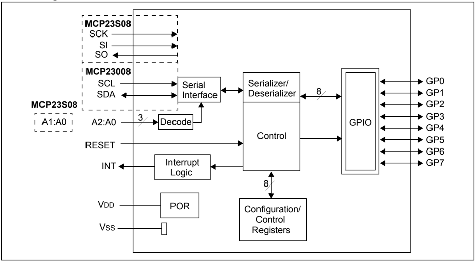

- Configurable interrupt source
- -Interrupt-on-change from configured defaults or pin change
- Polarity Inversion register to configure the polarity of the input port data
- External reset input
- Low standby current: 1 µA (max.)
- Operating voltage:
- -1.8V to 5.5V @ -40°C to +85°C I 2 C @ 100 kHz SPI @ 5 MHz
- -2.7V to 5.5V @ -40°C to +85°C I 2 C @ 400 kHz SPI @ 10 MHz
- -4.5V to 5.5V @ -40°C to +125°C I 2 C @ 1.7 kHz SPI @ 10 MHz

## Packages

- 18-pin PDIP (300 mil)
- 18-pin SOIC (300 mil)
- 20-pin SSOP
- 20-pin QFN

## Package Types

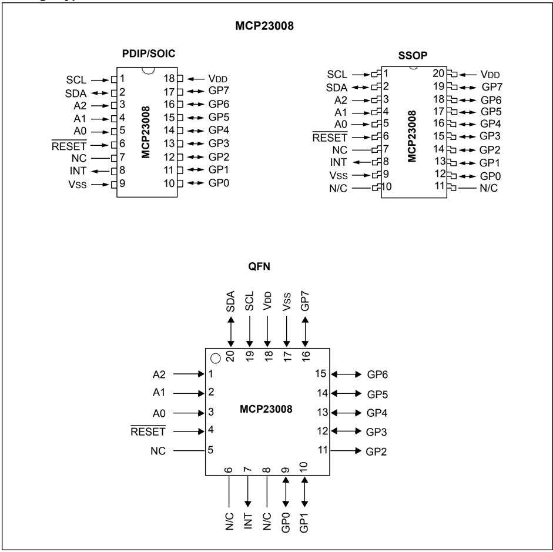

## Package Types: (Continued)

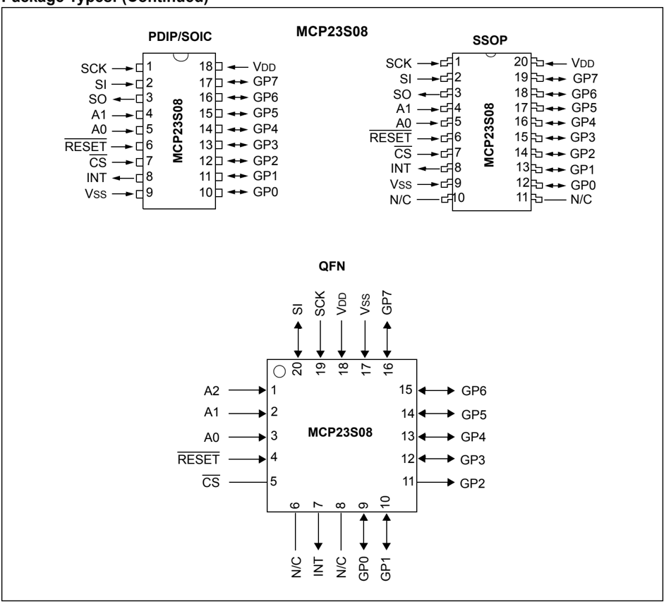

NOTES:

## 1.0 DEVICE OVERVIEW

The MCP23X08 device provides 8-bit, general purpose,  parallel  I/O  expansion  for  I 2 C  bus  or  SPI applications. The two devices differ in the number of hardware address pins and the serial interface:

- MCP23008 - I 2 C interface; three address pins
- MCP23S08 - SPI interface; two address pins

The MCP23X08 consists of multiple 8-bit configuration registers  for  input,  output  and  polarity  selection.  The system master can enable the I/Os as either inputs or outputs by writing the I/O configuration bits. The data for  each  input  or  output  is  kept  in  the  corresponding Input or Output register. The polarity of the Input Port register  can  be  inverted  with  the  Polarity  Inversion register. All registers can be read by the system master.

## 1.1 Pin Descriptions

## TABLE 1-1: PINOUT DESCRIPTION

| Pin Name   | PDIP/ SOIC   | QFN   | SSOP   | Pin Type   | Function                                                                                             |
|------------|--------------|-------|--------|------------|------------------------------------------------------------------------------------------------------|
| SCL/SCK    | 1            | 19    | 1      | I          | Serial clock input.                                                                                  |
| SDA/SI     | 2            | 20    | 2      | I/O        | Serial data I/O ( MCP23008 )/Serial data input ( MCP23S08 ).                                         |
| A2/SO      | 3            | 1     | 3      | I/O        | Hardware address input ( MCP23008 )/ Serial data output ( MCP23S08 ). A2 must be biased externally.  |
| A1         | 4            | 2     | 4      | I          | Hardware address input. Must be biased externally.                                                   |
| A0         | 5            | 3     | 5      | I          | Hardware address input. Must be biased externally.                                                   |
| RESET      | 6            | 4     | 6      | I          | External reset input. Must be biased externally.                                                     |
| NC/CS      | 7            | 5     | 7      | I          | No connect ( MCP23008 )/External chip select input ( MCP23S08 ).                                     |
| INT        | 8            | 7     | 8      | O          | Interrupt output. Can be configured for active-high, active-low or open-drain.                       |
| VSS        | 9            | 17    | 9      | P          | Ground.                                                                                              |
| GP0        | 10           | 9     | 12     | I/O        | Bidirectional I/O pin. Can be enabled for interrupt-on-change and/or internal weak pull-up resistor. |
| GP1        | 11           | 10    | 13     | I/O        | Bidirectional I/O pin. Can be enabled for interrupt-on-change and/or internal weak pull-up resistor. |
| GP2        | 12           | 11    | 14     | I/O        | Bidirectional I/O pin. Can be enabled for interrupt-on-change and/or internal weak pull-up resistor. |
| GP3        | 13           | 12    | 15     | I/O        | Bidirectional I/O pin. Can be enabled for interrupt-on-change and/or internal weak pull-up resistor. |
| GP4        | 14           | 13    | 16     | I/O        | Bidirectional I/O pin. Can be enabled for interrupt-on-change and/or internal weak pull-up resistor. |
| GP5        | 15           | 14    | 17     | I/O        | Bidirectional I/O pin. Can be enabled for interrupt-on-change and/or internal weak pull-up resistor. |
| GP6        | 16           | 15    | 18     | I/O        | Bidirectional I/O pin. Can be enabled for interrupt-on-change and/or internal weak pull-up resistor. |
| GP7        | 17           | 16    | 19     | I/O        | Bidirectional I/O pin. Can be enabled for interrupt-on-change and/or internal weak pull-up resistor. |
| VDD        | 18           | 18    | 20     | P          | Power.                                                                                               |
| N/C        | -            | 6, 8  | 10, 11 | -          | -                                                                                                    |

## MCP23008/MCP23S08

The  interrupt  output  can  be  configured  to  activate under two conditions (mutually exclusive):

1. When any input state differs from its corresponding  input  port  register  state,  this  is used to indicate to the system master that an input state has changed.
2. When an input state differs from a preconfigured register value (DEFVAL register).

The Interrupt Capture register captures port values at the time of the interrupt, thereby saving the condition that caused the interrupt.

The Power-on Reset (POR) sets the registers to their default values and initializes the device state machine.

The hardware address pins are used to determine the device address.

## 1.2 Power-on Reset (POR)

The on-chip POR circuit holds the device in reset until VDD has reached a high enough voltage to deactivate the POR circuit (i.e., release the device from Reset). The maximum VDD rise time is specified in Section 2.0 'Electrical Characteristics' .

When  the  device  exits  the  POR  condition  (releases reset), device operating parameters  (i.e., voltage, temperature, serial bus frequency, etc.) must be met to ensure proper operation.

## 1.3 Serial Interface

This block handles the functionality of the I 2 C (MCP23008)  or  SPI  (MCP23S08)  interface  protocol. The MCP23X08 contains eleven registers that can be addressed through the serial interface block (Table 1-2):

## TABLE 1-2: REGISTER ADDRESSES

| Address   | Access to:         |
|-----------|--------------------|
| 00h       | IODIR              |
| 01h       | IPOL               |
| 02h       | GPINTEN            |
| 03h       | DEFVAL             |
| 04h       | INTCON             |
| 05h       | IOCON              |
| 06h       | GPPU               |
| 07h       | INTF               |
| 08h       | INTCAP (Read-only) |
| 09h       | GPIO               |
| 0Ah       | OLAT               |

## 1.3.1 SEQUENTIAL OPERATION BIT

The Sequential Operation (SEQOP) bit  (IOCON register) controls the operation of the address pointer. The address pointer can either be enabled (default) to allow  the  address  pointer  to  increment  automatically after each data transfer, or it can be disabled.

When operating in Sequential mode (IOCON.SEQOP = 0 ), the address pointer automatically increments to the next address after each byte is clocked.

When operating in Byte mode (IOCON.SEQOP = 1 ), the  MCP23X08  does  not  increment  its  address counter after each byte during the data transfer. This gives the ability to continually read the same address by providing extra clocks (without additional control bytes). This is useful for polling the GPIO register for data changes.

## 1.3.2 I 2 C™ INTERFACE

## 1.3.2.1 I 2 C Write Operation

The I 2 C Write operation includes the control byte and register address sequence, as shown in the bottom of Figure 1-1. This sequence is followed by eight bits of data from the master and an Acknowledge (ACK) from the MCP23008. The operation is ended with a STOP or RESTART condition being generated by the master.

Data  is  written  to  the  MCP23008  after  every  byte transfer. If a STOP or RESTART condition is generated during a data transfer, the data will not be written to the MCP23008.

Byte writes and sequential writes are both supported by  the  MCP23008.  The  MCP23008  increments  its address  counter  after  each  ACK  during  the  data transfer.

## 1.3.2.2 I 2 C Read Operation

The  I 2 C  Read  operation  includes  the  control  byte sequence, as shown in the bottom of Figure 1-1. This sequence is followed by another control byte (including  the  START  condition  and  ACK)  with  the  R/W  bit equal  to  a  logic  1  (R/W  = 1 ).  The  MCP23008  then transmits the data contained in the addressed register. The sequence is ended with the master generating a STOP or RESTART condition.

## 1.3.2.3 I 2 C Sequential Write/Read

For sequential operations (Write or Read), instead of transmitting a STOP or RESTART condition after the data transfer, the master clocks the next byte pointed to by the address pointer (see Section 1.3.1 'Sequential Operation Bit' for details regarding sequential operation control).

The sequence ends with the master sending a STOP or RESTART condition.

The  MCP23008  address  pointer  will  roll over to address zero after reaching the last register address.

Refer to Figure 1-1.

## 1.3.3 SPI INTERFACE

## 1.3.3.1 SPI Write Operation

The SPI Write operation is started by lowering CS. The Write command (slave address with R/W bit cleared) is then clocked into the device. The opcode is followed by an address and at least one data byte.

## 1.3.3.2 SPI Read Operation

The SPI Read operation is started by lowering CS. The SPI read command (slave address with R/W bit set) is then clocked into the device. The opcode is followed by an address, with at least one data byte being clocked out of the device.

## FIGURE 1-1: MCP23008 I 2 C™ DEVICE PROTOCOL

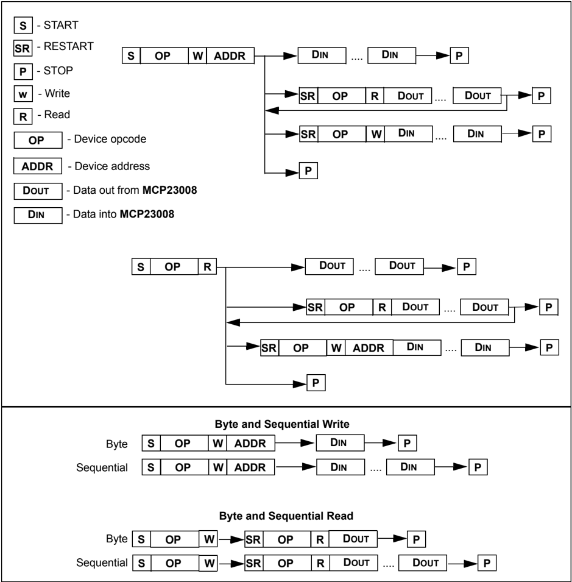

## 1.3.3.3 SPI Sequential Write/Read

For sequential operations, instead of deselecting the device by raising CS, the master clocks the next byte pointed to by the address pointer.

The sequence ends by the raising of CS.

The  MCP23S08  address  pointer  will  roll  over  to address zero after reaching the last register address.

## 1.4 Hardware Address Decoder

The hardware address pins are used to determine the device address. To address a device, the corresponding address bits in the control byte must match the pin state.

- MCP23008 has address pins A2, A1 and A0.
- MCP23S08 has address pins A1 and A0.

The pins must be biased externally.

## MCP23008/MCP23S08

## 1.4.1 ADDRESSING I 2 C DEVICES (MCP23008)

The MCP23008 is a slave I 2 C device that supports 7-bit slave addressing, with the read/write bit filling out the control byte. The slave address contains four fixed bits and three user-defined hardware address bits (pins A2, A1 and A0). Figure 1-2 shows the control byte format.

## 1.4.2 ADDRESSING SPI DEVICES (MCP23S08)

The  MCP23S08  is  a  slave  SPI  device.  The  slave address contains five fixed bits and two user-defined hardware address bits (pins A1 and A0), with the read/ write bit  filling  out  the  control  byte.  Figure 1-3  shows the control byte format.

FIGURE 1-4: I 2 C™ ADDRESSING REGISTERS

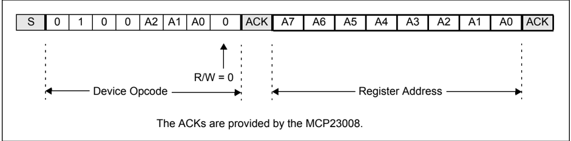

FIGURE 1-5: SPI ADDRESSING REGISTERS

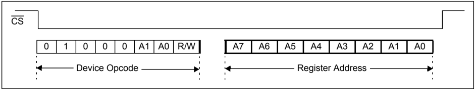

## I 2 C™ CONTROL BYTE

FIGURE 1-2: FORMAT

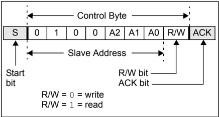

FIGURE 1-3: SPI CONTROL BYTE FORMAT

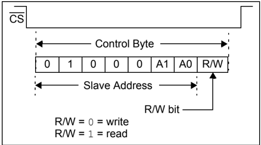

## 1.5 GPIO Port

The  GPIO  module  contains  the  data  port  (GPIO), internal  pull  up  resistors  and  the  Output  Latches (OLAT).

Reading the GPIO register reads the value on the port. Reading the OLAT register only reads the OLAT, not the actual value on the port.

Writing to the GPIO register actually causes a write to the  OLAT.  Writing  to  the  OLAT  register  forces  the associated output drivers to drive to the level in OLAT. Pins configured as inputs turn off the associated output driver and put it in high-impedance.

TABLE 1-3: CONFIGURATION AND CONTROL REGISTERS

| Register Name   | Address (hex)   | bit 7   | bit 6   | bit 5   | bit 4   | bit 3   | bit 2   | bit 1   | bit 0   | POR/RST value   | POR/RST value   |
|-----------------|-----------------|---------|---------|---------|---------|---------|---------|---------|---------|-----------------|-----------------|
| IODIR           | 00              | IO7     | IO6     | IO5     | IO4     | IO3     | IO2     | IO1     | IO0     | 1111            | 1111            |
| IPOL            | 01              | IP7     | IP6     | IP5     | IP4     | IP3     | IP2     | IP1     | IP0     | 0000            | 0000            |
| GPINTEN         | 02              | GPINT7  | GPINT6  | GPINT5  | GPINT4  | GPINT3  | GPINT2  | GPINT1  | GPINT0  | 0000            | 0000            |
| DEFVAL          | 03              | DEF7    | DEF6    | DEF5    | DEF4    | DEF3    | DEF2    | DEF1    | DEF0    | 0000            | 0000            |
| INTCON          | 04              | IOC7    | IOC6    | IOC5    | IOC4    | IOC3    | IOC2    | IOC1    | IOC0    | 0000            | 0000            |
| IOCON           | 05              | -       | -       | SREAD   | DISSLW  | HAEN *  | ODR     | INTPOL  | -       | --00            | 000-            |
| GPPU            | 06              | PU7     | PU6     | PU5     | PU4     | PU3     | PU2     | PU1     | PU0     | 0000            | 0000            |
| INTF            | 07              | INT7    | INT6    | INT5    | INT4    | INT3    | INT2    | INT1    | INTO    | 0000            | 0000            |
| INTCAP          | 08              | ICP7    | ICP6    | ICP5    | ICP4    | ICP3    | ICP2    | ICP1    | ICP0    | 0000            | 0000            |
| GPIO            | 09              | GP7     | GP6     | GP5     | GP4     | GP3     | GP2     | GP1     | GP0     | 0000            | 0000            |
| OLAT            | 0A              | OL7     | OL6     | OL5     | OL4     | OL3     | OL2     | OL1     | OL0     | 0000            | 0000            |

## 1.6 Configuration and Control Registers

The  Configuration  and  Control  blocks  contain  the registers as shown in Table 1-3.

## MCP23008/MCP23S08

## 1.6.1 I/O DIRECTION (IODIR) REGISTER

Controls the direction of the data I/O.

When a bit is set, the corresponding pin becomes an input.  When  a  bit  is  clear,  the  corresponding  pin becomes an output.

## REGISTER 1-1: IODIR - I/O DIRECTION REGISTER (ADDR 0x00)

| R/W-1   | R/W-1   | R/W-1   | R/W-1   | R/W-1   | R/W-1   | R/W-1   | R/W-1   |
|---------|---------|---------|---------|---------|---------|---------|---------|
| IO7     | IO6     | IO5     | IO4     | IO3     | IO2     | IO1     | IO0     |
| bit 7   | bit 7   | bit 7   | bit 7   | bit 7   | bit 7   | bit 7   | bit 0   |

## Legend:

R = Readable bit

W = Writable bit

U = Unimplemented bit, read as '0'

-n = Value at POR

'1' = Bit is set

'0' = Bit is cleared

x = Bit is unknown

bit 7-0

IO7:IO0:

These bits control the direction of data I/O &lt;7:0&gt;

1 = Pin is configured as an input.

0 = Pin is configured as an output.

## 1.6.2 INPUT POLARITY (IPOL) REGISTER

The  IPOL  register  allows  the  user  to  configure  the polarity on the corresponding GPIO port bits.

If a bit is set, the corresponding GPIO register bit will reflect the inverted value on the pin.

## REGISTER 1-2: IPOL - INPUT POLARITY PORT REGISTER (ADDR 0x01)

| R/W-0   | R/W-0   | R/W-0   | R/W-0   | R/W-0   | R/W-0   | R/W-0   | R/W-0   |
|---------|---------|---------|---------|---------|---------|---------|---------|
| IP7     | IP6     | IP5     | IP4     | IP3     | IP2     | IP1     | IP0     |
| bit 7   | bit 7   | bit 7   | bit 7   | bit 7   | bit 7   | bit 7   | bit 0   |

| Legend:           | Legend:          | Legend:                            | Legend:                            |
|-------------------|------------------|------------------------------------|------------------------------------|
| R = Readable bit  | W = Writable bit | U = Unimplemented bit, read as '0' | U = Unimplemented bit, read as '0' |
| -n = Value at POR | '1' = Bit is set | '0' = Bit is cleared               | x = Bit is unknown                 |

bit 7-0

IP7:IP0:

These bits control the polarity inversion of the input pins &lt;7:0&gt;

1 = GPIO register bit will reflect the opposite logic state of the input pin.

0 = GPIO register bit will reflect the same logic state of the input pin.

## MCP23008/MCP23S08

## 1.6.3 INTERRUPT-ON-CHANGE CONTROL (GPINTEN) REGISTER

The GPINTEN  register controls the interrupt-onchange feature for each pin.

If  a  bit  is  set,  the  corresponding  pin  is  enabled  for interrupt-on-change. The DEFVAL and INTCON registers  must  also  be  configured  if  any  pins  are enabled for interrupt-on-change.

## REGISTER 1-3: GPINTEN - INTERRUPT-ON-CHANGE PINS (ADDR 0x02)

| R/W-0       | R/W-0       | R/W-0       | R/W-0       | R/W-0       | R/W-0       | R/W-0       | R/W-0       |
|-------------|-------------|-------------|-------------|-------------|-------------|-------------|-------------|
| GPINT7      | GPINT6      | GPINT5      | GPINT4      | GPINT3      | GPINT2      | GPINT1      | GPINT0      |
| bit 7 bit 0 | bit 7 bit 0 | bit 7 bit 0 | bit 7 bit 0 | bit 7 bit 0 | bit 7 bit 0 | bit 7 bit 0 | bit 7 bit 0 |

| Legend:           | Legend:          | Legend:                            | Legend:                            |
|-------------------|------------------|------------------------------------|------------------------------------|
| R = Readable bit  | W = Writable bit | U = Unimplemented bit, read as '0' | U = Unimplemented bit, read as '0' |
| -n = Value at POR | '1' = Bit is set | '0' = Bit is cleared               | x = Bit is unknown                 |

bit 7-0

GPINT7:GPINT0:

General purpose I/O interrupt-on-change bits &lt;7:0&gt;

1 = Enable GPIO input pin for interrupt-on-change event.

0 = Disable GPIO input pin for interrupt-on-change event.

Refer to INTCON and GPINTEN.

## 1.6.4 DEFAULT COMPARE (DEFVAL) REGISTER FOR INTERRUPT-ONCHANGE

The  default  comparison  value  is  configured  in  the DEFVAL  register. If enabled (via  GPINTEN  and INTCON) to compare against the DEFVAL register, an opposite  value  on  the  associated  pin  will  cause  an interrupt to occur.

## REGISTER 1-4: DEFVAL - DEFAULT VALUE REGISTER (ADDR 0x03)

| R/W-0   | R/W-0   | R/W-0   | R/W-0   | R/W-0   | R/W-0   | R/W-0   | R/W-0   |
|---------|---------|---------|---------|---------|---------|---------|---------|
| DEF7    | DEF6    | DEF5    | DEF4    | DEF3    | DEF2    | DEF1    | DEF0    |
| bit 7   | bit 7   | bit 7   | bit 7   | bit 7   | bit 7   | bit 7   | bit 0   |

| Legend:           | Legend:          | Legend:                            | Legend:                            |
|-------------------|------------------|------------------------------------|------------------------------------|
| R = Readable bit  | W = Writable bit | U = Unimplemented bit, read as '0' | U = Unimplemented bit, read as '0' |
| -n = Value at POR | '1' = Bit is set | '0' = Bit is cleared               | x = Bit is unknown                 |

bit 7-0

DEF7:DEF0: These bits set the compare value for pins configured for interrupt-on-change from defaults &lt;7:0&gt;. Refer to INTCON.

If the associated pin level is the opposite from the register bit, an interrupt occurs.

Refer to INTCON and GPINTEN.

## MCP23008/MCP23S08

## 1.6.5 INTERRUPT CONTROL (INTCON) REGISTER

The INTCON register controls how the associated pin value is compared for the interrupt-on-change feature. If  a  bit  is  set,  the  corresponding I/O  pin is  compared against the associated bit in the DEFVAL register. If a bit value is clear, the corresponding I/O pin is compared against the previous value.

## REGISTER 1-5: INTCON - INTERRUPT-ON-CHANGE CONTROL REGISTER (ADDR 0x04)

| R/W-0   | R/W-0   | R/W-0   | R/W-0   | R/W-0   | R/W-0   | R/W-0   | R/W-0   |
|---------|---------|---------|---------|---------|---------|---------|---------|
| IOC7    | IOC6    | IOC5    | IOC4    | IOC3    | IOC2    | IOC1    | IOC0    |
| bit 7   |         |         |         |         |         |         | bit 0   |

| Legend:           | Legend:          | Legend:                            | Legend:                            |
|-------------------|------------------|------------------------------------|------------------------------------|
| R = Readable bit  | W = Writable bit | U = Unimplemented bit, read as '0' | U = Unimplemented bit, read as '0' |
| -n = Value at POR | '1' = Bit is set | '0' = Bit is cleared               | x = Bit is unknown                 |

bit 7-0 IOC7:IOC0: These bits control how the associated pin value is compared for interrupt-on-change &lt;7:0&gt;

1 = Controls how the associated pin value is compared for interrupt-on-change.

0 = Pin value is compared against the previous pin value.

Refer to INTCON and GPINTEN.

## 1.6.6 CONFIGURATION (IOCON) REGISTER

The IOCON register contains several bits for configuring the device:

- The Sequential Operation (SEQOP) controls the incrementing function of the address pointer. If the address pointer is disabled, the address pointer does not automatically increment after each byte is clocked during a serial transfer. This feature is useful when it is desired to continuously poll (read) or modify (write) a register.
- The Slew Rate (DISSLW) bit controls the slew rate function on the SDA pin. If enabled, the SDA slew rate will be controlled when driving from a high to a low.

## REGISTER 1-6: IOCON - I/O EXPANDER CONFIGURATION REGISTER (ADDR 0x05)

| U-0   | U-0   | R/W-0   | R/W-0   | R/W-0   | R/W-0   | R/W-0   | U-0   |
|-------|-------|---------|---------|---------|---------|---------|-------|
| -     | -     | SEQOP   | DISSLW  | HAEN    | ODR     | INTPOL  | -     |
| bit 7 | bit 7 | bit 7   | bit 7   | bit 7   | bit 7   | bit 7   | bit 0 |

## Legend:

R = Readable bit

W = Writable bit

U = Unimplemented bit, read as '0'

-n = Value at POR

'1' = Bit is set

'0' = Bit is cleared

x = Bit is unknown

bit 7-6

Unimplemented:

Read as ' 0 '.

bit 5

SEQOP:

Sequential Operation mode bit.

1 = Sequential operation disabled, address pointer does not increment.

0 =  Sequential operation enabled, address pointer increments.

bit 4

DISSLW:

Slew Rate control bit for SDA output.

1 = Slew rate disabled.

0 =  Slew rate enabled.

bit 3

HAEN: Hardware Address Enable bit (MCP23S08 only). Address pins are always enabled on MCP23008.

1 = Enables the MCP23S08 address pins.

0 =  Disables the MCP23S08 address pins.

bit 2

ODR:

This bit configures the INT pin as an open-drain output.

1

= Open-drain output (overrides the INTPOL bit).

0 =  Active driver output (INTPOL bit sets the polarity).

bit 1

INTPOL: This bit sets the polarity of the INT output pin.

1 = Active-high.

0 =  Active-low.

bit 0

Unimplemented:

Read as ' 0 '.

## MCP23008/MCP23S08

- The Hardware Address Enable (HAEN) control bit enables/disables the hardware address pins (A1, A0) on the MCP23S08. This bit is not used on the MCP23008. The address pins are always enabled on the MCP23008.
- The Open-Drain (ODR) control bit enables/ disables the INT pin for open-drain configuration.
- The Interrupt Polarity (INTPOL) control bit sets the polarity of the INT pin. This bit is functional only when the ODR bit is cleared, configuring the INT pin as active push-pull.

## MCP23008/MCP23S08

## 1.6.7 PULL-UP RESISTOR CONFIGURATION (GPPU)

REGISTER

The GPPU register controls the pull-up resistors for the port  pins.  If  a  bit  is  set  and  the  corresponding  pin  is configured as an input, the corresponding port pin is internally pulled up with a 100 k Ω resistor.

## REGISTER 1-7: GPPU - GPIO PULL-UP RESISTOR REGISTER (ADDR 0x06)

| R/W-0   | R/W-0   | R/W-0   | R/W-0   | R/W-0   | R/W-0   | R/W-0   | R/W-0   |
|---------|---------|---------|---------|---------|---------|---------|---------|
| PU7     | PU6     | PU5     | PU4     | PU3     | PU2     | PU1     | PU0     |
| bit 7   | bit 7   | bit 7   | bit 7   | bit 7   | bit 7   | bit 7   | bit 0   |

| Legend:           | Legend:          | Legend:                            | Legend:                            |
|-------------------|------------------|------------------------------------|------------------------------------|
| R = Readable bit  | W = Writable bit | U = Unimplemented bit, read as '0' | U = Unimplemented bit, read as '0' |
| -n = Value at POR | '1' = Bit is set | '0' = Bit is cleared               | x = Bit is unknown                 |

bit 7-0

PU7:PU0: These bits control the weak pull-up resistors on each pin (when configured as an input) &lt;7:0&gt;.

1 = Pull-up enabled.

0 = Pull-up disabled.

## 1.6.8 INTERRUPT FLAG (INTF) REGISTER

The INTF register reflects the interrupt condition on the port pins of any pin that is enabled for interrupts via the GPINTEN  register. A 'set' bit indicates that the associated pin caused the interrupt.

This register is 'read-only'. Writes to this register will be ignored.

## MCP23008/MCP23S08

Note:

INTF  will  always  reflect  the  pin(s)  that have an interrupt condition. For example, one pin causes an interrupt to occur and is captured  in  INTCAP  and  INF.  If  before clearing the interrupt another pin changes, which would normally cause an interrupt, it will be reflected in INTF, but not INTCAP.

## REGISTER 1-8: INTF - INTERRUPT FLAG REGISTER (ADDR 0x07)

| R-0   | R-0   | R-0   | R-0   | R-0   | R-0   | R-0   | R-0   |
|-------|-------|-------|-------|-------|-------|-------|-------|
| INT7  | INT6  | INT5  | INT4  | INT3  | INT2  | INT1  | INT0  |
| bit 7 | bit 7 | bit 7 | bit 7 | bit 7 | bit 7 | bit 7 | bit 0 |

## Legend:

R = Readable bit

W = Writable bit

U = Unimplemented bit, read as '0'

-n = Value at POR

'1' = Bit is set

'0' = Bit is cleared

x = Bit is unknown

bit 7-0

INT7:INT0: These bits reflect the interrupt condition on the port. Will reflect the change only if interrupts are enabled (GPINTEN) &lt;7:0&gt;.

1 = Pin caused interrupt.

0 = Interrupt not pending.

## MCP23008/MCP23S08

## 1.6.9 INTERRUPT CAPTURE (INTCAP) REGISTER

The INTCAP register captures the GPIO port value at the time the interrupt occurred. The register is 'readonly' and is updated only when an interrupt occurs. The register  will  remain  unchanged  until  the  interrupt  is cleared via a read of INTCAP or GPIO.

## REGISTER 1-9: INTCAP - INTERRUPT CAPTURED VALUE FOR PORT REGISTER (ADDR 0x08)

| R-x   | R-x   | R-x   | R-x   | R-x   | R-x   | R-x   | R-x   |
|-------|-------|-------|-------|-------|-------|-------|-------|
| ICP7  | ICP6  | ICP5  | ICP4  | ICP3  | ICP2  | ICP1  | ICP0  |
| bit 7 |       |       |       |       |       |       | bit 0 |

| Legend:           | Legend:          | Legend:                            | Legend:                            |
|-------------------|------------------|------------------------------------|------------------------------------|
| R = Readable bit  | W = Writable bit | U = Unimplemented bit, read as '0' | U = Unimplemented bit, read as '0' |
| -n = Value at POR | '1' = Bit is set | '0' = Bit is cleared               | x = Bit is unknown                 |

bit 7-0 ICP7:ICP0: These bits reflect the logic level on the port pins at the time of interrupt due to pin change &lt;7:0&gt;

1 = Logic-high.

0 = Logic-low.

## 1.6.10 PORT (GPIO) REGISTER

The  GPIO  register  reflects  the  value  on  the  port. Reading from this register reads the port. Writing to this register modifies the Output Latch (OLAT) register.

## REGISTER 1-10: GPIO - GENERAL PURPOSE I/O PORT REGISTER (ADDR 0x09)

| R/W-0   | R/W-0   | R/W-0   | R/W-0   | R/W-0   | R/W-0   | R/W-0   | R/W-0   |
|---------|---------|---------|---------|---------|---------|---------|---------|
| GP7     | GP6     | GP5     | GP4     | GP3     | GP2     | GP1     | GP0     |
| bit 7   |         |         |         |         |         |         | bit 0   |

## Legend:

R = Readable bit

W = Writable bit

U = Unimplemented bit, read as '0'

-n = Value at POR

'1' = Bit is set

'0' = Bit is cleared

x = Bit is unknown

bit 7-0

GP7:GP0:

These bits reflect the logic level on the pins &lt;7:0&gt;

1 = Logic-high.

0 = Logic-low.

## MCP23008/MCP23S08

## 1.6.11 OUTPUT LATCH REGISTER (OLAT)

The  OLAT  register  provides  access  to  the  output latches. A read from this register results in a read of the OLAT and not the  port  itself.  A  write  to  this  register modifies the output latches that modify  the  pins configured as outputs.

## REGISTER 1-11: OLAT - OUTPUT LATCH REGISTER 0 (ADDR 0x0A)

| R/W-0   | R/W-0   | R/W-0   | R/W-0   | R/W-0   | R/W-0   | R/W-0   | R/W-0   |
|---------|---------|---------|---------|---------|---------|---------|---------|
| OL7     | OL6     | OL5     | OL4     | OL3     | OL2     | OL1     | OL0     |
| bit 7   | bit 7   | bit 7   | bit 7   | bit 7   | bit 7   | bit 7   | bit 0   |

| Legend:           | Legend:          | Legend:                            | Legend:                            |
|-------------------|------------------|------------------------------------|------------------------------------|
| R = Readable bit  | W = Writable bit | U = Unimplemented bit, read as '0' | U = Unimplemented bit, read as '0' |
| -n = Value at POR | '1' = Bit is set | '0' = Bit is cleared               | x = Bit is unknown                 |

bit 7-0

OL7:OL0: These bits reflect the logic level on the output latch &lt;7:0&gt;

1 = Logic-high.

0 = Logic-low.

## 1.7 Interrupt Logic

The  interrupt  output  pin  will  activate  if  an  internal interrupt  occurs.  The  interrupt  block  is  configured  by the following registers:

- GPINTEN - enables the individual inputs
- DEFVAL - holds the values that are compared against the associated input port values
- INTCON - controls if the input values are compared against DEFVAL or the previous values on the port
- IOCON (ODR and INPOL) - configures the INT pin as push-pull, open-drain and active-level

Only  pins  configured  as  inputs  can  cause  interrupts. Pins configured as outputs have no affect on INT.

Interrupt activity on the port will cause the port value to be captured and copied into INTCAP. The interrupt will remain  active  until  the  INTCAP  or  GPIO  register  is read.  Writing  to  these  registers  will  not  affect  the interrupt.

The first interrupt event will cause the port contents to be copied  into  the  INTCAP  register.  Subsequent interrupt  conditions  on  the  port  will  not  cause  an interrupt to occur as long as the interrupt is not cleared by a read of INTCAP or GPIO.

## 1.7.1 INTERRUPT CONDITIONS

There are two possible configurations to cause interrupts (configured via INTCON):

1. Pins  configured  for interrupt-on-pin-change will cause an interrupt to occur if a pin changes to the opposite state. The default state is reset after an  interrupt  occurs.  For  example,  an interrupt occurs by an input changing from 1 to 0 . The new initial state for the pin is a logic 0 .
2. Pins configured for interrupt-on-change from register value will cause an interrupt to occur if the  corresponding  input  pin  differs  from  the register bit. The interrupt condition will remain as long  as  the  condition  exists,  regardless  if  the INTAP or GPIO is read.

See Figure 1-6 and Figure 1-7 for more information on interrupt operations.

## INTERRUPT-ON-PIN-

FIGURE 1-6: CHANGE

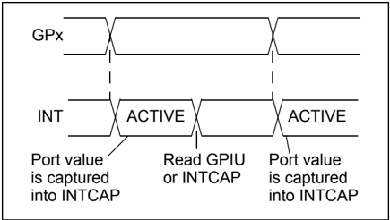

## INTERRUPT-ON-CHANGE

FIGURE 1-7: FROM REGISTER DEFAULT

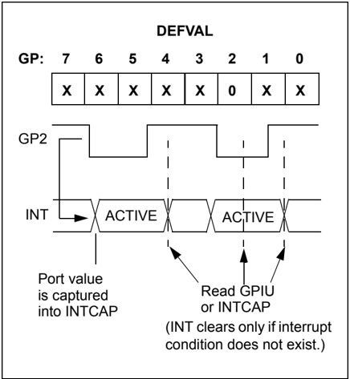

NOTES:

## 2.0 ELECTRICAL CHARACTERISTICS

## Absolute Maximum Ratings †

| Ambient temperature under bias.............................................................................................................-40°C to +125°C                   | Ambient temperature under bias.............................................................................................................-40°C to +125°C                   |
|------------------------------------------------------------------------------------------------------------------------------------------------------------------------------|------------------------------------------------------------------------------------------------------------------------------------------------------------------------------|
| Storage temperature .............................................................................................................................. -65°C to +150°C           | Storage temperature .............................................................................................................................. -65°C to +150°C           |
| Voltage on VDD with respect to VSS ......................................................................................................... -0.3V to +5.5V                  | Voltage on VDD with respect to VSS ......................................................................................................... -0.3V to +5.5V                  |
| Voltage on all other pins with respect to VSS (except VDD)............................................................. -0.6V to (VDD + 0.6V)                                | Voltage on all other pins with respect to VSS (except VDD)............................................................. -0.6V to (VDD + 0.6V)                                |
| Total power dissipation ( Note ) .............................................................................................................................700mW          | Total power dissipation ( Note ) .............................................................................................................................700mW          |
| Maximum current out of VSS pin ...........................................................................................................................150 mA             | Maximum current out of VSS pin ...........................................................................................................................150 mA             |
| Maximum current into VDD pin ..............................................................................................................................125 mA            | Maximum current into VDD pin ..............................................................................................................................125 mA            |
| Input clamp current, I IK (VI < 0 or VI > VDD) ......................................................................................................................± 20 mA | Input clamp current, I IK (VI < 0 or VI > VDD) ......................................................................................................................± 20 mA |
| Output clamp current, IOK (VO < 0 or VO > VDD) ..............................................................................................................± 20 mA         | Output clamp current, IOK (VO < 0 or VO > VDD) ..............................................................................................................± 20 mA         |
| Maximum output current sunk by any output pin ....................................................................................................25 mA                      | Maximum output current sunk by any output pin ....................................................................................................25 mA                      |
| Maximum output current sourced by any output pin ...............................................................................................25 mA                        | Maximum output current sourced by any output pin ...............................................................................................25 mA                        |
| Note:                                                                                                                                                                        | Power dissipation is calculated as follows: PDIS = VDD x {IDD - ∑ IOH} + ∑ {(VDD-VOH) x IOH} + ∑ (VOL x IOL)                                                                 |

†   NOTICE: Stresses above those listed under 'Absolute Maximum Ratings' may cause permanent damage to the device. This is a stress rating only and functional operation of the device at those or any other conditions above those indicated  in  the  operation  listings  of  this  specification  is  not  implied.  Exposure  to  maximum  rating  conditions  for extended periods may affect device reliability.

## 2.1 DC Characteristics

Note 1: This parameter is characterized, not 100% tested.

| DC Characteristics   | DC Characteristics                                  | Operating Conditions (unless otherwise indicated): 1.8V ≤ VDD ≤ 5.5V at -40 ° C ≤ TA ≤ +85 ° C (I-Temp) 4.5V ≤ VDD ≤ 5.5V at -40 ° C ≤ TA ≤ +125 ° C (E-Temp) (Note 1)   | Operating Conditions (unless otherwise indicated): 1.8V ≤ VDD ≤ 5.5V at -40 ° C ≤ TA ≤ +85 ° C (I-Temp) 4.5V ≤ VDD ≤ 5.5V at -40 ° C ≤ TA ≤ +125 ° C (E-Temp) (Note 1)   | Operating Conditions (unless otherwise indicated): 1.8V ≤ VDD ≤ 5.5V at -40 ° C ≤ TA ≤ +85 ° C (I-Temp) 4.5V ≤ VDD ≤ 5.5V at -40 ° C ≤ TA ≤ +125 ° C (E-Temp) (Note 1)   | Operating Conditions (unless otherwise indicated): 1.8V ≤ VDD ≤ 5.5V at -40 ° C ≤ TA ≤ +85 ° C (I-Temp) 4.5V ≤ VDD ≤ 5.5V at -40 ° C ≤ TA ≤ +125 ° C (E-Temp) (Note 1)   | Operating Conditions (unless otherwise indicated): 1.8V ≤ VDD ≤ 5.5V at -40 ° C ≤ TA ≤ +85 ° C (I-Temp) 4.5V ≤ VDD ≤ 5.5V at -40 ° C ≤ TA ≤ +125 ° C (E-Temp) (Note 1)   | Operating Conditions (unless otherwise indicated): 1.8V ≤ VDD ≤ 5.5V at -40 ° C ≤ TA ≤ +85 ° C (I-Temp) 4.5V ≤ VDD ≤ 5.5V at -40 ° C ≤ TA ≤ +125 ° C (E-Temp) (Note 1)   |
|----------------------|-----------------------------------------------------|--------------------------------------------------------------------------------------------------------------------------------------------------------------------------|--------------------------------------------------------------------------------------------------------------------------------------------------------------------------|--------------------------------------------------------------------------------------------------------------------------------------------------------------------------|--------------------------------------------------------------------------------------------------------------------------------------------------------------------------|--------------------------------------------------------------------------------------------------------------------------------------------------------------------------|--------------------------------------------------------------------------------------------------------------------------------------------------------------------------|
| Param No.            | Characteristic                                      | Sym                                                                                                                                                                      | Min                                                                                                                                                                      | Typ                                                                                                                                                                      | Max                                                                                                                                                                      | Units                                                                                                                                                                    | Conditions                                                                                                                                                               |
| D001                 | Supply Voltage                                      | VDD                                                                                                                                                                      | 1.8                                                                                                                                                                      | -                                                                                                                                                                        | 5.5                                                                                                                                                                      | V                                                                                                                                                                        |                                                                                                                                                                          |
| D002                 | VDD Start Voltage to Ensure Power-on Reset          | VPOR                                                                                                                                                                     | -                                                                                                                                                                        | VSS                                                                                                                                                                      | -                                                                                                                                                                        | V                                                                                                                                                                        |                                                                                                                                                                          |
| D003                 | VDD Rise Rate to Ensure Power-on Reset              | SVDD                                                                                                                                                                     | 0.05                                                                                                                                                                     | -                                                                                                                                                                        | -                                                                                                                                                                        | V/ms                                                                                                                                                                     | Design guidance only. Not tested.                                                                                                                                        |
| D004                 | Supply Current                                      | IDD                                                                                                                                                                      | -                                                                                                                                                                        | -                                                                                                                                                                        | 1                                                                                                                                                                        | mA                                                                                                                                                                       | SCL/SCK = 1 MHz                                                                                                                                                          |
| D005                 | Standby current                                     | IDDS                                                                                                                                                                     | -                                                                                                                                                                        | -                                                                                                                                                                        | 1                                                                                                                                                                        | µA                                                                                                                                                                       |                                                                                                                                                                          |
|                      |                                                     |                                                                                                                                                                          | -                                                                                                                                                                        | -                                                                                                                                                                        | 2                                                                                                                                                                        | µA                                                                                                                                                                       | 4.5V - 5.5V @ +125 ° C (Note 1)                                                                                                                                          |
|                      | Input Low-Voltage                                   | Input Low-Voltage                                                                                                                                                        | Input Low-Voltage                                                                                                                                                        | Input Low-Voltage                                                                                                                                                        | Input Low-Voltage                                                                                                                                                        | Input Low-Voltage                                                                                                                                                        | Input Low-Voltage                                                                                                                                                        |
| D030                 | A0, A1 (TTL buffer)                                 | VIL                                                                                                                                                                      | VSS                                                                                                                                                                      | -                                                                                                                                                                        | 0.15 VDD                                                                                                                                                                 | V                                                                                                                                                                        |                                                                                                                                                                          |
| D031                 | CS, GPIO, SCL/SCK, SDA, A2, RESET (Schmitt Trigger) |                                                                                                                                                                          | VSS                                                                                                                                                                      | -                                                                                                                                                                        | 0.2 VDD                                                                                                                                                                  | V                                                                                                                                                                        |                                                                                                                                                                          |
|                      | Input High-Voltage                                  | Input High-Voltage                                                                                                                                                       | Input High-Voltage                                                                                                                                                       | Input High-Voltage                                                                                                                                                       | Input High-Voltage                                                                                                                                                       | Input High-Voltage                                                                                                                                                       | Input High-Voltage                                                                                                                                                       |
| D040                 | A0, A1 (TTL buffer)                                 | VIH                                                                                                                                                                      | 0.25 VDD + 0.8                                                                                                                                                           | -                                                                                                                                                                        | VDD                                                                                                                                                                      | V                                                                                                                                                                        |                                                                                                                                                                          |
| D041                 | CS, GPIO, SCL/SCK, SDA, A2, RESET (Schmitt Trigger) |                                                                                                                                                                          | 0.8 VDD                                                                                                                                                                  | -                                                                                                                                                                        | VDD                                                                                                                                                                      | V                                                                                                                                                                        | For entire VDD range.                                                                                                                                                    |
|                      | Input Leakage Current                               | Input Leakage Current                                                                                                                                                    | Input Leakage Current                                                                                                                                                    | Input Leakage Current                                                                                                                                                    | Input Leakage Current                                                                                                                                                    | Input Leakage Current                                                                                                                                                    | Input Leakage Current                                                                                                                                                    |
| D060                 | I/O port pins                                       | I IL                                                                                                                                                                     | -                                                                                                                                                                        | -                                                                                                                                                                        | ±1                                                                                                                                                                       | µA                                                                                                                                                                       | VSS ≤ VPIN ≤ VDD                                                                                                                                                         |
|                      | Output Leakage Current                              | Output Leakage Current                                                                                                                                                   | Output Leakage Current                                                                                                                                                   | Output Leakage Current                                                                                                                                                   | Output Leakage Current                                                                                                                                                   | Output Leakage Current                                                                                                                                                   | Output Leakage Current                                                                                                                                                   |
| D065                 | I/O port pins                                       | ILO                                                                                                                                                                      | -                                                                                                                                                                        | -                                                                                                                                                                        | ±1                                                                                                                                                                       | µA                                                                                                                                                                       | VSS ≤ VPIN ≤ VDD                                                                                                                                                         |
| D070                 | GPIO weak pull-up current                           | IPU                                                                                                                                                                      | 40                                                                                                                                                                       | 75                                                                                                                                                                       | 115                                                                                                                                                                      | µA                                                                                                                                                                       | VDD = 5V, GP Pins = VSS -40°C ≤ TA ≤ +85°C                                                                                                                               |
|                      | Output Low-Voltage                                  | Output Low-Voltage                                                                                                                                                       | Output Low-Voltage                                                                                                                                                       | Output Low-Voltage                                                                                                                                                       | Output Low-Voltage                                                                                                                                                       | Output Low-Voltage                                                                                                                                                       | Output Low-Voltage                                                                                                                                                       |
| D080                 | GPIO                                                | VOL                                                                                                                                                                      | -                                                                                                                                                                        | -                                                                                                                                                                        | 0.6                                                                                                                                                                      | V                                                                                                                                                                        | IOL = 8.5 mA, VDD = 4.5V                                                                                                                                                 |
|                      | INT                                                 |                                                                                                                                                                          | -                                                                                                                                                                        | -                                                                                                                                                                        | 0.6                                                                                                                                                                      | V                                                                                                                                                                        | IOL = 1.6 mA, VDD = 4.5V                                                                                                                                                 |
|                      | SO, SDA                                             |                                                                                                                                                                          | -                                                                                                                                                                        | -                                                                                                                                                                        | 0.6                                                                                                                                                                      | V                                                                                                                                                                        | IOL = 3.0 mA, VDD = 1.8V                                                                                                                                                 |
|                      | SDA                                                 |                                                                                                                                                                          | -                                                                                                                                                                        | -                                                                                                                                                                        | 0.8                                                                                                                                                                      | V                                                                                                                                                                        | IOL = 3.0 mA, VDD = 4.5V                                                                                                                                                 |
|                      | Output High-Voltage                                 | Output High-Voltage                                                                                                                                                      | Output High-Voltage                                                                                                                                                      | Output High-Voltage                                                                                                                                                      | Output High-Voltage                                                                                                                                                      | Output High-Voltage                                                                                                                                                      | Output High-Voltage                                                                                                                                                      |
| D090                 | GPIO, INT, SO                                       | VOH                                                                                                                                                                      | VDD - 0.7                                                                                                                                                                | -                                                                                                                                                                        | -                                                                                                                                                                        | V                                                                                                                                                                        | IOH = -3.0 mA, VDD = 4.5V                                                                                                                                                |
|                      | Capacitive Loading Specs on Output Pins             | Capacitive Loading Specs on Output Pins                                                                                                                                  | Capacitive Loading Specs on Output Pins                                                                                                                                  | Capacitive Loading Specs on Output Pins                                                                                                                                  | Capacitive Loading Specs on Output Pins                                                                                                                                  | Capacitive Loading Specs on Output Pins                                                                                                                                  | Capacitive Loading Specs on Output Pins                                                                                                                                  |
| D101                 | GPIO, SO, INT                                       | CIO                                                                                                                                                                      | -                                                                                                                                                                        | -                                                                                                                                                                        | 50                                                                                                                                                                       | pF                                                                                                                                                                       |                                                                                                                                                                          |
| D102                 | SDA                                                 | CB                                                                                                                                                                       | -                                                                                                                                                                        | -                                                                                                                                                                        | 400                                                                                                                                                                      | pF                                                                                                                                                                       |                                                                                                                                                                          |

## FIGURE 2-1: LOAD CONDITIONS FOR DEVICE TIMING SPECIFICATIONS

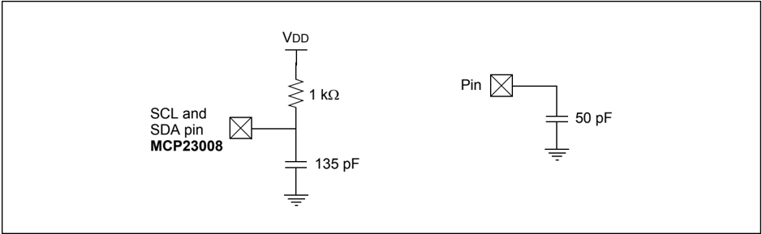

FIGURE 2-2: RESET AND DEVICE RESET TIMER TIMING

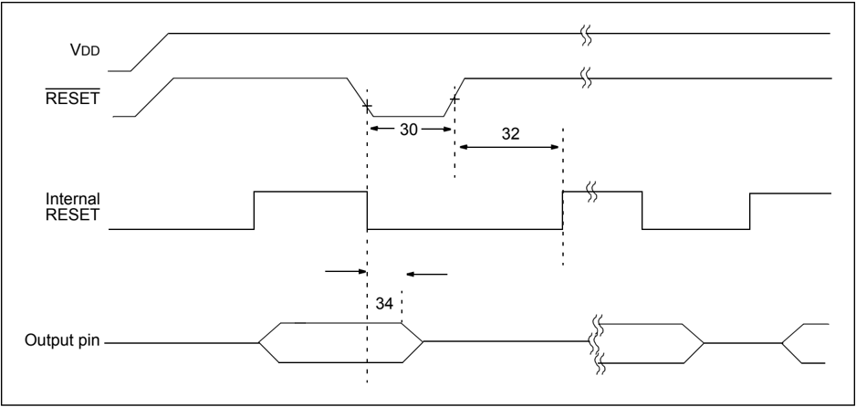

## MCP23008/MCP23S08

## TABLE 2-1: DEVICE RESET SPECIFICATIONS

Note 1: This parameter is characterized, not 100% tested.

| AC Characteristics   | AC Characteristics                   | Operating Conditions (unless otherwise indicated): 1.8V ≤ VDD ≤ 5.5V at -40 ° C ≤ TA ≤ +85 ° C (I-Temp) 4.5V ≤ VDD ≤ 5.5V at -40 ° C ≤ TA ≤ +125 ° C (E-Temp) (Note 1)   | Operating Conditions (unless otherwise indicated): 1.8V ≤ VDD ≤ 5.5V at -40 ° C ≤ TA ≤ +85 ° C (I-Temp) 4.5V ≤ VDD ≤ 5.5V at -40 ° C ≤ TA ≤ +125 ° C (E-Temp) (Note 1)   | Operating Conditions (unless otherwise indicated): 1.8V ≤ VDD ≤ 5.5V at -40 ° C ≤ TA ≤ +85 ° C (I-Temp) 4.5V ≤ VDD ≤ 5.5V at -40 ° C ≤ TA ≤ +125 ° C (E-Temp) (Note 1)   | Operating Conditions (unless otherwise indicated): 1.8V ≤ VDD ≤ 5.5V at -40 ° C ≤ TA ≤ +85 ° C (I-Temp) 4.5V ≤ VDD ≤ 5.5V at -40 ° C ≤ TA ≤ +125 ° C (E-Temp) (Note 1)   | Operating Conditions (unless otherwise indicated): 1.8V ≤ VDD ≤ 5.5V at -40 ° C ≤ TA ≤ +85 ° C (I-Temp) 4.5V ≤ VDD ≤ 5.5V at -40 ° C ≤ TA ≤ +125 ° C (E-Temp) (Note 1)   | Operating Conditions (unless otherwise indicated): 1.8V ≤ VDD ≤ 5.5V at -40 ° C ≤ TA ≤ +85 ° C (I-Temp) 4.5V ≤ VDD ≤ 5.5V at -40 ° C ≤ TA ≤ +125 ° C (E-Temp) (Note 1)   |
|----------------------|--------------------------------------|--------------------------------------------------------------------------------------------------------------------------------------------------------------------------|--------------------------------------------------------------------------------------------------------------------------------------------------------------------------|--------------------------------------------------------------------------------------------------------------------------------------------------------------------------|--------------------------------------------------------------------------------------------------------------------------------------------------------------------------|--------------------------------------------------------------------------------------------------------------------------------------------------------------------------|--------------------------------------------------------------------------------------------------------------------------------------------------------------------------|
| Param No.            | Characteristic                       | Sym                                                                                                                                                                      | Min                                                                                                                                                                      | Typ (1)                                                                                                                                                                  | Max                                                                                                                                                                      | Units                                                                                                                                                                    | Conditions                                                                                                                                                               |
| 30                   | RESET Pulse Width (Low)              | TRSTL                                                                                                                                                                    | 1                                                                                                                                                                        | -                                                                                                                                                                        | -                                                                                                                                                                        | µs                                                                                                                                                                       |                                                                                                                                                                          |
| 32                   | Device Active After RESET high       | THLD                                                                                                                                                                     | -                                                                                                                                                                        | 0                                                                                                                                                                        | -                                                                                                                                                                        | µs                                                                                                                                                                       | VDD = 5.0V                                                                                                                                                               |
| 34                   | Output High-Impedance From RESET Low | TIOZ                                                                                                                                                                     | -                                                                                                                                                                        | -                                                                                                                                                                        | 1                                                                                                                                                                        | µs                                                                                                                                                                       |                                                                                                                                                                          |

## FIGURE 2-3: I 2 C™ BUS START/STOP BITS TIMING

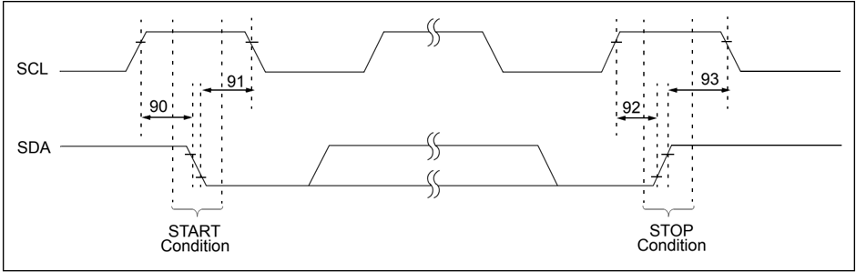

## FIGURE 2-4: I 2 C™ BUS DATA TIMING

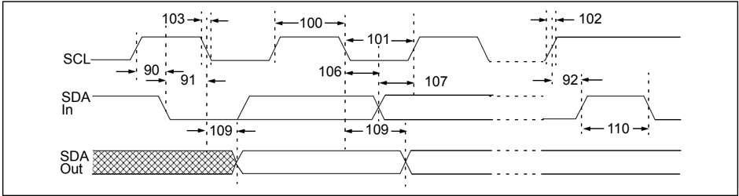

## TABLE 2-2: I 2 C™ BUS DATA REQUIREMENTS

| I 2 C™ AC Characteristics   | I 2 C™ AC Characteristics   | Operating Conditions (unless otherwise indicated): 1.8V ≤ VDD ≤ 5.5V at -40 ° C ≤ TA ≤ +85 ° C (I-Temp) 4.5V ≤ VDD ≤ 5.5V at -40 ° C ≤ TA ≤ +125 ° C (E-Temp) (Note 1) RPU (SCL, SDA) = 1 k Ω , CL (SCL, SDA) = 135 pF   | Operating Conditions (unless otherwise indicated): 1.8V ≤ VDD ≤ 5.5V at -40 ° C ≤ TA ≤ +85 ° C (I-Temp) 4.5V ≤ VDD ≤ 5.5V at -40 ° C ≤ TA ≤ +125 ° C (E-Temp) (Note 1) RPU (SCL, SDA) = 1 k Ω , CL (SCL, SDA) = 135 pF   | Operating Conditions (unless otherwise indicated): 1.8V ≤ VDD ≤ 5.5V at -40 ° C ≤ TA ≤ +85 ° C (I-Temp) 4.5V ≤ VDD ≤ 5.5V at -40 ° C ≤ TA ≤ +125 ° C (E-Temp) (Note 1) RPU (SCL, SDA) = 1 k Ω , CL (SCL, SDA) = 135 pF   | Operating Conditions (unless otherwise indicated): 1.8V ≤ VDD ≤ 5.5V at -40 ° C ≤ TA ≤ +85 ° C (I-Temp) 4.5V ≤ VDD ≤ 5.5V at -40 ° C ≤ TA ≤ +125 ° C (E-Temp) (Note 1) RPU (SCL, SDA) = 1 k Ω , CL (SCL, SDA) = 135 pF   | Operating Conditions (unless otherwise indicated): 1.8V ≤ VDD ≤ 5.5V at -40 ° C ≤ TA ≤ +85 ° C (I-Temp) 4.5V ≤ VDD ≤ 5.5V at -40 ° C ≤ TA ≤ +125 ° C (E-Temp) (Note 1) RPU (SCL, SDA) = 1 k Ω , CL (SCL, SDA) = 135 pF   | Operating Conditions (unless otherwise indicated): 1.8V ≤ VDD ≤ 5.5V at -40 ° C ≤ TA ≤ +85 ° C (I-Temp) 4.5V ≤ VDD ≤ 5.5V at -40 ° C ≤ TA ≤ +125 ° C (E-Temp) (Note 1) RPU (SCL, SDA) = 1 k Ω , CL (SCL, SDA) = 135 pF   |
|-----------------------------|-----------------------------|--------------------------------------------------------------------------------------------------------------------------------------------------------------------------------------------------------------------------|--------------------------------------------------------------------------------------------------------------------------------------------------------------------------------------------------------------------------|--------------------------------------------------------------------------------------------------------------------------------------------------------------------------------------------------------------------------|--------------------------------------------------------------------------------------------------------------------------------------------------------------------------------------------------------------------------|--------------------------------------------------------------------------------------------------------------------------------------------------------------------------------------------------------------------------|--------------------------------------------------------------------------------------------------------------------------------------------------------------------------------------------------------------------------|
| Param No.                   | Characteristic              | Sym                                                                                                                                                                                                                      | Min                                                                                                                                                                                                                      | Typ                                                                                                                                                                                                                      | Max                                                                                                                                                                                                                      | Units                                                                                                                                                                                                                    | Conditions                                                                                                                                                                                                               |
| 100                         | Clock High Time:            |                                                                                                                                                                                                                          | THIGH                                                                                                                                                                                                                    |                                                                                                                                                                                                                          |                                                                                                                                                                                                                          |                                                                                                                                                                                                                          |                                                                                                                                                                                                                          |
| 100                         | 100 kHz mode                |                                                                                                                                                                                                                          | 4.0                                                                                                                                                                                                                      | -                                                                                                                                                                                                                        | -                                                                                                                                                                                                                        | µs                                                                                                                                                                                                                       | 1.8V - 5.5V (I-Temp)                                                                                                                                                                                                     |
| 100                         | 400 kHz mode                |                                                                                                                                                                                                                          | 0.6                                                                                                                                                                                                                      | -                                                                                                                                                                                                                        | -                                                                                                                                                                                                                        | µs                                                                                                                                                                                                                       | 2.7V - 5.5V (I-Temp)                                                                                                                                                                                                     |
| 100                         | 1.7 MHz mode                |                                                                                                                                                                                                                          | 0.12                                                                                                                                                                                                                     | -                                                                                                                                                                                                                        | -                                                                                                                                                                                                                        | µs                                                                                                                                                                                                                       | 4.5V - 5.5V (E-Temp)                                                                                                                                                                                                     |
| 101                         | Clock Low Time:             | TLOW                                                                                                                                                                                                                     |                                                                                                                                                                                                                          |                                                                                                                                                                                                                          |                                                                                                                                                                                                                          |                                                                                                                                                                                                                          |                                                                                                                                                                                                                          |
| 101                         | 100 kHz mode                | TLOW                                                                                                                                                                                                                     | 4.7                                                                                                                                                                                                                      | -                                                                                                                                                                                                                        | -                                                                                                                                                                                                                        | µs                                                                                                                                                                                                                       | 1.8V - 5.5V (I-Temp)                                                                                                                                                                                                     |
| 101                         | 400 kHz mode                | TLOW                                                                                                                                                                                                                     | 1.3                                                                                                                                                                                                                      | -                                                                                                                                                                                                                        | -                                                                                                                                                                                                                        | µs                                                                                                                                                                                                                       | 2.7V - 5.5V (I-Temp)                                                                                                                                                                                                     |
| 101                         | 1.7 MHz mode                | TLOW                                                                                                                                                                                                                     | 0.32                                                                                                                                                                                                                     | -                                                                                                                                                                                                                        | -                                                                                                                                                                                                                        | µs                                                                                                                                                                                                                       | 4.5V - 5.5V (E-Temp)                                                                                                                                                                                                     |
| 102                         | SDA and SCL Rise Time:      | TR                                                                                                                                                                                                                       |                                                                                                                                                                                                                          |                                                                                                                                                                                                                          |                                                                                                                                                                                                                          |                                                                                                                                                                                                                          |                                                                                                                                                                                                                          |
| 102                         | 100 kHz mode                | (Note 1)                                                                                                                                                                                                                 | -                                                                                                                                                                                                                        | -                                                                                                                                                                                                                        | 1000                                                                                                                                                                                                                     | ns                                                                                                                                                                                                                       | 1.8V - 5.5V (I-Temp)                                                                                                                                                                                                     |
| 102                         | 400 kHz mode                | TR                                                                                                                                                                                                                       | 20 + 0.1 CB (2)                                                                                                                                                                                                          | -                                                                                                                                                                                                                        | 300                                                                                                                                                                                                                      | ns                                                                                                                                                                                                                       | 2.7V - 5.5V (I-Temp)                                                                                                                                                                                                     |
| 102                         | 1.7 MHz mode                | TR                                                                                                                                                                                                                       | 20                                                                                                                                                                                                                       | -                                                                                                                                                                                                                        | 160                                                                                                                                                                                                                      | ns                                                                                                                                                                                                                       | 4.5V - 5.5V (E-Temp)                                                                                                                                                                                                     |
| 103                         | SDA and SCL Fall Time:      | TF                                                                                                                                                                                                                       |                                                                                                                                                                                                                          |                                                                                                                                                                                                                          |                                                                                                                                                                                                                          |                                                                                                                                                                                                                          |                                                                                                                                                                                                                          |
| 103                         | 100 kHz mode                | (Note 1)                                                                                                                                                                                                                 | -                                                                                                                                                                                                                        | -                                                                                                                                                                                                                        | 300                                                                                                                                                                                                                      | ns                                                                                                                                                                                                                       | 1.8V - 5.5V (I-Temp)                                                                                                                                                                                                     |
| 103                         | 400 kHz mode                | (Note 1)                                                                                                                                                                                                                 | 20 + 0.1 CB (2)                                                                                                                                                                                                          | -                                                                                                                                                                                                                        | 300                                                                                                                                                                                                                      | ns                                                                                                                                                                                                                       | 2.7V - 5.5V (I-Temp)                                                                                                                                                                                                     |
| 103                         | 1.7 MHz mode                | (Note 1)                                                                                                                                                                                                                 | 20                                                                                                                                                                                                                       | -                                                                                                                                                                                                                        | 80                                                                                                                                                                                                                       | ns                                                                                                                                                                                                                       | 4.5V - 5.5V (E-Temp)                                                                                                                                                                                                     |
| 90                          | START Condition Setup Time: | TSU:STA                                                                                                                                                                                                                  |                                                                                                                                                                                                                          |                                                                                                                                                                                                                          |                                                                                                                                                                                                                          |                                                                                                                                                                                                                          |                                                                                                                                                                                                                          |
| 90                          | 100 kHz mode                | TSU:STA                                                                                                                                                                                                                  | 4.7                                                                                                                                                                                                                      | -                                                                                                                                                                                                                        | -                                                                                                                                                                                                                        | µs                                                                                                                                                                                                                       | 1.8V - 5.5V (I-Temp)                                                                                                                                                                                                     |
| 90                          | 400 kHz mode                | TSU:STA                                                                                                                                                                                                                  | 0.6                                                                                                                                                                                                                      | -                                                                                                                                                                                                                        | -                                                                                                                                                                                                                        | µs                                                                                                                                                                                                                       | 2.7V - 5.5V (I-Temp)                                                                                                                                                                                                     |
| 90                          | 1.7 MHz mode                | TSU:STA                                                                                                                                                                                                                  | 0.16                                                                                                                                                                                                                     | -                                                                                                                                                                                                                        | -                                                                                                                                                                                                                        | µs                                                                                                                                                                                                                       | 4.5V - 5.5V (E-Temp)                                                                                                                                                                                                     |
| 91                          | START Condition Hold Time:  | THD:STA                                                                                                                                                                                                                  |                                                                                                                                                                                                                          |                                                                                                                                                                                                                          |                                                                                                                                                                                                                          |                                                                                                                                                                                                                          |                                                                                                                                                                                                                          |
| 91                          | 100 kHz mode                | THD:STA                                                                                                                                                                                                                  | 4.0                                                                                                                                                                                                                      | -                                                                                                                                                                                                                        | -                                                                                                                                                                                                                        | µs                                                                                                                                                                                                                       | 1.8V - 5.5V (I-Temp)                                                                                                                                                                                                     |
| 91                          | 400 kHz mode                | THD:STA                                                                                                                                                                                                                  | 0.6                                                                                                                                                                                                                      | -                                                                                                                                                                                                                        | -                                                                                                                                                                                                                        | µs                                                                                                                                                                                                                       | 2.7V - 5.5V (I-Temp)                                                                                                                                                                                                     |
| 91                          | 1.7 MHz mode                | THD:STA                                                                                                                                                                                                                  | 0.16                                                                                                                                                                                                                     | -                                                                                                                                                                                                                        | -                                                                                                                                                                                                                        | µs                                                                                                                                                                                                                       | 4.5V - 5.5V (E-Temp)                                                                                                                                                                                                     |
| 106                         | Data Input Hold Time:       | THD:DAT                                                                                                                                                                                                                  |                                                                                                                                                                                                                          |                                                                                                                                                                                                                          |                                                                                                                                                                                                                          |                                                                                                                                                                                                                          |                                                                                                                                                                                                                          |
| 106                         | 100 kHz mode                | THD:DAT                                                                                                                                                                                                                  | 0                                                                                                                                                                                                                        | -                                                                                                                                                                                                                        | 3.45                                                                                                                                                                                                                     | µs                                                                                                                                                                                                                       | 1.8V - 5.5V (I-Temp)                                                                                                                                                                                                     |
| 106                         | 400 kHz mode                | THD:DAT                                                                                                                                                                                                                  | 0                                                                                                                                                                                                                        | -                                                                                                                                                                                                                        | 0.9                                                                                                                                                                                                                      | µs                                                                                                                                                                                                                       | 2.7V - 5.5V (I-Temp)                                                                                                                                                                                                     |
| 106                         | 1.7 MHz mode                | THD:DAT                                                                                                                                                                                                                  | 0                                                                                                                                                                                                                        | -                                                                                                                                                                                                                        | 0.15                                                                                                                                                                                                                     | µs                                                                                                                                                                                                                       | 4.5V - 5.5V (E-Temp)                                                                                                                                                                                                     |
| 107                         | Data Input Setup Time:      | TSU:DAT                                                                                                                                                                                                                  |                                                                                                                                                                                                                          |                                                                                                                                                                                                                          |                                                                                                                                                                                                                          |                                                                                                                                                                                                                          |                                                                                                                                                                                                                          |
| 107                         | 100 kHz mode                | TSU:DAT                                                                                                                                                                                                                  | 250                                                                                                                                                                                                                      | -                                                                                                                                                                                                                        | -                                                                                                                                                                                                                        | ns                                                                                                                                                                                                                       | 1.8V - 5.5V (I-Temp)                                                                                                                                                                                                     |
| 107                         | 400 kHz mode                | TSU:DAT                                                                                                                                                                                                                  | 100                                                                                                                                                                                                                      | -                                                                                                                                                                                                                        | -                                                                                                                                                                                                                        | ns                                                                                                                                                                                                                       | 2.7V - 5.5V (I-Temp)                                                                                                                                                                                                     |
| 107                         | 1.7 MHz mode                | TSU:DAT                                                                                                                                                                                                                  | 0.01                                                                                                                                                                                                                     | -                                                                                                                                                                                                                        | -                                                                                                                                                                                                                        | µs                                                                                                                                                                                                                       | 4.5V - 5.5V (E-Temp)                                                                                                                                                                                                     |
| 92                          | STOP Condition Setup Time:  | TSU:STO                                                                                                                                                                                                                  |                                                                                                                                                                                                                          |                                                                                                                                                                                                                          |                                                                                                                                                                                                                          |                                                                                                                                                                                                                          |                                                                                                                                                                                                                          |
| 92                          | 100 kHz mode                | TSU:STO                                                                                                                                                                                                                  | 4.0                                                                                                                                                                                                                      | -                                                                                                                                                                                                                        | -                                                                                                                                                                                                                        | µs                                                                                                                                                                                                                       | 1.8V - 5.5V (I-Temp)                                                                                                                                                                                                     |
| 92                          | 400 kHz mode                | TSU:STO                                                                                                                                                                                                                  | 0.6                                                                                                                                                                                                                      | -                                                                                                                                                                                                                        | -                                                                                                                                                                                                                        | µs                                                                                                                                                                                                                       | 2.7V - 5.5V (I-Temp)                                                                                                                                                                                                     |
| 92                          | 1.7 MHz mode                | TSU:STO                                                                                                                                                                                                                  | 0.16                                                                                                                                                                                                                     | -                                                                                                                                                                                                                        | -                                                                                                                                                                                                                        | µs                                                                                                                                                                                                                       | 4.5V - 5.5V (E-Temp)                                                                                                                                                                                                     |

Note 1: This parameter is characterized, not 100% tested.

2: CB is specified to be from 10 to 400 pF.

## MCP23008/MCP23S08

## TABLE 2-2: I 2 C™ BUS DATA REQUIREMENTS (CONTINUED)

Note 1: This parameter is characterized, not 100% tested.

| I 2 C™ AC Characteristics   | I 2 C™ AC Characteristics                     | Operating Conditions (unless otherwise indicated): 1.8V ≤ VDD ≤ 5.5V at -40 ° C ≤ TA ≤ +85 ° C (I-Temp) 4.5V ≤ VDD ≤ 5.5V at -40 ° C ≤ TA ≤ +125 ° C (E-Temp) (Note 1) RPU (SCL, SDA) = 1 k Ω , CL (SCL, SDA) = 135 pF   | Operating Conditions (unless otherwise indicated): 1.8V ≤ VDD ≤ 5.5V at -40 ° C ≤ TA ≤ +85 ° C (I-Temp) 4.5V ≤ VDD ≤ 5.5V at -40 ° C ≤ TA ≤ +125 ° C (E-Temp) (Note 1) RPU (SCL, SDA) = 1 k Ω , CL (SCL, SDA) = 135 pF   | Operating Conditions (unless otherwise indicated): 1.8V ≤ VDD ≤ 5.5V at -40 ° C ≤ TA ≤ +85 ° C (I-Temp) 4.5V ≤ VDD ≤ 5.5V at -40 ° C ≤ TA ≤ +125 ° C (E-Temp) (Note 1) RPU (SCL, SDA) = 1 k Ω , CL (SCL, SDA) = 135 pF   | Operating Conditions (unless otherwise indicated): 1.8V ≤ VDD ≤ 5.5V at -40 ° C ≤ TA ≤ +85 ° C (I-Temp) 4.5V ≤ VDD ≤ 5.5V at -40 ° C ≤ TA ≤ +125 ° C (E-Temp) (Note 1) RPU (SCL, SDA) = 1 k Ω , CL (SCL, SDA) = 135 pF   | Operating Conditions (unless otherwise indicated): 1.8V ≤ VDD ≤ 5.5V at -40 ° C ≤ TA ≤ +85 ° C (I-Temp) 4.5V ≤ VDD ≤ 5.5V at -40 ° C ≤ TA ≤ +125 ° C (E-Temp) (Note 1) RPU (SCL, SDA) = 1 k Ω , CL (SCL, SDA) = 135 pF   | Operating Conditions (unless otherwise indicated): 1.8V ≤ VDD ≤ 5.5V at -40 ° C ≤ TA ≤ +85 ° C (I-Temp) 4.5V ≤ VDD ≤ 5.5V at -40 ° C ≤ TA ≤ +125 ° C (E-Temp) (Note 1) RPU (SCL, SDA) = 1 k Ω , CL (SCL, SDA) = 135 pF   |
|-----------------------------|-----------------------------------------------|--------------------------------------------------------------------------------------------------------------------------------------------------------------------------------------------------------------------------|--------------------------------------------------------------------------------------------------------------------------------------------------------------------------------------------------------------------------|--------------------------------------------------------------------------------------------------------------------------------------------------------------------------------------------------------------------------|--------------------------------------------------------------------------------------------------------------------------------------------------------------------------------------------------------------------------|--------------------------------------------------------------------------------------------------------------------------------------------------------------------------------------------------------------------------|--------------------------------------------------------------------------------------------------------------------------------------------------------------------------------------------------------------------------|
| Param No.                   | Characteristic                                | Sym                                                                                                                                                                                                                      | Min                                                                                                                                                                                                                      | Typ                                                                                                                                                                                                                      | Max                                                                                                                                                                                                                      | Units                                                                                                                                                                                                                    | Conditions                                                                                                                                                                                                               |
| 109                         | Output Valid From Clock:                      |                                                                                                                                                                                                                          | TAA                                                                                                                                                                                                                      | TAA                                                                                                                                                                                                                      | TAA                                                                                                                                                                                                                      | TAA                                                                                                                                                                                                                      | TAA                                                                                                                                                                                                                      |
| 109                         | 100 kHz mode                                  |                                                                                                                                                                                                                          | -                                                                                                                                                                                                                        | -                                                                                                                                                                                                                        | 3.45                                                                                                                                                                                                                     | µs                                                                                                                                                                                                                       | 1.8V - 5.5V (I-Temp)                                                                                                                                                                                                     |
| 109                         | 400 kHz mode                                  |                                                                                                                                                                                                                          | -                                                                                                                                                                                                                        | -                                                                                                                                                                                                                        | 0.9                                                                                                                                                                                                                      | µs                                                                                                                                                                                                                       | 2.7V - 5.5V (I-Temp)                                                                                                                                                                                                     |
| 109                         | 1.7 MHz mode                                  |                                                                                                                                                                                                                          | -                                                                                                                                                                                                                        | -                                                                                                                                                                                                                        | 0.18                                                                                                                                                                                                                     | µs                                                                                                                                                                                                                       | 4.5V - 5.5V (E-Temp)                                                                                                                                                                                                     |
| 110                         | Bus Free Time:                                | TBUF                                                                                                                                                                                                                     |                                                                                                                                                                                                                          |                                                                                                                                                                                                                          |                                                                                                                                                                                                                          |                                                                                                                                                                                                                          |                                                                                                                                                                                                                          |
| 110                         | 100 kHz mode                                  | TBUF                                                                                                                                                                                                                     | 4.7                                                                                                                                                                                                                      | -                                                                                                                                                                                                                        | -                                                                                                                                                                                                                        | µs                                                                                                                                                                                                                       | 1.8V - 5.5V (I-Temp)                                                                                                                                                                                                     |
| 110                         | 400 kHz mode                                  | TBUF                                                                                                                                                                                                                     | 1.3                                                                                                                                                                                                                      | -                                                                                                                                                                                                                        | -                                                                                                                                                                                                                        | µs                                                                                                                                                                                                                       | 2.7V - 5.5V (I-Temp)                                                                                                                                                                                                     |
| 110                         | 1.7 MHz mode                                  | TBUF                                                                                                                                                                                                                     | N/A                                                                                                                                                                                                                      | -                                                                                                                                                                                                                        | N/A                                                                                                                                                                                                                      | µs                                                                                                                                                                                                                       | 4.5V - 5.5V (E-Temp)                                                                                                                                                                                                     |
|                             | Bus Capacitive Loading:                       | CB                                                                                                                                                                                                                       |                                                                                                                                                                                                                          |                                                                                                                                                                                                                          |                                                                                                                                                                                                                          |                                                                                                                                                                                                                          |                                                                                                                                                                                                                          |
|                             | 100 kHz and 400 kHz                           | CB                                                                                                                                                                                                                       | -                                                                                                                                                                                                                        | -                                                                                                                                                                                                                        | 400                                                                                                                                                                                                                      | pF                                                                                                                                                                                                                       | (Note 1)                                                                                                                                                                                                                 |
|                             | 1.7 MHz                                       | CB                                                                                                                                                                                                                       | -                                                                                                                                                                                                                        | -                                                                                                                                                                                                                        | 100                                                                                                                                                                                                                      | pF                                                                                                                                                                                                                       | (Note 1)                                                                                                                                                                                                                 |
|                             | Input Filter Spike Suppression: (SDA and SCL) | TSP                                                                                                                                                                                                                      |                                                                                                                                                                                                                          |                                                                                                                                                                                                                          |                                                                                                                                                                                                                          |                                                                                                                                                                                                                          |                                                                                                                                                                                                                          |
|                             | 100 kHz and 400 kHz                           | TSP                                                                                                                                                                                                                      | -                                                                                                                                                                                                                        | -                                                                                                                                                                                                                        | 50                                                                                                                                                                                                                       | ns                                                                                                                                                                                                                       |                                                                                                                                                                                                                          |
|                             | 1.7 MHz                                       | TSP                                                                                                                                                                                                                      | -                                                                                                                                                                                                                        | -                                                                                                                                                                                                                        | 10                                                                                                                                                                                                                       | ns                                                                                                                                                                                                                       | Spike suppression off                                                                                                                                                                                                    |

- 2: CB is specified to be from 10 to 400 pF.

## FIGURE 2-5: SPI INPUT TIMING

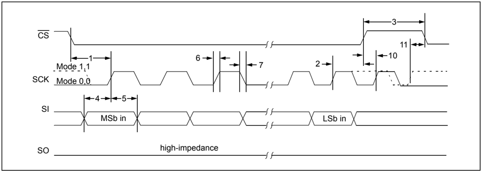

FIGURE 2-6: SPI OUTPUT TIMING

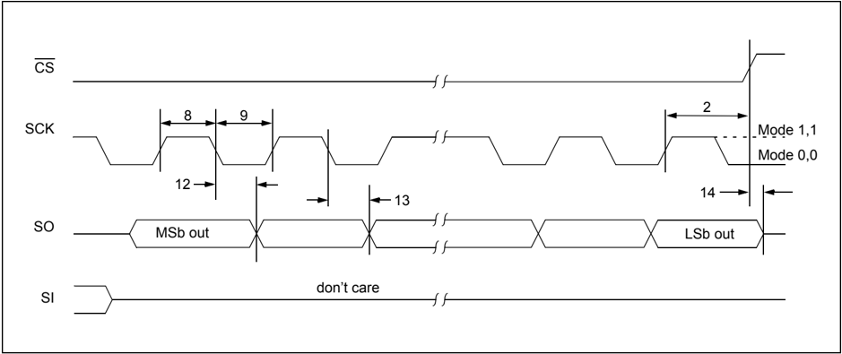

## TABLE 2-3: SPI INTERFACE AC CHARACTERISTICS

| SPI Interface AC Characteristics   | SPI Interface AC Characteristics   | Operating Conditions (unless otherwise indicated): 1.8V ≤ VDD ≤ 5.5V at -40 ° C ≤ TA ≤ +85 ° C (I-Temp) 4.5V ≤ VDD ≤ 5.5V at -40 ° C ≤ TA ≤ +125 ° C (E-Temp) (Note 1)   | Operating Conditions (unless otherwise indicated): 1.8V ≤ VDD ≤ 5.5V at -40 ° C ≤ TA ≤ +85 ° C (I-Temp) 4.5V ≤ VDD ≤ 5.5V at -40 ° C ≤ TA ≤ +125 ° C (E-Temp) (Note 1)   | Operating Conditions (unless otherwise indicated): 1.8V ≤ VDD ≤ 5.5V at -40 ° C ≤ TA ≤ +85 ° C (I-Temp) 4.5V ≤ VDD ≤ 5.5V at -40 ° C ≤ TA ≤ +125 ° C (E-Temp) (Note 1)   | Operating Conditions (unless otherwise indicated): 1.8V ≤ VDD ≤ 5.5V at -40 ° C ≤ TA ≤ +85 ° C (I-Temp) 4.5V ≤ VDD ≤ 5.5V at -40 ° C ≤ TA ≤ +125 ° C (E-Temp) (Note 1)   | Operating Conditions (unless otherwise indicated): 1.8V ≤ VDD ≤ 5.5V at -40 ° C ≤ TA ≤ +85 ° C (I-Temp) 4.5V ≤ VDD ≤ 5.5V at -40 ° C ≤ TA ≤ +125 ° C (E-Temp) (Note 1)   | Operating Conditions (unless otherwise indicated): 1.8V ≤ VDD ≤ 5.5V at -40 ° C ≤ TA ≤ +85 ° C (I-Temp) 4.5V ≤ VDD ≤ 5.5V at -40 ° C ≤ TA ≤ +125 ° C (E-Temp) (Note 1)   |
|------------------------------------|------------------------------------|--------------------------------------------------------------------------------------------------------------------------------------------------------------------------|--------------------------------------------------------------------------------------------------------------------------------------------------------------------------|--------------------------------------------------------------------------------------------------------------------------------------------------------------------------|--------------------------------------------------------------------------------------------------------------------------------------------------------------------------|--------------------------------------------------------------------------------------------------------------------------------------------------------------------------|--------------------------------------------------------------------------------------------------------------------------------------------------------------------------|
| Param No.                          | Characteristic                     | Sym                                                                                                                                                                      | Min                                                                                                                                                                      | Typ                                                                                                                                                                      | Max                                                                                                                                                                      | Units                                                                                                                                                                    | Conditions                                                                                                                                                               |
|                                    | Clock Frequency                    | FCLK                                                                                                                                                                     | -                                                                                                                                                                        | -                                                                                                                                                                        | 5                                                                                                                                                                        | MHz                                                                                                                                                                      | 1.8V - 5.5V (I-Temp)                                                                                                                                                     |
|                                    | Clock Frequency                    | FCLK                                                                                                                                                                     | -                                                                                                                                                                        | -                                                                                                                                                                        | 10                                                                                                                                                                       | MHz                                                                                                                                                                      | 2.7V - 5.5V (I-Temp)                                                                                                                                                     |
|                                    | Clock Frequency                    | FCLK                                                                                                                                                                     | -                                                                                                                                                                        | -                                                                                                                                                                        | 10                                                                                                                                                                       | MHz                                                                                                                                                                      | 4.5V - 5.5V (E-Temp)                                                                                                                                                     |
| 1                                  | CS Setup Time                      | TCSS                                                                                                                                                                     | 50                                                                                                                                                                       | -                                                                                                                                                                        | -                                                                                                                                                                        | ns                                                                                                                                                                       |                                                                                                                                                                          |
| 2                                  | CS Hold Time                       | TCSH                                                                                                                                                                     | 100                                                                                                                                                                      | -                                                                                                                                                                        | -                                                                                                                                                                        | ns                                                                                                                                                                       | 1.8V - 5.5V (I-Temp)                                                                                                                                                     |
| 2                                  | CS Hold Time                       | TCSH                                                                                                                                                                     | 50                                                                                                                                                                       | -                                                                                                                                                                        | -                                                                                                                                                                        | ns                                                                                                                                                                       | 2.7V - 5.5V (I-Temp)                                                                                                                                                     |
| 2                                  | CS Hold Time                       | TCSH                                                                                                                                                                     | 50                                                                                                                                                                       | -                                                                                                                                                                        | -                                                                                                                                                                        | ns                                                                                                                                                                       | 4.5V - 5.5V (E-Temp)                                                                                                                                                     |
| 3                                  | CS Disable Time                    | TCSD                                                                                                                                                                     | 100                                                                                                                                                                      | -                                                                                                                                                                        | -                                                                                                                                                                        | ns                                                                                                                                                                       | 1.8V - 5.5V (I-Temp)                                                                                                                                                     |
| 3                                  | CS Disable Time                    | TCSD                                                                                                                                                                     | 50                                                                                                                                                                       | -                                                                                                                                                                        | -                                                                                                                                                                        | ns                                                                                                                                                                       | 2.7V - 5.5V (I-Temp)                                                                                                                                                     |
| 3                                  | CS Disable Time                    | TCSD                                                                                                                                                                     | 50                                                                                                                                                                       | -                                                                                                                                                                        | -                                                                                                                                                                        | ns                                                                                                                                                                       | 4.5V - 5.5V (E-Temp)                                                                                                                                                     |
| 4                                  | Data Setup Time                    | TSU                                                                                                                                                                      | 20                                                                                                                                                                       | -                                                                                                                                                                        | -                                                                                                                                                                        | ns                                                                                                                                                                       | 1.8V - 5.5V (I-Temp)                                                                                                                                                     |
| 4                                  | Data Setup Time                    | TSU                                                                                                                                                                      | 10                                                                                                                                                                       | -                                                                                                                                                                        | -                                                                                                                                                                        | ns                                                                                                                                                                       | 2.7V - 5.5V (I-Temp)                                                                                                                                                     |
| 4                                  | Data Setup Time                    | TSU                                                                                                                                                                      | 10                                                                                                                                                                       | -                                                                                                                                                                        | -                                                                                                                                                                        | ns                                                                                                                                                                       | 4.5V - 5.5V (E-Temp)                                                                                                                                                     |
| 5                                  | Data Hold Time                     | THD                                                                                                                                                                      | 20                                                                                                                                                                       | -                                                                                                                                                                        | -                                                                                                                                                                        | ns                                                                                                                                                                       | 1.8V - 5.5V (I-Temp)                                                                                                                                                     |
| 5                                  | Data Hold Time                     | THD                                                                                                                                                                      | 10                                                                                                                                                                       | -                                                                                                                                                                        | -                                                                                                                                                                        | ns                                                                                                                                                                       | 2.7V - 5.5V (I-Temp)                                                                                                                                                     |
| 5                                  | Data Hold Time                     | THD                                                                                                                                                                      | 10                                                                                                                                                                       | -                                                                                                                                                                        | -                                                                                                                                                                        | ns                                                                                                                                                                       | 4.5V - 5.5V (E-Temp)                                                                                                                                                     |
| 6                                  | CLK Rise Time                      | TR                                                                                                                                                                       | -                                                                                                                                                                        | -                                                                                                                                                                        | 2                                                                                                                                                                        | µs                                                                                                                                                                       | Note 1                                                                                                                                                                   |
| 7                                  | CLK Fall Time                      | TF                                                                                                                                                                       | -                                                                                                                                                                        | -                                                                                                                                                                        | 2                                                                                                                                                                        | µs                                                                                                                                                                       | Note 1                                                                                                                                                                   |
| 8                                  | Clock High Time                    | THI                                                                                                                                                                      | 90                                                                                                                                                                       | -                                                                                                                                                                        | -                                                                                                                                                                        | ns                                                                                                                                                                       | 1.8V - 5.5V (I-Temp)                                                                                                                                                     |
| 8                                  | Clock High Time                    | THI                                                                                                                                                                      | 45                                                                                                                                                                       | -                                                                                                                                                                        | -                                                                                                                                                                        | ns                                                                                                                                                                       | 2.7V - 5.5V (I-Temp)                                                                                                                                                     |
| 8                                  | Clock High Time                    | THI                                                                                                                                                                      | 45                                                                                                                                                                       | -                                                                                                                                                                        | -                                                                                                                                                                        | ns                                                                                                                                                                       | 4.5V - 5.5V (E-Temp)                                                                                                                                                     |

Note 1: This parameter is characterized, not 100% tested.

- 2: TV = 90 ns (max) when address pointer rolls over from address 0x0A to 0x00.

## MCP23008/MCP23S08

## TABLE 2-3: SPI INTERFACE AC CHARACTERISTICS (CONTINUED)

Note 1: This parameter is characterized, not 100% tested.

| SPI Interface AC Characteristics   | SPI Interface AC Characteristics   | Operating Conditions (unless otherwise indicated): 1.8V ≤ VDD ≤ 5.5V at -40 ° C ≤ TA ≤ +85 ° C (I-Temp) 4.5V ≤ VDD ≤ 5.5V at -40 ° C ≤ TA ≤ +125 ° C (E-Temp) (Note 1)   | Operating Conditions (unless otherwise indicated): 1.8V ≤ VDD ≤ 5.5V at -40 ° C ≤ TA ≤ +85 ° C (I-Temp) 4.5V ≤ VDD ≤ 5.5V at -40 ° C ≤ TA ≤ +125 ° C (E-Temp) (Note 1)   | Operating Conditions (unless otherwise indicated): 1.8V ≤ VDD ≤ 5.5V at -40 ° C ≤ TA ≤ +85 ° C (I-Temp) 4.5V ≤ VDD ≤ 5.5V at -40 ° C ≤ TA ≤ +125 ° C (E-Temp) (Note 1)   | Operating Conditions (unless otherwise indicated): 1.8V ≤ VDD ≤ 5.5V at -40 ° C ≤ TA ≤ +85 ° C (I-Temp) 4.5V ≤ VDD ≤ 5.5V at -40 ° C ≤ TA ≤ +125 ° C (E-Temp) (Note 1)   | Operating Conditions (unless otherwise indicated): 1.8V ≤ VDD ≤ 5.5V at -40 ° C ≤ TA ≤ +85 ° C (I-Temp) 4.5V ≤ VDD ≤ 5.5V at -40 ° C ≤ TA ≤ +125 ° C (E-Temp) (Note 1)   | Operating Conditions (unless otherwise indicated): 1.8V ≤ VDD ≤ 5.5V at -40 ° C ≤ TA ≤ +85 ° C (I-Temp) 4.5V ≤ VDD ≤ 5.5V at -40 ° C ≤ TA ≤ +125 ° C (E-Temp) (Note 1)   |
|------------------------------------|------------------------------------|--------------------------------------------------------------------------------------------------------------------------------------------------------------------------|--------------------------------------------------------------------------------------------------------------------------------------------------------------------------|--------------------------------------------------------------------------------------------------------------------------------------------------------------------------|--------------------------------------------------------------------------------------------------------------------------------------------------------------------------|--------------------------------------------------------------------------------------------------------------------------------------------------------------------------|--------------------------------------------------------------------------------------------------------------------------------------------------------------------------|
| Param No.                          | Characteristic                     | Sym                                                                                                                                                                      | Min                                                                                                                                                                      | Typ                                                                                                                                                                      | Max                                                                                                                                                                      | Units                                                                                                                                                                    | Conditions                                                                                                                                                               |
| 9                                  | Clock Low Time                     | TLO                                                                                                                                                                      | 90                                                                                                                                                                       | -                                                                                                                                                                        | -                                                                                                                                                                        | ns                                                                                                                                                                       | 1.8V - 5.5V (I-Temp)                                                                                                                                                     |
| 9                                  | Clock Low Time                     | TLO                                                                                                                                                                      | 45                                                                                                                                                                       | -                                                                                                                                                                        | -                                                                                                                                                                        | ns                                                                                                                                                                       | 2.7V - 5.5V (I-Temp)                                                                                                                                                     |
| 9                                  | Clock Low Time                     | TLO                                                                                                                                                                      | 45                                                                                                                                                                       | -                                                                                                                                                                        | -                                                                                                                                                                        | ns                                                                                                                                                                       | 4.5V - 5.5V (E-Temp)                                                                                                                                                     |
| 10                                 | Clock Delay Time                   | TCLD                                                                                                                                                                     | 50                                                                                                                                                                       | -                                                                                                                                                                        | -                                                                                                                                                                        | ns                                                                                                                                                                       |                                                                                                                                                                          |
| 11                                 | Clock Enable Time                  | TCLE                                                                                                                                                                     | 50                                                                                                                                                                       | -                                                                                                                                                                        | -                                                                                                                                                                        | ns                                                                                                                                                                       |                                                                                                                                                                          |
| 12 (2)                             | Output Valid from Clock Low        | TV                                                                                                                                                                       | -                                                                                                                                                                        | -                                                                                                                                                                        | 90                                                                                                                                                                       | ns                                                                                                                                                                       | 1.8V - 5.5V (I-Temp)                                                                                                                                                     |
| 12 (2)                             | Output Valid from Clock Low        | TV                                                                                                                                                                       | -                                                                                                                                                                        | -                                                                                                                                                                        | 45                                                                                                                                                                       | ns                                                                                                                                                                       | 2.7V - 5.5V (I-Temp)                                                                                                                                                     |
| 12 (2)                             | Output Valid from Clock Low        | TV                                                                                                                                                                       | -                                                                                                                                                                        | -                                                                                                                                                                        | 45                                                                                                                                                                       | ns                                                                                                                                                                       | 4.5V - 5.5V (E-Temp)                                                                                                                                                     |
| 13                                 | Output Hold Time                   | THO                                                                                                                                                                      | 0                                                                                                                                                                        | -                                                                                                                                                                        | -                                                                                                                                                                        | ns                                                                                                                                                                       |                                                                                                                                                                          |
| 14                                 | Output Disable Time                | TDIS                                                                                                                                                                     | -                                                                                                                                                                        | -                                                                                                                                                                        | 100                                                                                                                                                                      | ns                                                                                                                                                                       |                                                                                                                                                                          |

- 2: TV = 90 ns (max) when address pointer rolls over from address 0x0A to 0x00.

## FIGURE 2-7: GPIO AND INT TIMING

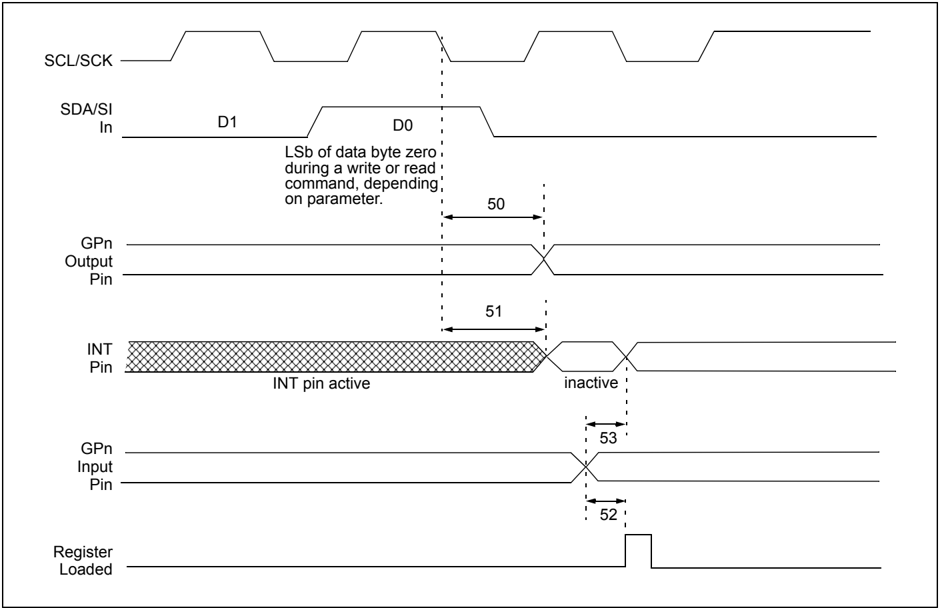

## TABLE 2-4: GP AND INT PINS

Note 1: This parameter is characterized, not 100% tested

| AC Characteristics   | AC Characteristics                | Operating Conditions (unless otherwise indicated): 1.8V ≤ VDD ≤ 5.5V at -40 ° C ≤ TA ≤ +85 ° C (I-Temp) 4.5V ≤ VDD ≤ 5.5V at -40 ° C ≤ TA ≤ +125 ° C (E-Temp) (Note 1)   | Operating Conditions (unless otherwise indicated): 1.8V ≤ VDD ≤ 5.5V at -40 ° C ≤ TA ≤ +85 ° C (I-Temp) 4.5V ≤ VDD ≤ 5.5V at -40 ° C ≤ TA ≤ +125 ° C (E-Temp) (Note 1)   | Operating Conditions (unless otherwise indicated): 1.8V ≤ VDD ≤ 5.5V at -40 ° C ≤ TA ≤ +85 ° C (I-Temp) 4.5V ≤ VDD ≤ 5.5V at -40 ° C ≤ TA ≤ +125 ° C (E-Temp) (Note 1)   | Operating Conditions (unless otherwise indicated): 1.8V ≤ VDD ≤ 5.5V at -40 ° C ≤ TA ≤ +85 ° C (I-Temp) 4.5V ≤ VDD ≤ 5.5V at -40 ° C ≤ TA ≤ +125 ° C (E-Temp) (Note 1)   | Operating Conditions (unless otherwise indicated): 1.8V ≤ VDD ≤ 5.5V at -40 ° C ≤ TA ≤ +85 ° C (I-Temp) 4.5V ≤ VDD ≤ 5.5V at -40 ° C ≤ TA ≤ +125 ° C (E-Temp) (Note 1)   | Operating Conditions (unless otherwise indicated): 1.8V ≤ VDD ≤ 5.5V at -40 ° C ≤ TA ≤ +85 ° C (I-Temp) 4.5V ≤ VDD ≤ 5.5V at -40 ° C ≤ TA ≤ +125 ° C (E-Temp) (Note 1)   |
|----------------------|-----------------------------------|--------------------------------------------------------------------------------------------------------------------------------------------------------------------------|--------------------------------------------------------------------------------------------------------------------------------------------------------------------------|--------------------------------------------------------------------------------------------------------------------------------------------------------------------------|--------------------------------------------------------------------------------------------------------------------------------------------------------------------------|--------------------------------------------------------------------------------------------------------------------------------------------------------------------------|--------------------------------------------------------------------------------------------------------------------------------------------------------------------------|
| Param No.            | Characteristic                    | Sym                                                                                                                                                                      | Min                                                                                                                                                                      | Typ                                                                                                                                                                      | Max                                                                                                                                                                      | Units                                                                                                                                                                    | Conditions                                                                                                                                                               |
| 50                   | Serial data to output valid       | TGPOV                                                                                                                                                                    | -                                                                                                                                                                        | -                                                                                                                                                                        | 500                                                                                                                                                                      | ns                                                                                                                                                                       |                                                                                                                                                                          |
| 51                   | Interrupt pin disable time        | TINTD                                                                                                                                                                    | -                                                                                                                                                                        | -                                                                                                                                                                        | 600                                                                                                                                                                      | ns                                                                                                                                                                       |                                                                                                                                                                          |
| 52                   | GP input change to register valid | TGPIV                                                                                                                                                                    | -                                                                                                                                                                        | -                                                                                                                                                                        | 450                                                                                                                                                                      | ns                                                                                                                                                                       |                                                                                                                                                                          |
| 53                   | IOC event to INT active           | TGPINT                                                                                                                                                                   | -                                                                                                                                                                        | -                                                                                                                                                                        | 600                                                                                                                                                                      | ns                                                                                                                                                                       |                                                                                                                                                                          |
|                      | Glitch Filter on GP Pins          | TGLITCH                                                                                                                                                                  | -                                                                                                                                                                        | -                                                                                                                                                                        | 150                                                                                                                                                                      | ns                                                                                                                                                                       |                                                                                                                                                                          |

NOTES:

## 3.0 PACKAGING INFORMATION

## 3.1 Package Marking Information

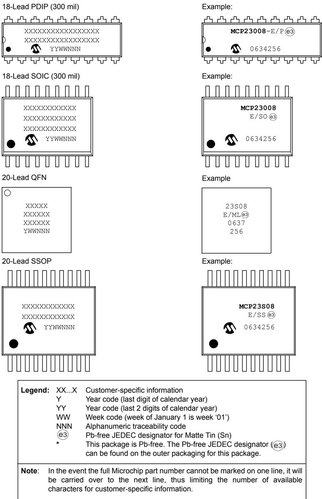

## 18-Lead Plastic Dual In-Line (P) - 300 mil Body [PDIP]

Note: For the most current package drawings, please see the Microchip Packaging Specification located at http://www.microchip.com/packaging

|                            | Units   | INCHES   | INCHES   | INCHES   |
|----------------------------|---------|----------|----------|----------|
| Dimension                  | Limits  | MIN      | NOM      | MAX      |
| Number of Pins             | N       | 18       | 18       | 18       |
| Pitch                      | e       | .100 BSC | .100 BSC | .100 BSC |
| Top to Seating Plane       | A       | -        | -        | .210     |
| Molded Package Thickness   | A2      | .115     | .130     | .195     |
| Base to Seating Plane      | A1      | .015     | -        | -        |
| Shoulder to Shoulder Width | E       | .300     | .310     | .325     |
| Molded Package Width       | E1      | .240     | .250     | .280     |
| Overall Length             | D       | .880     | .900     | .920     |
| Tip to Seating Plane       | L       | .115     | .130     | .150     |
| Lead Thickness             | c       | .008     | .010     | .014     |
| Upper Lead Width           | b1      | .045     | .060     | .070     |
| Lower Lead Width           | b       | .014     | .018     | .022     |
| Overall Row Spacing §      | eB      | -        | -        | .430     |

## Notes:

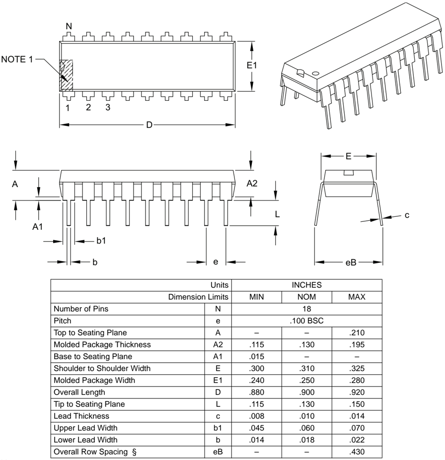

1. Pin 1 visual index feature may vary, but must be located within the hatched area.
2. § Significant Characteristic.
3. Dimensions D and E1 do not include mold flash or protrusions. Mold flash or protrusions shall not exceed .010" per side.
4. Dimensioning and tolerancing per ASME Y14.5M.

BSC: Basic Dimension. Theoretically exact value shown without tolerances.

Microchip Technology Drawing C04-007B

## 18-Lead Plastic Small Outline (SO) - Wide, 7.50 mm Body [SOIC]

Note: For the most current package drawings, please see the Microchip Packaging Specification located at http://www.microchip.com/packaging

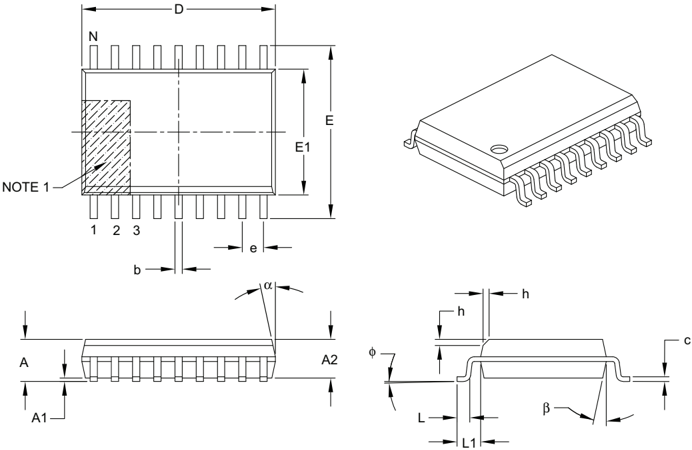

## Notes:

|                          | Units            | MILLIMETERS   | MILLIMETERS   | MILLIMETERS   |
|--------------------------|------------------|---------------|---------------|---------------|
| Dimension Limits         | Dimension Limits | MIN           | NOM           | MAX           |
| Number of Pins           | N                | 18            | 18            | 18            |
| Pitch                    | e                | 1.27 BSC      | 1.27 BSC      | 1.27 BSC      |
| Overall Height           | A                | -             | -             | 2.65          |
| Molded Package Thickness | A2               | 2.05          | -             | -             |
| Standoff §               | A1               | 0.10          | -             | 0.30          |
| Overall Width            | E                | 10.30 BSC     | 10.30 BSC     | 10.30 BSC     |
| Molded Package Width     | E1               | 7.50 BSC      | 7.50 BSC      | 7.50 BSC      |
| Overall Length           | D                | 11.55 BSC     | 11.55 BSC     | 11.55 BSC     |
| Chamfer (optional)       | h                | 0.25          | -             | 0.75          |
| Foot Length              | L                | 0.40          | -             | 1.27          |
| Footprint                | L1               | 1.40 REF      | 1.40 REF      | 1.40 REF      |
| Foot Angle               | φ                | 0°            | -             | 8°            |
| Lead Thickness           | c                | 0.20          | -             | 0.33          |
| Lead Width               | b                | 0.31          | -             | 0.51          |
| Mold Draft Angle Top     | α                | 5°            | -             | 15°           |
| Mold Draft Angle Bottom  | β                | 5°            | -             | 15°           |

1. Pin 1 visual index feature may vary, but must be located within the hatched area.
2. § Significant Characteristic.
3. Dimensions D and E1 do not include mold flash or protrusions. Mold flash or protrusions shall not exceed 0.15 mm per side.
4. Dimensioning and tolerancing per ASME Y14.5M.

BSC: Basic Dimension. Theoretically exact value shown without tolerances.

REF: Reference Dimension, usually without tolerance, for information purposes only.

Microchip Technology Drawing C04-051B

## 20-Lead Plastic Quad Flat, No Lead Package (ML) - 4x4x0.9 mm Body [QFN]

Note: For the most current package drawings, please see the Microchip Packaging Specification located at http://www.microchip.com/packaging

|                        | Units            | MILLIMETERS   | MILLIMETERS   | MILLIMETERS   |
|------------------------|------------------|---------------|---------------|---------------|
| Dimension Limits       | Dimension Limits | MIN           | NOM           | MAX           |
| Number of Pins         | N                | 20            | 20            | 20            |
| Pitch                  | e                | 0.50 BSC      | 0.50 BSC      | 0.50 BSC      |
| Overall Height         | A                | 0.80          | 0.90          | 1.00          |
| Standoff               | A1               | 0.00          | 0.02          | 0.05          |
| Contact Thickness      | A3               | 0.20 REF      | 0.20 REF      | 0.20 REF      |
| Overall Width          | E                | 4.00 BSC      | 4.00 BSC      | 4.00 BSC      |
| Exposed Pad Width      | E2               | 2.60          | 2.70          | 2.80          |
| Overall Length         | D                | 4.00 BSC      | 4.00 BSC      | 4.00 BSC      |
| Exposed Pad Length     | D2               | 2.60          | 2.70          | 2.80          |
| Contact Width          | b                | 0.18          | 0.25          | 0.30          |
| Contact Length         | L                | 0.30          | 0.40          | 0.50          |
| Contact-to-Exposed Pad | K                | 0.20          | -             | -             |

## Notes:

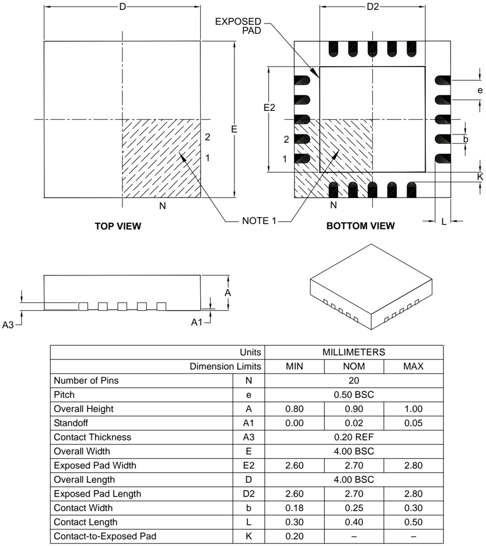

1. Pin 1 visual index feature may vary, but must be located within the hatched area.
2. Package is saw singulated.
3. Dimensioning and tolerancing per ASME Y14.5M.

BSC: Basic Dimension. Theoretically exact value shown without tolerances.

REF: Reference Dimension, usually without tolerance, for information purposes only.

Microchip Technology Drawing C04-126B

## 20-Lead Plastic Shrink Small Outline (SS) - 5.30 mm Body [SSOP]

Note: For the most current package drawings, please see the Microchip Packaging Specification located at http://www.microchip.com/packaging

|                          | Units            | MILLIMETERS   | MILLIMETERS   | MILLIMETERS   |
|--------------------------|------------------|---------------|---------------|---------------|
| Dimension Limits         | Dimension Limits | MIN           | NOM           | MAX           |
| Number of Pins           | N                | 20            | 20            | 20            |
| Pitch                    | e                | 0.65 BSC      | 0.65 BSC      | 0.65 BSC      |
| Overall Height           | A                | -             | -             | 2.00          |
| Molded Package Thickness | A2               | 1.65          | 1.75          | 1.85          |
| Standoff                 | A1               | 0.05          | -             | -             |
| Overall Width            | E                | 7.40          | 7.80          | 8.20          |
| Molded Package Width     | E1               | 5.00          | 5.30          | 5.60          |
| Overall Length           | D                | 6.90          | 7.20          | 7.50          |
| Foot Length              | L                | 0.55          | 0.75          | 0.95          |
| Footprint                | L1               | 1.25 REF      | 1.25 REF      | 1.25 REF      |
| Lead Thickness           | c                | 0.09          | -             | 0.25          |
| Foot Angle               | φ                | 0°            | 4°            | 8°            |
| Lead Width               | b                | 0.22          | -             | 0.38          |

## Notes:

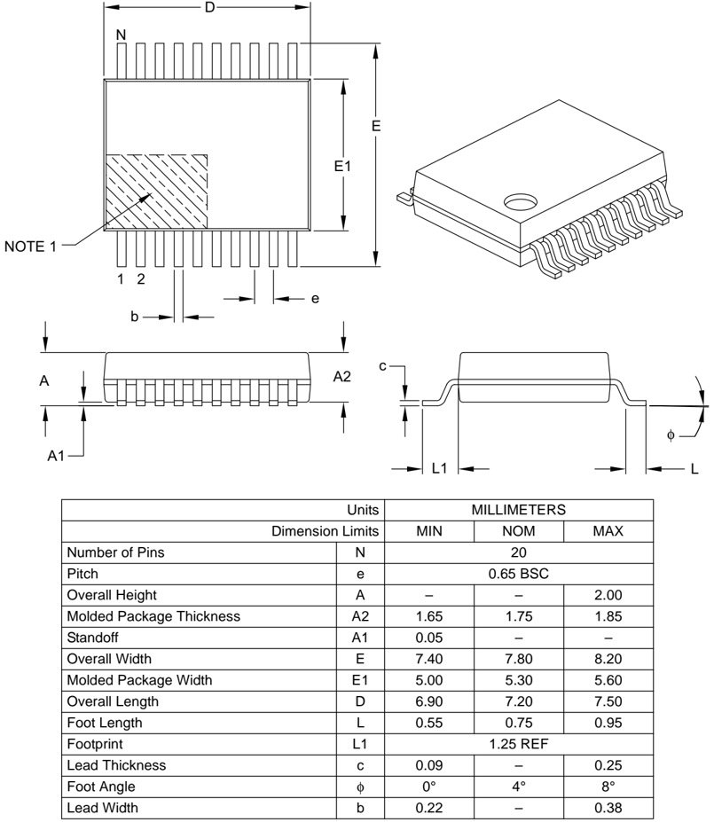

1. Pin 1 visual index feature may vary, but must be located within the hatched area.
2. Dimensions D and E1 do not include mold flash or protrusions. Mold flash or protrusions shall not exceed 0.20 mm per side.
3. Dimensioning and tolerancing per ASME Y14.5M.

BSC: Basic Dimension. Theoretically exact value shown without tolerances.

REF: Reference Dimension, usually without tolerance, for information purposes only.

Microchip Technology Drawing C04-072B

NOTES:

## APPENDIX A: REVISION HISTORY

## Revision E (August 2007)

1. Section 3.0 'Packaging Information' : Updated package outline drawings.

## Revision D (February 2007)

1. Changed Byte and Sequential Read in Figure 1-1 from 'R' to 'W'.
2. Table 2-4, Param No. 51 and 53: Changed from 450 to 600 and 500 to 600, respecively.
3. Added disclaimer to package outline drawings.
4. Updated package outline drawings.

## Revision C (October 2006)

1. Added 20-pin QFN package information throughout document.
2. Added disclaimer to package outline drawings.

## Revision B (February 2005)

The following is the list of modifications:

1. Section 1.6 'Configuration and Control Registers' . Added Hardware Address Enable (HAEN) bit to Table 1-3.
2. Section 1.6.6 'Configuration (IOCON) Register' . Added Hardware Address Enable (HAEN) bit to Register 1-6.

## Revision A (December 2004)

- Original Release of this Document.

NOTES:

## PRODUCT IDENTIFICATION SYSTEM

To order or obtain information, e.g., on pricing or delivery, refer to the factory or the listed sales office.

| PART NO.          | X -                                                                                                                                                                                                 | /XX                                                                                                                                                                                                 | Examples:   |                              |                                                                      |
|-------------------|-----------------------------------------------------------------------------------------------------------------------------------------------------------------------------------------------------|-----------------------------------------------------------------------------------------------------------------------------------------------------------------------------------------------------|-------------|------------------------------|----------------------------------------------------------------------|
| Device Device     | Package Temperature Range                                                                                                                                                                           | Package Temperature Range                                                                                                                                                                           | a) b)       | MCP23008-E/P: MCP23008-E/SO: | Extended Temp., 18LD PDIP package. Extended Temp.,                   |
|                   | MCP23008: MCP23008T:                                                                                                                                                                                | 8-Bit I/O Expander w/ I 2 C™ Interface 8-Bit I/O Expander w/ I 2 C Interface (Tape and Reel)                                                                                                        | c)          | MCP23008T-E/SO:              | 18LD SOIC package. Tape and Reel, Extended Temp., 18LD SOIC package. |
|                   | MCP23S08: MCP23S08T:                                                                                                                                                                                | 8-Bit I/O Expander w/ SPI Interface 8-Bit I/O Expander w/ SPI Interface                                                                                                                             | d)          | MCP23008-E/SS:               | Extended Temp., 20LD SSOP package.                                   |
|                   | (Tape and Reel)                                                                                                                                                                                     | (Tape and Reel)                                                                                                                                                                                     | e)          | MCP23008T-E/SS:              | Tape and Reel, Extended Temp., 20LD SSOP package.                    |
| Temperature Range | E = -40 ° C to +125 ° C (Extended) *                                                                                                                                                                | E = -40 ° C to +125 ° C (Extended) *                                                                                                                                                                | f)          | MCP23008-E/ML:               | Extended Temp., 20LD QFN package.                                    |
|                   | * While these devices are only offered in the 'E' temperature range, the device will operate at different voltages and temperatures as identified in the Section 2.0 'Electrical Characteristics' . | * While these devices are only offered in the 'E' temperature range, the device will operate at different voltages and temperatures as identified in the Section 2.0 'Electrical Characteristics' . | a)          | MCP23S08-E/P:                | Extended Temp., 18LD PDIP package.                                   |
| Package           | ML =                                                                                                                                                                                                | Plastic Quad Flat, No Lead Package 4x4x0.9 mm Body (QFN), 20-Lead                                                                                                                                   | b)          | MCP23S08-E/SO:               | Extended Temp., 18LD SOIC package.                                   |
|                   | P SO                                                                                                                                                                                                | = Plastic DIP (300 mil Body), 18-Lead                                                                                                                                                               | c)          | MCP23S08T-E/SO:              | Tape and Reel, Extended Temp., 18LD SOIC package.                    |
|                   | SS = SSOP,                                                                                                                                                                                          | = Plastic SOIC (300 mil Body), 18-Lead (209 mil Body, 5.30 mm), 20-Lead                                                                                                                             | d)          | MCP23S08-E/SS:               | Extended Temp., 20LD SSOP package.                                   |
|                   |                                                                                                                                                                                                     |                                                                                                                                                                                                     | e)          | MCP23S08T-E/SS:              | Tape and Reel, Extended Temp., 20LD SSOP package.                    |
|                   |                                                                                                                                                                                                     |                                                                                                                                                                                                     | f)          | MCP23S08T-E/MF:              | Tape and Reel, Extended Temp., 20LD QFN package.                     |

## MCP23008/MCP23S08

NOTES:

## Note the following details of the code protection feature on Microchip devices:

- Microchip products meet the specification contained in their particular Microchip Data Sheet.
- Microchip believes that its family of products is one of the most secure families of its kind on the market today, when used in the intended manner and under normal conditions.
- There are dishonest and possibly illegal methods used to breach the code protection feature. All of these methods, to our knowledge, require using the Microchip products in a manner outside the operating specifications contained in Microchip's Data Sheets. Most likely, the person doing so is engaged in theft of intellectual property.
- Microchip is willing to work with the customer who is concerned about the integrity of their code.
- Neither Microchip nor any other semiconductor manufacturer can guarantee the security of their code. Code protection does not mean that we are guaranteeing the product as 'unbreakable.'

Code protection is constantly evolving. We at Microchip are committed to continuously improving the code protection features of our products. Attempts to break Microchip's code protection feature may be a violation of the Digital Millennium Copyright Act. If such acts allow unauthorized access to your software or other copyrighted work, you may have a right to sue for relief under that Act.

Information  contained  in  this  publication  regarding  device applications and the like is provided only for your convenience and may be superseded by updates. It is your responsibility to ensure  that  your  application  meets  with  your  specifications. MICROCHIP MAKES NO REPRESENTATIONS OR WARRANTIES  OF  ANY  KIND  WHETHER  EXPRESS  OR IMPLIED, WRITTEN OR ORAL, STATUTORY OR OTHERWISE, RELATED TO THE INFORMATION, INCLUDING  BUT  NOT  LIMITED  TO  ITS  CONDITION, QUALITY, PERFORMANCE, MERCHANTABILITY OR FITNESS  FOR  PURPOSE . Microchip  disclaims  all  liability arising  from  this  information  and  its  use.  Use  of  Microchip devices in life support and/or safety applications is entirely at the buyer's risk, and the buyer agrees to defend, indemnify and hold  harmless  Microchip  from  any  and  all  damages,  claims, suits,  or  expenses  resulting  from  such  use.  No  licenses  are conveyed, implicitly or otherwise, under any Microchip intellectual property rights.

## QUALITY MANAGEMENT SYSTEM CERTIFIED BY DNV

ISO/TS 16949.2002

## Trademarks

The Microchip name and logo, the Microchip logo, Accuron, dsPIC, KEELOQ, KEELOQ logo, micro ID , MPLAB, PIC, PICmicro, PICSTART, PRO MATE, rfPIC and SmartShunt are registered trademarks of Microchip Technology Incorporated in the U.S.A. and other countries.

AmpLab, FilterLab, Linear Active Thermistor, Migratable Memory, MXDEV, MXLAB, SEEVAL, SmartSensor and The Embedded Control Solutions Company are registered trademarks of Microchip Technology Incorporated in the U.S.A.

Analog-for-the-Digital Age, Application Maestro, CodeGuard, dsPICDEM, dsPICDEM.net, dsPICworks, ECAN, ECONOMONITOR, FanSense, FlexROM, fuzzyLAB, In-Circuit Serial Programming, ICSP, ICEPIC, Mindi, MiWi, MPASM, MPLAB Certified logo, MPLIB, MPLINK, PICkit, PICDEM, PICDEM.net, PICLAB, PICtail, PowerCal, PowerInfo, PowerMate, PowerTool, REAL ICE, rfLAB, Select Mode, Smart Serial, SmartTel, Total Endurance, UNI/O, WiperLock and ZENA are trademarks of Microchip Technology Incorporated in the U.S.A. and other countries.

SQTP is a service mark of Microchip Technology Incorporated in the U.S.A.

All other trademarks mentioned herein are property of their respective companies.

© 2007, Microchip Technology Incorporated, Printed in the U.S.A., All Rights Reserved.

Printed on recycled paper.

Microchip received ISO/TS-16949:2002 certification for its worldwide headquarters, design and wafer fabrication facilities in Chandler and Tempe, Arizona; Gresham, Oregon and design centers in California and India. The Company's quality system processes and procedures are for its PIC ®  MCUs and dsPIC ®  DSCs, KEELOQ ®  code hopping devices, Serial EEPROMs, microperipherals, nonvolatile memory and analog products. In addition, Microchip's quality system for the design and manufacture of development systems is ISO 9001:2000 certified.

## WORLDWIDE SALES AND SERVICE

## ASIA/PACIFIC

Asia Pacific Office Suites 3707-14, 37th Floor Tower 6, The Gateway Harbour City, Kowloon Hong Kong Tel: 852-2401-1200 Fax: 852-2401-3431

Australia - Sydney Tel: 61-2-9868-6733 Fax: 61-2-9868-6755

China - Beijing Tel: 86-10-8528-2100 Fax: 86-10-8528-2104

China - Chengdu Tel: 86-28-8665-5511 Fax: 86-28-8665-7889

China - Fuzhou Tel: 86-591-8750-3506 Fax: 86-591-8750-3521

China - Hong Kong SAR Tel: 852-2401-1200 Fax: 852-2401-3431

China - Qingdao Tel: 86-532-8502-7355 Fax: 86-532-8502-7205

China - Shanghai Tel: 86-21-5407-5533 Fax: 86-21-5407-5066

China - Shenyang Tel: 86-24-2334-2829 Fax: 86-24-2334-2393

China - Shenzhen Tel: 86-755-8203-2660 Fax: 86-755-8203-1760

China - Shunde Tel: 86-757-2839-5507 Fax: 86-757-2839-5571

China - Wuhan Tel: 86-27-5980-5300 Fax: 86-27-5980-5118

China - Xian Tel: 86-29-8833-7252 Fax: 86-29-8833-7256

## ASIA/PACIFIC

India - Bangalore Tel: 91-80-4182-8400 Fax: 91-80-4182-8422

India - New Delhi Tel: 91-11-4160-8631 Fax: 91-11-4160-8632

India - Pune Tel: 91-20-2566-1512 Fax: 91-20-2566-1513

Japan - Yokohama Tel: 81-45-471- 6166 Fax: 81-45-471-6122

Korea - Daegu Tel: 82-53-744-4301 Fax: 82-53-744-4302

Korea - Seoul Tel: 82-2-554-7200 Fax: 82-2-558-5932 or 82-2-558-5934

Malaysia - Penang Tel: 60-4-646-8870 Fax: 60-4-646-5086

Philippines - Manila Tel: 63-2-634-9065 Fax: 63-2-634-9069

Singapore Tel:  65-6334-8870 Fax: 65-6334-8850

Taiwan - Hsin Chu Tel: 886-3-572-9526 Fax: 886-3-572-6459

Taiwan - Kaohsiung Tel: 886-7-536-4818 Fax: 886-7-536-4803

Taiwan - Taipei Tel: 886-2-2500-6610 Fax: 886-2-2508-0102

Thailand - Bangkok Tel: 66-2-694-1351 Fax: 66-2-694-1350

## AMERICAS

Corporate Office 2355 West Chandler Blvd. Chandler, AZ  85224-6199 Tel:  480-792-7200 Fax:  480-792-7277 Technical Support: http://support.microchip.com Web Address: www.microchip.com

Atlanta Duluth, GA Tel: 678-957-9614 Fax: 678-957-1455

Boston

Westborough, MA Tel: 774-760-0087 Fax: 774-760-0088

## Chicago

Itasca, IL Tel: 630-285-0071 Fax: 630-285-0075

Dallas Addison, TX Tel: 972-818-7423 Fax: 972-818-2924

Detroit

Farmington Hills, MI Tel: 248-538-2250 Fax: 248-538-2260

## Kokomo

Kokomo, IN Tel: 765-864-8360 Fax: 765-864-8387

## Los Angeles

Mission Viejo, CA Tel: 949-462-9523 Fax: 949-462-9608

## Santa Clara

Santa Clara, CA Tel: 408-961-6444 Fax: 408-961-6445

Toronto Mississauga, Ontario, Canada Tel: 905-673-0699 Fax:  905-673-6509

## EUROPE

Austria - Wels Tel: 43-7242-2244-39

Fax: 43-7242-2244-393 Denmark - Copenhagen Tel: 45-4450-2828 Fax: 45-4485-2829

France - Paris Tel: 33-1-69-53-63-20 Fax: 33-1-69-30-90-79

Germany - Munich Tel: 49-89-627-144-0 Fax: 49-89-627-144-44

Italy - Milan Tel: 39-0331-742611 Fax: 39-0331-466781

Netherlands - Drunen Tel: 31-416-690399 Fax: 31-416-690340

Spain - Madrid Tel: 34-91-708-08-90 Fax: 34-91-708-08-91

UK - Wokingham Tel: 44-118-921-5869 Fax: 44-118-921-5820

06/25/07