## PIC32 Flash Programming Specification PIC32

## Introduction

This programming specification defines the Flash programming specification for the PIC32 family of 32bit Microcontrollers (MCUs). This programming specification is designed to guide developers of external programmer tools. The customers who are developing applications for the PIC32 devices must use development tools that already provide support for device programming.


## Table of Contents

|   Introduction...........................................................................................................................................................................1 | Introduction...........................................................................................................................................................................1                                                                                           | Introduction...........................................................................................................................................................................1                                                                                           |   Introduction...........................................................................................................................................................................1 |
|--------------------------------------------------------------------------------------------------------------------------------------------------------------------------------------------|------------------------------------------------------------------------------------------------------------------------------------------------------------------------------------------------------------------------------------------------------------------------------------|------------------------------------------------------------------------------------------------------------------------------------------------------------------------------------------------------------------------------------------------------------------------------------|--------------------------------------------------------------------------------------------------------------------------------------------------------------------------------------------|
|                                                                                                                                                                                         1. | Quick References...........................................................................................................................................................5                                                                                                       | Quick References...........................................................................................................................................................5                                                                                                       |                                                                                                                                                                                            |
|                                                                                                                                                                                            | 1.1.                                                                                                                                                                                                                                                                               | Reference Documentation................................................................................................................................5                                                                                                                           |                                                                                                                                                                                            |
|                                                                                                                                                                                            | 1.2.                                                                                                                                                                                                                                                                               | Acronyms and Abbreviations...........................................................................................................................                                                                                                                              |                                                                                                                                                                                          5 |
|                                                                                                                                                                                         2. | Programming Overview................................................................................................................................................6                                                                                                              | Programming Overview................................................................................................................................................6                                                                                                              |                                                                                                                                                                                            |
|                                                                                                                                                                                            | 2.1.                                                                                                                                                                                                                                                                               | Devices with Dual Flash Panel and Dual Boot Regions.................................................................................                                                                                                                                               |                                                                                                                                                                                          6 |
|                                                                                                                                                                                            | 2.2.                                                                                                                                                                                                                                                                               | Programming Interfaces...................................................................................................................................                                                                                                                          |                                                                                                                                                                                          6 |
|                                                                                                                                                                                            | 2.3.                                                                                                                                                                                                                                                                               | Enhanced JTAG (EJTAG)......................................................................................................................................7                                                                                                                       |                                                                                                                                                                                            |
|                                                                                                                                                                                            | 2.4.                                                                                                                                                                                                                                                                               | Data Sizes............................................................................................................................................................7                                                                                                            |                                                                                                                                                                                            |
|                                                                                                                                                                                         3. | Programming Steps......................................................................................................................................................                                                                                                            | Programming Steps......................................................................................................................................................                                                                                                            |                                                                                                                                                                                          8 |
|                                                                                                                                                                                         4. | Connecting to the Device...........................................................................................................................................                                                                                                                | Connecting to the Device...........................................................................................................................................                                                                                                                |                                                                                                                                                                                         10 |
|                                                                                                                                                                                            | 4.1.                                                                                                                                                                                                                                                                               | Four-Wire Interface..........................................................................................................................................10                                                                                                                    |                                                                                                                                                                                            |
|                                                                                                                                                                                            | 4.2.                                                                                                                                                                                                                                                                               | Two-Wire Interface..........................................................................................................................................                                                                                                                       |                                                                                                                                                                                         11 |
|                                                                                                                                                                                            | 4.3.                                                                                                                                                                                                                                                                               | PIC32MX Power Requirements......................................................................................................................                                                                                                                                   |                                                                                                                                                                                         12 |
|                                                                                                                                                                                            | 4.4.                                                                                                                                                                                                                                                                               | PIC32MX With V BAT Pin Power........................................................................................................................13                                                                                                                             |                                                                                                                                                                                            |
|                                                                                                                                                                                            | 4.5.                                                                                                                                                                                                                                                                               | PIC32MZ EC and PIC32MZ EF Power Requirements....................................................................................14 PIC32MZ DA Power Requirements................................................................................................................   |                                                                                                                                                                                         14 |
|                                                                                                                                                                                            | 4.6.                                                                                                                                                                                                                                                                               |                                                                                                                                                                                                                                                                                    |                                                                                                                                                                                            |
|                                                                                                                                                                                            | 4.7.                                                                                                                                                                                                                                                                               | PIC32MK Power Requirements......................................................................................................................                                                                                                                                   |                                                                                                                                                                                         15 |
|                                                                                                                                                                                            | 4.8. PIC32MZ W1 Power Requirements................................................................................................................15 Enhanced Joint Test Action Group (EJTAG) vs In-Circuit Serial Programming ™ (ICSP).........................................17 | 4.8. PIC32MZ W1 Power Requirements................................................................................................................15 Enhanced Joint Test Action Group (EJTAG) vs In-Circuit Serial Programming ™ (ICSP).........................................17 |                                                                                                                                                                                            |
|                                                                                                                                                                                            | 5.1.                                                                                                                                                                                                                                                                               | Programming Interface...................................................................................................................................17                                                                                                                         |                                                                                                                                                                                            |
|                                                                                                                                                                                            | 5.2.                                                                                                                                                                                                                                                                               | Four-Wire JTAG Details....................................................................................................................................20                                                                                                                       |                                                                                                                                                                                            |
|                                                                                                                                                                                            | 5.3.                                                                                                                                                                                                                                                                               | Two-Wire ICSP Details.....................................................................................................................................                                                                                                                         |                                                                                                                                                                                         21 |
|                                                                                                                                                                                         6. | Pseudo Operations.....................................................................................................................................................                                                                                                             | Pseudo Operations.....................................................................................................................................................                                                                                                             |                                                                                                                                                                                         23 |
|                                                                                                                                                                                            | 6.1.                                                                                                                                                                                                                                                                               | Set Mode ( SetMode ) Pseudo Operation.......................................................................................................                                                                                                                                       |                                                                                                                                                                                         23 |
|                                                                                                                                                                                            | 6.2.                                                                                                                                                                                                                                                                               | Send Command ( SendCommand ) Pseudo Operation...................................................................................24                                                                                                                                                 |                                                                                                                                                                                            |
|                                                                                                                                                                                            | 6.3.                                                                                                                                                                                                                                                                               | Transfer Data ( XferData ) Pseudo Operation..............................................................................................25                                                                                                                                        |                                                                                                                                                                                            |
|                                                                                                                                                                                            | 6.4.                                                                                                                                                                                                                                                                               | Transfer Fast Data ( XferFastData ) Pseudo Operation............................................................................                                                                                                                                                   |                                                                                                                                                                                         26 |
|                                                                                                                                                                                            | 6.5.                                                                                                                                                                                                                                                                               | Transfer Instruction ( XferInstruction ) Pseudo Operation...................................................................27                                                                                                                                                     |                                                                                                                                                                                            |
|                                                                                                                                                                                            | 6.6.                                                                                                                                                                                                                                                                               | Read from Address ( ReadFromAddress ) Pseudo Operation....................................................................28                                                                                                                                                       |                                                                                                                                                                                            |
|                                                                                                                                                                                            | 6.7.                                                                                                                                                                                                                                                                               | Synchronize ( Synchronize ) Pseudo Operation.........................................................................................                                                                                                                                              |                                                                                                                                                                                         29 |
|                                                                                                                                                                                         7. | Entering Two-Wire Enhanced ICSP Mode.................................................................................................................30                                                                                                                            | Entering Two-Wire Enhanced ICSP Mode.................................................................................................................30                                                                                                                            |                                                                                                                                                                                            |
|                                                                                                                                                                                         8. | Check Device Status....................................................................................................................................................31                                                                                                          | Check Device Status....................................................................................................................................................31                                                                                                          |                                                                                                                                                                                            |
|                                                                                                                                                                                         8. | 8.1.                                                                                                                                                                                                                                                                               | Four-Wire Interface..........................................................................................................................................31                                                                                                                    |                                                                                                                                                                                            |
|                                                                                                                                                                                            | 8.2.                                                                                                                                                                                                                                                                               | Two-Wire Interface..........................................................................................................................................                                                                                                                       |                                                                                                                                                                                         32 |
|                                                                                                                                                                                         9. | Erasing the Device.......................................................................................................................................................33                                                                                                        | Erasing the Device.......................................................................................................................................................33                                                                                                        |                                                                                                                                                                                            |
|                                                                                                                                                                                            | 9.1.                                                                                                                                                                                                                                                                               | Blank Check......................................................................................................................................................                                                                                                                  |                                                                                                                                                                                         34 |
|                                                                                                                                                                                            | 10. Entering Serial Execution Mode................................................................................................................................ 35                                                                                                              | 10. Entering Serial Execution Mode................................................................................................................................ 35                                                                                                              |                                                                                                                                                                                            |
|                                                                                                                                                                                            | 10.1. Four-Wire Interface..........................................................................................................................................37                                                                                                              | 10.1. Four-Wire Interface..........................................................................................................................................37                                                                                                              |                                                                                                                                                                                            |


|                                                                                                                                                                                     | 10.2. Two-Wire Interface..........................................................................................................................................                  |   37 |
|-------------------------------------------------------------------------------------------------------------------------------------------------------------------------------------|-------------------------------------------------------------------------------------------------------------------------------------------------------------------------------------|------|
| 11. Downloading the Programming Executive (PE).......................................................................................................38                             | 11. Downloading the Programming Executive (PE).......................................................................................................38                             |      |
| 12. Downloading a Data Block.........................................................................................................................................42             | 12. Downloading a Data Block.........................................................................................................................................42             |      |
| 12.1.                                                                                                                                                                               | Without the PE..................................................................................................................................................42                  |      |
| 12.2.                                                                                                                                                                               | With the PE.......................................................................................................................................................                  |   42 |
| 13. Initiating a Page Erase................................................................................................................................................         | 13. Initiating a Page Erase................................................................................................................................................         |   44 |
| 14. Initiating a Flash Row Write........................................................................................................................................47          | 14. Initiating a Flash Row Write........................................................................................................................................47          |      |
| 14.1.                                                                                                                                                                               | With the PE.......................................................................................................................................................                  |   47 |
| 14.2.                                                                                                                                                                               | Without the PE..................................................................................................................................................47                  |      |
| 15. Verify Device Memory.................................................................................................................................................50         | 15. Verify Device Memory.................................................................................................................................................50         |      |
| 15.1.                                                                                                                                                                               | Verifying Memory with the PE........................................................................................................................50                              |      |
| 15.2.                                                                                                                                                                               | Verifying Memory without the PE..................................................................................................................50                                 |      |
| 16. Exiting Programming Mode.......................................................................................................................................                 | 16. Exiting Programming Mode.......................................................................................................................................                 |   52 |
| 16.1.                                                                                                                                                                               | Four-Wire Interface..........................................................................................................................................52                     |      |
| 16.2.                                                                                                                                                                               | Two-Wire Interface..........................................................................................................................................                        |   52 |
| 17. Programming Executive.............................................................................................................................................              | 17. Programming Executive.............................................................................................................................................              |   54 |
| 17.1.                                                                                                                                                                               | PE Communication..........................................................................................................................................                          |   54 |
| 17.2.                                                                                                                                                                               | The PE Command Set......................................................................................................................................55                          |      |
| 18. Checksum.....................................................................................................................................................................74 | 18. Checksum.....................................................................................................................................................................74 |      |
| 18.1.                                                                                                                                                                               | Theory...............................................................................................................................................................               |   74 |
| 18.2.                                                                                                                                                                               | Mask Values......................................................................................................................................................74                 |      |
| 18.3.                                                                                                                                                                               | Algorithm..........................................................................................................................................................                 |   76 |
| 18.4.                                                                                                                                                                               | Example of Checksum Calculation.................................................................................................................78                                  |      |
| 19. Configuration Memory and Device ID......................................................................................................................                        | 19. Configuration Memory and Device ID......................................................................................................................                        |   80 |
| 19.1.                                                                                                                                                                               | Device Configuration.......................................................................................................................................80                       |      |
| 19.2.                                                                                                                                                                               | Device Code Protection Bit (CP).....................................................................................................................                                |   83 |
| 19.3.                                                                                                                                                                               | Program Write Protection (PWP) Bits............................................................................................................83                                   |      |
| 20. Tap Controllers............................................................................................................................................................85   | 20. Tap Controllers............................................................................................................................................................85   |      |
| 20.1.                                                                                                                                                                               | Microchip (MTAP) TAP Controllers.................................................................................................................85                                 |      |
| 20.2.                                                                                                                                                                               | EJTAG TAP Controller.......................................................................................................................................87                       |      |
| 21.                                                                                                                                                                                 | AC/DC Characteristics and Timing Requirements...................................................................................................92                                  |      |
| 22.                                                                                                                                                                                 | Appendix A: PIC32 Flash Memory Map....................................................................................................................                              |   93 |
| 23.                                                                                                                                                                                 | Appendix B: HEX File Format.....................................................................................................................................                    |   94 |
| 24.                                                                                                                                                                                 | Appendix C: Device IDs...............................................................................................................................................95             |      |
| 25.                                                                                                                                                                                 | Document Revision History.....................................................................................................................................                      |  104 |
| Microchip Information.....................................................................................................................................................115       | Microchip Information.....................................................................................................................................................115       |      |
|                                                                                                                                                                                     | Trademarks................................................................................................................................................................115       |      |
| Legal                                                                                                                                                                               | Notice...............................................................................................................................................................               |  115 |


## Microchip Devices Code Protection Feature..........................................................................................................115


## 1. Quick References

## 1.1 Reference Documentation

For further details, refer to the following:

- MPASM ™ Assembler, MPLINK ™ Object Linker, MPLIB ™ Object Librarian User's Guide (DS33014)
- Section 48. Memory Organization and Permissions (DS60001214)

## 1.2 Acronyms and Abbreviations

Table 1-1. Acronyms and Abbreviations

| Acronyms and Abbreviations   | Description                      |
|------------------------------|----------------------------------|
| BFM                          | Boot Flash Memory                |
| CP                           | Code Protection                  |
| CRC                          | Cyclic Redundancy Check          |
| ECR                          | EJTAG Control register           |
| EJTAG                        | Enhanced Joint Test Action Group |
| ETAP                         | Enhanced Tag Access Port         |
| ICSP                         | In-Circuit Serial Programming    |
| JTAG                         | Joint Test Action Group          |
| LSb                          | Least Significant bit            |
| MTAP                         | Microchip Tag Access Port        |
| MSb                          | Most Significant bit             |
| PE                           | Programming Executive            |
| PFM                          | Program Flash Memory             |
| POR                          | Power-on Reset                   |
| PWP                          | Program Write Protection         |
| SFRs                         | Special Function Registers       |
| SPI                          | Serial Peripheral Interface      |
| TCK                          | Test Clock                       |
| TDI                          | Test Data Input                  |
| TDO                          | Test Data Output                 |
| TMS                          | Test Mode Select                 |
| XferData                     | Transfer Data                    |
| XferFastData                 | Transfer Fast Data               |


## 2. Programming Overview

When developing a programming tool, it is necessary to understand the internal Flash program operations of the target device and the Special Function Registers (SFRs) used to control Flash programming, as these same operations and registers are used by an external programming tool and its software. These operations and control registers are described in the 'Flash Program Memory' chapter in the specific device data sheet, and the related 'PIC32 Family Reference Manual' section. It is highly recommended that these documents be used in conjunction with this programming specification.

An external programming setup includes an external programmer tool and a target PIC32 device. Figure 2-1 illustrates a typical programming setup. The programmer tool executes the necessary programming steps and completes the programming operation.

Figure 2-1. Programming System Setup

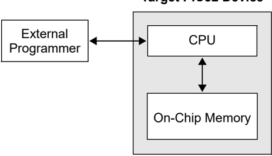

## Target PIC32 Device

## 2.1 Devices with Dual Flash Panel and Dual Boot Regions

The PIC32MKXXXXXXD/E/F/K/L/M and the PIC32MZ device families incorporate several features the facilitate field (self) programming of the device. These features include dual Flash panels with dual boot regions, an aliasing scheme for the boot regions allowing automatic selection of boot code at start-up and a panel swap feature for Program Flash. The two Flash panels and their associated boot regions can be erased and programmed separately. Refer to the 'Section 48. Memory Organization and Permissions' (DS60001214) of the 'PIC32 Family Reference Manual' for a detailed explanation of these features.

A development tool used for production programming will not be concerned about most of these features with the following exceptions:

- Ensuring the SWAP bit (NVMCON[7]) is in the proper setting. The default setting is ' 0 ', indicating no swap of panels. The development tool must assume the default setting when generating source files for the programming tool.
- Proper handling of the aliasing of the boot memory in the checksum calculation. The aliased sections are duplicates of the fixed sections. See 'Checksum' for more information on checksum calculations with aliased regions.
- For the PIC32MK devices, using the Erase/Retry feature when an attempt to erase a Flash page fails and requires a retire. See 'Initiating a Page Erase' for more information.

## 2.2 Programming Interfaces

All the PIC32 devices provide two physical interfaces to the external programmer tool:

- Two-Wire In-Circuit Serial Programming ™ (ICSP ™ )


- Four-Wire Joint Test Action Group (JTAG)

See 'Connecting to the Device' for more information.

Either of these methods may use a downloadable Programming Executive (PE). The PE executes from the target device RAM and hides the device programming details from the programmer. It also removes overhead associated with data transfer and improves overall data throughput. Microchip has developed a PE that is available for use with any external programmer, see 'Programming Executive' for more information.

Programming Steps describes high-level programming steps, followed by a brief explanation of each step. Detailed explanations are available in corresponding sections of this document.

More information on programming commands, EJTAG, and DC specifications are available in the following sections:

- Configuration Memory and Device ID
- Tap Controllers
- AC/DC Characteristics and Timing Requirements

## 2.3 Enhanced JTAG (EJTAG)

The Two-Wire and Four-Wire interfaces use the EJTAG protocol to exchange data with the programmer. This programming specification provides a working description of this protocol as needed, advanced users are advised to refer to the Imagination Technologies Limited web site (www.imgtec.com) for more information.

## 2.4 Data Sizes

Data sizes are defined as follows:

- One word: 32-bits
- One-half word: 16-bits
- One-quarter word: 8-bits
- One Byte: 8-bits


## 3. Programming Steps

All tool programmers must perform a common set of steps, regardless of the actual method being used. Figure 3-1 shows the set of steps to program the PIC32 devices.

Figure 3-1. Programming Flow

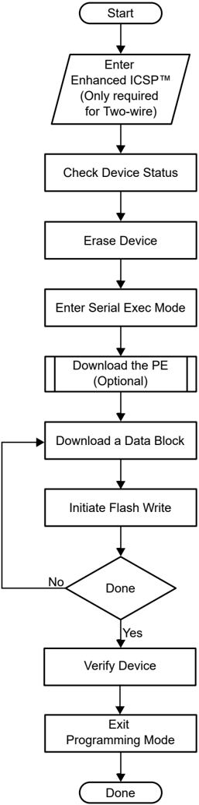

The following sequence lists the programming steps with a brief explanation of each step. More detailed information about these steps is available in the subsequent sections.


1. Connect the target device. To ensure successful programming, all required pins must be connected to appropriate signals. See Connecting to the Device for more information.
2. Place the target device in programming mode. For Two-Wire programming methods, the target device must be placed in a special programming mode (Enhanced ICSP ™ ) before executing any other steps.

Note: For the Four-Wire programming methods, step 2 is not applicable.

See Entering Two-Wire Enhanced ICSP Mode for more information.

3. Check the status of the device. Checks the status of the device to ensure it is ready to receive information from the programmer. See Check Device Status for more information.
4. Erase the target device. If the target memory block in the device is not blank, or if the device is code-protected, an erase step must be performed before programming any new data. See Erasing the Device for more information.
5. Enter programming mode. Verifies that the device is not code-protected and boots the TAP controller to start sending and receiving data to and from the PIC32 CPU. See Entering Serial Execution Mode for more information.
6. Download the Programming Executive (PE). The PE is a small block of executable code that is downloaded into the RAM of the target device. It will receive and program the actual data. Note: If the programming method being used does not require the PE, step 6 is not applicable.

See Downloading the Programming Executive (PE) for more information.

7. Download the block of data to program. All methods, with or without the PE, must download the desired programming data into a block of memory in RAM. See Downloading a Data Block for more information.
8. Initiate Flash Write. After downloading each block of data into RAM, the programming sequence must be started to program it into the target device's Flash memory. See Initiating a Flash Row Write for more information.
9. Repeat step 7 and step 8 until all data blocks are downloaded and programmed.
10. Verify the program memory. After all programming data and Configuration bits are programmed, the target device memory should be read back and verified for the matching content. See Verify Device Memory for more information.
11. Exit the Programming mode. The newly programmed data is not effective until either power is removed and reapplied to the target device or an exit programming sequence is performed. See Exiting Programming Mode for more information.


## 4. Connecting to the Device

The PIC32 family provides two possible physical interfaces for connecting and programming the memory contents, see Figure 4-1. For all programming interfaces, the target device must be powered and all required signals must be connected. In addition, the interface must be enabled, either through its Configuration bit, as in the case of the JTAG Four-Wire interface, or though a special initialization sequence, as is the case for the Two-Wire ICSP ™ interface.

The JTAG interface is enabled by default in blank devices shipped from the factory.

Enabling ICSP is described in Entering Two-Wire Enhanced ICSP Mode.

Figure 4-1. Programming Interfaces

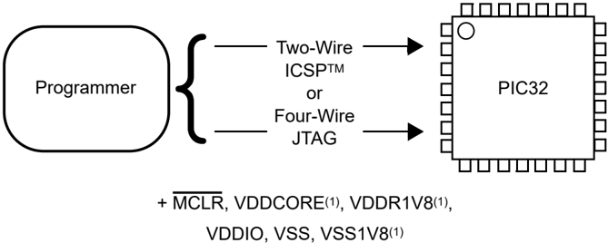

## Note:

1. This pin is not available on all devices. Refer to the 'Pin Diagrams' or 'Pin Tables' section in the specific device data sheet to determine availability.

## 4.1 Four-Wire Interface

One possible interface is the Four-Wire JTAG (IEEE 1149.1) port. Table 4-1 lists the required pin connections. This interface uses the following four communication lines to transfer data to and from the PIC32 device being programmed:

- Test Clock Input (TCK)
- Test Mode Select Input (TMS)
- Test Data Input (TDI)
- Test Data Output (TDO)

Table 4-1. Four-Wire Interface Pins

| Device Pin Name                                                       | Pin Type   | Pin Description                       |
|-----------------------------------------------------------------------|------------|---------------------------------------|
| MCLR                                                                  | Input      | Programming enable                    |
| ENVREG (2)                                                            | Input      | Enable for on-chip voltage regulator  |
| V DD , V DD IO, V DDCORE (2) , V DDR1V8 (2) , V BAT (2) and AV DD (1) | Power      | Power supply                          |
| V SS , V SS1V8 (2) and AV SS (1)                                      | Power      | Ground                                |
| V CAP (2)                                                             | Power      | CPU logic filter capacitor connection |
| TDI                                                                   | Input      | Test Data In                          |
| TDO                                                                   | Output     | Test Data Out                         |
| TCK                                                                   | Input      | Test Clock                            |
| TMS                                                                   | Input      | Test Mode State                       |


## Device Pin Name

## Notes:

1. All power supply and ground pins must be connected, including analog supplies (AVDD) and ground (AVSS).
2. This pin is not available on all devices. Refer to the 'Pin Diagrams' or 'Pin Tables' section in the specific device data sheet to determine availability.

## 4.1.1 Test Clock Input (TCK)

TCK is the clock that controls the updating of the TAP controller and the shifting of data through the Instruction or selected Data registers. TCK is independent of the processor clock with respect to both frequency and phase.

## 4.1.2 Test Mode Select Input (TMS)

TMS is the control signal for the TAP controller. This signal is sampled on the rising edge of the TCK.

## 4.1.3 Test Data Input (TDI)

TDI is the test data input to the Instruction or selected Data register. This signal is sampled on the rising edge of the TCK for some TAP controller states.

## 4.1.4 Test Data Output (TDO)

TDO is the test data output from the Instruction or Data registers. This signal changes on the falling edge of TCK. TDO is only driven when data is shifted out, otherwise the TDO is tri-stated.

## 4.2 Two-Wire Interface

Another possible interface is the Two-Wire In-Circuit Serial Programming ™ (ICSP ™ ) port. Table 4-2 lists the required pin connections. This interface uses the following two communication lines to transfer data to and from the PIC32 device being programmed:

- Serial Program Clock (PGECx)
- Serial Program Data (PGEDx)

These signals are described in the following two sections. Refer to the specific device data sheet for the connection of the signals to the chip pins.

Table 4-2. Two-Wire Interface Pins

| Device Pin Name                         | Programmer Pin Name   | Pin Type     | Pin Description                              |
|-----------------------------------------|-----------------------|--------------|----------------------------------------------|
| MCLR                                    | MCLR                  | Power        | Programming enable                           |
| ENVREG (2)                              | N/A                   | Input        | Enable for on-chip voltage regulator         |
| V DD , V DDIO , V BAT (2) and AV DD (1) | V DD                  | Power        | Power supply                                 |
| V DDCORE (2) and V DDR1V8 (2)           | N/A                   | Power        | Power supply for DDR interface               |
| V SS , V SS1V8 (2) and AV SS (1)        | V SS                  | Power        | Ground                                       |
| V CAP (2)                               | N/A                   | Power        | CPU logic filter capacitor connection        |
| PGECx                                   | PGEC                  | Input        | Primary programming pin pair: • Serial clock |
| PGEDx                                   | PGED                  | Input/Output | Primary programming pin pair: • Serial data  |

## Notes:

1. Ensure to connect all power supply and ground pins, including analog supplies (AVDD) and ground (AVSS).

2. This pin is not available on all devices. Refer to the 'Pin Diagrams' or 'Pin Tables' section in the specific device data sheet to determine availability.


Pin Type

## Pin Description

For more details on the connection of the signals to the device pins, refer to the specific device data sheet .

## 4.2.1 Serial Program Clock (PGECx)

PGECx is the clock that controls the updating of the TAP controller and the shifting of data through the Instruction or selected Data registers. PGECx is independent of the processor clock, with respect to both frequency and phase.

## 4.2.2 Serial Program Data (PGEDx)

PGEDx is the data input/output to the Instruction or selected Data Registers, it is also the control signal for the TAP controller. This signal is sampled on the falling edge of the PGECx for some TAP controller states.

## 4.3 PIC32MX Power Requirements

Devices in the PIC32MX family are dual voltage supply designs. There is one supply for the core and another for peripherals and I/O pins. All devices contain an on-chip regulator for the lower voltage core supply to eliminate the need for an additional external regulator. There are three implementations of the on board regulator:

- The first version has an internal regulator that can be disabled using the ENVREG pin. When disabled, an external power supply must be used to power the core. If enabled, a low-ESR filter capacitor must be connected to the VCAP pin, see Figure 4-2.
- The second version has an internal regulator that cannot be disabled. A low-ESR filter capacitor must always be connected to the VCAP pin.
- The third version has an internal regulator that cannot be disabled and does not require a filter capacitor

Refer to 'AC/DC Characteristics and Timing Requirements' and the 'Electrical Characteristics' chapter in the specific device data sheet for the power requirements of the device.


Figure 4-2. Internal Regulator Enable/Disable Options

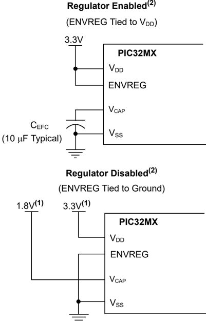

## Notes:

1. These are typical operating voltages. Refer to the AC/DC Characteristics and Timing Requirements for the full operating ranges of VDD and VCAP.
2. Regulator Enabled and Regulator Disabled mode are not available on all devices. Refer to the specific device data sheet to determine availability.

## 4.4 PIC32MX With VBAT Pin Power

Some devices in the PIC32MX family provide a VBAT pin which can be connected to the VDD power supply during programming. See Figure 4-3.

Figure 4-3. PIC32MX With VBAT Pin Power Connections

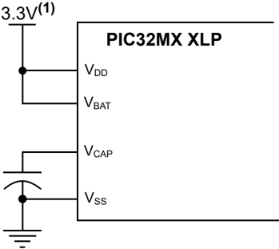


## Note:

1. This is typical operating voltage. Refer to the AC/DC Characteristics and Timing Requirements for the full operating range of V DD.

## 4.5 PIC32MZ EC and PIC32MZ EF Power Requirements

Devices in the PIC32MZ EC and PIC32MZ EF families are also dual voltage supply designs like PIC32MX devices. However, the internal regulator does not require the external filter capacitor, and there is no corresponding VCAP or ENVREG pins. See Figure 4-4.

Refer to the AC/DC Characteristics and Timing Requirements and the 'Electrical Characteristics' chapter in the specific device data sheet for the power requirements of the device.

Figure 4-4. PIC32MZ EC/EF Power

## Note:

1. This is typical operating voltage. Refer to the AC/DC Characteristics and Timing Requirements for the full operating range of V DD.

## 4.6 PIC32MZ DA Power Requirements

Devices in the PIC32MZ DA family are quadruple voltage supply designs. Two of the voltage supplies are identical to the PIC32MZ EC and PIC32MZ EF voltage supplies. The third voltage supply is for the DDR memory interface, and requires a 1.8 volt supply. The fourth voltage supply is for the VBAT pin, but it can be connected to the VDD power supply. See Figure 4-5.

Refer to the AC/DC Characteristics and Timing Requirements and the 'Electrical Characteristics' chapter in the specific device data sheet for the power requirements of the device.

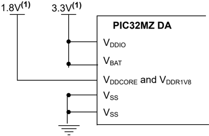


Figure 4-5. PIC32MZ DA Power Connections

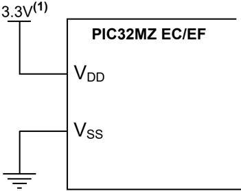

## Note:

1. These are typical operating voltages. Refer to the AC/DC Characteristics and Timing Requirements for the full operating ranges of V DDIO, V BAT , VDDCORE and VDDR1V8.

## 4.7 PIC32MK Power Requirements

Devices in the PIC32MK family are triple voltage supply designs. Two of the voltage supplies are identical to the PIC32MZ EC and the PIC32MZ EF voltage supplies. The third voltage supply is for the VBAT pin, but it can be connected to the VDD power supply. See Figure 4-6.

Figure 4-6. PIC32MK Power Connections

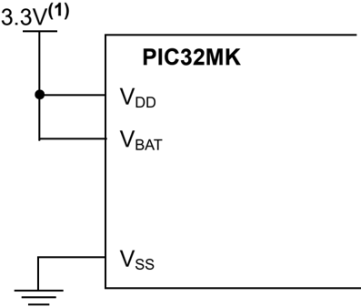

## Note:

1. These are typical operating voltages. Refer to the AC/DC Characteristics and Timing Requirements for the full operating ranges of VDD and VBAT.

## 4.8 PIC32MZ W1 Power Requirements

Devices in the PIC32MZ W1 family are triple voltage supply designs. Two of the voltage supplies are identical to the PIC32MZ EC and PIC32MZ EF voltage supplies. Connect the voltage supplies of the PIC32MZ W1 family of devices, see Figure 4-7.

Figure 4-7. PIC32MZ W1 Power Connections

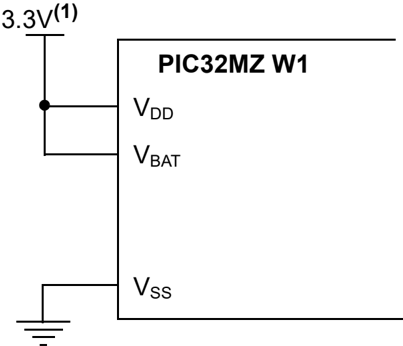


## Note:

1. These are typical operating voltages. Refer to the AC/DC Characteristics and Timing Requirements for the full operating ranges of VDD and VBAT.


## 5. Enhanced Joint Test Action Group (EJTAG) vs In-Circuit Serial Programming ™ (ICSP)

Programming is accomplished through the EJTAG module in the CPU core. EJTAG is connected to either the full set of JTAG pins or a reduced Two-Wire to Four-Wire EJTAG interface for ICSP mode. In both modes, programming of the PIC32 Flash memory is accomplished through the ETAP controller. The TAP controller uses the TMS pin to determine if Instruction or Data registers must be accessed in the shift path between TDI and TDO, see Figure 5-1.

The basic concept of the EJTAG that is used for programming is the use of a special memory area called DMSEG (0xFF200000 to 0xFF2FFFFF), which is only available when the processor is running in the Debug mode. All instructions are serially shifted into an internal buffer, and then loaded into the Instruction register and executed by the CPU. Instructions are fed through the ETAP state machine in 32-bit groups.

Figure 5-1. Tap Controller

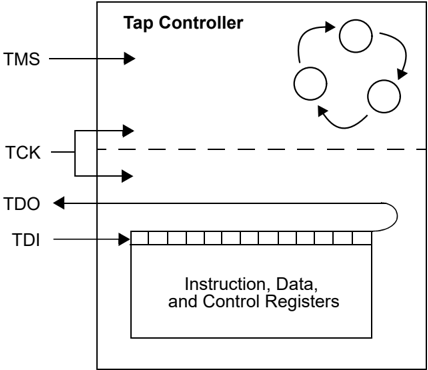

## 5.1 Programming Interface

Figure 5-2 shows the basic programming interface in the PIC32 devices. Descriptions of each interface block are provided in subsequent sections.


Figure 5-2. Basic PIC32 Programming Interface Block Diagram

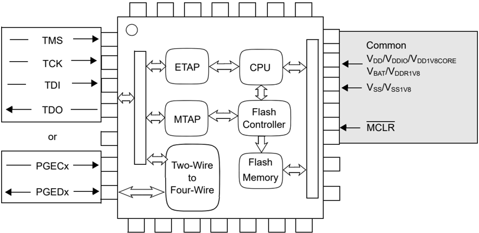

## Enhanced Tag Access Port (ETAP)

This block serially feeds instructions and data into the CPU.

## Microchip Tag Access Port (MTAP)

In addition to the EJTAG TAP (ETAP) controller, the PIC32 device uses a second proprietary TAP controller for additional operations. The Microchip TAP (MTAP) controller supports two instructions relevant to programming, MTAP\_COMMAND and TAP switch instructions. See Table 20-1 for complete list of instructions. The MTAP\_COMMAND instruction provides a mechanism for a JTAG probe to send commands to the device through its Data register.

The programmer sends commands by shifting in the MTAP\_COMMAND instruction through the SendCommand pseudo operation, and then sending the MTAP\_COMMAND DR commands through the XferData pseudo operation, see Table 20-2 for specific commands. The probe does not need to issue an MTAP\_COMMAND instruction for every command shifted into the Data register.

## Two-Wire or Four-Wire

This block converts the Two-Wire ICSP ™ interface to the Four-Wire JTAG interface.

## CPU

The CPU executes instructions at 8 MHz through the internal oscillator.

## Flash Controller

The Flash controller controls erasing and programming of the Flash memory on the device.

## Flash Memory

The PIC32 device Flash memory is divided into two logical Flash partitions consisting of the Boot Flash Memory (BFM) and Program Flash Memory (PFM). The BFM begins at address 0x1FC00000, and the PFM begins at address 0x1D000000. Each Flash partition is divided into pages, which represent the smallest block of memory that can be erased. Depending on the device, page sizes are 256 words (1024 bytes), 1024 words (4096 bytes) or 4096 words (16,384 bytes). Row size indicates the number of words that are programmed with the row program command. There are always eight rows within a page; therefore, devices with 256, 1024 and 4096 word page sizes have 32, 128 and 512 word row sizes, respectively. Table 5-1 shows the PFM, BFM, row and page size of each device family.


For a PIC32MZ W1 device, the BFM begins at address 0x1FC00000, and the PFM begins at address 0x10000000. The Flash is divided into pages of 1024 words or 4-KB, which represents the smallest block of memory that can be erased. Row size indicates the number of words that are programmed with row program commands. The Flash contains four rows within a page with a total row size of 256 words or 1024 bytes.

Memory locations of the BFM are reserved for the device Configuration registers, see Configuration Memory and Device ID for more information.

Table 5-1. Code Memory Size

| PIC32 Device                                                               |   Row Size (Words) |   Page Size (Words) | Boot Flash Memory Address (Bytes) (1)                           | Programming Executive (2, 3)   |
|----------------------------------------------------------------------------|--------------------|---------------------|-----------------------------------------------------------------|--------------------------------|
| PIC32MX 110/120/130/150/170210/220/230/350/270 (28/36/44 pin devices only) |                 32 |                 256 | 0x1FC00000-0x1FC00BFF (3 KB)                                    | RIPE_11_aabbcc.hex             |
| PIC32MX 120/130/150/170/230/250/270/530/550/57 (64/100-pin devices only)   |                 32 |                 256 | 0x1FC00000-0x1FC00BFF (3 KB)                                    | RIPE_11_aabbcc.hex             |
| PIC32MX 15X/17X/25X/27X (28/44-pin devices only)                           |                 32 |                 256 | 0x1FC00000-0x1FC02FFF (12 KB)                                   | RIPE_11_aabbcc.hex             |
| PIC32MZW1 10XX/20XX                                                        |                256 |                1024 | 0x1FC00000-0x1FC0FFFF (64 KB)                                   | RIPE_25_aabbcc.hex             |
| PIC32MX 330/350/370/430/450/470                                            |                128 |                1024 | 0x1FC00000-0x1FC02FFF (12 KB)                                   | RIPE_06_aabbcc.hex             |
| PIC32MX 320/340/360/420/440/460                                            |                128 |                1024 | 0x1FC00000-0x1FC02FFF (12 KB)                                   | RIPE_06_aabbcc.hex             |
| PIC32MX 534/564/664/764                                                    |                128 |                1024 | 0x1FC00000-0x1FC02FFF (12 KB)                                   | RIPE_06_aabbcc.hex             |
| PIC32MX 575/675/695/795                                                    |                128 |                1024 | 0x1FC00000-0x1FC02FFF (12 KB)                                   | RIPE_06_aabbcc.hex             |
| PIC32MK 0512/1024XXD/E/F/K/L/M                                             |                128 |                1024 | • 0x1FC00000-0x1FC04FFF (20 KB) • 0x1FC20000-0x1FC24FFF (20 KB) | RIPE_15a_aabbcc.hex            |
| PIC32MK 0256/0512XXG/H                                                     |                128 |                1024 | 0x1FC00000-0x1FC04FFF (20 KB)                                   | RIPE_15a_aabbcc.hex            |
| PIC32MZ 05XX/10XX/20XX                                                     |                512 |                4096 | • 0x1FC00000-0x1FC13FFF (80 KB) • 0x1FC20000-0x1FC33FFF (80 KB) | RIPE_15_aabbcc.hex             |


## ...........continued

| PIC32 Device   | Row Size (Words) Page Size (Words) Boot Flash Memory Address (Bytes) (1) Programming Executive (2, 3)   |
|----------------|---------------------------------------------------------------------------------------------------------|

## Notes:

1. Program Flash memory address ranges are based on the program Flash size. The following are the program Flash memory addresses:
2. -0x1D000000-0x1D003FFF (16 KB)
3. -0x1D000000-0x1D007FFF (32 KB)
4. -0x1D000000-0x1D00FFFF (64 KB)
5. -0x1D000000-0x1D01FFFF (128 KB)
6. -0x1D000000-0x1D03FFFF (256 KB)
7. -0x1D000000-0x1D07FFFF (512 KB)
8. -0x1D000000-0x1D0FFFFF (1024 KB)
9. -0x1D000000-0x1D1FFFFF (2048 KB)

All program Flash memory sizes are not supported by each family.

The program Flash memory address ranges for the PIC32MZ W1 family are as follows:

- 10XX: 0x10000000-0x100FFFFF (1024 KB)
- 20XX: 0x10000000-0x101FFFFF (2048 KB)
2. The Programming Executive can be obtained from the related product page on the Microchip website or it can be located in the following MPLAB ® X IDE installation folders:
- -…\Microchip\MPLABX\&lt;version&gt;\mplab\_ide\mplablibs\modules\ext\REALICE.jar
- -…\Microchip\MPLABX\&lt;version&gt;\mplab\_ide\mplablibs\modules\ext\ICD3.jar
- -…\Microchip\MPLABX\&lt;version&gt;\mplab\_ide\mplablibs\modules\ext\PICKIT3.jar
3. The last characters of the file name, aabbcc , vary based on the revision of the file.

## 5.2 Four-Wire JTAG Details

The Four-Wire interface uses standard JTAG (IEEE ® 1149.1-2001) interface signals.

- Test Clock (TCK) - Drives data in/out
- Test Mode Select (TMS) - Selects operational mode
- Test Data Input (TDI) - Data into the device
- Test Data Output (TDO) - Data out of the device

Since only one data line is available, the protocol is necessarily serial, similar to Serial Peripheral Interface (SPI). The clock input occurs at the TCK pin. Configuration is performed by manipulating a state machine bit by bit through the TMS pin. One bit of data is transferred in and out per TCK clock pulse at the TDI and TDO pins. Different instruction modes can be loaded to read the chip ID or manipulate chip functions.

Data presented to TDI must be valid for a chip-specific setup time before, and hold time, after the rising edge of the TCK. TDO data is valid for a chip-specific time after the falling edge of TCK, see Figure 5-3.


Figure 5-3. Four-Wire JTAG Interface

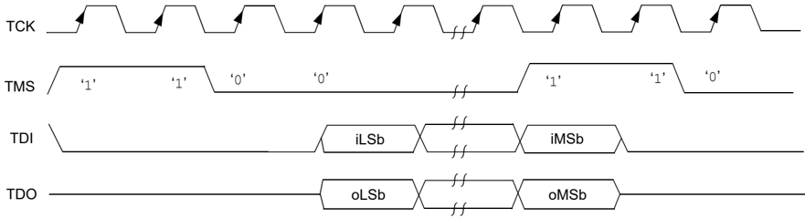

## 5.3 Two-Wire ICSP Details

In ICSP mode, the Two-Wire ICSP ™ signals are time multiplexed into the Two-Wire to Four-Wire block. The Two-Wire to Four-Wire block then converts the signals to look like a Four-Wire JTAG port to the TAP controller. The following are two possible modes of operation:

- 4-phase ICSP
- 2-phase ICSP

## 5.3.1 4-phase ICSP

In 4-phase ICSP mode, the TDI, TDO and TMS device pins are multiplexed onto PGEDx in four clocks, see Figure 5-4. The LSb is shifted first; and TDI and TMS are sampled on the falling edge of PGECx, while TDO is driven on the same edge. The 4-phase ICSP mode facilitates both read and write data transfers.

Figure 5-4. Two-Wire and 4-Phase

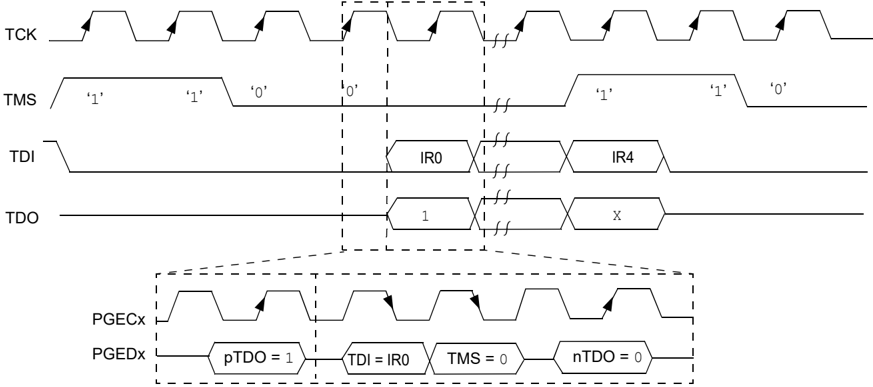

## 5.3.2 2-phase ICSP

In 2-phase ICSP ™ mode, the TMS and TDI device pins are multiplexed into PGEDx in two clocks, see Figure 5-5. The LSb is shifted first; and TDI and TMS are sampled on the falling edge of PGECx. There is no TDO output provided in this mode. The 2-phase ICSP mode was designed to accelerate Two-Wire, write-only transactions.

Note: The packet is not actually executed until the first clock of the next packet. To enter Two-Wire, 2-phase ICSP mode, the TDOEN bit (DDPCON[0] or CFGCON[0]) must be set to ' 0 '.


Figure 5-5. Two-Wire and 2-Phase

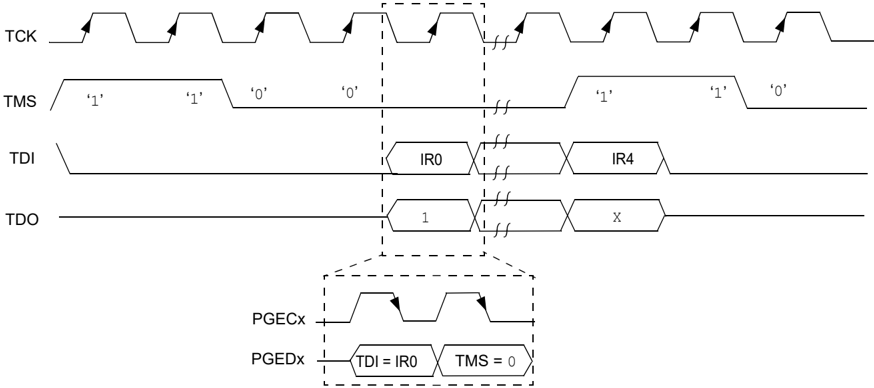

## 5.3.3 Synchronization

Some PIC32 devices can Reset the internal EJTAG state machine if the attached programmer loses synchronization with it. This can occur when noise is present on the PGCx signal.

To achieve resynchronization, the PGEDx pin is held high for 24 PGECx clock cycles. This forces five TMS events into the EJTAG controller and places the EJTAG state machine into a Test Idle Reset. See Figure 5-6 for an example of how to achieve resynchronization.

When asserting the PGEDx pin high, there may be contention on the pin as the device may attempt to drive TDO out onto the pin while the in-circuit emulator is driving in. This only occurs for a maximum of one cycle as TMS high advances the EJTAG state machine out of a Shift-IR or Shift-DR state.

Synchronization in 2-wire, 2-phase mode is not supported.

Figure 5-6. Achieving Resynchronization

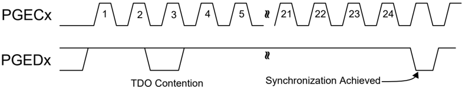


## 6. Pseudo Operations

To simplify the description of programming details, all operations will be described using pseudo operations. There are several functions used in the pseudo-code descriptions. These are used either to make the pseudo-code more readable, to abstract implementation-specific behavior or both. When passing parameters with pseudo operation, the following syntax will be used:

- 5'h0x03 - Send 5-bit hexadecimal value of 3
- 6'b011111 - Send 6-bit binary value of 31

These functions are defined in this section, and include the following operations:

- SetMode (mode)
- SendCommand (command)
- oData = XferData (iData)
- oData = XferFastData (iData)
- oData = XferInstruction (instruction)

## 6.1 Set Mode ( SetMode ) Pseudo Operation

## Format:

SetMode (mode)

## Purpose:

- To set the EJTAG state machine to a specific state.

## Description:

- The value of mode is clocked into the device on signal TMS. TDI is set to ' 0 ' and TDO is ignored.

## Restrictions:

- None.

## Example:

- The following is an example of how to use the SetMode function:

SetMode (6'b011111)

Figure 6-1. Set Mode Four-Wire

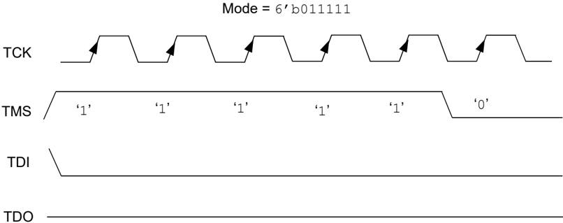


Figure 6-2. Set Mode Two-Wire

Mode = 6'b011111

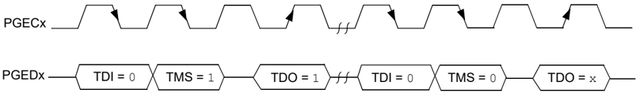

## 6.2 Send Command ( SendCommand ) Pseudo Operation

## Format:

SendCommand (command)

## Purpose:

- To send a command to select a specific TAP register.

## Description (in sequence):

1. The TMS Header is clocked into the device to select the Shift IR state
2. The command is clocked into the device on TDI while holding signal TMS low.
3. The last MSb of the command is clocked in while setting TMS high.
4. The TMS Footer is clocked in on TMS to return the TAP controller to the Run/Test Idle state.

## Restrictions:

- None.

## Example:

- The following is an example of how to use the Send Command ( SendCommand ) function:

SendCommand (5'h0x07)

Figure 6-3. Send Command ( SendCommand ) Four-Wire

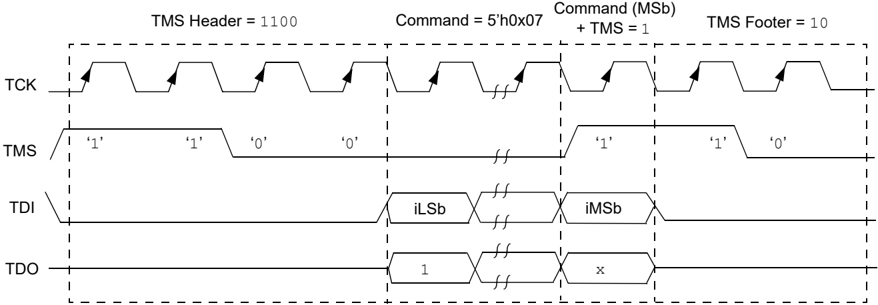


Figure 6-4. Send Command ( SendCommand ) Two-Wire (4-phase)

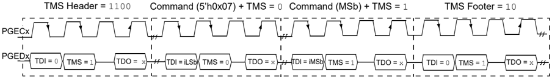

## 6.3 Transfer Data ( XferData ) Pseudo Operation

## Format:

```
oData = XferData (iData)
```

## Purpose:

- To clock data to and from the register selected by the command.

## Description (in sequence):

1. The TMS Header is clocked into the device to select the Shift DR state.
2. The data is clocked in/out of the device on TDI/TDO while holding signal TMS low.
3. The last MSb of the data is clocked in/out while setting TMS high.
4. The TMS Footer is clocked in on TMS to return the TAP controller to the Run/Test Idle state.

## Restrictions:

- None.

## Example:

- The following is an example of how to use the Transfer Data ( XferData ) function:

```
oData = XferData (32'h0x12)
```

Figure 6-5. Transfer Data ( XferData ) Four-Wire

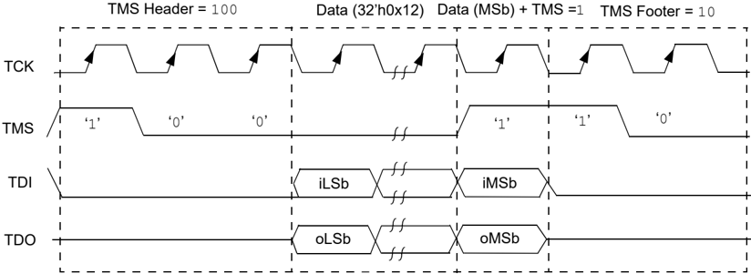


Figure 6-6. Transfer Data ( XferData ) Two-Wire (4-phase)

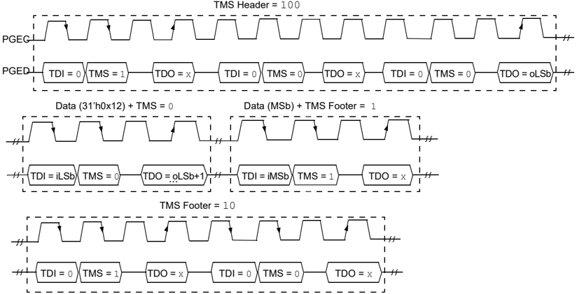

## 6.4 Transfer Fast Data ( XferFastData ) Pseudo Operation

## Format:

oData = XferFastData (iData)

## Purpose:

- To quickly send 32 bits of data in/out of the device.

## Description (in sequence):

1. The TMS Header is clocked into the device to select the Shift DR state. Note: For Two-Wire (4-phase) - On the last clock, the oPrAcc bit is shifted out on TDO while clocking in the TMS header. If the value of oPrAcc is not ' 1 ', the whole operation must be repeated.
2. The input value of the PrAcc bit, which is ' 0 ', is clocked in. Note: For Two-Wire (4-phase) - The TDO during this operation will be the LSb of output data. The rest of the 31 bits of the input data are clocked in and the 31 bits of output data are clocked out. For the last bit of the input data, the TMS Footer = 1 is set.
3. TMS Footer = 10 is clocked in to return the TAP controller to the Run/Test Idle state.

## Restrictions:

- The SendCommand (ETAP\_FASTDATA) must be sent first to select the Fast Data register, as shown in SendCommand (ETAP\_FASTDATA) ). See Table 20-3 for detailed descriptions of commands.

Note: The 2-phase XferData is only used when talking to the PE. See Programming Executive for more information.

## Example:

- The following is an example of how to use the Transfer Fast Data ( XferFastData ) function:

```
// Select the Fastdata Register SendCommand (ETAP_FASTDATA) // Send/Receive 32-bit Data oData = XferFastData(32'h0x12)
```


Figure 6-7. Transfer Fast Data ( XferFastData ) Four-Wire

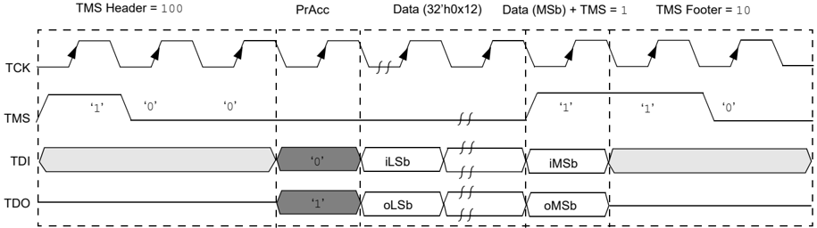

Figure 6-8. Transfer Fast Data ( XferFastData ) Two-Wire (2-phase)

Figure 6-9. Transfer Fast Data ( XferFastData ) Two-Wire (4-phase)

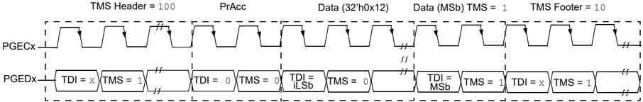

TMS Header =

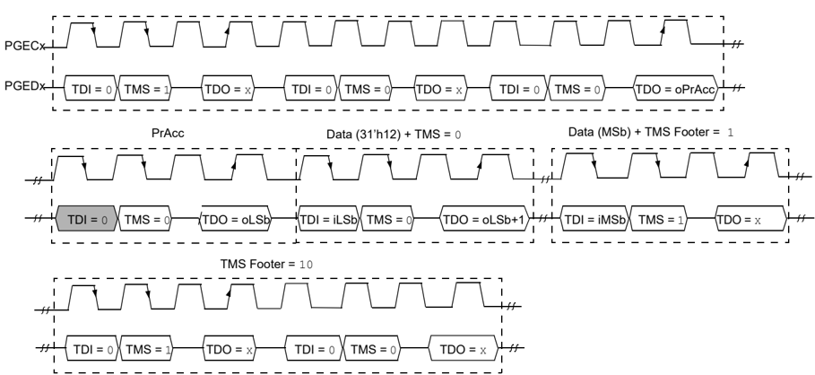

100

## 6.5 Transfer Instruction ( XferInstruction ) Pseudo Operation

## Format:

XferInstruction (instruction)

## Purpose:

- To send 32 bits of data for the device to execute.

## Description:

- The instruction is clocked into the device and then executed by CPU.


## Restrictions:

- The device must be in Debug mode.

## Example:

- The following is an example of how to use the Transfer Instruction ( XferInstruction ) function:

```
XferInstruction (instruction) // Check if Processor Access bit (bit 18) is set
```

```
{ // Select Control Register SendCommand (ETAP_CONTROL); // Wait until CPU is ready do { controlVal = XferData(32'h0x0004C000); } while( PrAcc(contorlVal[18]) is not '1' ); // Select Data Register SendCommand (ETAP_DATA); // Send the instruction XferData (instruction); // Tell CPU to execute instruction SendCommand (ETAP_CONTROL); XferData(32'h0x0000C000); }
```

## 6.6 Read from Address ( ReadFromAddress ) Pseudo Operation

## Format:

```
oData = ReadFromAddress (address)
```

## Purpose:

- To send 32 bits of data to the device memory.

## Description:

- The 32-bit data is read from the memory at the address specified in the address parameter.

## Restrictions:

- The device must be in Debug mode.

## Example:

- The following is an example of how to use the ReadFromAddress function for PIC32MX, PIC32MZ and PIC32MK devices:

```
ReadFromAddress (address) { // Load Fast Data register address to s3 instruction = 0x3c130000; instruction |= (0xff200000>>16)&0x0000ffff; XferInstruction(instruction); // lui s3, <FAST_DATA_REG_ADDRESS(31:16)> - set address of fast data register // Load memory address to be read into t0 instruction = 0x3c080000; instruction |= (address>>16)&0x0000ffff; XferInstruction(instruction); // lui t0, <DATA_ADDRESS(31:16)> - set address of data instruction = 0x35080000; instruction |= (address&0x0000ffff); XferInstruction(instruction); // ori t0, <DATA_ADDRESS(15:0)> - set address of data // Read data XferInstruction (0x8d090000); // lw t1, 0(t0) // Store data into Fast Data register XferInstruction (0xae690000); // sw t1, 0(s3) - store data to fast data register XferInstruction (0); // nop // Shift out the data SendCommand (ETAP_FASTDATA); oData = XferFastData(32'h0x00000000); return oData; }
```


## 6.7 Synchronize ( Synchronize ) Pseudo Operation

## Format:

Synchronize ()

## Purpose:

- To reset the EJTAG state machine into Test Idle Reset.

## Description:

- The PGEDx signal is held high for 24 PGECx clock cycles. All other signals are ignored.

## Restrictions:

- None.

Figure 6-10. Achieving Resynchronization

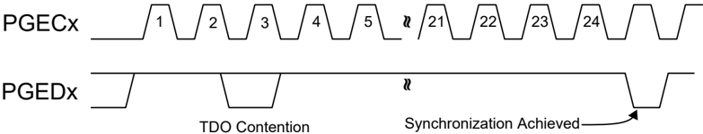


## 7. Entering Two-Wire Enhanced ICSP Mode

To use the Two-Wire PGEDx and PGECx pins for programming, they must be enabled. Note that any pair of programming pins available on a particular device may be used, however, they must be used as a pair. PGED1 must be used with PGEC1, and so on.

Note: If using the Four-Wire JTAG interface, the following procedure is not necessary.

The following steps are required to enter the Two-Wire Enhanced ICSP ™ mode:

1. The MCLR pin is briefly driven high, then low.
2. A 32-bit key sequence is clocked into PGEDx.
3. The MCLR pin is then driven high within a specified period of time and held.

Refer to the AC/DC Characteristics and Timing Requirements for timing requirements.

The programming voltage applied to the MCLR pin is VIH, which is essentially VDD, in PIC32 devices. There is no minimum time requirement for holding at VIH. After VIH is removed, an interval of at least P18 must elapse before presenting the key sequence on PGEDx.

The key sequence is a specific 32-bit pattern 0100 1101 0100 0011 0100 1000 0101 0000 (the acronym 'MCHP', in ASCII). The device will enter the Program/Verify mode only if the key sequence is valid. The MSb of the Most Significant nibble must be shifted in first.

Once the key sequence is complete, VIH must be applied to the MCLR pin and held at that level for as long as the Two-Wire Enhanced ICSP interface is to be maintained. An interval of at least time P19 and P7 must elapse before presenting data on PGEDx. Signals appearing on PGEDx before P7 has elapsed will not be interpreted as valid.

Upon successful entry, the programming operations documented in subsequent sections can be performed. While in Two-Wire Enhanced ICSP mode, all unused I/Os are placed in the highimpedance state.

Note: Entering the ICSP mode puts the device into a Reset state to prevent instruction execution. To release the Reset, the MCHP\_DEASSERT\_RST command must be issued.

Figure 7-1. Entering Enhanced ICSP Mode

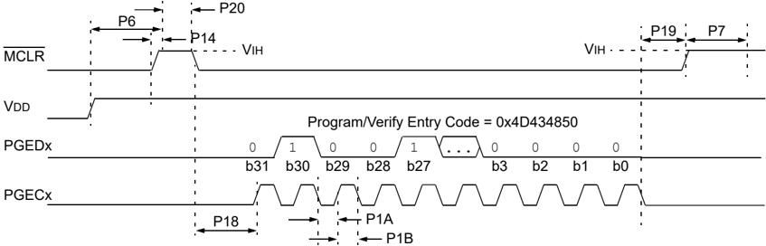


## 8. Check Device Status

Before a device can be programmed, the programmer must check the status of the device to ensure that it is ready to receive information.

Figure 8-1. Check Device Status

## 8.1 Four-Wire Interface

The setup sequence to enter Four-Wire JTAG programming must be done while asserting the MCLR pin. Once the programming mode is entered, the MCLR pin can be released to allow the processor to execute instructions or drive ports.

The following are the steps required to check the device status using the Four-Wire interface:

1. Set the MCLR pin low.
2. SetMode (6'b011111) to force the chip TAP controller into Run Test/Idle state.
3. SendCommand (MTAP\_SW\_MTAP) .
4. SetMode (6'b011111) to force the Chip TAP controller into Run Test/Idle state.


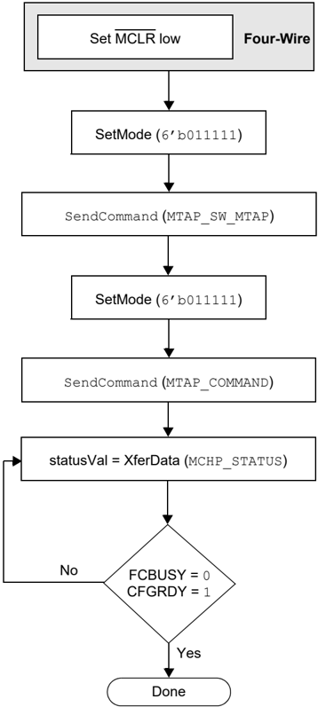

5. SendCommand (MTAP\_COMMAND) .
6. statusVal = XferData (MCHP\_STATUS) .
7. If CFGRDY (statusVal[3]) is not ' 1 ' and FCBUSY (statusVal[2]) is not ' 0 ', go to step 5.

Note: If using the 4-wire interface, the oscillator source, as selected by the Configuration Words, must be present to access the Flash memory. In an unprogrammed device, the oscillator source is the internal FRC allowing for Flash memory access. If the Configuration Words have been reprogrammed selecting an external oscillator source then it must be present for Flash memory access. See the 'Special Features' chapter in the specific device data sheet for details regarding oscillator selection using the Configuration Word settings.

## 8.2 Two-Wire Interface

The following steps are required to check the device status using the Two-Wire interface:

1. SetMode (6'b011111) to force the Chip TAP controller into Run Test/Idle state.
2. SendCommand (MTAP\_SW\_MTAP) .
3. SetMode (6'b011111) to force the Chip TAP controller into Run Test/Idle state.
4. SendCommand (MTAP\_COMMAND) .
5. statusVal = XferData (MCHP\_STATUS) .
6. If CFGRDY (statusVal[3]) is not ' 1 ' and FCBUSY (statusVal[2]) is not ' 0 ', go to step 4.

Note: If the CFGRDY and FCBUSY bits do not come to the proper state within 10 ms, the sequence may have been executed incorrectly or the device is damaged.


## 9. Erasing the Device

Before a device can be programmed, it must be erased. The erase operation writes all ' 1 s' to the Flash memory and prepares it to program a new set of data. Once a device is erased, it can be verified by performing a 'Blank Check' operation. See Blank Check for more information.

The procedure for erasing program memory (program, boot, and configuration memory) consists of selecting the MTAP and sending the MCHP\_ERASE command. The programmer must wait for the erase operation to complete by reading and verifying bits in the MCHP\_STATUS value. Figure 9-1 illustrates the process for performing a chip erase operation.

Note: The device ID memory locations are read-only and cannot be erased. Therefore, the chip erase operation has no effect on these memory locations.

The following steps are required to erase a target device:

1. SendCommand (MTAP\_SW\_MTAP) .
2. SetMode (6'b011111) .
3. SendCommand (MTAP\_COMMAND) .
4. XferData (MCHP\_ERASE) .
5. XferData (MCHP\_DE\_ASSERT\_RST) . Note: This step is not required for the PIC32MX devices.
6. Delay 10 ms.
7. statusVal = XferData (MCHP\_STATUS) .
8. If CFGRDY (statusVal[3]) is not ' 1 ' and FCBUSY (statusVal[2]) is not ' 0 ', go to step 5.note Note: The Chip Erase operation is a self-timed operation. If the FCBUSY and CFGRD bits do not set properly within the specified Chip Erase time, the sequence may have been executed incorrectly or the device is damaged.


Figure 9-1. Erase Device

## 9.1 Blank Check

The term 'Blank Check' implies verifying that the device has been successfully erased and contains no programmed memory locations. A blank or erased memory location always reads as ' 1 '.

The device Configuration registers are ignored by the Blank Check. Additionally, all unimplemented memory space must be ignored from the Blank Check.


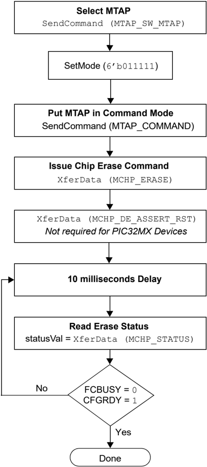

## 10. Entering Serial Execution Mode

Before programming a device, it must be placed in Serial Execution mode. The procedure for entering Serial Execution mode consists of verifying that the device is not code-protected. If the device is code protected, a Chip Erase must be performed. See Erasing the Device for details.


Figure 10-1. Entering Serial Execution Mode

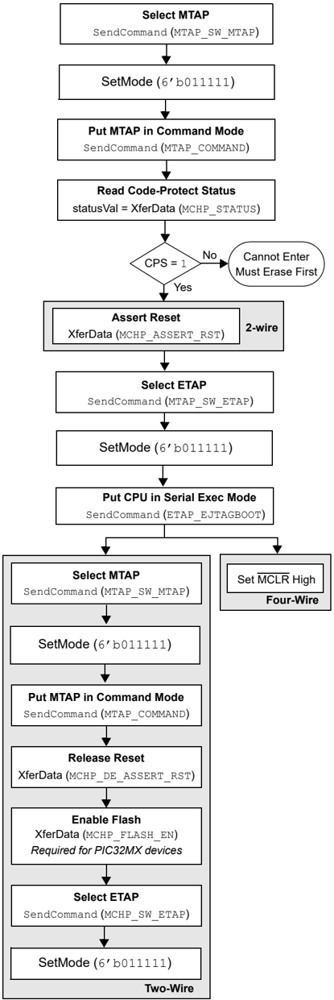


## 10.1 Four-Wire Interface

The following steps are required to enter Serial Execution mode:

Note: The assumption is that the MCLR pin has been driven low from the previous check device status step (see Figure 8-1).

1. SendCommand (MTAP\_SW\_MTAP) .
2. SetMode (6'b011111).
3. SendCommand (MTAP\_COMMAND) .
4. statusVal = XferData (MCHP\_STATUS) .
5. If CPS (statusVal[7]) is not ' 1 ', first, erase the device.
6. SendCommand (MTAP\_SW\_ETAP) .
7. SetMode (6'b011111) .
8. SendCommand (ETAP\_EJTAGBOOT) .
9. Set the MCLR pin high.

## 10.2 Two-Wire Interface

The following steps are required to enter Serial Execution mode:

1. SendCommand (MTAP\_SW\_MTAP) .
2. SetMode (6'b011111) .
3. SendCommand (MTAP\_COMMAND) .
4. statusVal = XferData (MCHP\_STATUS) .
5. If CPS (statusVal[7]) is not ' 1 ', first, erase the device.
6. XferData (MCHP\_ASSERT\_RST) .
7. SendCommand (MTAP\_SW\_ETAP) .
8. SetMode (6'b011111) .
9. SendCommand (ETAP\_EJTAGBOOT) .
10. SendCommand (MTAP\_SW\_MTAP) .
11. SetMode (6'b011111) .
12. SendCommand (MTAP\_COMMAND) .
13. XferData (MCHP\_DE\_ASSERT\_RST) .
14. XferData (MCHP\_FLASH\_ENABLE) . Note: This step is required for the PIC32MX family devices.
15. SendCommand (MTAP\_SW\_ETAP) .
16. SetMode (6'b011111) .


## 11. Downloading the Programming Executive (PE)

The Programming Executive (PE) resides in RAM memory, and is executed by the CPU to program the device. The PE provides the mechanism for the programmer to program and verify the PIC32 devices using a simple command set and communication protocol. The PE provides several basic functions, such as:

- Read memory
- Erase memory
- Program memory
- Blank check
- Read executive firmware revision
- Get the Cyclic Redundancy Check (CRC) of Flash memory locations

The PE performs the low-level tasks required for programming and verifying a device. This allows the programmer to program the device by issuing the appropriate commands and data. A detailed description on each command is provided in The PE Command Set.

The PE uses the device's data RAM for variable storage and program execution. After running the PE, do not make any assumptions about the contents of data RAM.

After the PE is loaded into the data RAM, the PIC32 family can be programmed using the command set shown in Table 17-1.

Figure 11-1. Downloading the PE

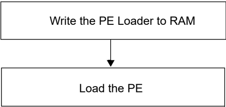

Loading the PE in the memory is a two step process:

1. Load the PE loader in the data RAM. (The PE loader loads the PE binary file in the proper location of the data RAM, and when done, jumps to the programming exec and starts executing it.)
2. Feed the PE binary to the PE loader.

Table 11-1 lists the steps that are required to download the PE.


Table 11-1. Download the PE OP Codes

| Step Number   | Operation                                                                                                                                                                                                                                                                                                                                                                                                                                                                                                                                                                            |                                                                                                                                                                                                                                                                                                                                                                                                                                                                                                                                                                                      | Operand                                                                                                                                                                                                                                                                                                                                                                                                                                                                                                                                                                              |
|---------------|--------------------------------------------------------------------------------------------------------------------------------------------------------------------------------------------------------------------------------------------------------------------------------------------------------------------------------------------------------------------------------------------------------------------------------------------------------------------------------------------------------------------------------------------------------------------------------------|--------------------------------------------------------------------------------------------------------------------------------------------------------------------------------------------------------------------------------------------------------------------------------------------------------------------------------------------------------------------------------------------------------------------------------------------------------------------------------------------------------------------------------------------------------------------------------------|--------------------------------------------------------------------------------------------------------------------------------------------------------------------------------------------------------------------------------------------------------------------------------------------------------------------------------------------------------------------------------------------------------------------------------------------------------------------------------------------------------------------------------------------------------------------------------------|
| Step 1        | PIC32MX devices only: Initialize BMXCON to 0x1F0040. The instruction sequence executed by the PIC32 core is:                                                                                                                                                                                                                                                                                                                                                                                                                                                                         | PIC32MX devices only: Initialize BMXCON to 0x1F0040. The instruction sequence executed by the PIC32 core is:                                                                                                                                                                                                                                                                                                                                                                                                                                                                         | PIC32MX devices only: Initialize BMXCON to 0x1F0040. The instruction sequence executed by the PIC32 core is:                                                                                                                                                                                                                                                                                                                                                                                                                                                                         |
| Step 1        | lui a0,0xbf88 ori a0,a0,0x2000 lui a1,0x1f ori a1,a1,0x40 sw a1,0(a0)                                                                                                                                                                                                                                                                                                                                                                                                                                                                                                                | lui a0,0xbf88 ori a0,a0,0x2000 lui a1,0x1f ori a1,a1,0x40 sw a1,0(a0)                                                                                                                                                                                                                                                                                                                                                                                                                                                                                                                | /* address of BMXCON */ /* a1 has 0x1f0040 */ /* BMXCON initialized */                                                                                                                                                                                                                                                                                                                                                                                                                                                                                                               |
| Step 1        | XferInstruction                                                                                                                                                                                                                                                                                                                                                                                                                                                                                                                                                                      | XferInstruction                                                                                                                                                                                                                                                                                                                                                                                                                                                                                                                                                                      | 0x3c04bf88                                                                                                                                                                                                                                                                                                                                                                                                                                                                                                                                                                           |
| Step 1        | XferInstruction                                                                                                                                                                                                                                                                                                                                                                                                                                                                                                                                                                      | XferInstruction                                                                                                                                                                                                                                                                                                                                                                                                                                                                                                                                                                      | 0x34842000                                                                                                                                                                                                                                                                                                                                                                                                                                                                                                                                                                           |
| Step 1        | XferInstruction                                                                                                                                                                                                                                                                                                                                                                                                                                                                                                                                                                      | XferInstruction                                                                                                                                                                                                                                                                                                                                                                                                                                                                                                                                                                      | 0x3c05001f                                                                                                                                                                                                                                                                                                                                                                                                                                                                                                                                                                           |
| Step 1        | XferInstruction                                                                                                                                                                                                                                                                                                                                                                                                                                                                                                                                                                      | XferInstruction                                                                                                                                                                                                                                                                                                                                                                                                                                                                                                                                                                      | 0x34a50040                                                                                                                                                                                                                                                                                                                                                                                                                                                                                                                                                                           |
| Step 1        | XferInstruction                                                                                                                                                                                                                                                                                                                                                                                                                                                                                                                                                                      | XferInstruction                                                                                                                                                                                                                                                                                                                                                                                                                                                                                                                                                                      | 0xac850000                                                                                                                                                                                                                                                                                                                                                                                                                                                                                                                                                                           |
| Step 2        | PIC32MX devices only: Initialize BMXDKPBA to 0x800. The instruction sequence executed by the PIC32 core is:                                                                                                                                                                                                                                                                                                                                                                                                                                                                          | PIC32MX devices only: Initialize BMXDKPBA to 0x800. The instruction sequence executed by the PIC32 core is:                                                                                                                                                                                                                                                                                                                                                                                                                                                                          | PIC32MX devices only: Initialize BMXDKPBA to 0x800. The instruction sequence executed by the PIC32 core is:                                                                                                                                                                                                                                                                                                                                                                                                                                                                          |
| Step 2        | li a1,0x800 sw a1,16(a0)                                                                                                                                                                                                                                                                                                                                                                                                                                                                                                                                                             | li a1,0x800 sw a1,16(a0)                                                                                                                                                                                                                                                                                                                                                                                                                                                                                                                                                             | li a1,0x800 sw a1,16(a0)                                                                                                                                                                                                                                                                                                                                                                                                                                                                                                                                                             |
| Step 2        | XferInstruction                                                                                                                                                                                                                                                                                                                                                                                                                                                                                                                                                                      | XferInstruction                                                                                                                                                                                                                                                                                                                                                                                                                                                                                                                                                                      | 0x34050800                                                                                                                                                                                                                                                                                                                                                                                                                                                                                                                                                                           |
| Step 2        | XferInstruction                                                                                                                                                                                                                                                                                                                                                                                                                                                                                                                                                                      | XferInstruction                                                                                                                                                                                                                                                                                                                                                                                                                                                                                                                                                                      | 0x34050800                                                                                                                                                                                                                                                                                                                                                                                                                                                                                                                                                                           |
| Step 3        | PIC32MX devices only: Initialize BMXDUDBA and BMXDUPBA to the value of the BMXDRMSZ. The instruction sequence executed by the PIC32 core is:                                                                                                                                                                                                                                                                                                                                                                                                                                         | PIC32MX devices only: Initialize BMXDUDBA and BMXDUPBA to the value of the BMXDRMSZ. The instruction sequence executed by the PIC32 core is:                                                                                                                                                                                                                                                                                                                                                                                                                                         | PIC32MX devices only: Initialize BMXDUDBA and BMXDUPBA to the value of the BMXDRMSZ. The instruction sequence executed by the PIC32 core is:                                                                                                                                                                                                                                                                                                                                                                                                                                         |
| Step 3        | lw a1,64(a0) sw a1,32(a0) sw a1,48(a0)                                                                                                                                                                                                                                                                                                                                                                                                                                                                                                                                               | lw a1,64(a0) sw a1,32(a0) sw a1,48(a0)                                                                                                                                                                                                                                                                                                                                                                                                                                                                                                                                               | /* load BMXDMSZ */                                                                                                                                                                                                                                                                                                                                                                                                                                                                                                                                                                   |
| Step 3        | XferInstruction                                                                                                                                                                                                                                                                                                                                                                                                                                                                                                                                                                      | XferInstruction                                                                                                                                                                                                                                                                                                                                                                                                                                                                                                                                                                      | 0x8C850040                                                                                                                                                                                                                                                                                                                                                                                                                                                                                                                                                                           |
| Step 3        | XferInstruction                                                                                                                                                                                                                                                                                                                                                                                                                                                                                                                                                                      | XferInstruction                                                                                                                                                                                                                                                                                                                                                                                                                                                                                                                                                                      | 0xac850020                                                                                                                                                                                                                                                                                                                                                                                                                                                                                                                                                                           |
| Step 3        | XferInstruction                                                                                                                                                                                                                                                                                                                                                                                                                                                                                                                                                                      | XferInstruction                                                                                                                                                                                                                                                                                                                                                                                                                                                                                                                                                                      | 0xac850030                                                                                                                                                                                                                                                                                                                                                                                                                                                                                                                                                                           |
| Step 4        | Set up PIC32 RAM address for PE. The instruction sequence executed by the PIC32 core is:                                                                                                                                                                                                                                                                                                                                                                                                                                                                                             | Set up PIC32 RAM address for PE. The instruction sequence executed by the PIC32 core is:                                                                                                                                                                                                                                                                                                                                                                                                                                                                                             | Set up PIC32 RAM address for PE. The instruction sequence executed by the PIC32 core is:                                                                                                                                                                                                                                                                                                                                                                                                                                                                                             |
| Step 4        | lui a0,0xa000 ori a0,a0,0x800                                                                                                                                                                                                                                                                                                                                                                                                                                                                                                                                                        | lui a0,0xa000 ori a0,a0,0x800                                                                                                                                                                                                                                                                                                                                                                                                                                                                                                                                                        | lui a0,0xa000 ori a0,a0,0x800                                                                                                                                                                                                                                                                                                                                                                                                                                                                                                                                                        |
| Step 4        | XferInstruction                                                                                                                                                                                                                                                                                                                                                                                                                                                                                                                                                                      | XferInstruction                                                                                                                                                                                                                                                                                                                                                                                                                                                                                                                                                                      | 0x3c04a000                                                                                                                                                                                                                                                                                                                                                                                                                                                                                                                                                                           |
| Step 4        | XferInstruction                                                                                                                                                                                                                                                                                                                                                                                                                                                                                                                                                                      | XferInstruction                                                                                                                                                                                                                                                                                                                                                                                                                                                                                                                                                                      | 0x34840800                                                                                                                                                                                                                                                                                                                                                                                                                                                                                                                                                                           |
| Step 5        | Load the PE_Loader. Repeat this step (step 5) until the entire PE_Loader is loaded in the PIC32 memory. In the operands field, <PE_loader hi++> represents the MSbs 31 through 16 of the PE loader op codes shown in Table 11-2. Likewise, <PE_loader lo++> represents the LSbs 15 through 0 of the PE loader op codes shown in Table 11-2. The ++ sign indicates that when these operations are performed in succession, the new word is to be transferred from the list of op codes of the LPE loader shown in Table 11-2. The instruction sequence executed by the PIC32 core is: | Load the PE_Loader. Repeat this step (step 5) until the entire PE_Loader is loaded in the PIC32 memory. In the operands field, <PE_loader hi++> represents the MSbs 31 through 16 of the PE loader op codes shown in Table 11-2. Likewise, <PE_loader lo++> represents the LSbs 15 through 0 of the PE loader op codes shown in Table 11-2. The ++ sign indicates that when these operations are performed in succession, the new word is to be transferred from the list of op codes of the LPE loader shown in Table 11-2. The instruction sequence executed by the PIC32 core is: | Load the PE_Loader. Repeat this step (step 5) until the entire PE_Loader is loaded in the PIC32 memory. In the operands field, <PE_loader hi++> represents the MSbs 31 through 16 of the PE loader op codes shown in Table 11-2. Likewise, <PE_loader lo++> represents the LSbs 15 through 0 of the PE loader op codes shown in Table 11-2. The ++ sign indicates that when these operations are performed in succession, the new word is to be transferred from the list of op codes of the LPE loader shown in Table 11-2. The instruction sequence executed by the PIC32 core is: |
| Step 5        | lui ori sw addiu                                                                                                                                                                                                                                                                                                                                                                                                                                                                                                                                                                     | a2, <PE_loader hi++> a2,a2, <PE_loader lo++> a2,0(a0) a0,a0,4                                                                                                                                                                                                                                                                                                                                                                                                                                                                                                                        | a2, <PE_loader hi++> a2,a2, <PE_loader lo++> a2,0(a0) a0,a0,4                                                                                                                                                                                                                                                                                                                                                                                                                                                                                                                        |
| Step 5        | XferInstruction                                                                                                                                                                                                                                                                                                                                                                                                                                                                                                                                                                      | XferInstruction                                                                                                                                                                                                                                                                                                                                                                                                                                                                                                                                                                      | (0x3c06 <PE_loader hi++> )                                                                                                                                                                                                                                                                                                                                                                                                                                                                                                                                                           |
| Step 5        | XferInstruction                                                                                                                                                                                                                                                                                                                                                                                                                                                                                                                                                                      | XferInstruction                                                                                                                                                                                                                                                                                                                                                                                                                                                                                                                                                                      | (0x34c6 <PE_loader lo++> )                                                                                                                                                                                                                                                                                                                                                                                                                                                                                                                                                           |
| Step 5        | XferInstruction                                                                                                                                                                                                                                                                                                                                                                                                                                                                                                                                                                      | XferInstruction                                                                                                                                                                                                                                                                                                                                                                                                                                                                                                                                                                      | 0xac860000                                                                                                                                                                                                                                                                                                                                                                                                                                                                                                                                                                           |
| Step 5        | XferInstruction                                                                                                                                                                                                                                                                                                                                                                                                                                                                                                                                                                      | XferInstruction                                                                                                                                                                                                                                                                                                                                                                                                                                                                                                                                                                      | 0x24840004                                                                                                                                                                                                                                                                                                                                                                                                                                                                                                                                                                           |


| ...........continued   | ...........continued                                                                                                                                                                                                                                                                                                                                                                                                         | ...........continued                                                                                                                                                                                                                                                                                                                                                                                                         |
|------------------------|------------------------------------------------------------------------------------------------------------------------------------------------------------------------------------------------------------------------------------------------------------------------------------------------------------------------------------------------------------------------------------------------------------------------------|------------------------------------------------------------------------------------------------------------------------------------------------------------------------------------------------------------------------------------------------------------------------------------------------------------------------------------------------------------------------------------------------------------------------------|
| Step Number            | Operation                                                                                                                                                                                                                                                                                                                                                                                                                    | Operand                                                                                                                                                                                                                                                                                                                                                                                                                      |
| Step 6                 | Jump to the PE_Loader. The instruction sequence executed by the PIC32 core is:                                                                                                                                                                                                                                                                                                                                               | Jump to the PE_Loader. The instruction sequence executed by the PIC32 core is:                                                                                                                                                                                                                                                                                                                                               |
| Step 6                 | lui t9,0xa000 ori t9,t9,0x800 jr t9 nop                                                                                                                                                                                                                                                                                                                                                                                      |                                                                                                                                                                                                                                                                                                                                                                                                                              |
| Step 6                 | XferInstruction                                                                                                                                                                                                                                                                                                                                                                                                              | 0x3c19a000                                                                                                                                                                                                                                                                                                                                                                                                                   |
| Step 6                 | XferInstruction                                                                                                                                                                                                                                                                                                                                                                                                              | 0x37390800                                                                                                                                                                                                                                                                                                                                                                                                                   |
| Step 6                 | XferInstruction                                                                                                                                                                                                                                                                                                                                                                                                              | 0x03200008                                                                                                                                                                                                                                                                                                                                                                                                                   |
| Step 6                 | XferInstruction                                                                                                                                                                                                                                                                                                                                                                                                              | 0x00000000                                                                                                                                                                                                                                                                                                                                                                                                                   |
| Step 7                 | Load the PE using the PE_Loader. Repeat the last instruction of this step (step 7) until the entire PE is loaded into the PIC32 memory. In this step, the user is given an Intel ® Hex format file of the PE that the user will parse and transfer a number of 32-bit words at a time to the PIC32 memory (refer to the Appendix B: HEX File Format). The instruction sequence executed by the PIC32 is shown in Table 11-2. | Load the PE using the PE_Loader. Repeat the last instruction of this step (step 7) until the entire PE is loaded into the PIC32 memory. In this step, the user is given an Intel ® Hex format file of the PE that the user will parse and transfer a number of 32-bit words at a time to the PIC32 memory (refer to the Appendix B: HEX File Format). The instruction sequence executed by the PIC32 is shown in Table 11-2. |
| Step 7                 | SendCommand                                                                                                                                                                                                                                                                                                                                                                                                                  | ETAP_FASTDATA                                                                                                                                                                                                                                                                                                                                                                                                                |
| Step 7                 | XferFastData                                                                                                                                                                                                                                                                                                                                                                                                                 | PE_ADDRESS (Address of PE program block from PE Hex file)                                                                                                                                                                                                                                                                                                                                                                    |
| Step 7                 | XferFastData                                                                                                                                                                                                                                                                                                                                                                                                                 | PE_SIZE (Number of 32-bit words of the program block from PE Hex file)                                                                                                                                                                                                                                                                                                                                                       |
| Step 7                 | XferFastData                                                                                                                                                                                                                                                                                                                                                                                                                 | PE software op code from PE Hex file (PE Instructions)                                                                                                                                                                                                                                                                                                                                                                       |
| Step 8                 | Jump to the PE. The magic number ( 0xDEAD0000 ) instructs the PE_Loader that the PE is completely loaded into the memory. When the PE_Loader sees the magic number, it jumps to the PE.                                                                                                                                                                                                                                      | Jump to the PE. The magic number ( 0xDEAD0000 ) instructs the PE_Loader that the PE is completely loaded into the memory. When the PE_Loader sees the magic number, it jumps to the PE.                                                                                                                                                                                                                                      |
| Step 8                 | XferFastData                                                                                                                                                                                                                                                                                                                                                                                                                 | 0x00000000                                                                                                                                                                                                                                                                                                                                                                                                                   |
| Step 8                 | XferFastData                                                                                                                                                                                                                                                                                                                                                                                                                 | 0xDEAD0000                                                                                                                                                                                                                                                                                                                                                                                                                   |

Table 11-2. PE Loader OP Codes

| Op Code    | Instruction        |
|------------|--------------------|
| 0x3c07dead | lui a3, 0xdead     |
| 0x3c06ff20 | lui a2, 0xff20     |
| 0x3c05ff20 | lui a1, 0xff20     |
| -          | herel:             |
| 0x8cc40000 | lw a0, 0 (a2)      |
| 0x8cc30000 | lw v1, 0 (a2)      |
| 0x1067000b | beg v1, a3 <here3> |
| 0x00000000 | nop                |
| 0x1060fffb | begz v1, <here3>   |
| 0x00000000 | nop                |
| -          | here2:             |
| 0x8ca20000 | lw v0, 0 (a1)      |
| 0x2463ffff | addiu v1, v1, -1   |
| 0xac820000 | SW v0, 0, (a0)     |
| 0x24840004 | addiu a0, a0, 4    |
| 0x1460fffb | bnez v1, <here2>   |
| 0x00000000 | nop                |
| 0x1000fff3 | b <here1>          |
| 0x00000000 | nop                |
| -          | here3:             |
| 0x3c02a000 | lui v0, 0xa000     |
| 0x34420900 | ori v0, v0, 0x900  |


| ...........continued   |             |
|------------------------|-------------|
| Op Code                | Instruction |
| 0x00400008             | jr v0       |
| 0x00000000             | nop         |


## 12. Downloading a Data Block

To program a block of data to the PIC32 device, it must be loaded into SRAM.

## 12.1 Without the PE

To program a block of memory without using the PE, the block of data must first be written to RAM. This method requires the programmer to transfer the actual machine instructions with embedded (immediate) data for writing the block of data to the devices internal RAM memory.

Figure 12-1. Downloading Data without PE

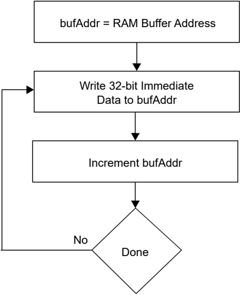

The following steps are required to download a block of data:

1. XferInstruction (op code).
2. Repeat step 1 until the last instruction is transferred to CPU.

Table 12-1. Download Data OP Codes

| Step Number   | Op Code                                                         | Instruction                                                                                     |
|---------------|-----------------------------------------------------------------|-------------------------------------------------------------------------------------------------|
| Step 1        | Initialize SRAM base address to 0xA0000000.                     | Initialize SRAM base address to 0xA0000000.                                                     |
|               | 3c10a000                                                        | lui s0, 0xA000;                                                                                 |
| Step 2        | Write the entire row of data to be programmed into system SRAM. | Write the entire row of data to be programmed into system SRAM.                                 |
|               | 3c08<DATA> 3508<DATA> ae08<OFFSET>                              | lui t0, <DATA(31:16)>; ori t0, t0, <DATA(15:0)>; sw t0, <OFFSET>(s0); // OFFSET increments by 4 |
| Step 3        | Repeat step 2 until one row of data is loaded.                  | Repeat step 2 until one row of data is loaded.                                                  |

## 12.2 With the PE

When using the PE, the steps in Downloading a Data Block and Initiating a Flash Row Write are handled in two single commands ROW\_PROGRAM and PROGRAM .


The ROW\_PROGRAM command programs a single row of Flash data, while the PROGRAM command programs multiple rows of Flash data. Both of these commands are documented in Programming Executive.


## 13. Initiating a Page Erase

An individual page may be erased rather than erasing all of Flash memory. The PE is not used in this case.

PIC32MK family devices can perform an erase retry on a page by increasing the internal voltage used to perform the erase.

Table 13-1. Page Erase OP Codes

| Step Number   | Op Code                                                                                                                                                                                                                                      | Instruction                                                                                                                                                                                                                                  |
|---------------|----------------------------------------------------------------------------------------------------------------------------------------------------------------------------------------------------------------------------------------------|----------------------------------------------------------------------------------------------------------------------------------------------------------------------------------------------------------------------------------------------|
| Step 1        | All the PIC32 devices: Initialize constants. Registers a1, a2, and a3 are set for WREN = 1 or NVMOP[3:0] = 0100 , WR = 1 and WREN = 1 , respectively. Registers s1 and s2 are set for the unlock data values and s0 is initialized to ' 0 '. | All the PIC32 devices: Initialize constants. Registers a1, a2, and a3 are set for WREN = 1 or NVMOP[3:0] = 0100 , WR = 1 and WREN = 1 , respectively. Registers s1 and s2 are set for the unlock data values and s0 is initialized to ' 0 '. |
| Step 1        | 34054004                                                                                                                                                                                                                                     | ori a1, $0,0x4004                                                                                                                                                                                                                            |
| Step 1        | 34068000                                                                                                                                                                                                                                     | ori a2,$0,0x8000                                                                                                                                                                                                                             |
| Step 1        | 34074000                                                                                                                                                                                                                                     | ori a3,$0,0x4000                                                                                                                                                                                                                             |
| Step 1        | 3c11aa99                                                                                                                                                                                                                                     | lui s1,0xaa99                                                                                                                                                                                                                                |
| Step 1        | 36316655                                                                                                                                                                                                                                     | ori s1,s1,0x6655                                                                                                                                                                                                                             |
| Step 1        | 3c125566                                                                                                                                                                                                                                     | lui s2,0x5566                                                                                                                                                                                                                                |
| Step 1        | 365299aa                                                                                                                                                                                                                                     | ori s2,s2,0x99aa                                                                                                                                                                                                                             |
| Step 1        | 3c100000                                                                                                                                                                                                                                     | lui s0,0x0000                                                                                                                                                                                                                                |
| Step 2        | PIC32MX family devices only: Set register a0 to the base address of the NVM register (0xBF80_F400).                                                                                                                                          | PIC32MX family devices only: Set register a0 to the base address of the NVM register (0xBF80_F400).                                                                                                                                          |
| Step 2        | 3c04bf80                                                                                                                                                                                                                                     | lui a0,0xbf80                                                                                                                                                                                                                                |
| Step 2        | 3484f400                                                                                                                                                                                                                                     | ori a0,a0,0xf400                                                                                                                                                                                                                             |
| Step 3        | PIC32MK and PIC32MZ family devices only: Set register a0 to the base address of the NVM register (0xBF80_0600). Register s3 is set for the value used to disable write protection in NVMBPB.                                                 | PIC32MK and PIC32MZ family devices only: Set register a0 to the base address of the NVM register (0xBF80_0600). Register s3 is set for the value used to disable write protection in NVMBPB.                                                 |
| Step 3        | 3c04b480                                                                                                                                                                                                                                     | lui a0,0xbf80                                                                                                                                                                                                                                |
| Step 3        | 34840600                                                                                                                                                                                                                                     | ori a0,a0,0x0600                                                                                                                                                                                                                             |
| Step 3        | 34138080                                                                                                                                                                                                                                     | ori s3,$0,0x8080                                                                                                                                                                                                                             |
| Step 4        | PIC32MK and PIC32MZ family devices only: Unlock and disable boot Flash write protection.                                                                                                                                                     | PIC32MK and PIC32MZ family devices only: Unlock and disable boot Flash write protection.                                                                                                                                                     |
| Step 4        | ac910010                                                                                                                                                                                                                                     | sw s1,16(a0)                                                                                                                                                                                                                                 |
| Step 4        | ac920010                                                                                                                                                                                                                                     | sw s2,16(a0)                                                                                                                                                                                                                                 |
| Step 4        | ac930090                                                                                                                                                                                                                                     | sw s3,144(a0)                                                                                                                                                                                                                                |
| Step 4        | 00000000                                                                                                                                                                                                                                     | nop                                                                                                                                                                                                                                          |
| Step 5        | PIC32MK family devices only: Save the contents of NVMCON2.                                                                                                                                                                                   | PIC32MK family devices only: Save the contents of NVMCON2.                                                                                                                                                                                   |
| Step 5        | 8c9400a0                                                                                                                                                                                                                                     | lw s4,160(a0)                                                                                                                                                                                                                                |
| Step 6        | PIC32MK family devices only: Set the initial programming voltage level and enable page testing (unlock required).                                                                                                                            | PIC32MK family devices only: Set the initial programming voltage level and enable page testing (unlock required).                                                                                                                            |
| Step 6        | 36953000                                                                                                                                                                                                                                     | ori s5,s4,0x3000                                                                                                                                                                                                                             |
| Step 6        | 32b5fcff                                                                                                                                                                                                                                     | andi s5,s5,0xFCFF                                                                                                                                                                                                                            |
| Step 6        | -                                                                                                                                                                                                                                            | here3:                                                                                                                                                                                                                                       |
| Step 6        | ac910010                                                                                                                                                                                                                                     | sw s1,16(a0)                                                                                                                                                                                                                                 |
| Step 6        | ac920010                                                                                                                                                                                                                                     | sw s2,16(a0)                                                                                                                                                                                                                                 |
| Step 6        | ac860008                                                                                                                                                                                                                                     | sw a2,8(a0)                                                                                                                                                                                                                                  |
| Step 6        | ac9500a0                                                                                                                                                                                                                                     | sw s5,160(a0)                                                                                                                                                                                                                                |
| Step 7        | All the PIC32 devices: Set the NVMADDR register with the address of the Flash page to be erased.                                                                                                                                             | All the PIC32 devices: Set the NVMADDR register with the address of the Flash page to be erased.                                                                                                                                             |
| Step 7        | 3c08<ADDR>                                                                                                                                                                                                                                   | lui t0,<FLASH_PAGE_ADDR(31:16)>                                                                                                                                                                                                              |
| Step 7        | 3508<ADDR>                                                                                                                                                                                                                                   | ori t0,t0,<FLASH_PAGE_ADDR(15:0)>                                                                                                                                                                                                            |
| Step 7        | ac880020                                                                                                                                                                                                                                     | sw t0,32(a0)                                                                                                                                                                                                                                 |


| ...........continued   | ...........continued                                                                                                                                                                                                                                                                                            | ...........continued                                                                                                                                                                                                                                                                                            |
|------------------------|-----------------------------------------------------------------------------------------------------------------------------------------------------------------------------------------------------------------------------------------------------------------------------------------------------------------|-----------------------------------------------------------------------------------------------------------------------------------------------------------------------------------------------------------------------------------------------------------------------------------------------------------------|
| Step Number            | Op Code                                                                                                                                                                                                                                                                                                         | Instruction                                                                                                                                                                                                                                                                                                     |
| Step 8                 | All the PIC32 devices: Poll the LVDSTAT register.                                                                                                                                                                                                                                                               | All the PIC32 devices: Poll the LVDSTAT register.                                                                                                                                                                                                                                                               |
| Step 8                 | ac850000                                                                                                                                                                                                                                                                                                        | sw a1,0(a0)                                                                                                                                                                                                                                                                                                     |
| Step 8                 | -                                                                                                                                                                                                                                                                                                               | delay (6 us)                                                                                                                                                                                                                                                                                                    |
| Step 9                 | PIC32MX devices only: Set up the NVMCON register for write operation.                                                                                                                                                                                                                                           | PIC32MX devices only: Set up the NVMCON register for write operation.                                                                                                                                                                                                                                           |
| Step 9                 | -                                                                                                                                                                                                                                                                                                               | here1:                                                                                                                                                                                                                                                                                                          |
| Step 9                 | 8c880000                                                                                                                                                                                                                                                                                                        | lw t0,0(a0)                                                                                                                                                                                                                                                                                                     |
| Step 9                 | 31080800                                                                                                                                                                                                                                                                                                        | andi t0,t0,0x0800                                                                                                                                                                                                                                                                                               |
| Step 9                 | 1500fffd                                                                                                                                                                                                                                                                                                        | bne t0,$0,here1                                                                                                                                                                                                                                                                                                 |
| Step 9                 | 00000000                                                                                                                                                                                                                                                                                                        | nop                                                                                                                                                                                                                                                                                                             |
| Step 10                | All the PIC32 devices: Unlock the NVMCON register and start the write operation.                                                                                                                                                                                                                                | All the PIC32 devices: Unlock the NVMCON register and start the write operation.                                                                                                                                                                                                                                |
| Step 10                | ac910010                                                                                                                                                                                                                                                                                                        | sw s1,16(a0)                                                                                                                                                                                                                                                                                                    |
| Step 10                | ac920010                                                                                                                                                                                                                                                                                                        | sw s2,16(a0)                                                                                                                                                                                                                                                                                                    |
| Step 10                | ac860008                                                                                                                                                                                                                                                                                                        | sw a2,8(a0)                                                                                                                                                                                                                                                                                                     |
| Step 11                | All the PIC32 devices: Loop until the WR bit (NVMCON[15]) is clear.                                                                                                                                                                                                                                             | All the PIC32 devices: Loop until the WR bit (NVMCON[15]) is clear.                                                                                                                                                                                                                                             |
| Step 11                | -                                                                                                                                                                                                                                                                                                               | here2:                                                                                                                                                                                                                                                                                                          |
| Step 11                | 8c880000                                                                                                                                                                                                                                                                                                        | lw t0,0(a0)                                                                                                                                                                                                                                                                                                     |
| Step 11                | 01064024                                                                                                                                                                                                                                                                                                        | and t0,t0,a2                                                                                                                                                                                                                                                                                                    |
| Step 11                | 1500fffd                                                                                                                                                                                                                                                                                                        | bne t0,$0,here2                                                                                                                                                                                                                                                                                                 |
| Step 11                | 00000000                                                                                                                                                                                                                                                                                                        | nop                                                                                                                                                                                                                                                                                                             |
| Step 12                | All the PIC32 devices: Wait at least 500 ns after the WR bit (NVMCON[15]) clears before writing to any of the NVM registers. This requires inserting a delay in the execution. The programming tools and program executive utilizes the FRC 8 MHz clock. Therefore four NOP instructions equate to 500 ns (1) . | All the PIC32 devices: Wait at least 500 ns after the WR bit (NVMCON[15]) clears before writing to any of the NVM registers. This requires inserting a delay in the execution. The programming tools and program executive utilizes the FRC 8 MHz clock. Therefore four NOP instructions equate to 500 ns (1) . |
| Step 12                | 00000000                                                                                                                                                                                                                                                                                                        | nop                                                                                                                                                                                                                                                                                                             |
| Step 12                | 00000000                                                                                                                                                                                                                                                                                                        | nop                                                                                                                                                                                                                                                                                                             |
| Step 12                | 00000000                                                                                                                                                                                                                                                                                                        | nop                                                                                                                                                                                                                                                                                                             |
| Step 12                | 00000000                                                                                                                                                                                                                                                                                                        | nop                                                                                                                                                                                                                                                                                                             |
| Step 13                | All the PIC32 devices: Clear the WREN bit (NVMCON[14]).                                                                                                                                                                                                                                                         | All the PIC32 devices: Clear the WREN bit (NVMCON[14]).                                                                                                                                                                                                                                                         |
| Step 13                | ac870004                                                                                                                                                                                                                                                                                                        | sw a3,4(a0)                                                                                                                                                                                                                                                                                                     |


| ...........continued Step Number   | Op Code                                                                                                                                                                                          | Instruction                                                                                                                                                                                      |
|------------------------------------|--------------------------------------------------------------------------------------------------------------------------------------------------------------------------------------------------|--------------------------------------------------------------------------------------------------------------------------------------------------------------------------------------------------|
| Step 14                            | PIC32MK family devices only: Check that all data in the page has been erased. If not, adjust the voltage and try again. If all voltages levels have been tried, fail, and go to error procedure. | PIC32MK family devices only: Check that all data in the page has been erased. If not, adjust the voltage and try again. If all voltages levels have been tried, fail, and go to error procedure. |
|                                    | ac870004                                                                                                                                                                                         | sw a3, 4(a0)                                                                                                                                                                                     |
|                                    | 20171000                                                                                                                                                                                         | addi s7, $0, 4096                                                                                                                                                                                |
|                                    | 00005020                                                                                                                                                                                         | add t2, $0, $0                                                                                                                                                                                   |
|                                    | 8c880020                                                                                                                                                                                         | lw t0, 32(a0)                                                                                                                                                                                    |
|                                    | 01194020                                                                                                                                                                                         | add t0, t0, t9                                                                                                                                                                                   |
|                                    | -                                                                                                                                                                                                | here5:                                                                                                                                                                                           |
|                                    | 8d090000                                                                                                                                                                                         | lw t1, 0(t0)                                                                                                                                                                                     |
|                                    | 15200005                                                                                                                                                                                         | bne t1, $0, here6                                                                                                                                                                                |
|                                    | 214a0010                                                                                                                                                                                         | addi t2, t2, 16                                                                                                                                                                                  |
|                                    | 11570009                                                                                                                                                                                         | beq t2, s7, here7                                                                                                                                                                                |
|                                    | 00000000                                                                                                                                                                                         | nop                                                                                                                                                                                              |
|                                    | 1000fffa                                                                                                                                                                                         | beq $0, $0, here5                                                                                                                                                                                |
|                                    | 21080010                                                                                                                                                                                         | addi t0, t0, 16                                                                                                                                                                                  |
|                                    | -                                                                                                                                                                                                | here6:                                                                                                                                                                                           |
|                                    | 22b50100                                                                                                                                                                                         | addi s5, s5, 256                                                                                                                                                                                 |
|                                    | 32b60300                                                                                                                                                                                         | andi s6, s5, 768                                                                                                                                                                                 |
|                                    | 16c0ffde                                                                                                                                                                                         | bne s6, $0, here3                                                                                                                                                                                |
|                                    | 00000000                                                                                                                                                                                         | nop                                                                                                                                                                                              |
|                                    | 10000005                                                                                                                                                                                         | beq $0, $0, err_proc                                                                                                                                                                             |
|                                    | 00000000                                                                                                                                                                                         | nop                                                                                                                                                                                              |
| Step 15                            | PIC32MK family devices only: Restore the NVMCON2 register.                                                                                                                                       | PIC32MK family devices only: Restore the NVMCON2 register.                                                                                                                                       |
| Step 15                            | -                                                                                                                                                                                                | here7:                                                                                                                                                                                           |
| Step 15                            | ac9400a0                                                                                                                                                                                         | sw s4,160(a0)                                                                                                                                                                                    |
| Step 16                            | All the PIC32 devices: Check the WRERR bit (NVMCON[13]) to ensure the successful completion of the program sequence. If an error occurs, jump to the error processing routine.                   | All the PIC32 devices: Check the WRERR bit (NVMCON[13]) to ensure the successful completion of the program sequence. If an error occurs, jump to the error processing routine.                   |
| Step 16                            | 8c880000                                                                                                                                                                                         | lw t0,0(a0)                                                                                                                                                                                      |
| Step 16                            | 30082000                                                                                                                                                                                         | andi t0,t0,0x2000                                                                                                                                                                                |
| Step 16                            | 1500<ERR_PROC>                                                                                                                                                                                   | bne t0,$0,<err_proc_offset>                                                                                                                                                                      |
| Step 16                            | 00000000                                                                                                                                                                                         | nop                                                                                                                                                                                              |

## Note:

1. For programming the Flash at runtime in the user's application, the following code is recommended:

```
while(NVMCON.WR) // waitfor WR bit(NVMCON[15]) to clear {}; { unsigned int start_count = _CP0_GET_COUNT(); unsigned int total_count = (.00000025 * SYSCLK); //count for 500 ns and CPU frequency in MHz while ((_CP0_GET_COUNT()- start_count) < total_count); }
```


## 14. Initiating a Flash Row Write

Once a row of data has been downloaded into the device's SRAM, the programming sequence must be initiated to write the block of data to the Flash memory. See Table 14-1 for the op code and instructions for initiating a Flash row write.

Note: Certain PIC32 devices have available ECC memory. When the ECC feature is used, the Flash memory must be programmed in groups of four 32-bit words using four, 32-bit word alignment. If ECC is dynamically used, the programming method determines when the feature is used. ECC is not enabled for words programmed with the single word programming command. ECC is enabled for words programmed in groups of four, either with the quad word or row programming commands. Failure to adhere to these methods can result in ECC DED errors during run-time. Refer to the specific device data sheet for details regarding ECC use and configuration..

## 14.1 With the PE

When using the PE, the data is immediately written to the Flash memory from the SRAM. No further action is required.

## 14.2 Without the PE

Flash memory write operations are controlled by the NVMCON register. Programming is performed by setting the NVMCON register to select the type of write operation and initiating the programming sequence by setting the WR control bit (NVMCON[15]).

Figure 14-1. Initiating Flash Write without the PE

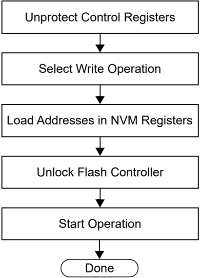

In the Flash write procedure (see Table 14-1), the Row Programming method is used to program the Flash memory, as it is typically the most expedient. word and Quad Word programming methods are also available, depending on the device, and may be used or required depending on your application. Refer to the 'Flash Program Memory' chapter in the specific device data sheet and the related section of the 'PIC32 Family Reference Manual' for more information.


## The following steps are required to initiate a Flash write:

1. XferInstruction (op code).
2. Repeat step 1 until the last instruction is transferred to the CPU.

Table 14-1. Initiate Flash Row Write OP Codes

| Step Number   | Op Code                                                                                                                                                                                      | Instruction                                                                                                                                                                                  |
|---------------|----------------------------------------------------------------------------------------------------------------------------------------------------------------------------------------------|----------------------------------------------------------------------------------------------------------------------------------------------------------------------------------------------|
| Step 1        | All the PIC32 devices: Initialize constants. Registers a1, a2, and a3 are set for WREN = 1 or NVMOP[3:0] =                                                                                   | All the PIC32 devices: Initialize constants. Registers a1, a2, and a3 are set for WREN = 1 or NVMOP[3:0] =                                                                                   |
| Step 1        | 34054003                                                                                                                                                                                     | ori a1, $0,0x4003                                                                                                                                                                            |
| Step 1        | 34068000                                                                                                                                                                                     | ori a2,$0,0x8000                                                                                                                                                                             |
| Step 1        | 34074000                                                                                                                                                                                     | ori a3,$0,0x4000                                                                                                                                                                             |
| Step 1        | 3c11aa99                                                                                                                                                                                     | lui s1,0xaa99                                                                                                                                                                                |
| Step 1        | 36316655                                                                                                                                                                                     | ori s1,s1,0x6655                                                                                                                                                                             |
| Step 1        | 3c125566                                                                                                                                                                                     | lui s2,0x5566                                                                                                                                                                                |
| Step 1        | 365299aa                                                                                                                                                                                     | ori s2,s2,0x99aa                                                                                                                                                                             |
| Step 1        | 3c100000                                                                                                                                                                                     | lui s0,0x0000                                                                                                                                                                                |
| Step 2        | PIC32MX family devices only: Set register a0 to the base address of the NVM register (0xBF80_F400).                                                                                          | PIC32MX family devices only: Set register a0 to the base address of the NVM register (0xBF80_F400).                                                                                          |
| Step 2        | 3c04bf80                                                                                                                                                                                     | lui a0,0xbf80                                                                                                                                                                                |
| Step 2        | 3484f400                                                                                                                                                                                     | ori a0,a0,0xf400                                                                                                                                                                             |
| Step 3        | PIC32MK and PIC32MZ family devices only: Set register a0 to the base address of the NVM register (0xBF80_0600). Register s3 is set for the value used to disable write protection in NVMBPB. | PIC32MK and PIC32MZ family devices only: Set register a0 to the base address of the NVM register (0xBF80_0600). Register s3 is set for the value used to disable write protection in NVMBPB. |
| Step 3        | 3c04b480                                                                                                                                                                                     | lui a0,0xbf80                                                                                                                                                                                |
| Step 3        | 34840600                                                                                                                                                                                     | ori a0,a0,0x0600                                                                                                                                                                             |
| Step 3        | 34138080                                                                                                                                                                                     | ori s3,$0,0x8080                                                                                                                                                                             |
| Step 4        | PIC32MK and PIC32MZ family devices only: Unlock and disable boot Flash write protection.                                                                                                     | PIC32MK and PIC32MZ family devices only: Unlock and disable boot Flash write protection.                                                                                                     |
| Step 4        | ac910010                                                                                                                                                                                     | sw s1,16(a0)                                                                                                                                                                                 |
| Step 4        | ac920010                                                                                                                                                                                     | sw s2,16(a0)                                                                                                                                                                                 |
| Step 4        | ac930090                                                                                                                                                                                     | sw s3,144(a0)                                                                                                                                                                                |
| Step 4        | 00000000                                                                                                                                                                                     | nop                                                                                                                                                                                          |
| Step 5        | All the PIC32 devices: Set the NVMADDR register with the address of the Flash row to be programmed.                                                                                          | All the PIC32 devices: Set the NVMADDR register with the address of the Flash row to be programmed.                                                                                          |
| Step 5        | 3c08<ADDR>                                                                                                                                                                                   | lui t0,<FLASH_ROW_ADDR(31:16)>                                                                                                                                                               |
| Step 5        | 3508<ADDR>                                                                                                                                                                                   | ori t0,t0,<FLASH_ROW_ADDR(15:0)>                                                                                                                                                             |
| Step 5        | ac880020                                                                                                                                                                                     | sw t0,32(a0)                                                                                                                                                                                 |
| Step 6        | PIC32MX devices only: Set the NVMSRCADDR register with the physical source SRAM address (offset is 64).                                                                                      | PIC32MX devices only: Set the NVMSRCADDR register with the physical source SRAM address (offset is 64).                                                                                      |
| Step 6        | 3c10<ADDR>                                                                                                                                                                                   | lui s0, <RAM_ADDR(31:16)>                                                                                                                                                                    |
| Step 6        | 3610<ADDR>                                                                                                                                                                                   | ori s0,s0,<RAM_ADDR(15:0)>                                                                                                                                                                   |
| Step 6        | ac900040                                                                                                                                                                                     | sw s0,64(a0)                                                                                                                                                                                 |
| Step 7        | PIC32MK and PIC32MZ family devices only: Set the NVMSRCADDR register with the physical source SRAM address (offset is 112).                                                                  | PIC32MK and PIC32MZ family devices only: Set the NVMSRCADDR register with the physical source SRAM address (offset is 112).                                                                  |
| Step 7        | 3c10<ADDR>                                                                                                                                                                                   | lui t0,<FLASH_PAGE_ADDR(31:16)>                                                                                                                                                              |
| Step 7        | 3610<ADDR>                                                                                                                                                                                   | ori s0,s0,<RAM_ADDR(15:0)>                                                                                                                                                                   |
| Step 7        | ac900070                                                                                                                                                                                     | sw s0,112(a0)                                                                                                                                                                                |
| Step 8        | All the PIC32 devices: Set up the NVMCON register for write operation.                                                                                                                       | All the PIC32 devices: Set up the NVMCON register for write operation.                                                                                                                       |
| Step 8        | ac850000                                                                                                                                                                                     | sw a1,0(a0)                                                                                                                                                                                  |
| Step 8        | -                                                                                                                                                                                            | delay (6 us)                                                                                                                                                                                 |


| ...........continued   | ...........continued                                                                                                                                                                                                                                                                                            | ...........continued                                                                                                                                                                                                                                                                                            |
|------------------------|-----------------------------------------------------------------------------------------------------------------------------------------------------------------------------------------------------------------------------------------------------------------------------------------------------------------|-----------------------------------------------------------------------------------------------------------------------------------------------------------------------------------------------------------------------------------------------------------------------------------------------------------------|
| Step Number            | Op Code                                                                                                                                                                                                                                                                                                         | Instruction                                                                                                                                                                                                                                                                                                     |
| Step 9                 | PIC32MX devices only: Poll the LVDSTAT register.                                                                                                                                                                                                                                                                | PIC32MX devices only: Poll the LVDSTAT register.                                                                                                                                                                                                                                                                |
| Step 9                 | -                                                                                                                                                                                                                                                                                                               | here1:                                                                                                                                                                                                                                                                                                          |
| Step 9                 | 8c880000                                                                                                                                                                                                                                                                                                        | lw t0,0(a0)                                                                                                                                                                                                                                                                                                     |
| Step 9                 | 31080800                                                                                                                                                                                                                                                                                                        | andi t0,t0,0x0800                                                                                                                                                                                                                                                                                               |
| Step 9                 | 1500fffd                                                                                                                                                                                                                                                                                                        | bne t0,$0,here1                                                                                                                                                                                                                                                                                                 |
| Step 9                 | 00000000                                                                                                                                                                                                                                                                                                        | nop                                                                                                                                                                                                                                                                                                             |
| Step 10                | All the PIC32 devices: Unlock the NVMCON register and start the write operation.                                                                                                                                                                                                                                | All the PIC32 devices: Unlock the NVMCON register and start the write operation.                                                                                                                                                                                                                                |
| Step 10                | ac910010                                                                                                                                                                                                                                                                                                        | sw s1,16(a0)                                                                                                                                                                                                                                                                                                    |
| Step 10                | ac920010                                                                                                                                                                                                                                                                                                        | sw s2,16(a0)                                                                                                                                                                                                                                                                                                    |
| Step 10                | ac860008                                                                                                                                                                                                                                                                                                        | sw a2,8(a0)                                                                                                                                                                                                                                                                                                     |
| Step 11                | All the PIC32 devices: Loop until the WR bit (NVMCON[15]) is clear.                                                                                                                                                                                                                                             | All the PIC32 devices: Loop until the WR bit (NVMCON[15]) is clear.                                                                                                                                                                                                                                             |
| Step 11                | -                                                                                                                                                                                                                                                                                                               | here2:                                                                                                                                                                                                                                                                                                          |
| Step 11                | 8c880000                                                                                                                                                                                                                                                                                                        | lw t0,0(a0)                                                                                                                                                                                                                                                                                                     |
| Step 11                | 01064024                                                                                                                                                                                                                                                                                                        | and t0,t0,a2                                                                                                                                                                                                                                                                                                    |
| Step 11                | 1500fffd                                                                                                                                                                                                                                                                                                        | bne t0,$0,here2                                                                                                                                                                                                                                                                                                 |
| Step 11                | 00000000                                                                                                                                                                                                                                                                                                        | nop                                                                                                                                                                                                                                                                                                             |
| Step 12                | All the PIC32 devices: Wait at least 500 ns after the WR bit (NVMCON[15]) clears before writing to any of the NVM registers. This requires inserting a delay in the execution. The programming tools and program executive utilizes the FRC 8 MHz clock. Therefore four NOP instructions equate to 500 ns (1) . | All the PIC32 devices: Wait at least 500 ns after the WR bit (NVMCON[15]) clears before writing to any of the NVM registers. This requires inserting a delay in the execution. The programming tools and program executive utilizes the FRC 8 MHz clock. Therefore four NOP instructions equate to 500 ns (1) . |
| Step 12                | 00000000                                                                                                                                                                                                                                                                                                        | nop                                                                                                                                                                                                                                                                                                             |
| Step 12                | 00000000                                                                                                                                                                                                                                                                                                        | nop                                                                                                                                                                                                                                                                                                             |
| Step 12                | 00000000                                                                                                                                                                                                                                                                                                        | nop                                                                                                                                                                                                                                                                                                             |
| Step 12                | 00000000                                                                                                                                                                                                                                                                                                        | nop                                                                                                                                                                                                                                                                                                             |
| Step 13                | All the PIC32 devices: Clear the WREN bit (NVMCON[14]).                                                                                                                                                                                                                                                         | All the PIC32 devices: Clear the WREN bit (NVMCON[14]).                                                                                                                                                                                                                                                         |
| Step 13                | ac870004                                                                                                                                                                                                                                                                                                        | sw a3,4(a0)                                                                                                                                                                                                                                                                                                     |
| Step 14                | All the PIC32 devices: Check the WRERR bit (NVMCON[13]) to ensure the successful completion of the program sequence. If an error occurs, jump to the error processing routine.                                                                                                                                  | All the PIC32 devices: Check the WRERR bit (NVMCON[13]) to ensure the successful completion of the program sequence. If an error occurs, jump to the error processing routine.                                                                                                                                  |
| Step 14                | 8c880000                                                                                                                                                                                                                                                                                                        | lw t0,0(a0)                                                                                                                                                                                                                                                                                                     |
| Step 14                | 30082000                                                                                                                                                                                                                                                                                                        | andi t0,zero,0x2000                                                                                                                                                                                                                                                                                             |
| Step 14                | 1500<ERR_PROC>                                                                                                                                                                                                                                                                                                  | bne t0,$0,<err_proc_offset>                                                                                                                                                                                                                                                                                     |
| Step 14                | 00000000                                                                                                                                                                                                                                                                                                        | nop                                                                                                                                                                                                                                                                                                             |

## Note:

1. For programming the Flash at runtime in the user's application, the following code is recommended:

```
while(NVMCON.WR) // waitfor WR bit(NVMCON[15]) to clear {}; { unsigned int start_count = _CP0_GET_COUNT(); unsigned int total_count = (.00000025 * SYSCLK); //count for 500 ns and CPU frequency in MHz while ((_CP0_GET_COUNT()- start_count) < total_count); }
```


## 15. Verify Device Memory

The verify step involves reading back the code memory space and comparing it with the copy held in the programmer's buffer. The Configuration registers are verified with the rest of the code.

Note: Because the Configuration registers include the device code protection bit, code memory should be verified immediately after writing (if code protection is enabled). This is because the device will not be readable or verifiable if a device Reset occurs after the code-protect bit has been cleared.

## 15.1 Verifying Memory with the PE

Memory verify is performed using the GET\_CRC command. Table 17-2 lists the op codes and instructions.

Figure 15-1. Verifying Memory with the PE

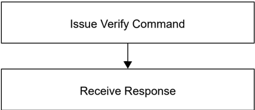

The following steps are required to verify memory using the PE:

1. XferFastData (GET\_CRC) .
2. XferFastData (start\_Address) .
3. XferFastData (length) .
4. valCkSum = XferFastData (32'h0x00) .

Verify that valCkSum matches the checksum of the copy held in the programmer's buffer.

## 15.2 Verifying Memory without the PE

Reading from the Flash memory is performed by executing a series of read accesses from the Fastdata register. Table 20-3 shows the EJTAG programming details, including the address and op code data for performing processor access operations.


Figure 15-2. Verifying Memory without the PE

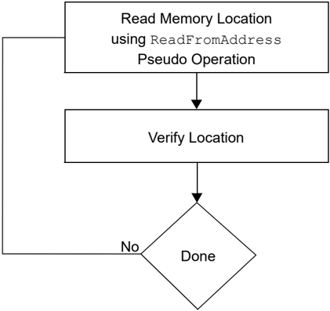

The following steps are required to verify memory:

1. XferInstruction (op code).
2. Repeat step 1 until the CPU receives the last instruction.
3. Verify that valRead matches the copy held in the programmer's buffer.
4. Repeat steps 1-3 for each memory location.

Table 15-1. Verify Device OP Codes

| Step Number   | Op Code                                                      | Instruction                                                  |
|---------------|--------------------------------------------------------------|--------------------------------------------------------------|
| Step 1        | Initialize some constants.                                   | Initialize some constants.                                   |
| Step 1        | 3c13ff20                                                     | lui s3, 0xFF20                                               |
| Step 2        | Read memory location.                                        | Read memory location.                                        |
| Step 2        | 3c08<ADDR>                                                   | lui t0,<FLASH_WORD_ADDR(31:16)>                              |
| Step 2        | 3508<ADDR>                                                   | ori t0, t0, <FLASH_WORD_ADDR(15:0)>                          |
| Step 3        | Write to Fastdata location.                                  | Write to Fastdata location.                                  |
| Step 3        | 8d090000                                                     | lw t1, 0(t0)                                                 |
| Step 3        | ae690000                                                     | sw t1, 0(s3)                                                 |
| Step 4        | Read data from Fastdata register 0xFF200000.                 | Read data from Fastdata register 0xFF200000.                 |
| Step 3        | Repeat steps 2-4 until all configuration locations are read. | Repeat steps 2-4 until all configuration locations are read. |


## 16. Exiting Programming Mode

Once a device is programmed, it must be taken out of programming mode to start proper execution of its new program memory contents.

## 16.1 Four-Wire Interface

Exiting programming mode is done by removing VIH from the MCLR pin, as illustrated in Figure 16-1. The only requirement for exit is that an interval, P16, must elapse between the last clock and program signals before removing VIH.

Figure 16-1. Four-Wire Exit Programming Mode

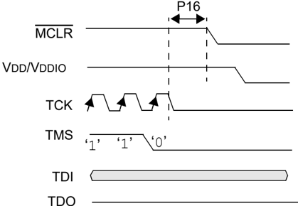

TDO

The following steps are required to exit Programming mode:

1. SetMode (5'b11111) .
2. Assert the MCLR pin.
3. Remove power (if the device is powered).

## 16.2 Two-Wire Interface

Exiting programming mode is done by removing VIH from the MCLR pin, as illustrated in Figure 16-2. The only requirement for exit is that an interval, P16, must elapse between the last clock and program signals on PGECx and PGEDx pins before removing VIH.

Figure 16-2. Two-Wire Exit Programming Mode

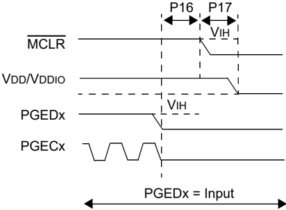

The following steps are required to exit Programming mode:


1. SetMode (5'b11111) .
2. Assert the MCLR pin.
3. Issue a clock pulse on the PGECx pin.
4. Remove power (if the device is powered).


## 17. Programming Executive

Note: The Programming Executive (PE) is included with the installation of MPLAB ™ X IDE. To download the appropriate PE file for the device, go to the related product page on the Microchip web site www.microchip.com.

## 17.1 PE Communication

The programmer and the PE have a host-client relationship, where the programmer is the host programming device and the PE is the client.

All communication is initiated by the programmer in the form of a command. The PE is able to receive only one command at a time. Correspondingly, after receiving and processing a command, the PE sends a single response to the programmer.

## 17.1.1 Two-Wire ICSP EJTAG Rate

In Enhanced ICSP mode, the PIC32 family devices operate from the internal Fast RC oscillator, which has a nominal frequency of 8 MHz.

## 17.1.2 Communication Overview

The programmer and the PE communicate using the EJTAG Address, Data and Fastdata registers. In particular, the programmer transfers the command and data to the PE using the Fast Data register. The programmer receives a response from the PE using the Address and Data registers. The pseudo operation of receiving a response is shown in the GetPEResponse pseudo operation below:

## Format:

```
response = GetPEResponse()
```

## Purpose:

- Enables the programmer to receive the 32-bit response value from the PE.

Example: GetPEResponse pseudo operation:

```
WORD GetPEResponse () { WORD response; // Wait until CPU is ready SendCommand (ETAP_CONTROL); // Check if Proc. Access bit (bit 18) is set do { controlVal=XferData(32'h0x0004C000 ); } while(PrAcc(contorlVal[18]) is not '1' ); // Select Data Register SendCommand (ETAP_DATA); // Receive Response response = XferData(0); // Tell CPU to execute instruction SendCommand (ETAP_CONTROL); XferData(32'h0x0000C000); // return 32-bit response return response; }
```

The typical communication sequence between the programmer and the PE is shown in Table 17-1.

The sequence begins when the programmer sends the command and optional additional data to the PE, and the PE carries out the command.

When the PE has finished executing the command, it sends the response back to the programmer.

The response may contain more than one response. For example, if the programmer sent a READ command, the response will contain the data read.


Table 17-1. Communication Sequence for the PE

| Step Number   | Operation                                                | Operand                                                  |
|---------------|----------------------------------------------------------|----------------------------------------------------------|
| Step 1        | Send command and optional data from programmer to the PE | Send command and optional data from programmer to the PE |
|               | XferFastData                                             | (Command &#124; data len)                                |
|               | XferFastData..                                           | optional data..                                          |
| Step 2        | Programmer reads the response from the PE.               | Programmer reads the response from the PE.               |
|               | GetPEResponse                                            | response                                                 |
|               | GetPEResponse...                                         | response...                                              |

## 17.2 The PE Command Set

Table 17-2 provides PE command set details, such as op code, mnemonic and short description for each command. Functional details on each command are provided in Row Program (Row\_Program) Command through Change CFG (CHANGE\_CFG) Command.

The PE sends a response to the programmer for each command that it receives. The response indicates if the command was processed correctly. It includes any required response data or error data.

## 17.2.1 Command Format

All PE commands have a general format consisting of a 32-bit header and any required data for the command, see Figure 17-1. The 32-bit header consists of a 16-bit op code field, which is used to identify the command, and a 16-bit command Operand field. Use of the Operand field varies by command.

Note: Some commands have no operand information; however, the Operand field must be sent and the programming executive will ignore the data.

Figure 17-1. Command Format

| 31                              | 16                              |
|---------------------------------|---------------------------------|
| Op code                         | Op code                         |
| 15                              | 0                               |
| Operand (optional)              | Operand (optional)              |
| 31                              | 16                              |
| Command Data High (if required) | Command Data High (if required) |
| 15                              | 0                               |
| Command Data Low (if required)  | Command Data Low (if required)  |

The command in the op code field must match one of the commands in the command set that is listed in Table 17-2. Any command received that does not match a command the list returns a NACK response, as shown in Table 17-3.

The PE uses the command operand field to determine the number of bytes to read from or to write to. If the value of this field is incorrect, the command is not be properly received by the PE.

Table 17-2. PE Command Set

| Op Code   | Mnemonic        | Description                                                                    |
|-----------|-----------------|--------------------------------------------------------------------------------|
| 0x0       | ROW_PROGRAM (1) | Program one row of Flash memory at the specified address                       |
| 0x1       | READ            | Read N 32-bit words of memory starting from the specified address (N < 65,536) |
| 0x2       | PROGRAM         | Program Flash memory starting at the specified address                         |


| ...........continued   |                    |                                                                    |
|------------------------|--------------------|--------------------------------------------------------------------|
| 0x3                    | WORD_PROGRAM (3)   | Program one word of Flash memory at the specified address          |
| 0x4                    | CHIP_ERASE         | Chip erase of entire chip                                          |
| 0x5                    | PAGE_ERASE         | Erase pages of code memory from the specified address              |
| 0x6                    | BLANK_CHECK        | Blank check code                                                   |
| 0x7                    | EXEC_VERSION       | Read the PE software version                                       |
| 0x8                    | GET_CRC            | Get the CRC of Flash memory                                        |
| 0x9                    | PROGRAM_CLUSTER    | Programs the specified number of bytes to the specified address    |
| 0xA                    | GET_DEVICEID       | Returns the hardware ID of the device                              |
| 0xB                    | CHANGE_CFG (2)     | Used by the probe to set various configuration settings for the PE |
| 0xC                    | GET_CHECKSUM       | Get the checksum of Flash memory                                   |
| 0xD                    | QUAD_WORD_PGRM (4) | Program four words of Flash memory at the specified address        |

## Notes:

1. Refer Table 5-1 for the row size for each device.
2. This command is not available in the PIC32MX1XX/2XX devices.
3. On the PIC32MZ family devices, which incorporate ECC, the WORD\_PROGRAM command will not generate the ECC parity bits. Reading a location programmed with the WORD\_PROGRAM command with ECC enabled will cause a DED fault.
4. This command is available on PIC32MK and PIC32MZ family devices only.

## 17.2.2 Response Format

The PE response set is shown in Table 17-3. All PE responses have a general format consisting of a 32-bit header and any required data for the response (see Figure 17-2).

Figure 17-2. Response Format

| 31            | 16            |               |
|---------------|---------------|---------------|
| Last Command  | Last Command  | Last Command  |
| 15            | 0             |               |
| Response Code | Response Code | Response Code |
| 31            | 16            |               |
| Data_High_1   | Data_High_1   | Data_High_1   |
| 15            | 0             |               |
| Data_Low_1    | Data_Low_1    | Data_Low_1    |
| 31            | 16            |               |
| Data_High_N   | Data_High_N   | Data_High_N   |
| 15            | 0             |               |
| Data_Low_N    | Data_Low_N    | Data_Low_N    |

## 17.2.2.1 Last Command ( Last\_Cmd ) Field

Last\_Cmd is a 16-bit field in the first word of the response and indicates the command that the PE processed. It can be used to verify that the PE correctly received the command that the programmer transmitted.


## 17.2.2.2 Response Code

The response code indicates whether the last command succeeded or failed, or if the command is a value that is not recognized. The response code values are shown in Table 17-3.

Table 17-3. Response Values

| Op Code   | Mnemonic   | Description                      |
|-----------|------------|----------------------------------|
| 0x0       | PASS       | Command successfully processed   |
| 0x2       | FAIL       | Command unsuccessfully processed |
| 0x3       | NACK       | Command not known                |

## 17.2.2.3 Optional Data

The response header may be followed by optional data in case of certain commands such as read. The number of 32-bit words of optional data varies depending on the last command operation and its parameters.

## 17.2.3 Row Program ( Row\_Program ) Command

The ROW\_PROGRAM command instructs the PE to program a row of data at a specified address.

The data to be programmed to memory, located in command words Data\_1 through Data\_N, must be arranged using the packed instruction word format provided in Table 17-4 (this command expects an entire row of data).

Figure 17-3. Row Program ( ROW\_PROGRAM ) Command

| 31          | 16          |             |
|-------------|-------------|-------------|
| Op code     | Op code     | Op code     |
| 15          | 0           |             |
| Operand     | Operand     | Operand     |
| 31          | 16          |             |
| Addr_High   | Addr_High   | Addr_High   |
| 15          | 0           |             |
| Addr_Low    | Addr_Low    | Addr_Low    |
| 31          | 16          |             |
| Data_High_1 | Data_High_1 | Data_High_1 |
| 15          | 0           |             |
| Data_Low_1  | Data_Low_1  | Data_Low_1  |
| 31          | 16          |             |
| Data_High_N | Data_High_N | Data_High_N |
| 15          | 0           |             |
| Data_Low_N  | Data_Low_N  | Data_Low_N  |

Table 17-4. Row Program ( ROW\_PROGRAM ) Format

| OP Field    | Description                               |
|-------------|-------------------------------------------|
| Op code     | 0x0                                       |
| Operand     | Not used                                  |
| Addr_High   | High16 bits of 32-bit destination address |
| Addr_Low    | Low16 bits of 32-bit destination address  |
| Data_High_1 | High 16 bits data word 1                  |
| Data_Low_1  | Low 16 bits data word 1                   |
| Data_High_N | High 16 bits data word 2 through N        |


| ...........continued   |                                   |
|------------------------|-----------------------------------|
| OP Field               | Description                       |
| Data_Low_N             | Low 16 bits data word 2 through N |

## Expected Response (1 word):

Figure 17-4. Row Response ( ROW\_PROGRAM ) Response

| 31            | 16            |
|---------------|---------------|
| Last Command  | Last Command  |
| 15            | 0             |
| Response Code | Response Code |

## 17.2.4 Read ( Read ) Command

The READ command instructs the PE to read from memory. The number of 32-bit words specified in the operand field starting from the 32-bit address specified by the Addr\_Low and Addr\_High fields. This command can be used to read Flash memory and Configuration Words. All data returned in response to this command uses the packed data format that is provided in Table 17-5.

Figure 17-5. Read ( Read ) Command

| 31        | 16        |           |
|-----------|-----------|-----------|
| Op code   | Op code   | Op code   |
| 15        | 0         |           |
| Operand   | Operand   | Operand   |
| 31        | 16        |           |
| Addr_High | Addr_High | Addr_High |
| 15        | 0         |           |
| Addr_Low  | Addr_Low  | Addr_Low  |

Table 17-5. Read Format

| Field     | Description                                          |
|-----------|------------------------------------------------------|
| Op code   | 0x1                                                  |
| Operand   | N number of 32-bit words to read (maximum of 65,535) |
| Addr_Low  | Low16 bits of 32-bit source address                  |
| Addr_High | High16 bits of 32-bit source address                 |

## Expected Response:


Figure 17-6. Read ( Read ) Response

| 31            | 16            |               |
|---------------|---------------|---------------|
| Last Command  | Last Command  | Last Command  |
| 15            | 0             |               |
| Response Code | Response Code | Response Code |
| 31            | 16            |               |
| Data_High_1   | Data_High_1   | Data_High_1   |
| 15            | 0             |               |
| Data_Low_1    | Data_Low_1    | Data_Low_1    |
| 31            | 16            |               |
| Data_High_N   | Data_High_N   | Data_High_N   |
| 15            | 0             |               |
| Data_Low_N    | Data_Low_N    | Data_Low_N    |

Note: Reading unimplemented memory will cause the PE to Reset. Ensure that only memory locations present on a particular device are accessed.

## 17.2.5 Program ( Program ) Command

The PROGRAM command instructs the PE to program the Flash memory, including configuration words, starting from the 32-bit address specified in the Addr\_Low and Addr\_High fields. A 32-bit length field specifies the number of bytes to program.

Align the address to a Flash row size boundary and the length must be a multiple of a Flash row size. See Table 5-1 for the correct row size for the device to be programmed.

Figure 17-7. Program ( Program ) Command

| 31      |             | 16      |
|---------|-------------|---------|
| Op code | Op code     | Op code |
| 15      |             | 0       |
|         | Operand     |         |
| 31      |             | 16      |
|         | Addr_High   |         |
| 15      |             | 0       |
|         | Addr_Low    |         |
| 31      |             | 16      |
|         | Length_High |         |
| 15      |             | 0       |
|         | Length_Low  |         |
| 31      |             | 16      |
|         | Data_High_1 |         |
| 15      |             | 0       |
|         | Data_Low_1  |         |
| 31      |             | 16      |
|         | Data_High_N |         |
| 15      |             | 0       |
|         | Data_Low_N  |         |


Table 17-6. Program ( Program ) Command

| Field       | Description                               |
|-------------|-------------------------------------------|
| Op code     | 0x2                                       |
| Operand     | Not used                                  |
| Addr_Low    | Low16 bits of 32-bit destination address  |
| Addr_High   | High16 bits of 32-bit destination address |
| Length_Low  | Low16 bits of Length                      |
| Length_High | High16 bits Length                        |
| Data_Low_N  | Low16 bits data word 2 through N          |
| Data_High_N | High16 bits data word 2 through N         |

The following are three programming scenarios:

- The length of the data to be programmed is the size of a single Flash row
- The length of the data to be programmed is the size of two Flash rows
- The length of the data to be programmed is larger than the size of two Flash rows

When the data length is equal to 512 bytes, the PE receives the 512-byte block of data from the probe and immediately sends the response for this command back to the probe.

The PE will respond for each row of data that it receives. If the data length of the command is equal to a single row, a single PE response is generated. If the data length is equal to two rows, the PE waits to receive both rows of data, then sends back-to-back responses for each data row. If the data length is greater than two rows of data, the PE will send the response for the first row after receiving the first two rows of data. Subsequent responses are sent after receiving subsequent data row packets. The responses will lag the data by one row. When the last row of data is received, the PE will respond with backto- back responses for the second-to last data row followed by the last row.


Figure 17-8. Program ( Program ) Command Algorithm

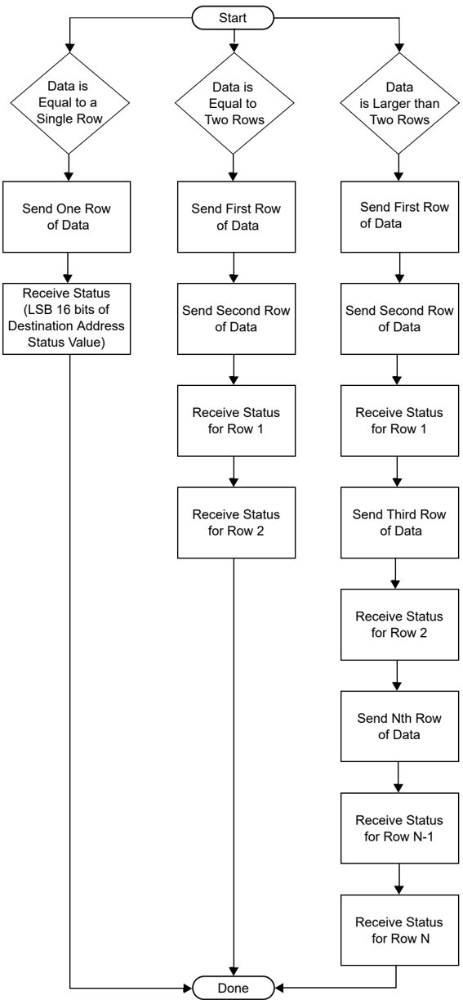


If the PE encounters an error in programming any of the blocks, it sends a failure status to the probe and aborts the PROGRAM command. On receiving the failure status, the probe must stop sending data. The PE will not process any other data for this command from the probe. The process is illustrated in Figure 17-8.

Note: If the PROGRAM command fails, the programmer must read the failing row using the READ command from the Flash memory. Then the programmer must compare the row received from the Flash memory to its local copy, word-by-word, to determine the address where Flash programming fails.

The response for this command is a little different than the response for other commands. The 16 MSbs of the response contain the 16 LSbs of the destination address, where the last block is programmed. This helps the probe and the PE maintain proper synchronization of sending and receiving data and responses.

## Expected Response (1 word):

Figure 17-9. Program ( Program ) Response

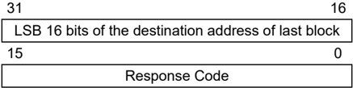

## 17.2.6 Word Program ( WORD\_PROGRAM ) Command

The WORD\_PROGRAM command instructs the PE to program a 32-bit word of data at the specified address.

Figure 17-10. Word Program ( WORD\_COMMAND ) Command

| 31        | 16        |           |
|-----------|-----------|-----------|
| Op code   | Op code   | Op code   |
| 15        | 0         |           |
| Operand   | Operand   | Operand   |
| 31        | 16        |           |
| Addr_High | Addr_High | Addr_High |
| 15        | 0         |           |
| Addr_Low  | Addr_Low  | Addr_Low  |
| 31        | 16        |           |
| Data_High | Data_High | Data_High |
| 15        | 0         |           |
| Data_Low  | Data_Low  | Data_Low  |

Table 17-7. Word Program ( WORD\_PROGRAM ) Format

| Field     | Description                               |
|-----------|-------------------------------------------|
| Op code   | 0x3                                       |
| Operand   | Not used                                  |
| Addr_High | High16 bits of 32-bit destination address |
| Addr_Low  | Low16 bits of 32-bit destination address  |
| Data_High | High16 bits data word                     |
| Data_Low  | Low16 bits data word                      |


## Expected Response (1 word):

Figure 17-11. Word Program ( WORD\_PROGRAM ) Response

| 31            | 16            |
|---------------|---------------|
| Last Command  | Last Command  |
| 15            | 0             |
| Response Code | Response Code |

## 17.2.7 Chip Erase ( CHIP\_ERASE ) Command

The CHIP\_ERASE command erases the entire chip, including the configuration block.

After performing the erase operation, the entire Flash memory contains 0xFFFFFFFF.

Figure 17-12. Chip Erase ( CHIP\_ERASE ) Command

| 31      | 16      |
|---------|---------|
| Op code | Op code |
| 15      | 0       |
| Operand | Operand |

Table 17-8. Chip Erase ( CHIP\_ERASE ) Format

| Field     | Description                               |
|-----------|-------------------------------------------|
| Op code   | 0x4                                       |
| Operand   | Not used                                  |
| Addr_Low  | Low16 bits of 32-bit destination address  |
| Addr_High | High16 bits of 32-bit destination address |

## Expected Response (1 word):

Figure 17-13. Chip Erase ( CHIP\_ERASE ) Response

| 31            | 16            |
|---------------|---------------|
| Last Command  | Last Command  |
| 15            | 0             |
| Response Code | Response Code |

## 17.2.8 Page Erase ( PAGE\_ERASE ) Command

The PAGE\_ERASE command erases the specified number of pages of code memory from the specified base address. Depending on the device, the specified, base address must be a multiple of 0x400 or 0x100.

After the erase is performed, all targeted words of code memory contain 0xFFFFFFFF.


Figure 17-14. Page Erase ( PAGE\_ERASE ) Command

| 31        | 16        |           |
|-----------|-----------|-----------|
| Op code   | Op code   | Op code   |
| 15        | 0         |           |
| Operand   | Operand   | Operand   |
| 31        | 16        |           |
| Addr_High | Addr_High | Addr_High |
| 15        | 0         |           |
| Addr_Low  | Addr_Low  | Addr_Low  |

Table 17-9. Page Erase ( PAGE\_ERASE ) Format

| Field     | Description                               |
|-----------|-------------------------------------------|
| Op code   | 0x5                                       |
| Operand   | Number of pages to erase                  |
| Addr_Low  | Low16 bits of 32-bit destination address  |
| Addr_High | High16 bits of 32-bit destination address |

## Expected Response (1 word):

Figure 17-15. Page Erase ( PAGE\_ERASE ) Response

| 31            | 16            |               |
|---------------|---------------|---------------|
| Last Command  | Last Command  | Last Command  |
| 15            | 0             |               |
| Response Code | Response Code | Response Code |

## 17.2.9 Blank Check ( BLANK\_CHECK ) Command

The BLANK\_CHECK command queries the PE to determine whether the contents of code memory and code-protect Configuration bits (GCP and GWRP) are blank (contains all ' 1 's).

Figure 17-16. Blank Check ( BLANK\_CHECK ) Command

| 31          | 16          |             |
|-------------|-------------|-------------|
| Op code     | Op code     | Op code     |
| 15          | 0           |             |
| Operand     | Operand     | Operand     |
| 31          | 16          |             |
| Addr_High   | Addr_High   | Addr_High   |
| 15          | 0           |             |
| Addr_Low    | Addr_Low    | Addr_Low    |
| 31          | 16          |             |
| Length_High | Length_High | Length_High |
| 15          | 0           |             |
| Length_Low  | Length_Low  | Length_Low  |


Table 17-10. Blank Check ( BLANK\_CHECK ) Format

| Field   | Description                                                   |
|---------|---------------------------------------------------------------|
| Op code | 0x6                                                           |
| Operand | Not used                                                      |
| Address | Address where to start the Blank Check                        |
| Length  | Number of program memory locations to check in terms of bytes |

## Expected Response (1 word for Blank Device):

Figure 17-17. Blank Check ( BLANK\_CHECK ) Response

| 31            | 16            |
|---------------|---------------|
| Last Command  | Last Command  |
| 15            | 0             |
| Response Code | Response Code |

## 17.2.10  Executable Version ( EXEC\_VERSION ) Command

EXEC\_VERSION queries for the version of the PE software stored in RAM.

Figure 17-18. Executable Version ( EXEC\_VERSION ) Command

| 31      | 16      |
|---------|---------|
| Op code |         |
| 15      | 0       |
| Operand | Operand |

Table 17-11. Executable Version ( EXEC\_VERSION ) Format

| Field   | Description   |
|---------|---------------|
| Op code | 0x7           |
| Operand | Not used      |

## Expected Response (1 word):

Figure 17-19. Executable Version ( EXEC\_VERSION ) Response

| 31             | 16             |
|----------------|----------------|
| Last Command   | Last Command   |
| 15             | 0              |
| Version Number | Version Number |

## 17.2.11  Get CRC ( GET\_CRC ) Command

GET\_CRC calculates the CRC of the buffer from the specified address to the specified length, using the table look-up method. The CRC details are as follows:

- CRC-CCITT, 16-bit
- Polynomial: X^16+X^12+X^5+1, hex 0x00011021
- Seed: 0xFFFF
- MSB shifted in first


## Notes:

1. In the response, only the CRC LSb, 16 bits are valid.
2. The PE will automatically determine if the hardware CRC is available and uses it by default. The hardware CRC is not used on PIC32MX1XX/2XX devices.

Figure 17-20. Get CRC ( GET\_CRC ) Command

| 31          | 16          |             |
|-------------|-------------|-------------|
| Op code     | Op code     | Op code     |
| 15          | 0           |             |
| Operand     | Operand     | Operand     |
| 31          | 16          |             |
| Addr_High   | Addr_High   | Addr_High   |
| 15          | 0           |             |
| Addr_Low    | Addr_Low    | Addr_Low    |
| 31          | 16          |             |
| Length_High | Length_High | Length_High |
| 15          | 0           |             |
| Length_Low  | Length_Low  | Length_Low  |

Table 17-12. Get CRC ( GET\_CRC ) Format

| Field   | Description                                                        |
|---------|--------------------------------------------------------------------|
| Op code | 0x8                                                                |
| Operand | Not used                                                           |
| Address | Address where to start calculating the CRC                         |
| Length  | Length of buffer on which to calculate the CRC, in number of bytes |

## Expected Response (2 words):

Figure 17-21. Get CRC ( GET\_CRC ) Response

| 31            | 16            |               |
|---------------|---------------|---------------|
| Last Command  | Last Command  | Last Command  |
| 15            | 0             |               |
| Response Code | Response Code | Response Code |
| 31            | 16            |               |
| CRC_High      | CRC_High      | CRC_High      |
| 15            | 0             |               |
| CRC_Low       | CRC_Low       | CRC_Low       |

## 17.2.12  Program Cluster ( PROGRAM\_CLUSTER ) Command

PROGRAM\_CLUSTER programs the specified number of bytes to the specified address. The address must be 32-bit aligned, and the number of bytes must be a multiple of a 32-bit word.


Figure 17-22. Program Cluster ( PROGRAM\_CLUSTER ) Command

| 31          | 16          |             |
|-------------|-------------|-------------|
| Op code     | Op code     | Op code     |
| 15          | 0           |             |
| Operand     | Operand     | Operand     |
| 31          | 16          |             |
| Addr_High   | Addr_High   | Addr_High   |
| 15          | 0           |             |
| Addr_Low    | Addr_Low    | Addr_Low    |
| 31          | 16          |             |
| Length_High | Length_High | Length_High |
| 15          | 0           |             |
| Length_Low  | Length_Low  | Length_Low  |

Table 17-13. Program Cluster ( PROGRAM\_CLUSTER ) Format

| Field   | Description                                  |
|---------|----------------------------------------------|
| Op code | 0x9                                          |
| Operand | Not used                                     |
| Address | Start address for programming                |
| Length  | Length of area to program in number of bytes |

Note: If the PROGRAM\_CLUSTER command fails, the programmer must read the failing row using the READ command from the Flash memory. Then the programmer must compare the row received from the Flash memory to its local copy word-by word to determine the address where Flash programming fails.

## Expected Response (1 word):

Figure 17-23. Program Cluster ( PROGRAM\_CLUSTER ) Response

| 31            | 16            |
|---------------|---------------|
| Last Command  | Last Command  |
| 15            | 0             |
| Response Code | Response Code |

## 17.2.13  Get Device ID ( GET\_DEVICEID ) Command

The GET\_DEVICEID command returns the hardware ID of the device.

Figure 17-24. Get Device ID ( GET\_DEVICEID ) Command

| 31      | 16      |
|---------|---------|
| Op code | Op code |
| 15      | 0       |
| Operand | Operand |


Table 17-14. Get Device ID ( GET\_DEVICEID ) Format

| Field   | Description   |
|---------|---------------|
| Op code | 0xA           |
| Operand | Not used      |

## Expected Response (1 word):

Figure 17-25. Get Device ID ( GET\_DEVICEID ) Response

| 31           | 16           |
|--------------|--------------|
| Last Command | Last Command |
| 15           | 0            |
| Device ID    | Device ID    |

## 17.2.14  Change CFG ( CHANGE\_CFG ) Command

CHANGE\_CFG is used by the probe to set various configuration settings for the PE. Currently, the single configuration setting determines which of the following calculation methods the PE should use:

- Software CRC calculation method
- Hardware calculation method

Figure 17-26. Change CFG ( CHANGE\_CFG ) Command

| 31           | 16           |              |
|--------------|--------------|--------------|
| Op code      | Op code      | Op code      |
| 15           | 0            |              |
| Operand      | Operand      | Operand      |
| 31           | 16           |              |
| CRCFlag_High | CRCFlag_High | CRCFlag_High |
| 15           | 0            |              |
| CRCFlag_Low  | CRCFlag_Low  | CRCFlag_Low  |

Table 17-15. Change CFG ( CHANGE\_CFG ) Format

| Field    | Description                                                                                                                                            |
|----------|--------------------------------------------------------------------------------------------------------------------------------------------------------|
| Op code  | 0xB                                                                                                                                                    |
| Operand  | Not used                                                                                                                                               |
| CRC flag | If the value is ' 0 ', the PE uses the software CRC calculation method. If the value is ' 1 ', the PE uses the hardware CRC unit to calculate the CRC. |

## Expected Response (1 word):

Figure 17-27. Change CFG ( CHANGE\_CFG ) Response

| 31            | 16            |               |
|---------------|---------------|---------------|
| Last Command  | Last Command  | Last Command  |
| 15            | 0             |               |
| Response Code | Response Code | Response Code |

Note: The CHANGE\_CFG command is not available in the PIC32MX1XX/2XX devices.


## 17.2.15  Get Checksum ( GET\_CHECKSUM ) Command

GET\_CHECKSUM returns the sum of all the bytes starting at the address argument up to the length argument. The result is a 32-bit word.

Figure 17-28. Get Checksum ( GET\_CHECKSUM ) Command

| 31          | 16          |             |
|-------------|-------------|-------------|
| Op code     | Op code     | Op code     |
| 15          | 0           |             |
| Operand     | Operand     | Operand     |
| 31          | 16          |             |
| Addr_High   | Addr_High   | Addr_High   |
| 15          | 0           |             |
| Addr_Low    | Addr_Low    | Addr_Low    |
| 31          | 16          |             |
| Length_High | Length_High | Length_High |
| 15          | 0           |             |
| Length_Low  | Length_Low  | Length_Low  |

Table 17-16. Get Checksum ( GET\_CHECKSUM ) Format

| Field       | Description                                                                                 |
|-------------|---------------------------------------------------------------------------------------------|
| Op code     | 0x0C                                                                                        |
| Operand     | Not used                                                                                    |
| Addr_High   | High-order16 bits of the 32-bit starting address of the data to calculate the checksum for. |
| Addr_Low    | Low-order16 bits of the 32-bit starting address of the data to calculate the checksum for.  |
| Length_High | High-order16 bits of the 32-bit length of data to calculate the checksum for in bytes.      |
| Length_Low  | Low-order16 bits of the 32-bit length of data to calculate the checksum for in bytes.       |

## Expected Response (1 word):

Figure 17-29. Get Checksum ( GET\_CHECKSUM ) Response

| 31            | 16            |               |
|---------------|---------------|---------------|
| Last Command  | Last Command  | Last Command  |
| 15            | 0             |               |
| Response Code | Response Code | Response Code |
| 31            | 16            |               |
| Checksum_High | Checksum_High | Checksum_High |
| 15            | 0             |               |
| Checksum_Low  | Checksum_Low  | Checksum_Low  |

## 17.2.16  Quad Word Program ( QUAD\_WORD\_PROGRAM ) Command

QUAD\_WORD\_PROGRAM instructs the PE to program four, 32-bit words at the specified address. The address must be an aligned four word boundary (bits 0-1 must be ' 0 '). If not, the command will return a FAIL response value and no data will be programmed.


Figure 17-30. Quad Word Program ( QUAD\_WORD\_PROGRAM ) Command

|   31 |            |   16 |
|------|------------|------|
|      | Op code    |      |
|   15 |            |    0 |
|      | Operand    |      |
|   31 |            |   16 |
|      | Addr_High  |      |
|   15 |            |    0 |
|      | Addr_Low   |      |
|   31 |            |   16 |
|      | Data0_High |      |
|   15 |            |    0 |
|      | Data0_Low  |      |
|   31 |            |   16 |
|      | Data1_High |      |
|   15 |            |    0 |
|      | Data1_Low  |      |
|   31 |            |   16 |
|      | Data2_High |      |
|   15 |            |    0 |
|      | Data2_Low  |      |
|   31 |            |   16 |
|      | Data3_High |      |
|   15 |            |    0 |
|      | Data3_Low  |      |

Table 17-17. Quad Word Program ( QUAD\_WORD\_PROGRAM ) Format

| Field      | Description                                      |
|------------|--------------------------------------------------|
| Op code    | 0x0D                                             |
| Operand    | Not used                                         |
| Addr_High  | High-order16 bits of the 32-bit starting address |
| Addr_Low   | Low-order 16 bits of the 32-bit starting address |
| Data0_High | High-order16 bits of data word 0                 |
| Data0_Low  | Low-order16 bits of data word 0                  |
| Data1_High | High-order16 bits of data word 1                 |
| Data1_Low  | Low-order16 bits of data word 1                  |
| Data2_High | High-order16 bits of data word 2                 |
| Data2_Low  | Low-order16 bits of data word 2                  |
| Data3_High | High-order16 bits of data word 3                 |
| Data3_Low  | Low-order16 bits of data word 3                  |

Expected Response (1 word):


Figure 17-31. Quad Word Program ( QUAD\_WORD\_PROGRAM ) Response

| 31            | 16            |
|---------------|---------------|
| Last Command  | Last Command  |
| 15            | 0             |
| Response Code | Response Code |

## 17.2.17  Quad Double Word Program ( QUAD\_DOUBLE\_WORD\_PROGRAM ) Command

QUAD\_DOUBLE\_WORD\_PROGRAM instructs the PE to program four, 64-bit words at the specified address. The address must be an aligned four word boundary (bits 0-1 must be ' 0 '). If not, the command returns a FAIL response value and no data will be programmed.


Figure 17-32. Quad Double Word Program ( QUAD\_DOUBLE\_WORD\_PROGRAM ) Command

|   31 |            |   16 |
|------|------------|------|
|   15 | Op code    |    0 |
|      | Operand    |      |
|   31 |            |   16 |
|      | Addr_High  |      |
|   15 |            |    0 |
|      | Addr_Low   |      |
|   31 |            |   16 |
|      | Data0_High |      |
|   15 |            |    0 |
|      | Data0_Low  |      |
|   31 |            |   16 |
|      | Data1_High |      |
|   15 |            |    0 |
|      | Data1_Low  |      |
|   31 |            |   16 |
|      | Data2_High |      |
|   15 |            |    0 |
|      | Data2_Low  |      |
|   31 |            |   16 |
|      | Data3_High |      |
|   15 |            |    0 |
|      | Data3_Low  |      |
|   31 | Data4_High |   16 |
|      | Data4_Low  |      |
|   31 |            |   16 |
|   15 | Data5_High |    0 |
|      | Data5_Low  |      |
|   31 |            |   16 |
|   15 | Data6_High |    0 |
|      | Data6_Low  |      |
|      |            |   16 |
|   31 | Data7_High |      |
|   15 |            |    0 |
|      | Data7_Low  |      |


Table 17-18. Quad Double Word Program ( QUAD\_DOUBLE\_WORD\_PROGRAM ) Format

| Field      | Description                                      |
|------------|--------------------------------------------------|
| Op code    | 0x10                                             |
| Operand    | Not used                                         |
| Addr_High  | High-order16 bits of the 32-bit starting address |
| Addr_Low   | Low-order16 bits of the 32-bit starting address  |
| Data0_High | High-order16 bits of data word 0                 |
| Data0_Low  | Low-order16 bits of data word 0                  |
| Data1_High | High-order16 bits of data word 1                 |
| Data1_Low  | Low-order16 bits of data word 1                  |
| Data2_High | High-order16 bits of data word 2                 |
| Data2_Low  | Low-order16 bits of data word 2                  |
| Data3_High | High-order16 bits of data word 3                 |
| Data3_Low  | Low-order16 bits of data word 3                  |
| Data4_High | High-order16 bits of data word 4                 |
| Data4_Low  | Low-order16 bits of data word 4                  |
| Data5_High | High-order16 bits of data word 5                 |
| Data5_Low  | Low-order16 bits of data word 5                  |
| Data6_High | High-order16 bits of data word 6                 |
| Data6_Low  | Low-order16 bits of data word 6                  |
| Data7_High | High-order16 bits of data word 7                 |
| Data7_Low  | Low-order16 bits of data word 7                  |

## Expected Response (1 word):

Figure 17-33. Quad Double Word Program ( QUAD\_DOUBLE\_WORD\_PROGRAM ) Response

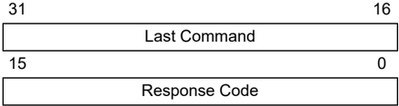


## 18. Checksum

## 18.1 Theory

The checksum is calculated as the 32-bit summation of all bytes (8-bit quantities) in program Flash, Boot Flash (except device Configuration Words), the Device ID register with applicable mask, and the device Configuration Words with applicable masks. Then the 2's complement of the summation is calculated. This final 32-bit number is presented as the checksum.

Note: The PIC32MKXXXXGPK/MCM/GPG/ MCJXXX devices use the CRC32 checksum. For additional information on the CRC32 checksum, refer to the 'Checksum Changes' chapter of the document 'Readme for MPLABX IDE.htm ', which can be found at &lt;MPLABX Installation Path&gt;\&lt;MPLABX Revision&gt;\docs.

## 18.2 Mask Values

The mask value of a device Configuration is calculated by setting all the unimplemented bits to ' 0 ' and all the implemented bits to ' 1 '.

For example, Register 18-1 shows the DEVCFG0 register of the PIC32MX360F512L device. The mask value for this register is as follows:

- mask\_value\_devcfg0 = 0x110FF00B

REGISTER 18-1: DEVCFG0 REGISTER OF PIC32MX360F512L

| Bit Range   | Bit 31/23/15/7   | Bit 30/22/14/6   | Bit 29/21/13/5   | Bit 28/20/12/4   | Bit 27/19/11/3   | Bit 26/18/10/2   | Bit 25/17/9/1   | Bit 24/16/8/0   |
|-------------|------------------|------------------|------------------|------------------|------------------|------------------|-----------------|-----------------|
| 31:24       | r-0              | r-1              | r-1              | R/P-1            | r-1              | r-1              | r-1             | R/P-1           |
| 31:24       | -                | -                | -                | CP               | -                | -                | -               | BWP             |
| 23:16       | r-1              | r-1              | r-1              | r-1              | R/P-1            | R/P-1            | R/P-1           | R/P-1           |
| 23:16       | -                | -                | -                | -                | PWP19            | PWP18            | PWP17           | PWP16           |
| 15:8        | R/P-1            | R/P-1            | R/P-1            | R/P-1            | r-1              | r-1              | r-1             | r-1             |
| 15:8        | PWP15            | PWP14            | PWP13            | PWP12            | -                | -                | -               | -               |
| 7:0         | r-1              | r-1              | r-1              | r-1              | R/P-1            | r-1              | R/P-1           | R/P-1           |
| 7:0         | -                | -                | -                | -                | ICESEL           | -                | DEBUG[1:0]      | DEBUG[1:0]      |

| Legend:           | P = Programmable bit   | r = Reserved bit                        |
|-------------------|------------------------|-----------------------------------------|
| R = Readable bit  | W = Writable bit       | U = Unimplemented bit, read as '0'      |
| -n = Value at POR | '1' = Bit is set       | '0' = Bit is cleared x = Bit is unknown |

Table 18-1 lists the mask values of the four device Configuration registers and device ID registers to be used in the checksum calculations for the PIC32MX, PIC32MZ and PIC32MKXXXXGPD/GPE/ MCFXXX devices. PIC32MKXXXXGPK/MCM/GPG/MCJXXX devices use the CRC32 checksum. For additional information on the CRC32 checksum, refer to the 'Checksum Changes' chapter of the document 'Readme for MPLABX IDE.htm ', which can be found at &lt;MPLABX Installation Path&gt;\&lt;MPLABX Revision&gt;\docs.

Table 18-1. Device Configuration Register Mask Values Of Currently Supported PIC32MX, PIC32MZ AND PIC32MKXXXXGPD/GPE/MCFXXX Devices

| Device Family                                                          | Flash Memory Sizes (KB)   | DEVCFG0    | DEVCFG1    | DEVCFG2    | DEVCFG3    | DEVCFG4   | DEVID      |
|------------------------------------------------------------------------|---------------------------|------------|------------|------------|------------|-----------|------------|
| PIC32MX110/120/130/ 150F0xx PIC32MX150F128 (28/36/44-pin devices only) | 16, 32, 64, 128           | 0x1100FC1F | 0x03DFF7A7 | 0x00070077 | 0xF000FFFF | -         | 0x0FFFFFFF |


| ...........continued Device Family                                                                                     | Flash Memory Sizes (KB)   | DEVCFG0    | DEVCFG1    | DEVCFG2    | DEVCFG3    | DEVCFG4       | DEVID      |
|------------------------------------------------------------------------------------------------------------------------|---------------------------|------------|------------|------------|------------|---------------|------------|
| PIC32MX130F128/256 PIC32MX150F256 (28/36/44-pin devices only)                                                          | 16, 32, 64, 128           | 0x1100FC1F | 0x03DFF7A7 | 0x00070077 | 0xF0000000 | -             | 0x0FFFFFFF |
| PIC32MX210/220/230/ 250 (28/36/44-pin devices only)                                                                    | 16, 32, 64, 128           | 0x1100FC1F | 0x03DFF7A7 | 0x00078777 | 0xF0000000 | -             | 0x0FFFFFFF |
| PIC32MX15X/17X (28/44- pin devices only)                                                                               | 128, 256                  | 0x1187F01F | 0x03FFF7A7 | 0xFFB700F7 | 0x30C00000 | -             | 0x0FFFFFFF |
| PIC32MX25X/27X (28/44- pin devices only)                                                                               | 128, 256                  | 0x1187F01F | 0x03FFF7A7 | 0xFFB787F7 | 0x70C00000 | -             | 0x0FFFFFFF |
| PIC32MX320/340/360                                                                                                     | 32, 64, 128, 256, 512     | 0x110FF00B | 0x009FF7A7 | 0x00070077 | 0x0000FFFF | -             | 0x000FF000 |
| PIC32MX420/440/460                                                                                                     | 32, 64, 128, 256, 512     | 0x110FF00B | 0x009FF7A7 | 0x00078777 | 0x0000FFFF | -             | 0x000FF000 |
| PIC32MX110/120/130/ 150F0xx PIC32MX150F128 PIC32MX170F256 (64/100- pin devices only)                                   | 64, 128, 256, 512         | 0x110FFC1F | 0x03DFF7A7 | 0x00070077 | 0xF000FFFF | -             | 0x0FFFFFFF |
| PIC32MX130F128/256 PIC32MX150F256 PIC32MX170F512 (64/100- pin devices only)                                            | 64, 128, 256, 512         | 0x110FFC1F | 0x03DFF7A7 | 0x00070077 | 0xF0000000 | -             | 0x0FFFFFFF |
| PIC32MX230F0xx PIC32MX250F128 PIC32MX270F256 (64/100- pin devices only)                                                | 64, 128, 256, 512         | 0x110FFC1F | 0x03DFF7A7 | 0x00078777 | 0xF000FFFF | -             | 0x0FFFFFFF |
| PIC32MX230F128 PIC32MX230F256 PIC32MX250F256 PIC32MX270F512 PIC32MX530 PIC32MX550 PIC32MX570 (64/100-pin devices only) | 64, 128, 256, 512         | 0x110FFC1F | 0x03DFF7A7 | 0x00078777 | 0xF0000000 | -             | 0x0FFFFFFF |
| PIC32MX330/350/370                                                                                                     | 64, 128, 256, 512         | 0x110FF01F | 0x03DFF7A7 | 0x00070077 | 0x3007FFFF | -             | 0x0FFFFFFF |
| PIC32MX430/450/470                                                                                                     | 64, 128, 256, 512         | 0x110FF01F | 0x03DFF7A7 | 0x00078777 | 0xF007FFFF | -             | 0x0FFFFFFF |
| PIC32MX534/564                                                                                                         | 64, 128                   | 0x110FF00F | 0x009FF7A7 | 0x00078777 | 0xC407FFFF | -             | 0x0FFFF000 |
| PIC32MX664                                                                                                             | 64, 128                   | 0x110FF00F | 0x009FF7A7 | 0x00078777 | 0xC307FFFF | -             | 0x0FFFF000 |
| PIC32MK0512/ 1024XXD/E/F                                                                                               | 512, 1024                 | 0x7FFFFFFF | 0xFFFFFFFF | 0xFFFFFFFF | 0xFFFF0000 | -             | 0x0FFFFFFF |
| PIC32MX764                                                                                                             | 128                       | 0x110FF00F | 0x009FF7A7 | 0x00078777 | 0xC707FFFF | -             | 0x0FFFF000 |
| PIC32MX170F256 (28/36/44-pin devices only)                                                                             | 256                       | 0x1107FC1F | 0x03DFF7A7 | 0x00070077 | 0xF000FFFF | -             | 0x0FFFFFFF |
| PIC32MX170F512 (28/36/44-pin devices only)                                                                             | 256                       | 0x1107FC1F | 0x03DFF7A7 | 0x00070077 | 0xF0000000 | -             | 0x0FFFFFFF |
| PIC32MX270F256 (28/36/44-pin devices only)                                                                             | 256                       | 0x1107FC1F | 0x03DFF7A7 | 0x00078777 | 0xF000FFFF | -             | 0x0FFFFFFF |
| PIC32MX270F512 (28/36/44-pin devices only)                                                                             | 256                       | 0x1107FC1F | 0x03DFF7A7 | 0x00078777 | 0xF0000000 | -             | 0x0FFFFFFF |
| PIC32MZ05XX/10XX/20XX                                                                                                  | 512, 1024, 2048           | 0x7FFFFFFF | 0xFFFFFFFF | 0xFFFFFFFF | 0xFFFF0000 | 0xFFFFFFF (1) | 0x0FFFFFFF |
| PIC32MX575                                                                                                             | 256, 512                  | 0x110FF00F | 0x009FF7A7 | 0x00078777 | 0xC407FFFF | -             | 0x000FF000 |


| ...........continued Device Family   | Flash Memory   | DEVCFG0    | DEVCFG1    | DEVCFG2    | DEVCFG3    | DEVCFG4    | DEVID      |
|--------------------------------------|----------------|------------|------------|------------|------------|------------|------------|
| PIC32MX675/695                       | 256, 512       | 0x110FF00F | 0x009FF7A7 | 0x00078777 | 0xC307FFFF | -          | 0x000FF000 |
| PIC32MX775/795                       | 256, 512       | 0x110FF00F | 0x009FF7A7 | 0x00078777 | 0xC707FFFF | -          | 0x000FF000 |
| PIC32MZW1                            | 1024, 2048     | 0xFFB3FDFD | 0x1FFFFF3B | 0xFFFFFF38 | 0x0003FFFF | 0x5FF800FF | 0xFFFFFFFF |

## Notes:

1. Applicable only to the PIC32MZ DA family of devices.
2. Device Configuration register mask values of the PIC32MZ for:
3. -USERID: 0x0000FFF
4. -BCFG0: 0x8000000B

## 18.3 Algorithm

Figure 18-1 illustrates an example of a high-level algorithm for calculating the checksum for a PIC32 device to demonstrate one method to derive a checksum. This is merely an example of how to achieve the actual calculations, the method that is ultimately used is left to the discretion of the software developer.

As stated earlier, calculate the PIC32 checksum as the 32-bit summation of all bytes (8-bit quantities) in program Flash, Boot Flash (except device configuration words), the Device ID register with applicable mask, and the device configuration words with applicable masks.

Then, the 2's complement of the summation is calculated. This final 32-bit number is presented as the checksum.

The mask values of the device Configuration and Device ID registers are derived as described in the previous section, Mask Values.

An arithmetic AND operation of these device Configuration register values is performed with the appropriate mask value, before adding their bytes to the checksum.

Similarly, an arithmetic AND operation of the Device ID register is performed with the appropriate mask value, before adding its bytes to the checksum, see Configuration Memory and Device ID for more information.


Figure 18-1. High-Level Algorithm for Checksum Calculation

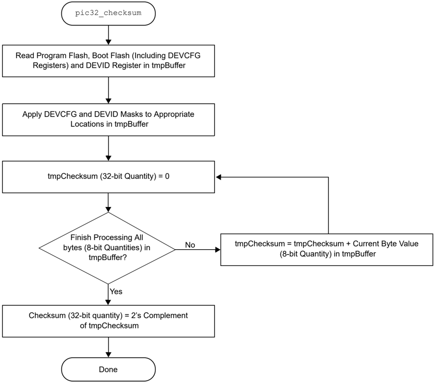

Equation 18-1 provides a formula to calculate the checksum for a PIC32 device.

Equation 18-1. Checksum Formula Checksum = 2's complement (PF+BF+DCR+DIR) Where,

- PF = 32-bit summation of all bytes in program Flash
- BF = 32-bit summation of all bytes in boot Flash, except device Configuration registers (1)
- y = 3 for PIC32MX, PIC32MKXXXXGPD/GPE/MCFXXX, PIC32MZ EC and PIC32MZ EF family of devices
- X = 0 Y 32 - bitsummation of bytes MASK DEVCFGX &amp;DEVCFGx
- y = 4 for all other PIC32MZ family of devices · DIR = 32 - bit summation of bytes MASK DEVCFGX &amp;DEVID · MASKDEVCFGX = mask value from Table 18-1


- MASKDEVID = mask value from Table 18-1 (2) · DEVCP = 32 - bit summation of bytes MASK DEVCP &amp;DEVCP -Where, MASKDEVCP = 0x10000000 for the PIC32MKXXXXGPD/GPE/MCFXXX

## Notes:

1. For the PIC32MZ family of devices, the Boot Flash memory that resides at 0x1FCxFF00 through 0x1FCxFFFF is not summed, as these memory locations contain the device configuration and CP values. For the PIC32MKXXXXGPD/GPE/MCFXXX family of devices, the Boot Flash memory that resides at 0x1FC03F00 through 0x1FC03FFF is not summed.
2. For the PIC32MZ and the PIC32MKXXXXGPD/GPE/MCFXXX family of devices, the checksum calculated in MPLAB X IDE only uses the primary DEVCFGx registers. Neither the alternate nor second Boot Flash (if available) registers are calculated.

## 18.4 Example of Checksum Calculation

The following five sections demonstrate a checksum calculation for the PIC32MX360F512L device using Equation 18-1.

The following assumptions are made for the purpose of this checksum calculation example:

- Program Flash and Boot Flash are in the erased state (all bytes are 0xFF)
- Device Configuration is in the default state of the device (no configuration changes are made)

Each item on the right side of the equation (PF, BF, DCR, DIR) is individually calculated. After deriving the values, the final value of the checksum can be calculated.

## 18.4.1 Calculating for 'PF' in the Checksum Formula

The size of the program Flash is 512-KB, which equals 524288 bytes. Since the program Flash is assumed to be in erased state, the value of PF is resolved through the following calculation:

- PF = 0xFF + 0xFF + … 524288 times
- PF = 0x7F80000 (32-bit number)

## 18.4.2 Calculating for 'BF' in the Checksum Formula

The size of the Boot Flash is 12 KB, which equals 12288 bytes. However, the last 16 bytes are device Configuration registers, which are treated separately. Therefore, the number of bytes in Boot Flash that we consider in this step is 12272. Since the Boot Flash is assumed to be in erased state, the value of 'BF' is resolved through the following calculation:

- BF = 0xFF + 0xFF + … 12272 times
- BF = 0x002FC010 (32-bit number)

## 18.4.3 Calculating for 'DCR' in the Checksum Formula

Since the device Configuration registers are left in their default state, the value of the appropriate DEVCFG register - as read by the PIC32 core, its respective mask value, the value derived from applying the mask and the 32-bit summation of bytes (all as shown in Table 18-2) provide the total of the 32-bit summation of bytes.

From Table 18-2, the value of 'DCRZ' is:

- DCR = 0x000003D6 (32-bit number)

## Table 18-2. DCR Calculation Example

| Register   | POR Default Value   | Mask       | POR Default Value and Mask   | 32-Bit Summation of Bytes   |
|------------|---------------------|------------|------------------------------|-----------------------------|
| DEVCFG0    | 0x7FFFFFFF          | 0x110FF00B | 0x110FF00B                   | 0x0000011B                  |


| ...........continued                                | ...........continued                                | ...........continued                                | ...........continued                                | ...........continued                                |
|-----------------------------------------------------|-----------------------------------------------------|-----------------------------------------------------|-----------------------------------------------------|-----------------------------------------------------|
| Register                                            | POR Default Value                                   | Mask                                                | POR Default Value and Mask                          | 32-Bit Summation of Bytes                           |
| DEVCFG1                                             | 0xFFFFFFFF                                          | 0x009FF7A7                                          | 0x009FF7A7                                          | 0x0000023D                                          |
| DEVCFG2                                             | 0xFFFFFFFF                                          | 0x00070077                                          | 0x00070077                                          | 0x0000007E                                          |
| DEVCFG3                                             | 0xFFFFFFFF                                          | 0x00000000                                          | 0x00000000                                          | 0x00000000                                          |
| Total of the 32-bit summation of Bytes = 0x000003D6 | Total of the 32-bit summation of Bytes = 0x000003D6 | Total of the 32-bit summation of Bytes = 0x000003D6 | Total of the 32-bit summation of Bytes = 0x000003D6 | Total of the 32-bit summation of Bytes = 0x000003D6 |

## 18.4.4 Calculating for 'DIR' in the Checksum Formula

The value of Device ID register and its mask value, the value derived from applying the mask and the 32-bit summation of bytes are shown in Table 18-3.

From Table 18-3, the value of DIR is:

- DIR = 0x00000083 (32-bit number)

Table 18-3. DIR Calculation Example

| Register   | POR Default Value   | Mask       | POR Default Value and Mask   | 32-BitSummationof Bytes   |
|------------|---------------------|------------|------------------------------|---------------------------|
| DEVID      | 0x00938053          | 0x000FF000 | 0x00038000                   | 0x00000083                |

## 18.4.5 Completing the PIC32 Checksum Calculation

The values derived in previous sections (PF, BF, DCR, DIR) are used to calculate the checksum value. Perform the 32-bit summation of the PF, BF, DCR and DIR as derived in previous sections and store it in a variable, called temp.

The following are the steps of the checksum calculation process:

1. First, temp = PF + BF + DCR + DIR, which translates to:
- a. temp = 0x7F80000 + 0x002FC010 + 0x000003D6 + 0x00000083
2. Adding all four values results in temp being equal to 0x0827C469
3. Finally, the 2's complement of the temp is the checksum:
5. -Checksum = 2's complement ( temp ), which is Checksum = (1's complement ( temp )) + 1, resulting in 0xF7D83B97

## 18.4.6 Checksum Values while Device is Code-Protected

Since the device configuration words are not readable while the PIC32 devices are in Code-protected state, the checksum values are zero for all devices.


## 19. Configuration Memory and Device ID

PIC32 devices include several features intended to maximize application flexibility and reliability, and minimize cost through elimination of external components. These features are configurable through specific Configuration bits for each device.

Refer to the 'Special Features' chapter in the specific device data sheet for a full list of available features, Configuration bits and the Device ID register.

Refer to Appendix C: Device IDs to locate the Device ID for a particular PIC32MX, PIC32MZ or PIC32MK family of devices.

For the current silicon revision and revision ID for a particular device, refer to the Family Silicon Errata and Data Sheet Clarification. These documents are available for download from the Microchip web site: http://www.microchip.com/PIC32 and navigating to: Documentation &gt; Errata.

## 19.1 Device Configuration

In PIC32 devices, the configuration words select various device configurations that are set at device Reset prior to execution of any code. These values are available at the highest locations of the Boot Flash Memory (BFM) and since they are part of the program memory, are included in the programming file along with executable code and program constants. The names and locations of these configuration words are listed in Table 19-1 through Table 19-4.

Additonally, Table 19-3 through Table 19-4 include configuration words for the PIC32MZ and the PIC32MK family devices, respectively, with dual boot and dual panel Flash. Refer to 'Section 48. Memory Organization and Permissions' (DS60001214) of the 'PIC32 Family Reference Manual' for a detailed description of the dual boot regions.

Table 19-1. DEVCFG Locations for 15X/17X/25X/27X and PIC32MX3XX/4XX/5XX/6XX/ 7XX Devices Only

| Configuration Word   | Physical Address   |
|----------------------|--------------------|
| DEVCFG0              | 0x1FC02FFC         |
| DEVCFG1              | 0x1FC02FF8         |
| DEVCFG2              | 0x1FC02FF4         |
| DEVCFG3              | 0x1FC02FF0         |

Table 19-2. DEVCFG Locations for 28/36/44-Pin PIC32MX1XX/2XX and 64/100-Pin PIC32MX1XX/2XX/5XX Devices Only

| Configuration Word   | Physical Address   |
|----------------------|--------------------|
| DEVCFG0              | 0x1FC00BFC         |
| DEVCFG1              | 0x1FC00BF8         |
| DEVCFG2              | 0x1FC00BF4         |
| DEVCFG3              | 0x1FC00BF0         |

On Power-on Reset (POR) or any Reset, the configuration words are copied from the Boot Flash memory to their corresponding Configuration registers. A Configuration bit can only be programmed = 0 (unprogrammed state = 1 ).

During programming, a configuration word can be programmed a maximum of two times for PIC32MX devices and only one time for PIC32MZ, and PIC32MK family devices before a page erase must be performed.

After programming the configuration words, a device Reset will cause the new values to be loaded into the Configuration registers. Because of this, the programmer must program the configuration words just prior to verification of the device. The final step is programming the code protection configuration word.


These configuration words determine the oscillator source. If using the Two-Wire Enhanced ICSP mode the configuration words are ignored and the device will always use the FRC; however, in Four-Wire mode this is not the case. If an oscillator source is selected by the configuration words that is not present on the device after Reset, the programmer will not be able to perform Flash operations on the device after it is Reset. See the 'Special Features' chapter in the specific device data sheet for details regarding oscillator selection using the configuration words.

Table 19-3. Configuration Word Locations for PIC32MZ Family Devices

| Configuration Word (1)         | Register Physical Address   | Register Physical Address   | Register Physical Address    | Register Physical Address      |
|--------------------------------|-----------------------------|-----------------------------|------------------------------|--------------------------------|
|                                | Fixed Boot Region 1         | Fixed Boot Region 2         | Active Boot Alias Region (2) | Inactive Boot Alias Region (2) |
| Boot sequence number           | 0x1FC4FFF0                  | 0x1FC6FFF0                  | 0x1FC0FFF0                   | 0x1FC2FFF0                     |
| Code protection                | 0x1FC4FFD0                  | 0x1FC6FFD0                  | 0x1FC0FFD0                   | 0x1FC2FFD0                     |
| DEVCFG0                        | 0x1FC4FFCC                  | 0x1FC6FFCC                  | 0x1FC0FFCC                   | 0x1FC2FFCC                     |
| DEVCFG1                        | 0x1FC4FFC8                  | 0x1FC6FFC8                  | 0x1FC0FFC8                   | 0x1FC2FFC8                     |
| DEVCFG2                        | 0x1FC4FFC4                  | 0x1FC6FFC4                  | 0x1FC0FFC4                   | 0x1FC2FFC4                     |
| DEVCFG3                        | 0x1FC4FFC0                  | 0x1FC6FFC0                  | 0x1FC0FFC0                   | 0x1FC2FFC0                     |
| DEVCFG4 (3)                    | 0x1FC4FFBC                  | 0x1FC6FFBC                  | 0x1FC0FFBC                   | 0x1FC2FFBC                     |
| Alternate boot sequence number | 0x1FC4FF70                  | 0x1FC6FF70                  | 0x1FC0FF70                   | 0x1FC2FF70                     |
| Alternate code protection      | 0x1FC4FF50                  | 0x1FC6FF50                  | 0x1FC0FF50                   | 0x1FC2FF50                     |
| Alternate DEVCFG0              | 0x1FC4FF4C                  | 0x1FC6FF4C                  | 0x1FC0FF4C                   | 0x1FC2FF4C                     |
| Alternate DEVCFG1              | 0x1FC4FF48                  | 0x1FC6FF48                  | 0x1FC0FF48                   | 0x1FC2FF48                     |
| Alternate DEVCFG2              | 0x1FC4FF44                  | 0x1FC6FF44                  | 0x1FC0FF44                   | 0x1FC2FF44                     |
| Alternate DEVCFG3              | 0x1FC4FF40                  | 0x1FC6FF40                  | 0x1FC0FF40                   | 0x1FC2FF40                     |
| Alternate DEVCFG4 (3)          | 0x1FC4FF3C                  | 0x1FC6FF3C                  | 0x1FC0FF3C                   | 0x1FC2FF3C                     |

## Notes:

1. All values in the 0x1FCxFF00-0x1FCxFFFF memory regions must be programmed using the QUAD\_WORD\_PROGRAM command to ensure proper ECC configuration. Refer to Quad Word Program (QUAD\_WORD\_PROGRAM) Command for details.
2. Active/inactive boot alias selections are assumed for an unprogrammed device where fixed region 1 is active and fixed region 2 is inactive. Refer to 'Section 48. Memory Organization and Permissions' (DS60001214) for a detailed description of the alias boot regions.
3. These configuration words are available only on the PIC32MZ DA family devices.

Table 19-4. Configuration Word Locations for PIC32MKXXXXXXD/E/FXX Family Devices

| Configuration Word (1)   | Register Physical Address   | Register Physical Address   | Register Physical Address    | Register Physical Address      |
|--------------------------|-----------------------------|-----------------------------|------------------------------|--------------------------------|
|                          | Fixed Boot Region 1         | Fixed Boot Region 2         | Active Boot Alias Region (2) | Inactive Boot Alias Region (2) |
| Boot sequence number     | 0x1FC43FF0                  | 0x1FC63FF0                  | 0x1FC03FF0                   | 0x1FC23FF0                     |
| Code protection          | 0x1FC43FD0                  | 0x1FC63FD0                  | 0x1FC03FD0                   | 0x1FC23FD0                     |
| DEVCFG0                  | 0x1FC43FCC                  | 0x1FC63FCC                  | 0x1FC03FCC                   | 0x1FC23FCC                     |
| DEVCFG1                  | 0x1FC43FC8                  | 0x1FC63FC8                  | 0x1FC03FC8                   | 0x1FC23FC8                     |
| DEVCFG2                  | 0x1FC43FC4                  | 0x1FC63FC4                  | 0x1FC03FC4                   | 0x1FC23FC4                     |
| DEVCFG3                  | 0x1FC43FC0                  | 0x1FC63FC0                  | 0x1FC03FC0                   | 0x1FC23FC0                     |


| ...........continued   |                                                                 |
|------------------------|-----------------------------------------------------------------|
| Configuration Word (1) | Register Physical Address Fixed Boot Region 1 Fixed Boot Region |

## Notes:

1. If the device has ECC memory, each of the following configuration word groups must be programmed using the QUAD\_WORD\_PROGRAM command:
2. -Boot sequence number (single quad word programming operation)
3. -Code protection (single quad word programming operation)
4. -DEVCFG3, DEVCFG2, DEVCFG1 and DEVCFG0 (single quad word programming operation)
2. Active/inactive boot alias selections are assumed for an unprogrammed device where fixed region 1 is active and fixed region 2 is inactive. Refer to 'Section 48. Memory Organization and Permissions' (DS60001214) for a detailed description of the alias boot regions.

Table 19-5. Configuration Word Locations for PIC32MKXXXXXXH/G/J/K/L/MXX Family Devices

| Configuration Word (1)         | Register Physical Address   | Register Physical Address   | Register Physical Address       | Register Physical Address         |
|--------------------------------|-----------------------------|-----------------------------|---------------------------------|-----------------------------------|
|                                | Fixed Boot Region 1         | Fixed Boot Region 2         | Active Boot Alias Region (2, 3) | Inactive Boot Alias Region (2, 3) |
| Boot sequence number           | 0x1FC43FF0                  | 0x1FC63FF0                  | 0x1FC03FF0                      | 0x1FC23FF0                        |
| Code protection                | 0x1FC43FD0                  | 0x1FC63FD0                  | 0x1FC03FD0                      | 0x1FC23FD0                        |
| DEVCFG0                        | 0x1FC43FCC                  | 0x1FC63FCC                  | 0x1FC03FCC                      | 0x1FC23FCC                        |
| DEVCFG1                        | 0x1FC43FC8                  | 0x1FC63FC8                  | 0x1FC03FC8                      | 0x1FC23FC8                        |
| DEVCFG2                        | 0x1FC43FC4                  | 0x1FC63FC4                  | 0x1FC03FC4                      | 0x1FC23FC4                        |
| DEVCFG3                        | 0x1FC43FC0                  | 0x1FC63FC0                  | 0x1FC03FC0                      | 0x1FC23FC0                        |
| DEVCFG4                        | 0x1FC43FBC                  | -                           | -                               | -                                 |
| Alternate boot sequence number | 0x1FC43F70                  | 0x1FC63F70                  | 0x1FC03F70                      | 0x1FC23F70                        |
| Alternate code protection      | 0x1FC43F50                  | 0x1FC63F50                  | 0x1FC03F50                      | 0x1FC23F50                        |
| Alternate DEVCFG0              | 0x1FC43F4C                  | 0x1FC63F4C                  | 0x1FC03F4C                      | 0x1FC23F4C                        |
| Alternate DEVCFG1              | 0x1FC43F48                  | 0x1FC63F48                  | 0x1FC03F48                      | 0x1FC23F48                        |
| Alternate DEVCFG2              | 0x1FC43F44                  | 0x1FC63F44                  | 0x1FC03F44                      | 0x1FC23F44                        |
| Alternate DEVCFG3              | 0x1FC43F40                  | 0x1FC63F40                  | 0x1FC03F40                      | 0x1FC23F40                        |
| Alternate DEVCFG4              | 0x1FC43F3C                  | 0x1FC63F3C                  | 0x1FC03F3C                      | 0x1FC23F3C                        |

## Notes:

1. If the device has ECC memory, each of the following Configuration Word Groups should be programmed using the QUAD\_WORD\_PROGRAM command:
- Boot sequence number (single quad word programming operation)
- Code protection (single quad word programming operation)
- DEVCFG3, DEVCFG2, DEVCFG1 and DEVCFG0 (single quad word programming operation)
2. All values in the 0x1FCxFF00-0x1FCxFFFF memory regions must be programmed using the QUAD\_WORD\_PROGRAM command to ensure proper ECC configuration. Refer to Quad Word Program (QUAD\_WORD\_PROGRAM) Command for details.
3. Active/inactive boot alias selections are assumed for an unprogrammed device where fixed region 1 is active and fixed region 2 is inactive. Refer to 'Section 48. Memory Organization and Permissions' (DS60001214) for a detailed description of the alias boot regions.

## 19.1.1 Device Configuration for PIC32MZ W1 Devices

In the PIC32MZ W1 devices, the configuration words select various device configurations that are set at the device Reset prior to the execution of any code. They are part of the program memory and are included in the programming file along with the executable code and program constants. The names and locations of these configuration words are listed in Table 19-6.


Table 19-6. DEVCFG Locations for PIC32MZ W1

| Configuration Word   | Physical Address   |
|----------------------|--------------------|
| BCFG0                | 0x1F800100         |
| CFGCON0              | 0x1F800000         |
| CFGCON1              | 0x1F800010         |
| CFGCON2              | 0x1F800020         |
| CFGCON3              | 0x1F800030         |
| CFGCON4              | 0x1F800040         |
| USERID               | 0x1F800070         |

| Configuration Word (1)   | Physical Address   |
|--------------------------|--------------------|
| BFDEVCFG0                | 0x1FC5_5F9C        |
| BFDEVCFG1                | 0x1FC5_5F98        |
| BFDEVCFG2                | 0x1FC5_5F94        |
| BFDEVCFG3                | 0x1FC5_5F90        |
| BFDEVCFG4                | 0x1FC5_5F8C        |
| BFDEVCFG5                | 0x1FC5_5F88        |

## Note:

1. The user-configured setting of BFDEVCFG0 to BFDEVCFG5 are loaded from the boot Flash into the following counterpart registers at system start-up:

- -BFDEVCFG0 to BCFG0(L)
- -BFDEVCFG1 to CFGCON0(L)
- -BFDEVCFG2 to CFGCON1(L)
- -BFDEVCFG3 to CFGCON2(L)
- -BFDEVCFG4 to CFGCON4(L)
- -BFDEVCFG5 to USERID

## 19.1.2 Configuration Register Protection

To prevent inadvertent Configuration bit changes during code execution, all programmable Configuration bits are write-once. After a bit is initially programmed during a power cycle, it cannot be written to again. Changing a device configuration requires changing the Configuration data in the Boot Flash memory, and cycling power to the device.

To ensure integrity of the 128-bit data, a comparison is made between each Configuration bit and its stored complement continuously. If a mismatch is detected, a Configuration Mismatch Reset is generated, which causes a device Reset.

## 19.2 Device Code Protection Bit (CP)

The PIC32 family of devices feature code protection, which when enabled, prevents reading of the Flash memory by an external programming device. Once code protection is enabled, it can only be disabled by erasing the device with the Chip Erase command ( MCHP\_ERASE ).

When programming a device that has opted to utilize code protection, the programming device must perform verification prior to enabling code protection. Enabling code protection must be the last step of the programming process. Location of the code protection enable bits vary by device. Refer to 'Special Features' chapter in the specific device data sheet for details.

Note: Once code protection is enabled, the Flash memory can no longer be read and can only be disabled by an external programmer using the Chip Erase Command ( MCHP\_ERASE ).

## 19.3 Program Write Protection (PWP) Bits

The PIC32 families of devices feature write protection, which prevents designated boot and program Flash regions from erasing or writing during program execution.


In PIC32MX devices, write protection is implemented in Configuration memory by the Device Configuration Words, while in PIC32MZ and PIC32MK family devices, this feature is implemented through SFRs in the Flash controller.

When write protection is implemented by Device Configuration Words, the write protection register must only be written when all boot and program Flash memory has been programmed. Refer to the 'Special Features' chapter in the specific device data sheet for details.

If write protection is implemented using SFRs, certain steps may be required during initialization of the device by the external programmer prior to programming Flash regions. Refer to the 'Flash Program Memory' chapter in the specific device data sheet for details.


## 20. Tap Controllers

Table 20-1. MCHP Tap Instructions

| Command      | Value   | Description                                                           |
|--------------|---------|-----------------------------------------------------------------------|
| MTAP_COMMAND | 5'h0x07 | TDI and TDO connected to MCHP Command Shift register (see Table 20-2) |
| MTAP_SW_MTAP | 5'h0x04 | Switch TAP controller to MCHP TAP controller                          |
| MTAP_SW_ETAP | 5'h0x05 | Switch TAP controller to EJTAG TAP controller                         |
| MTAP_IDCODE  | 5'h0x01 | Select Chip Identification Data register                              |

## 20.1 Microchip (MTAP) TAP Controllers

## 20.1.1 MTAP Command ( MTAP\_COMMAND ) Instruction

MTAP\_COMMAND selects the MCHP Command Shift register. See Table 20-2 for available commands.

## 20.1.1.1 MCHP Status ( MCHP\_STATUS ) Instruction

MCHP\_STATUS returns the 8-bit Status value of the Microchip TAP controller. MCHP Status Value Register provides the format of the status value.

## 20.1.1.2 MCHP Assert Reset ( MCHP\_ASSERT\_RST ) Instruction

MCHP\_ASSERT\_RST performs a persistent device Reset. It is similar to asserting and holding the MCLR pin. Its associated Status bit is DEVRST.

## 20.1.1.3 MCHP De-Assert Reset ( MCHP\_DE\_ASSERT\_RST ) Instruction

MCHP\_DE\_ASSERT\_RST removes the persistent device Reset. It is similar to deasserting the MCLR pin. Its associated Status bit is DEVRST.

## 20.1.1.4 MCHP Erase ( MCHP\_ERASE ) Instruction

MCHP\_ERASE performs a Chip Erase . The CHIP\_ERASE command sets an internal bit that requests the Flash Controller to perform the erase. Once the controller becomes busy, as indicated by FCBUSY (Status bit), the internal bit is cleared.

## 20.1.1.5 MCHP Flash Enable ( MCHP\_FLASH\_ENABLE ) Instruction

Note: This command is not required for PIC32MZ and PIC32MK family devices.

MCHP\_FLASH\_ENABLE sets the FAEN bit, which controls processor access to the Flash memory. The FAEN bit's state is returned in the field of the same name. This command has no effect if CPS = 0 . This command requires a NOP to complete.

## 20.1.1.6 MCHP Flash Disable ( MCHP\_FLASH\_DISABLE ) Instruction

Note: his command is not required for PIC32MZ and PIC32MK family devices.

MCHP\_FLASH\_DISABLE clears the FAEN bit which controls processor accesses to the Flash memory. The FAEN bit's state is returned in the field of the same name. This command has no effect if CPS = 0 . This command requires a NOP to complete.

## 20.1.2 MTAP Switch MTAP ( MTAP\_SW\_MTAP ) Instruction

MTAP\_SW\_MTAP switches the TAP instruction set to the MCHP TAP instruction set.

Each of these commands should be followed with a SetMode ( 6'b011111 ) to force the Chip TAP controller to the Run Test/Idle state.

## 20.1.3 MTAP Switch ETAP ( MTAP\_SW\_ETAP ) Instruction

MTAP\_SW\_ETAP effectively switches the TAP instruction set to the EJTAG TAP instruction set. It does this by holding the EJTAG TAP controller in the Run Test/Idle state until a MTAP\_SW\_ETAP instruction is decoded by the MCHP TAP controller.


Each of these commands should be followed with a SetMode ( 6'b011111 ) to force the Chip TAP controller to the Run Test/Idle state.

## 20.1.4 MTAP IDCODE ( MTAP\_IDCODE ) Instruction

MTAP\_IDCODE returns the value stored in the DEVID register.

Table 20-2. MTAP\_COMMAND DR Commands

| Command                | Value                                                                   | Description                                                                                                                                           |
|------------------------|-------------------------------------------------------------------------|-------------------------------------------------------------------------------------------------------------------------------------------------------|
| MCHP_STATUS            | 8'h0x00                                                                 | NOP and return status.                                                                                                                                |
| MCHP_ASSERT_RST        | 8'h0xD1                                                                 | Requests the Reset controller to assert device Reset.                                                                                                 |
| MCHP_DE_ASSERT_RST     | 8'h0xD0                                                                 | Removes the request for device Reset, which causes the reset controller to deassert device Reset if there is no other source requesting Reset (MCLR). |
| MCHP_ERASE             | 8'h0xFC                                                                 | Cause the Flash controller to perform a chip erase.                                                                                                   |
| MCHP_FLASH_ENABLE (1)  | 8'h0xFE                                                                 | Enables fetches and loads to the Flash (from the processor).                                                                                          |
| MCHP_FLASH_DISABLE (1) | 8'h0xFD                                                                 | Disables fetches and loads to the Flash (from the processor).                                                                                         |
| Note:                  | Note:                                                                   | Note:                                                                                                                                                 |
| 1.                     | This command is not required for PIC32MK and PIC32MZ family of devices. | This command is not required for PIC32MK and PIC32MZ family of devices.                                                                               |

Table 20-3. EJTAG Tap Instructions

| Command        | Value   | Description                                                  |
|----------------|---------|--------------------------------------------------------------|
| ETAP_ADDRESS   | 5'h0x08 | Select Address register                                      |
| ETAP_DATA      | 5'h0x09 | Select Data register                                         |
| ETAP_CONTROL   | 5'h0x0A | Select EJTAG Control register                                |
| ETAP_EJTAGBOOT | 5'h0x0C | Set EjtagBrk, ProbEn and ProbTrap to ' 1 'as the Reset value |
| ETAP_FASTDATA  | 5'h0x0E | Selects the Data and Fast data registers                     |


## 20.1.5 MCHP Status Value Register

Name:

MCHP Status Value Register

Offset:

0x00

Reset:

0x00

Property:

R/W

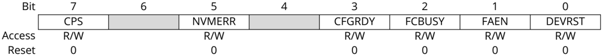

## Bit 7 - CPS Code-Protect State bit

|   Value | Description                  |
|---------|------------------------------|
|       1 | Device is not code-protected |
|       0 | Device is code-protected     |

## Bit 5 - NVMERR NVMCON Status bit

Note: This bit is not implemented in the PIC32MX320/340/360/420/440/460 devices.

|   Value | Name                                        |
|---------|---------------------------------------------|
|       1 | An Error occurred during NVM operation      |
|       0 | An Error did not occur during NVM operation |

## Bit 3 - CFGRDY Code-Protect State bit

|   Value | Name                                        |
|---------|---------------------------------------------|
|       1 | Configuration has been read and CP is valid |
|       0 | Configuration has not been read             |

## Bit 2 - FCBUSY Flash Controller Busy bit

|   Value | Name                                                                           |
|---------|--------------------------------------------------------------------------------|
|       1 | Flash controller is busy (erase is in progress)                                |
|       0 | Flash controller is not busy (either erase has not started or it has finished) |

## Bit 1 - FAEN Flash Access Enable bit

Note:

This bit is not implemented in the PIC32MK and the PIC32MZ family devices.

|   Value | Name                                                      |
|---------|-----------------------------------------------------------|
|       1 | Flash access is enabled                                   |
|       0 | Flash access is disabled (processor accesses are blocked) |

## Bit 0 - DEVRST Device Reset State bit

|   Value | Name                       |
|---------|----------------------------|
|       1 | Device Reset is active     |
|       0 | Device Reset is not active |

## 20.2 EJTAG TAP Controller

## 20.2.1 ETAP Address ( ETAP\_ADDRESS ) Command

ETAP\_ADDRESS selects the Address register. The read-only Address register provides the address for a processor access. The value read in the register is valid if a processor access is pending, otherwise the value is undefined.


The two or three LSBs of the register are used with the Psz field from the EJTAG Control register to indicate the size and data position of the pending processor access transfer. These bits are not taken directly from the address referenced by the load/store.

## 20.2.2 ETAP Data ( ETAP\_DATA ) Command

ETAP\_DATA selects the Data register. The read/write Data register is used for op code and data transfers during processor accesses. The value read in the Data register is valid only if a processor access for a write is pending, in which case the Data register holds the store value. The value written to the Data register is only used if a processor access for a pending read is finished afterwards; in which case, the data value written is the value for the fetch or load. This behavior implies that the Data register is not a memory location where a previously written value can be read afterwards.

## 20.2.3 ETAP Control ( ETAP\_CONTROL ) Command

ETAP\_CONTROL selects the Control register. The EJTAG Control Register (ECR) handles processor Reset and soft Reset indication, Debug mode indication, access start, finish and size and read/write indication. The ECR also provides the following features:

- Controls debug vector location and indication of serviced processor accesses
- Allows a debug interrupt request
- Indicates a processor Low-power mode
- Allows implementation-dependent processor and peripheral Resets

## 20.2.3.1 EJTAG Control register (ECR)

The EJTAG Control register (see ECR: EJTAG Control Register) is not updated/written in the UpdateDR state unless the Reset occurred; that is ROCC (bit 31) is either already ' 0 ' or is written to ' 0 ' at the same time. This condition ensures proper handling of processor accesses after a Reset.

Reset of the processor can be indicated through the ROCC bit in the TCK domain a number of TCK cycles after it is removed in the processor clock domain in order to allow for proper synchronization between the two clock domains.

Bits that are Read/Write (R/W) in the register return their written value on a subsequent read, unless other behavior is defined.

Internal synchronization ensures that a written value is updated for reading immediately afterwards, even when the TAP controller takes the shortest path from the Update-DR to Capture-DR state.


## 20.2.3.2 EJTAG Control Register

Name:

ECR: EJTAG Control Register

Offset:

0x30

Reset:

0x00000000

Property:

-

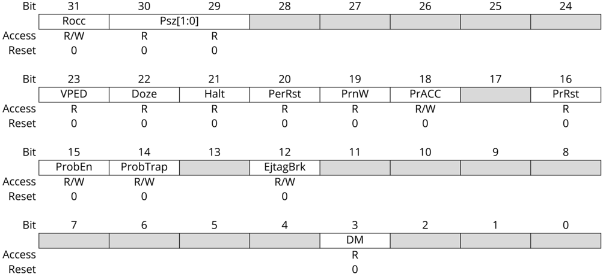

## Bit 31 - Rocc

Note: For descriptions of these bits, refer to the Imagination Technologies Limited (www.imgtec.com).

## Bits 30:29 - Psz[1:0]

Note: For descriptions of these bits, refer to the Imagination Technologies Limited (www.imgtec.com).

## Bit 23 - VPED

Note: For descriptions of these bits, refer to the Imagination Technologies Limited (www.imgtec.com).

## Bit 22 - Doze

Note: For descriptions of these bits, refer to the Imagination Technologies Limited (www.imgtec.com).

## Bit 21 - Halt

Note: For descriptions of these bits, refer to the Imagination Technologies Limited (www.imgtec.com).

## Bit 20 - PerRst

Note: For descriptions of these bits, refer to the Imagination Technologies Limited (www.imgtec.com).


## Bit 19 - PrnW

Note: For descriptions of these bits, refer to the Imagination Technologies Limited (www.imgtec.com).

## Bit 18 - PrACC Pending Processor Access and Control bit

This bit indicates a pending processor access and controls finishing of a pending processor access. A write of ' 0 ' finishes processor access if pending. A write of ' 1 ' is ignored. A successful FASTDATA access clears this bit.

|   Value | Description                     |
|---------|---------------------------------|
|       1 | Pending processor access        |
|       0 | No pending pre-processor access |

## Bit 16 - PrRst

Note: For descriptions of these bits, refer to the Imagination Technologies Limited (www.imgtec.com).

## Bit 15 - ProbEn Processor Access Service Control bit

This bit controls where the probe handles accesses to the DMSEG segment through servicing of processor accesses.

|   Value | Description                   |
|---------|-------------------------------|
|       1 | A BCFG error has occurred     |
|       0 | A BCFG error has not occurred |

## Bit 14 - ProbTrap Debug Exception Vector Control Location bit

This bit controls the location of the debug exception vector.

|   Value | Description   |
|---------|---------------|
|       1 | 0xFF200200    |
|       0 | 0xBFC00480    |

## Bit 12 - EjtagBrk Debug Interrupt Exception Request bit

This bit requests a debug interrupt exception to the processor when this bit is written as '1'. A write of '0' is ignored.

|   Value | Description                                        |
|---------|----------------------------------------------------|
|       1 | A debug interrupt exception request is pending     |
|       0 | A debug interrupt exception request is not pending |

## Bit 3 - DM

Note: For descriptions of these bits, refer to the Imagination Technologies Limited (www.imgtec.com).

## 20.2.4 ETAP EJTAG Boot ( ETAP\_EJTAGBOOT ) Command

The ETAP\_EJTAGBOOT command causes the processor to fetch code from the debug exception vector after a Reset. This allows the programmer to send instructions to the processor to execute, instead of the processor fetching them from the normal Reset vector. The Reset value of the EjtagBrk, ProbTrap and ProbE bits follows the setting of the internal EJTAGBOOT indication.

If the EJTAGBOOT instruction has been given, and the internal EJTAGBOOT indication is active, then the Reset value of the three bits is set (' 1 '), otherwise the Reset value is clear (' 0 ').

The results of setting these bits are:

- Setting the EjtagBrk bit causes a Debug interrupt exception to be requested right after the processor Reset from the EJTAGBOOT instruction


- The debug handler is executed from the EJTAG memory because ProbTrap is set to indicate debug vector in EJTAG memory at 0xFF200200
- Service of the processor access is indicated because ProbEn is set

With this configuration in place, an interrupt exception will occur and the processor fetches the handler from the DMSEG at 0xFF200200 . Since ProbEn bit is set, the processor will wait for the instruction to be provided by the probe.

## 20.2.5 ETAP Fast Data ( ETAP\_FASTDATA ) Command

The ETAP\_FASTDATA command provides a mechanism for quickly transferring data between the processor and the probe. The width of the Fastdata register is one bit. During a fast data access, the Fastdata register is written and read (a bit is shifted in and a bit is shifted out). During a fast data access, the Fastdata register value shifted in specifies whether the fast data access must be completed or not. The value shifted out is a flag that indicates whether the fast data access was successful or not (if completion was requested). The FASTDATA access is used for efficient block transfers between the DMSEG segment (on the probe) and target memory (on the processor). An 'upload' is defined as a sequence that the processor loads from target memory and stores to the DMSEG segment. A 'download' is a sequence of processor loads from the DMSEG segment and stores to target= memory. The 'Fastdata area' specifies the legal range of DMSEG segment addresses (0xFF200000 to 0xFF20000F) that can be used for uploads and downloads. The Data and Fastdata registers (selected with the FASTDATA instruction) allow efficient completion of pending Fastdata area accesses.

During Fastdata uploads and downloads, the processor will stall on accesses to the Fastdata area. The PrAcc (processor access pending bit) will be '1' indicating the probe is required to complete the access. Both upload and download accesses are attempted by shifting in a zero SPrAcc value (to request access completion) and shifting out SPrAcc to see if the attempt will be successful (i.e., there was an access pending and a legal Fastdata area address was used).

Downloads will also shift in the data to be used to satisfy the load from the DMSEG segment Fastdata area, while uploads will shift out the data being stored to the DMSEG segment Fastdata area.

As indicated, the following two conditions must be true for the Fastdata access to succeed:

- PrAcc must be ' 1 ' (there must be a pending processor access)
- The Fastdata operation must use a valid Fastdata area address in the DMSEG segment (0xFF200000 to 0xFF20000F)


## 21. AC/DC Characteristics and Timing Requirements

Table 21-1. AC/DC Characteristics and Timing Requirements

| Parameter Number Symbol                                                   |                                                                           | Characteristic                                                            | Min.                                                                      | Max.                                                                      | Units                                                                     | Conditions                                                                |
|---------------------------------------------------------------------------|---------------------------------------------------------------------------|---------------------------------------------------------------------------|---------------------------------------------------------------------------|---------------------------------------------------------------------------|---------------------------------------------------------------------------|---------------------------------------------------------------------------|
| Standard Operating Conditions                                             | Standard Operating Conditions                                             | Standard Operating Conditions                                             | Standard Operating Conditions                                             | Standard Operating Conditions                                             | Standard Operating Conditions                                             | Standard Operating Conditions                                             |
| Operating Temperature: 0ºC to +70ºC. Programming at +25ºC is recommended. | Operating Temperature: 0ºC to +70ºC. Programming at +25ºC is recommended. | Operating Temperature: 0ºC to +70ºC. Programming at +25ºC is recommended. | Operating Temperature: 0ºC to +70ºC. Programming at +25ºC is recommended. | Operating Temperature: 0ºC to +70ºC. Programming at +25ºC is recommended. | Operating Temperature: 0ºC to +70ºC. Programming at +25ºC is recommended. | Operating Temperature: 0ºC to +70ºC. Programming at +25ºC is recommended. |
| D111                                                                      | V DDIO                                                                    | Supply voltage during programming                                         | -                                                                         | -                                                                         | V                                                                         | (1)                                                                       |
| D112a                                                                     | V DDCORE                                                                  | Core power supply voltage during programming                              | -                                                                         | -                                                                         | V                                                                         | (1)                                                                       |
| D112b                                                                     | V DDR1V8                                                                  | DDR SDRAM supply voltage during programming                               | -                                                                         | -                                                                         | V                                                                         | (1)                                                                       |
| D113                                                                      | I DDP                                                                     | Supply current during programming                                         | -                                                                         | -                                                                         | mA                                                                        | (1)                                                                       |
| D114                                                                      | I PEAK                                                                    | Instantaneous peak current during start-up                                | -                                                                         | -                                                                         | mA                                                                        | (1)                                                                       |
| D115a                                                                     | I DDCORE                                                                  | Core power supply current during programming                              | -                                                                         | -                                                                         | mA                                                                        | (1)                                                                       |
| D115b                                                                     | I DDR1V8P                                                                 | DDR SDRAM supply current during programming                               | -                                                                         | -                                                                         | mA                                                                        | (1)                                                                       |
| D116                                                                      | V DDVBAT                                                                  | V BAT supply voltage during programming                                   | -                                                                         | -                                                                         | V                                                                         | (1)                                                                       |
| D117                                                                      | I DDVBAT                                                                  | VBAT supply current during programming                                    | -                                                                         | -                                                                         | mA                                                                        | (1)                                                                       |
| D031                                                                      | V IL                                                                      | Input low voltage                                                         | -                                                                         | -                                                                         | V                                                                         | (1)                                                                       |
| D041                                                                      | V IH                                                                      | Input high voltage                                                        | -                                                                         | -                                                                         | V                                                                         | (1)                                                                       |
| D080                                                                      | V OL                                                                      | Output low voltage                                                        | -                                                                         | -                                                                         | V                                                                         | (1)                                                                       |
| D090                                                                      | V OH                                                                      | Output high voltage                                                       | -                                                                         | -                                                                         | V                                                                         | (1)                                                                       |
| D012                                                                      | C IO                                                                      | Capacitive loading on I/O pin (PGEDx)                                     | -                                                                         | -                                                                         | pF                                                                        | (1)                                                                       |
| D013                                                                      | C F                                                                       | Filter capacitor value on V CAP                                           | -                                                                         | -                                                                         | mF                                                                        | (1)                                                                       |
| P1                                                                        | T PGC                                                                     | Serial clock (PGECx) period                                               | 100                                                                       | -                                                                         | ns                                                                        | -                                                                         |
| P1A                                                                       | T PGCL                                                                    | Serial clock (PGECx) low time                                             | 40                                                                        | -                                                                         | ns                                                                        | -                                                                         |
| P1B                                                                       | T PGCH                                                                    | Serial clock (PGECx) high time                                            | 40                                                                        | -                                                                         | ns                                                                        | -                                                                         |
| P6                                                                        | T SET2                                                                    | V DD ↑ setup time to MCLR ↑                                               | 100                                                                       | -                                                                         | ns                                                                        | -                                                                         |
| P7                                                                        | T HLD2                                                                    | Input data hold time from MCLR ↑                                          | 500                                                                       | -                                                                         | ns                                                                        | -                                                                         |
| P9a                                                                       | T DLY4                                                                    | PE command processing time                                                | 40                                                                        | -                                                                         | ms                                                                        | -                                                                         |
| P9b                                                                       | T DLY5                                                                    | Delay between PGEDx ↓ by the PE to PGEDx released by the PE               | 15                                                                        | -                                                                         | ms                                                                        | -                                                                         |
| P11                                                                       | T DLY7                                                                    | Chip erase time                                                           | -                                                                         | -                                                                         | ms                                                                        | (1)                                                                       |
| P12                                                                       | T DLY8                                                                    | Page erase time                                                           | -                                                                         | -                                                                         | ms                                                                        | (1)                                                                       |
| P13                                                                       | T DLY9                                                                    | Row programming time                                                      | -                                                                         | -                                                                         | ms                                                                        | (1)                                                                       |
| P14                                                                       | T R                                                                       | MCLR rise time to enter ICSP ™ mode                                       | -                                                                         | 1.0                                                                       | ms                                                                        | -                                                                         |
| P15                                                                       | T VALID                                                                   | Data out valid from PGECx ↑                                               | 10                                                                        | -                                                                         | ns                                                                        | -                                                                         |
| P16                                                                       | T DLY8                                                                    | Delay between last PGECx ↓ and MCLR ↓                                     | 0                                                                         | -                                                                         | s                                                                         | -                                                                         |
| P17                                                                       | T HLD3                                                                    | MCLR ↓ to V DD ↓                                                          | -                                                                         | 100                                                                       | ns                                                                        | -                                                                         |
| P18                                                                       | T KEY1                                                                    | Delay from first MCLR ↓ to first PGECx ↑ for key sequence on PGEDx        | 40                                                                        | -                                                                         | ns                                                                        | -                                                                         |
| P19                                                                       | T KEY2                                                                    | Delay from last PGECx ↓ for key Sequence on PGEDx to second MCLR ↑        | 40                                                                        | -                                                                         | ns                                                                        | -                                                                         |
| P20                                                                       | T MCLRH                                                                   | MCLR high time                                                            | -                                                                         | 500                                                                       | µs                                                                        | -                                                                         |

Note:

1. For the minimum and maximum values for this parameter, refer to the Electrical Characteristics chapter in the specific device data sheet.


## 22. Appendix A: PIC32 Flash Memory Map

Figure 22-1. Flash Memory Map

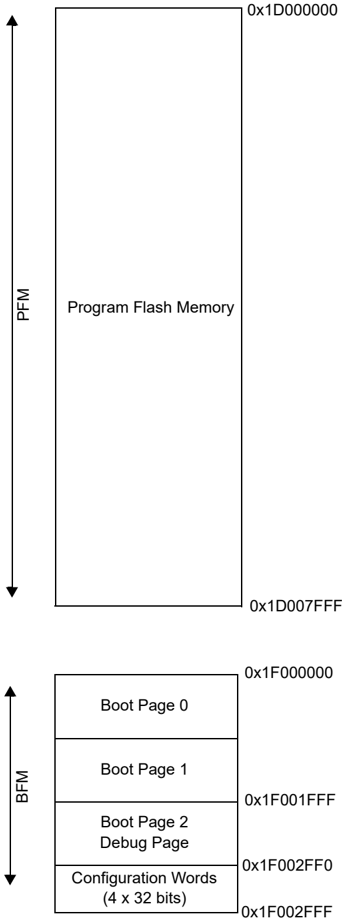

Note: The memory map shown is for reference only. Refer to the 'Memory Organization' chapter in the specific device data sheet for the memory map for your device.


## 23. Appendix B: HEX File Format

Flash programmers process the standard hexadecimal (hex) format used by the Microchip development tools. The format supported is the Intel ® HEX32 format (INHX32). Refer to Section 1.75 'Hex file Formats' in the MPASM ™ Assembler, MPLINK ™ Object Linker, MPLIB ™ Object Librarian User's Guide (DS33014).

The basic format of the hex file is:

- :BBAAAATTHHHH...HHHHCC

Each data record begins with a nine character prefix and always ends with a two character checksum. All records begin with : , regardless of the format. The individual elements are described below.

- BB : It is a two-digit hexadecimal byte count representing the number of data bytes that appear on the line. Divide this number by two to get the number of words per line.
- AAAA : It is a four-digit hexadecimal address representing the starting address of the data record. Format is high byte first followed by low byte.
- TT : It is a two-digit record type.
- -00 for data records
- -01 for end-of-file records
- -04 for extended-address record
- HHHH : It is a four-digit hexadecimal data word. Format is low byte followed by high byte. There will be BB /2 data words following TT .
- CC : It is a two-digit hexadecimal checksum that is the 2's complement of the sum of all the preceding bytes in the line record.

Because the Intel ® hex file format is byte-oriented but the 16-bit program counter is not, program memory sections require special treatment. Each 24-bit program word is extended to 32 bits by inserting a so called 'phantom byte'. Each program memory address is multiplied by 2 to yield a byte address.

As an example, a section that is located at 0x100 in program memory will be represented in the hex file as 0x200.

The hex file will be produced with the following contents:

- :020000040000fa
- :040200003322110096
- :00000001FF

The data record (second line) has a load address of 0200, while the source code specified address is 0x100. The data is represented in Little Endian (LE) format, that is the LSB appears first and the phantom byte appears last, before the checksum.


## 24. Appendix C: Device IDs

Table 24-1. PIC32MX320/340/360/440/460 Family Device IDs

| Part Number     | Device ID (1)   |
|-----------------|-----------------|
| PIC32MX360F512L | 0x0938053       |
| PIC32MX360F256L | 0x0934053       |
| PIC32MX340F128L | 0x092D053       |
| PIC32MX320F128L | 0x092A053       |
| PIC32MX340F512H | 0x0916053       |
| PIC32MX340F256H | 0x0912053       |
| PIC32MX340F128H | 0x090D053       |
| PIC32MX320F128H | 0x090A053       |
| PIC32MX320F064H | 0x0906053       |
| PIC32MX320F032H | 0x0902053       |
| PIC32MX460F512L | 0x0978053       |
| PIC32MX460F256L | 0x0974053       |
| PIC32MX440F128L | 0x096D053       |
| PIC32MX440F256H | 0x0952053       |
| PIC32MX440F512H | 0x0956053       |
| PIC32MX440F128H | 0x094D053       |
| PIC32MX420F032H | 0x0942053       |
| Note:           |                 |

Table 24-2. PIC32MX575/675/695/775/795 Family Device IDs

| Part Number     | Device ID (1)   |
|-----------------|-----------------|
| PIC32MX575F256H | 0x04317053      |
| PIC32MX675F256H | 0x0430B053      |
| PIC32MX775F256H | 0x04303053      |
| PIC32MX575F512H | 0x04309053      |
| PIC32MX675F512H | 0x0430C053      |
| PIC32MX695F512H | 0x04325053      |
| PIC32MX775F512H | 0x0430D053      |
| PIC32MX795F512H | 0x0430E053      |
| PIC32MX575F256L | 0x04333053      |
| PIC32MX675F256L | 0x04305053      |
| PIC32MX775F256L | 0x04312053      |
| PIC32MX575F512L | 0x0430F053      |
| PIC32MX675F512L | 0x04311053      |
| PIC32MX695F512L | 0x04341053      |
| PIC32MX775F512L | 0x04307053      |
| PIC32MX795F512L | 0x04307053      |
| Note:           |                 |


Table 24-3. PIC32MX534/564/664/764 Family Device IDs

| Part Number                                                                    | Device ID (1)                                                                  |
|--------------------------------------------------------------------------------|--------------------------------------------------------------------------------|
| PIC32MX534F064H                                                                | 0x04400053                                                                     |
| PIC32MX564F064H                                                                | 0x04401053                                                                     |
| PIC32MX564F128H                                                                | 0x04403053                                                                     |
| PIC32MX664F064H                                                                | 0x04405053                                                                     |
| PIC32MX664F128H                                                                | 0x04407053                                                                     |
| PIC32MX764F128H                                                                | 0x0440B053                                                                     |
| PIC32MX534F064L                                                                | 0x0440C053                                                                     |
| PIC32MX564F064L                                                                | 0x0440D053                                                                     |
| PIC32MX564F128L                                                                | 0x0440F053                                                                     |
| PIC32MX664F064L                                                                | 0x04411053                                                                     |
| PIC32MX664F128L                                                                | 0x04413053                                                                     |
| PIC32MX764F128L                                                                | 0x04417053                                                                     |
| Note:                                                                          |                                                                                |
| 1. The first four bits of the 32-bit device ID indicates the silicon revision. | 1. The first four bits of the 32-bit device ID indicates the silicon revision. |

Table 24-4. PIC32MX1XX/2XX 28/36/44-Pin Family Device IDs

| Part Number     | Device ID (1)   |
|-----------------|-----------------|
| PIC32MX110F016B | 0x04A07053      |
| PIC32MX110F016C | 0x04A09053      |
| PIC32MX110F016D | 0x04A0B053      |
| PIC32MX210F016B | 0x04A01053      |
| PIC32MX210F016C | 0x04A03053      |
| PIC32MX210F016D | 0x04A05053      |
| PIC32MX120F032B | 0x04A06053      |
| PIC32MX120F032C | 0x04A08053      |
| PIC32MX120F032D | 0x04A0A053      |
| PIC32MX220F032B | 0x04A00053      |
| PIC32MX220F032C | 0x04A02053      |
| PIC32MX220F032D | 0x04A04053      |
| PIC32MX130F064B | 0x04D07053      |
| PIC32MX130F064C | 0x04D09053      |
| PIC32MX130F064D | 0x04D0B053      |
| PIC32MX230F064B | 0x04D01053      |
| PIC32MX230F064C | 0x04D03053      |
| PIC32MX230F064D | 0x04D05053      |
| PIC32MX150F128B | 0x04D06053      |
| PIC32MX150F128C | 0x04D08053      |
| PIC32MX150F128D | 0x04D0A053      |
| PIC32MX250F128B | 0x04D00053      |
| PIC32MX250F128C | 0x04D02053      |
| PIC32MX250F128D | 0x04D04053      |
| PIC32MX170F256B | 0x06610053      |
| PIC32MX170F256D | 0x0661A053      |
| PIC32MX270F256B | 0x06600053      |
| PIC32MX270F256D | 0x0660A053      |


| ...........continued                                                 |               |
|----------------------------------------------------------------------|---------------|
| Part Number                                                          | Device ID (1) |
| PIC32MX270F256DB                                                     | 0x0660C053    |
| PIC32MX130F256B                                                      | 0x06703053    |
| PIC32MX130F256D                                                      | 0x06705053    |
| PIC32MX230F256B                                                      | 0x06700053    |
| PIC32MX230F256D                                                      | 0x06702053    |
| Note:                                                                |               |
| 1. The first four bits of the 32-bit device ID indicates the silicon | revision.     |

Table 24-5. PIC32MX330/350/370/430/450/470 Family Device IDs

| Part Number                                                                    | Device ID (1)                                                                  |
|--------------------------------------------------------------------------------|--------------------------------------------------------------------------------|
| PIC32MX330F064H                                                                | 0x05600053                                                                     |
| PIC32MX330F064L                                                                | 0x05601053                                                                     |
| PIC32MX350F256H                                                                | 0x05704053                                                                     |
| PIC32MX350F256L                                                                | 0x05705053                                                                     |
| PIC32MX430F064H                                                                | 0x05602053                                                                     |
| PIC32MX430F064L                                                                | 0x05603053                                                                     |
| PIC32MX450F256H                                                                | 0x05706053                                                                     |
| PIC32MX450F256L                                                                | 0x05707053                                                                     |
| PIC32MX350F128H                                                                | 0x0570C053                                                                     |
| PIC32MX350F128L                                                                | 0x0570D053                                                                     |
| PIC32MX450F128H                                                                | 0x0570E053                                                                     |
| PIC32MX450F128L                                                                | 0x0570F053                                                                     |
| PIC32MX370F512H                                                                | 0x05808053                                                                     |
| PIC32MX370F512L                                                                | 0x05809053                                                                     |
| PIC32MX470F512H                                                                | 0x0580A053                                                                     |
| PIC32MX470F512L                                                                | 0x0580B053                                                                     |
| PIC32MX450F256HB                                                               | 0x05710053                                                                     |
| PIC32MX470F512LB                                                               | 0x05811053                                                                     |
| Note:                                                                          |                                                                                |
| 1. The first four bits of the 32-bit device ID indicates the silicon revision. | 1. The first four bits of the 32-bit device ID indicates the silicon revision. |

Table 24-6. PIC32MZ Embedded Connectivity (EC) Family Device IDs

| Part Number       | Device ID (1)   |
|-------------------|-----------------|
| PIC32MZ1024ECG064 | 0x05103053      |
| PIC32MZ1024ECH064 | 0x05108053      |
| PIC32MZ1024ECM064 | 0x05130053      |
| PIC32MZ2048ECG064 | 0x05104053      |
| PIC32MZ2048ECH064 | 0x05109053      |
| PIC32MZ2048ECM064 | 0x05131053      |
| PIC32MZ1024ECG100 | 0x0510D053      |
| PIC32MZ1024ECH100 | 0x05112053      |
| PIC32MZ1024ECM100 | 0x0513A053      |
| PIC32MZ2048ECG100 | 0x0510E053      |
| PIC32MZ2048ECH100 | 0x05113053      |
| PIC32MZ2048ECM100 | 0x0513B053      |


| ...........continued   | (1)        |
|------------------------|------------|
| PIC32MZ1024ECG124      | 0x05117053 |
| PIC32MZ1024ECH124      | 0x0511C053 |
| PIC32MZ1024ECM124      | 0x05144053 |
| PIC32MZ2048ECG124      | 0x05118053 |
| PIC32MZ2048ECH124      | 0x0511D053 |
| PIC32MZ2048ECM124      | 0x05145053 |
| PIC32MZ1024ECG144      | 0x05121053 |
| PIC32MZ1024ECH144      | 0x05126053 |
| PIC32MZ1024ECM144      | 0x0514E053 |
| PIC32MZ2048ECG144      | 0x05122053 |
| PIC32MZ2048ECH144      | 0x05127053 |
| PIC32MZ2048ECM144      | 0x0514F053 |
| Note:                  |            |

Table 24-7. PIC32MX1XX/2XX/5XX 64/100-Pin Family Device IDs

| Part Number     | Device ID (1)   |
|-----------------|-----------------|
| PIC32MX150F256H | 0x06A10053      |
| PIC32MX150F256L | 0x06A11053      |
| PIC32MX170F512H | 0x06A30053      |
| PIC32MX170F512L | 0x06A31053      |
| PIC32MX250F256H | 0x06A12053      |
| PIC32MX250F256L | 0x06A13053      |
| PIC32MX270F512H | 0x06A32053      |
| PIC32MX270F512L | 0x06A33053      |
| PIC32MX550F256L | 0x06A15053      |
| PIC32MX570F512H | 0x06A34053      |
| PIC32MX570F512L | 0x06A35053      |
| PIC32MX120F064H | 0x06A50053      |
| PIC32MX130F128H | 0x06A00053      |
| PIC32MX130F128L | 0x06A01053      |
| PIC32MX230F128H | 0x06A02053      |
| PIC32MX230F128L | 0x06A03053      |
| PIC32MX530F128H | 0x06A04053      |
| PIC32MX530F128L | 0x06A05053      |
| Note:           |                 |

Table 24-8. PIC32MZ Embedded Connectivity with FPU (EF) Family Device IDs

| Part Number       | Device ID (1)   |
|-------------------|-----------------|
| PIC32MZ0512EFE064 | 0x07201053      |
| PIC32MZ0512EFF064 | 0x07206053      |
| PIC32MZ0512EFK064 | 0x0722E053      |
| PIC32MZ1024EFE064 | 0x07202053      |


| ...........continued Part Number   | Device ID (1)   |
|------------------------------------|-----------------|
| PIC32MZ1024EFF064                  | 0x07207053      |
| PIC32MZ1024EFK064                  | 0x0722F053      |
| PIC32MZ1024EFG064                  | 0x07203053      |
| PIC32MZ1024EFH064                  | 0x07208053      |
| PIC32MZ1024EFM064                  | 0x07230053      |
| PIC32MZ2048EFG064                  | 0x07204053      |
| PIC32MZ2048EFH064                  | 0x07209053      |
| PIC32MZ2048EFM064                  | 0x07231053      |
| PIC32MZ0512EFE100                  | 0x0720B053      |
| PIC32MZ0512EFF100                  | 0x07210053      |
| PIC32MZ0512EFK100                  | 0x07238053      |
| PIC32MZ1024EFE100                  | 0x0720C053      |
| PIC32MZ1024EFF100                  | 0x07211053      |
| PIC32MZ1024EFK100                  | 0x07239053      |
| PIC32MZ1024EFG100                  | 0x0720D053      |
| PIC32MZ1024EFH100                  | 0x07212053      |
| PIC32MZ1024EFM100                  | 0x0723A053      |
| PIC32MZ2048EFG100                  | 0x0720E053      |
| PIC32MZ2048EFH100                  | 0x07213053      |
| PIC32MZ2048EFM100                  | 0x0723B053      |
| PIC32MZ0512EFE124                  | 0x07215053      |
| PIC32MZ0512EFF124                  | 0x0721A053      |
| PIC32MZ0512EFK124                  | 0x07242053      |
| PIC32MZ1024EFE124                  | 0x07216053      |
| PIC32MZ1024EFF124                  | 0x0721B053      |
| PIC32MZ1024EFK124                  | 0x07243053      |
| PIC32MZ1024EFG124                  | 0x07217053      |
| PIC32MZ1024EFH124                  | 0x0721C053      |
| PIC32MZ1024EFM124                  | 0x07244053      |
| PIC32MZ2048EFG124                  | 0x07218053      |
| PIC32MZ2048EFH124                  | 0x0721D053      |
| PIC32MZ2048EFM124                  | 0x07245053      |
| PIC32MZ0512EFE144                  | 0x0721F053      |
| PIC32MZ0512EFF144                  | 0x07224053      |
| PIC32MZ0512EFK144                  | 0x0724C053      |
| PIC32MZ1024EFE144                  | 0x07220053      |
| PIC32MZ1024EFF144                  | 0x07225053      |
| PIC32MZ1024EFK144                  | 0x0724D053      |
| PIC32MZ1024EFG144                  | 0x07221053      |
| PIC32MZ1024EFH144                  | 0x07226053      |
| PIC32MZ1024EFM144                  | 0x0724E053      |
| PIC32MZ2048EFG144                  | 0x07222053      |
| PIC32MZ2048EFH144                  | 0x07227053      |
| PIC32MZ2048EFM144                  | 0x0724F053      |


| ...........continued      | ...........continued                                                        |
|---------------------------|-----------------------------------------------------------------------------|
| Part Number Device ID (1) | Part Number Device ID (1)                                                   |
| Note: 1.                  | The first four bits of the 32-bit device ID indicates the silicon revision. |

Table 24-9. PIC32MZ Graphics (DA) Family Device IDs

| Part Number       | Device ID (1)   |
|-------------------|-----------------|
| PIC32MZ1025DAA169 | 0x05F0C053      |
| PIC32MZ1025DAB169 | 0x05F0D053      |
| PIC32MZ1064DAA169 | 0x05F0F053      |
| PIC32MZ1064DAB169 | 0x05F10053      |
| PIC32MZ2025DAA169 | 0x05F15053      |
| PIC32MZ2025DAB169 | 0x05F16053      |
| PIC32MZ2064DAA169 | 0x05F18053      |
| PIC32MZ2064DAB169 | 0x05F19053      |
| PIC32MZ1025DAG169 | 0x05F42053      |
| PIC32MZ1025DAH169 | 0x05F43053      |
| PIC32MZ1064DAG169 | 0x05F45053      |
| PIC32MZ1064DAH169 | 0x05F46053      |
| PIC32MZ2025DAG169 | 0x05F4B053      |
| PIC32MZ2025DAH169 | 0x05F4C053      |
| PIC32MZ2064DAG169 | 0x05F4E053      |
| PIC32MZ2064DAH169 | 0x05F4F053      |
| PIC32MZ1025DAA176 | 0x05F78053      |
| PIC32MZ1025DAB176 | 0x05F79053      |
| PIC32MZ1064DAA176 | 0x05F7B053      |
| PIC32MZ1064DAB176 | 0x05F7C053      |
| PIC32MZ2025DAA176 | 0x05F81053      |
| PIC32MZ2025DAB176 | 0x05F82053      |
| PIC32MZ2064DAA176 | 0x05F84053      |
| PIC32MZ2064DAB176 | 0x05F85053      |
| PIC32MZ1025DAG176 | 0x05FAE053      |
| PIC32MZ1025DAH176 | 0x05FAF053      |
| PIC32MZ1064DAG176 | 0x05FB1053      |
| PIC32MZ1064DAH176 | 0x05FB2053      |
| PIC32MZ2025DAG176 | 0x05FB7053      |
| PIC32MZ2025DAH176 | 0x05FB8053      |
| PIC32MZ2064DAG176 | 0x05FBA053      |
| PIC32MZ2064DAH176 | 0x05FBB053      |
| PIC32MZ1025DAA288 | 0x05F5D053      |
| PIC32MZ1025DAB288 | 0x05F5E053      |
| PIC32MZ1064DAA288 | 0x05F60053      |
| PIC32MZ1064DAB288 | 0x05F61053      |
| PIC32MZ2025DAA288 | 0x05F66053      |
| PIC32MZ2025DAB288 | 0x05F67053      |
| PIC32MZ2064DAA288 | 0x05F69053      |
| PIC32MZ2064DAB288 | 0x05F6A053      |


| ...........continued                                                           | Device ID (1)                                                                  |
|--------------------------------------------------------------------------------|--------------------------------------------------------------------------------|
| PIC32MZ1025DAK169                                                              | 0x08A0C053                                                                     |
| PIC32MZ1025DAL169                                                              | 0x08A0D053                                                                     |
| PIC32MZ1064DAK169                                                              | 0x08A0F053                                                                     |
| PIC32MZ1064DAL169                                                              | 0x08A10053                                                                     |
| PIC32MZ2025DAK169                                                              | 0x08A15053                                                                     |
| PIC32MZ2025DAL169                                                              | 0x08A16053                                                                     |
| PIC32MZ2064DAK169                                                              | 0x08A18053                                                                     |
| PIC32MZ2064DAL169                                                              | 0x08A19053                                                                     |
| PIC32MZ1025DAR169                                                              | 0x08A42053                                                                     |
| PIC32MZ1025DAS169                                                              | 0x08A43053                                                                     |
| PIC32MZ1064DAR169                                                              | 0x08A45053                                                                     |
| PIC32MZ1064DAS169                                                              | 0x08A46053                                                                     |
| PIC32MZ2025DAR169                                                              | 0x08A4B053                                                                     |
| PIC32MZ2025DAS169                                                              | 0x08A4C053                                                                     |
| PIC32MZ2064DAR169                                                              | 0x08A4E053                                                                     |
| PIC32MZ2064DAS169                                                              | 0x08A4F053                                                                     |
| PIC32MZ1025DAK176                                                              | 0x08A78053                                                                     |
| PIC32MZ1025DAL176                                                              | 0x08A79053                                                                     |
| PIC32MZ1064DAK176                                                              | 0x08A7B053                                                                     |
| PIC32MZ1064DAL176                                                              | 0x08A7C053                                                                     |
| PIC32MZ2025DAK176                                                              | 0x08A81053                                                                     |
| PIC32MZ2025DAL176                                                              | 0x08A82053                                                                     |
| PIC32MZ2064DAK176                                                              | 0x08A84053                                                                     |
| PIC32MZ2064DAL176                                                              | 0x08A85053                                                                     |
| PIC32MZ1025DAR176                                                              | 0x08AAE053                                                                     |
| PIC32MZ1025DAS176                                                              | 0x08AAF053                                                                     |
| PIC32MZ1064DAR176                                                              | 0x08AB1053                                                                     |
| PIC32MZ1064DAS176                                                              | 0x08AB2053                                                                     |
| PIC32MZ2025DAR176                                                              | 0x08AB7053                                                                     |
| PIC32MZ2025DAS176                                                              | 0x08AB8053                                                                     |
| PIC32MZ2064DAR176                                                              | 0x08ABA053                                                                     |
| PIC32MZ2064DAS176                                                              | 0x08ABB053                                                                     |
| Note:                                                                          | Note:                                                                          |
| 1. The first four bits of the 32-bit device ID indicates the silicon revision. | 1. The first four bits of the 32-bit device ID indicates the silicon revision. |

Table 24-10. PIC32MX1XX/2XX 28/44-Pin XLP Family Device IDs

| Part Number     | Device ID (1)   |
|-----------------|-----------------|
| PIC32MX154F128B | 0x07800053      |
| PIC32MX154F128D | 0x07804053      |
| PIC32MX155F128B | 0x07808053      |
| PIC32MX155F128D | 0x0780C053      |
| PIC32MX174F256B | 0x07801053      |
| PIC32MX174F256D | 0x07805053      |
| PIC32MX175F256B | 0x07809053      |
| PIC32MX175F256D | 0x0780D053      |


| ...........continued   |            |
|------------------------|------------|
| PIC32MX254F128B        | 0x07802053 |
| PIC32MX254F128D        | 0x07806053 |
| PIC32MX255F128B        | 0x0780A053 |
| PIC32MX255F128D        | 0x0780E053 |
| PIC32MX274F256B        | 0x07803053 |
| PIC32MX274F256D        | 0x07807053 |
| PIC32MX275F256B        | 0x0780B053 |
| PIC32MX275F256D        | 0x0780F053 |
| Note:                  |            |

Table 24-11. PIC32MK General Purpose and Motor Control (GP/MC) Family Device IDs

| Part Number            | Device ID (1)   |
|------------------------|-----------------|
| PIC32MK1024MCF100      | 0x06201053      |
| PIC32MK1024MCF064      | 0x06202053      |
| PIC32MK0512MCF100      | 0x06204053      |
| PIC32MK0512MCF064      | 0x06205053      |
| PIC32MK1024GPE100      | 0x06207053      |
| PIC32MK1024GPE064      | 0x06208053      |
| PIC32MK0512GPE100      | 0x0620A053      |
| PIC32MK0512GPE064      | 0x0620B053      |
| PIC32MK1024GPD100      | 0x0620D053      |
| PIC32MK1024GPD064      | 0x0620E053      |
| PIC32MK0512GPD100      | 0x06210053      |
| PIC32MK0512GPD064      | 0x06211053      |
| Note:                  |                 |
| 1. The first four bits |                 |

Table 24-12. PIC32MK General Purpose and Motor Control (GP/MC) with ECC Flash Family Device IDs

| Part Number       | Device ID (1)   |
|-------------------|-----------------|
| PIC32MK1024MCM100 | 0x08B01053      |
| PIC32MK1024MCM064 | 0x08B02053      |
| PIC32MK0512MCM100 | 0x08B04053      |
| PIC32MK0512MCM064 | 0x08B05053      |
| PIC32MK1024GPL100 | 0x08B07053      |
| PIC32MK1024GPL064 | 0x08B08053      |
| PIC32MK0512GPL100 | 0x08B0A053      |
| PIC32MK0512GPL064 | 0x08B0B053      |
| PIC32MK1024GPK100 | 0x08B0D053      |
| PIC32MK1024GPK064 | 0x08B0E053      |
| PIC32MK0512GPK100 | 0x08B10053      |
| PIC32MK0512GPK064 | 0x08B11053      |
| PIC32MK0512MCJ064 | 0x06300053      |
| PIC32MK0512MCJ048 | 0x06301053      |
| PIC32MK0512MCJ040 | 0x06302053      |


| ...........continued Part Number   | Device ID (1)   |
|------------------------------------|-----------------|
| PIC32MK0256MCJ064                  | 0x06304053      |
| PIC32MK0256MCJ048                  | 0x06305053      |
| PIC32MK0256MCJ040                  | 0x06306053      |
| PIC32MK0512GPH064                  | 0x06308053      |
| PIC32MK0512GPH048                  | 0x06309053      |
| PIC32MK0512GPH040                  | 0x0630A053      |
| PIC32MK0256GPH064                  | 0x0630C053      |
| PIC32MK0256GPH048                  | 0x0630D053      |
| PIC32MK0256GPH040                  | 0x0630E053      |
| PIC32MK0512GPG064                  | 0x06318053      |
| PIC32MK0512GPG048                  | 0x06319053      |
| PIC32MK0512GPG040                  | 0x0631A053      |
| PIC32MK0256GPG064                  | 0x0631C053      |
| PIC32MK0256GPG048                  | 0x0631D053      |
| PIC32MK0256GPG040                  | 0x0631E053      |
| Note:                              |                 |

Table 24-13. PIC32MZ W1 Wi-Fi ®  Connectivity Family Device IDs

| Part Number                                                                                         | Device ID (1)                                                                                       |
|-----------------------------------------------------------------------------------------------------|-----------------------------------------------------------------------------------------------------|
| PIC32MZ1025W104132 (2)                                                                              | 0x08C03053                                                                                          |
|                                                                                                     | 0X0A403053                                                                                          |
| PIC32MZ2051W104132                                                                                  | 0X0A603053                                                                                          |
| Notes:                                                                                              |                                                                                                     |
| 1. The first four bits of the 32-bit device ID indicates the silicon revision.                      | 1. The first four bits of the 32-bit device ID indicates the silicon revision.                      |
| 2. The part has two Mask IDs. The bits 27 through 20 of the 32-bit device ID indicates the Mask ID. | 2. The part has two Mask IDs. The bits 27 through 20 of the 32-bit device ID indicates the Mask ID. |


## 25. Document Revision History

The revision history describes the changes that were implemented in the document. The changes are listed by revision, starting with the most current publication.

Table 25-1. Document Revision History

| Revision   | Date    | Section                                     | Description                                                                                                                                                                                                                                                                                             |
|------------|---------|---------------------------------------------|---------------------------------------------------------------------------------------------------------------------------------------------------------------------------------------------------------------------------------------------------------------------------------------------------------|
| AB         | 11/2024 | Appendix C: Device IDs                      | Updated Table 24-13 with device IDs.                                                                                                                                                                                                                                                                    |
| AB         | 11/2024 | Mask Values                                 | Updated with Flash Memory Sizes (KB) in Table 18-1                                                                                                                                                                                                                                                      |
| AB         | 11/2024 | Flash Memory                                | Updated Table 5-1 with new Flash Memory address ranges for PIC32MZ W1                                                                                                                                                                                                                                   |
| AA         | 07/2021 | Device Configuration for PIC32MZ W1 Devices | Updated Table 19-6 with new physical address                                                                                                                                                                                                                                                            |
| Y          | 09/2020 | Appendix C: Device IDs                      | Added Table 24-13 with PIC32MZ W1 Wi-Fi ® Connectivity Family Device ID                                                                                                                                                                                                                                 |
| Y          | 09/2020 | Mask Values                                 | Updated PIC32MZ W1 device information in Table 18-1                                                                                                                                                                                                                                                     |
| Y          | 09/2020 | Device Configuration for PIC32MZ W1 Devices | Added section                                                                                                                                                                                                                                                                                           |
| Y          | 09/2020 | Flash Memory                                | • Updated section with PIC32MZ W1 information • Added note that applies to the PIC32MZ W1 devices                                                                                                                                                                                                       |
| Y          | 09/2020 | PIC32MZ W1 Power Requirements               | Added section                                                                                                                                                                                                                                                                                           |
| X          | 11/2019 | Algorithm                                   | Updated Equation 18-1 with PIC32MKXXXXGPD/GPE/MCFXXX device information                                                                                                                                                                                                                                 |
| X          | 11/2019 | Mask Values                                 | Updated PIC32MKXXXXGPD/GPE/MCFXXX device information in Table 18-1                                                                                                                                                                                                                                      |
| X          | 11/2019 | Theory                                      | Added a new note that applies to PIC32MKXXXXGPD/GPE/MCFXXX devices                                                                                                                                                                                                                                      |
| W          | 10/2018 | Document                                    | The following are the updates: • Added note below Table 13-1 and Table 14-1 • Moved content from Table C-13 to Table 24-9                                                                                                                                                                               |
| V          | 07/2018 | Appendix C: Device IDs                      | • Removed references to PIC32MKXXXXMCM/GPL/GPKXXX and PIC32MKXXXXMCH/GPGXXX in Table 24-11 • Rearranged PIC32MKXXXX/MCM/ GPL/GPKXXX devices in Table 24-12 • Added PIC32MKXXXX- MCJ/GPH/GPGXXX devices in Table 24-12 • Added note reference to the revision ID has been from Table 24-1 to Table 24-12 |
| V          | 07/2018 | Device Configuration                        | Renamed family name from PIC32MKXXXXXXG/H/K/L/MXX to PIC32MKXXXXXXH/G/J/K/L/MXX in Table 19-5                                                                                                                                                                                                           |
| V          | 07/2018 | Mask Values                                 | Renamed PIC32MK0256/0512XXG/H to PIC32MK0256/0512XXH/G/J. Also, updated Device Configuration register mask values for PIC32MK0512/1024XXK/L/M and PIC32MK0512/1024XXH/G/J in Table 18-1                                                                                                                 |
| U          | 07/2017 | Document                                    | The following are the updates: • Minor updates to text and formatting were incorporated throughout the document • Updated the PIC32MK devices in Devices with Dual Flash Panel and Dual Boot Regions • Updated Table 5-1, Table 18-1, Table 19-4 and Table 24-11 • Added Table 19-5                     |


| ...........continued   | Revision Date   | Section                                                                                                                                                                                                  | Description                                                                                                                                                                                                                                                                                                                  |
|------------------------|-----------------|----------------------------------------------------------------------------------------------------------------------------------------------------------------------------------------------------------|------------------------------------------------------------------------------------------------------------------------------------------------------------------------------------------------------------------------------------------------------------------------------------------------------------------------------|
| T                      | 05/2017         | Document                                                                                                                                                                                                 | The following are the updates: • Minor updates to text and formatting were incorporated throughout the document • Updated Figure 4-1, Figure 4-2 and Figure 5-2 • Updated Table 4-1, Table 4-2 and Table 20-1 • Added Table 24-12                                                                                            |
| S                      | 09/2016         | Appendix C: Device IDs Document                                                                                                                                                                          | Added Table 24-1 through Table 24-11 The following are the updates: • Updated Figure 4-1, Figure 4-5 and Figure 5-2 • Updated Table 4-1, Table 4-2 and Table 21-1                                                                                                                                                            |
| R                      | 04/2016         | Table 21-1                                                                                                                                                                                               | Added parameters D112 (V DD1V8 ) and D115 (I DD1V8P )                                                                                                                                                                                                                                                                        |
|                        |                 | • PIC32MX With VBAT Pin Power • PIC32MZ EC and PIC32MZ EF Power Requirements • PIC32MZ DA Power Requirements • PIC32MK Power Requirements • Synchronization • Synchronize (Synchronize) Pseudo Operation | Added section                                                                                                                                                                                                                                                                                                                |
|                        |                 | Document                                                                                                                                                                                                 | The following are the updates: • Updated Figure 4-1, Figure 4-4, Figure 4-5, Figure 5-2, Figure 16-1, Figure 16-2 • Updated Table 4-1, Table 4-2, Table 5-1, Table 13-1 and Table 18-1 • Updated PIC32MX Power Requirements • Updated Four-Wire Interface • Updated Two-Wire Interface • Updated Note 1 in the Equation 18-1 |
| Q                      | 07/2015         | Device Configuration                                                                                                                                                                                     | Updated Table 19-3 to include DEVCFG4                                                                                                                                                                                                                                                                                        |
|                        |                 | Algorithm                                                                                                                                                                                                | Updated Equation 18-1                                                                                                                                                                                                                                                                                                        |
|                        |                 | Table 18-1                                                                                                                                                                                               | Updated to include DEVCFG4                                                                                                                                                                                                                                                                                                   |
|                        |                 | Initiating a Flash Row Write                                                                                                                                                                             | Added section                                                                                                                                                                                                                                                                                                                |
| P                      | 10/2014         | Device Configuration                                                                                                                                                                                     | Added Table 19-4                                                                                                                                                                                                                                                                                                             |
|                        |                 | Example of Checksum Calculation                                                                                                                                                                          | Removed Table 18-4: Device IDs and Revision as this information is readily available in the current Family Silicon Errata                                                                                                                                                                                                    |
|                        |                 | • Table 5-1 • Table 18-1                                                                                                                                                                                 | Updated to include PIC32MK device information                                                                                                                                                                                                                                                                                |
|                        |                 | Document                                                                                                                                                                                                 | Note: The revision history in this document intentionally skips from Revision N to Revision P to avoid confusing the uppercase letter 'O' with the number zero (0).                                                                                                                                                          |


| ...........continued   | ...........continued   | ...........continued                               | ...........continued                                                                                                                                                                                                                                                                                                                                                                                              |
|------------------------|------------------------|----------------------------------------------------|-------------------------------------------------------------------------------------------------------------------------------------------------------------------------------------------------------------------------------------------------------------------------------------------------------------------------------------------------------------------------------------------------------------------|
| Revision Date          | Revision Date          | Section                                            | Description                                                                                                                                                                                                                                                                                                                                                                                                       |
| N                      | 04/2014                | Appendix C: Device IDs                             | The Revision ID and Silicon Revision column was updated and the following = devices were added to the Device IDs and Revision table (see Table 24-4): • PIC32MX170F256B → PIC32MX350F256H • PIC32MX170F256D → PIC32MX350F256L • PIC32MX270F256B → PIC32MX430F064H • PIC32MX270F256D → PIC32MX430F064L • PIC32MX330F064H → PIC32MX450F128H • PIC32MX330F064L → PIC32MX450F128L • PIC32MX350F128H → PIC32MX450F256H |
| N                      |                        | Erasing the Device                                 | Updated delay value in Step 5                                                                                                                                                                                                                                                                                                                                                                                     |
| N                      |                        | Two-Wire Interface                                 | Updated Note 2 in Table 4-2                                                                                                                                                                                                                                                                                                                                                                                       |
| N                      |                        | Four-Wire Interface                                | Updated Note 2 in Table 4-1                                                                                                                                                                                                                                                                                                                                                                                       |
| M                      | 09/2013                | Device Configuration                               | Updated Device IDs and Revision in Table 19-4                                                                                                                                                                                                                                                                                                                                                                     |
| M                      | 09/2013                | Algorithm                                          | Removed the first sentence in the fourth paragraph                                                                                                                                                                                                                                                                                                                                                                |
| M                      | 09/2013                | Mask Values                                        | Updated Device Configuration Register Mask Values in Table 18-1                                                                                                                                                                                                                                                                                                                                                   |
| M                      | 09/2013                | Quad Word Program (QUAD_WORD_PROGRAM) Command      | Updated the Op code description in Table 17-17                                                                                                                                                                                                                                                                                                                                                                    |
| M                      | 09/2013                | Without the PE                                     | • Added a new paragraph • Updated Step 2, 3 and 5 in Table 13-1                                                                                                                                                                                                                                                                                                                                                   |
| M                      | 09/2013                | Downloading the Programming Executive (PE)         | Updated Steps 1, 2, 3 and 5 in Table 11-1                                                                                                                                                                                                                                                                                                                                                                         |
| M                      | 09/2013                | Flash Memory                                       | Updated Code Memory Sizes and added Note 3 (see Table 5-1)                                                                                                                                                                                                                                                                                                                                                        |
| M                      | 09/2013                | • Programming Overview • Flash Memory • Figure 9-1 | Updated section All references to MIPS Technologies Inc. and www.mips.com                                                                                                                                                                                                                                                                                                                                         |
| M                      | 09/2013                | Document                                           | were updated to Imagination Technologies Limited and www.imgtec.com,respectively                                                                                                                                                                                                                                                                                                                                  |
| L                      | 01/2013                | Device Configuration                               | • Updated all addresses in DEVCFG locations (see Table 19-1 and Table 19-2) • Added configuration word locations for PIC32MZEC family devices                                                                                                                                                                                                                                                                     |
| L                      | 01/2013                | Command Format                                     | Added Note 3 and Note 4 (see Table 17-2): • GET_CHECKSUM • QUAD_WORD_PRGM                                                                                                                                                                                                                                                                                                                                         |


| ...........continued Revision Date Section                                                                                                                     | Description                                                                                                                                                                                                                                                                                                                                                                                                                                                                                                                                                                                                                                                                                                                                                                                                                                                                                                                   |
|----------------------------------------------------------------------------------------------------------------------------------------------------------------|-------------------------------------------------------------------------------------------------------------------------------------------------------------------------------------------------------------------------------------------------------------------------------------------------------------------------------------------------------------------------------------------------------------------------------------------------------------------------------------------------------------------------------------------------------------------------------------------------------------------------------------------------------------------------------------------------------------------------------------------------------------------------------------------------------------------------------------------------------------------------------------------------------------------------------|
| Flash Memory                                                                                                                                                   | Added the following new devices to the Code Memory Size table (see Table 5-1) and the Device IDs and Revision table (see Table 24-4): • PIC32MZ0256ECE064 → PIC32MZ1024ECF064 • PIC32MZ0256ECE100 → PIC32MZ1024ECF100 • PIC32MZ0256ECE124 → PIC32MZ1024ECF124 • PIC32MZ0256ECE144 → PIC32MZ1024ECF144 • PIC32MZ0256ECF064 → PIC32MZ1024ECG064 • PIC32MZ0256ECF100 → PIC32MZ1024ECG100 • PIC32MZ0256ECF124 → PIC32MZ1024ECG124 • PIC32MZ0256ECF144 → PIC32MZ1024ECG144 • PIC32MZ0512ECE064 → PIC32MZ1024ECH064 • PIC32MZ0512ECE100 → PIC32MZ1024ECH100 • PIC32MZ0512ECE124 → PIC32MZ1024ECH124 • PIC32MZ0512ECE144 → PIC32MZ1024ECH144 • PIC32MZ0512ECF064 → PIC32MZ2048ECG064 • PIC32MZ0512ECF100 → PIC32MZ2048ECG100 • PIC32MZ0512ECF124 → PIC32MZ2048ECG124 • PIC32MZ0512ECF144 → PIC32MZ2048ECG144 • PIC32MZ1024ECE064 → PIC32MZ2048ECH064 • PIC32MZ1024ECE100 → PIC32MZ2048ECH100 • PIC32MZ1024ECE124 → PIC32MZ2048ECH124 |
| Mask Values                                                                                                                                                    | Updated Device Configuration Register Mask Values in Table 18-1                                                                                                                                                                                                                                                                                                                                                                                                                                                                                                                                                                                                                                                                                                                                                                                                                                                               |
| • PIC32MX Power Requirements • Initiating a Flash Row Write • Two-Wire ICSP EJTAG Rate • Device Code Protection Bit (CP) • Program Write Protection (PWP) Bits | Updated section                                                                                                                                                                                                                                                                                                                                                                                                                                                                                                                                                                                                                                                                                                                                                                                                                                                                                                               |
| • Devices with Dual Flash Panel and Dual Boot Regions • Get Checksum (GET_CHECKSUM) Command • Quad Word Program (QUAD_WORD_PROGRAM) Command                    | Added section                                                                                                                                                                                                                                                                                                                                                                                                                                                                                                                                                                                                                                                                                                                                                                                                                                                                                                                 |
| Document                                                                                                                                                       | • All references to Test mode were updated to Programming mode throughout the document • Minor updates to text and formatting were incorporated through the document                                                                                                                                                                                                                                                                                                                                                                                                                                                                                                                                                                                                                                                                                                                                                          |
| K 07/2012 AC/DC Characteristics and Timing Requirements                                                                                                        | • Removed parameter D112 • Replaced Notes 1 and 2 with a new Note 1 • Updated parameters D111, D113, D114, D031, D041, D080, D090, D012, D013, P11, P12 and P13                                                                                                                                                                                                                                                                                                                                                                                                                                                                                                                                                                                                                                                                                                                                                               |


| ...........continued Revision Date   | Section                                                                                                                                                                  | Description                                                                                                                                                                                                                                                                                                                                                                                                                          |
|--------------------------------------|--------------------------------------------------------------------------------------------------------------------------------------------------------------------------|--------------------------------------------------------------------------------------------------------------------------------------------------------------------------------------------------------------------------------------------------------------------------------------------------------------------------------------------------------------------------------------------------------------------------------------|
|                                      | ECR: EJTAG Control Register                                                                                                                                              | Added register                                                                                                                                                                                                                                                                                                                                                                                                                       |
|                                      | Device Code Protection Bit (CP)                                                                                                                                          | Added a Note                                                                                                                                                                                                                                                                                                                                                                                                                         |
|                                      | Flash Memory                                                                                                                                                             | Added the following new devices to the Code Memory Size table (see Table 5-1) and the Device IDs and Revision table (see Table 24-4): • PIC32MX420F032H → PIC32MX450F128 • PIC32MX330F064H → PIC32MX440F256H • PIC32MX330F064L → PIC32MX450F256H • PIC32MX430F064H → PIC32MX450F256L • PIC32MX430F064L → PIC32MX460F256L • PIC32MX340F128H → PIC32MX340F512H • PIC32MX340F128L → PIC32MX360F512H • PIC32MX350F128H → PIC32MX370F512H |
|                                      | Completing the PIC32 Checksum Calculation                                                                                                                                | Updated the Checksum Calculation Process (see Completing the PIC32 Checksum Calculation)                                                                                                                                                                                                                                                                                                                                             |
|                                      | Calculating for 'DCR' in the Checksum Formula                                                                                                                            | Updated the DCR value and Table 18-2                                                                                                                                                                                                                                                                                                                                                                                                 |
|                                      | The PE Command Set                                                                                                                                                       | PIC32MX2XX devices, and DEVCFG3 for all devices in Table 18-1 Added references to the Operand field throughout the section                                                                                                                                                                                                                                                                                                           |
|                                      | Programming Executive                                                                                                                                                    | Added a note regarding the PE location                                                                                                                                                                                                                                                                                                                                                                                               |
|                                      | Verifying Memory without the PE                                                                                                                                          | Updated Step 1 in Verify Device OP Codes (see Table 14-1)                                                                                                                                                                                                                                                                                                                                                                            |
|                                      | Without the PE                                                                                                                                                           | Updated Step 3 in Initiate Flash Row Write OP Codes (see Table 13-1)                                                                                                                                                                                                                                                                                                                                                                 |
|                                      | Two-Wire Interface                                                                                                                                                       | Updated step 11                                                                                                                                                                                                                                                                                                                                                                                                                      |
|                                      | Entering Serial Execution Mode PIC32MX Power Requirements                                                                                                                | Updated Figure 10-1 Added Note 2 to Connections for the On-chip Regulator (see 4-2)                                                                                                                                                                                                                                                                                                                                                  |
|                                      | Two-Wire Interface Four-Wire Interface                                                                                                                                   | Figure Added Note 2 to the 2-wire Interface Pins tables (see Table 4-2)                                                                                                                                                                                                                                                                                                                                                              |
|                                      | • Connecting to the Device • Entering Two-Wire Enhanced ICSP Mode • With the PE • Four-Wire Interface • Two-Wire Interface • Program (Program) Command • ETAP EJTAG Boot | Added Note 2 to the 4-wire Interface Pins tables (see Table 4-1) Updated section                                                                                                                                                                                                                                                                                                                                                     |
|                                      | Data Sizes                                                                                                                                                               | Added section                                                                                                                                                                                                                                                                                                                                                                                                                        |
|                                      | Introduction                                                                                                                                                             |                                                                                                                                                                                                                                                                                                                                                                                                                                      |
|                                      |                                                                                                                                                                          | Updated with a list of all major topics in this                                                                                                                                                                                                                                                                                                                                                                                      |
|                                      |                                                                                                                                                                          | document                                                                                                                                                                                                                                                                                                                                                                                                                             |


| ...........continued Date Section         | Description                                                                                                                                                                                                                                                                                                                                                                                                                                          |
|-------------------------------------------|------------------------------------------------------------------------------------------------------------------------------------------------------------------------------------------------------------------------------------------------------------------------------------------------------------------------------------------------------------------------------------------------------------------------------------------------------|
| Document                                  | • Minor updates to text and formatting were incorporated through the document • All occurrences of PGC and PGD were changed to: PGEC and PGED, respectively                                                                                                                                                                                                                                                                                          |
| 08/2011                                   | Timing The following changes were made to the AC/DC Characteristics and Timing Requirements (Table 21-1): • Updated the Min. value for parameter D111 (V DD ) • Added parameter D114 (I PEAK ) • Removed parameters P2, P3, P4, P4A, P5, P8 and P10                                                                                                                                                                                                  |
| Mask Values                               | Updated the DEVCFG0 and DEVCFG1 values for All PIC32MX1XX and All PIC32MX2XX devices in Table 18-1                                                                                                                                                                                                                                                                                                                                                   |
| Change CFG (CHANGE_CFG) Command           | Added a note after the CHANGE_CFG response (see Figure 17-27)                                                                                                                                                                                                                                                                                                                                                                                        |
| Program Cluster (PROGRAM_CLUSTER) Command | Updated the address and length descriptions in the PROGRAM_CLUSTER format (see Table 16-13)                                                                                                                                                                                                                                                                                                                                                          |
| Get CRC (GET_CRC) Command                 | Added section                                                                                                                                                                                                                                                                                                                                                                                                                                        |
| Command Format                            | Updated the PE Command Set with the following commands and modified Note 2 (see Table 16-2): • PROGRAM_CLUSTER • GET_DEVICEID • CHANGE_CFG                                                                                                                                                                                                                                                                                                           |
| Two-Wire Interface                        | Updated the MCLR signal in Two-Wire Exit Test Mode (see Figure 16-2)                                                                                                                                                                                                                                                                                                                                                                                 |
| Erasing the Device                        | • Updated the Erase Device block diagram (see Figure 9-1) • Added a new step 4 to the process to erase a target device                                                                                                                                                                                                                                                                                                                               |
| Entering Two-Wire Enhanced Mode           | ICSP Updated the PGCx signal in Entering Enhanced ICSP Mode (see Figure 7-1)                                                                                                                                                                                                                                                                                                                                                                         |
| Flash Memory                              | • Added the following new devices to the Code Memory Size table (see Table 5-1) and the Device IDs and Revision table (see Table 24-4): - PIC32MX130F064B - PIC32MX130F064C - PIC32MX130F064D - PIC32MX150F128B - PIC32MX150F128C - PIC32MX150F128D - PIC32MX230F064B - PIC32MX230F064C - PIC32MX230F064D - PIC32MX250F128B - PIC32MX250F128C - PIC32MX250F128D • Added Row Size and Page Size columns to the Code Memory Size table (see Table 5-1) |
| Two-Wire Interface                        | Removed the column, Programmer Pin Name, from the 2-Wire Interface Pins table and updated the Pin Type for MCLR (see Table 4-2)                                                                                                                                                                                                                                                                                                                      |


| ...........continued   | ...........continued   | ...........continued   | ...........continued                                                                                                                                                                                                                                                                                                                                                                                                                |
|------------------------|------------------------|------------------------|-------------------------------------------------------------------------------------------------------------------------------------------------------------------------------------------------------------------------------------------------------------------------------------------------------------------------------------------------------------------------------------------------------------------------------------|
| Revision               | Date                   | Section                | Description                                                                                                                                                                                                                                                                                                                                                                                                                         |
|                        |                        | Programming Overview   | Updated the fourth paragraph                                                                                                                                                                                                                                                                                                                                                                                                        |
|                        |                        | Document               | Note: The revision history in this document, intentionally skips from Revision H to Revision J to avoid confusing the uppercase letter 'I' (EY) with the lowercase letter 'l' (EL). This revision includes the following updates: • Minor updates to text and formatting were incorporated throughout the document • All occurrences of VCORE/VCAP have been changed to VCAP • Removed Appendix C: 'Flash Program Memory Data Sheet |
|                        |                        |                        | Clarification'                                                                                                                                                                                                                                                                                                                                                                                                                      |


| ...........continued   | ...........continued   | ...........continued                           |                                                                                                                                                                                                                                                                                                                                                                                                                                                                                                                                                                             |
|------------------------|------------------------|------------------------------------------------|-----------------------------------------------------------------------------------------------------------------------------------------------------------------------------------------------------------------------------------------------------------------------------------------------------------------------------------------------------------------------------------------------------------------------------------------------------------------------------------------------------------------------------------------------------------------------------|
| Revision Date          | Revision Date          | Section                                        | Description                                                                                                                                                                                                                                                                                                                                                                                                                                                                                                                                                                 |
| H                      | 04/2011                | Appendix A: PIC32 Flash Memory Map             | Added a note to the Flash Memory Map (see Figure 22-1)                                                                                                                                                                                                                                                                                                                                                                                                                                                                                                                      |
|                        |                        | MCHP Status Value Register                     | Added the NVMERR bit to the MCHP Status Value table                                                                                                                                                                                                                                                                                                                                                                                                                                                                                                                         |
|                        |                        | Configuration Memory and Device ID             | • Removed Table 18-1 and updated Table 18-2: DEVID Summary as Table 18-1 • The following Silicon Revision and Revision ID are added to Table 18-4: - 0x5- B6 Revision                                                                                                                                                                                                                                                                                                                                                                                                       |
|                        |                        | Checksum Values while Device is Code-Protected | Added section                                                                                                                                                                                                                                                                                                                                                                                                                                                                                                                                                               |
|                        |                        | Appendix C: Device IDs                         | The following devices were added in Table 24-4: • PIC32MX110F016B • PIC32MX110F016C • PIC32MX110F016D • PIC32MX120F032B • PIC32MX120F032C • PIC32MX120F032D • PIC32MX210F016B • PIC32MX210F016C • PIC32MX210F016D • PIC32MX220F032B • PIC32MX220F032C                                                                                                                                                                                                                                                                                                                       |
|                        |                        | Document                                       | • Updates to formatting and minor typographical changes have been incorporated throughout the document • The following rows were added to Table 17-1: - PIC32MX1X0 - PIC32MX2X0 • Removed Register 18-1 through Register 18-5. • Removed Table 17-2 • Removed Section 17.5 'Checksum for PIC32 Devices' and its sub sections • The Flash Program Memory Write-Protect Range stable was removed (formerly Table 18-4) • Added DEVCFG Locations for PIC32MX1X0 and PIC32MX20X Devices Only (see Table 18-3) • Added Appendix C: Flash Program Memory Data Sheet Clarification |
| G                      | 08/2010                | Downloading the Programming Executive (PE)     | Updated step 3 in Table 11-1 (Downloading the PE)                                                                                                                                                                                                                                                                                                                                                                                                                                                                                                                           |
|                        |                        | Document                                       | Minor corrections to formatting changes throughout the document                                                                                                                                                                                                                                                                                                                                                                                                                                                                                                             |


| ...........continued   | ...........continued                | ...........continued                                                                                                                                                                                                                                                                                                                                                                                                     | ...........continued   |
|------------------------|-------------------------------------|--------------------------------------------------------------------------------------------------------------------------------------------------------------------------------------------------------------------------------------------------------------------------------------------------------------------------------------------------------------------------------------------------------------------------|------------------------|
| Revision Date          | Section                             | Description                                                                                                                                                                                                                                                                                                                                                                                                              |                        |
| F                      | 04/2010 Appendix C: Device IDs      | • Added the following devices: - PIC32MX534F064H - PIC32MX534F064L - PIC32MX564F064H - PIC32MX564F064L - PIC32MX564F128H - PIC32MX564F128L - PIC32MX575F256L - PIC32MX664F064H - PIC32MX664F064L - PIC32MX664F128H - PIC32MX664F128L - PIC32MX675F256H - PIC32MX675F256L - PIC32MX695F512H - PIC32MX605F512L - PIC32MX764F128H - PIC32MX764F128L - PIC32MX775F256H - PIC32MX775F256L - PIC32MX775F512H - PIC32MX775F512L |                        |
|                        | Initiating a Page Erase             | Updated the Initiate Flash Row Write Op Codes and instructions (see                                                                                                                                                                                                                                                                                                                                                      |                        |
|                        |                                     | steps 4, 5 and 6 in Table 13-1)                                                                                                                                                                                                                                                                                                                                                                                          |                        |
|                        | 2-phase ICSP                        | Updated the note                                                                                                                                                                                                                                                                                                                                                                                                         |                        |
|                        | Programming Overview                | Updated the PIC32MX family data sheet references in the fourth paragraph                                                                                                                                                                                                                                                                                                                                                 |                        |
|                        | Document                            | This version of the document includes the following additions and updates: • The following global bit name changes were made: - NVMWR renamed as WR - NVMWREN renamed as WREN - NVMERR renamed as WRERR - FVBUSIO renamed as FVBUSONIO - FUPLLEN renamed as UPLLEN - FUPLLIDIV renamed as UPLLIDIV POSCMOD                                                                                                               |                        |
|                        |                                     | - POSCMD renamed as                                                                                                                                                                                                                                                                                                                                                                                                      |                        |
| E                      | 07/2009 Appendix B: HEX File Format | Added chapter                                                                                                                                                                                                                                                                                                                                                                                                            |                        |


| ...........continued Revision Date   | Section                                    | Description                                                                                                                                                                                                                                                                                                                                                                |
|--------------------------------------|--------------------------------------------|----------------------------------------------------------------------------------------------------------------------------------------------------------------------------------------------------------------------------------------------------------------------------------------------------------------------------------------------------------------------------|
|                                      | Checksum                                   | • Added Notes 1-3 and the following bits to the DEVCFG - Device Configuration Word Summary and the DEVCFG3: Device Configuration Word 3 (see Table 18-1 and Register): - FVBUSIO - FUSBIDIO - FCANIO - FETHIO - FMIIEN - FPBDIV[1:0] - FJTAGEN                                                                                                                             |
|                                      | Programming Executive                      | • Added the following devices to Table 17-5: - PIC32MX565F256H - PIC32MX575F512H - PIC32MX575F512L - PIC32MX675F512H - PIC32MX675F512L - PIC32MX795F512H - PIC32MX795F512L • Updated address values in Table 17-2 • Added the following devices to Table 24-2: - PIC32MX565F256H - PIC32MX575F512H - PIC32MX675F512H - PIC32MX795F512H - PIC32MX575F512L - PIC32MX675F512L |
|                                      | Initiating a Page Erase                    | The following instructions in Table 13-1 were updated: • Seventh, ninth and eleventh instructions in Step 1 • All instructions in Step 2 • First instruction in Step 3 • Third instruction in Step 4                                                                                                                                                                       |
|                                      | Downloading the Programming Executive (PE) | Updated Step 7 of Table 11-1 to clarify repeat of the last instruction in the step                                                                                                                                                                                                                                                                                         |
|                                      | Entering Two-Wire Enhanced ICSP Mode       | Updated MCLR pulse line to show active-high (P20) in Figure 7-1                                                                                                                                                                                                                                                                                                            |


| ...........continued   |         | Section   | Description                                                                                                                                                                                                                                                                                                                                                                                                                                                                                                                                                                      |
|------------------------|---------|-----------|----------------------------------------------------------------------------------------------------------------------------------------------------------------------------------------------------------------------------------------------------------------------------------------------------------------------------------------------------------------------------------------------------------------------------------------------------------------------------------------------------------------------------------------------------------------------------------|
|                        |         | Document  | • Minor changes to style and formatting have been incorporated throughout the document • Added the following devices: - PIC32MX565F256H - PIC32MX575F512H - PIC32MX675F512H - PIC32MX795F512H - PIC32MX575F512L - PIC32MX675F512L - PIC32MX795F512L • Updated the DEVID Summary (see Table 18-1) • Updated ICESEL bit description and added the FJTAGEN bit in DEVCFG0: Device Configuration Word 0 (see Register 16-1) • Updated DEVID: Device and Revision ID register • Added Device IDs and Revision table (Table 18-4) • Added MCLR High Time (parameter P20) to Table 20-1 |
| D                      | 05/2008 | Document  | Update records for this revision are not available                                                                                                                                                                                                                                                                                                                                                                                                                                                                                                                               |
| C                      | 04/2008 | Document  | Update records for this revision are not available                                                                                                                                                                                                                                                                                                                                                                                                                                                                                                                               |
| B                      | 02/2008 | Document  | Update records for this revision are not available                                                                                                                                                                                                                                                                                                                                                                                                                                                                                                                               |
| A                      | 08/2007 | Document  | Initial Revision                                                                                                                                                                                                                                                                                                                                                                                                                                                                                                                                                                 |


## Microchip Information

## Trademarks

The 'Microchip' name and logo, the 'M' logo, and other names, logos, and brands are registered and unregistered trademarks of Microchip Technology Incorporated or its affiliates and/or subsidiaries in the United States and/or other countries ('Microchip Trademarks'). Information regarding Microchip Trademarks can be found at https://www.microchip.com/en-us/about/legalinformation/microchip-trademarks.

ISBN: 978-1-6683-0455-6

## Legal Notice

This publication and the information herein may be used only with Microchip products, including to design, test, and integrate Microchip products with your application. Use of this information in any other manner violates these terms. Information regarding device applications is provided only for your convenience and may be superseded by updates. It is your responsibility to ensure that your application meets with your specifications. Contact your local Microchip sales office for additional support or, obtain additional support at www.microchip.com/en-us/support/design-help/ client-support-services.

THIS INFORMATION IS PROVIDED BY MICROCHIP 'AS IS'. MICROCHIP MAKES NO REPRESENTATIONS OR WARRANTIES OF ANY KIND WHETHER EXPRESS OR IMPLIED, WRITTEN OR ORAL, STATUTORY OR OTHERWISE, RELATED TO THE INFORMATION INCLUDING BUT NOT LIMITED TO ANY IMPLIED WARRANTIES OF NON-INFRINGEMENT, MERCHANTABILITY, AND FITNESS FOR A PARTICULAR PURPOSE, OR WARRANTIES RELATED TO ITS CONDITION, QUALITY, OR PERFORMANCE.

IN NO EVENT WILL MICROCHIP BE LIABLE FOR ANY INDIRECT, SPECIAL, PUNITIVE, INCIDENTAL, OR CONSEQUENTIAL LOSS, DAMAGE, COST, OR EXPENSE OF ANY KIND WHATSOEVER RELATED TO THE INFORMATION OR ITS USE, HOWEVER CAUSED, EVEN IF MICROCHIP HAS BEEN ADVISED OF THE POSSIBILITY OR THE DAMAGES ARE FORESEEABLE. TO THE FULLEST EXTENT ALLOWED BY LAW, MICROCHIP'S TOTAL LIABILITY ON ALL CLAIMS IN ANY WAY RELATED TO THE INFORMATION OR ITS USE WILL NOT EXCEED THE AMOUNT OF FEES, IF ANY, THAT YOU HAVE PAID DIRECTLY TO MICROCHIP FOR THE INFORMATION.

Use of Microchip devices in life support and/or safety applications is entirely at the buyer's risk, and the buyer agrees to defend, indemnify and hold harmless Microchip from any and all damages, claims, suits, or expenses resulting from such use. No licenses are conveyed, implicitly or otherwise, under any Microchip intellectual property rights unless otherwise stated.

## Microchip Devices Code Protection Feature

Note the following details of the code protection feature on Microchip products:

- Microchip products meet the specifications contained in their particular Microchip Data Sheet.
- Microchip believes that its family of products is secure when used in the intended manner, within operating specifications, and under normal conditions.
- Microchip values and aggressively protects its intellectual property rights. Attempts to breach the code protection features of Microchip products are strictly prohibited and may violate the Digital Millennium Copyright Act.
- Neither Microchip nor any other semiconductor manufacturer can guarantee the security of its code. Code protection does not mean that we are guaranteeing the product is 'unbreakable'. Code protection is constantly evolving. Microchip is committed to continuously improving the code protection features of our products.

