## PIC32MX1XX/2XX 28/36/44-PIN

Microchip

## 32-bit Microcontrollers (up to 256 KB Flash and 64 KB SRAM) with Audio and Graphics Interfaces, USB, and Advanced Analog

## Operating Conditions

- 2.3V to 3.6V, -40ºC to +105ºC, DC to 40 MHz
- 2.3V to 3.6V, -40ºC to +85ºC, DC to 50 MHz

## Core: 50 MHz/83 DMIPS MIPS32 ®  M4K ®

- MIPS16e ®  mode for up to 40% smaller code size
- Code-efficient (C and Assembly) architecture
- Single-cycle (MAC) 32x16 and two-cycle 32x32 multiply

## Clock Management

- 0.9% internal oscillator
- Programmable PLLs and oscillator clock sources
- Fail-Safe Clock Monitor (FSCM)
- Independent Watchdog Timer
- Fast wake-up and start-up

## Power Management

- Low-power management modes (Sleep and Idle)
- Integrated Power-on Reset and Brown-out Reset
- 0.5 mA/MHz dynamic current (typical)
- 44 μA IPD current (typical)

## Audio Interface Features

- Data communication: I 2 S, LJ, RJ, and DSP modes
- Control interface: SPI and I 2 C
- Master clock:
- -Generation of fractional clock frequencies
- -Can be synchronized with USB clock
- -Can be tuned in run-time

## Advanced Analog Features

- ADC Module:
- -10-bit 1.1 Msps rate with one S&amp;H
- -Up to 10 analog inputs on 28-pin devices and 13 analog inputs on 44-pin devices
- Flexible and independent ADC trigger sources
- Charge Time Measurement Unit (CTMU):
- -Supports mTouch™ capacitive touch sensing
- -Provides high-resolution time measurement (1 ns)
- -On-chip temperature measurement capability
- Comparators:
- -Up to three Analog Comparator modules

## Packages

| Type               | SOIC            | SSOP       | SPDIP                 | QFN     | QFN     | VTLA    | VTLA    | TQFP    |
|--------------------|-----------------|------------|-----------------------|---------|---------|---------|---------|---------|
| Pin Count          | 28              | 28         | 28                    | 28      | 44      | 36      | 44      | 44      |
| I/O Pins (up to)   | 21              | 21         | 21                    | 21      | 34      | 25      | 34      | 34      |
| Contact/Lead Pitch | 1.27            | 0.65       | 0.100''               | 0.65    | 0.65    | 0.50    | 0.50    | 0.80    |
| Dimensions         | 17.90x7.50x2.65 | 10.2x5.3x2 | 1.365''x.285''x.135'' | 6x6x0.9 | 8x8x0.9 | 5x5x0.9 | 6x6x0.9 | 10x10x1 |

Note:

All dimensions are in millimeters (mm) unless specified.

- -Programmable references with 32 voltage points

## Timers/Output Compare/Input Capture

- Five General Purpose Timers:
- -Five 16-bit and up to two 32-bit Timers/Counters
- Five Output Compare (OC) modules
- Five Input Capture (IC) modules
- Peripheral Pin Select (PPS) to allow function remap
- Real-Time Clock and Calendar (RTCC) module

## Communication Interfaces

- USB 2.0-compliant Full-speed OTG controller
- Two UART modules (12.5 Mbps):
- -Supports LIN 2.0 protocols and IrDA ®  support
- Two 4-wire SPI modules (25 Mbps)
- Two I 2 C modules (up to 1 Mbaud) with SMBus support
- PPS to allow function remap
- Parallel Master Port (PMP)

## Direct Memory Access (DMA)

- Four channels of hardware DMA with automatic data size detection
- Two additional channels dedicated for USB
- Programmable Cyclic Redundancy Check (CRC)

## Input/Output

- 10 mA source/sink on all I/O pins and up to 14 mA on non-standard VOH
- 5V-tolerant pins
- Selectable open drain, pull-ups, and pull-downs
- External interrupts on all I/O pins

## Class B Support

- Class B Safety Library, IEC 60730

## Debugger Development Support

- In-circuit and in-application programming
- 4-wire MIPS ®  Enhanced JTAG interface
- Unlimited program and six complex data breakpoints
- IEEE 1149.2-compatible (JTAG) boundary scan

## PIC32MX1XX/2XX 28/36/44-PIN FAMILY

## TABLE 1: PIC32MX1XX 28/36/44-PIN GENERAL PURPOSE FAMILY FEATURES

| Device          | Pins   | Program Memory (KB) (1)   | Data Memory (KB)   | Remappable Peripherals   | Remappable Peripherals      | Remappable Peripherals   | Remappable Peripherals   | Remappable Peripherals   |   Analog Comparators | USB On-The-Go (OTG)   |   I 2 C | PMP   | DMA Channels (Programmable/Dedicated)   | CTMU   | 1 Msps ADC (Channels)   | RTCC   |   I/O Pins | JTAG   | Packages               |
|-----------------|--------|---------------------------|--------------------|--------------------------|-----------------------------|--------------------------|--------------------------|--------------------------|----------------------|-----------------------|---------|-------|-----------------------------------------|--------|-------------------------|--------|------------|--------|------------------------|
| Device          | Pins   | Program Memory (KB) (1)   | Data Memory (KB)   | Remappable Pins          | Timers (2) /Capture/Compare | UART                     | SPI/I 2 S                | External Interrupts (3)  |                      |                       |         |       |                                         |        | 10-bit                  |        |            |        |                        |
| PIC32MX110F016B | 28     | 16+3                      | 4                  | 20                       | 5/5/5                       | 2                        | 2                        | 5                        |                    3 | N                     |       2 | Y     | 4/0                                     | Y      | 10                      | Y      |         21 | Y      | SOIC, SSOP, SPDIP, QFN |
| PIC32MX110F016C | 36     | 16+3                      | 4                  | 24                       | 5/5/5                       | 2                        | 2                        | 5                        |                    3 | N                     |       2 | Y     | 4/0                                     | Y      | 12                      | Y      |         25 | Y      | VTLA                   |
| PIC32MX110F016D | 44     | 16+3                      | 4                  | 32                       | 5/5/5                       | 2                        | 2                        | 5                        |                    3 | N                     |       2 | Y     | 4/0                                     | Y      | 13                      | Y      |         35 | Y      | VTLA, TQFP, QFN        |
| PIC32MX120F032B | 28     | 32+3                      | 8                  | 20                       | 5/5/5                       | 2                        | 2                        | 5                        |                    3 | N                     |       2 | Y     | 4/0                                     | Y      | 10                      | Y      |         21 | Y      | SOIC, SSOP, SPDIP, QFN |
| PIC32MX120F032C | 36     | 32+3                      | 8                  | 24                       | 5/5/5                       | 2                        | 2                        | 5                        |                    3 | N                     |       2 | Y     | 4/0                                     | Y      | 12                      | Y      |         25 | Y      | VTLA                   |
| PIC32MX120F032D | 44     | 32+3                      | 8                  | 32                       | 5/5/5                       | 2                        | 2                        | 5                        |                    3 | N                     |       2 | Y     | 4/0                                     | Y      | 13                      | Y      |         35 | Y      | VTLA, TQFP, QFN        |
| PIC32MX130F064B | 28     | 64+3                      | 16                 | 20                       | 5/5/5                       | 2                        | 2                        | 5                        |                    3 | N                     |       2 | Y     | 4/0                                     | Y      | 10                      | Y      |         21 | Y      | SOIC, SSOP, SPDIP, QFN |
| PIC32MX130F064C | 36     | 64+3                      | 16                 | 24                       | 5/5/5                       | 2                        | 2                        | 5                        |                    3 | N                     |       2 | Y     | 4/0                                     | Y      | 12                      | Y      |         25 | Y      | VTLA                   |
| PIC32MX130F064D | 44     | 64+3                      | 16                 | 32                       | 5/5/5                       | 2                        | 2                        | 5                        |                    3 | N                     |       2 | Y     | 4/0                                     | Y      | 13                      | Y 35   |            | Y      | VTLA, TQFP, QFN        |
| PIC32MX150F128B | 28     | 128+3                     | 32                 | 20                       | 5/5/5                       | 2                        | 2                        | 5                        |                    3 | N                     |       2 | Y     | 4/0                                     | Y      | 10                      | Y      |         21 | Y      | SOIC, SSOP, SPDIP, QFN |
| PIC32MX150F128C | 36     | 128+3                     | 32                 | 24                       | 5/5/5                       | 2                        | 2                        | 5                        |                    3 | N                     |       2 | Y     | 4/0                                     | Y      | 12                      | Y      |         25 | Y      | VTLA                   |
| PIC32MX150F128D | 44     | 128+3                     | 32                 | 32                       | 5/5/5                       | 2                        | 2                        | 5                        |                    3 | N                     |       2 | Y     | 4/0                                     | Y      | 13                      | Y      |         35 | Y      | VTLA, TQFP, QFN        |
| PIC32MX130F256B | 28     | 256+3                     | 16                 | 20                       | 5/5/5                       | 2                        | 2                        | 5                        |                    3 | N                     |       2 | Y     | 4/0                                     | Y      | 10                      | Y      |         21 | Y      | SSOP, SPDIP, QFN       |
| PIC32MX130F256D | 44     | 256+3                     | 16                 | 32                       | 5/5/5                       | 2                        | 2                        | 5                        |                    3 | N                     |       2 | Y     | 4/0                                     | Y      | 13                      | Y      |         35 | Y      | VTLA, TQFP, QFN        |
| PIC32MX170F256B | 28     | 256+3                     | 64                 | 20                       | 5/5/5                       | 2                        | 2                        | 5                        |                    3 | N                     |       2 | Y     | 4/0                                     | Y      | 10                      | Y      |         21 | Y      | SOIC, SSOP, SPDIP, QFN |
| PIC32MX170F256D | 44     | 256+3                     | 64                 | 32                       | 5/5/5                       | 2                        | 2                        | 5                        |                    3 | N                     |       2 | Y     | 4/0                                     | Y      | 13                      | Y      |         35 | Y      | VTLA, TQFP, QFN        |

Note

1: This device features 3 KB of boot Flash memory.

- 2: Four out of five timers are remappable.
- 3: Four out of five external interrupts are remappable.

## PIC32MX1XX/2XX 28/36/44-PIN FAMILY

TABLE 2: PIC32MX2XX 28/36/44-PIN USB FAMILY FEATURES

| Device          | Pins   | Program Memory (KB) (1)   | Data Memory (KB)   | Remappable Peripherals   | Remappable Peripherals      | Remappable Peripherals   | Remappable Peripherals   | Remappable Peripherals   | Analog Comparators   | USB On-The-Go (OTG)   | I 2 C   | PMP   | DMA Channels (Programmable/Dedicated)   | CTMU   | 10-bit 1 Msps ADC (Channels)   | I/O Pins   | JTAG   | Packages               |
|-----------------|--------|---------------------------|--------------------|--------------------------|-----------------------------|--------------------------|--------------------------|--------------------------|----------------------|-----------------------|---------|-------|-----------------------------------------|--------|--------------------------------|------------|--------|------------------------|
| Device          | Pins   | Program Memory (KB) (1)   | Data Memory (KB)   | Remappable Pins          | Timers (2) /Capture/Compare | UART                     | SPI/I 2 S                | External Interrupts (3)  | Analog Comparators   | USB On-The-Go (OTG)   | I 2 C   | PMP   | DMA Channels (Programmable/Dedicated)   | CTMU   | 10-bit 1 Msps ADC (Channels)   | I/O Pins   | JTAG   | Packages               |
| PIC32MX210F016B | 28     | 16+3                      | 4                  | 19                       | 5/5/5                       | 2                        | 2                        | 5                        | 3                    | Y                     | 2       | Y     | 4/2                                     | Y      | 9                              | 19         | Y      | SOIC, SSOP, SPDIP, QFN |
| PIC32MX210F016C | 36     | 16+3                      | 4                  | 23                       | 5/5/5                       | 2                        | 2                        | 5                        | 3                    | Y                     | 2       | Y     | 4/2                                     | Y      | 12                             | 25         | Y      | VTLA                   |
| PIC32MX210F016D | 44     | 16+3                      | 4                  | 31                       | 5/5/5                       | 2                        | 2                        | 5                        | 3                    | Y                     | 2       | Y     | 4/2                                     | Y      | 13                             | 33         | Y      | VTLA, TQFP, QFN        |
| PIC32MX220F032B | 28     | 32+3                      | 8                  | 19                       | 5/5/5                       | 2                        | 2                        | 5                        | 3                    | Y                     | 2       | Y     | 4/2                                     | Y      | 9                              | 19         | Y      | SOIC, SSOP, SPDIP, QFN |
| PIC32MX220F032C | 36     | 32+3                      | 8                  | 23                       | 5/5/5                       | 2                        | 2                        | 5                        | 3                    | Y                     | 2       | Y     | 4/2                                     | Y      | 12                             | 23         | Y      | VTLA                   |
| PIC32MX220F032D | 44     | 32+3                      | 8                  | 31                       | 5/5/5                       | 2                        | 2                        | 5                        | 3                    | Y                     | 2       | Y     | 4/2                                     | Y      | 13                             | 33         | Y      | VTLA, TQFP, QFN        |
| PIC32MX230F064B | 28     | 64+3                      | 16                 | 19                       | 5/5/5                       | 2                        | 2                        | 5                        | 3                    | Y                     | 2       | Y     | 4/2                                     | Y      | 9                              | 19         | Y      | SOIC, SSOP, SPDIP, QFN |
| PIC32MX230F064C | 36     | 64+3                      | 16                 | 23                       | 5/5/5                       | 2                        | 2                        | 5                        | 3                    | Y                     | 2       | Y     | 4/2                                     | Y      | 12                             | 23         | Y      | VTLA                   |
| PIC32MX230F064D | 44     | 64+3                      | 16                 | 31                       | 5/5/5                       | 2                        | 2                        | 5                        | 3                    | Y                     | 2       | Y     | 4/2                                     | Y      | 13                             | 33         | Y      | VTLA, TQFP, QFN        |
| PIC32MX250F128B | 28     | 128+3                     | 32                 | 19                       | 5/5/5                       | 2                        | 2                        | 5                        | 3                    | Y                     | 2       | Y     | 4/2                                     | Y      | 9                              | 19         | Y      | SOIC, SSOP, SPDIP, QFN |
| PIC32MX250F128C | 36     | 128+3                     | 32                 | 23                       | 5/5/5                       | 2                        | 2                        | 5                        | 3                    | Y                     | 2       | Y     | 4/2                                     | Y      | 12                             | 23         | Y      | VTLA                   |
| PIC32MX250F128D | 44     | 128+3                     | 32                 | 31                       | 5/5/5                       | 2                        | 2                        | 5                        | 3                    | Y                     | 2       | Y     | 4/2                                     | Y      | 13                             | 33         | Y      | VTLA, TQFP, QFN        |
| PIC32MX230F256B | 28     | 256+3                     | 16                 | 19                       | 5/5/5                       | 2                        | 2                        | 5                        | 3                    | Y                     | 2       | Y     | 4/2                                     | Y      | 9                              | 19         | Y      | SSOP, SPDIP, QFN       |
| PIC32MX230F256D | 44     | 256+3                     | 16                 | 31                       | 5/5/5                       | 2                        | 2                        | 5                        | 3                    | Y                     | 2       | Y     | 4/2                                     | Y      | 13                             | 33         | Y      | VTLA, TQFP, QFN        |
| PIC32MX270F256B | 28     | 256+3                     | 64                 | 19                       | 5/5/5                       | 2                        | 2                        | 5                        | 3                    | Y                     | 2       | Y     | 4/2                                     | Y      | 9                              | 19         | Y      | SOIC, SSOP, SPDIP, QFN |
| PIC32MX270F256D | 44     | 256+3                     | 64                 | 31                       | 5/5/5                       | 2                        | 2                        | 5                        | 3                    | Y                     | 2       | Y     | 4/2                                     | Y      | 13                             | 33         | Y      | VTLA, TQFP, QFN        |

- 2: Four out of five timers are remappable.
- 3: Four out of five external interrupts are remappable.

Note

## PIC32MX1XX/2XX 28/36/44-PIN FAMILY

## Pin Diagrams

|   Pin # | Full Pin Name                          |
|---------|----------------------------------------|
|       1 | MCLR                                   |
|       2 | VREF+/CVREF +/AN0/C3INC/RPA0/CTED1/RA0 |
|       3 | VREF-/CV REF -/AN1/RPA1/CTED2/RA1      |
|       4 | PGED1/AN2/C1IND/C2INB/C3IND/RPB0/RB0   |
|       5 | PGEC1/AN3/C1INC/C2INA/RPB1/CTED12/RB1  |
|       6 | AN4/C1INB/C2IND/RPB2/SDA2/CTED13/RB2   |
|       7 | AN5/C1INA/C2INC/RTCC/RPB3/SCL2/RB3     |
|       8 | VSS                                    |
|       9 | OSC1/CLKI/RPA2/RA2                     |
|      10 | OSC2/CLKO/RPA3/PMA0/RA3                |
|      11 | SOSCI/RPB4/RB4                         |
|      12 | SOSCO/RPA4/T1CK/CTED9/PMA1/RA4         |
|      13 | VDD                                    |
|      14 | PGED3/RPB5/PMD7/RB5                    |

TABLE 3: PIN NAMES FOR 28-PIN GENERAL PURPOSE DEVICES

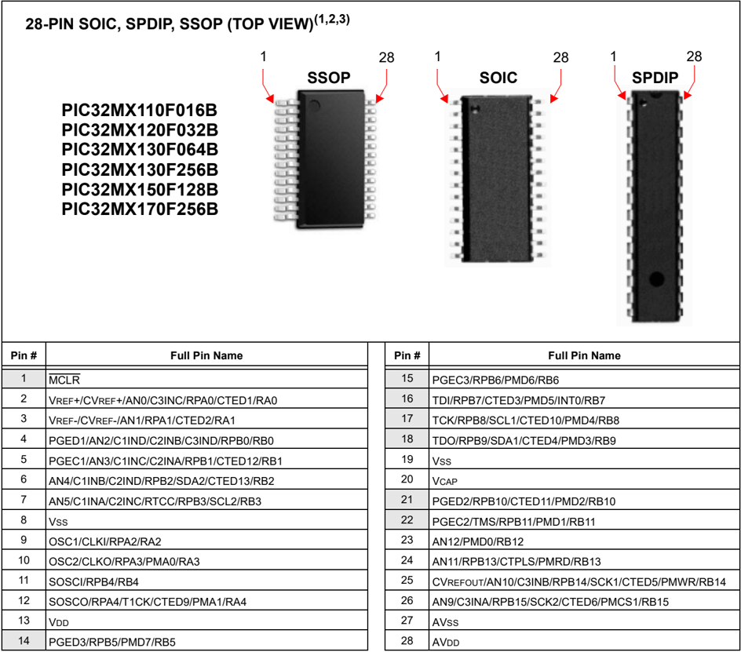

|   Pin # | Full Pin Name                                  |
|---------|------------------------------------------------|
|      15 | PGEC3/RPB6/PMD6/RB6                            |
|      16 | TDI/RPB7/CTED3/PMD5/INT0/RB7                   |
|      17 | TCK/RPB8/SCL1/CTED10/PMD4/RB8                  |
|      18 | TDO/RPB9/SDA1/CTED4/PMD3/RB9                   |
|      19 | VSS                                            |
|      20 | VCAP                                           |
|      21 | PGED2/RPB10/CTED11/PMD2/RB10                   |
|      22 | PGEC2/TMS/RPB11/PMD1/RB11                      |
|      23 | AN12/PMD0/RB12                                 |
|      24 | AN11/RPB13/CTPLS/PMRD/RB13                     |
|      25 | CVREFOUT/AN10/C3INB/RPB14/SCK1/CTED5/PMWR/RB14 |
|      26 | AN9/C3INA/RPB15/SCK2/CTED6/PMCS1/RB15          |
|      27 | AVSS                                           |
|      28 | AVDD                                           |

- 2: Every I/O port pin (RAx-RCx) can be used as a change notification pin (CNAx-CNCx). See Section 11.0 'I/O Ports' for more information.
- 3: Shaded pins are 5V tolerant.

## PIC32MX1XX/2XX 28/36/44-PIN FAMILY

## TABLE 4: PIN NAMES FOR 28-PIN USB DEVICES

Note 1: The RPn pins can be used by remappable peripherals. See Table 1 for the available peripherals and Section 11.3 'Peripheral Pin Select' for restrictions.

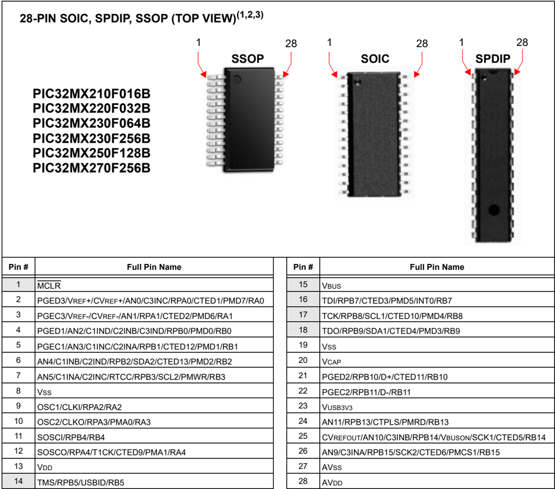

|   Pin # | Full Pin Name                                    |
|---------|--------------------------------------------------|
|       1 | MCLR                                             |
|       2 | PGED3/VREF+/CVREF+/AN0/C3INC/RPA0/CTED1/PMD7/RA0 |
|       3 | PGEC3/VREF-/CVREF-/AN1/RPA1/CTED2/PMD6/RA1       |
|       4 | PGED1/AN2/C1IND/C2INB/C3IND/RPB0/PMD0/RB0        |
|       5 | PGEC1/AN3/C1INC/C2INA/RPB1/CTED12/PMD1/RB1       |
|       6 | AN4/C1INB/C2IND/RPB2/SDA2/CTED13/PMD2/RB2        |
|       7 | AN5/C1INA/C2INC/RTCC/RPB3/SCL2/PMWR/RB3          |
|       8 | VSS                                              |
|       9 | OSC1/CLKI/RPA2/RA2                               |
|      10 | OSC2/CLKO/RPA3/PMA0/RA3                          |
|      11 | SOSCI/RPB4/RB4                                   |
|      12 | SOSCO/RPA4/T1CK/CTED9/PMA1/RA4                   |
|      13 | VDD                                              |
|      14 | TMS/RPB5/USBID/RB5                               |

|   Pin # | Full Pin Name                                    |
|---------|--------------------------------------------------|
|      15 | VBUS                                             |
|      16 | TDI/RPB7/CTED3/PMD5/INT0/RB7                     |
|      17 | TCK/RPB8/SCL1/CTED10/PMD4/RB8                    |
|      18 | TDO/RPB9/SDA1/CTED4/PMD3/RB9                     |
|      19 | VSS                                              |
|      20 | VCAP                                             |
|      21 | PGED2/RPB10/D+/CTED11/RB10                       |
|      22 | PGEC2/RPB11/D-/RB11                              |
|      23 | VUSB3V3                                          |
|      24 | AN11/RPB13/CTPLS/PMRD/RB13                       |
|      25 | CVREFOUT/AN10/C3INB/RPB14/VBUSON/SCK1/CTED5/RB14 |
|      26 | AN9/C3INA/RPB15/SCK2/CTED6/PMCS1/RB15            |
|      27 | AVSS                                             |
|      28 | AVDD                                             |

- 2: Every I/O port pin (RAx-RCx) can be used as a change notification pin (CNAx-CNCx). See Section 11.0 'I/O Ports' for more information.
- 3: Shaded pins are 5V tolerant.

## PIC32MX1XX/2XX 28/36/44-PIN FAMILY

## TABLE 5: PIN NAMES FOR 28-PIN GENERAL PURPOSE DEVICES

## 28-PIN QFN (TOP VIEW) (1,2,3.4)

PIC32MX110F016B

PIC32MX120F032B

PIC32MX130F064B

PIC32MX130F256B

PIC32MX150F128B

PIC32MX170F256B

|   Pin # | Full Pin Name                         |
|---------|---------------------------------------|
|       1 | PGED1/AN2/C1IND/C2INB/C3IND/RPB0/RB0  |
|       2 | PGEC1/AN3/C1INC/C2INA/RPB1/CTED12/RB1 |
|       3 | AN4/C1INB/C2IND/RPB2/SDA2/CTED13/RB2  |
|       4 | AN5/C1INA/C2INC/RTCC/RPB3/SCL2/RB3    |
|       5 | VSS                                   |
|       6 | OSC1/CLKI/RPA2/RA2                    |
|       7 | OSC2/CLKO/RPA3/PMA0/RA3               |
|       8 | SOSCI/RPB4/RB4                        |
|       9 | SOSCO/RPA4/T1CK/CTED9/PMA1/RA4        |
|      10 | VDD                                   |
|      11 | PGED3/RPB5/PMD7/RB5                   |
|      12 | PGEC3/RPB6/PMD6/RB6                   |
|      13 | TDI/RPB7/CTED3/PMD5/INT0/RB7          |
|      14 | TCK/RPB8/SCL1/CTED10/PMD4/RB8         |

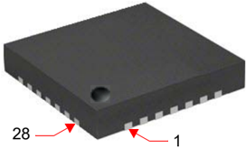

|   Pin # | Full Pin Name                                  |
|---------|------------------------------------------------|
|      15 | TDO/RPB9/SDA1/CTED4/PMD3/RB9                   |
|      16 | VSS                                            |
|      17 | VCAP                                           |
|      18 | PGED2/RPB10/CTED11/PMD2/RB10                   |
|      19 | PGEC2/TMS/RPB11/PMD1/RB11                      |
|      20 | AN12/PMD0/RB12                                 |
|      21 | AN11/RPB13/CTPLS/PMRD/RB13                     |
|      22 | CVREFOUT/AN10/C3INB/RPB14/SCK1/CTED5/PMWR/RB14 |
|      23 | AN9/C3INA/RPB15/SCK2/CTED6/PMCS1/RB15          |
|      24 | AVSS                                           |
|      25 | AVDD                                           |
|      26 | MCLR                                           |
|      27 | VREF +/CV REF +/AN0/C3INC/RPA0/CTED1/RA0       |
|      28 | VREF -/CV REF -/AN1/RPA1/CTED2/RA1             |

- 2: Every I/O port pin (RAx-RCx) can be used as a change notification pin (CNAx-CNCx). See Section 11.0 'I/O Ports' for more information.
- 3: The metal plane at the bottom of the device is not connected to any pins and is recommended to be connected to VSS externally.
- 4: Shaded pins are 5V tolerant.

## PIC32MX1XX/2XX 28/36/44-PIN FAMILY

## TABLE 6: PIN NAMES FOR 28-PIN USB DEVICES

## 28-PIN QFN (TOP VIEW) (1,2,3,4)

PIC32MX210F016B

PIC32MX220F032B

PIC32MX230F064B

PIC32MX230F256B

PIC32MX250F128B

PIC32MX270F256B

|   Pin # | Full Pin Name                              |
|---------|--------------------------------------------|
|       1 | PGED1/AN2/C1IND/C2INB/C3IND/RPB0/PMD0/RB0  |
|       2 | PGEC1/AN3/C1INC/C2INA/RPB1/CTED12/PMD1/RB1 |
|       3 | AN4/C1INB/C2IND/RPB2/SDA2/CTED13/PMD2/RB2  |
|       4 | AN5/C1INA/C2INC/RTCC/RPB3/SCL2/PMWR/RB3    |
|       5 | VSS                                        |
|       6 | OSC1/CLKI/RPA2/RA2                         |
|       7 | OSC2/CLKO/RPA3/PMA0/RA3                    |
|       8 | SOSCI/RPB4/RB4                             |
|       9 | SOSCO/RPA4/T1CK/CTED9/PMA1/RA4             |
|      10 | VDD                                        |
|      11 | TMS/RPB5/USBID/RB5                         |
|      12 | VBUS                                       |
|      13 | TDI/RPB7/CTED3/PMD5/INT0/RB7               |
|      14 | TCK/RPB8/SCL1/CTED10/PMD4/RB8              |

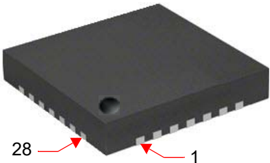

|   Pin # | Full Pin Name                                    |
|---------|--------------------------------------------------|
|      15 | TDO/RPB9/SDA1/CTED4/PMD3/RB9                     |
|      16 | VSS                                              |
|      17 | VCAP                                             |
|      18 | PGED2/RPB10/D+/CTED11/RB10                       |
|      19 | PGEC2/RPB11/D-/RB11                              |
|      20 | VUSB3V3                                          |
|      21 | AN11/RPB13/CTPLS/PMRD/RB13                       |
|      22 | CVREFOUT/AN10/C3INB/RPB14/VBUSON/SCK1/CTED5/RB14 |
|      23 | AN9/C3INA/RPB15/SCK2/CTED6/PMCS1/RB15            |
|      24 | AVSS                                             |
|      25 | AVDD                                             |
|      26 | MCLR                                             |
|      27 | PGED3/VREF+/CVREF+/AN0/C3INC/RPA0/CTED1/PMD7/RA0 |
|      28 | PGEC3/VREF-/CVREF-/AN1/RPA1/CTED2/PMD6/RA1       |

- 2: Every I/O port pin (RAx-RCx) can be used as a change notification pin (CNAx-CNCx). See Section 11.0 'I/O Ports' for more information.
- 3: The metal plane at the bottom of the device is not connected to any pins and is recommended to be connected to VSS externally.
- 4: Shaded pins are 5V tolerant.

## PIC32MX1XX/2XX 28/36/44-PIN FAMILY

## TABLE 7: PIN NAMES FOR 36-PIN GENERAL PURPOSE DEVICES

## 36-PIN VTLA (BOTTOM VIEW) (1,2,3,5)

PIC32MX110F016C

PIC32MX120F032C

PIC32MX130F064C

PIC32MX150F128C

|   Pin # | Full Pin Name                        |
|---------|--------------------------------------|
|       1 | AN4/C1INB/C2IND/RPB2/SDA2/CTED13/RB2 |
|       2 | AN5/C1INA/C2INC/RTCC/RPB3/SCL2/RB3   |
|       3 | PGED4 (4) /AN6/RPC0/RC0              |
|       4 | PGEC4 (4) /AN7/RPC1/RC1              |
|       5 | VDD                                  |
|       6 | VSS                                  |
|       7 | OSC1/CLKI/RPA2/RA2                   |
|       8 | OSC2/CLKO/RPA3/PMA0/RA3              |
|       9 | SOSCI/RPB4/RB4                       |
|      10 | SOSCO/RPA4/T1CK/CTED9/PMA1/RA4       |
|      11 | RPC3/RC3                             |
|      12 | VSS                                  |
|      13 | VDD                                  |
|      14 | VDD                                  |
|      15 | PGED3/RPB5/PMD7/RB5                  |
|      16 | PGEC3/RPB6/PMD6/RB6                  |
|      17 | TDI/RPB7/CTED3/PMD5/INT0/RB7         |
|      18 | TCK/RPB8/SCL1/CTED10/PMD4/RB8        |

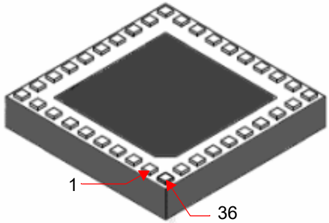

|   Pin # | Full Pin Name                                  |
|---------|------------------------------------------------|
|      19 | TDO/RPB9/SDA1/CTED4/PMD3/RB9                   |
|      20 | RPC9/CTED7/RC9                                 |
|      21 | VSS                                            |
|      22 | VCAP                                           |
|      23 | VDD                                            |
|      24 | PGED2/RPB10/CTED11/PMD2/RB10                   |
|      25 | PGEC2/TMS/RPB11/PMD1/RB11                      |
|      26 | AN12/PMD0/RB12                                 |
|      27 | AN11/RPB13/CTPLS/PMRD/RB13                     |
|      28 | CVREFOUT/AN10/C3INB/RPB14/SCK1/CTED5/PMWR/RB14 |
|      29 | AN9/C3INA/RPB15/SCK2/CTED6/PMCS1/RB15          |
|      30 | AVSS                                           |
|      31 | AVDD                                           |
|      32 | MCLR                                           |
|      33 | VREF +/CV REF +/AN0/C3INC/RPA0/CTED1/RA0       |
|      34 | VREF -/CV REF -/AN1/RPA1/CTED2/RA1             |
|      35 | PGED1/AN2/C1IND/C2INB/C3IND/RPB0/RB0           |
|      36 | PGEC1/AN3/C1INC/C2INA/RPB1/CTED12/RB1          |

- 2: Every I/O port pin (RAx-RCx) can be used as a change notification pin (CNAx-CNCx). See Section 11.0 'I/O Ports' for more information.
- 3: The metal plane at the bottom of the device is not connected to any pins and is recommended to be connected to VSS externally.
- 4: This pin function is not available on PIC32MX110F016C and PIC32MX120F032C devices.
- 5: Shaded pins are 5V tolerant.

## PIC32MX1XX/2XX 28/36/44-PIN FAMILY

## TABLE 8: PIN NAMES FOR 36-PIN USB DEVICES

## 36-PIN VTLA (BOTTOM VIEW) (1,2,3,5)

PIC32MX210F016C

PIC32MX220F032C

PIC32MX230F064C

PIC32MX250F128C

|   Pin # | Full Pin Name                             |
|---------|-------------------------------------------|
|       1 | AN4/C1INB/C2IND/RPB2/SDA2/CTED13/PMD2/RB2 |
|       2 | AN5/C1INA/C2INC/RTCC/RPB3/SCL2/PMWR/RB3   |
|       3 | PGED4 (4) /AN6/RPC0/RC0                   |
|       4 | PGEC4 (4) /AN7/RPC1/RC1                   |
|       5 | VDD                                       |
|       6 | VSS                                       |
|       7 | OSC1/CLKI/RPA2/RA2                        |
|       8 | OSC2/CLKO/RPA3/PMA0/RA3                   |
|       9 | SOSCI/RPB4/RB4                            |
|      10 | SOSCO/RPA4/T1CK/CTED9/PMA1/RA4            |
|      11 | AN12/RPC3/RC3                             |
|      12 | VSS                                       |
|      13 | VDD                                       |
|      14 | VDD                                       |
|      15 | TMS/RPB5/USBID/RB5                        |
|      16 | VBUS                                      |
|      17 | TDI/RPB7/CTED3/PMD5/INT0/RB7              |
|      18 | TCK/RPB8/SCL1/CTED10/PMD4/RB8             |

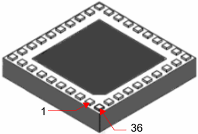

|   Pin # | Full Pin Name                                    |
|---------|--------------------------------------------------|
|      19 | TDO/RPB9/SDA1/CTED4/PMD3/RB9                     |
|      20 | RPC9/CTED7/RC9                                   |
|      21 | VSS                                              |
|      22 | VCAP                                             |
|      23 | VDD                                              |
|      24 | PGED2/RPB10/D+/CTED11/RB10                       |
|      25 | PGEC2/RPB11/D-/RB11                              |
|      26 | VUSB3V3                                          |
|      27 | AN11/RPB13/CTPLS/PMRD/RB13                       |
|      28 | CVREFOUT/AN10/C3INB/RPB14/VBUSON/SCK1/CTED5/RB14 |
|      29 | AN9/C3INA/RPB15/SCK2/CTED6/PMCS1/RB15            |
|      30 | AVSS                                             |
|      31 | AVDD                                             |
|      32 | MCLR                                             |
|      33 | PGED3/VREF+/CVREF+/AN0/C3INC/RPA0/CTED1/PMD7/RA0 |
|      34 | PGEC3/VREF-/CVREF-/AN1/RPA1/CTED2/PMD6/RA1       |
|      35 | PGED1/AN2/C1IND/C2INB/C3IND/RPB0/PMD0/RB0        |
|      36 | PGEC1/AN3/C1INC/C2INA/RPB1/CTED12/PMD1/RB1       |

- 2: Every I/O port pin (RAx-RCx) can be used as a change notification pin (CNAx-CNCx). See Section 11.0 'I/O Ports' for more information.
- 3: The metal plane at the bottom of the device is not connected to any pins and is recommended to be connected to VSS externally.
- 4: This pin function is not available on PIC32MX210F016C and PIC32MX120F032C devices.
- 5: Shaded pins are 5V tolerant.

## PIC32MX1XX/2XX 28/36/44-PIN FAMILY

## TABLE 9: PIN NAMES FOR 44-PIN GENERAL PURPOSE DEVICES

44-PIN QFN (TOP VIEW) (1,2,3,5)

PIC32MX110F016D

PIC32MX120F032D

PIC32MX130F064D

PIC32MX130F256D

PIC32MX150F128D

PIC32MX170F256D

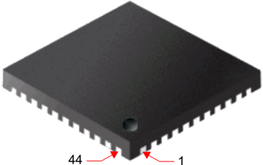

|   Pin # | Full Pin Name                                  |
|---------|------------------------------------------------|
|       1 | RPB9/SDA1/CTED4/PMD3/RB9                       |
|       2 | RPC6/PMA1/RC6                                  |
|       3 | RPC7/PMA0/RC7                                  |
|       4 | RPC8/PMA5/RC8                                  |
|       5 | RPC9/CTED7/PMA6/RC9                            |
|       6 | VSS                                            |
|       7 | VCAP                                           |
|       8 | PGED2/RPB10/CTED11/PMD2/RB10                   |
|       9 | PGEC2/RPB11/PMD1/RB11                          |
|      10 | AN12/PMD0/RB12                                 |
|      11 | AN11/RPB13/CTPLS/PMRD/RB13                     |
|      12 | PGED4 (4) /TMS/PMA10/RA10                      |
|      13 | PGEC4 (4) /TCK/CTED8/PMA7/RA7                  |
|      14 | CVREFOUT/AN10/C3INB/RPB14/SCK1/CTED5/PMWR/RB14 |
|      15 | AN9/C3INA/RPB15/SCK2/CTED6/PMCS1/RB15          |
|      16 | AVSS                                           |
|      17 | AVDD                                           |
|      18 | MCLR                                           |
|      19 | VREF+/CVREF +/AN0/C3INC/RPA0/CTED1/RA0         |
|      20 | VREF-/CV REF -/AN1/RPA1/CTED2/RA1              |
|      21 | PGED1/AN2/C1IND/C2INB/C3IND/RPB0/RB0           |
|      22 | PGEC1/AN3/C1INC/C2INA/RPB1/CTED12/RB1          |

|   Pin # | Full Pin Name                        |
|---------|--------------------------------------|
|      23 | AN4/C1INB/C2IND/RPB2/SDA2/CTED13/RB2 |
|      24 | AN5/C1INA/C2INC/RTCC/RPB3/SCL2/RB3   |
|      25 | AN6/RPC0/RC0                         |
|      26 | AN7/RPC1/RC1                         |
|      27 | AN8/RPC2/PMA2/RC2                    |
|      28 | VDD                                  |
|      29 | VSS                                  |
|      30 | OSC1/CLKI/RPA2/RA2                   |
|      31 | OSC2/CLKO/RPA3/RA3                   |
|      32 | TDO/RPA8/PMA8/RA8                    |
|      33 | SOSCI/RPB4/RB4                       |
|      34 | SOSCO/RPA4/T1CK/CTED9/RA4            |
|      35 | TDI/RPA9/PMA9/RA9                    |
|      36 | RPC3/RC3                             |
|      37 | RPC4/PMA4/RC4                        |
|      38 | RPC5/PMA3/RC5                        |
|      39 | VSS                                  |
|      40 | VDD                                  |
|      41 | PGED3/RPB5/PMD7/RB5                  |
|      42 | PGEC3/RPB6/PMD6/RB6                  |
|      43 | RPB7/CTED3/PMD5/INT0/RB7             |
|      44 | RPB8/SCL1/CTED10/PMD4/RB8            |

- 2: Every I/O port pin (RAx-RCx) can be used as a change notification pin (CNAx-CNCx). See Section 11.0 'I/O Ports' for more information.
- 3: The metal plane at the bottom of the device is not connected to any pins and is recommended to be connected to VSS externally.
- 4: This pin function is not available on PIC32MX110F016D and PIC32MX120F032D devices.
- 5: Shaded pins are 5V tolerant.

## PIC32MX1XX/2XX 28/36/44-PIN FAMILY

## TABLE 10: PIN NAMES FOR 44-PIN USB DEVICES

44-PIN QFN (TOP VIEW) (1,2,3,5)

PIC32MX210F016D

PIC32MX220F032D

PIC32MX230F064D

PIC32MX230F256D

PIC32MX250F128D

PIC32MX270F256D

|   Pin # | Full Pin Name                                    |
|---------|--------------------------------------------------|
|       1 | RPB9/SDA1/CTED4/PMD3/RB9                         |
|       2 | RPC6/PMA1/RC6                                    |
|       3 | RPC7/PMA0/RC7                                    |
|       4 | RPC8/PMA5/RC8                                    |
|       5 | RPC9/CTED7/PMA6/RC9                              |
|       6 | VSS                                              |
|       7 | VCAP                                             |
|       8 | PGED2/RPB10/D+/CTED11/RB10                       |
|       9 | PGEC2/RPB11/D-/RB11                              |
|      10 | VUSB3V3                                          |
|      11 | AN11/RPB13/CTPLS/PMRD/RB13                       |
|      12 | PGED4/TMS/PMA10/RA10                             |
|      13 | PGEC4/TCK/CTED8/PMA7/RA7                         |
|      14 | CVREFOUT/AN10/C3INB/RPB14/VBUSON/SCK1/CTED5/RB14 |
|      15 | AN9/C3INA/RPB15/SCK2/CTED6/PMCS1/RB15            |
|      16 | AVSS                                             |
|      17 | AVDD                                             |
|      18 | MCLR                                             |
|      19 | PGED3/VREF+/CVREF+/AN0/C3INC/RPA0/CTED1/PMD7/RA0 |
|      20 | PGEC3/VREF-/CVREF-/AN1/RPA1/CTED2/PMD6/RA1       |
|      21 | PGED1/AN2/C1IND/C2INB/C3IND/RPB0/PMD0/RB0        |
|      22 | PGEC1/AN3/C1INC/C2INA/RPB1/CTED12/PMD1/RB1       |

1

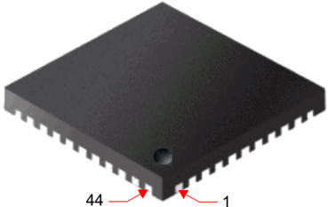

|   Pin # | Full Pin Name                             |
|---------|-------------------------------------------|
|      23 | AN4/C1INB/C2IND/RPB2/SDA2/CTED13/PMD2/RB2 |
|      24 | AN5/C1INA/C2INC/RTCC/RPB3/SCL2/PMWR/RB3   |
|      25 | AN6/RPC0/RC0                              |
|      26 | AN7/RPC1/RC1                              |
|      27 | AN8/RPC2/PMA2/RC2                         |
|      28 | VDD                                       |
|      29 | VSS                                       |
|      30 | OSC1/CLKI/RPA2/RA2                        |
|      31 | OSC2/CLKO/RPA3/RA3                        |
|      32 | TDO/RPA8/PMA8/RA8                         |
|      33 | SOSCI/RPB4/RB4                            |
|      34 | SOSCO/RPA4/T1CK/CTED9/RA4                 |
|      35 | TDI/RPA9/PMA9/RA9                         |
|      36 | AN12/RPC3/RC3                             |
|      37 | RPC4/PMA4/RC4                             |
|      38 | RPC5/PMA3/RC5                             |
|      39 | VSS                                       |
|      40 | VDD                                       |
|      41 | RPB5/USBID/RB5                            |
|      42 | VBUS                                      |
|      43 | RPB7/CTED3/PMD5/INT0/RB7                  |
|      44 | RPB8/SCL1/CTED10/PMD4/RB8                 |

- Note 1: The RPn pins can be used by remappable peripherals. See Table 1 for the available peripherals and Section 11.3 'Peripheral Pin Select' for restrictions.
- 2: Every I/O port pin (RAx-RCx) can be used as a change notification pin (CNAx-CNCx). See Section 11.0 'I/O Ports' for more information.
- 3: The metal plane at the bottom of the device is not connected to any pins and is recommended to be connected to VSS externally.
- 4: This pin function is not available on PIC32MX110F016D and PIC32MX120F032D devices.
- 5: Shaded pins are 5V tolerant.

## PIC32MX1XX/2XX 28/36/44-PIN FAMILY

## TABLE 11: PIN NAMES FOR 44-PIN GENERAL PURPOSE DEVICES

## 44-PIN TQFP (TOP VIEW) (1,2,3,5)

PIC32MX110F016D

PIC32MX120F032D

PIC32MX130F064D

PIC32MX130F256D

PIC32MX150F128D

PIC32MX170F256D

|   Pin # | Full Pin Name                                  |
|---------|------------------------------------------------|
|       1 | RPB9/SDA1/CTED4/PMD3/RB9                       |
|       2 | RPC6/PMA1/RC6                                  |
|       3 | RPC7/PMA0/RC7                                  |
|       4 | RPC8/PMA5/RC8                                  |
|       5 | RPC9/CTED7/PMA6/RC9                            |
|       6 | VSS                                            |
|       7 | VCAP                                           |
|       8 | PGED2/RPB10/CTED11/PMD2/RB10                   |
|       9 | PGEC2/RPB11/PMD1/RB11                          |
|      10 | AN12/PMD0/RB12                                 |
|      11 | AN11/RPB13/CTPLS/PMRD/RB13                     |
|      12 | PGED4 (4) /TMS/PMA10/RA10                      |
|      13 | PGEC4 (4) /TCK/CTED8/PMA7/RA7                  |
|      14 | CVREFOUT/AN10/C3INB/RPB14/SCK1/CTED5/PMWR/RB14 |
|      15 | AN9/C3INA/RPB15/SCK2/CTED6/PMCS1/RB15          |
|      16 | AVSS                                           |
|      17 | AVDD                                           |
|      18 | MCLR                                           |
|      19 | VREF+/CVREF +/AN0/C3INC/RPA0/CTED1/RA0         |
|      20 | VREF-/CV REF -/AN1/RPA1/CTED2/RA1              |
|      21 | PGED1/AN2/C1IND/C2INB/C3IND/RPB0/RB0           |
|      22 | PGEC1/AN3/C1INC/C2INA/RPB1/CTED12/RB1          |


|   Pin # | Full Pin Name                        |
|---------|--------------------------------------|
|      23 | AN4/C1INB/C2IND/RPB2/SDA2/CTED13/RB2 |
|      24 | AN5/C1INA/C2INC/RTCC/RPB3/SCL2/RB3   |
|      25 | AN6/RPC0/RC0                         |
|      26 | AN7/RPC1/RC1                         |
|      27 | AN8/RPC2/PMA2/RC2                    |
|      28 | VDD                                  |
|      29 | VSS                                  |
|      30 | OSC1/CLKI/RPA2/RA2                   |
|      31 | OSC2/CLKO/RPA3/RA3                   |
|      32 | TDO/RPA8/PMA8/RA8                    |
|      33 | SOSCI/RPB4/RB4                       |
|      34 | SOSCO/RPA4/T1CK/CTED9/RA4            |
|      35 | TDI/RPA9/PMA9/RA9                    |
|      36 | RPC3/RC3                             |
|      37 | RPC4/PMA4/RC4                        |
|      38 | RPC5/PMA3/RC5                        |
|      39 | VSS                                  |
|      40 | VDD                                  |
|      41 | PGED3/RPB5/PMD7/RB5                  |
|      42 | PGEC3/RPB6/PMD6/RB6                  |
|      43 | RPB7/CTED3/PMD5/INT0/RB7             |
|      44 | RPB8/SCL1/CTED10/PMD4/RB8            |

- Note 1: The RPn pins can be used by remappable peripherals. See Table 1 for the available peripherals and Section 11.3 'Peripheral Pin Select' for restrictions.
- 2: Every I/O port pin (RAx-RCx) can be used as a change notification pin (CNAx-CNCx). See Section 11.0 'I/O Ports' for more information.
- 3: The metal plane at the bottom of the device is not connected to any pins and is recommended to be connected to VSS externally.
- 4: This pin function is not available on PIC32MX110F016D and PIC32MX120F032D devices.
- 5: Shaded pins are 5V tolerant.

## PIC32MX1XX/2XX 28/36/44-PIN FAMILY

## TABLE 12: PIN NAMES FOR 44-PIN USB DEVICES

44-PIN TQFP (TOP VIEW) (1,2,3,5)

PIC32MX210F016D

PIC32MX220F032D

PIC32MX230F064D

PIC32MX230F256D

PIC32MX250F128D

PIC32MX270F256D

Note 1: The RPn pins can be used by remappable peripherals. See Table 1 for the available peripherals and Section 11.3 'Peripheral Pin Select' for restrictions.

|   Pin # | Full Pin Name                                    |
|---------|--------------------------------------------------|
|       1 | RPB9/SDA1/CTED4/PMD3/RB9                         |
|       2 | RPC6/PMA1/RC6                                    |
|       3 | RPC7/PMA0/RC7                                    |
|       4 | RPC8/PMA5/RC8                                    |
|       5 | RPC9/CTED7/PMA6/RC9                              |
|       6 | VSS                                              |
|       7 | VCAP                                             |
|       8 | PGED2/RPB10/D+/CTED11/RB10                       |
|       9 | PGEC2/RPB11/D-/RB11                              |
|      10 | VUSB3V3                                          |
|      11 | AN11/RPB13/CTPLS/PMRD/RB13                       |
|      12 | PGED4 (4) /TMS/PMA10/RA10                        |
|      13 | PGEC4 (4) /TCK/CTED8/PMA7/RA7                    |
|      14 | CVREFOUT/AN10/C3INB/RPB14/VBUSON/SCK1/CTED5/RB14 |
|      15 | AN9/C3INA/RPB15/SCK2/CTED6/PMCS1/RB15            |
|      16 | AVSS                                             |
|      17 | AVDD                                             |
|      18 | MCLR                                             |
|      19 | PGED3/VREF+/CVREF+/AN0/C3INC/RPA0/CTED1/PMD7/RA0 |
|      20 | PGEC3/VREF-/CVREF-/AN1/RPA1/CTED2/PMD6/RA1       |
|      21 | PGED1/AN2/C1IND/C2INB/C3IND/RPB0/PMD0/RB0        |
|      22 | PGEC1/AN3/C1INC/C2INA/RPB1/CTED12/PMD1/RB1       |

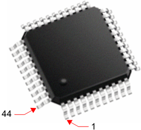

|   Pin # | Full Pin Name                             |
|---------|-------------------------------------------|
|      23 | AN4/C1INB/C2IND/RPB2/SDA2/CTED13/PMD2/RB2 |
|      24 | AN5/C1INA/C2INC/RTCC/RPB3/SCL2/PMWR/RB3   |
|      25 | AN6/RPC0/RC0                              |
|      26 | AN7/RPC1/RC1                              |
|      27 | AN8/RPC2/PMA2/RC2                         |
|      28 | VDD                                       |
|      29 | VSS                                       |
|      30 | OSC1/CLKI/RPA2/RA2                        |
|      31 | OSC2/CLKO/RPA3/RA3                        |
|      32 | TDO/RPA8/PMA8/RA8                         |
|      33 | SOSCI/RPB4/RB4                            |
|      34 | SOSCO/RPA4/T1CK/CTED9/RA4                 |
|      35 | TDI/RPA9/PMA9/RA9                         |
|      36 | AN12/RPC3/RC3                             |
|      37 | RPC4/PMA4/RC4                             |
|      38 | RPC5/PMA3/RC5                             |
|      39 | VSS                                       |
|      40 | VDD                                       |
|      41 | RPB5/USBID/RB5                            |
|      42 | VBUS                                      |
|      43 | RPB7/CTED3/PMD5/INT0/RB7                  |
|      44 | RPB8/SCL1/CTED10/PMD4/RB8                 |

- 2: Every I/O port pin (RAx-RCx) can be used as a change notification pin (CNAx-CNCx). See Section 11.0 'I/O Ports' for more information.
- 3: The metal plane at the bottom of the device is not connected to any pins and is recommended to be connected to VSS externally.
- 4: This pin function is not available on PIC32MX210F016D and PIC32MX220F032D devices.
- 5: Shaded pins are 5V tolerant.

## PIC32MX1XX/2XX 28/36/44-PIN FAMILY

## TABLE 13: PIN NAMES FOR 44-PIN GENERAL PURPOSE DEVICES

## 44-PIN VTLA (BOTTOM VIEW) (1,2,3,5)

PIC32MX110F016D

PIC32MX120F032D

PC32MX130F064D

PIC32MX130F256D

PIC32MX150F128D

PIC32MX170F256D

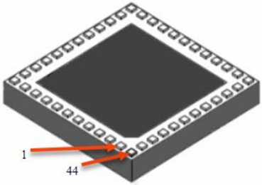

|   Pin # | Full Pin Name                                  |
|---------|------------------------------------------------|
|       1 | RPB9/SDA1/CTED4/PMD3/RB9                       |
|       2 | RPC6/PMA1/RC6                                  |
|       3 | RPC7/PMA0/RC7                                  |
|       4 | RPC8/PMA5/RC8                                  |
|       5 | RPC9/CTED7/PMA6/RC9                            |
|       6 | VSS                                            |
|       7 | VCAP                                           |
|       8 | PGED2/RPB10/CTED11/PMD2/RB10                   |
|       9 | PGEC2/RPB11/PMD1/RB11                          |
|      10 | AN12/PMD0/RB12                                 |
|      11 | AN11/RPB13/CTPLS/PMRD/RB13                     |
|      12 | PGED4 (4) /TMS/PMA10/RA10                      |
|      13 | PGEC4 (4) /TCK/CTED8/PMA7/RA7                  |
|      14 | CVREFOUT/AN10/C3INB/RPB14/SCK1/CTED5/PMWR/RB14 |
|      15 | AN9/C3INA/RPB15/SCK2/CTED6/PMCS1/RB15          |
|      16 | AVSS                                           |
|      17 | AVDD                                           |
|      18 | MCLR                                           |
|      19 | VREF+/CVREF +/AN0/C3INC/RPA0/CTED1/RA0         |
|      20 | VREF-/CV REF -/AN1/RPA1/CTED2/RA1              |
|      21 | PGED1/AN2/C1IND/C2INB/C3IND/RPB0/RB0           |
|      22 | PGEC1/AN3/C1INC/C2INA/RPB1/CTED12/RB1          |

|   Pin # | Full Pin Name                        |
|---------|--------------------------------------|
|      23 | AN4/C1INB/C2IND/RPB2/SDA2/CTED13/RB2 |
|      24 | AN5/C1INA/C2INC/RTCC/RPB3/SCL2/RB3   |
|      25 | AN6/RPC0/RC0                         |
|      26 | AN7/RPC1/RC1                         |
|      27 | AN8/RPC2/PMA2/RC2                    |
|      28 | VDD                                  |
|      29 | VSS                                  |
|      30 | OSC1/CLKI/RPA2/RA2                   |
|      31 | OSC2/CLKO/RPA3/RA3                   |
|      32 | TDO/RPA8/PMA8/RA8                    |
|      33 | SOSCI/RPB4/RB4                       |
|      34 | SOSCO/RPA4/T1CK/CTED9/RA4            |
|      35 | TDI/RPA9/PMA9/RA9                    |
|      36 | RPC3/RC3                             |
|      37 | RPC4/PMA4/RC4                        |
|      38 | RPC5/PMA3/RC5                        |
|      39 | VSS                                  |
|      40 | VDD                                  |
|      41 | PGED3/RPB5/PMD7/RB5                  |
|      42 | PGEC3/RPB6/PMD6/RB6                  |
|      43 | RPB7/CTED3/PMD5/INT0/RB7             |
|      44 | RPB8/SCL1/CTED10/PMD4/RB8            |

- 2: Every I/O port pin (RAx-RCx) can be used as a change notification pin (CNAx-CNCx). See Section 11.0 'I/O Ports' for more information.
- 3: The metal plane at the bottom of the device is not connected to any pins and is recommended to be connected to VSS externally.
- 4: This pin function is not available on PIC32MX110F016D and PIC32MX120F032D devices.
- 5: Shaded pins are 5V tolerant.

## PIC32MX1XX/2XX 28/36/44-PIN FAMILY

## TABLE 14: PIN NAMES FOR 44-PIN USB DEVICES

## 44-PIN VTLA (BOTTOM VIEW) (1,2,3,5)

PIC32MX210F016D

PIC32MX220F032D

PIC32MX230F064D

PIC32MX230F256D

PIC32MX250F128D

PIC32MX270F256D

|   Pin # | Full Pin Name                                    |
|---------|--------------------------------------------------|
|       1 | RPB9/SDA1/CTED4/PMD3/RB9                         |
|       2 | RPC6/PMA1/RC6                                    |
|       3 | RPC7/PMA0/RC7                                    |
|       4 | RPC8/PMA5/RC8                                    |
|       5 | RPC9/CTED7/PMA6/RC9                              |
|       6 | VSS                                              |
|       7 | VCAP                                             |
|       8 | PGED2/RPB10/D+/CTED11/RB10                       |
|       9 | PGEC2/RPB11/D-/RB11                              |
|      10 | VUSB3V3                                          |
|      11 | AN11/RPB13/CTPLS/PMRD/RB13                       |
|      12 | PGED4 (4) /TMS/PMA10/RA10                        |
|      13 | PGEC4 (4) /TCK/CTED8/PMA7/RA7                    |
|      14 | CVREFOUT/AN10/C3INB/RPB14/VBUSON/SCK1/CTED5/RB14 |
|      15 | AN9/C3INA/RPB15/SCK2/CTED6/PMCS1/RB15            |
|      16 | AVSS                                             |
|      17 | AVDD                                             |
|      18 | MCLR                                             |
|      19 | PGED3/VREF+/CVREF+/AN0/C3INC/RPA0/CTED1/PMD7/RA0 |
|      20 | PGEC3/VREF-/CVREF-/AN1/RPA1/CTED2/PMD6/RA1       |
|      21 | PGED1/AN2/C1IND/C2INB/C3IND/RPB0/PMD0/RB0        |
|      22 | PGEC1/AN3/C1INC/C2INA/RPB1/CTED12/PMD1/RB1       |

44

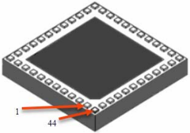

Note 1: The RPn pins can be used by remappable peripherals. See Table 1 for the available peripherals and Section 11.3 'Peripheral Pin Select' for restrictions.

|   Pin # | Full Pin Name                             |
|---------|-------------------------------------------|
|      23 | AN4/C1INB/C2IND/RPB2/SDA2/CTED13/PMD2/RB2 |
|      24 | AN5/C1INA/C2INC/RTCC/RPB3/SCL2/PMWR/RB3   |
|      25 | AN6/RPC0/RC0                              |
|      26 | AN7/RPC1/RC1                              |
|      27 | AN8/RPC2/PMA2/RC2                         |
|      28 | VDD                                       |
|      29 | VSS                                       |
|      30 | OSC1/CLKI/RPA2/RA2                        |
|      31 | OSC2/CLKO/RPA3/RA3                        |
|      32 | TDO/RPA8/PMA8/RA8                         |
|      33 | SOSCI/RPB4/RB4                            |
|      34 | SOSCO/RPA4/T1CK/CTED9/RA4                 |
|      35 | TDI/RPA9/PMA9/RA9                         |
|      36 | AN12/RPC3/RC3                             |
|      37 | RPC4/PMA4/RC4                             |
|      38 | RPC5/PMA3/RC5                             |
|      39 | VSS                                       |
|      40 | VDD                                       |
|      41 | RPB5/USBID/RB5                            |
|      42 | VBUS                                      |
|      43 | RPB7/CTED3/PMD5/INT0/RB7                  |
|      44 | RPB8/SCL1/CTED10/PMD4/RB8                 |

- 2: Every I/O port pin (RAx-RCx) can be used as a change notification pin (CNAx-CNCx). See Section 11.0 'I/O Ports' for more information.
- 3: The metal plane at the bottom of the device is not connected to any pins and is recommended to be connected to VSS externally.
- 4: This pin function is not available on PIC32MX210F016D and PIC32MX220F032D devices.
- 5: Shaded pins are 5V tolerant.

## PIC32MX1XX/2XX 28/36/44-PIN FAMILY

## Table of Contents

1.0

Device Overview ........................................................................................................................................................................ 19

2.0

3.0

4.0

5.0

6.0

7.0

8.0

9.0

10.0

11.0

12.0

13.0

14.0

15.0

16.0

17.0

18.0

19.0

20.0

21.0

22.0

23.0

24.0

25.0

26.0

27.0

28.0

29.0

30.0

31.0

32.0

33.0

Guidelines for Getting Started with 32-bit MCUs........................................................................................................................ 27

CPU............................................................................................................................................................................................ 37

Memory Organization ................................................................................................................................................................. 41

Flash Program Memory.............................................................................................................................................................. 57

Resets ........................................................................................................................................................................................ 63

Interrupt Controller ..................................................................................................................................................................... 67

Oscillator Configuration .............................................................................................................................................................. 77

Direct Memory Access (DMA) Controller ................................................................................................................................... 87

USB On-The-Go (OTG)............................................................................................................................................................ 107

I/O Ports ................................................................................................................................................................................... 131

Timer1 ...................................................................................................................................................................................... 147

Timer2/3, Timer4/5 ................................................................................................................................................................... 151

Watchdog Timer (WDT) ........................................................................................................................................................... 157

Input Capture............................................................................................................................................................................ 161

Output Compare....................................................................................................................................................................... 165

Serial Peripheral Interface (SPI)............................................................................................................................................... 169

Inter-Integrated Circuit (I

2

C)..................................................................................................................................................... 177

Universal Asynchronous Receiver Transmitter (UART) ........................................................................................................... 185

Parallel Master Port (PMP)....................................................................................................................................................... 193

Real-Time Clock and Calendar (RTCC)................................................................................................................................... 203

10-bit Analog-to-Digital Converter (ADC) ................................................................................................................................. 213

Comparator .............................................................................................................................................................................. 223

Comparator Voltage Reference (CVREF).................................................................................................................................. 227

Charge Time Measurement Unit (CTMU)  ............................................................................................................................... 231

Power-Saving Features ........................................................................................................................................................... 237

Special Features ...................................................................................................................................................................... 243

Instruction Set .......................................................................................................................................................................... 255

Development Support............................................................................................................................................................... 257

Electrical Characteristics .......................................................................................................................................................... 261

50 MHz Electrical Characteristics............................................................................................................................................. 305

DC and AC Device Characteristics Graphs.............................................................................................................................. 311

Packaging Information.............................................................................................................................................................. 315

The Microchip Web Site..................................................................................................................................................................... 347

Customer Change Notification Service .............................................................................................................................................. 347

Customer Support.............................................................................................................................................................................. 347

Product Identification System............................................................................................................................................................. 348

## PIC32MX1XX/2XX 28/36/44-PIN FAMILY

## TO OUR VALUED CUSTOMERS

It is our intention to provide our valued customers with the best documentation possible to ensure successful use of your Microchip products. To this end, we will continue to improve our publications to better suit your needs. Our publications will be refined and enhanced as new volumes and updates are introduced.

If you have any questions or comments regarding this publication, please contact the Marketing Communications Department via E-mail at docerrors@microchip.com . We welcome your feedback.

## Most Current Data Sheet

To obtain the most up-to-date version of this data sheet, please register at our Worldwide Web site at:

## http://www.microchip.com

You can determine the version of a data sheet by examining its literature number found on the bottom outside corner of any page. The last character of the literature number is the version number, (e.g., DS30000000A is version A of document DS30000000).

## Errata

An errata sheet, describing minor operational differences from the data sheet and recommended workarounds, may exist for current devices. As device/documentation issues become known to us, we will publish an errata sheet. The errata will specify the revision of silicon and revision of document to which it applies.

To determine if an errata sheet exists for a particular device, please check with one of the following:

- Microchip's Worldwide Web site; http://www.microchip.com
- Your local Microchip sales office (see last page)

When contacting a sales office, please specify which device, revision of silicon and data sheet (include literature number) you are using.

## Customer Notification System

Register on our web site at www.microchip.com to receive the most current information on all of our products.

## PIC32MX1XX/2XX 28/36/44-PIN FAMILY

## Referenced Sources

This  device  data  sheet  is  based  on  the  following individual  chapters  of  the 'PIC32  Family  Reference Manual' .  These documents should be considered as the general reference for the operation of a particular module or device feature.

Note:

To access the following documents, refer to the Documentation &gt; Reference Manuals section  of  the  Microchip  PIC32 website: http://www.microchip.com/pic32

- Section 1. 'Introduction' (DS60001127)
- Section 2. 'CPU' (DS60001113)
- Section 3. 'Memory Organization' (DS60001115)
- Section 5. 'Flash Program Memory' (DS60001121)
- Section 6. 'Oscillator Configuration' (DS60001112)
- Section 7. 'Resets' (DS60001118)
- Section 8. 'Interrupt Controller' (DS60001108)
- Section 9. 'Watchdog Timer and Power-up Timer' (DS60001114)
- Section 10. 'Power-Saving Features' (DS60001130)
- Section 12. 'I/O Ports' (DS60001120)
- Section 13. 'Parallel Master Port (PMP)' (DS60001128)
- Section 14. 'Timers' (DS60001105)
- Section 15. 'Input Capture' (DS60001122)
- Section 16. 'Output Compare' (DS60001111)
- Section 17. '10-bit Analog-to-Digital Converter (ADC)' (DS60001104)
- Section 19. 'Comparator' (DS60001110)
- Section 20. 'Comparator Voltage Reference (CVREF)' (DS60001109)
- Section 21. 'Universal Asynchronous Receiver Transmitter (UART)' (DS60001107)
- Section 23. 'Serial Peripheral Interface (SPI)' (DS60001106)
- Section 24. 'Inter-Integrated Circuit (I 2 C)' (DS60001116)
- Section 27. 'USB On-The-Go (OTG)' (DS60001126)
- Section 29. 'Real-Time Clock and Calendar (RTCC)' (DS60001125)
- Section 31. 'Direct Memory Access (DMA) Controller' (DS60001117)
- Section 32. 'Configuration' (DS60001124)
- Section 33. 'Programming and Diagnostics' (DS60001129)
- Section 37. 'Charge Time Measurement Unit (CTMU)' (DS60001167)

## PIC32MX1XX/2XX 28/36/44-PIN FAMILY

## 1.0 DEVICE OVERVIEW

Note: This data sheet summarizes the features of  the  PIC32MX1XX/2XX  28/36/44-pin Family of devices. It is not intended to be a  comprehensive  reference  source.  To complement  the  information  in  this  data sheet,  refer  to  documents  listed  in  the Documentation &gt; Reference Manual section  of  the  Microchip  PIC32  web  site (www.microchip.com/pic32).

FIGURE 1-1: BLOCK DIAGRAM

This document contains device-specific information for PIC32MX1XX/2XX 28/36/44-pin Family of devices.

Figure 1-1  illustrates  a  general  block  diagram  of  the core and peripheral modules in the PIC32MX1XX/2XX 28/36/44-pin Family of devices.

Table 1-1 lists the functions of the various pins shown in the pinout diagrams.

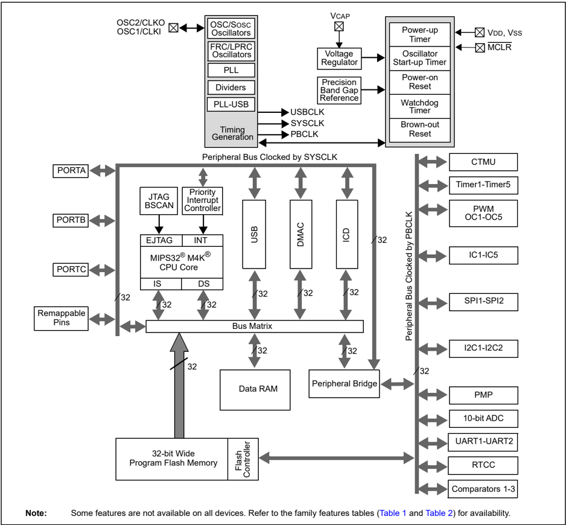

## PIC32MX1XX/2XX 28/36/44-PIN FAMILY

TABLE 1-1: PINOUT I/O DESCRIPTIONS

| Pin Name   | Pin Number (1)   | Pin Number (1)           | Pin Number (1)   | Pin Number (1)         |          |             |                                                                                                                                                                                    |
|------------|------------------|--------------------------|------------------|------------------------|----------|-------------|------------------------------------------------------------------------------------------------------------------------------------------------------------------------------------|
| Pin Name   | 28-pin QFN       | 28-pin SSOP/ SPDIP/ SOIC | 36-pin VTLA      | 44-pin QFN/ TQFP/ VTLA | Pin Type | Buffer Type | Description                                                                                                                                                                        |
| AN0        | 27               | 2                        | 33               | 19                     | I        | Analog      | Analog input channels.                                                                                                                                                             |
| AN1        | 28               | 3                        | 34               | 20                     | I        | Analog      | Analog input channels.                                                                                                                                                             |
| AN2        | 1                | 4                        | 35               | 21                     | I        | Analog      | Analog input channels.                                                                                                                                                             |
| AN3        | 2                | 5                        | 36               | 22                     | I        | Analog      | Analog input channels.                                                                                                                                                             |
| AN4        | 3                | 6                        | 1                | 23                     | I        | Analog      | Analog input channels.                                                                                                                                                             |
| AN5        | 4                | 7                        | 2                | 24                     | I        | Analog      | Analog input channels.                                                                                                                                                             |
| AN6        | -                | -                        | 3                | 25                     | I        | Analog      | Analog input channels.                                                                                                                                                             |
| AN7        | -                | -                        | 4                | 26                     | I        | Analog      | Analog input channels.                                                                                                                                                             |
| AN8        | -                | -                        | -                | 27                     | I        | Analog      | Analog input channels.                                                                                                                                                             |
| AN9        | 23               | 26                       | 29               | 15                     | I        | Analog      | Analog input channels.                                                                                                                                                             |
| AN10       | 22               | 25                       | 28               | 14                     | I        | Analog      | Analog input channels.                                                                                                                                                             |
| AN11       | 21               | 24                       | 27               | 11                     | I        | Analog      | Analog input channels.                                                                                                                                                             |
| AN12       | 20 (2)           | 23 (2)                   | 26 (2) 11 (3)    | 10 (2) 36 (3)          | I        | Analog      | Analog input channels.                                                                                                                                                             |
| CLKI       | 6                | 9                        | 7                | 30                     | I        | ST/CMOS     | External clock source input. Always associated with OSC1 pin function.                                                                                                             |
| CLKO       | 7                | 10                       | 8                | 31                     | O        | -           | Oscillator crystal output. Connects to crystal or resonator in Crystal Oscillator mode. Optionally functions as CLKO in RC and EC modes. Always associated with OSC2 pin function. |
| OSC1       | 6                | 9                        | 7                | 30                     | I        | ST/CMOS     | Oscillator crystal input. ST buffer when configured in RC mode; CMOS otherwise.                                                                                                    |
| OSC2       | 7                | 10                       | 8                | 31                     | O        | -           | Oscillator crystal output. Connects to crystal or resonator in Crystal Oscillator mode. Optionally functions as CLKO in RC and EC modes.                                           |
| SOSCI      | 8                | 11                       | 9                | 33                     | I        | ST/CMOS     | 32.768 kHz low-power oscillator crystal input; CMOS otherwise.                                                                                                                     |
| SOSCO      | 9                | 12                       | 10               | 34                     | O        | -           | 32.768 kHz low-power oscillator crystal output.                                                                                                                                    |
| REFCLKI    | PPS              | PPS                      | PPS              | PPS                    | I        | ST          | Reference Input Clock                                                                                                                                                              |
| REFCLKO    | PPS              | PPS                      | PPS              | PPS                    | O        | -           | Reference Output Clock                                                                                                                                                             |
| IC1        | PPS              | PPS                      | PPS              | PPS                    | I        | ST          | Capture Inputs 1-5                                                                                                                                                                 |
| IC2        | PPS              | PPS                      | PPS              | PPS                    | I        | ST          |                                                                                                                                                                                    |
|            | PPS              | PPS                      | PPS              | PPS                    | I        | ST          |                                                                                                                                                                                    |
| IC3 IC4    | PPS              | PPS                      | PPS              | PPS                    | I        | ST          |                                                                                                                                                                                    |
| IC5        | PPS              | PPS                      | PPS              | PPS                    | I        | ST          |                                                                                                                                                                                    |

Legend:

CMOS = CMOS compatible input or output ST = Schmitt Trigger input with CMOS levels TTL = TTL input buffer

Analog = Analog input

P = Power

O = Output

I  =  Input

PPS = Peripheral Pin Select

- = N/A

Note 1:

Pin numbers are provided for reference only. See the 'Pin Diagrams' section for device pin availability.

- 2: Pin number for PIC32MX1XX devices only.

3: Pin number for PIC32MX2XX devices only.

## PIC32MX1XX/2XX 28/36/44-PIN FAMILY

TABLE 1-1: PINOUT I/O DESCRIPTIONS (CONTINUED)

| Pin Name   | Pin Number (1)   | Pin Number (1)           | Pin Number (1)   | Pin Number (1)         |          |             |                                   |
|------------|------------------|--------------------------|------------------|------------------------|----------|-------------|-----------------------------------|
| Pin Name   | 28-pin QFN       | 28-pin SSOP/ SPDIP/ SOIC | 36-pin VTLA      | 44-pin QFN/ TQFP/ VTLA | Pin Type | Buffer Type | Description                       |
| OC1        | PPS              | PPS                      | PPS              | PPS                    | O        | -           | Output Compare Output 1           |
| OC2        | PPS              | PPS                      | PPS              | PPS                    | O        | -           | Output Compare Output 2           |
| OC3        | PPS              | PPS                      | PPS              | PPS                    | O        | -           | Output Compare Output 3           |
| OC4        | PPS              | PPS                      | PPS              | PPS                    | O        | -           | Output Compare Output 4           |
| OC5        | PPS              | PPS                      | PPS              | PPS                    | O        | -           | Output Compare Output 5           |
| OCFA       | PPS              | PPS                      | PPS              | PPS                    | I        | ST          | Output Compare Fault A Input      |
| OCFB       | PPS              | PPS                      | PPS              | PPS                    | I        | ST          | Output Compare Fault B Input      |
| INT0       | 13               | 16                       | 17               | 43                     | I        | ST          | External Interrupt 0              |
| INT1       | PPS              | PPS                      | PPS              | PPS                    | I        | ST          | External Interrupt 1              |
| INT2       | PPS              | PPS                      | PPS              | PPS                    | I        | ST          | External Interrupt 2              |
| INT3       | PPS              | PPS                      | PPS              | PPS                    | I        | ST          | External Interrupt 3              |
| INT4       | PPS              | PPS                      | PPS              | PPS                    | I        | ST          | External Interrupt 4              |
| RA0        | 27               | 2                        | 33               | 19                     | I/O      | ST          | PORTA is a bidirectional I/O port |
| RA1        | 28               | 3                        | 34               | 20                     | I/O      | ST          |                                   |
| RA2        | 6                | 9                        | 7                | 30                     | I/O      | ST          |                                   |
| RA3        | 7                | 10                       | 8                | 31                     | I/O      | ST          |                                   |
| RA4        | 9                | 12                       | 10               | 34                     | I/O      | ST          |                                   |
| RA7        | -                | -                        | -                | 13                     | I/O      | ST          |                                   |
| RA8        | -                | -                        | -                | 32                     | I/O      | ST          |                                   |
| RA9        | -                | -                        | -                | 35                     | I/O      | ST          |                                   |
| RA10       | -                | -                        | -                | 12                     | I/O      | ST          |                                   |
| RB0        | 1                | 4                        | 35               | 21                     | I/O      | ST          | PORTB is a bidirectional I/O port |
| RB1        | 2                | 5                        | 36               | 22                     | I/O      | ST          |                                   |
| RB2        | 3                | 6                        | 1                | 23                     | I/O      | ST          |                                   |
| RB3        | 4                | 7                        | 2                | 24                     | I/O      |             | ST                                |
| RB4        | 8                | 11                       | 9                | 33                     | I/O      | ST          |                                   |
| RB5        | 11               | 14                       | 15               | 41                     | I/O      | ST          |                                   |
| RB6        | 12 (2)           | 15 (2)                   | 16 (2)           | 42 (2)                 | I/O      | ST          |                                   |
| RB7        | 13               | 16                       | 17               | 43                     | I/O      | ST          |                                   |
| RB8        | 14               | 17                       | 18               | 44                     | I/O      | ST          |                                   |
| RB9        | 15               | 18                       | 19               | 1                      | I/O      | ST          |                                   |
| RB10       | 18               | 21                       | 24               | 8                      | I/O      | ST          |                                   |
| RB11       | 19               | 22                       | 25               | 9                      | I/O      |             |                                   |
| RB12       | 20 (2)           | 23 (2)                   | 26 (2)           | 10 (2)                 | I/O      | ST          |                                   |
| RB13       | 21               | 24                       |                  | 11                     | I/O      | ST          |                                   |
| RB14       |                  |                          | 27               |                        |          | ST          |                                   |
|            | 22               | 25                       | 28               | 14                     | I/O      | ST          |                                   |

Legend:

CMOS = CMOS compatible input or output

Analog = Analog input

P = Power

ST = Schmitt Trigger input with CMOS levels TTL = TTL input buffer

O = Output

I  =  Input

PPS = Peripheral Pin Select

- = N/A

Note 1:

Pin numbers are provided for reference only. See the 'Pin Diagrams' section for device pin availability.

- 2: Pin number for PIC32MX1XX devices only.

- 3: Pin number for PIC32MX2XX devices only.

## PIC32MX1XX/2XX 28/36/44-PIN FAMILY

TABLE 1-1: PINOUT I/O DESCRIPTIONS (CONTINUED)

| Pin Name   | Pin Number (1)   | Pin Number (1)           | Pin Number (1)   | Pin Number (1)         |          |             |                                                |
|------------|------------------|--------------------------|------------------|------------------------|----------|-------------|------------------------------------------------|
| Pin Name   | 28-pin QFN       | 28-pin SSOP/ SPDIP/ SOIC | 36-pin VTLA      | 44-pin QFN/ TQFP/ VTLA | Pin Type | Buffer Type | Description                                    |
| RC0        | -                | -                        | 3                | 25                     | I/O      | ST          | PORTC is a bidirectional I/O port              |
| RC1        | -                | -                        | 4                | 26                     | I/O      | ST          | PORTC is a bidirectional I/O port              |
| RC2        | -                | -                        | -                | 27                     | I/O      | ST          | PORTC is a bidirectional I/O port              |
| RC3        | -                | -                        | 11               | 36                     | I/O      | ST          | PORTC is a bidirectional I/O port              |
| RC4        | -                | -                        | -                | 37                     | I/O      | ST          | PORTC is a bidirectional I/O port              |
| RC5        | -                | -                        | -                | 38                     | I/O      | ST          | PORTC is a bidirectional I/O port              |
| RC6        | -                | -                        | -                | 2                      | I/O      | ST          | PORTC is a bidirectional I/O port              |
| RC7        | -                | -                        | -                | 3                      | I/O      | ST          | PORTC is a bidirectional I/O port              |
| RC8        | -                | -                        | -                | 4                      | I/O      | ST          | PORTC is a bidirectional I/O port              |
| RC9        | -                | -                        | 20               | 5                      | I/O      | ST          | PORTC is a bidirectional I/O port              |
| T1CK       | 9                | 12                       | 10               | 34                     | I        | ST          | Timer1 external clock input                    |
| T2CK       | PPS              | PPS                      | PPS              | PPS                    | I        | ST          | Timer2 external clock input                    |
| T3CK       | PPS              | PPS                      | PPS              | PPS                    | I        | ST          | Timer3 external clock input                    |
| T4CK       | PPS              | PPS                      | PPS              | PPS                    | I        | ST          | Timer4 external clock input                    |
| T5CK       | PPS              | PPS                      | PPS              | PPS                    | I        | ST          | Timer5 external clock input                    |
| U1CTS      | PPS              | PPS                      | PPS              | PPS                    | I        | ST          | UART1 clear to send                            |
| U1RTS      | PPS              | PPS                      | PPS              | PPS                    | O        | -           | UART1 ready to send                            |
| U1RX       | PPS              | PPS                      | PPS              | PPS                    | I        | ST          | UART1 receive                                  |
| U1TX       | PPS              | PPS                      | PPS              | PPS                    | O        | -           | UART1 transmit                                 |
| U2CTS      | PPS              | PPS                      | PPS              | PPS                    | I        | ST          | UART2 clear to send                            |
| U2RTS      | PPS              | PPS                      | PPS              | PPS                    | O        | -           | UART2 ready to send                            |
| U2RX       | PPS              | PPS                      | PPS              | PPS                    | I        | ST          | UART2 receive                                  |
| U2TX       | PPS              | PPS                      | PPS              | PPS                    | O        | -           | UART2 transmit                                 |
| SCK1       | 22               | 25                       | 28               | 14                     | I/O      | ST          | Synchronous serial clock input/output for SPI1 |
| SDI1       | PPS              | PPS                      | PPS              | PPS                    | I        | ST          | SPI1 data in                                   |
| SDO1       | PPS              | PPS                      | PPS              | PPS                    | O        | -           | SPI1 data out                                  |
| SS1        | PPS              | PPS                      | PPS              | PPS                    | I/O      | ST          | SPI1 slave synchronization or frame pulse I/O  |
| SCK2       | 23               | 26                       | 29               | 15                     | I/O      | ST          | Synchronous serial clock input/output for SPI2 |
| SDI2       | PPS              | PPS                      | PPS              | PPS                    | I        | ST          | SPI2 data in                                   |
| SDO2       | PPS              | PPS                      | PPS              | PPS                    | O        | -           | SPI2 data out                                  |
| SS2        | PPS              | PPS                      | PPS              | PPS                    | I/O      | ST          | SPI2 slave synchronization or frame pulse I/O  |
| SCL1       | 14               | 17                       | 18               | 44                     | I/O      | ST          | Synchronous serial clock input/output for I2C1 |

Legend:

CMOS = CMOS compatible input or output ST = Schmitt Trigger input with CMOS levels TTL = TTL input buffer

Analog = Analog input

P = Power

O = Output

I  =  Input

PPS = Peripheral Pin Select

- = N/A

Note 1: Pin numbers are provided for reference only. See the 'Pin Diagrams' section for device pin availability.

- 2: Pin number for PIC32MX1XX devices only.

- 3: Pin number for PIC32MX2XX devices only.

## PIC32MX1XX/2XX 28/36/44-PIN FAMILY

TABLE 1-1: PINOUT I/O DESCRIPTIONS (CONTINUED)

| Pin Name   | Pin Number (1)   | Pin Number (1)           | Pin Number (1)   | Pin Number (1)         |          |             |                                                |
|------------|------------------|--------------------------|------------------|------------------------|----------|-------------|------------------------------------------------|
| Pin Name   | 28-pin QFN       | 28-pin SSOP/ SPDIP/ SOIC | 36-pin VTLA      | 44-pin QFN/ TQFP/ VTLA | Pin Type | Buffer Type | Description                                    |
| SDA1       | 15               | 18                       | 19               | 1                      | I/O      | ST          | Synchronous serial data input/output for I2C1  |
| SCL2       | 4                | 7                        | 2                | 24                     | I/O      | ST          | Synchronous serial clock input/output for I2C2 |
| SDA2       | 3                | 6                        | 1                | 23                     | I/O      | ST          | Synchronous serial data input/output for I2C2  |
| TMS        | 19 (2) 11 (3)    | 22 (2) 14 (3)            | 25 (2) 15 (3)    | 12                     | I        | ST          | JTAG Test mode select pin                      |
| TCK        | 14               | 17                       | 18               | 13                     | I        | ST          | JTAG test clock input pin                      |
| TDI        | 13               | 16                       | 17               | 35                     | O        | -           | JTAG test data input pin                       |
| TDO        | 15               | 18                       | 19               | 32                     | O        | -           | JTAG test data output pin                      |
| RTCC       | 4                | 7                        | 2                | 24                     | O        | ST          | Real-Time Clock alarm output                   |
| CVREF-     | 28               | 3                        | 34               | 20                     | I        | Analog      | Comparator Voltage Reference (low)             |
| CVREF+     | 27               | 2                        | 33               | 19                     | I        | Analog      | Comparator Voltage Reference (high)            |
| CVREFOUT   | 22               | 25                       | 28               | 14                     | O        | Analog      | Comparator Voltage Reference output            |
| C1INA      | 4                | 7                        | 2                | 24                     | I        | Analog      | Comparator Inputs                              |
| C1INB      | 3                | 6                        | 1                | 23                     | I        | Analog      |                                                |
| C1INC      | 2                | 5                        | 36               | 22                     | I        | Analog      |                                                |
| C1IND      | 1                | 4                        | 35               | 21                     | I        | Analog      |                                                |
| C2INA      | 2                | 5                        | 36               | 22                     | I        | Analog      |                                                |
| C2INB      | 1                | 4                        | 35               | 21                     | I        | Analog      |                                                |
| C2INC      | 4                | 7                        | 2                | 24                     | I        | Analog      |                                                |
| C2IND      | 3                | 6                        | 1                | 23                     | I        | Analog      |                                                |
| C3INA      | 23               | 26                       | 29               | 15                     | I        | Analog      |                                                |
| C3INB      | 22               | 25                       | 28               | 14                     | I        | Analog      |                                                |
| C3INC      | 27               | 2                        | 33               | 19                     | I        | Analog      |                                                |
| C3IND      | 1                | 4                        | 35               | 21                     | I        | Analog      |                                                |
| C1OUT      | PPS              | PPS                      | PPS              | PPS                    | O        | -           | Comparator Outputs                             |
| C2OUT      | PPS              | PPS                      | PPS              | PPS                    | O        | -           |                                                |
| C3OUT      | PPS              | PPS                      | PPS              | PPS                    | O        | -           |                                                |

Legend:

CMOS = CMOS compatible input or output ST = Schmitt Trigger input with CMOS levels TTL = TTL input buffer

Analog = Analog input

P = Power

O = Output

I  =  Input

PPS = Peripheral Pin Select

- = N/A

Note 1: Pin numbers are provided for reference only. See the 'Pin Diagrams' section for device pin availability.

- 2: Pin number for PIC32MX1XX devices only.
- 3: Pin number for PIC32MX2XX devices only.

## PIC32MX1XX/2XX 28/36/44-PIN FAMILY

TABLE 1-1: PINOUT I/O DESCRIPTIONS (CONTINUED)

| Pin Name   | Pin Number (1)   | Pin Number (1)           | Pin Number (1)   | Pin Number (1)         |          |             |                                                                                                                 |
|------------|------------------|--------------------------|------------------|------------------------|----------|-------------|-----------------------------------------------------------------------------------------------------------------|
| Pin Name   | 28-pin QFN       | 28-pin SSOP/ SPDIP/ SOIC | 36-pin VTLA      | 44-pin QFN/ TQFP/ VTLA | Pin Type | Buffer Type | Description                                                                                                     |
| PMA0       | 7                | 10                       | 8                | 3                      | I/O      | TTL/ST      | Parallel Master Port Address bit 0 input (Buffered Slave modes) and output (Master modes)                       |
| PMA1       | 9                | 12                       | 10               | 2                      | I/O      | TTL/ST      | Parallel Master Port Address bit 1 input (Buffered Slave modes) and output (Master modes)                       |
| PMA2       |                  | -                        | -                | 27                     | O        | -           | Parallel Master Port address (Demultiplexed Master modes)                                                       |
| PMA3       |                  | -                        | -                | 38                     | O        | -           | Parallel Master Port address (Demultiplexed Master modes)                                                       |
| PMA4       |                  | -                        | -                | 37                     | O        | -           | Parallel Master Port address (Demultiplexed Master modes)                                                       |
| PMA5       |                  | -                        | -                | 4                      | O        | -           | Parallel Master Port address (Demultiplexed Master modes)                                                       |
| PMA6       |                  | -                        | -                | 5                      | O        | -           | Parallel Master Port address (Demultiplexed Master modes)                                                       |
| PMA7       |                  | -                        | -                | 13                     | O        | -           | Parallel Master Port address (Demultiplexed Master modes)                                                       |
| PMA8       |                  | -                        | -                | 32                     | O        | -           | Parallel Master Port address (Demultiplexed Master modes)                                                       |
| PMA9       |                  | -                        | -                | 35                     | O        | -           | Parallel Master Port address (Demultiplexed Master modes)                                                       |
| PMA10      |                  | -                        | -                | 12                     | O        | -           | Parallel Master Port address (Demultiplexed Master modes)                                                       |
| PMCS1      | 23               | 26                       | 29               | 15                     | O        | -           | Parallel Master Port Chip Select 1 strobe Parallel Master Port data (Demultiplexed Master mode) or address/data |
| PMD0       | 20 (2)           | 23 (2)                   | 26 (2)           | 10 (2)                 | I/O      | TTL/ST      | (Multiplexed Master modes)                                                                                      |
| PMD0       | 1 (3)            | 4 (3)                    | 35 (3)           | 21 (3)                 |          |             | (Multiplexed Master modes)                                                                                      |
| PMD1       | 19 (2)           | 22 (2)                   | 25 (2)           | 9 (2)                  | I/O      |             | (Multiplexed Master modes)                                                                                      |
|            | 2 (3)            | 5 (3)                    | 36 (3)           | 22 (3) (2)             |          | TTL/ST      | (Multiplexed Master modes)                                                                                      |
| PMD2       | 18 (2) 3 (3)     | 21 (2) 6 (3)             | 24 (2) 1 (3)     | 8 23 (3)               | I/O      | TTL/ST      | (Multiplexed Master modes)                                                                                      |
| PMD3       | 15               | 18                       | 19               | 1                      | I/O      | TTL/ST      | (Multiplexed Master modes)                                                                                      |
| PMD4       | 14               | 17                       | 18               | 44                     | I/O      | TTL/ST      | (Multiplexed Master modes)                                                                                      |
| PMD5       | 13               | 16                       | 17               | 43                     | I/O      | TTL/ST      | (Multiplexed Master modes)                                                                                      |
| PMD6       | 12 (2)           | 15 (2)                   | 16 (2)           | 42 (2)                 | I/O      |             | (Multiplexed Master modes)                                                                                      |
| PMD6       | 28 (3)           | 3 (3)                    | 34 (3)           | 20 (3)                 |          | TTL/ST      | (Multiplexed Master modes)                                                                                      |
| PMD7       | 11 (2)           | 14 (2)                   | 15 (2)           | 41 (2)                 |          |             | (Multiplexed Master modes)                                                                                      |
| PMD7       | 27 (3)           | 2 (3)                    | 33 (3)           | 19 (3)                 | I/O      | TTL/ST      | (Multiplexed Master modes)                                                                                      |
| PMRD       | 21               | 24                       | 27               | 11                     | O        | -           | Parallel Master Port read strobe                                                                                |
| PMWR       | 22 (2)           | 25 (2)                   | 28 (2)           | 14 (2)                 | O        |             | Parallel Master Port write strobe                                                                               |
| PMWR       | 4 (3)            | 7 (3)                    | 2 (3)            | 24 (3)                 |          | -           | Parallel Master Port write strobe                                                                               |
| VBUS       | 12 (3)           | 15 (3)                   | 16 (3)           | 42 (3)                 | I        | Analog      | USB bus power monitor                                                                                           |
| VUSB3V3    | 20 (3)           | 23 (3)                   | 26 (3)           | 10 (3)                 | P        | -           | USB internal transceiver supply. This pin must be connected to VDD.                                             |
| VBUSON     | 22 (3)           | 25 (3)                   | 28 (3)           | 14 (3)                 | O        | -           | USB Host and OTG bus power control output                                                                       |
| D+         | 18 (3)           | 21 (3)                   | 24 (3)           | 8 (3)                  | I/O      | Analog      | USB D+                                                                                                          |
| D-         | 19 (3)           | 22 (3)                   | 25 (3)           | 9 (3)                  | I/O      | Analog      | USB D-                                                                                                          |

Legend:

CMOS = CMOS compatible input or output ST = Schmitt Trigger input with CMOS levels

Analog = Analog input O = Output PPS = Peripheral Pin Select

P = Power

I  =  Input

TTL = TTL input buffer

- = N/A

Note 1: Pin numbers are provided for reference only. See the 'Pin Diagrams' section for device pin availability.

- 2: Pin number for PIC32MX1XX devices only.

- 3: Pin number for PIC32MX2XX devices only.

## PIC32MX1XX/2XX 28/36/44-PIN FAMILY

TABLE 1-1: PINOUT I/O DESCRIPTIONS (CONTINUED)

| Pin Name   | Pin Number (1)   | Pin Number (1)           | Pin Number (1)   | Pin Number (1)         | Pin   |             |                                                                    |
|------------|------------------|--------------------------|------------------|------------------------|-------|-------------|--------------------------------------------------------------------|
| Pin Name   | 28-pin QFN       | 28-pin SSOP/ SPDIP/ SOIC | 36-pin VTLA      | 44-pin QFN/ TQFP/ VTLA | Type  | Buffer Type | Description                                                        |
| USBID      | 11 (3)           | 14 (3)                   | 15 (3)           | 41 (3)                 | I     | ST          | USB OTG ID detect                                                  |
| CTED1      | 27               | 2                        | 33               | 19                     | I     | ST          | CTMU External Edge Input                                           |
| CTED2      | 28               | 3                        | 34               | 20                     | I     | ST          | CTMU External Edge Input                                           |
| CTED3      | 13               | 16                       | 17               | 43                     | I     | ST          | CTMU External Edge Input                                           |
| CTED4      | 15               | 18                       | 19               | 1                      | I     | ST          | CTMU External Edge Input                                           |
| CTED5      | 22               | 25                       | 28               | 14                     | I     | ST          | CTMU External Edge Input                                           |
| CTED6      | 23               | 26                       | 29               | 15                     | I     | ST          | CTMU External Edge Input                                           |
| CTED7      | -                | -                        | 20               | 5                      | I     | ST          | CTMU External Edge Input                                           |
| CTED8      | -                | -                        | -                | 13                     | I     | ST          | CTMU External Edge Input                                           |
| CTED9      | 9                | 12                       | 10               | 34                     | I     | ST          | CTMU External Edge Input                                           |
| CTED10     | 14               | 17                       | 18               | 44                     | I     | ST          | CTMU External Edge Input                                           |
| CTED11     | 18               | 21                       | 24               | 8                      | I     | ST          | CTMU External Edge Input                                           |
| CTED12     | 2                | 5                        | 36               | 22                     | I     | ST          | CTMU External Edge Input                                           |
| CTED13     | 3                | 6                        | 1                | 23                     | I     | ST          | CTMU External Edge Input                                           |
| CTPLS      | 21               | 24                       | 27               | 11                     | O     | -           | CTMU Pulse Output                                                  |
| PGED1      | 1                | 4                        | 35               | 21                     | I/O   | ST          | Data I/O pin for Programming/Debugging Communication Channel 1     |
| PGEC1      | 2                | 5                        | 36               | 22                     | I     | ST          | Clock input pin for Programming/Debugging Communication Channel 1  |
| PGED2      | 18               | 21                       | 24               | 8                      | I/O   | ST          | Data I/O pin for Programming/Debugging Communication Channel 2     |
| PGEC2      | 19               | 22                       | 25               | 9                      | I     | ST          | Clock input pin for Programming/Debugging Communication Channel 2  |
| PGED3      | 11 (2)           | 14 (2)                   | 15 (2)           | 41 (2)                 |       |             | Data I/O pin for Programming/Debugging Communication Channel 3     |
| PGED3      | 27 (3)           | 2 (3)                    | 33 (3)           | 19 (3)                 | I/O   | ST          | Data I/O pin for Programming/Debugging Communication Channel 3     |
| PGEC3      | 12 (2)           | 15 (2)                   | 16 (2)           | 42 (2)                 | I     | ST          | Clock input pin for Programming/ Debugging Communication Channel 3 |
| PGEC3      | 28 (3)           | 3 (3)                    | 34 (3)           | 20 (3)                 | I     | ST          | Clock input pin for Programming/ Debugging Communication Channel 3 |
| PGED4      | -                | -                        | 3                | 12                     | I/O   | ST          | Data I/O pin for Programming/Debugging Communication Channel 4     |
| PGEC4      | -                | -                        | 4                | 13                     | I     | ST          | Clock input pin for Programming/ Debugging Communication Channel 4 |

Legend:

CMOS = CMOS compatible input or output ST = Schmitt Trigger input with CMOS levels TTL = TTL input buffer

Analog = Analog input O = Output PPS = Peripheral Pin Select

P = Power

I  =  Input

- = N/A

Note 1:

Pin numbers are provided for reference only. See the 'Pin Diagrams' section for device pin availability.

- 2: Pin number for PIC32MX1XX devices only.
- 3: Pin number for PIC32MX2XX devices only.

## PIC32MX1XX/2XX 28/36/44-PIN FAMILY

TABLE 1-1: PINOUT I/O DESCRIPTIONS (CONTINUED)

|          | Pin Number (1)   | Pin Number (1)           | Pin Number (1)   | Pin Number (1)         |          |             |                                                                                   |
|----------|------------------|--------------------------|------------------|------------------------|----------|-------------|-----------------------------------------------------------------------------------|
| Pin Name | 28-pin QFN       | 28-pin SSOP/ SPDIP/ SOIC | 36-pin VTLA      | 44-pin QFN/ TQFP/ VTLA | Pin Type | Buffer Type | Description                                                                       |
| MCLR     | 26               | 1                        | 32               | 18                     | I/P      | ST          | Master Clear (Reset) input. This pin is an active-low Reset to the device.        |
| AVDD     | 25               | 28                       | 31               | 17                     | P        | -           | Positive supply for analog modules. This pin must be connected at all times.      |
| AVSS     | 24               | 27                       | 30               | 16                     | P        | -           | Ground reference for analog modules                                               |
| VDD      | 10               | 13                       | 5, 13, 14, 23    | 28, 40                 | P        | -           | Positive supply for peripheral logic and I/O pins                                 |
| VCAP     | 17               | 20                       | 22               | 7                      | P        | -           | CPU logic filter capacitor connection                                             |
| VSS      | 5, 16            | 8, 19                    | 6, 12, 21        | 6, 29, 39              | P        | -           | Ground reference for logic and I/O pins. This pin must be connected at all times. |
| VREF+    | 27               | 2                        | 33               | 19                     | I        | Analog      | Analog voltage reference (high) input                                             |
| VREF-    | 28               | 3                        | 34               | 20                     | I        | Analog      | Analog voltage reference (low) input                                              |

Legend:

CMOS = CMOS compatible input or output ST = Schmitt Trigger input with CMOS levels TTL = TTL input buffer

Analog = Analog input

P = Power

O = Output PPS = Peripheral Pin Select

I  =  Input

- = N/A

Note 1: Pin numbers are provided for reference only. See the 'Pin Diagrams' section for device pin availability.

- 2: Pin number for PIC32MX1XX devices only.
- 3: Pin number for PIC32MX2XX devices only.

## PIC32MX1XX/2XX 28/36/44-PIN FAMILY

## 2.0 GUIDELINES FOR GETTING STARTED WITH 32-BIT MCUs

Note: This data sheet summarizes the features of  the  PIC32MX1XX/2XX  28/36/44-pin Family of devices. It is not intended to be a  comprehensive  reference  source.  To complement  the  information  in  this  data sheet, refer to the documents listed in the Documentation &gt; Reference Manual section  of  the  Microchip  PIC32  web  site (www.microchip.com/pic32).

## 2.1 Basic Connection Requirements

Getting started with the PIC32MX1XX/2XX 28/36/44pin Family of 32-bit Microcontrollers (MCUs) requires attention  to  a  minimal  set  of  device  pin  connections before proceeding with development. The following is a list of pin names, which must always be connected:

- All VDD and VSS pins (see 2.2 'Decoupling Capacitors' )
- All AVDD and AVSS pins, even if the ADC module is not used (see 2.2 'Decoupling Capacitors' )
- VCAP pin (see 2.3 'Capacitor on Internal Voltage Regulator (VCAP)' )
- MCLR pin (see 2.4 'Master Clear (MCLR) Pin' )
- PGECx/PGEDx pins, used for In-Circuit Serial Programming™ (ICSP™) and debugging purposes (see 2.5 'ICSP Pins' )
- OSC1 and OSC2 pins, when external oscillator source is used (see 2.7 'External Oscillator Pins' )

The following pins may be required:

- VREF+/VREF- pins - used when external voltage reference for the ADC module is implemented

Note:

The  AVDD  and  AVSS  pins  must  be  connected,  regardless  of ADC  use  and  the ADC voltage reference source.

## 2.2 Decoupling Capacitors

The  use  of  decoupling  capacitors  on  power  supply pins, such as VDD, VSS, AVDD and AVSS is required. See Figure 2-1.

Consider the following criteria when using decoupling capacitors:

- Value and type of capacitor: A value of 0.1 µF (100 nF), 10-20V is recommended. The capacitor should be a low Equivalent Series Resistance (low-ESR) capacitor and have resonance frequency in the range of 20 MHz and higher. It is further recommended that ceramic capacitors be used.
- Placement on the printed circuit board: The decoupling capacitors should be placed as close to the pins as possible. It is recommended that the capacitors be placed on the same side of the board as the device. If space is constricted, the capacitor can be placed on another layer on the PCB using a via; however, ensure that the trace length from the pin to the capacitor is within onequarter inch (6 mm) in length.
- Handling high frequency noise: If the board is experiencing high frequency noise, upward of tens of MHz, add a second ceramic-type capacitor in parallel to the above described decoupling capacitor. The value of the second capacitor can be in the range of 0.01 µF to 0.001 µF. Place this second capacitor next to the primary decoupling capacitor. In high-speed circuit designs, consider implementing a decade pair of capacitances as close to the power and ground pins as possible. For example, 0.1 µF in parallel with 0.001 µF.
- Maximizing performance: On the board layout from the power supply circuit, run the power and return traces to the decoupling capacitors first, and then to the device pins. This ensures that the decoupling capacitors are first in the power chain. Equally important is to keep the trace length between the capacitor and the power pins to a minimum thereby reducing PCB track inductance.

## PIC32MX1XX/2XX 28/36/44-PIN FAMILY

## FIGURE 2-1: RECOMMENDED MINIMUM CONNECTION

Note 1: If  the  USB  module  is  not  used,  this  pin  must  be connected to VDD.

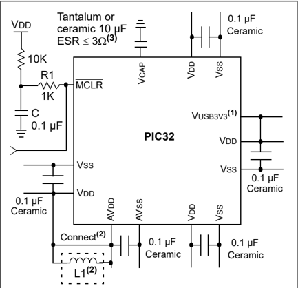

- 2: As an option, instead of a hard-wired connection, an inductor (L1) can be substituted between VDD and AVDD to improve ADC noise rejection. The inductor impedance should be less than 3  and the inductor capacity greater than 10 mA.

Where:

<!-- formula-not-decoded -->

<!-- formula-not-decoded -->

<!-- formula-not-decoded -->

- 1: Aluminum  or  electrolytic  capacitors  should  not  be used.  ESR  3  from  -40ºC  to  125ºC  @  SYSCLK frequency (i.e., MIPS).

## 2.2.1 BULK CAPACITORS

The use of a bulk capacitor is recommended to improve power supply stability. Typical values range from 4.7 µF to 47 µF. This capacitor should be located as close to the device as possible.

## 2.3 Capacitor on Internal Voltage Regulator (VCAP)

## 2.3.1 INTERNAL REGULATOR MODE

A low-ESR (3 ohm) capacitor is required on the VCAP pin,  which  is  used  to  stabilize  the  internal  voltage regulator output. The VCAP pin must not be connected to VDD, and must have a CEFC capacitor, with at least a 6V  rating,  connected  to  ground.  The  type  can  be ceramic or tantalum. Refer to 30.0 'Electrical Characteristics' for  additional  information  on  CEFC specifications.

## 2.4 Master Clear (MCLR) Pin

The MCLR pin provides two specific device functions:

- Device Reset
- Device programming and debugging

Pulling The MCLR pin low generates a device Reset. Figure 2-2  illustrates  a  typical  MCLR  circuit.  During device  programming  and  debugging,  the  resistance and  capacitance  that  can  be  added  to  the  pin  must be  considered.  Device  programmers  and  debuggers drive  the  MCLR  pin.  Consequently,  specific  voltage levels  (VIH  and  VIL)  and  fast  signal  transitions  must not  be  adversely  affected.  Therefore,  specific  values of  R  and  C  will  need  to  be  adjusted  based  on  the application and PCB requirements.

For example, as illustrated in Figure 2-2, it is recommended that the capacitor C, be isolated from the  MCLR  pin  during  programming  and  debugging operations.

Place the components illustrated in Figure 2-2 within one-quarter inch (6 mm) from the MCLR pin.

## FIGURE 2-2: EXAMPLE OF MCLR PIN CONNECTIONS

Note 1: 470   R1  1  will  limit  any  current  flowing  into MCLR from the external capacitor C, in the event of MCLR pin breakdown, due to Electrostatic Discharge (ESD) or Electrical Overstress (EOS). Ensure that the MCLR pin VIH and VIL specifications are met without interfering with the Debug/Programmer tools.

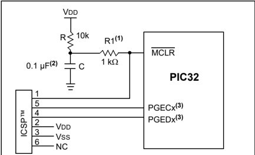

- 2: The capacitor can be sized to prevent unintentional Resets  from  brief  glitches  or  to  extend  the  device Reset period during POR.
- 3: No  pull-ups  or  bypass  capacitors  are  allowed  on active debug/program PGECx/PGEDx pins.

## 2.5 ICSP Pins

The PGECx and PGEDx pins are used for ICSP and debugging purposes. It is recommended to keep the trace length between the ICSP connector and the ICSP pins on the device as short as possible. If the ICSP connector  is  expected  to  experience  an  ESD  event,  a series resistor is recommended, with the value in the range of a few tens of Ohms, not to exceed 100 Ohms.

## PIC32MX1XX/2XX 28/36/44-PIN FAMILY

Pull-up resistors, series diodes and capacitors on the PGECx and PGEDx pins are not recommended as they will interfere with the programmer/debugger communications to the device. If such discrete components are an  application  requirement,  they  should  be  removed from  the  circuit  during  programming  and  debugging. Alternatively,  refer  to  the  AC/DC  characteristics  and timing requirements information in the respective device Flash programming specification for information on capacitive loading limits and pin input voltage high (VIH) and input low (VIL) requirements.

Ensure that the 'Communication Channel Select' (i.e., PGECx/PGEDx  pins)  programmed  into  the  device matches  the  physical  connections  for  the  ICSP  to MPLAB ®  ICD 3 or MPLAB REAL ICE™.

For  more  information  on  ICD  3  and  REAL  ICE connection requirements, refer to the following documents  that  are  available  on  the  Microchip  web site:

- 'Using MPLAB ®  ICD 3' (poster) (DS50001765)
- 'MPLAB ®  ICD 3 Design Advisory' (DS50001764)
- 'MPLAB ®  REAL ICE™ In-Circuit Debugger User's Guide' ( DS50001616)
- 'Using MPLAB ®  REAL ICE™ Emulator' (poster) (DS50001749)

## 2.6 JTAG

The TMS, TDO, TDI and TCK pins are used for testing and  debugging  according  to  the  Joint  Test  Action Group (JTAG) standard. It is recommended to keep the trace  length  between  the  JTAG  connector  and  the JTAG pins on the device as short as possible. If the JTAG  connector  is  expected  to  experience  an  ESD event, a series resistor is recommended with the value in the range of a few tens of Ohms, not to exceed 100 Ohms.

Pull-up resistors, series diodes and capacitors on the TMS, TDO, TDI and TCK pins are not recommended as  they  will  interfere  with  the  programmer/debugger communications to the device. If such discrete components are an application requirement, they should be removed  from  the  circuit  during  programming  and debugging. Alternatively, refer to the AC/DC characteristics and  timing  requirements information in the respective device Flash programming specification for information on capacitive loading limits and pin input voltage high (VIH) and input low (VIL) requirements.

## 2.7 External Oscillator Pins

Many MCUs have options for at least two oscillators: a high-frequency primary oscillator and a low-frequency secondary oscillator (refer to Section 8.0 'Oscillator Configuration' for details).

The oscillator circuit should be placed on the same side of the board as the device. Also, place the oscillator circuit close to the respective oscillator pins, not exceeding one-half inch (12 mm) distance between them. The load capacitors should be placed next to the oscillator itself, on the same side of the board. Use a grounded copper pour around the oscillator circuit to isolate them from surrounding circuits. The grounded copper pour should be routed directly to the MCU ground. Do not run any signal traces or power traces inside the ground pour. Also, if using a two-sided board, avoid any traces on  the  other  side  of  the  board  where  the  crystal  is placed. A suggested layout is illustrated in Figure 2-3.

FIGURE 2-3: SUGGESTED OSCILLATOR CIRCUIT PLACEMENT

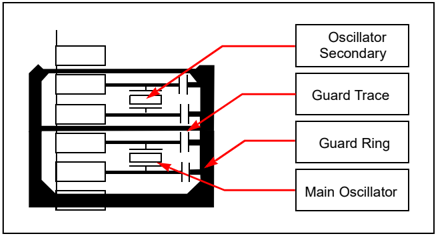

## 2.8 Unused I/Os

Unused  I/O  pins  should  not  be  allowed  to  float  as inputs. They can be configured as outputs and driven to a logic-low state.

Alternatively, inputs can be reserved by connecting the pin to VSS through a 1k to 10k resistor and configuring the pin as an input.

## PIC32MX1XX/2XX 28/36/44-PIN FAMILY

## 2.8.1 CRYSTAL OSCILLATOR DESIGN CONSIDERATION

The  following example  assumptions  are  used  to calculate the Primary Oscillator loading capacitor values:

- CIN = PIC32\_OSC2\_Pin Capacitance = ~4-5 pF
- COUT = PIC32\_OSC1\_Pin Capacitance = ~4-5 pF
- C1 and C2 = XTAL manufacturing recommended loading capacitance
- Estimated PCB stray capacitance, (i.e.,12 mm length) = 2.5 pF

## EXAMPLE 2-1: CRYSTAL LOAD CAPACITOR CALCULATION

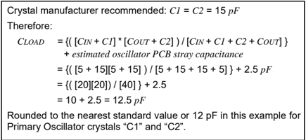

The following tips are used to increase oscillator gain, (i.e., to increase peak-to-peak oscillator signal):

- Select a crystal with a lower 'minimum' power drive rating
- Select an crystal oscillator with a lower XTAL manufacturing 'ESR' rating.
- Add a parallel resistor across the crystal. The smaller the resistor value the greater the gain. It is recommended to stay in the range of 600k to 1M
- C1 and C2 values also affect the gain of the oscillator. The lower the values, the higher the gain.
- C2/C1 ratio also affects gain. To increase the gain, make C1 slightly smaller than C2, which will also help start-up performance.

Note: Do not add excessive gain such that the

oscillator  signal  is  clipped,  flat  on  top  of the sine wave. If so, you need to reduce the gain or add a series resistor, RS, as shown in circuit 'C' in Figure 2-4. Failure to  do  so  will  stress  and  age  the  crystal, which can result in an early failure. Adjust the gain to trim the max peak-to-peak to ~VDD-0.6V. When measuring the oscillator  signal  you  must  use  a  FET  scope probe  or  a  probe  with  1.5  pF  or  the scope probe itself will unduly change the gain and peak-to-peak levels.

## 2.8.1.1 Additional Microchip References

- AN588 'PICmicro ®  Microcontroller Oscillator Design Guide'
- AN826 'Crystal Oscillator Basics and Crystal Selection for rfPIC™ and PICmicro ®  Devices'
- AN849 'Basic PICmicro ®  Oscillator Design'

## FIGURE 2-4: PRIMARY CRYSTAL OSCILLATOR CIRCUIT RECOMMENDATIONS

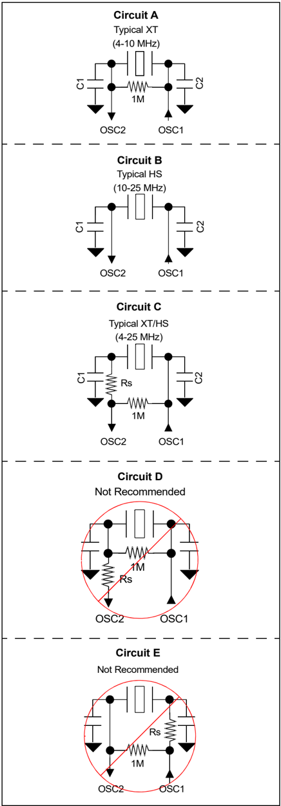

## PIC32MX1XX/2XX 28/36/44-PIN FAMILY

## 2.9 Typical Application Connection Examples

Examples of typical application connections are shown

in Figure 2-5 and Figure 2-6.

FIGURE 2-5: CAPACITIVE TOUCH SENSING WITH GRAPHICS APPLICATION

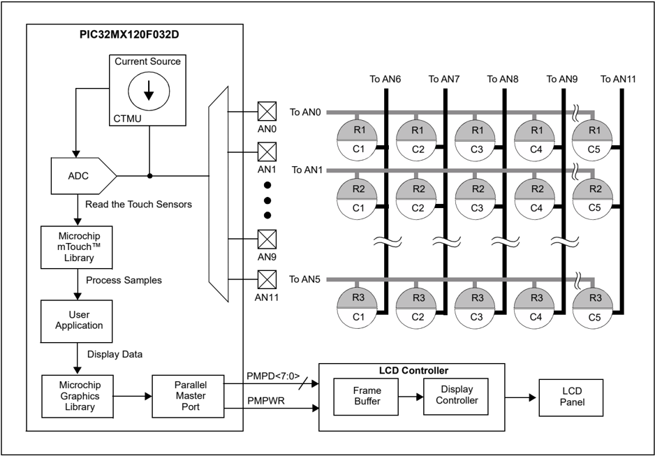

FIGURE 2-6: AUDIO PLAYBACK APPLICATION

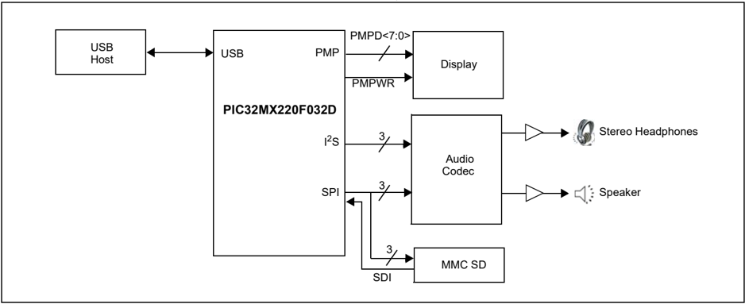

## PIC32MX1XX/2XX 28/36/44-PIN FAMILY

## 2.10 Considerations When Interfacing To Remotely Powered Circuits

## 2.10.1 NON-5V TOLERANT INPUT PINS

A quick review of the maximum rating section in the Section 30.0 'Electrical Characteristics' will indicate that the voltage on any non-5V tolerant pin should not exceed AVDD/VDD+0.3V. Figure 2-7 illustrates a remote circuit using an independent power source that is powered while connected to a PIC32 non-5V tolerant circuit which is not powered.

FIGURE 2-7: REMOTE CIRCUIT WITH AN INDEPENDENT POWER SOURCE

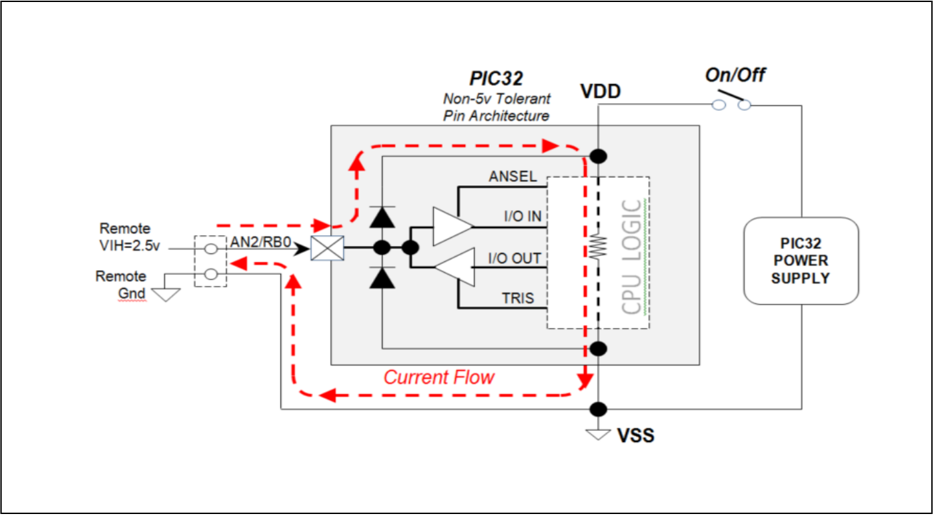

## PIC32MX1XX/2XX 28/36/44-PIN FAMILY

Without proper signal isolation on non-5V tolerant pins, the remote signal can power the PIC32 through the high side ESD protection diodes. This violates the maximum rating specification and can cause improper initialization of internal PIC32 logic circuits. In this case, it is recommended that users can implement a digital or analog signal isolation, as shown in Figure 28.

FIGURE 2-8: DIGITAL AND ANALOG SIGNAL ISOLATION

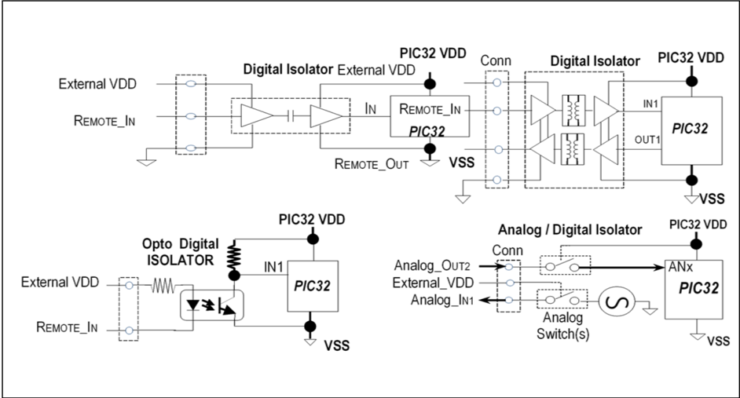

Digital signal isolators along with optional level translation examples are provided in Table 2-1.

TABLE 2-1: EXAMPLES OF DIGITAL ISOLATORS WITH OPTIONAL LEVEL TRANSLATION

|                             | Inductive Coupling   | Capacitive Coupling   | Optional Coupling   | Analog/Digital Switch   |
|-----------------------------|----------------------|-----------------------|---------------------|-------------------------|
| ADuM7241 / 40 ARZ (1Mbps)   | X                    | -                     | -                   | -                       |
| ADuM7241 / 40 CRZ (25 Mbps) | X                    | -                     | -                   | -                       |
| ISO721                      | -                    | X                     | -                   | -                       |
| LTV-829S (2 Chan)           | -                    | -                     | X                   | -                       |
| LTV-849S (4 Chan)           | -                    | -                     | -                   | -                       |
| FSA266 / NC7WB66            | -                    | -                     | -                   | X                       |

## PIC32MX1XX/2XX 28/36/44-PIN FAMILY

## 2.10.2 5V-TOLERANT INPUT PINS

The internal high-side diode on 5V-tolerant pins, rather than being connected to V DD, are bussed to an internal floating node, as shown in Figure 2-9. Voltages on these pins, if VDD &lt; 2.3V, should not exceed roughly 3.2V relative to PIC32 V SS . At 3.6V or above, it will violate the absolute maximum specification and impact the device reliability.

If a remotely powered digital only signal can be guaranteed to always be ≤ 3.2V relative to PIC32 V SS , then a 5V-tolerant pin can be used without a digital isolator. This can be assumed when the following is applicable:

- No ground loop issue
- The logic ground of the two circuits is not at the same absolute level
- No remote logic low inputs are less than V SS -0.3V

FIGURE 2-9: 5V-TOLERANT INPUT PINS BUSSED TO AN INTERNAL FLOATING NODE

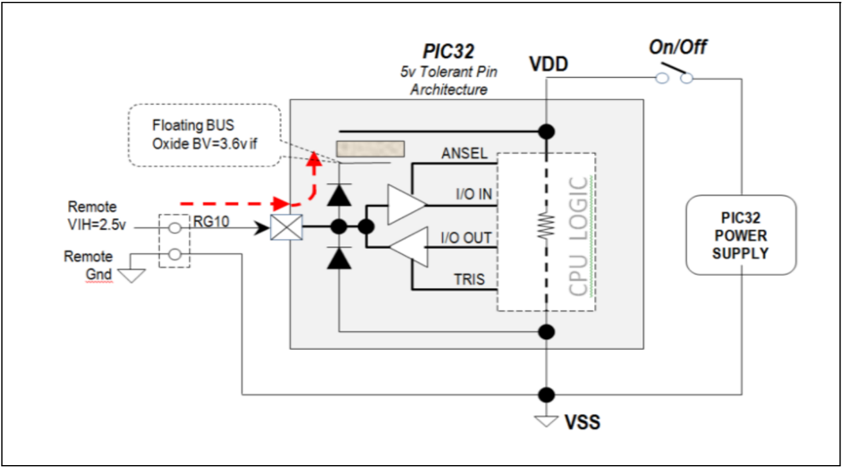

## PIC32MX1XX/2XX 28/36/44-PIN FAMILY

## 2.11 EMI/EMC/EFT (IEC 61000-4-4 and IEC 61000-4-2) Suppression Considerations

The  use  of  LDO  regulators  is  preferred  to  reduce overall  system  noise  and  provide  a  cleaner  power source. However, when utilizing switching Buck/Boost  regulators  as  the  local  power  source  for PIC32  devices,  as  well  as  in  electrically  noisy  environments  or  test  conditions  required  for  IEC  610004-4  and  IEC  61000-4-2,  users  should  evaluate  the use  of  T-Filters  (i.e.,  L-C-L)  on  the  power  pins,  as shown  in  Figure 2-10.  In  addition  to  a  more  stable power  source,  using  this  type  of  T-Filter  can  greatly reduce susceptibility to EMI sources and events.

FIGURE 2-10: EMI/EMC/EFT SUPPRESSION CIRCUIT

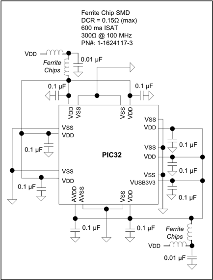

## NOTES:

## 3.0 CPU

Note: This data sheet summarizes the features of  the  PIC32MX1XX/2XX  28/36/44-pin Family of devices. It is not intended to be a  comprehensive  reference  source.  To complement  the  information  in  this  data sheet, refer to Section 2. 'CPU' (DS60001113), which is available from the Documentation &gt; Reference Manual section  of  the  Microchip  PIC32  web  site (www.microchip.com/pic32). Resources for  the  MIPS32 ®   M4K ®   Processor  Core are available at: www.imgtec.com.

The MIPS32 ®  M4K ®  Processor Core is the heart of the PIC32MX1XX/2XX family processor. The CPU fetches instructions, decodes each instruction, fetches source operands,  executes  each  instruction  and  writes  the results of instruction execution to the destinations.

## 3.1 Features

- 5-stage pipeline
- 32-bit address and data paths
- MIPS32 Enhanced Architecture (Release 2)
- -Multiply-accumulate and multiply-subtract instructions
- -Targeted multiply instruction
- -Zero/One detect instructions
- -WAIT instruction
- -Conditional move instructions ( MOVN , MOVZ )
- -Vectored interrupts
- -Programmable exception vector base
- -Atomic interrupt enable/disable
- -Bit field manipulation instructions

## PIC32MX1XX/2XX 28/36/44-PIN FAMILY

- MIPS16e ®  code compression
- -16-bit encoding of 32-bit instructions to improve code density
- -Special PC-relative instructions for efficient loading of addresses and constants
- -SAVE and RESTORE macro instructions for setting up and tearing down stack frames within subroutines
- -Improved support for handling 8 and 16-bit data types
- Simple Fixed Mapping Translation (FMT) mechanism
- Simple dual bus interface
- -Independent 32-bit address and data buses
- -Transactions can be aborted to improve interrupt latency
- Autonomous multiply/divide unit
- -Maximum issue rate of one 32x16 multiply per clock
- -Maximum issue rate of one 32x32 multiply every other clock
- -Early-in iterative divide. Minimum 11 and maximum 33 clock latency (dividend ( rs ) sign extension-dependent)
- Power control
- -Minimum frequency: 0 MHz
- -Low-Power mode (triggered by WAIT instruction)
- -Extensive use of local gated clocks
- EJTAG debug and instruction trace
- -Support for single stepping
- -Virtual instruction and data address/value
- -Breakpoints

## FIGURE 3-1: MIPS32 ®  M4K ®  PROCESSOR CORE BLOCK DIAGRAM

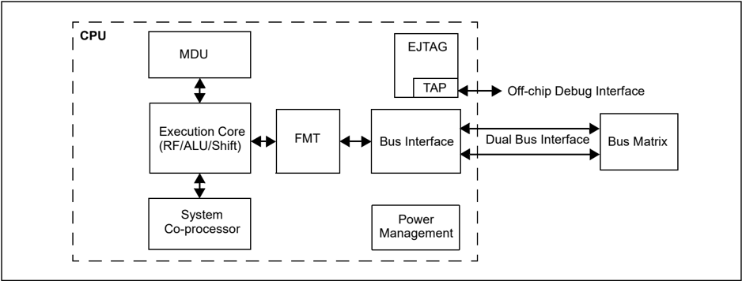

## PIC32MX1XX/2XX 28/36/44-PIN FAMILY

## 3.2 Architecture Overview

The  MIPS32  M4K  processor  core  contains  several logic blocks working together in parallel, providing an efficient high-performance computing engine.  The following blocks are included with the core:

- Execution Unit
- Multiply/Divide Unit (MDU)
- System Control Coprocessor (CP0)
- Fixed Mapping Translation (FMT)
- Dual Internal Bus interfaces
- Power Management
- MIPS16e ®  Support
- Enhanced JTAG (EJTAG) Controller

## 3.2.1 EXECUTION UNIT

The MIPS32 M4K processor core execution unit implements a load/store architecture with single-cycle ALU operations (logical, shift, add, subtract) and an autonomous multiply/divide unit. The core contains thirty-two 32-bit  General  Purpose  Registers  (GPRs)  used  for integer operations and address calculation. The register file consists of two read ports and one write port and is fully bypassed to minimize operation latency in the pipeline.

The execution unit includes:

- 32-bit adder used for calculating the data address
- Address unit for calculating the next instruction address
- Logic for branch determination and branch target address calculation
- Load aligner
- Bypass multiplexers used to avoid stalls when executing instruction streams where data producing instructions are followed closely by consumers of their results
- Leading Zero/One detect unit for implementing the CLZ and CLO instructions
- Arithmetic Logic Unit (ALU) for performing bitwise logical operations
- Shifter and store aligner

## 3.2.2 MULTIPLY/DIVIDE UNIT (MDU)

The  MIPS32  M4K  processor  core  includes  a  Multiply/Divide Unit (MDU) that contains a separate pipeline for multiply and divide operations. This pipeline operates in parallel with the Integer Unit (IU) pipeline and does not stall when the IU pipeline stalls. This allows MDU operations to be partially masked by system stalls and/or other integer unit instructions.

The high-performance MDU consists of a 32x16 booth recoded  multiplier,  result/accumulation  registers  (HI and LO), a divide state machine, and the necessary multiplexers and control logic. The first number shown ('32' of 32x16) represents the rs operand. The second number ('16' of 32x16) represents the rt operand. The PIC32 core only checks the value of the latter ( rt) operand to determine how many times the operation must pass  through  the  multiplier.  The  16x16  and  32x16 operations pass through the multiplier once. A 32x32 operation passes through the multiplier twice.

The MDU supports execution of one 16x16 or 32x16 multiply  operation  every  clock  cycle;  32x32  multiply operations  can  be  issued  every  other  clock  cycle. Appropriate  interlocks  are  implemented  to  stall  the issuance  of  back-to-back  32x32  multiply  operations. The multiply operand size is automatically determined by logic built into the MDU.

Divide operations are implemented with a simple 1 bit per clock iterative algorithm.  An early-in detection checks the sign extension of the dividend ( rs ) operand. If rs is 8 bits wide, 23 iterations are skipped. For a 16-bit wide rs , 15 iterations are skipped and for a 24-bit wide rs , 7 iterations are skipped. Any attempt to issue a subsequent MDU instruction  while  a  divide  is  still  active causes an IU pipeline stall until the divide operation is completed.

Table 3-1 lists the repeat rate (peak issue rate of cycles until the operation can be reissued) and latency (number of cycles until a result is available) for the PIC32 core multiply and divide instructions. The approximate latency and repeat rates are listed in terms of pipeline clocks.

## TABLE 3-1: MIPS32 ®  M4K ®  PROCESSOR CORE HIGH-PERFORMANCE INTEGER MULTIPLY/DIVIDE UNIT LATENCIES AND REPEAT RATES

| Opcode                  | Operand Size (mul rt ) (div rs )   |   Latency |   Repeat Rate |
|-------------------------|------------------------------------|-----------|---------------|
| MULT/MULTU, MADD/MADDU, | 16 bits                            |         1 |             1 |
| MSUB/MSUBU              | 32 bits                            |         2 |             2 |
| MUL                     | 16 bits                            |         2 |             1 |
|                         | 32 bits                            |         3 |             2 |
| DIV/DIVU                | 8 bits                             |        12 |            11 |
|                         | 16 bits                            |        19 |            18 |
|                         | 24 bits                            |        26 |            25 |
|                         | 32 bits                            |        33 |            32 |

## PIC32MX1XX/2XX 28/36/44-PIN FAMILY

The  MIPS  architecture  defines  that  the  result  of  a multiply or divide operation be placed in the HI and LO registers. Using the Move-From-HI ( MFHI ) and MoveFrom-LO  ( MFLO )  instructions,  these  values  can  be transferred to the General Purpose Register file.

In  addition  to  the  HI/LO  targeted  operations,  the MIPS32 ®  architecture also defines a multiply instruction, MUL , which places the least significant results in the primary register file instead of the HI/LO register pair. By avoiding the explicit MFLO instruction required when using the LO register, and by supporting  multiple  destination  registers,  the  throughput  of multiply-intensive operations is increased.

Two other instructions, Multiply-Add ( MADD ) and Multiply-Subtract  ( MSUB ),  are  used  to  perform  the multiply-accumulate and  multiply-subtract  operations. The MADD instruction multiplies two numbers and then

TABLE 3-2: COPROCESSOR 0 REGISTERS

| Register Number   | Register Name   | Function                                                                 |
|-------------------|-----------------|--------------------------------------------------------------------------|
| 0-6               | Reserved        | Reserved in the PIC32MX1XX/2XX family core.                              |
| 7                 | HWREna          | Enables access via the RDHWR instruction to selected hardware registers. |
| 8                 | BadVAddr (1)    | Reports the address for the most recent address-related exception.       |
| 9                 | Count (1)       | Processor cycle count.                                                   |
| 10                | Reserved        | Reserved in the PIC32MX1XX/2XX family core.                              |
| 11                | Compare (1)     | Timer interrupt control.                                                 |
| 12                | Status (1)      | Processor status and control.                                            |
| 12                | IntCtl (1)      | Interrupt system status and control.                                     |
| 12                | SRSCtl (1)      | Shadow register set status and control.                                  |
| 12                | SRSMap (1)      | Provides mapping from vectored interrupt to a shadow set.                |
| 13                | Cause (1)       | Cause of last general exception.                                         |
| 14                | EPC (1)         | Program counter at last exception.                                       |
| 15                | PRId            | Processor identification and revision.                                   |
| 15                | EBASE           | Exception vector base register.                                          |
| 16                | Config          | Configuration register.                                                  |
| 16                | Config1         | Configuration Register 1.                                                |
| 16                | Config2         | Configuration Register 2.                                                |
| 16                | Config3         | Configuration Register 3.                                                |
| 17-22             | Reserved        | Reserved in the PIC32MX1XX/2XX family core.                              |
| 23                | Debug (2)       | Debug control and exception status.                                      |
| 24                | DEPC (2)        | Program counter at last debug exception.                                 |
| 25-29             | Reserved        | Reserved in the PIC32MX1XX/2XX family core.                              |
| 30                | ErrorEPC (1)    | Program counter at last error.                                           |
| 31                | DESAVE (2)      | Debug handler scratchpad register.                                       |

Note

1: Registers used in exception processing.

2: Registers used during debug.

adds the product to the current contents of the HI and LO registers. Similarly, the MSUB instruction multiplies two operands and then subtracts the product from the HI and LO registers. The MADD and MSUB operations are commonly used in DSP algorithms.

## 3.2.3 SYSTEM CONTROL COPROCESSOR (CP0)

In  the  MIPS  architecture,  CP0  is  responsible  for  the virtual-to-physical  address  translation,  the  exception control system, the processor's diagnostics capability, the  operating  modes  (Kernel,  User  and  Debug)  and whether interrupts are enabled or disabled. Configuration  information,  such  as  presence  of  options  like MIPS16e,  is  also  available  by  accessing  the  CP0 registers, listed in Table 3-2.

## PIC32MX1XX/2XX 28/36/44-PIN FAMILY

Coprocessor  0  also  contains  the  logic  for  identifying and managing exceptions. Exceptions can be caused by a variety of sources, including alignment errors in data, external events or program errors. Table 3-3 lists the exception types in order of priority.

TABLE 3-3: MIPS32 ®  M4K ®  PROCESSOR CORE EXCEPTION TYPES

| Exception   | Description                                                                                                                      |
|-------------|----------------------------------------------------------------------------------------------------------------------------------|
| Reset       | Assertion MCLR or a Power-on Reset (POR).                                                                                        |
| DSS         | EJTAG debug single step.                                                                                                         |
| DINT        | EJTAG debug interrupt. Caused by the assertion of the external EJ_DINT input or by setting the EjtagBrk bit in the ECR register. |
| NMI         | Assertion of NMI signal.                                                                                                         |
| Interrupt   | Assertion of unmasked hardware or software interrupt signal.                                                                     |
| DIB         | EJTAG debug hardware instruction break matched.                                                                                  |
| AdEL        | Fetch address alignment error. Fetch reference to protected address.                                                             |
| IBE         | Instruction fetch bus error.                                                                                                     |
| DBp         | EJTAG breakpoint (execution of SDBBP instruction).                                                                               |
| Sys         | Execution of SYSCALL instruction.                                                                                                |
| Bp          | Execution of BREAK instruction.                                                                                                  |
| RI          | Execution of a reserved instruction.                                                                                             |
| CpU         | Execution of a coprocessor instruction for a coprocessor that is not enabled.                                                    |
| CEU         | Execution of a CorExtend instruction when CorExtend is not enabled.                                                              |
| Ov          | Execution of an arithmetic instruction that overflowed.                                                                          |
| Tr          | Execution of a trap (when trap condition is true).                                                                               |
| DDBL/DDBS   | EJTAG Data Address Break (address only) or EJTAG data value break on store (address + value).                                    |
| AdEL        | Load address alignment error. Load reference to protected address.                                                               |
| AdES        | Store address alignment error. Store to protected address.                                                                       |
| DBE         | Load or store bus error.                                                                                                         |
| DDBL        | EJTAG data hardware breakpoint matched in load data compare.                                                                     |

## 3.3 Power Management

The MIPS M4K processor core offers many power management  features,  including  low-power  design,  active power management and power-down modes of operation. The core is a static design that supports slowing or Halting the  clocks,  which  reduces  system  power  consumption during Idle periods.

## 3.3.1 INSTRUCTION-CONTROLLED POWER MANAGEMENT

The  mechanism  for  invoking  Power-Down  mode  is through  execution  of  the WAIT instruction.  For  more information on power management, see Section 26.0 'Power-Saving Features' .

## 3.4 EJTAG Debug Support

The MIPS M4K processor core provides an Enhanced JTAG (EJTAG) interface for use in the software debug of application and kernel code. In addition to standard User mode and Kernel modes of operation, the M4K core  provides  a  Debug  mode  that  is  entered  after  a debug exception (derived from a hardware breakpoint, single-step exception, etc.) is taken and continues until a  Debug  Exception  Return  ( DERET ) instruction is executed. During this time, the processor executes the debug exception handler routine.

The EJTAG interface operates through the Test Access Port (TAP), a serial communication port used for transferring test data in and out of the core. In addition to the standard JTAG instructions, special instructions defined in the EJTAG  specification define  which registers are selected and how they are used.

## PIC32MX1XX/2XX 28/36/44-PIN FAMILY

## 4.0 MEMORY ORGANIZATION

Note:

This data sheet summarizes the features

of  the  PIC32MX1XX/2XX  28/36/44-pin Family of devices. It is not intended to be a  comprehensive  reference  source.For detailed  information,  refer  to Section  3. 'Memory Organization' (DS60001115), which is available from the Documentation &gt; Reference Manual section  of  the  Microchip  PIC32  web  site (www.microchip.com/pic32).

PIC32MX1XX/2XX  28/36/44-pin  Family  microcontrollers  provide  4  GB  unified  virtual  memory  address space. All  memory  regions,  including  program,  data memory, Special Function Registers (SFRs), and Configuration registers, reside in this address space at their respective  unique  addresses. The  program  and  data memories can be optionally partitioned into user and kernel memories. In addition, the data memory can be made executable, allowing PIC32MX1XX/2XX 28/36/44-pin  Family  devices  to  execute  from  data memory.

Key features include:

- 32-bit native data width
- Separate User (KUSEG) and Kernel (KSEG0/KSEG1) mode address space
- Flexible program Flash memory partitioning
- Flexible data RAM partitioning for data and program space
- Separate boot Flash memory for protected code
- Robust bus exception handling to intercept runaway code
- Simple memory mapping with Fixed Mapping Translation (FMT) unit
- Cacheable (KSEG0) and non-cacheable (KSEG1) address regions

## 4.1 PIC32MX1XX/2XX 28/36/44-pin Family Memory Layout

PIC32MX1XX/2XX  28/36/44-pin  Family  microcontrollers implement two address schemes: virtual and physical. All hardware resources, such as program memory, data  memory  and  peripherals,  are  located  at  their respective  physical  addresses. Virtual  addresses  are exclusively  used  by  the  CPU  to  fetch  and  execute instructions  as  well  as  access  peripherals.  Physical addresses are used by bus master peripherals, such as DMA  and  the  Flash  controller,  that  access  memory independently of the CPU.

The memory maps for the PIC32MX1XX/2XX 28/36/44-pin Family devices are illustrated in Figure 4-1 through Figure 4-6.

Table 4-1 provides SFR memory map details.

## PIC32MX1XX/2XX 28/36/44-PIN FAMILY

FIGURE 4-1: MEMORY MAP ON RESET FOR PIC32MX110/210 DEVICES (4 KB RAM, 16 KB FLASH)


## PIC32MX1XX/2XX 28/36/44-PIN FAMILY

FIGURE 4-2: MEMORY MAP ON RESET FOR PIC32MX120/220 DEVICES (8 KB RAM, 32 KB FLASH)

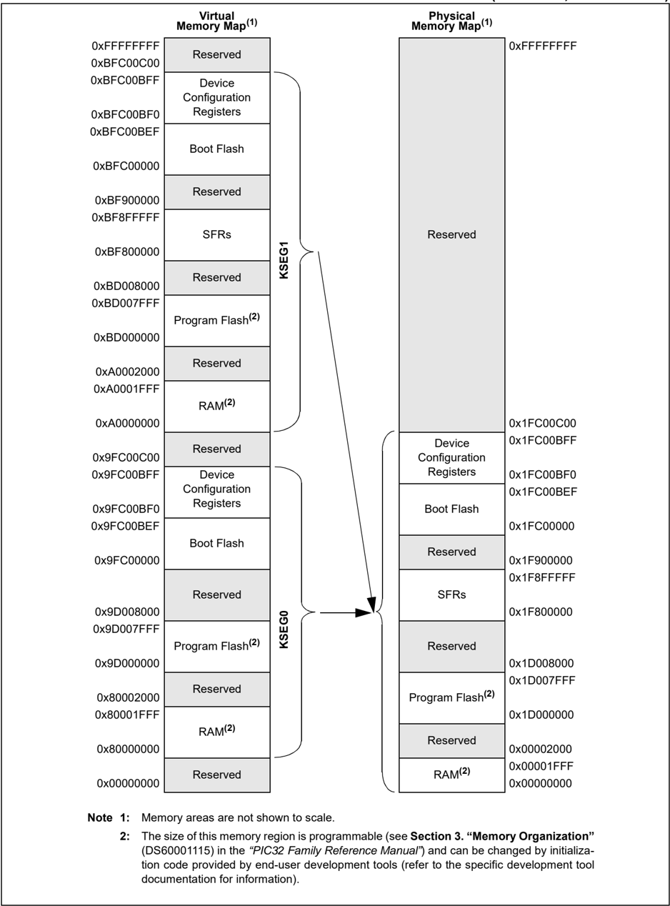

## PIC32MX1XX/2XX 28/36/44-PIN FAMILY

## FIGURE 4-3: MEMORY MAP ON RESET FOR PIC32MX130/230 DEVICES (16 KB RAM, 64 KB FLASH)

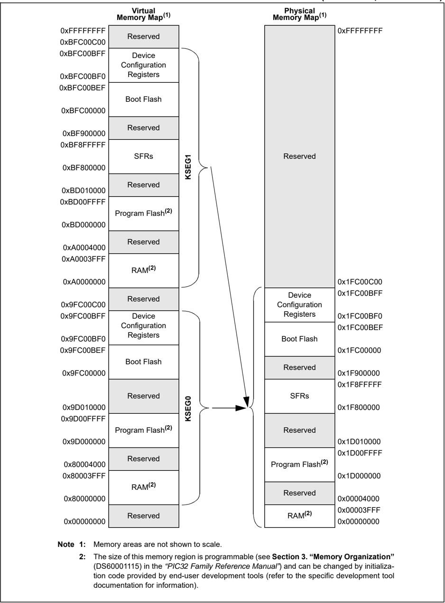

## PIC32MX1XX/2XX 28/36/44-PIN FAMILY

## FIGURE 4-4: MEMORY MAP ON RESET FOR PIC32MX150/250 DEVICES (32 KB RAM, 128 KB FLASH)


## PIC32MX1XX/2XX 28/36/44-PIN FAMILY

FIGURE 4-5: MEMORY MAP ON RESET FOR PIC32MX170/270 DEVICES (64 KB RAM, 256 KB FLASH)

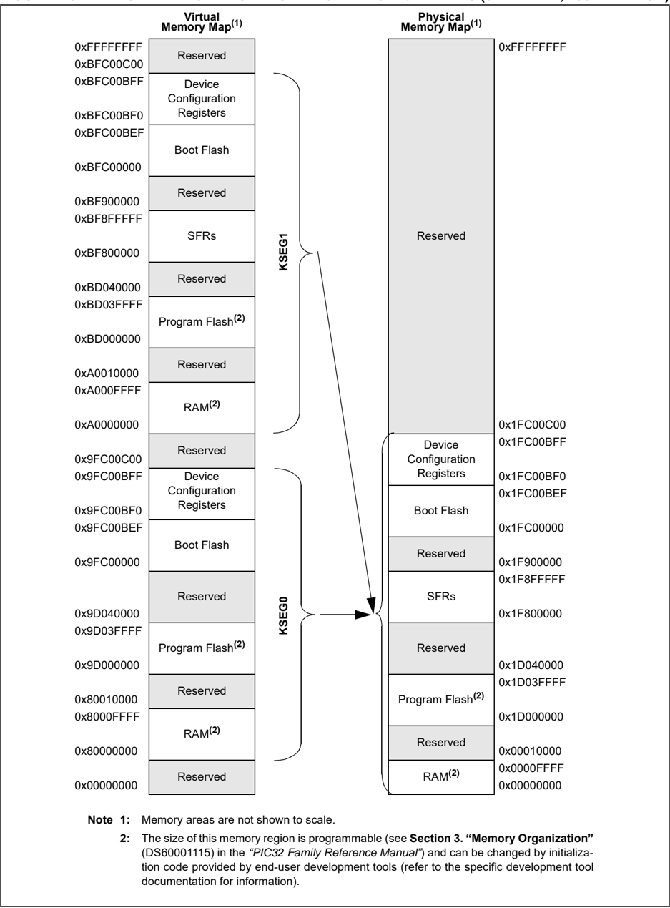

## PIC32MX1XX/2XX 28/36/44-PIN FAMILY

## FIGURE 4-6: MEMORY MAP ON RESET FOR PIC32MX130/230 DEVICES (16 KB RAM, 256 KB FLASH)

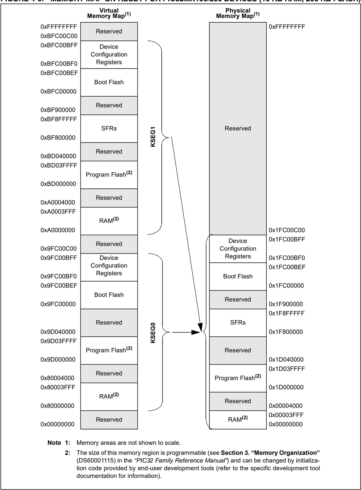

## PIC32MX1XX/2XX 28/36/44-PIN FAMILY

## TABLE 4-1: SFR MEMORY MAP

|                           | Virtual Address   | Virtual Address   |
|---------------------------|-------------------|-------------------|
| Peripheral                | Base              | Offset Start      |
| Watchdog Timer            | 0xBF80            | 0x0000            |
| RTCC                      | 0xBF80            | 0x0200            |
| Timer1-5                  | 0xBF80            | 0x0600            |
| Input Capture 1-5         | 0xBF80            | 0x2000            |
| Output Compare 1-5        | 0xBF80            | 0x3000            |
| IC1 and IC2               | 0xBF80            | 0x5000            |
| SPI1 and SPI2             | 0xBF80            | 0x5800            |
| UART1 and UART2           | 0xBF80            | 0x6000            |
| PMP                       | 0xBF80            | 0x7000            |
| ADC                       | 0xBF80            | 0x9000            |
| CVREF                     | 0xBF80            | 0x9800            |
| Comparator                | 0xBF80            | 0xA000            |
| CTMU                      | 0xBF80            | 0xA200            |
| Oscillator                | 0xBF80            | 0xF000            |
| Device and Revision ID    | 0xBF80            | 0xF220            |
| Peripheral Module Disable | 0xBF80            | 0xF240            |
| Flash Controller          | 0xBF80            | 0xF400            |
| Reset                     |                   | 0xF600            |
| PPS                       |                   | 0xFA04            |
| Interrupts                | 0xBF88            | 0x1000            |
| Bus Matrix                | 0xBF88            | 0x2000            |
| DMA                       | 0xBF88            | 0x3000            |
| USB                       | 0xBF88            | 0x5050            |
| PORTA-PORTC               | 0xBF88            | 0x6000            |
| Configuration             | 0xBFC0            | 0x0BF0            |

## 4.2 Bus Matrix Control Registers

TABLE 4-2: BUS MATRIX REGISTER MAP

|   Virtual Address (BF88_#) | Register Name   |                           | Bits                      | Bits                      | Bits                      | Bits                      | Bits                      | Bits                      | Bits                      | Bits                      | Bits                      | Bits                      | Bits                      | Bits                      | Bits                                       | Bits                                       | Bits                                       | Bits                                       |                                            |
|----------------------------|-----------------|---------------------------|---------------------------|---------------------------|---------------------------|---------------------------|---------------------------|---------------------------|---------------------------|---------------------------|---------------------------|---------------------------|---------------------------|---------------------------|--------------------------------------------|--------------------------------------------|--------------------------------------------|--------------------------------------------|--------------------------------------------|
|                            |                 | Bit Range                 | 31/15                     | 30/14                     | 29/13                     | 28/12                     | 27/11                     | 26/10 25/9                | 24/8                      |                           | 23/7 22/6                 | 21/5                      | 20/4                      | 19/3                      |                                            | 18/2                                       | 17/1                                       | 16/0                                       | All Resets                                 |
|                       2000 | BMXCON (1)      | 31:16                     | -                         | -                         | -                         | -                         | - -                       | -                         |                           | -                         | -                         | -                         | -                         | BMXERRIXI                 | BMXERRICD BMXERRDMA BMXERRDS BMXERRIS 001F | BMXERRICD BMXERRDMA BMXERRDS BMXERRIS 001F | BMXERRICD BMXERRDMA BMXERRDS BMXERRIS 001F | BMXERRICD BMXERRDMA BMXERRDS BMXERRIS 001F | BMXERRICD BMXERRDMA BMXERRDS BMXERRIS 001F |
|                       2000 | BMXCON (1)      | 15:0                      | -                         | -                         | -                         | -                         | -                         | -                         | -                         | -                         | -                         | BMXWSDRM                  | -                         | -                         | - BMXARB<2:0>                              | - BMXARB<2:0>                              | - BMXARB<2:0>                              | - BMXARB<2:0>                              | 0041                                       |
|                       2010 | BMXDKPBA (1)    | 31:16                     | -                         | -                         | -                         | -                         | -                         | -                         | -                         | -                         | -                         | -                         | - -                       | -                         | -                                          |                                            | -                                          | -                                          | 0000                                       |
|                       2010 | BMXDKPBA (1)    | 15:0 BMXDKPBA<15:0>       | 15:0 BMXDKPBA<15:0>       | 15:0 BMXDKPBA<15:0>       | 15:0 BMXDKPBA<15:0>       | 15:0 BMXDKPBA<15:0>       | 15:0 BMXDKPBA<15:0>       | 15:0 BMXDKPBA<15:0>       | 15:0 BMXDKPBA<15:0>       | 15:0 BMXDKPBA<15:0>       | 15:0 BMXDKPBA<15:0>       | 15:0 BMXDKPBA<15:0>       | 15:0 BMXDKPBA<15:0>       | 15:0 BMXDKPBA<15:0>       | 15:0 BMXDKPBA<15:0>                        | 15:0 BMXDKPBA<15:0>                        | 15:0 BMXDKPBA<15:0>                        | 15:0 BMXDKPBA<15:0>                        | 0000                                       |
|                       2020 | BMXDUDBA (1)    | 31:16                     | -                         | -                         | -                         | -                         | -                         | -                         | -                         | -                         | -                         | -                         | -                         | -                         | -                                          | -                                          | -                                          | -                                          | 0000                                       |
|                       2020 | BMXDUDBA (1)    | 15:0 BMXDUDBA<15:0>       | 15:0 BMXDUDBA<15:0>       | 15:0 BMXDUDBA<15:0>       | 15:0 BMXDUDBA<15:0>       | 15:0 BMXDUDBA<15:0>       | 15:0 BMXDUDBA<15:0>       | 15:0 BMXDUDBA<15:0>       | 15:0 BMXDUDBA<15:0>       | 15:0 BMXDUDBA<15:0>       | 15:0 BMXDUDBA<15:0>       | 15:0 BMXDUDBA<15:0>       | 15:0 BMXDUDBA<15:0>       | 15:0 BMXDUDBA<15:0>       | 15:0 BMXDUDBA<15:0>                        | 15:0 BMXDUDBA<15:0>                        | 15:0 BMXDUDBA<15:0>                        | 15:0 BMXDUDBA<15:0>                        | 0000                                       |
|                       2030 | BMXDUPBA (1)    | 31:16                     | -                         | -                         | -                         | -                         | -                         | -                         | -                         | -                         | -                         | -                         | -                         | -                         | -                                          | -                                          | -                                          | -                                          | 0000                                       |
|                       2030 | BMXDUPBA (1)    | 15:0 BMXDUPBA<15:0>       | 15:0 BMXDUPBA<15:0>       | 15:0 BMXDUPBA<15:0>       | 15:0 BMXDUPBA<15:0>       | 15:0 BMXDUPBA<15:0>       | 15:0 BMXDUPBA<15:0>       | 15:0 BMXDUPBA<15:0>       | 15:0 BMXDUPBA<15:0>       | 15:0 BMXDUPBA<15:0>       | 15:0 BMXDUPBA<15:0>       | 15:0 BMXDUPBA<15:0>       | 15:0 BMXDUPBA<15:0>       | 15:0 BMXDUPBA<15:0>       | 15:0 BMXDUPBA<15:0>                        | 15:0 BMXDUPBA<15:0>                        | 15:0 BMXDUPBA<15:0>                        | 15:0 BMXDUPBA<15:0>                        | 0000                                       |
|                       2040 | BMXDRMSZ        | 31:16                     |                           |                           |                           |                           |                           |                           |                           |                           |                           |                           |                           |                           |                                            |                                            |                                            |                                            | xxxx                                       |
|                       2040 | BMXDRMSZ        | BMXDRMSZ<31:0> 15:0       | BMXDRMSZ<31:0> 15:0       | BMXDRMSZ<31:0> 15:0       | BMXDRMSZ<31:0> 15:0       | BMXDRMSZ<31:0> 15:0       | BMXDRMSZ<31:0> 15:0       | BMXDRMSZ<31:0> 15:0       | BMXDRMSZ<31:0> 15:0       | BMXDRMSZ<31:0> 15:0       | BMXDRMSZ<31:0> 15:0       | BMXDRMSZ<31:0> 15:0       | BMXDRMSZ<31:0> 15:0       | BMXDRMSZ<31:0> 15:0       | BMXDRMSZ<31:0> 15:0                        | BMXDRMSZ<31:0> 15:0                        | BMXDRMSZ<31:0> 15:0                        | BMXDRMSZ<31:0> 15:0                        | xxxx                                       |
|                       2050 | BMXPUPBA (1)    | 31:16                     | -                         | -                         | -                         | -                         | -                         | -                         | -                         | -                         | -                         | -                         | -                         | -                         | BMXPUPBA<19:16>                            | BMXPUPBA<19:16>                            | BMXPUPBA<19:16>                            | BMXPUPBA<19:16>                            | 0000                                       |
|                       2050 | BMXPUPBA (1)    | 15:0 BMXPUPBA<15:0>       | 15:0 BMXPUPBA<15:0>       | 15:0 BMXPUPBA<15:0>       | 15:0 BMXPUPBA<15:0>       | 15:0 BMXPUPBA<15:0>       | 15:0 BMXPUPBA<15:0>       | 15:0 BMXPUPBA<15:0>       | 15:0 BMXPUPBA<15:0>       | 15:0 BMXPUPBA<15:0>       | 15:0 BMXPUPBA<15:0>       | 15:0 BMXPUPBA<15:0>       | 15:0 BMXPUPBA<15:0>       | 15:0 BMXPUPBA<15:0>       | 15:0 BMXPUPBA<15:0>                        | 15:0 BMXPUPBA<15:0>                        | 15:0 BMXPUPBA<15:0>                        | 15:0 BMXPUPBA<15:0>                        | 0000                                       |
|                       2060 | BMXPFMSZ        | 31:16                     |                           |                           |                           |                           |                           |                           |                           |                           |                           |                           |                           |                           |                                            |                                            |                                            |                                            | xxxx                                       |
|                       2060 | BMXPFMSZ        | BMXPFMSZ<31:0> 15:0 xxxx  | BMXPFMSZ<31:0> 15:0 xxxx  | BMXPFMSZ<31:0> 15:0 xxxx  | BMXPFMSZ<31:0> 15:0 xxxx  | BMXPFMSZ<31:0> 15:0 xxxx  | BMXPFMSZ<31:0> 15:0 xxxx  | BMXPFMSZ<31:0> 15:0 xxxx  | BMXPFMSZ<31:0> 15:0 xxxx  | BMXPFMSZ<31:0> 15:0 xxxx  | BMXPFMSZ<31:0> 15:0 xxxx  | BMXPFMSZ<31:0> 15:0 xxxx  | BMXPFMSZ<31:0> 15:0 xxxx  | BMXPFMSZ<31:0> 15:0 xxxx  | BMXPFMSZ<31:0> 15:0 xxxx                   | BMXPFMSZ<31:0> 15:0 xxxx                   | BMXPFMSZ<31:0> 15:0 xxxx                   | BMXPFMSZ<31:0> 15:0 xxxx                   |                                            |
|                       2070 | BMXBOOTSZ       | 31:16                     |                           |                           |                           |                           |                           |                           |                           |                           |                           |                           |                           |                           |                                            |                                            |                                            |                                            | 0000                                       |
|                       2070 | BMXBOOTSZ       | BMXBOOTSZ<31:0> 15:0 0C00 | BMXBOOTSZ<31:0> 15:0 0C00 | BMXBOOTSZ<31:0> 15:0 0C00 | BMXBOOTSZ<31:0> 15:0 0C00 | BMXBOOTSZ<31:0> 15:0 0C00 | BMXBOOTSZ<31:0> 15:0 0C00 | BMXBOOTSZ<31:0> 15:0 0C00 | BMXBOOTSZ<31:0> 15:0 0C00 | BMXBOOTSZ<31:0> 15:0 0C00 | BMXBOOTSZ<31:0> 15:0 0C00 | BMXBOOTSZ<31:0> 15:0 0C00 | BMXBOOTSZ<31:0> 15:0 0C00 | BMXBOOTSZ<31:0> 15:0 0C00 | BMXBOOTSZ<31:0> 15:0 0C00                  | BMXBOOTSZ<31:0> 15:0 0C00                  | BMXBOOTSZ<31:0> 15:0 0C00                  | BMXBOOTSZ<31:0> 15:0 0C00                  |                                            |

Legend:

Note 1:

x = unknown value on Reset; - = unimplemented, read as ' 0 '. Reset values are shown in hexadecimal.

This register has corresponding CLR, SET and INV registers at its virtual address, plus an offset of 0x4, 0x8 and 0xC, respectively. See Section 11.2 'CLR, SET and INV Registers' for more information.

## PIC32MX1XX/2XX 28/36/44-PIN FAMILY

## REGISTER 4-1: BMXCON: BUS MATRIX CONFIGURATION REGISTER

| Bit Range   | Bit 31/23/15/7   | Bit 30/22/14/6   | Bit 29/21/13/5   | Bit 28/20/12/4   | Bit 27/19/11/3   | Bit 26/18/10/2   | Bit 25/17/9/1   | Bit 24/16/8/0   |
|-------------|------------------|------------------|------------------|------------------|------------------|------------------|-----------------|-----------------|
| 31:24       | U-0              | U-0              | U-0              | U-0              | U-0              | U-0              | U-0             | U-0             |
| 31:24       | -                | -                | -                | -                | -                | -                | -               | -               |
| 23:16       | U-0              | U-0              | U-0              | R/W-1            | R/W-1            | R/W-1            | R/W-1           | R/W-1           |
| 23:16       | -                | -                | -                | BMX ERRIXI       | BMX ERRICD       | BMX ERRDMA       | BMX ERRDS       | BMX ERRIS       |
| 15:8        | U-0              | U-0              | U-0              | U-0              | U-0              | U-0              | U-0             | U-0             |
| 15:8        | -                | -                | -                | -                | -                | -                | -               | -               |
| 7:0         | U-0              | R/W-1            | U-0              | U-0              | U-0              | R/W-0            | R/W-0           | R/W-1           |
| 7:0         | -                | BMX WSDRM        | -                | -                | -                | BMXARB<2:0>      | BMXARB<2:0>     | BMXARB<2:0>     |

## Legend:

R = Readable bit

W = Writable bit

U = Unimplemented bit, read as '0'

-n = Value at POR

'1' = Bit is set

'0' = Bit is cleared

## bit 31-21 Unimplemented: Read as ' 0 '

bit 20

BMXERRIXI:

Enable Bus Error from IXI bit

1 = Enable bus error exceptions for unmapped address accesses initiated from IXI shared bus

0 = Disable bus error exceptions for unmapped address accesses initiated from IXI shared bus

bit 19 BMXERRICD: Enable Bus Error from ICD Debug Unit bit

1 = Enable bus error exceptions for unmapped address accesses initiated from ICD

- 0 = Disable bus error exceptions for unmapped address accesses initiated from ICD

bit 18 BMXERRDMA: Bus Error from DMA bit

1 = Enable bus error exceptions for unmapped address accesses initiated from DMA

0 = Disable bus error exceptions for unmapped address accesses initiated from DMA

bit 17 BMXERRDS: Bus Error from CPU Data Access bit (disabled in Debug mode)

1 = Enable bus error exceptions for unmapped address accesses initiated from CPU data access

0 = Disable bus error exceptions for unmapped address accesses initiated from CPU data access

bit 16 BMXERRIS: Bus Error from CPU Instruction Access bit (disabled in Debug mode)

- 1 = Enable bus error exceptions for unmapped address accesses initiated from CPU instruction access

- 0 = Disable bus error exceptions for unmapped address accesses initiated from CPU instruction access

bit 15-7 Unimplemented: Read as ' 0 '

bit 6

BMXWSDRM:

CPU Instruction or Data Access from Data RAM Wait State bit

1 = Data RAM accesses from CPU have one wait state for address setup

0 = Data RAM accesses from CPU have zero wait states for address setup

bit 5-3 Unimplemented: Read as ' 0 '

bit 2-0

BMXARB&lt;2:0&gt;:

Bus Matrix Arbitration Mode bits

111 = Reserved (using these Configuration modes will produce undefined behavior)

•

•

•

011 = Reserved (using these Configuration modes will produce undefined behavior)

010 = Arbitration Mode 2

001 = Arbitration Mode 1 (default)

000 = Arbitration Mode 0

## PIC32MX1XX/2XX 28/36/44-PIN FAMILY

## REGISTER 4-2: BMXDKPBA: DATA RAM KERNEL PROGRAM BASE ADDRESS REGISTER

| Bit Range   | Bit 31/23/15/7   | Bit 30/22/14/6   | Bit 29/21/13/5   | Bit 28/20/12/4   | Bit 27/19/11/3   | Bit 26/18/10/2   | Bit 25/17/9/1   | Bit 24/16/8/0   |
|-------------|------------------|------------------|------------------|------------------|------------------|------------------|-----------------|-----------------|
| 31:24       | U-0              | U-0              | U-0              | U-0              | U-0              | U-0              | U-0             | U-0             |
| 31:24       | -                | -                | -                | -                | -                | -                | -               | -               |
| 23:16       | U-0              | U-0              | U-0              | U-0              | U-0              | U-0              | U-0             | U-0             |
| 23:16       | -                | -                | -                | -                | -                | -                | -               | -               |
| 15:8        | R/W-0            | R/W-0            | R/W-0            | R/W-0            | R/W-0            | R/W-0            | R-0             | R-0             |
| 15:8        | BMXDKPBA<15:8>   | BMXDKPBA<15:8>   | BMXDKPBA<15:8>   | BMXDKPBA<15:8>   | BMXDKPBA<15:8>   | BMXDKPBA<15:8>   | BMXDKPBA<15:8>  | BMXDKPBA<15:8>  |
| 7:0         | R-0              | R-0              | R-0              | R-0              | R-0              | R-0              | R-0             | R-0             |
| 7:0         | BMXDKPBA<7:0>    | BMXDKPBA<7:0>    | BMXDKPBA<7:0>    | BMXDKPBA<7:0>    | BMXDKPBA<7:0>    | BMXDKPBA<7:0>    | BMXDKPBA<7:0>   | BMXDKPBA<7:0>   |

## Legend:

R = Readable bit

W = Writable bit

U = Unimplemented bit, read as '0'

-n = Value at POR

'1' = Bit is set

'0' = Bit is cleared

x = Bit is unknown

bit 31-16 Unimplemented:

Read as ' 0 '

bit 15-10 BMXDKPBA&lt;15:10&gt;:

DRM Kernel Program Base Address bits

When non-zero, this value selects the relative base address for kernel program space in RAM

bit 9-0 BMXDKPBA&lt;9:0&gt;:

Read-Only bits

This value is always ' 0 ', which forces 1 KB increments

- Note 1: At Reset, the value in this register is forced to zero, which causes all of the RAM to be allocated to Kernal mode data usage.
- 2: The value in this register must be less than or equal to BMXDRMSZ.

## PIC32MX1XX/2XX 28/36/44-PIN FAMILY

## REGISTER 4-3: BMXDUDBA: DATA RAM USER DATA BASE ADDRESS REGISTER

| Bit Range   | Bit 31/23/15/7   | Bit 30/22/14/6   | Bit 29/21/13/5   | Bit 28/20/12/4   | Bit 27/19/11/3   | Bit 26/18/10/2   | Bit 25/17/9/1   | Bit 24/16/8/0   |
|-------------|------------------|------------------|------------------|------------------|------------------|------------------|-----------------|-----------------|
| 31:24       | U-0              | U-0              | U-0              | U-0              | U-0              | U-0              | U-0             | U-0             |
| 31:24       | -                | -                | -                | -                | -                | -                | -               | -               |
| 23:16       | U-0              | U-0              | U-0              | U-0              | U-0              | U-0              | U-0             | U-0             |
| 23:16       | -                | -                | -                | -                | -                | -                | -               | -               |
| 15:8        | R/W-0            | R/W-0            | R/W-0            | R/W-0            | R/W-0            | R/W-0            | R-0             | R-0             |
| 15:8        | BMXDUDBA<15:8>   | BMXDUDBA<15:8>   | BMXDUDBA<15:8>   | BMXDUDBA<15:8>   | BMXDUDBA<15:8>   | BMXDUDBA<15:8>   | BMXDUDBA<15:8>  | BMXDUDBA<15:8>  |
| 7:0         | R-0              | R-0              | R-0              | R-0              | R-0              | R-0              | R-0             | R-0             |
| 7:0         | BMXDUDBA<7:0>    | BMXDUDBA<7:0>    | BMXDUDBA<7:0>    | BMXDUDBA<7:0>    | BMXDUDBA<7:0>    | BMXDUDBA<7:0>    | BMXDUDBA<7:0>   | BMXDUDBA<7:0>   |

## Legend:

R = Readable bit

W = Writable bit

U = Unimplemented bit, read as '0'

-n = Value at POR

'1' = Bit is set

'0' = Bit is cleared

x = Bit is unknown

bit 31-16 Unimplemented: Read as ' 0

'

bit 15-10 BMXDUDBA&lt;15:10&gt;: DRM User Data Base Address bits

When non-zero, the value selects the relative base address for User mode data space in RAM, the value must be greater than BMXDKPBA.

bit 9-0 BMXDUDBA&lt;9:0&gt;: Read-Only bits

This value is always ' 0 ', which forces 1 KB increments

- Note 1: At Reset, the value in this register is forced to zero, which causes all of the RAM to be allocated to Kernal mode data usage.
- 2: The value in this register must be less than or equal to BMXDRMSZ.

## PIC32MX1XX/2XX 28/36/44-PIN FAMILY

## REGISTER 4-4: BMXDUPBA: DATA RAM USER PROGRAM BASE ADDRESS REGISTER

| Bit Range   | Bit 31/23/15/7   | Bit 30/22/14/6   | Bit 29/21/13/5   | Bit 28/20/12/4   | Bit 27/19/11/3   | Bit 26/18/10/2   | Bit 25/17/9/1   | Bit 24/16/8/0   |
|-------------|------------------|------------------|------------------|------------------|------------------|------------------|-----------------|-----------------|
| 31:24       | U-0              | U-0              | U-0              | U-0              | U-0              | U-0              | U-0             | U-0             |
| 31:24       | -                | -                | -                | -                | -                | -                | -               | -               |
| 23:16       | U-0              | U-0              | U-0              | U-0              | U-0              | U-0              | U-0             | U-0             |
| 23:16       | -                | -                | -                | -                | -                | -                | -               | -               |
| 15:8        | R/W-0            | R/W-0            | R/W-0            | R/W-0            | R/W-0            | R/W-0            | R-0             | R-0             |
| 15:8        | BMXDUPBA<15:8>   | BMXDUPBA<15:8>   | BMXDUPBA<15:8>   | BMXDUPBA<15:8>   | BMXDUPBA<15:8>   | BMXDUPBA<15:8>   | BMXDUPBA<15:8>  | BMXDUPBA<15:8>  |
| 7:0         | R-0              | R-0              | R-0              | R-0              | R-0              | R-0              | R-0             | R-0             |
| 7:0         | BMXDUPBA<7:0>    | BMXDUPBA<7:0>    | BMXDUPBA<7:0>    | BMXDUPBA<7:0>    | BMXDUPBA<7:0>    | BMXDUPBA<7:0>    | BMXDUPBA<7:0>   | BMXDUPBA<7:0>   |

## Legend:

R = Readable bit

W = Writable bit

U = Unimplemented bit, read as '0'

-n = Value at POR

'1' = Bit is set

'0' = Bit is cleared

x = Bit is unknown

bit 31-16 Unimplemented:

Read as ' 0 '

bit 15-10 BMXDUPBA&lt;15:10&gt;:

DRM User Program Base Address bits

When  non-zero,  the  value  selects  the  relative  base  address  for  User  mode  program  space  in  RAM, BMXDUPBA must be greater than BMXDUDBA.

bit 9-0 BMXDUPBA&lt;9:0&gt;: Read-Only bits

This value is always ' 0 ', which forces 1 KB increments

- Note 1: At Reset, the value in this register is forced to zero, which causes all of the RAM to be allocated to Kernal mode data usage.
- 2: The value in this register must be less than or equal to BMXDRMSZ.

## PIC32MX1XX/2XX 28/36/44-PIN FAMILY

## REGISTER 4-5: BMXDRMSZ: DATA RAM SIZE REGISTER

| Bit Range   | Bit 31/23/15/7   | Bit 30/22/14/6   | Bit 29/21/13/5   | Bit 28/20/12/4   | Bit 27/19/11/3   | Bit 26/18/10/2   | Bit 25/17/9/1   | Bit 24/16/8/0   |
|-------------|------------------|------------------|------------------|------------------|------------------|------------------|-----------------|-----------------|
| 31:24       | R                | R                | R                | R                | R                | R                | R               | R               |
| 31:24       | BMXDRMSZ<31:24>  | BMXDRMSZ<31:24>  | BMXDRMSZ<31:24>  | BMXDRMSZ<31:24>  | BMXDRMSZ<31:24>  | BMXDRMSZ<31:24>  | BMXDRMSZ<31:24> | BMXDRMSZ<31:24> |
| 23:16       | R                | R                | R                | R                | R                | R                | R               | R               |
| 23:16       | BMXDRMSZ<23:16>  | BMXDRMSZ<23:16>  | BMXDRMSZ<23:16>  | BMXDRMSZ<23:16>  | BMXDRMSZ<23:16>  | BMXDRMSZ<23:16>  | BMXDRMSZ<23:16> | BMXDRMSZ<23:16> |
| 15:8        | R                | R                | R                | R                | R                | R                | R               | R               |
| 15:8        | BMXDRMSZ<15:8>   | BMXDRMSZ<15:8>   | BMXDRMSZ<15:8>   | BMXDRMSZ<15:8>   | BMXDRMSZ<15:8>   | BMXDRMSZ<15:8>   | BMXDRMSZ<15:8>  | BMXDRMSZ<15:8>  |
| 7:0         | R                | R                | R                | R                | R                | R                | R               | R               |
| 7:0         | BMXDRMSZ<7:0>    | BMXDRMSZ<7:0>    | BMXDRMSZ<7:0>    | BMXDRMSZ<7:0>    | BMXDRMSZ<7:0>    | BMXDRMSZ<7:0>    | BMXDRMSZ<7:0>   | BMXDRMSZ<7:0>   |

## Legend:

R = Readable bit

W = Writable bit

U = Unimplemented bit, read as '0'

-n = Value at POR

'1' = Bit is set

'0' = Bit is cleared

x = Bit is unknown

## bit 31-0 BMXDRMSZ&lt;31:0&gt;:

Data RAM Memory (DRM) Size bits

Static value that indicates the size of the Data RAM in bytes:

0x00001000 = Device has 4 KB RAM

0x00002000 = Device has 8 KB RAM

0x00004000 = Device has 16 KB RAM

0x00008000 = Device has 32 KB RAM

0x00010000 = Device has 64 KB RAM

## REGISTER 4-6: BMXPUPBA: PROGRAM FLASH (PFM) USER PROGRAM BASE ADDRESS REGISTER

| Bit Range   | Bit 31/23/15/7   | Bit 30/22/14/6   | Bit 29/21/13/5   | Bit 28/20/12/4   | Bit 27/19/11/3   | Bit 26/18/10/2   | Bit 25/17/9/1   | Bit 24/16/8/0   |
|-------------|------------------|------------------|------------------|------------------|------------------|------------------|-----------------|-----------------|
| 31:24       | U-0              | U-0              | U-0              | U-0              | U-0              | U-0              | U-0             | U-0             |
| 31:24       | -                | -                | -                | -                | -                | -                | -               | -               |
| 23:16       | U-0              | U-0              | U-0              | U-0              | R/W-0            | R/W-0            | R/W-0           | R/W-0           |
| 23:16       | -                | -                | -                | -                | BMXPUPBA<19:16>  | BMXPUPBA<19:16>  | BMXPUPBA<19:16> | BMXPUPBA<19:16> |
| 15:8        | R/W-0            | R/W-0            | R/W-0            | R/W-0            | R/W-0            | R-0              | R-0             | R-0             |
| 15:8        | BMXPUPBA<15:8>   | BMXPUPBA<15:8>   | BMXPUPBA<15:8>   | BMXPUPBA<15:8>   | BMXPUPBA<15:8>   | BMXPUPBA<15:8>   | BMXPUPBA<15:8>  | BMXPUPBA<15:8>  |
| 7:0         | R-0              | R-0              | R-0              | R-0              | R-0              | R-0              | R-0             | R-0             |
| 7:0         | BMXPUPBA<7:0>    | BMXPUPBA<7:0>    | BMXPUPBA<7:0>    | BMXPUPBA<7:0>    | BMXPUPBA<7:0>    | BMXPUPBA<7:0>    | BMXPUPBA<7:0>   | BMXPUPBA<7:0>   |

## Legend:

R = Readable bit

W = Writable bit

U = Unimplemented bit, read as '0'

-n = Value at POR

'1' = Bit is set

'0' = Bit is cleared

x = Bit is unknown

bit 31-20 Unimplemented: Read as ' 0 '

bit 19-11

BMXPUPBA&lt;19:11&gt;: Program Flash (PFM) User Program Base Address bits

bit 10-0

BMXPUPBA&lt;10:0&gt;: Read-Only bits

This value is always ' 0 ', which forces 2 KB increments

Note 1: At Reset, the value in this register is forced to zero, which causes all of the RAM to be allocated to Kernal mode data usage.

2: The value in this register must be less than or equal to BMXPFMSZ.

## PIC32MX1XX/2XX 28/36/44-PIN FAMILY

## REGISTER 4-7: BMXPFMSZ: PROGRAM FLASH (PFM) SIZE REGISTER

| Bit Range   | Bit 31/23/15/7   | Bit 30/22/14/6   | Bit 29/21/13/5   | Bit 28/20/12/4   | Bit 27/19/11/3   | Bit 26/18/10/2   | Bit 25/17/9/1   | Bit 24/16/8/0   |
|-------------|------------------|------------------|------------------|------------------|------------------|------------------|-----------------|-----------------|
| 31:24       | R                | R                | R                | R                | R                | R                | R               | R               |
| 31:24       | BMXPFMSZ<31:24>  | BMXPFMSZ<31:24>  | BMXPFMSZ<31:24>  | BMXPFMSZ<31:24>  | BMXPFMSZ<31:24>  | BMXPFMSZ<31:24>  | BMXPFMSZ<31:24> | BMXPFMSZ<31:24> |
| 23:16       | R                | R                | R                | R                | R                | R                | R               | R               |
| 23:16       | BMXPFMSZ<23:16>  | BMXPFMSZ<23:16>  | BMXPFMSZ<23:16>  | BMXPFMSZ<23:16>  | BMXPFMSZ<23:16>  | BMXPFMSZ<23:16>  | BMXPFMSZ<23:16> | BMXPFMSZ<23:16> |
| 15:8        | R                | R                | R                | R                | R                | R                | R               | R               |
| 15:8        | BMXPFMSZ<15:8>   | BMXPFMSZ<15:8>   | BMXPFMSZ<15:8>   | BMXPFMSZ<15:8>   | BMXPFMSZ<15:8>   | BMXPFMSZ<15:8>   | BMXPFMSZ<15:8>  | BMXPFMSZ<15:8>  |
| 7:0         | R                | R                | R                | R                | R                | R                | R               | R               |
| 7:0         | BMXPFMSZ<7:0>    | BMXPFMSZ<7:0>    | BMXPFMSZ<7:0>    | BMXPFMSZ<7:0>    | BMXPFMSZ<7:0>    | BMXPFMSZ<7:0>    | BMXPFMSZ<7:0>   | BMXPFMSZ<7:0>   |

## Legend:

R = Readable bit

W = Writable bit

U = Unimplemented bit, read as '0'

-n = Value at POR

'1' = Bit is set

'0' = Bit is cleared

x = Bit is unknown

## bit 31-0 BMXPFMSZ&lt;31:0&gt;: Program Flash Memory (PFM) Size bits

Static value that indicates the size of the PFM in bytes:

0x00004000 = Device has 16 KB Flash

0x00008000 = Device has 32 KB Flash

0x00010000 = Device has 64 KB Flash

0x00020000 = Device has 128 KB Flash

0x00040000 = Device has 256 KB Flash

## REGISTER 4-8: BMXBOOTSZ: BOOT FLASH (IFM) SIZE REGISTER

| Bit Range   | Bit 31/23/15/7   | Bit 30/22/14/6   | Bit 29/21/13/5   | Bit 28/20/12/4   | Bit 27/19/11/3   | Bit 26/18/10/2   | Bit 25/17/9/1    | Bit 24/16/8/0    |
|-------------|------------------|------------------|------------------|------------------|------------------|------------------|------------------|------------------|
| 31:24       | R                | R                | R                | R                | R                | R                | R                | R                |
| 31:24       | BMXBOOTSZ<31:24> | BMXBOOTSZ<31:24> | BMXBOOTSZ<31:24> | BMXBOOTSZ<31:24> | BMXBOOTSZ<31:24> | BMXBOOTSZ<31:24> | BMXBOOTSZ<31:24> | BMXBOOTSZ<31:24> |
| 23:16       | R                | R                | R                | R                | R                | R                | R                | R                |
| 23:16       | BMXBOOTSZ<23:16> | BMXBOOTSZ<23:16> | BMXBOOTSZ<23:16> | BMXBOOTSZ<23:16> | BMXBOOTSZ<23:16> | BMXBOOTSZ<23:16> | BMXBOOTSZ<23:16> | BMXBOOTSZ<23:16> |
| 15:8        | R                | R                | R                | R                | R                | R                | R                | R                |
| 15:8        | BMXBOOTSZ<15:8>  | BMXBOOTSZ<15:8>  | BMXBOOTSZ<15:8>  | BMXBOOTSZ<15:8>  | BMXBOOTSZ<15:8>  | BMXBOOTSZ<15:8>  | BMXBOOTSZ<15:8>  | BMXBOOTSZ<15:8>  |
| 7:0         | R                | R                | R                | R                | R                | R                | R                | R                |
| 7:0         | BMXBOOTSZ<7:0>   | BMXBOOTSZ<7:0>   | BMXBOOTSZ<7:0>   | BMXBOOTSZ<7:0>   | BMXBOOTSZ<7:0>   | BMXBOOTSZ<7:0>   | BMXBOOTSZ<7:0>   | BMXBOOTSZ<7:0>   |

| Legend:           | Legend:          | Legend:                            | Legend:                            |
|-------------------|------------------|------------------------------------|------------------------------------|
| R = Readable bit  | W = Writable bit | U = Unimplemented bit, read as '0' | U = Unimplemented bit, read as '0' |
| -n = Value at POR | '1' = Bit is set | '0' = Bit is cleared               | x = Bit is unknown                 |

## bit 31-0 BMXBOOTSZ&lt;31:0&gt;:

Boot Flash Memory (BFM) Size bits

Static value that indicates the size of the Boot PFM in bytes:

0x00000C00 = Device has 3 KB boot Flash

## NOTES:

## PIC32MX1XX/2XX 28/36/44-PIN FAMILY

## 5.0 FLASH PROGRAM MEMORY

Note:

This data sheet summarizes the features of  the  PIC32MX1XX/2XX  28/36/44-pin Family of devices. It is not intended to be a  comprehensive  reference  source.  To complement  the  information  in  this  data sheet, refer to Section 5. 'Flash Program Memory' (DS60001121), which is  available  from  the Documentation  &gt; Reference Manual section of the Microchip PIC32 web site (www.microchip.com/pic32).

PIC32MX1XX/2XX 28/36/44-pin  Family  devices  contain an internal Flash program memory for executing user code. There are three methods by which the user can program this memory:

- Run-Time Self-Programming (RTSP)
- EJTAG Programming
- In-Circuit Serial Programming™ (ICSP™)

RTSP is performed by software executing from either Flash  or  RAM  memory.  Information  about  RTSP techniques is available in Section 5. 'Flash Program Memory' (DS60001121) in the 'PIC32 Family Reference Manual'.

EJTAG  is  performed  using  the  EJTAG  port  of  the device and an EJTAG capable programmer.

ICSP is performed using a serial data connection to the device and allows much faster programming times than RTSP.

The EJTAG and ICSP methods are described in the ' PIC32 Flash Programming Specification ' (DS60001145),  which  can  be  downloaded  from  the Microchip web site.

Note: The Flash page size on PIC32MX1XX/2XX 28/36/44-pin Family devices is 1 KB and the row size is 128 bytes (256 IW and 32 IW, respectively).

## 5.1 Flash Controller Control Registers

TABLE 5-1: FLASH CONTROLLER REGISTER MAP

| Address (BF80_#)   |               |                            | Bits                       | Bits                       | Bits                       | Bits                       | Bits                       | Bits                       | Bits                       | Bits                       | Bits                       | Bits                       | Bits                       | Bits                       | Bits                       | Bits                       | Bits                       | Bits                       |            |
|--------------------|---------------|----------------------------|----------------------------|----------------------------|----------------------------|----------------------------|----------------------------|----------------------------|----------------------------|----------------------------|----------------------------|----------------------------|----------------------------|----------------------------|----------------------------|----------------------------|----------------------------|----------------------------|------------|
| Virtual            | Register Name | Bit Range                  | 31/15 30/14                | 29/13                      | 28/12                      | 27/11                      | 26/10                      |                            | 25/9                       | 24/8                       | 23/7                       | 22/6                       | 21/5                       | 20/4                       | 19/3                       | 18/2                       | 17/1                       | 16/0                       | All Resets |
| F400               | NVMCON (1)    | 31:16                      | - -                        | -                          | -                          | -                          |                            | -                          | -                          | - -                        | -                          | -                          | -                          | -                          |                            | -                          | -                          | -                          | 0000       |
| F400               | NVMCON (1)    | 15:0 31:16                 | WR WREN                    | WRERR                      |                            | LVDERR                     | LVDSTAT                    | -                          | -                          | -                          | -                          | -                          | -                          | -                          | NVMOP<3:0>                 | NVMOP<3:0>                 | NVMOP<3:0>                 | NVMOP<3:0>                 | 0000       |
| F410               | NVMKEY        | NVMKEY<31:0>               | NVMKEY<31:0>               | NVMKEY<31:0>               | NVMKEY<31:0>               | NVMKEY<31:0>               | NVMKEY<31:0>               | NVMKEY<31:0>               | NVMKEY<31:0>               | NVMKEY<31:0>               | NVMKEY<31:0>               | NVMKEY<31:0>               | NVMKEY<31:0>               | NVMKEY<31:0>               | NVMKEY<31:0>               | NVMKEY<31:0>               | NVMKEY<31:0>               | NVMKEY<31:0>               | 0000       |
| F410               | NVMKEY        | 15:0                       | 15:0                       | 15:0                       | 15:0                       | 15:0                       | 15:0                       | 15:0                       | 15:0                       | 15:0                       | 15:0                       | 15:0                       | 15:0                       | 15:0                       | 15:0                       | 15:0                       | 15:0                       | 15:0                       | 0000       |
| F420               | NVMADDR (1)   | 31:16 NVMADDR<31:0>        | 31:16 NVMADDR<31:0>        | 31:16 NVMADDR<31:0>        | 31:16 NVMADDR<31:0>        | 31:16 NVMADDR<31:0>        | 31:16 NVMADDR<31:0>        | 31:16 NVMADDR<31:0>        | 31:16 NVMADDR<31:0>        | 31:16 NVMADDR<31:0>        | 31:16 NVMADDR<31:0>        | 31:16 NVMADDR<31:0>        | 31:16 NVMADDR<31:0>        | 31:16 NVMADDR<31:0>        | 31:16 NVMADDR<31:0>        | 31:16 NVMADDR<31:0>        | 31:16 NVMADDR<31:0>        | 31:16 NVMADDR<31:0>        | 0000       |
| F420               | NVMADDR (1)   | 15:0 0000                  | 15:0 0000                  | 15:0 0000                  | 15:0 0000                  | 15:0 0000                  | 15:0 0000                  | 15:0 0000                  | 15:0 0000                  | 15:0 0000                  | 15:0 0000                  | 15:0 0000                  | 15:0 0000                  | 15:0 0000                  | 15:0 0000                  | 15:0 0000                  | 15:0 0000                  | 15:0 0000                  |            |
| F430               | NVMDATA       | 31:16 NVMDATA<31:0> 0000   | 31:16 NVMDATA<31:0> 0000   | 31:16 NVMDATA<31:0> 0000   | 31:16 NVMDATA<31:0> 0000   | 31:16 NVMDATA<31:0> 0000   | 31:16 NVMDATA<31:0> 0000   | 31:16 NVMDATA<31:0> 0000   | 31:16 NVMDATA<31:0> 0000   | 31:16 NVMDATA<31:0> 0000   | 31:16 NVMDATA<31:0> 0000   | 31:16 NVMDATA<31:0> 0000   | 31:16 NVMDATA<31:0> 0000   | 31:16 NVMDATA<31:0> 0000   | 31:16 NVMDATA<31:0> 0000   | 31:16 NVMDATA<31:0> 0000   | 31:16 NVMDATA<31:0> 0000   | 31:16 NVMDATA<31:0> 0000   |            |
| F430               | NVMDATA       | 15:0 0000                  | 15:0 0000                  | 15:0 0000                  | 15:0 0000                  | 15:0 0000                  | 15:0 0000                  | 15:0 0000                  | 15:0 0000                  | 15:0 0000                  | 15:0 0000                  | 15:0 0000                  | 15:0 0000                  | 15:0 0000                  | 15:0 0000                  | 15:0 0000                  | 15:0 0000                  | 15:0 0000                  |            |
| F440               | NVMSRCADDR    | 31:16                      | 31:16                      | 31:16                      | 31:16                      | 31:16                      | 31:16                      | 31:16                      | 31:16                      | 31:16                      | 31:16                      | 31:16                      | 31:16                      | 31:16                      | 31:16                      | 31:16                      | 31:16                      | 31:16                      | 0000       |
| F440               | NVMSRCADDR    | NVMSRCADDR<31:0> 15:0 0000 | NVMSRCADDR<31:0> 15:0 0000 | NVMSRCADDR<31:0> 15:0 0000 | NVMSRCADDR<31:0> 15:0 0000 | NVMSRCADDR<31:0> 15:0 0000 | NVMSRCADDR<31:0> 15:0 0000 | NVMSRCADDR<31:0> 15:0 0000 | NVMSRCADDR<31:0> 15:0 0000 | NVMSRCADDR<31:0> 15:0 0000 | NVMSRCADDR<31:0> 15:0 0000 | NVMSRCADDR<31:0> 15:0 0000 | NVMSRCADDR<31:0> 15:0 0000 | NVMSRCADDR<31:0> 15:0 0000 | NVMSRCADDR<31:0> 15:0 0000 | NVMSRCADDR<31:0> 15:0 0000 | NVMSRCADDR<31:0> 15:0 0000 | NVMSRCADDR<31:0> 15:0 0000 |            |

Legend:

x = unknown value on Reset; - = unimplemented, read as ' 0 '. Reset values are shown in hexadecimal.

Note 1: This register has corresponding CLR, SET and INV registers at its virtual address, plus offsets of 0x4, 0x8 and 0xC, respectively. See Section 11.2 'CLR, SET and INV Registers' for more information.

## PIC32MX1XX/2XX 28/36/44-PIN FAMILY

## REGISTER 5-1: NVMCON: PROGRAMMING CONTROL REGISTER

| Bit Range   | Bit 31/23/15/7   | Bit 30/22/14/6   | Bit 29/21/13/5   | Bit 28/20/12/4   | Bit 27/19/11/3   | Bit 26/18/10/2   | Bit 25/17/9/1   | Bit 24/16/8/0   |
|-------------|------------------|------------------|------------------|------------------|------------------|------------------|-----------------|-----------------|
| 31:24       | U-0              | U-0              | U-0              | U-0              | U-0              | U-0              | U-0             | U-0             |
| 31:24       | -                | -                | -                | -                | -                | -                | -               | -               |
| 23:16       | U-0              | U-0              | U-0              | U-0              | U-0              | U-0              | U-0             | U-0             |
| 23:16       | -                | -                | -                | -                | -                | -                | -               | -               |
| 15:8        | R/W-0            | R/W-0            | R-0              | R-0              | R-0              | U-0              | U-0             | U-0             |
| 15:8        | WR               | WREN             | WRERR (1)        | LVDERR (1)       | LVDSTAT (1)      | -                | -               | -               |
| 7:0         | U-0              | U-0              | U-0              | U-0              | R/W-0            | R/W-0            | R/W-0           | R/W-0           |
| 7:0         | -                | -                | -                | -                | NVMOP<3:0>       | NVMOP<3:0>       | NVMOP<3:0>      | NVMOP<3:0>      |

## Legend:

R = Readable bit

W = Writable bit

U = Unimplemented bit, read as '0'

-n = Value at POR

'1' = Bit is set

'0' = Bit is cleared

x = Bit is unknown

## bit 31-16 Unimplemented: Read as ' 0 '

bit 15 WR:

Write Control bit

This bit is writable when WREN = 1 and the unlock sequence is followed.

- 1 = Initiate a Flash operation. Hardware clears this bit when the operation completes

- 0 = Flash operation is complete or inactive

bit 14 WREN: Write Enable bit

This is the only bit in this register reset by a device Reset.

- 1 = Enable writes to WR bit and enables LVD circuit

- 0 = Disable writes to WR bit and disables LVD circuit

bit 13 WRERR: Write Error bit (1)

This bit is read-only and is automatically set by hardware.

- 1 = Program or erase sequence did not complete successfully

- 0 = Program or erase sequence completed normally

bit 12 LVDERR: Low-Voltage Detect Error bit (LVD circuit must be enabled) (1)

This bit is read-only and is automatically set by hardware.

- 1 = Low-voltage detected (possible data corruption, if WRERR is set)

- 0 = Voltage level is acceptable for programming

bit 11 LVDSTAT: Low-Voltage Detect Status bit (LVD circuit must be enabled) (1)

This bit is read-only and is automatically set and cleared by the hardware.

- 1 = Low-voltage event is active

0 = Low-voltage event is not active

bit 10-4 Unimplemented: Read as ' 0 '

## bit 3-0 NVMOP&lt;3:0&gt;:

NVM Operation bits

These bits are writable when WREN = 0 .

1111 = Reserved

•

•

•

0111 = Reserved

0110 = No operation

0101 = Program Flash Memory (PFM) erase operation: erases PFM, if all pages are not write-protected

0100 = Page erase operation: erases page selected by NVMADDR, if it is not write-protected

0011 = Row program operation: programs row selected by NVMADDR, if it is not write-protected

0010 = No operation

0001 = Word program operation: programs word selected by NVMADDR, if it is not write-protected

0000 = No operation

Note 1: This bit is cleared by setting NVMOP == 'b0000 , and initiating a Flash operation (i.e., WR).

## PIC32MX1XX/2XX 28/36/44-PIN FAMILY

## REGISTER 5-2: NVMKEY: PROGRAMMING UNLOCK REGISTER

| Bit Range   | Bit 31/23/15/7   | Bit 30/22/14/6   | Bit 29/21/13/5   | Bit 28/20/12/4   | Bit 27/19/11/3   | Bit 26/18/10/2   | Bit 25/17/9/1   | Bit 24/16/8/0   |
|-------------|------------------|------------------|------------------|------------------|------------------|------------------|-----------------|-----------------|
| 31:24       | W-0              | W-0              | W-0              | W-0              | W-0              | W-0              | W-0             | W-0             |
| 31:24       | NVMKEY<31:24>    | NVMKEY<31:24>    | NVMKEY<31:24>    | NVMKEY<31:24>    | NVMKEY<31:24>    | NVMKEY<31:24>    | NVMKEY<31:24>   | NVMKEY<31:24>   |
| 23:16       | W-0              | W-0              | W-0              | W-0              | W-0              | W-0              | W-0             | W-0             |
| 23:16       | NVMKEY<23:16>    | NVMKEY<23:16>    | NVMKEY<23:16>    | NVMKEY<23:16>    | NVMKEY<23:16>    | NVMKEY<23:16>    | NVMKEY<23:16>   | NVMKEY<23:16>   |
| 15:8        | W-0              | W-0              | W-0              | W-0              | W-0              | W-0              | W-0             | W-0             |
| 15:8        | NVMKEY<15:8>     | NVMKEY<15:8>     | NVMKEY<15:8>     | NVMKEY<15:8>     | NVMKEY<15:8>     | NVMKEY<15:8>     | NVMKEY<15:8>    | NVMKEY<15:8>    |
| 7:0         | W-0              | W-0              | W-0              | W-0              | W-0              | W-0              | W-0             | W-0             |
| 7:0         | NVMKEY<7:0>      | NVMKEY<7:0>      | NVMKEY<7:0>      | NVMKEY<7:0>      | NVMKEY<7:0>      | NVMKEY<7:0>      | NVMKEY<7:0>     | NVMKEY<7:0>     |

## Legend:

R = Readable bit

W = Writable bit

U = Unimplemented bit, read as '0'

-n = Value at POR

'1' = Bit is set

'0' = Bit is cleared

x = Bit is unknown

## bit 31-0 NVMKEY&lt;31:0&gt;:

Unlock Register bits

These bits are write-only, and read as ' 0 ' on any read

Note:

This register is used as part of the unlock sequence to prevent inadvertent writes to the PFM.

## REGISTER 5-3: NVMADDR: FLASH ADDRESS REGISTER

| Bit Range   | Bit 31/23/15/7   | Bit 30/22/14/6   | Bit 29/21/13/5   | Bit 28/20/12/4   | Bit 27/19/11/3   | Bit 26/18/10/2   | Bit 25/17/9/1   | Bit 24/16/8/0   |
|-------------|------------------|------------------|------------------|------------------|------------------|------------------|-----------------|-----------------|
| 31:24       | R/W-0            | R/W-0            | R/W-0            | R/W-0            | R/W-0            | R/W-0            | R/W-0           | R/W-0           |
| 31:24       | NVMADDR<31:24>   | NVMADDR<31:24>   | NVMADDR<31:24>   | NVMADDR<31:24>   | NVMADDR<31:24>   | NVMADDR<31:24>   | NVMADDR<31:24>  | NVMADDR<31:24>  |
| 23:16       | R/W-0            | R/W-0            | R/W-0            | R/W-0            | R/W-0            | R/W-0            | R/W-0           | R/W-0           |
| 23:16       | NVMADDR<23:16>   | NVMADDR<23:16>   | NVMADDR<23:16>   | NVMADDR<23:16>   | NVMADDR<23:16>   | NVMADDR<23:16>   | NVMADDR<23:16>  | NVMADDR<23:16>  |
| 15:8        | R/W-0            | R/W-0            | R/W-0            | R/W-0            | R/W-0            | R/W-0            | R/W-0           | R/W-0           |
| 15:8        | NVMADDR<15:8>    | NVMADDR<15:8>    | NVMADDR<15:8>    | NVMADDR<15:8>    | NVMADDR<15:8>    | NVMADDR<15:8>    | NVMADDR<15:8>   | NVMADDR<15:8>   |
| 7:0         | R/W-0            | R/W-0            | R/W-0            | R/W-0            | R/W-0            | R/W-0            | R/W-0           | R/W-0           |
| 7:0         | NVMADDR<7:0>     | NVMADDR<7:0>     | NVMADDR<7:0>     | NVMADDR<7:0>     | NVMADDR<7:0>     | NVMADDR<7:0>     | NVMADDR<7:0>    | NVMADDR<7:0>    |

## Legend:

R = Readable bit

W = Writable bit

U = Unimplemented bit, read as '0'

-n = Value at POR

'1' = Bit is set

'0' = Bit is cleared

x = Bit is unknown

## bit 31-0 NVMADDR&lt;31:0&gt;: Flash Address bits

Bulk/Chip/PFM Erase: Address is ignored.

Page Erase: Address identifies the page to erase.

Row Program: Address identifies the row to program.

Word Program: Address identifies the word to program.

## PIC32MX1XX/2XX 28/36/44-PIN FAMILY

## REGISTER 5-4: NVMDATA: FLASH PROGRAM DATA REGISTER

| Bit Range   | Bit 31/23/15/7   | Bit 30/22/14/6   | Bit 29/21/13/5   | Bit 28/20/12/4   | Bit 27/19/11/3   | Bit 26/18/10/2   | Bit 25/17/9/1   | Bit 24/16/8/0   |
|-------------|------------------|------------------|------------------|------------------|------------------|------------------|-----------------|-----------------|
| 31:24       | R/W-0            | R/W-0            | R/W-0            | R/W-0            | R/W-0            | R/W-0            | R/W-0           | R/W-0           |
| 31:24       | NVMDATA<31:24>   | NVMDATA<31:24>   | NVMDATA<31:24>   | NVMDATA<31:24>   | NVMDATA<31:24>   | NVMDATA<31:24>   | NVMDATA<31:24>  | NVMDATA<31:24>  |
| 23:16       | R/W-0            | R/W-0            | R/W-0            | R/W-0            | R/W-0            | R/W-0            | R/W-0           | R/W-0           |
| 23:16       | NVMDATA<23:16>   | NVMDATA<23:16>   | NVMDATA<23:16>   | NVMDATA<23:16>   | NVMDATA<23:16>   | NVMDATA<23:16>   | NVMDATA<23:16>  | NVMDATA<23:16>  |
| 15:8        | R/W-0            | R/W-0            | R/W-0            | R/W-0            | R/W-0            | R/W-0            | R/W-0           | R/W-0           |
| 15:8        | NVMDATA<15:8>    | NVMDATA<15:8>    | NVMDATA<15:8>    | NVMDATA<15:8>    | NVMDATA<15:8>    | NVMDATA<15:8>    | NVMDATA<15:8>   | NVMDATA<15:8>   |
| 7:0         | R/W-0            | R/W-0            | R/W-0            | R/W-0            | R/W-0            | R/W-0            | R/W-0           | R/W-0           |
| 7:0         | NVMDATA<7:0>     | NVMDATA<7:0>     | NVMDATA<7:0>     | NVMDATA<7:0>     | NVMDATA<7:0>     | NVMDATA<7:0>     | NVMDATA<7:0>    | NVMDATA<7:0>    |

## Legend:

R = Readable bit

W = Writable bit

U = Unimplemented bit, read as '0'

-n = Value at POR

'1' = Bit is set

'0' = Bit is cleared

x = Bit is unknown

## bit 31-0 NVMDATA&lt;31:0&gt;: Flash Programming Data bits

Note:

The bits in this register are only reset by a Power-on Reset (POR).

## REGISTER 5-5: NVMSRCADDR: SOURCE DATA ADDRESS REGISTER

| Bit Range   | Bit 31/23/15/7    | Bit 30/22/14/6    | Bit 29/21/13/5    | Bit 28/20/12/4    | Bit 27/19/11/3    | Bit 26/18/10/2    | Bit 25/17/9/1     | Bit 24/16/8/0     |
|-------------|-------------------|-------------------|-------------------|-------------------|-------------------|-------------------|-------------------|-------------------|
| 31:24       | R/W-0             | R/W-0             | R/W-0             | R/W-0             | R/W-0             | R/W-0             | R/W-0             | R/W-0             |
| 31:24       | NVMSRCADDR<31:24> | NVMSRCADDR<31:24> | NVMSRCADDR<31:24> | NVMSRCADDR<31:24> | NVMSRCADDR<31:24> | NVMSRCADDR<31:24> | NVMSRCADDR<31:24> | NVMSRCADDR<31:24> |
| 23:16       | R/W-0             | R/W-0             | R/W-0             | R/W-0             | R/W-0             | R/W-0             | R/W-0             | R/W-0             |
| 23:16       | NVMSRCADDR<23:16> | NVMSRCADDR<23:16> | NVMSRCADDR<23:16> | NVMSRCADDR<23:16> | NVMSRCADDR<23:16> | NVMSRCADDR<23:16> | NVMSRCADDR<23:16> | NVMSRCADDR<23:16> |
| 15:8        | R/W-0             | R/W-0             | R/W-0             | R/W-0             | R/W-0             | R/W-0             | R/W-0             | R/W-0             |
| 15:8        | NVMSRCADDR<15:8>  | NVMSRCADDR<15:8>  | NVMSRCADDR<15:8>  | NVMSRCADDR<15:8>  | NVMSRCADDR<15:8>  | NVMSRCADDR<15:8>  | NVMSRCADDR<15:8>  | NVMSRCADDR<15:8>  |
| 7:0         | R/W-0             | R/W-0             | R/W-0             | R/W-0             | R/W-0             | R/W-0             | R/W-0             | R/W-0             |
| 7:0         | NVMSRCADDR<7:0>   | NVMSRCADDR<7:0>   | NVMSRCADDR<7:0>   | NVMSRCADDR<7:0>   | NVMSRCADDR<7:0>   | NVMSRCADDR<7:0>   | NVMSRCADDR<7:0>   | NVMSRCADDR<7:0>   |

## Legend:

R = Readable bit

W = Writable bit

U = Unimplemented bit, read as '0'

-n = Value at POR

'1' = Bit is set

'0' = Bit is cleared

x = Bit is unknown

## bit 31-0 NVMSRCADDR&lt;31:0&gt;: Source Data Address bits

The system physical address of the data to be programmed into the Flash when the NVMOP&lt;3:0&gt; bits (NVMCON&lt;3:0&gt;) are set to perform row programming.

## NOTES:

## 6.0 RESETS

Note:

This data sheet summarizes the features of  the  PIC32MX1XX/2XX  28/36/44-pin Family of devices. It is not intended to be a  comprehensive  reference  source.  To complement  the  information  in  this  data sheet, refer to Section 7. 'Resets' (DS60001118), which is available from the Documentation &gt; Reference Manual section  of  the  Microchip  PIC32  web  site (www.microchip.com/pic32).

## PIC32MX1XX/2XX 28/36/44-PIN FAMILY

The  Reset  module  combines  all  Reset  sources  and controls the device Master Reset signal, SYSRST. The following is a list of device Reset sources:

- Power-on Reset (POR)
- Master Clear Reset pin (MCLR)
- Software Reset (SWR)
- Watchdog Timer Reset (WDTR)
- Brown-out Reset (BOR)
- Configuration Mismatch Reset (CMR)

A  simplified  block  diagram  of  the  Reset  module  is illustrated in Figure 6-1.

## FIGURE 6-1: SYSTEM RESET BLOCK DIAGRAM

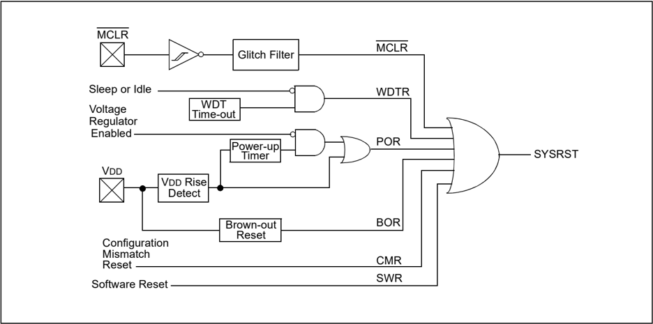

## 6.1 Reset Control Registers

## TABLE 6-1: RESET CONTROL REGISTER MAP

| Virtual Address (BF80_#)   |                             | Bits        | Bits   | Bits   | Bits        | Bits   | Bits   | Bits   | Bits   | Bits   | Bits   | Bits   | Bits   | Bits   | Bits   | Bits   | Bits   |            |
|----------------------------|-----------------------------|-------------|--------|--------|-------------|--------|--------|--------|--------|--------|--------|--------|--------|--------|--------|--------|--------|------------|
| Virtual Address (BF80_#)   | Register Name (1) Bit Range | 31/15 30/14 | 29/13  |        | 28/12 27/11 | 26/10  |        | 25/9   | 24/8   | 23/7   | 22/6   | 21/5   | 20/4   | 19/3   | 18/2   | 17/1   | 16/0   | All Resets |
|                            | RCON 31:16                  | -           | -      | -      | -           | -      | -      | -      | -      | -      | -      | -      | -      | -      | -      | -      | -      | 0000       |
|                            | 15:0                        | -           | -      | -      | -           | -      | -      | CMR    | VREGS  | EXTR   | SWR    | -      | WDTO   | SLEEP  | IDLE   | BOR    | POR    | xxxx (2)   |
|                            | RSWRST 31:16                | -           | -      | -      | -           | -      | -      | -      | -      | -      | -      | -      | -      | -      | -      | -      | -      | 0000       |
|                            | 15:0                        | -           | -      | -      | -           | -      | -      | -      | -      | -      | -      | -      | -      | -      | -      | -      | SWRST  | 0000       |

Note 1: All registers in this table have corresponding CLR, SET and INV registers at their virtual addresses, plus offsets of 0x4, 0x8 and 0xC, respectively. See Section 11.2 'CLR, SET and INV Registers' for more information.

2: Reset values are dependent on the DEVCFGx Configuration bits and the type of reset.

## PIC32MX1XX/2XX 28/36/44-PIN FAMILY

## REGISTER 6-1: RCON: RESET CONTROL REGISTER

| Bit Range   | Bit 31/23/15/7   | Bit 30/22/14/6   | Bit 29/21/13/5   | Bit 28/20/12/4   | Bit 27/19/11/3   | Bit 26/18/10/2   | Bit 25/17/9/1   | Bit 24/16/8/0   |
|-------------|------------------|------------------|------------------|------------------|------------------|------------------|-----------------|-----------------|
| 31:24       | U-0              | U-0              | U-0              | U-0              | U-0              | U-0              | U-0             | U-0             |
| 31:24       | -                | -                | -                | -                | -                | -                | -               | -               |
| 23:16       | U-0              | U-0              | U-0              | U-0              | U-0              | U-0              | U-0             | U-0             |
| 23:16       | -                | -                | -                | -                | -                | -                | -               | -               |
| 15:8        | U-0              | U-0              | U-0              | U-0              | U-0              | U-0              | R/W-0, HS       | R/W-0           |
| 15:8        | -                | -                | -                | -                | -                | -                | CMR             | VREGS           |
| 7:0         | R/W-0, HS        | R/W-0, HS        | U-0              | R/W-0, HS        | R/W-0, HS        | R/W-0, HS        | R/W-1, HS       | R/W-1, HS       |
| 7:0         | EXTR             | SWR              | -                | WDTO             | SLEEP            | IDLE             | BOR (1)         | POR (1)         |

Legend:

HS = Set by hardware

R = Readable bit

W = Writable bit

U = Unimplemented bit, read as '0'

-n = Value at POR

'1' = Bit is set

'0' = Bit is cleared

x = Bit is unknown

bit 31-10 Unimplemented:

Read as ' 0 '

bit 9

CMR:

Configuration Mismatch Reset Flag bit

1 = Configuration mismatch Reset has occurred

0 = Configuration mismatch Reset has not occurred

bit 8 VREGS: Voltage Regulator Standby Enable bit

1 = Regulator is enabled and is on during Sleep mode

0 = Regulator is set to standby tracking mode

bit 7

EXTR: External Reset (MCLR) Pin Flag bit

1 = Master Clear (pin) Reset has occurred

0 = Master Clear (pin) Reset has not occurred

bit 6

SWR: Software Reset Flag bit

1 = Software Reset was executed

0 = Software Reset as not executed

bit 5 Unimplemented: Read as ' 0 '

bit 4 WDTO: Watchdog Timer Time-out Flag bit

1 = WDT Time-out has occurred

0 = WDT Time-out has not occurred

bit 3 SLEEP: Wake From Sleep Flag bit

1 = Device was in Sleep mode

0 = Device was not in Sleep mode

bit 2 IDLE: Wake From Idle Flag bit

1 = Device was in Idle mode

0 = Device was not in Idle mode

bit 1

BOR: Brown-out Reset Flag bit (1)

1 = Brown-out Reset has occurred

0 = Brown-out Reset has not occurred

bit 0 POR: Power-on Reset Flag bit (1)

1 = Power-on Reset has occurred

0 = Power-on Reset has not occurred

Note 1: User software must clear this bit to view next detection.

## PIC32MX1XX/2XX 28/36/44-PIN FAMILY

## REGISTER 6-2: RSWRST: SOFTWARE RESET REGISTER

| Bit Range   | Bit 31/23/15/7   | Bit 30/22/14/6   | Bit 29/21/13/5   | Bit 28/20/12/4   | Bit 27/19/11/3   | Bit 26/18/10/2   | Bit 25/17/9/1   | Bit 24/16/8/0   |
|-------------|------------------|------------------|------------------|------------------|------------------|------------------|-----------------|-----------------|
| 31:24       | U-0              | U-0              | U-0              | U-0              | U-0              | U-0              | U-0             | U-0             |
| 31:24       | -                | -                | -                | -                | -                | -                | -               | -               |
| 23:16       | U-0              | U-0              | U-0              | U-0              | U-0              | U-0              | U-0             | U-0             |
| 23:16       | -                | -                | -                | -                | -                | -                | -               | -               |
| 15:8        | U-0              | U-0              | U-0              | U-0              | U-0              | U-0              | U-0             | U-0             |
| 15:8        | -                | -                | -                | -                | -                | -                | -               | -               |
| 7:0         | U-0              | U-0              | U-0              | U-0              | U-0              | U-0              | U-0             | W-0, HC         |
| 7:0         | -                | -                | -                | -                | -                | -                | -               | SWRST (1)       |

Legend:

HC = Cleared by hardware

R = Readable bit

W = Writable bit

U = Unimplemented bit, read as '0'

-n = Value at POR

'1' = Bit is set

'0' = Bit is cleared

x = Bit is unknown

bit 31-1 Unimplemented:

Read as ' 0 '

bit 0

SWRST: Software Reset Trigger bit (1)

1 = Enable Software Reset event

0 = No effect

Note 1: The system unlock sequence must be performed before the SWRST bit is written. Refer to Section 6. 'Oscillator' (DS60001112) in the 'PIC32 Family Reference Manual' for details.

## PIC32MX1XX/2XX 28/36/44-PIN FAMILY

## 7.0 INTERRUPT CONTROLLER

Note: This data sheet summarizes the features of  the  PIC32MX1XX/2XX  28/36/44-pin Family of devices. It is not intended to be a  comprehensive  reference  source.  To complement  the  information  in  this  data sheet, refer to Section 8. 'Interrupt Controller' (DS60001108), which is available from the Documentation  &gt;  Reference Manual section  of  the  Microchip  PIC32 web site (www.microchip.com/pic32).

PIC32MX1XX/2XX 28/36/44-pin Family devices generate  interrupt  requests  in  response  to  interrupt  events from peripheral modules. The interrupt control module exists  externally  to  the  CPU  logic  and  prioritizes  the interrupt events before presenting them to the CPU.

The  PIC32MX1XX/2XX 28/36/44-pin  Family  interrupt module includes the following features:

- Up to 64 interrupt sources
- Up to 44 interrupt vectors
- Single and multi-vector mode operations
- Five external interrupts with edge polarity control
- Interrupt proximity timer
- Seven user-selectable priority levels for each vector
- Four user-selectable subpriority levels within each priority
- Software can generate any interrupt
- User-configurable Interrupt Vector Table (IVT) location
- User-configurable interrupt vector spacing

Note:

The dedicated shadow register set is not present  on  PIC32MX1XX/2XX  28/36/44pin Family devices.

A  simplified  block  diagram  of  the  Interrupt  Controller module is illustrated in Figure 7-1.

FIGURE 7-1: INTERRUPT CONTROLLER MODULE BLOCK DIAGRAM

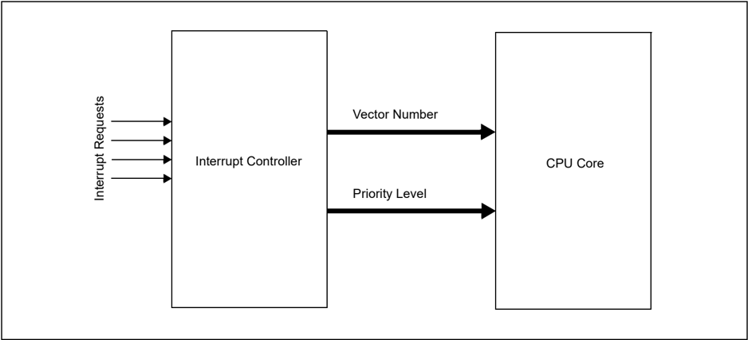

## PIC32MX1XX/2XX 28/36/44-PIN FAMILY

TABLE 7-1: INTERRUPT IRQ, VECTOR AND BIT LOCATION

| Interrupt Source (1)                | IRQ                            | Vector                         | Interrupt Bit Location         | Interrupt Bit Location         | Interrupt Bit Location         | Interrupt Bit Location         | Persistent                     |
|-------------------------------------|--------------------------------|--------------------------------|--------------------------------|--------------------------------|--------------------------------|--------------------------------|--------------------------------|
|                                     | #                              | #                              | Flag                           | Enable                         | Priority                       | Sub-priority                   | Interrupt                      |
| Highest Natural Order Priority      | Highest Natural Order Priority | Highest Natural Order Priority | Highest Natural Order Priority | Highest Natural Order Priority | Highest Natural Order Priority | Highest Natural Order Priority | Highest Natural Order Priority |
| CT - Core Timer Interrupt           | 0                              | 0                              | IFS0<0>                        | IEC0<0>                        | IPC0<4:2>                      | IPC0<1:0>                      | No                             |
| CS0 - Core Software Interrupt 0     | 1                              | 1                              | IFS0<1>                        | IEC0<1>                        | IPC0<12:10>                    | IPC0<9:8>                      | No                             |
| CS1 - Core Software Interrupt 1     | 2                              | 2                              | IFS0<2>                        | IEC0<2>                        | IPC0<20:18>                    | IPC0<17:16>                    | No                             |
| INT0 - External Interrupt           | 3                              | 3                              | IFS0<3>                        | IEC0<3>                        | IPC0<28:26>                    | IPC0<25:24>                    | No                             |
| T1 - Timer1                         | 4                              | 4                              | IFS0<4>                        | IEC0<4>                        | IPC1<4:2>                      | IPC1<1:0>                      | No                             |
| IC1E - Input Capture 1 Error        | 5                              | 5                              | IFS0<5>                        | IEC0<5>                        | IPC1<12:10>                    | IPC1<9:8>                      | Yes                            |
| IC1 - Input Capture 1               | 6                              | 5                              | IFS0<6>                        | IEC0<6>                        | IPC1<12:10>                    | IPC1<9:8>                      | Yes                            |
| OC1 - Output Compare 1              | 7                              | 6                              | IFS0<7>                        | IEC0<7>                        | IPC1<20:18>                    | IPC1<17:16>                    | No                             |
| INT1 - External Interrupt 1         | 8                              | 7                              | IFS0<8>                        | IEC0<8>                        | IPC1<28:26>                    | IPC1<25:24>                    | No                             |
| T2 - Timer2                         | 9                              | 8                              | IFS0<9>                        | IEC0<9>                        | IPC2<4:2>                      | IPC2<1:0>                      | No                             |
| IC2E - Input Capture 2              | 10                             | 9                              | IFS0<10>                       | IEC0<10>                       | IPC2<12:10>                    | IPC2<9:8>                      | Yes                            |
| IC2 - Input Capture 2               | 11                             | 9                              | IFS0<11>                       | IEC0<11>                       | IPC2<12:10>                    | IPC2<9:8>                      | Yes                            |
| OC2 - Output Compare 2              | 12                             | 10                             | IFS0<12>                       | IEC0<12>                       | IPC2<20:18>                    | IPC2<17:16>                    | No                             |
| INT2 - External Interrupt 2         | 13                             | 11                             | IFS0<13>                       | IEC0<13>                       | IPC2<28:26>                    | IPC2<25:24>                    | No                             |
| T3 - Timer3                         | 14                             | 12                             | IFS0<14>                       | IEC0<14>                       | IPC3<4:2>                      | IPC3<1:0>                      | No                             |
| IC3E - Input Capture 3              | 15                             | 13                             | IFS0<15>                       | IEC0<15>                       | IPC3<12:10>                    | IPC3<9:8>                      | Yes                            |
| IC3 - Input Capture 3               | 16                             | 13                             | IFS0<16>                       | IEC0<16>                       | IPC3<12:10>                    | IPC3<9:8>                      | Yes                            |
| OC3 - Output Compare 3              | 17                             | 14                             | IFS0<17>                       | IEC0<17>                       | IPC3<20:18>                    | IPC3<17:16>                    | No                             |
| INT3 - External Interrupt 3         | 18                             | 15                             | IFS0<18>                       | IEC0<18>                       | IPC3<28:26>                    | IPC3<25:24>                    | No                             |
| T4 - Timer4                         | 19                             | 16                             | IFS0<19>                       | IEC0<19>                       | IPC4<4:2>                      | IPC4<1:0>                      | No                             |
| IC4E - Input Capture 4 Error        | 20                             | 17                             | IFS0<20>                       | IEC0<20>                       | IPC4<12:10>                    | IPC4<9:8>                      | Yes                            |
| IC4 - Input Capture 4               | 21                             | 17                             | IFS0<21>                       | IEC0<21>                       | IPC4<12:10>                    | IPC4<9:8>                      | Yes                            |
| OC4 - Output Compare 4              | 22                             | 18                             | IFS0<22>                       | IEC0<22>                       | IPC4<20:18>                    | IPC4<17:16>                    | No                             |
| INT4 - External Interrupt 4         | 23                             | 19                             | IFS0<23>                       | IEC0<23>                       | IPC4<28:26>                    | IPC4<25:24>                    | No                             |
| T5 - Timer5                         | 24                             | 20                             | IFS0<24>                       | IEC0<24>                       | IPC5<4:2>                      | IPC5<1:0>                      | No                             |
| IC5E - Input Capture 5 Error        | 25                             | 21                             | IFS0<25>                       | IEC0<25>                       | IPC5<12:10>                    | IPC5<9:8>                      | Yes                            |
| IC5 - Input Capture 5               | 26                             | 21                             | IFS0<26>                       | IEC0<26>                       | IPC5<12:10>                    | IPC5<9:8>                      | Yes                            |
| OC5 - Output Compare 5              | 27                             | 22                             | IFS0<27>                       | IEC0<27>                       | IPC5<20:18>                    | IPC5<17:16>                    | No                             |
| AD1 - ADC1 Convert done             | 28                             | 23                             | IFS0<28>                       | IEC0<28>                       | IPC5<28:26>                    | IPC5<25:24>                    | Yes                            |
| FSCM - Fail-Safe Clock Monitor      | 29                             | 24                             | IFS0<29>                       | IEC0<29>                       | IPC6<4:2>                      | IPC6<1:0>                      | No                             |
| RTCC - Real-Time Clock and Calendar | 30                             | 25                             | IFS0<30>                       | IEC0<30>                       | IPC6<12:10>                    | IPC6<9:8>                      | No                             |
| FCE - Flash Control Event           | 31                             | 26                             | IFS0<31>                       | IEC0<31>                       | IPC6<20:18>                    | IPC6<17:16>                    | No                             |
| CMP1 - Comparator Interrupt         | 32                             | 27                             | IFS1<0>                        | IEC1<0>                        | IPC6<28:26>                    | IPC6<25:24>                    | No                             |
| CMP2 - Comparator Interrupt         | 33                             | 28                             | IFS1<1>                        | IEC1<1>                        | IPC7<4:2>                      | IPC7<1:0>                      | No                             |
| CMP3 - Comparator Interrupt         | 34                             | 29                             | IFS1<2>                        | IEC1<2>                        | IPC7<12:10>                    | IPC7<9:8>                      | No                             |
| USB - USB Interrupts                | 35                             | 30                             | IFS1<3>                        | IEC1<3>                        | IPC7<20:18>                    | IPC7<17:16>                    | Yes                            |
| SPI1E - SPI1 Fault                  | 36                             | 31                             | IFS1<4>                        | IEC1<4>                        | IPC7<28:26>                    | IPC7<25:24>                    | Yes                            |
| SPI1RX - SPI1 Receive Done          | 37                             | 31                             | IFS1<5>                        | IEC1<5>                        | IPC7<28:26>                    | IPC7<25:24>                    | Yes                            |
| SPI1TX - SPI1 Transfer Done         | 38                             | 31                             | IFS1<6>                        | IEC1<6>                        | IPC7<28:26>                    | IPC7<25:24>                    | Yes                            |

Note 1: Not all interrupt sources are available on all devices. See TABLE 1: 'PIC32MX1XX 28/36/44-Pin General Purpose Family Features' and TABLE 2: 'PIC32MX2XX 28/36/44-pin USB Family Features' for the lists of available peripherals.

## PIC32MX1XX/2XX 28/36/44-PIN FAMILY

TABLE 7-1: INTERRUPT IRQ, VECTOR AND BIT LOCATION (CONTINUED)

| Interrupt Source (1)               | IRQ #                         | Vector #                      | Interrupt Bit Location        | Interrupt Bit Location        | Interrupt Bit Location        | Interrupt Bit Location        | Persistent Interrupt          |
|------------------------------------|-------------------------------|-------------------------------|-------------------------------|-------------------------------|-------------------------------|-------------------------------|-------------------------------|
| Interrupt Source (1)               | IRQ #                         | Vector #                      | Flag                          | Enable                        | Priority                      | Sub-priority                  | Persistent Interrupt          |
| U1E - UART1 Fault                  | 39                            | 32                            | IFS1<7>                       | IEC1<7>                       | IPC8<4:2>                     | IPC8<1:0>                     | Yes                           |
| U1RX - UART1 Receive Done          | 40                            | 32                            | IFS1<8>                       | IEC1<8>                       | IPC8<4:2>                     | IPC8<1:0>                     | Yes                           |
| U1TX - UART1 Transfer Done         | 41                            | 32                            | IFS1<9>                       | IEC1<9>                       | IPC8<4:2>                     | IPC8<1:0>                     | Yes                           |
| I2C1B - I2C1 Bus Collision Event   | 42                            | 33                            | IFS1<10>                      | IEC1<10>                      | IPC8<12:10>                   | IPC8<9:8>                     | Yes                           |
| I2C1S - I2C1 Slave Event           | 43                            | 33                            | IFS1<11>                      | IEC1<11>                      | IPC8<12:10>                   | IPC8<9:8>                     | Yes                           |
| I2C1M - I2C1 Master Event          | 44                            | 33                            | IFS1<12>                      | IEC1<12>                      | IPC8<12:10>                   | IPC8<9:8>                     | Yes                           |
| CNA - PORTA Input Change Interrupt | 45                            | 34                            | IFS1<13>                      | IEC1<13>                      | IPC8<20:18>                   | IPC8<17:16>                   | Yes                           |
| CNB - PORTB Input Change Interrupt | 46                            | 34                            | IFS1<14>                      | IEC1<14>                      | IPC8<20:18>                   | IPC8<17:16>                   | Yes                           |
| CNC - PORTC Input Change Interrupt | 47                            | 34                            | IFS1<15>                      | IEC1<15>                      | IPC8<20:18>                   | IPC8<17:16>                   | Yes                           |
| PMP - Parallel Master Port         | 48                            | 35                            | IFS1<16>                      | IEC1<16>                      | IPC8<28:26>                   | IPC8<25:24>                   | Yes                           |
| PMPE - Parallel Master Port Error  | 49                            | 35                            | IFS1<17>                      | IEC1<17>                      | IPC8<28:26>                   | IPC8<25:24>                   | Yes                           |
| SPI2E - SPI2 Fault                 | 50                            | 36                            | IFS1<18>                      | IEC1<18>                      | IPC9<4:2>                     | IPC9<1:0>                     | Yes                           |
| SPI2RX - SPI2 Receive Done         | 51                            | 36                            | IFS1<19>                      | IEC1<19>                      | IPC9<4:2>                     | IPC9<1:0>                     | Yes                           |
| SPI2TX - SPI2 Transfer Done        | 52                            | 36                            | IFS1<20>                      | IEC1<20>                      | IPC9<4:2>                     | IPC9<1:0>                     | Yes                           |
| U2E - UART2 Error                  | 53                            | 37                            | IFS1<21>                      | IEC1<21>                      | IPC9<12:10>                   | IPC9<9:8>                     | Yes                           |
| U2RX - UART2 Receiver              | 54                            | 37                            | IFS1<22>                      | IEC1<22>                      | IPC9<12:10>                   | IPC9<9:8>                     | Yes                           |
| U2TX - UART2 Transmitter           | 55                            | 37                            | IFS1<23>                      | IEC1<23>                      | IPC9<12:10>                   | IPC9<9:8>                     | Yes                           |
| I2C2B - I2C2 Bus Collision Event   | 56                            | 38                            | IFS1<24>                      | IEC1<24>                      | IPC9<20:18>                   | IPC9<17:16>                   | Yes                           |
| I2C2S - I2C2 Slave Event           | 57                            | 38                            | IFS1<25>                      | IEC1<25>                      | IPC9<20:18>                   | IPC9<17:16>                   | Yes                           |
| I2C2M - I2C2 Master Event          | 58                            | 38                            | IFS1<26>                      | IEC1<26>                      | IPC9<20:18>                   | IPC9<17:16>                   | Yes                           |
| CTMU - CTMU Event                  | 59                            | 39                            | IFS1<27>                      | IEC1<27>                      | IPC9<28:26>                   | IPC9<25:24>                   | Yes                           |
| DMA0 - DMA Channel 0               | 60                            | 40                            | IFS1<28>                      | IEC1<28>                      | IPC10<4:2>                    | IPC10<1:0>                    | No                            |
| DMA1 - DMA Channel 1               | 61                            | 41                            | IFS1<29>                      | IEC1<29>                      | IPC10<12:10>                  | IPC10<9:8>                    | No                            |
| DMA2 - DMA Channel 2               | 62                            | 42                            | IFS1<30>                      | IEC1<30>                      | IPC10<20:18>                  | IPC10<17:16>                  | No                            |
| DMA3 - DMA Channel 3               | 63                            | 43                            | IFS1<31>                      | IEC1<31>                      | IPC10<28:26>                  | IPC10<25:24>                  | No                            |
| Lowest Natural Order Priority      | Lowest Natural Order Priority | Lowest Natural Order Priority | Lowest Natural Order Priority | Lowest Natural Order Priority | Lowest Natural Order Priority | Lowest Natural Order Priority | Lowest Natural Order Priority |

Note 1: Not all interrupt sources are available on all devices. See TABLE 1: 'PIC32MX1XX 28/36/44-Pin General Purpose Family Features' and TABLE 2: 'PIC32MX2XX 28/36/44-pin USB Family Features' for the lists of available peripherals.

## 7.1 Interrupt Control Registers

## TABLE 7-2: INTERRUPT REGISTER MAP

Legend:

| Virtual Address  (BF88\_#)  Register  Name (1)  Bit Range  Bits  All  Resets  31/15  30/14  29/13  28/12  27/11  26/10  25/9  24/8  23/7  22/6  21/5  20/4  19/3  18/2  17/1  16/0  1000  INTCON  31:16  -  -  -  -  -  -  -  -  -  -  -  -  -  -  -  -  0000  15:0  -  -  -  MVEC  -  TPC&lt;2:0&gt;  -  -  -  INT4EP  INT3EP  INT2EP  INT1EP  INT0EP  0000  1010  INTSTAT  (3)  31:16  -  -  -  -  -  -  -  -  -  -  -  -  -  -  -  -  0000  15:0  -  -  -  -  -  SRIPL&lt;2:0&gt;  -  -  VEC&lt;5:0&gt;  0000  1020  IPTMR  31:16  IPTMR&lt;31:0&gt;  0000  15:0  0000  1030  IFS0  31:16  FCEIF  RTCCIF  FSCMIF  AD1IF  OC5IF  IC5IF  IC5EIF  T5IF  INT4IF  OC4IF  IC4IF  IC4EIF  T4IF  INT3IF  OC3IF  IC3IF  0000  15:0  IC3EIF  T3IF  INT2IF  OC2IF  IC2IF  IC2EIF  T2IF  INT1IF  OC1IF  IC1IF  IC1EIF  T1IF  INT0IF  CS1IF  CS0IF  CTIF  0000  1040  IFS1  31:16  DMA3IF  DMA2IF  DMA1IF  DMA0IF  CTMUIF  I2C2MIF  I2C2SIF  I2C2BIF  U2TXIF  U2RXIF  U2EIF  SPI2TXIF  SPI2RXIF SPI2EIF PMPEIF  PMPIF  0000  15:0  CNCIF  CNBIF  CNAIF  I2C1MIF  I2C1SIF  I2C1BIF  U1TXIF  U1RXIF  U1EIF  SPI1TXIF  SPI1RXIF  SPI1EIF  USBIF  (2)  CMP3IF CMP2IF CMP1IF  0000  1060  IEC0  31:16  FCEIE  RTCCIE  FSCMIE  AD1IE  OC5IE  IC5IE  IC5EIE  T5IE  INT4IE  OC4IE  IC4IE  IC4EIE  T4IE  INT3IE  OC3IE  IC3IE  0000  15:0  IC3EIE  T3IE  INT2IE  OC2IE  IC2IE  IC2EIE  T2IE  INT1IE  OC1IE  IC1IE  IC1EIE  T1IE  INT0IE  CS1IE  CS0IE  CTIE  0000  1070  IEC1  31:16  DMA3IE  DMA2IE  DMA1IE  DMA0IE  CTMUIE  I2C2MIE  I2C2SIE  I2C2BIE  U2TXIE  U2RXIE  U2EIE  SPI2TXIE  SPI2RXIE SPI2EIE PMPEIE  PMPIE  0000  15:0  CNCIE  CNBIE  CNAIE  I2C1MIE  I2C1SIE  I2C1BIE  U1TXIE  U1RXIE  U1EIE  SPI1TXIE  SPI1RXIE  SPI1EIE  USBIE  (2)  CMP3IE CMP2IE CMP1IE  0000  1090  IPC0  31:16  -  -  -  INT0IP&lt;2:0&gt;  INT0IS&lt;1:0&gt;  -  -  -  CS1IP&lt;2:0&gt;  CS1IS&lt;1:0&gt;  0000  15:0  -  -  -  CS0IP&lt;2:0&gt;  CS0IS&lt;1:0&gt;  -  -  -  CTIP&lt;2:0&gt;  CTIS&lt;1:0&gt;  0000  10A0  IPC1  31:16  -  -  -  INT1IP&lt;2:0&gt;  INT1IS&lt;1:0&gt;  -  -  -  OC1IP&lt;2:0&gt;  OC1IS&lt;1:0&gt;  0000  15:0  -  -  -  IC1IP&lt;2:0&gt;  IC1IS&lt;1:0&gt;  -  -  -  T1IP&lt;2:0&gt;  T1IS&lt;1:0&gt;  0000  10B0  IPC2  31:16  -  -  -  INT2IP&lt;2:0&gt;  INT2IS&lt;1:0&gt;  -  -  -  OC2IP&lt;2:0&gt;  OC2IS&lt;1:0&gt;  0000  15:0  -  -  -  IC2IP&lt;2:0&gt;  IC2IS&lt;1:0&gt;  -  -  -  T2IP&lt;2:0&gt;  T2IS&lt;1:0&gt;  0000  10C0  IPC3  31:16  -  -  -  INT3IP&lt;2:0&gt;  INT3IS&lt;1:0&gt;  -  -  -  OC3IP&lt;2:0&gt;  OC3IS&lt;1:0&gt;  0000  15:0  -  -  -  IC3IP&lt;2:0&gt;  IC3IS&lt;1:0&gt;  -  -  -  T3IP&lt;2:0&gt;  T3IS&lt;1:0&gt;  0000  10D0  IPC4  31:16  -  -  -  INT4IP&lt;2:0&gt;  INT4IS&lt;1:0&gt;  -  -  -  OC4IP&lt;2:0&gt;  OC4IS&lt;1:0&gt;  0000  15:0  -  -  -  IC4IP&lt;2:0&gt;  IC4IS&lt;1:0&gt;  -  -  -  T4IP&lt;2:0&gt;  T4IS&lt;1:0&gt;  0000  10E0  IPC5  31:16  -  -  -  AD1IP&lt;2:0&gt;  AD1IS&lt;1:0&gt;  -  -  -  OC5IP&lt;2:0&gt;  OC5IS&lt;1:0&gt;  0000  15:0  -  -  -  IC5IP&lt;2:0&gt;  IC5IS&lt;1:0&gt;  -  -  -  T5IP&lt;2:0&gt;  T5IS&lt;1:0&gt;  0000  10F0  IPC6  31:16  -  -  -  CMP1IP&lt;2:0&gt;  CMP1IS&lt;1:0&gt;  -  -  -  FCEIP&lt;2:0&gt;  FCEIS&lt;1:0&gt;  0000  15:0  -  -  -  RTCCIP&lt;2:0&gt;  RTCCIS&lt;1:0&gt;  -  -  -  FSCMIP&lt;2:0&gt;  FSCMIS&lt;1:0&gt;  0000   |
|----------------------------------------------------------------------------------------------------------------------------------------------------------------------------------------------------------------------------------------------------------------------------------------------------------------------------------------------------------------------------------------------------------------------------------------------------------------------------------------------------------------------------------------------------------------------------------------------------------------------------------------------------------------------------------------------------------------------------------------------------------------------------------------------------------------------------------------------------------------------------------------------------------------------------------------------------------------------------------------------------------------------------------------------------------------------------------------------------------------------------------------------------------------------------------------------------------------------------------------------------------------------------------------------------------------------------------------------------------------------------------------------------------------------------------------------------------------------------------------------------------------------------------------------------------------------------------------------------------------------------------------------------------------------------------------------------------------------------------------------------------------------------------------------------------------------------------------------------------------------------------------------------------------------------------------------------------------------------------------------------------------------------------------------------------------------------------------------------------------------------------------------------------------------------------------------------------------------------------------------------------------------------------------------------------------------------------------------------------------------------------------------------------------------------------------------------------------------------------------------------------------------------------------------------------------------------------------------------------------------------------------------------------------------------------------------------------------------------------------------------------------------------------------------------------------------------------------------------------------------------------------------------------------------------------------------------------------------------------------------------------------------------------------------------------------------------------------------------------------------------------------------------------------------------------------------------------------------------------------------------------------------------------------------------------------------------------------------------|

Note 1:

x = unknown value on Reset; - = unimplemented, read as ' 0 '. Reset values are shown in hexadecimal.

With the exception of those noted, all registers in this table have corresponding CLR, SET and INV registers at their virtual addresses, plus offsets of 0x4 0x8 and 0xC, respectively. See Section 11.2 'CLR, SET and INV Registers' for more information.

2: These bits are not available on PIC32MX1XX devices.

3: This register does not have associated CLR, SET, INV registers.

## TABLE 7-2: INTERRUPT REGISTER MAP (CONTINUED)

|      |       |           | Bits        | Bits   | Bits   | Bits        | Bits        | Bits        | Bits        | Bits   | Bits   | Bits   | Bits           | Bits           | Bits        | Bits        | Bits       |
|------|-------|-----------|-------------|--------|--------|-------------|-------------|-------------|-------------|--------|--------|--------|----------------|----------------|-------------|-------------|------------|
|      |       | Bit Range | 31/15 30/14 | 29/13  | 28/12  |             | 27/11 26/10 | 25/9        | 24/8        | 23/7   | 22/6   | 21/5   | 20/4           | 19/3           | 18/2        | 17/1        | All Resets |
|      |       | 31:16     | -           | -      | -      | SPI1IP<2:0> | SPI1IP<2:0> | SPI1IS<1:0> | SPI1IS<1:0> | -      | -      | -      | USBIP<2:0> (2) | USBIP<2:0> (2) | USBIS<1:0>  | USBIS<1:0>  | 0000       |
|      |       | 15:0      | -           | -      | -      | CMP3IP<2:0> | CMP3IP<2:0> | CMP3IS<1:0> | CMP3IS<1:0> | -      | -      | -      | CMP2IP<2:0>    | CMP2IP<2:0>    | CMP2IS<1:0> | CMP2IS<1:0> | 0000       |
| 1110 | IPC8  | 31:16     | -           | -      | -      | PMPIP<2:0>  | PMPIP<2:0>  | PMPIS<1:0>  | PMPIS<1:0>  | -      | -      | -      | CNIP<2:0>      | CNIP<2:0>      | CNIS<1:0>   | CNIS<1:0>   | 0000       |
| 1110 | IPC8  | 15:0      | -           | -      | -      | I2C1IP<2:0> | I2C1IP<2:0> | I2C1IS<1:0> | I2C1IS<1:0> | -      | -      | -      | U1IP<2:0>      | U1IP<2:0>      | U1IS<1:0>   | U1IS<1:0>   | 0000       |
| 1120 | IPC9  | 31:16     | -           | -      | -      | CTMUIP<2:0> | CTMUIP<2:0> | CTMUIS<1:0> | CTMUIS<1:0> | -      | -      | -      | I2C2IP<2:0>    | I2C2IP<2:0>    | I2C2IS<1:0> | I2C2IS<1:0> | 0000       |
| 1120 | IPC9  | 15:0      | -           | -      | -      | U2IP<2:0>   | U2IP<2:0>   | U2IS<1:0>   | U2IS<1:0>   | -      | -      | -      | SPI2IP<2:0>    | SPI2IP<2:0>    | SPI2IS<1:0> | SPI2IS<1:0> | 0000       |
| 1130 | IPC10 | 31:16     | -           | -      | -      | DMA3IP<2:0> | DMA3IP<2:0> | DMA3IS<1:0> | DMA3IS<1:0> | -      | -      | -      | DMA2IP<2:0>    | DMA2IP<2:0>    | DMA2IS<1:0> | DMA2IS<1:0> | 0000       |
| 1130 | IPC10 | 15:0      | -           | -      | -      | DMA1IP<2:0> | DMA1IP<2:0> | DMA1IS<1:0> | DMA1IS<1:0> | -      | -      | -      | DMA0IP<2:0>    | DMA0IP<2:0>    | DMA0IS<1:0> | DMA0IS<1:0> | 0000       |

Legend:

Note 1:

x = unknown value on Reset; - = unimplemented, read as ' 0 '. Reset values are shown in hexadecimal.

With the exception of those noted, all registers in this table have corresponding CLR, SET and INV registers at their virtual addresses, plus offsets of 0x4 0x8 and 0xC, respectively. See Section 11.2 'CLR, SET and INV Registers' for more information.

- 2: These bits are not available on PIC32MX1XX devices.
- 3: This register does not have associated CLR, SET, INV registers.

## PIC32MX1XX/2XX 28/36/44-PIN FAMILY

## REGISTER 7-1: INTCON: INTERRUPT CONTROL REGISTER

| Bit Range   | Bit 31/23/15/7   | Bit 30/22/14/6   | Bit 29/21/13/5   | Bit 28/20/12/4   | Bit 27/19/11/3   | Bit 26/18/10/2   | Bit 25/17/9/1   | Bit 24/16/8/0   |
|-------------|------------------|------------------|------------------|------------------|------------------|------------------|-----------------|-----------------|
| 31:24       | U-0              | U-0              | U-0              | U-0              | U-0              | U-0              | U-0             | U-0             |
| 31:24       | -                | -                | -                | -                | -                | -                | -               | -               |
| 23:16       | U-0              | U-0              | U-0              | U-0              | U-0              | U-0              | U-0             | U-0             |
| 23:16       | -                | -                | -                | -                | -                | -                | -               | -               |
| 15:8        | U-0              | U-0              | U-0              | R/W-0            | U-0              | R/W-0            | R/W-0           | R/W-0           |
| 15:8        | -                | -                | -                | MVEC             | -                | TPC<2:0>         | TPC<2:0>        | TPC<2:0>        |
| 7:0         | U-0              | U-0              | U-0              | R/W-0            | R/W-0            | R/W-0            | R/W-0           | R/W-0           |
| 7:0         | -                | -                | -                | INT4EP           | INT3EP           | INT2EP           | INT1EP          | INT0EP          |

## Legend:

R = Readable bit

W = Writable bit

U = Unimplemented bit, read as '0'

-n = Value at POR

'1' = Bit is set

'0' = Bit is cleared

x = Bit is unknown

bit 31-16

Unimplemented: Read as ' 0 '

bit 15-13 Unimplemented: Read as ' 0

'

bit 12

MVEC: Multi Vector Configuration bit

1 = Interrupt controller configured for Multi-vectored mode

0 = Interrupt controller configured for Single-vectored mode

bit 11 Unimplemented: Read as ' 0

'

bit 10-8 TPC&lt;2:0&gt;:

Interrupt Proximity Timer Control bits

111 = Interrupts of group priority 7 or lower start the Interrupt Proximity timer

110 = Interrupts of group priority 6 or lower start the Interrupt Proximity timer

101 = Interrupts of group priority 5 or lower start the Interrupt Proximity timer

100 = Interrupts of group priority 4 or lower start the Interrupt Proximity timer

011 = Interrupts of group priority 3 or lower start the Interrupt Proximity timer

010 = Interrupts of group priority 2 or lower start the Interrupt Proximity timer

001 = Interrupts of group priority 1 start the Interrupt Proximity timer

000 = Disables Interrupt Proximity timer

## bit 7-5 Unimplemented: Read as ' 0 '

## bit 4 INT4EP: External Interrupt 4 Edge Polarity Control bit

1 = Rising edge

0 = Falling edge

bit 3 INT3EP: External Interrupt 3 Edge Polarity Control bit

1 = Rising edge

0 = Falling edge

bit 2

INT2EP: External Interrupt 2 Edge Polarity Control bit

1 = Rising edge

0 = Falling edge

## bit 1

INT1EP: External Interrupt 1 Edge Polarity Control bit

1 = Rising edge

0 = Falling edge

bit 0

INT0EP:

External Interrupt 0 Edge Polarity Control bit

1 = Rising edge

0 = Falling edge

## REGISTER 7-2:

## PIC32MX1XX/2XX 28/36/44-PIN FAMILY

INTSTAT: INTERRUPT STATUS REGISTER

| Bit Range   | Bit 31/23/15/7   | Bit 30/22/14/6   | Bit 29/21/13/5   | Bit 28/20/12/4   | Bit 27/19/11/3   | Bit 26/18/10/2   | Bit 25/17/9/1   | Bit 24/16/8/0   |
|-------------|------------------|------------------|------------------|------------------|------------------|------------------|-----------------|-----------------|
| 31:24       | U-0              | U-0              | U-0              | U-0              | U-0              | U-0              | U-0             | U-0             |
| 31:24       | -                | -                | -                | -                | -                | -                | -               | -               |
| 23:16       | U-0              | U-0              | U-0              | U-0              | U-0              | U-0              | U-0             | U-0             |
| 23:16       | -                | -                | -                | -                | -                | -                | -               | -               |
| 15:8        | U-0              | U-0              | U-0              | U-0              | U-0              | R/W-0            | R/W-0           | R/W-0           |
| 15:8        | -                | -                | -                | -                | -                | SRIPL<2:0> (1)   | SRIPL<2:0> (1)  | SRIPL<2:0> (1)  |
| 7:0         | U-0              | U-0              | R/W-0            | R/W-0            | R/W-0            | R/W-0            | R/W-0           | R/W-0           |
| 7:0         | -                | -                | VEC<5:0> (1)     | VEC<5:0> (1)     | VEC<5:0> (1)     | VEC<5:0> (1)     | VEC<5:0> (1)    | VEC<5:0> (1)    |

## Legend:

R = Readable bit

W = Writable bit

U = Unimplemented bit, read as '0'

-n = Value at POR

'1' = Bit is set

'0' = Bit is cleared

x = Bit is unknown

bit 31-11 Unimplemented:

Read as ' 0 '

bit 10-8

SRIPL&lt;2:0&gt;: Requested Priority Level bits (1)

111-000 = The priority level of the latest interrupt presented to the CPU

bit 7-6 Unimplemented:

Read as ' 0 '

bit 5-0

VEC&lt;5:0&gt;: Interrupt Vector bits

(1)

11111-00000 = The interrupt vector that is presented to the CPU

Note 1: This value should only be used when the interrupt controller is configured for Single Vector mode.

## REGISTER 7-3: IPTMR: INTERRUPT PROXIMITY TIMER REGISTER

| Bit Range   | Bit 31/23/15/7   | Bit 30/22/14/6   | Bit 29/21/13/5   | Bit 28/20/12/4   | Bit 27/19/11/3   | Bit 26/18/10/2   | Bit 25/17/9/1   | Bit 24/16/8/0   |
|-------------|------------------|------------------|------------------|------------------|------------------|------------------|-----------------|-----------------|
| 31:24       | R/W-0            | R/W-0            | R/W-0            | R/W-0            | R/W-0            | R/W-0            | R/W-0           | R/W-0           |
| 31:24       | IPTMR<31:24>     | IPTMR<31:24>     | IPTMR<31:24>     | IPTMR<31:24>     | IPTMR<31:24>     | IPTMR<31:24>     | IPTMR<31:24>    | IPTMR<31:24>    |
| 23:16       | R/W-0            | R/W-0            | R/W-0            | R/W-0            | R/W-0            | R/W-0            | R/W-0           | R/W-0           |
| 23:16       | IPTMR<23:16>     | IPTMR<23:16>     | IPTMR<23:16>     | IPTMR<23:16>     | IPTMR<23:16>     | IPTMR<23:16>     | IPTMR<23:16>    | IPTMR<23:16>    |
| 15:8        | R/W-0            | R/W-0            | R/W-0            | R/W-0            | R/W-0            | R/W-0            | R/W-0           | R/W-0           |
| 15:8        | IPTMR<15:8>      | IPTMR<15:8>      | IPTMR<15:8>      | IPTMR<15:8>      | IPTMR<15:8>      | IPTMR<15:8>      | IPTMR<15:8>     | IPTMR<15:8>     |
| 7:0         | R/W-0            | R/W-0            | R/W-0            | R/W-0            | R/W-0            | R/W-0            | R/W-0           | R/W-0           |
| 7:0         | IPTMR<7:0>       | IPTMR<7:0>       | IPTMR<7:0>       | IPTMR<7:0>       | IPTMR<7:0>       | IPTMR<7:0>       | IPTMR<7:0>      | IPTMR<7:0>      |

## Legend:

R = Readable bit

W = Writable bit

U = Unimplemented bit, read as '0'

-n = Value at POR

'1' = Bit is set

'0' = Bit is cleared

x = Bit is unknown

bit 31-0 IPTMR&lt;31:0&gt;: Interrupt Proximity Timer Reload bits

Used by the Interrupt Proximity Timer as a reload value when the Interrupt Proximity timer is triggered by an interrupt event.

## PIC32MX1XX/2XX 28/36/44-PIN FAMILY

## REGISTER 7-4:

IFSx: INTERRUPT FLAG STATUS REGISTER

| Bit Range   | Bit 31/23/15/7   | Bit 30/22/14/6   | Bit 29/21/13/5   | Bit 28/20/12/4   | Bit 27/19/11/3   | Bit 26/18/10/2   | Bit 25/17/9/1   | Bit 24/16/8/0   |
|-------------|------------------|------------------|------------------|------------------|------------------|------------------|-----------------|-----------------|
| 31:24       | R/W-0            | R/W-0            | R/W-0            | R/W-0            | R/W-0            | R/W-0            | R/W-0           | R/W-0           |
| 31:24       | IFS31            | IFS30            | IFS29            | IFS28            | IFS27            | IFS26            | IFS25           | IFS24           |
| 23:16       | R/W-0            | R/W-0            | R/W-0            | R/W-0            | R/W-0            | R/W-0            | R/W-0           | R/W-0           |
| 23:16       | IFS23            | IFS22            | IFS21            | IFS20            | IFS19            | IFS18            | IFS17           | IFS16           |
| 15:8        | R/W-0            | R/W-0            | R/W-0            | R/W-0            | R/W-0            | R/W-0            | R/W-0           | R/W-0           |
| 15:8        | IFS15            | IFS14            | IFS13            | IFS12            | IFS11            | IFS10            | IFS09           | IFS08           |
| 7:0         | R/W-0            | R/W-0            | R/W-0            | R/W-0            | R/W-0            | R/W-0            | R/W-0           | R/W-0           |
| 7:0         | IFS07            | IFS06            | IFS05            | IFS04            | IFS03            | IFS02            | IFS01           | IFS00           |

## Legend:

R = Readable bit

W = Writable bit

U = Unimplemented bit, read as '0'

-n = Value at POR

'1' = Bit is set

'0' = Bit is cleared

x = Bit is unknown

bit 31-0

IFS31-IFS00:

Interrupt Flag Status bits

1 = Interrupt request has occurred

0 = No interrupt request has occurred

Note:

This  register  represents  a  generic  definition  of  the  IFSx  register.  Refer  to  Table 7-1  for  the  exact  bit definitions.

## REGISTER 7-5: IECx: INTERRUPT ENABLE CONTROL REGISTER

| Bit Range   | Bit 31/23/15/7   | Bit 30/22/14/6   | Bit 29/21/13/5   | Bit 28/20/12/4   | Bit 27/19/11/3   | Bit 26/18/10/2   | Bit 25/17/9/1   | Bit 24/16/8/0   |
|-------------|------------------|------------------|------------------|------------------|------------------|------------------|-----------------|-----------------|
| 31:24       | R/W-0            | R/W-0            | R/W-0            | R/W-0            | R/W-0            | R/W-0            | R/W-0           | R/W-0           |
| 31:24       | IEC31            | IEC30            | IEC29            | IEC28            | IEC27            | IEC26            | IEC25           | IEC24           |
| 23:16       | R/W-0            | R/W-0            | R/W-0            | R/W-0            | R/W-0            | R/W-0            | R/W-0           | R/W-0           |
| 23:16       | IEC23            | IEC22            | IEC21            | IEC20            | IEC19            | IEC18            | IEC17           | IEC16           |
| 15:8        | R/W-0            | R/W-0            | R/W-0            | R/W-0            | R/W-0            | R/W-0            | R/W-0           | R/W-0           |
| 15:8        | IEC15            | IEC14            | IEC13            | IEC12            | IEC11            | IEC10            | IEC09           | IEC08           |
| 7:0         | R/W-0            | R/W-0            | R/W-0            | R/W-0            | R/W-0            | R/W-0            | R/W-0           | R/W-0           |
| 7:0         | IEC07            | IEC06            | IEC05            | IEC04            | IEC03            | IEC02            | IEC01           | IEC00           |

## Legend:

R = Readable bit

W = Writable bit

U = Unimplemented bit, read as '0'

-n = Value at POR

'1' = Bit is set

'0' = Bit is cleared

x = Bit is unknown

bit 31-0

IEC31-IEC00:

Interrupt Enable bits

1 = Interrupt is enabled

0 = Interrupt is disabled

Note: This  register  represents  a  generic  definition  of  the  IECx  register.  Refer  to  Table 7-1  for  the  exact  bit definitions.

## PIC32MX1XX/2XX 28/36/44-PIN FAMILY

## REGISTER 7-6: IPCx: INTERRUPT PRIORITY CONTROL REGISTER

| Bit Range   | Bit 31/23/15/7   | Bit 30/22/14/6   | Bit 29/21/13/5   | Bit 28/20/12/4   | Bit 27/19/11/3   | Bit 26/18/10/2   | Bit 25/17/9/1   | Bit 24/16/8/0   |
|-------------|------------------|------------------|------------------|------------------|------------------|------------------|-----------------|-----------------|
| 31:24       | U-0              | U-0              | U-0              | R/W-0            | R/W-0            | R/W-0            | R/W-0           | R/W-0           |
| 31:24       | -                | -                | -                | IP03<2:0>        | IP03<2:0>        | IP03<2:0>        | IS03<1:0>       | IS03<1:0>       |
| 23:16       | U-0              | U-0              | U-0              | R/W-0            | R/W-0            | R/W-0            | R/W-0           | R/W-0           |
| 23:16       | -                | -                | -                | IP02<2:0>        | IP02<2:0>        | IP02<2:0>        | IS02<1:0>       | IS02<1:0>       |
| 15:8        | U-0              | U-0              | U-0              | R/W-0            | R/W-0            | R/W-0            | R/W-0           | R/W-0           |
| 15:8        | -                | -                | -                | IP01<2:0>        | IP01<2:0>        | IP01<2:0>        | IS01<1:0>       | IS01<1:0>       |
| 7:0         | U-0              | U-0              | U-0              | R/W-0            | R/W-0            | R/W-0            | R/W-0           | R/W-0           |
| 7:0         | -                | -                | -                | IP00<2:0>        | IP00<2:0>        | IP00<2:0>        | IS00<1:0>       | IS00<1:0>       |

## Legend:

R = Readable bit

W = Writable bit

U = Unimplemented bit, read as '0'

-n = Value at POR

'1' = Bit is set

'0' = Bit is cleared

x = Bit is unknown

bit 31-29 Unimplemented: Read as ' 0 ' bit 28-26 IP03&lt;2:0&gt;: Interrupt Priority bits 111 = Interrupt priority is 7 • • • 010 = Interrupt priority is 2 001 = Interrupt priority is 1 000 = Interrupt is disabled bit 25-24 IS03&lt;1:0&gt;: Interrupt Subpriority bits 11 = Interrupt subpriority is 3 10 = Interrupt subpriority is 2 01 = Interrupt subpriority is 1 00 = Interrupt subpriority is 0 bit 23-21 Unimplemented: Read as ' 0 ' bit 20-18 IP02&lt;2:0&gt;: Interrupt Priority bits 111 = Interrupt priority is 7 • • • 010 = Interrupt priority is 2 001 = Interrupt priority is 1 000 = Interrupt is disabled bit 17-16 IS02&lt;1:0&gt;: Interrupt Subpriority bits 11 = Interrupt subpriority is 3 10 = Interrupt subpriority is 2 01 = Interrupt subpriority is 1 00 = Interrupt subpriority is 0 bit 15-13 Unimplemented: Read as ' 0 ' bit 12-10 IP01&lt;2:0&gt;: Interrupt Priority bits 111 = Interrupt priority is 7 • • • 010 = Interrupt priority is 2 001 = Interrupt priority is 1 000 = Interrupt is disabled

Note:

This  register  represents  a  generic  definition  of  the  IPCx  register.  Refer  to  Table 7-1  for  the  exact  bit definitions.

## PIC32MX1XX/2XX 28/36/44-PIN FAMILY

## REGISTER 7-6: IPCx: INTERRUPT PRIORITY CONTROL REGISTER (CONTINUED)

```
bit 9-8 IS01<1:0>: Interrupt Subpriority bits 11 = Interrupt subpriority is 3 10 = Interrupt subpriority is 2 01 = Interrupt subpriority is 1 00 = Interrupt subpriority is 0 bit 7-5 Unimplemented: Read as ' 0 ' bit 4-2 IP00<2:0>: Interrupt Priority bits 111 = Interrupt priority is 7 · · · 010 = Interrupt priority is 2 001 = Interrupt priority is 1 000 = Interrupt is disabled bit 1-0 IS00<1:0>: Interrupt Subpriority bits 11 = Interrupt subpriority is 3 10 = Interrupt subpriority is 2 01 = Interrupt subpriority is 1 00 = Interrupt subpriority is 0
```

Note: This  register  represents  a  generic  definition  of  the  IPCx  register.  Refer  to  Table 7-1  for  the  exact  bit definitions.

## PIC32MX1XX/2XX 28/36/44-PIN FAMILY

## 8.0 OSCILLATOR CONFIGURATION

Note: This data sheet summarizes the features of  the  PIC32MX1XX/2XX  28/36/44-pin Family of devices. It is not intended to be a  comprehensive  reference  source.  To complement  the  information  in  this  data sheet,  refer  to Section  6.  'Oscillator Configuration' (DS60001112), which is available from the Documentation &gt; Reference Manual section of the Microchip PIC32 web site (www.microchip.com/pic32).

The PIC32MX1XX/2XX 28/36/44-pin Family oscillator system has the following modules and features:

- Four external and internal oscillator options as clock sources
- On-Chip PLL with user-selectable input divider, multiplier and output divider to boost operating frequency on select internal and external oscillator sources
- On-Chip user-selectable divisor postscaler on select oscillator sources
- Software-controllable switching between various clock sources
- A Fail-Safe Clock Monitor (FSCM) that detects clock failure and permits safe application recovery or shutdown
- Dedicated On-Chip PLL for USB peripheral

A block diagram of the oscillator system is provided in Figure 8-1.

## PIC32MX1XX/2XX 28/36/44-PIN FAMILY

## FIGURE 8-1: OSCILLATOR DIAGRAM

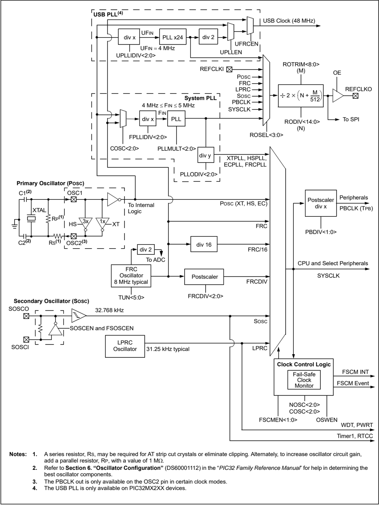

## 8.1 Oscillator Control Regiters

## TABLE 8-1: OSCILLATOR CONTROL REGISTER MAP

| Address (BF80_#)   | (1)           |           | Bits        | Bits        | Bits         | Bits         | Bits         | Bits        | Bits        | Bits        | Bits        | Bits        | Bits        | Bits        | Bits        | Bits         | Bits         | Bits            |                 |                 |                 |                 |                 |                 |                 |                 |                 |                 |                 |                 |                 |                 |
|--------------------|---------------|-----------|-------------|-------------|--------------|--------------|--------------|-------------|-------------|-------------|-------------|-------------|-------------|-------------|-------------|--------------|--------------|-----------------|-----------------|-----------------|-----------------|-----------------|-----------------|-----------------|-----------------|-----------------|-----------------|-----------------|-----------------|-----------------|-----------------|-----------------|
| Virtual            | Register Name | Bit Range | 31/15 30/14 | 29/13       | 28/12        | 27/11        | 26/10        |             | 25/9        | 24/8        | 23/7        | 22/6        | 21/5        | 20/4        | 19/3        | 18/2         | 17/1         | All Resets 16/0 | All Resets 16/0 | All Resets 16/0 | All Resets 16/0 | All Resets 16/0 | All Resets 16/0 | All Resets 16/0 | All Resets 16/0 | All Resets 16/0 | All Resets 16/0 | All Resets 16/0 | All Resets 16/0 | All Resets 16/0 | All Resets 16/0 | All Resets 16/0 |
| F000               | OSCCON        | 31:16     | -           | -           | PLLODIV<2:0> | PLLODIV<2:0> | PLLODIV<2:0> | FRCDIV<2:0> | FRCDIV<2:0> |             | -           | SOSCRDY     | PBDIVRDY    | PBDIV<1:0>  | PBDIV<1:0>  | PLLMULT<2:0> | PLLMULT<2:0> | x1xx (2)        | x1xx (2)        | x1xx (2)        | x1xx (2)        | x1xx (2)        | x1xx (2)        | x1xx (2)        | x1xx (2)        | x1xx (2)        | x1xx (2)        | x1xx (2)        | x1xx (2)        | x1xx (2)        | x1xx (2)        | x1xx (2)        |
|                    |               | 15:0      | -           | COSC<2:0>   | COSC<2:0>    | COSC<2:0>    | -            | NOSC<2:0>   | NOSC<2:0>   |             | CLKLOCK     | ULOCK (3)   | SLOCK       | SLPEN       | CF          | UFRCEN (3)   | SOSCEN       | OSWEN xxxx (2)  | OSWEN xxxx (2)  | OSWEN xxxx (2)  | OSWEN xxxx (2)  | OSWEN xxxx (2)  | OSWEN xxxx (2)  | OSWEN xxxx (2)  | OSWEN xxxx (2)  | OSWEN xxxx (2)  | OSWEN xxxx (2)  | OSWEN xxxx (2)  | OSWEN xxxx (2)  | OSWEN xxxx (2)  | OSWEN xxxx (2)  | OSWEN xxxx (2)  |
| F010               | OSCTUN        | 31:16     | -           | -           | -            | -            | -            | -           | -           | -           | -           | -           | -           | -           | -           | -            | -            | - 0000          | - 0000          | - 0000          | - 0000          | - 0000          | - 0000          | - 0000          | - 0000          | - 0000          | - 0000          | - 0000          | - 0000          | - 0000          | - 0000          | - 0000          |
|                    |               | 15:0      | -           | -           | -            | -            | -            | -           | -           | -           | -           | -           |             | TUN<5:0>    | TUN<5:0>    | TUN<5:0>     | TUN<5:0>     | 0000            | 0000            | 0000            | 0000            | 0000            | 0000            | 0000            | 0000            | 0000            | 0000            | 0000            | 0000            | 0000            | 0000            | 0000            |
| F020               |               | 31:16     | -           | RODIV<14:0> | RODIV<14:0>  | RODIV<14:0>  | RODIV<14:0>  | RODIV<14:0> | RODIV<14:0> | RODIV<14:0> | RODIV<14:0> | RODIV<14:0> | RODIV<14:0> | RODIV<14:0> | RODIV<14:0> | RODIV<14:0>  | RODIV<14:0>  | 0000            | 0000            | 0000            | 0000            | 0000            | 0000            | 0000            | 0000            | 0000            | 0000            | 0000            | 0000            | 0000            | 0000            | 0000            |
|                    | REFOCON       | 15:0      | ON          | -           | SIDL         | OE           | RSLP         | -           | DIVSWEN     | ACTIVE      | -           | -           | -           | -           | ROSEL<3:0>  | ROSEL<3:0>   | ROSEL<3:0>   | 0000            | 0000            | 0000            | 0000            | 0000            | 0000            | 0000            | 0000            | 0000            | 0000            | 0000            | 0000            | 0000            | 0000            | 0000            |
|                    |               | 31:16     | ROTRIM<8:0> | ROTRIM<8:0> | ROTRIM<8:0>  | ROTRIM<8:0>  | ROTRIM<8:0>  | ROTRIM<8:0> | ROTRIM<8:0> | ROTRIM<8:0> | ROTRIM<8:0> | -           | -           | -           | -           | -            | -            | 0000            | 0000            | 0000            | 0000            | 0000            | 0000            | 0000            | 0000            | 0000            | 0000            | 0000            | 0000            | 0000            | 0000            | 0000            |
|                    |               | 15:0      | -           | -           | -            | -            | -            | -           | -           | -           | -           | -           | -           | -           | -           | -            | -            | 0000            | 0000            | 0000            | 0000            | 0000            | 0000            | 0000            | 0000            | 0000            | 0000            | 0000            | 0000            | 0000            | 0000            | 0000            |
|                    |               |           |             |             |              |              |              |             |             |             |             |             |             |             |             |              | -            |                 |                 |                 |                 |                 |                 |                 |                 |                 |                 |                 |                 |                 |                 |                 |
| F030               |               |           |             |             |              |              |              |             |             |             |             |             |             |             |             |              |              |                 |                 |                 |                 |                 |                 |                 |                 |                 |                 |                 |                 |                 |                 |                 |
|                    | REFOTRIM      |           |             |             |              |              |              |             |             |             |             |             |             |             |             |              |              |                 |                 |                 |                 |                 |                 |                 |                 |                 |                 |                 |                 |                 |                 |                 |
|                    |               |           |             |             |              |              |              |             |             |             |             |             |             |             |             |              |              | -               |                 |                 |                 |                 |                 |                 |                 |                 |                 |                 |                 |                 |                 |                 |

Legend:

x = unknown value on Reset; - = unimplemented, read as ' 0 '. Reset values are shown in hexadecimal.

Note 1: All registers in this table have corresponding CLR, SET and INV registers at their virtual addresses, plus offsets of 0x4, 0x8 and 0xC, respectively. See Section 11.2 'CLR, SET and INV Registers' for more information.

2: Reset values are dependent on the DEVCFGx Configuration bits and the type of reset.

3: This bit is only available on PIC32MX2XX devices.

## PIC32MX1XX/2XX 28/36/44-PIN FAMILY

## REGISTER 8-1: OSCCON: OSCILLATOR CONTROL REGISTER

| Bit Range   | Bit 31/23/15/7   | Bit 30/22/14/6   | Bit 29/21/13/5   | Bit 28/20/12/4   | Bit 27/19/11/3   | Bit 26/18/10/2   | Bit 25/17/9/1   | Bit 24/16/8/0   |
|-------------|------------------|------------------|------------------|------------------|------------------|------------------|-----------------|-----------------|
| 31:24       | U-0              | U-0              | R/W-y            | R/W-y            | R/W-y            | R/W-0            | R/W-0           | R/W-1           |
| 31:24       | -                | -                | PLLODIV<2:0>     | PLLODIV<2:0>     | PLLODIV<2:0>     | FRCDIV<2:0>      | FRCDIV<2:0>     | FRCDIV<2:0>     |
| 23:16       | U-0              | R-0              | R-1              | R/W-y            | R/W-y            | R/W-y            | R/W-y           | R/W-y           |
| 23:16       | -                | SOSCRDY          | PBDIVRDY         | PBDIV<1:0>       | PBDIV<1:0>       | PLLMULT<2:0>     | PLLMULT<2:0>    | PLLMULT<2:0>    |
| 15:8        | U-0              | R-0              | R-0              | R-0              | U-0              | R/W-y            | R/W-y           | R/W-y           |
| 15:8        | -                | COSC<2:0>        | COSC<2:0>        | COSC<2:0>        | -                | NOSC<2:0>        | NOSC<2:0>       | NOSC<2:0>       |
| 7:0         | R/W-0            | R-0              | R-0              | R/W-0            | R/W-0            | R/W-0            | R/W-y           | R/W-0           |
| 7:0         | CLKLOCK          | ULOCK (1)        | SLOCK            | SLPEN            | CF               | UFRCEN (1)       | SOSCEN          | OSWEN           |

## Legend:

y = Value set from Configuration bits on POR

R = Readable bit

W = Writable bit

U = Unimplemented bit, read as '0'

-n = Value at POR

'1' = Bit is set

'0' = Bit is cleared

x = Bit is unknown

bit 31-30 Unimplemented:

Read as ' 0 '

bit 29-27 PLLODIV&lt;2:0&gt;:

Output Divider for PLL

111 = PLL output divided by 256

110 = PLL output divided by 64

101 = PLL output divided by 32

100 = PLL output divided by 16

011 = PLL output divided by 8

010 = PLL output divided by 4

001 = PLL output divided by 2

000 = PLL output divided by 1

bit 26-24 FRCDIV&lt;2:0&gt;: Internal Fast RC (FRC) Oscillator Clock Divider bits

111 = FRC divided by 256

110 = FRC divided by 64

101 = FRC divided by 32

100 = FRC divided by 16

011 = FRC divided by 8

010 = FRC divided by 4

001 = FRC divided by 2 (default setting)

000 = FRC divided by 1

bit 23 Unimplemented:

Read as ' 0 '

bit 22 SOSCRDY: Secondary Oscillator (SOSC) Ready Indicator bit

1 = The Secondary Oscillator is running and is stable

0 = The Secondary Oscillator is still warming up or is turned off

bit 21

PBDIVRDY: Peripheral Bus Clock (PBCLK) Divisor Ready bit

1 = PBDIV&lt;1:0&gt; bits can be written

0 = PBDIV&lt;1:0&gt; bits cannot be written

bit 20-19 PBDIV&lt;1:0&gt;: Peripheral Bus Clock (PBCLK) Divisor bits

11 = PBCLK is SYSCLK divided by 8 (default)

10 = PBCLK is SYSCLK divided by 4

01 = PBCLK is SYSCLK divided by 2

00 = PBCLK is SYSCLK divided by 1

Note 1: This bit is only available on PIC32MX2XX devices.

Note: Writes to this register require an unlock sequence. Refer to Section 6. 'Oscillator' (DS60001112) in the 'PIC32 Family Reference Manual' for details.

## PIC32MX1XX/2XX 28/36/44-PIN FAMILY

## REGISTER 8-1: OSCCON: OSCILLATOR CONTROL REGISTER

bit 18-16 PLLMULT&lt;2:0&gt;: Phase-Locked Loop (PLL) Multiplier bits

111 = Clock is multiplied by 24

110 = Clock is multiplied by 21

101 = Clock is multiplied by 20

100 = Clock is multiplied by 19

011 = Clock is multiplied by 18

010 = Clock is multiplied by 17

001 = Clock is multiplied by 16

000 = Clock is multiplied by 15

bit 15 Unimplemented: Read as ' 0 '

bit 14-12 COSC&lt;2:0&gt;: Current Oscillator Selection bits

111 = Internal Fast RC (FRC) Oscillator divided by FRCDIV&lt;2:0&gt; bits (OSCCON&lt;26:24&gt;)

- 110 = Internal Fast RC (FRC) Oscillator divided by 16
- 101 = Internal Low-Power RC (LPRC) Oscillator

100 = Secondary Oscillator (SOSC)

011 = Primary Oscillator (POSC) with PLL module (XTPLL, HSPLL or ECPLL)

010 = Primary Oscillator (POSC) (XT, HS or EC)

001 = Internal Fast RC Oscillator with PLL module via Postscaler (FRCPLL)

000 = Internal Fast RC (FRC) Oscillator

bit 11 Unimplemented: Read as ' 0 '

bit 10-8 NOSC&lt;2:0&gt;: New Oscillator Selection bits

111 = Internal Fast RC Oscillator (FRC) divided by OSCCON&lt;FRCDIV&gt; bits

110 = Internal Fast RC Oscillator (FRC) divided by 16

101 = Internal Low-Power RC (LPRC) Oscillator

100 = Secondary Oscillator (SOSC)

011 = Primary Oscillator with PLL module (XTPLL, HSPLL or ECPLL)

010 = Primary Oscillator (XT, HS or EC)

001 = Internal Fast Internal RC Oscillator with PLL module via Postscaler (FRCPLL)

000 = Internal Fast Internal RC Oscillator (FRC)

On Reset, these bits are set to the value of the FNOSC Configuration bits (DEVCFG1&lt;2:0&gt;).

## bit 7 CLKLOCK: Clock Selection Lock Enable bit

If clock switching and monitoring is disabled (FCKSM&lt;1:0&gt; = 1x ):

1 = Clock and PLL selections are locked

0 = Clock and PLL selections are not locked and may be modified

If clock switching and monitoring is enabled (FCKSM&lt;1:0&gt; = 0x ):

Clock and PLL selections are never locked and may be modified.

bit 6 ULOCK: USB PLL Lock Status bit (1)

1 = The USB PLL module is in lock or USB PLL module start-up timer is satisfied

0 =The USB PLL module is out of lock or USB PLL module start-up timer is in progress or the USB PLL is disabled

bit 5 SLOCK: PLL Lock Status bit

1 = The PLL module is in lock or PLL module start-up timer is satisfied

0 = The PLL module is out of lock, the PLL start-up timer is running, or the PLL is disabled

bit 4 SLPEN: Sleep Mode Enable bit

1 = The device will enter Sleep mode when a WAIT instruction is executed

0 = The device will enter Idle mode when a WAIT instruction is executed

Note 1: This bit is only available on PIC32MX2XX devices.

Note: Writes to this register require an unlock sequence. Refer to Section 6. 'Oscillator' (DS60001112) in the 'PIC32 Family Reference Manual' for details.

## PIC32MX1XX/2XX 28/36/44-PIN FAMILY

## REGISTER 8-1: OSCCON: OSCILLATOR CONTROL REGISTER

- bit 3 CF: Clock Fail Detect bit

- 1 = FSCM has detected a clock failure

- 0 = No clock failure has been detected

- bit 2 UFRCEN: USB FRC Clock Enable bit (1)

- 1 = Enable the FRC as the clock source for the USB clock source

- 0 = Use the Primary Oscillator or USB PLL as the USB clock source

- bit 1 SOSCEN: Secondary Oscillator (SOSC) Enable bit

- 1 = Enable the Secondary Oscillator

- 0 = Disable the Secondary Oscillator

- bit 0 OSWEN: Oscillator Switch Enable bit

- 1 = Initiate an oscillator switch to selection specified by NOSC&lt;2:0&gt; bits

- 0 = Oscillator switch is complete

Note 1: This bit is only available on PIC32MX2XX devices.

Note: Writes to this register require an unlock sequence. Refer to Section 6. 'Oscillator' (DS60001112) in the 'PIC32 Family Reference Manual' for details.

## PIC32MX1XX/2XX 28/36/44-PIN FAMILY

| Bit Range   | Bit 31/23/15/7   | Bit 30/22/14/6   | Bit 29/21/13/5   | Bit 28/20/12/4   | Bit 27/19/11/3   | Bit 26/18/10/2   | Bit 25/17/9/1   | Bit 24/16/8/0   |
|-------------|------------------|------------------|------------------|------------------|------------------|------------------|-----------------|-----------------|
| 31:24       | U-0              | U-0              | U-0              | U-0              | U-0              | U-0              | U-0             | U-0             |
| 31:24       | -                | -                | -                | -                | -                | -                | -               | -               |
| 23:16       | U-0              | R-0              | U-0              | U-0              | U-0              | U-0              | U-0             | U-0             |
| 23:16       | -                | -                | -                | -                | -                | -                | -               | -               |
| 15:8        | U-0              | R-0              | U-0              | U-0              | U-0              | U-0              | U-0             | U-0             |
| 15:8        | -                | -                | -                | -                | -                | -                | -               | -               |
| 7:0         | U-0              | U-0              | R/W-0            | R/W-0            | R/W-0            | R/W-0            | R/W-0           | R/W-0           |
| 7:0         | -                | -                | TUN<5:0> (1)     | TUN<5:0> (1)     | TUN<5:0> (1)     | TUN<5:0> (1)     | TUN<5:0> (1)    | TUN<5:0> (1)    |

## REGISTER 8-2: OSCTUN: FRC TUNING REGISTER

## Legend:

R = Readable bit

W = Writable bit

U = Unimplemented bit, read as '0'

-n = Value at POR

'1' = Bit is set

'0' = Bit is cleared

x = Bit is unknown

bit 31-6 Unimplemented: Read as ' 0 '

```
bit 5-0 TUN<5:0>: FRC Oscillator Tuning bits (1) 100000 = Center frequency -12.5% 100001 = · · · 111111 = 000000 = Center frequency. Oscillator runs at minimal frequency (8 MHz) 000001 = · · · 011110 = 011111 = Center frequency +12.5%
```

Note 1: OSCTUN functionality has been provided to help customers compensate for temperature effects on the FRC frequency over a wide range of temperatures. The tuning step size is an approximation, and is neither characterized, nor tested.

Note: Writes to this register require an unlock sequence. Refer to Section 6. 'Oscillator' (DS60001112) in the 'PIC32 Family Reference Manual' for details.

## PIC32MX1XX/2XX 28/36/44-PIN FAMILY

## REGISTER 8-3: REFOCON: REFERENCE OSCILLATOR CONTROL REGISTER

| Bit Range   | Bit 31/23/15/7   | Bit 30/22/14/6    | Bit 29/21/13/5    | Bit 28/20/12/4    | Bit 27/19/11/3    | Bit 26/18/10/2    | Bit 25/17/9/1     | Bit 24/16/8/0     |
|-------------|------------------|-------------------|-------------------|-------------------|-------------------|-------------------|-------------------|-------------------|
| 31:24       | U-0              | R/W-0             | R/W-0             | R/W-0             | R/W-0             | R/W-0             | R/W-0             | R/W-0             |
| 31:24       | -                | RODIV<14:8> (1,3) | RODIV<14:8> (1,3) | RODIV<14:8> (1,3) | RODIV<14:8> (1,3) | RODIV<14:8> (1,3) | RODIV<14:8> (1,3) | RODIV<14:8> (1,3) |
| 23:16       | R/W-0            | R/W-0             | R/W-0             | R/W-0             | R/W-0             | R/W-0             | R/W-0             | R/W-0             |
| 23:16       | RODIV<7:0> (1,3) | RODIV<7:0> (1,3)  | RODIV<7:0> (1,3)  | RODIV<7:0> (1,3)  | RODIV<7:0> (1,3)  | RODIV<7:0> (1,3)  | RODIV<7:0> (1,3)  | RODIV<7:0> (1,3)  |
| 15:8        | R/W-0            | U-0               | R/W-0             | R/W-0             | R/W-0             | U-0               | R/W-0, HC         | R-0, HS, HC       |
| 15:8        | ON               | -                 | SIDL              | OE                | RSLP (2)          | -                 | DIVSWEN           | ACTIVE            |
| 7:0         | U-0              | U-0               | U-0               | U-0               | R/W-0             | R/W-0             | R/W-0             | R/W-0             |
| 7:0         | -                | -                 | -                 | -                 | ROSEL<3:0> (1)    | ROSEL<3:0> (1)    | ROSEL<3:0> (1)    | ROSEL<3:0> (1)    |

## Legend:

HC = Hardware Clearable

HS = Hardware Settable

R = Readable bit

W = Writable bit

U = Unimplemented bit, read as '0'

-n = Value at POR

'1' = Bit is set

'0' = Bit is cleared

x = Bit is unknown

bit 31 Unimplemented: Read as ' 0 '

bit 30-16 RODIV&lt;14:0&gt; Reference Clock Divider bits (1,3)

The value selects the reference clock divider bits. See Figure 8-1 for information.

bit 15 ON:

Output Enable bit

1 = Reference Oscillator module is enabled

0 = Reference Oscillator module is disabled

bit 14 Unimplemented: Read as ' 0

'

bit 13 SIDL:

Peripheral Stop in Idle Mode bit

1 = Discontinue module operation when the device enters Idle mode

0 = Continue module operation when the device enters Idle mode

bit 12 OE: Reference Clock Output Enable bit

1 = Reference clock is driven out on REFCLKO pin

0 = Reference clock is not driven out on REFCLKO pin

bit 11

RSLP: Reference Oscillator Module Run in Sleep bit (2)

1 = Reference Oscillator module output continues to run in Sleep

0 = Reference Oscillator module output is disabled in Sleep

bit 10 Unimplemented: Read as ' 0 '

bit 9 DIVSWEN: Divider Switch Enable bit

1 = Divider switch is in progress

0 = Divider switch is complete

bit 8 ACTIVE:

Reference Clock Request Status bit

- 1 = Reference clock request is active

0 = Reference clock request is not active

bit 7-4 Unimplemented:

Read as ' 0 '

- Note 1: The ROSEL and RODIV bits should not be written while the ACTIVE bit is ' 1 ', as undefined behavior may result.

- 2: This bit is ignored when the ROSEL&lt;3:0&gt; bits = 0000 or 0001 .

- 3: While the ON bit is set to ' 1 ', writes to these bits do not take effect until the DIVSWEN bit is also set to ' 1 '.

## PIC32MX1XX/2XX 28/36/44-PIN FAMILY

## REGISTER 8-3: REFOCON: REFERENCE OSCILLATOR CONTROL REGISTER

```
bit 3-0 ROSEL<3:0>: Reference Clock Source Select bits (1) 1111 = Reserved; do not use · · · 1001 = Reserved; do not use 1000 = REFCLKI 0111 = System PLL output 0110 = USB PLL output 0101 = SOSC 0100 = LPRC 0011 = FRC 0010 = POSC 0001 = PBCLK 0000 = SYSCLK
```

- Note 1: The ROSEL and RODIV bits should not be written while the ACTIVE bit is ' 1 ', as undefined behavior may result.
- 2: This bit is ignored when the ROSEL&lt;3:0&gt; bits = 0000 or 0001 .
- 3: While the ON bit is set to ' 1 ', writes to these bits do not take effect until the DIVSWEN bit is also set to ' 1 '.

## PIC32MX1XX/2XX 28/36/44-PIN FAMILY

## REGISTER 8-4: REFOTRIM: REFERENCE OSCILLATOR TRIM REGISTER

| Bit Range   | Bit 31/23/15/7   | Bit 30/22/14/6   | Bit 29/21/13/5   | Bit 28/20/12/4   | Bit 27/19/11/3   | Bit 26/18/10/2   | Bit 25/17/9/1   | Bit 24/16/8/0   |
|-------------|------------------|------------------|------------------|------------------|------------------|------------------|-----------------|-----------------|
| 31:24       | R/W-0            | R/W-0            | R/W-0            | R/W-0            | R/W-0            | R/W-0            | R/W-0           | R/W-0           |
| 31:24       | ROTRIM<8:1>      | ROTRIM<8:1>      | ROTRIM<8:1>      | ROTRIM<8:1>      | ROTRIM<8:1>      | ROTRIM<8:1>      | ROTRIM<8:1>     | ROTRIM<8:1>     |
| 23:16       | R/W-0            | R-0              | U-0              | U-0              | U-0              | U-0              | U-0             | U-0             |
| 23:16       | ROTRIM<0>        | -                | -                | -                | -                | -                | -               | -               |
| 15:8        | U-0              | R-0              | U-0              | U-0              | U-0              | U-0              | U-0             | U-0             |
| 15:8        | -                | -                | -                | -                | -                | -                | -               | -               |
| 7:0         | U-0              | U-0              | U-0              | U-0              | U-0              | U-0              | U-0             | U-0             |
| 7:0         | -                | -                | -                | -                | -                | -                | -               | -               |

## Legend:

R = Readable bit

W = Writable bit

U = Unimplemented bit, read as '0'

-n = Value at POR

'1' = Bit is set

'0' = Bit is cleared

x = Bit is unknown

bit 31-23 ROTRIM&lt;8:0&gt;: Reference Oscillator Trim bits 111111111 = 511/512 divisor added to RODIV value 111111110 = 510/512 divisor added to RODIV value • • • 100000000 = 256/512 divisor added to RODIV value • • • 000000010 = 2/512 divisor added to RODIV value 000000001 = 1/512 divisor added to RODIV value 000000000 = 0/512 divisor added to RODIV value bit 22-0 Unimplemented: Read as ' 0 '

Note: While the ON (REFOCON&lt;15&gt;) bit is ' 1 ', writes to this register do not take effect until the DIVSWEN bit is also set to ' 1 '.

## PIC32MX1XX/2XX 28/36/44-PIN FAMILY

## 9.0 DIRECT MEMORY ACCESS (DMA) CONTROLLER

Note: This data sheet summarizes the features of  the  PIC32MX1XX/2XX  28/36/44-pin Family of devices. It is not intended to be a  comprehensive  reference  source.  To complement  the  information  in  this  data sheet, refer to Section 31. 'Direct Memory Access (DMA) Controller' (DS60001117), which is available from the Documentation &gt; Reference Manual section  of  the  Microchip  PIC32  web  site (www.microchip.com/pic32).

The PIC32 Direct Memory Access (DMA) controller is a bus master module useful for data transfers between different devices without CPU intervention. The source and destination of a DMA transfer can be any of the memory mapped modules existent in the PIC32, such as Peripheral Bus devices: SPI, UART, PMP, etc., or memory itself. Figure 9-1 show a block diagram of the DMA Controller module.

The  DMA  Controller  module  has  the  following  key features:

- Four identical channels, each featuring:
- -Auto-increment source and destination address registers
- -Source and destination pointers
- -Memory to memory and memory to peripheral transfers
- Automatic word-size detection:
- -Transfer granularity, down to byte level
- -Bytes need not be word-aligned at source and destination

## FIGURE 9-1: DMA BLOCK DIAGRAM

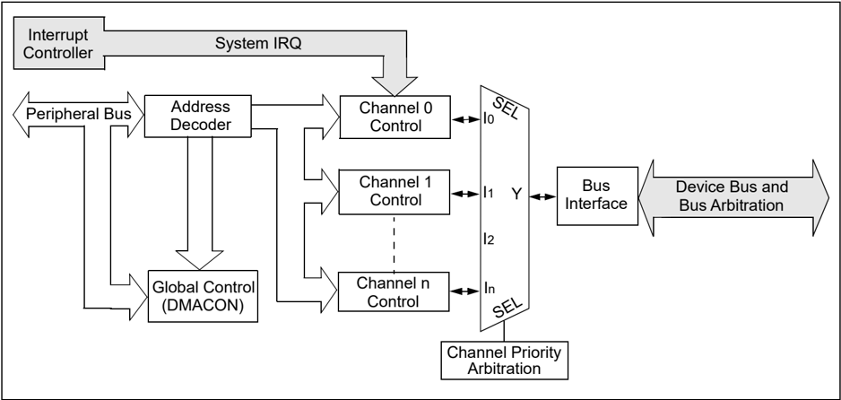

- Fixed priority channel arbitration
- Flexible DMA channel operating modes:
- -Manual (software) or automatic (interrupt) DMA requests
- -One-Shot or Auto-Repeat Block Transfer modes
- -Channel-to-channel chaining
- Flexible DMA requests:
- -A DMA request can be selected from any of the peripheral interrupt sources
- -Each channel can select any (appropriate) observable interrupt as its DMA request source
- -A DMA transfer abort can be selected from any of the peripheral interrupt sources
- -Pattern (data) match transfer termination
- Multiple DMA channel status interrupts:
- -DMA channel block transfer complete
- -Source empty or half empty
- -Destination full or half full
- -DMA transfer aborted due to an external event
- -Invalid DMA address generated
- DMA debug support features:
- -Most recent address accessed by a DMA channel
- -Most recent DMA channel to transfer data
- CRC Generation module:
- -CRC module can be assigned to any of the available channels
- -CRC module is highly configurable

## 9.1 DMA Control Registers

## TABLE 9-1: DMA GLOBAL REGISTER MAP

| Register Name (1)   |           | Bits          | Bits          | Bits          | Bits            | Bits            | Bits          | Bits          | Bits          | Bits          | Bits          | Bits          | Bits          | Bits          | Bits           | Bits           | Bits           |            |
|---------------------|-----------|---------------|---------------|---------------|-----------------|-----------------|---------------|---------------|---------------|---------------|---------------|---------------|---------------|---------------|----------------|----------------|----------------|------------|
| Register Name (1)   | Bit Range | 31/15 30/14   | 29/13         |               | 28/12           | 27/11           | 26/10         | 25/9          | 24/8          | 23/7          | 22/6          | 21/5          | 20/4          | 19/3          | 18/2           | 17/1           | 16/0           | All Resets |
| DMACON              | 31:16     | -             | -             | -             | -               | -               | -             | -             | -             | -             | -             | -             | -             | -             | -              | -              | -              | 0000       |
|                     | 15:0      | ON            | -             | -             | SUSPEND DMABUSY | SUSPEND DMABUSY | -             | -             | -             | -             | -             | -             | -             | -             | -              | -              | -              | 0000       |
| DMASTAT             | 31:16     | -             | -             | -             | -               | -               | -             | -             | -             | -             | -             | -             | -             | -             | -              | -              | -              | 0000       |
|                     | 15:0      | -             | -             | -             | -               | -               | -             | -             | -             | -             | -             | -             | -             | RDWR          | DMACH<2:0> (2) | DMACH<2:0> (2) | DMACH<2:0> (2) | 0000       |
| DMAADDR             | 31:16     |               |               |               |                 |                 |               |               |               |               |               |               |               |               |                |                |                | 0000       |
|                     | 15:0      | DMAADDR<31:0> | DMAADDR<31:0> | DMAADDR<31:0> | DMAADDR<31:0>   | DMAADDR<31:0>   | DMAADDR<31:0> | DMAADDR<31:0> | DMAADDR<31:0> | DMAADDR<31:0> | DMAADDR<31:0> | DMAADDR<31:0> | DMAADDR<31:0> | DMAADDR<31:0> | DMAADDR<31:0>  | DMAADDR<31:0>  | DMAADDR<31:0>  | 0000       |

Legend:

x = unknown value on Reset; - = unimplemented, read as ' 0 '. Reset values are shown in hexadecimal.

Note 1: All registers in this table have corresponding CLR, SET and INV registers at its virtual address, plus an offset of 0x4, 0x8 and 0xC, respectively. See Section 11.2 'CLR, SET and INV Registers' for more information.

## TABLE 9-2: DMA CRC REGISTER MAP

|                             | Bits             |       |           |       |             |      |                |               |        |        |      |      |            |      |      |            |      |
|-----------------------------|------------------|-------|-----------|-------|-------------|------|----------------|---------------|--------|--------|------|------|------------|------|------|------------|------|
| Register Name (1) Bit Range | 31/15 30/14 24/8 | 29/13 | 28/12     | 27/11 | 26/10       | 25/9 |                | 23/7          | 22/6   | 21/5   | 20/4 | 19/3 | 18/2       | 17/1 | 16/0 | All Resets |      |
| DCRCCON 31:16               | - BITO           | -     | BYTO<1:0> | WBO   |             | -    | -              | -             |        | -      | -    | -    | -          | -    | -    | 0000       |      |
|                             |                  | -     |           |       | - PLEN<4:0> |      |                |               | CRCAPP | CRCTYP | -    | -    |            |      |      | 0000       |      |
| 15:0                        | -                |       | -         |       |             |      |                | CRCEN         |        |        |      |      | CRCCH<2:0> |      |      |            |      |
| DCRCDATA 31:16              |                  |       |           |       |             |      |                |               |        |        |      |      |            |      |      | 0000       |      |
| 15:0                        |                  |       |           |       |             |      | DCRCDATA<31:0> |               |        |        |      |      |            |      |      | 0000       |      |
| 31:16                       |                  |       |           |       |             |      |                |               |        |        |      |      |            |      |      | 0000       |      |
| 15:0                        |                  |       |           |       |             |      |                |               |        |        |      |      |            |      |      | 0000       |      |
| DCRCXOR                     |                  |       |           |       |             |      |                |               |        |        |      |      |            |      |      |            |      |
|                             |                  |       |           |       |             |      |                | DCRCXOR<31:0> |        |        |      |      |            |      |      |            |      |
|                             |                  |       |           |       |             |      |                |               |        |        |      |      |            |      |      |            | 3050 |

Legend:

x = unknown value on Reset; - = unimplemented, read as ' 0 '. Reset values are shown in hexadecimal.

Note 1:

All registers in this table have corresponding CLR, SET and INV registers at their virtual addresses, plus offsets of 0x4, 0x8 and 0xC, respectively. See Section 11.2 'CLR, SET and INV Registers' for more information.

## TABLE 9-3: DMA CHANNELS 0-3 REGISTER MAP

| Virtual Address (BF88_#)   |                                                                                | Bits                                                                           | Bits                                                                           | Bits                                                                           | Bits                                                                           | Bits                                                                           | Bits                                                                           | Bits                                                                           | Bits                                                                           | Bits                                                                           | Bits                                                                           | Bits                                                                           | Bits                                                                        | Bits                                                                        | Bits                                                                        | Bits                                                                        | Bits       |            |
|----------------------------|--------------------------------------------------------------------------------|--------------------------------------------------------------------------------|--------------------------------------------------------------------------------|--------------------------------------------------------------------------------|--------------------------------------------------------------------------------|--------------------------------------------------------------------------------|--------------------------------------------------------------------------------|--------------------------------------------------------------------------------|--------------------------------------------------------------------------------|--------------------------------------------------------------------------------|--------------------------------------------------------------------------------|--------------------------------------------------------------------------------|-----------------------------------------------------------------------------|-----------------------------------------------------------------------------|-----------------------------------------------------------------------------|-----------------------------------------------------------------------------|------------|------------|
|                            | Bit Range                                                                      | 31/15                                                                          | 30/14                                                                          | 29/13                                                                          | 28/12                                                                          | 27/11 26/10                                                                    |                                                                                | 25/9                                                                           | 24/8 23/7                                                                      | 22/6                                                                           |                                                                                | 21/5 20/4                                                                      |                                                                             | 19/3                                                                        | 18/2 17/1                                                                   |                                                                             | 16/0       | All Resets |
| 3060                       | 31:16                                                                          | -                                                                              | -                                                                              | -                                                                              | -                                                                              | - -                                                                            | -                                                                              | -                                                                              | -                                                                              | -                                                                              | -                                                                              | -                                                                              | -                                                                           | -                                                                           | -                                                                           |                                                                             | -          | 0000       |
| 3060                       | DCH0CON 15:0                                                                   | CHBUSY                                                                         | -                                                                              | -                                                                              | -                                                                              | -                                                                              | -                                                                              | -                                                                              | CHCHNS                                                                         | CHEN                                                                           | CHAED                                                                          | CHCHN                                                                          | CHAEN                                                                       | -                                                                           | CHEDET                                                                      | CHPRI<1:0>                                                                  |            | 0000       |
| 3070                       | 31:16                                                                          | -                                                                              | -                                                                              | -                                                                              | -                                                                              | -                                                                              | -                                                                              | -                                                                              | -                                                                              |                                                                                |                                                                                |                                                                                | CHAIRQ<7:0>                                                                 | CHAIRQ<7:0>                                                                 | CHAIRQ<7:0>                                                                 | CHAIRQ<7:0>                                                                 |            | 00FF       |
| 3070                       | DCH0ECON 15:0                                                                  |                                                                                |                                                                                |                                                                                | CHSIRQ<7:0>                                                                    | CHSIRQ<7:0>                                                                    | CHSIRQ<7:0>                                                                    | CHSIRQ<7:0>                                                                    | CFORCE CABORT PATEN                                                            | CFORCE CABORT PATEN                                                            | CFORCE CABORT PATEN                                                            | CFORCE CABORT PATEN                                                            | SIRQEN AIRQEN - -                                                           | SIRQEN AIRQEN - -                                                           | SIRQEN AIRQEN - -                                                           | SIRQEN AIRQEN - -                                                           | -          | FF00       |
| 3080                       | 31:16                                                                          | -                                                                              | -                                                                              | -                                                                              | -                                                                              | -                                                                              | -                                                                              | -                                                                              | -                                                                              | CHSDIE                                                                         | CHSHIE                                                                         | CHDDIE                                                                         | CHDHIE                                                                      | CHBCIE                                                                      | CHCCIE                                                                      | CHTAIE                                                                      | CHERIE     | 0000       |
| 3080                       | 15:0                                                                           | -                                                                              | -                                                                              | -                                                                              | -                                                                              | -                                                                              | -                                                                              | -                                                                              | -                                                                              | CHSDIF                                                                         | CHSHIF                                                                         | CHDDIF                                                                         | CHDHIF                                                                      | CHBCIF                                                                      | CHCCIF                                                                      | CHTAIF                                                                      | CHERIF     | 0000       |
| 3090                       | DCH0SSA 31:16 CHSSA<31:0> 15:0                                                 | DCH0SSA 31:16 CHSSA<31:0> 15:0                                                 | DCH0SSA 31:16 CHSSA<31:0> 15:0                                                 | DCH0SSA 31:16 CHSSA<31:0> 15:0                                                 | DCH0SSA 31:16 CHSSA<31:0> 15:0                                                 | DCH0SSA 31:16 CHSSA<31:0> 15:0                                                 | DCH0SSA 31:16 CHSSA<31:0> 15:0                                                 | DCH0SSA 31:16 CHSSA<31:0> 15:0                                                 | DCH0SSA 31:16 CHSSA<31:0> 15:0                                                 | DCH0SSA 31:16 CHSSA<31:0> 15:0                                                 | DCH0SSA 31:16 CHSSA<31:0> 15:0                                                 | DCH0SSA 31:16 CHSSA<31:0> 15:0                                                 | DCH0SSA 31:16 CHSSA<31:0> 15:0                                              | DCH0SSA 31:16 CHSSA<31:0> 15:0                                              | DCH0SSA 31:16 CHSSA<31:0> 15:0                                              | DCH0SSA 31:16 CHSSA<31:0> 15:0                                              |            | 0000       |
| 3090                       |                                                                                |                                                                                |                                                                                |                                                                                |                                                                                |                                                                                |                                                                                |                                                                                |                                                                                |                                                                                |                                                                                |                                                                                |                                                                             |                                                                             |                                                                             |                                                                             |            | 0000       |
| 30A0                       | DCH0DSA 31:16 CHDSA<31:0> 15:0                                                 | DCH0DSA 31:16 CHDSA<31:0> 15:0                                                 | DCH0DSA 31:16 CHDSA<31:0> 15:0                                                 | DCH0DSA 31:16 CHDSA<31:0> 15:0                                                 | DCH0DSA 31:16 CHDSA<31:0> 15:0                                                 | DCH0DSA 31:16 CHDSA<31:0> 15:0                                                 | DCH0DSA 31:16 CHDSA<31:0> 15:0                                                 | DCH0DSA 31:16 CHDSA<31:0> 15:0                                                 | DCH0DSA 31:16 CHDSA<31:0> 15:0                                                 | DCH0DSA 31:16 CHDSA<31:0> 15:0                                                 | DCH0DSA 31:16 CHDSA<31:0> 15:0                                                 | DCH0DSA 31:16 CHDSA<31:0> 15:0                                                 | DCH0DSA 31:16 CHDSA<31:0> 15:0                                              | DCH0DSA 31:16 CHDSA<31:0> 15:0                                              | DCH0DSA 31:16 CHDSA<31:0> 15:0                                              | DCH0DSA 31:16 CHDSA<31:0> 15:0                                              |            | 0000       |
| 30B0                       | 31:16                                                                          | -                                                                              | -                                                                              | -                                                                              | -                                                                              | -                                                                              | -                                                                              | -                                                                              | -                                                                              | -                                                                              | -                                                                              | -                                                                              | -                                                                           | -                                                                           | -                                                                           | -                                                                           | -          | 0000 0000  |
| 30B0                       | DCH0SSIZ 15:0 CHSSIZ<15:0>                                                     | DCH0SSIZ 15:0 CHSSIZ<15:0>                                                     | DCH0SSIZ 15:0 CHSSIZ<15:0>                                                     | DCH0SSIZ 15:0 CHSSIZ<15:0>                                                     | DCH0SSIZ 15:0 CHSSIZ<15:0>                                                     | DCH0SSIZ 15:0 CHSSIZ<15:0>                                                     | DCH0SSIZ 15:0 CHSSIZ<15:0>                                                     | DCH0SSIZ 15:0 CHSSIZ<15:0>                                                     | DCH0SSIZ 15:0 CHSSIZ<15:0>                                                     | DCH0SSIZ 15:0 CHSSIZ<15:0>                                                     | DCH0SSIZ 15:0 CHSSIZ<15:0>                                                     | DCH0SSIZ 15:0 CHSSIZ<15:0>                                                     | DCH0SSIZ 15:0 CHSSIZ<15:0>                                                  | DCH0SSIZ 15:0 CHSSIZ<15:0>                                                  | DCH0SSIZ 15:0 CHSSIZ<15:0>                                                  | DCH0SSIZ 15:0 CHSSIZ<15:0>                                                  |            | 0000       |
| 30C0                       | 31:16                                                                          | -                                                                              | -                                                                              | -                                                                              | -                                                                              | -                                                                              | -                                                                              | -                                                                              | -                                                                              | -                                                                              | -                                                                              | - -                                                                            |                                                                             | -                                                                           | -                                                                           | -                                                                           | -          | 0000       |
| 30C0                       | DCH0DSIZ 15:0 CHDSIZ<15:0>                                                     | DCH0DSIZ 15:0 CHDSIZ<15:0>                                                     | DCH0DSIZ 15:0 CHDSIZ<15:0>                                                     | DCH0DSIZ 15:0 CHDSIZ<15:0>                                                     | DCH0DSIZ 15:0 CHDSIZ<15:0>                                                     | DCH0DSIZ 15:0 CHDSIZ<15:0>                                                     | DCH0DSIZ 15:0 CHDSIZ<15:0>                                                     | DCH0DSIZ 15:0 CHDSIZ<15:0>                                                     | DCH0DSIZ 15:0 CHDSIZ<15:0>                                                     | DCH0DSIZ 15:0 CHDSIZ<15:0>                                                     | DCH0DSIZ 15:0 CHDSIZ<15:0>                                                     | DCH0DSIZ 15:0 CHDSIZ<15:0>                                                     | DCH0DSIZ 15:0 CHDSIZ<15:0>                                                  | DCH0DSIZ 15:0 CHDSIZ<15:0>                                                  | DCH0DSIZ 15:0 CHDSIZ<15:0>                                                  | DCH0DSIZ 15:0 CHDSIZ<15:0>                                                  |            | 0000       |
| 30D0                       | 31:16                                                                          | -                                                                              | -                                                                              | -                                                                              | -                                                                              | -                                                                              | -                                                                              | -                                                                              | -                                                                              | -                                                                              | -                                                                              | -                                                                              | -                                                                           | -                                                                           | -                                                                           | -                                                                           | -          | 0000       |
| 30D0                       | DCH0SPTR 15:0 CHSPTR<15:0>                                                     | DCH0SPTR 15:0 CHSPTR<15:0>                                                     | DCH0SPTR 15:0 CHSPTR<15:0>                                                     | DCH0SPTR 15:0 CHSPTR<15:0>                                                     | DCH0SPTR 15:0 CHSPTR<15:0>                                                     | DCH0SPTR 15:0 CHSPTR<15:0>                                                     | DCH0SPTR 15:0 CHSPTR<15:0>                                                     | DCH0SPTR 15:0 CHSPTR<15:0>                                                     | DCH0SPTR 15:0 CHSPTR<15:0>                                                     | DCH0SPTR 15:0 CHSPTR<15:0>                                                     | DCH0SPTR 15:0 CHSPTR<15:0>                                                     | DCH0SPTR 15:0 CHSPTR<15:0>                                                     | DCH0SPTR 15:0 CHSPTR<15:0>                                                  | DCH0SPTR 15:0 CHSPTR<15:0>                                                  | DCH0SPTR 15:0 CHSPTR<15:0>                                                  | DCH0SPTR 15:0 CHSPTR<15:0>                                                  |            | 0000       |
| 30E0                       | DCH0DPTR 31:16                                                                 | -                                                                              | -                                                                              | -                                                                              | -                                                                              | -                                                                              | -                                                                              | -                                                                              | -                                                                              | -                                                                              | -                                                                              | -                                                                              | -                                                                           | -                                                                           | -                                                                           | -                                                                           | -          | 0000       |
| 30E0                       | 15:0 CHDPTR<15:0>                                                              | 15:0 CHDPTR<15:0>                                                              | 15:0 CHDPTR<15:0>                                                              | 15:0 CHDPTR<15:0>                                                              | 15:0 CHDPTR<15:0>                                                              | 15:0 CHDPTR<15:0>                                                              | 15:0 CHDPTR<15:0>                                                              | 15:0 CHDPTR<15:0>                                                              | 15:0 CHDPTR<15:0>                                                              | 15:0 CHDPTR<15:0>                                                              | 15:0 CHDPTR<15:0>                                                              | 15:0 CHDPTR<15:0>                                                              | 15:0 CHDPTR<15:0>                                                           | 15:0 CHDPTR<15:0>                                                           | 15:0 CHDPTR<15:0>                                                           | 15:0 CHDPTR<15:0>                                                           |            | 0000       |
| 30F0                       | DCH0CSIZ 31:16                                                                 | -                                                                              | -                                                                              | -                                                                              | -                                                                              | -                                                                              | -                                                                              | -                                                                              | -                                                                              | -                                                                              | -                                                                              | -                                                                              | -                                                                           | -                                                                           | -                                                                           | -                                                                           | -          | 0000       |
| 30F0                       | 15:0 CHCSIZ<15:0>                                                              | 15:0 CHCSIZ<15:0>                                                              | 15:0 CHCSIZ<15:0>                                                              | 15:0 CHCSIZ<15:0>                                                              | 15:0 CHCSIZ<15:0>                                                              | 15:0 CHCSIZ<15:0>                                                              | 15:0 CHCSIZ<15:0>                                                              | 15:0 CHCSIZ<15:0>                                                              | 15:0 CHCSIZ<15:0>                                                              | 15:0 CHCSIZ<15:0>                                                              | 15:0 CHCSIZ<15:0>                                                              | 15:0 CHCSIZ<15:0>                                                              | 15:0 CHCSIZ<15:0>                                                           | 15:0 CHCSIZ<15:0>                                                           | 15:0 CHCSIZ<15:0>                                                           | 15:0 CHCSIZ<15:0>                                                           |            | 0000       |
| 3100                       | DCH0CPTR 31:16                                                                 | -                                                                              | -                                                                              | -                                                                              | -                                                                              | -                                                                              | -                                                                              | -                                                                              | - -                                                                            |                                                                                | -                                                                              | -                                                                              | -                                                                           | -                                                                           | - -                                                                         |                                                                             | -          | 0000       |
| 3100                       | 15:0 CHCPTR<15:0>                                                              | 15:0 CHCPTR<15:0>                                                              | 15:0 CHCPTR<15:0>                                                              | 15:0 CHCPTR<15:0>                                                              | 15:0 CHCPTR<15:0>                                                              | 15:0 CHCPTR<15:0>                                                              | 15:0 CHCPTR<15:0>                                                              | 15:0 CHCPTR<15:0>                                                              | 15:0 CHCPTR<15:0>                                                              | 15:0 CHCPTR<15:0>                                                              | 15:0 CHCPTR<15:0>                                                              | 15:0 CHCPTR<15:0>                                                              | 15:0 CHCPTR<15:0>                                                           | 15:0 CHCPTR<15:0>                                                           | 15:0 CHCPTR<15:0>                                                           | 15:0 CHCPTR<15:0>                                                           |            | 0000       |
| 3110                       | 31:16                                                                          | -                                                                              | -                                                                              | -                                                                              | -                                                                              | -                                                                              | -                                                                              | -                                                                              | -                                                                              | -                                                                              | -                                                                              | -                                                                              | -                                                                           | -                                                                           | - -                                                                         |                                                                             | -          | 0000       |
| 3110                       | DCH0DAT 15:0 - - - - - - - - CHPDAT<7:0>                                       | DCH0DAT 15:0 - - - - - - - - CHPDAT<7:0>                                       | DCH0DAT 15:0 - - - - - - - - CHPDAT<7:0>                                       | DCH0DAT 15:0 - - - - - - - - CHPDAT<7:0>                                       | DCH0DAT 15:0 - - - - - - - - CHPDAT<7:0>                                       | DCH0DAT 15:0 - - - - - - - - CHPDAT<7:0>                                       | DCH0DAT 15:0 - - - - - - - - CHPDAT<7:0>                                       | DCH0DAT 15:0 - - - - - - - - CHPDAT<7:0>                                       | DCH0DAT 15:0 - - - - - - - - CHPDAT<7:0>                                       | DCH0DAT 15:0 - - - - - - - - CHPDAT<7:0>                                       | DCH0DAT 15:0 - - - - - - - - CHPDAT<7:0>                                       | DCH0DAT 15:0 - - - - - - - - CHPDAT<7:0>                                       | DCH0DAT 15:0 - - - - - - - - CHPDAT<7:0>                                    | DCH0DAT 15:0 - - - - - - - - CHPDAT<7:0>                                    | DCH0DAT 15:0 - - - - - - - - CHPDAT<7:0>                                    | DCH0DAT 15:0 - - - - - - - - CHPDAT<7:0>                                    |            | 0000       |
| 3120                       | 31:16                                                                          | -                                                                              | -                                                                              | -                                                                              | -                                                                              | -                                                                              | -                                                                              | -                                                                              | -                                                                              | -                                                                              | -                                                                              | -                                                                              | -                                                                           | -                                                                           | -                                                                           |                                                                             | -          | 0000       |
| 3120                       | DCH1CON                                                                        | DCH1CON                                                                        | DCH1CON                                                                        | DCH1CON                                                                        | DCH1CON                                                                        | DCH1CON                                                                        | DCH1CON                                                                        | DCH1CON                                                                        | DCH1CON                                                                        | DCH1CON                                                                        | DCH1CON                                                                        | DCH1CON                                                                        | DCH1CON                                                                     | DCH1CON                                                                     | DCH1CON                                                                     | DCH1CON                                                                     | CHPRI<1:0> | 0000       |
| 3130                       |                                                                                |                                                                                |                                                                                |                                                                                |                                                                                |                                                                                |                                                                                |                                                                                |                                                                                |                                                                                |                                                                                |                                                                                | -                                                                           | -                                                                           |                                                                             |                                                                             |            |            |
| 3130                       | 15:0 CHBUSY - - - - - - CHCHNS CHEN CHAED CHCHN DCH1ECON 31:16 - - - - - - - - | 15:0 CHBUSY - - - - - - CHCHNS CHEN CHAED CHCHN DCH1ECON 31:16 - - - - - - - - | 15:0 CHBUSY - - - - - - CHCHNS CHEN CHAED CHCHN DCH1ECON 31:16 - - - - - - - - | 15:0 CHBUSY - - - - - - CHCHNS CHEN CHAED CHCHN DCH1ECON 31:16 - - - - - - - - | 15:0 CHBUSY - - - - - - CHCHNS CHEN CHAED CHCHN DCH1ECON 31:16 - - - - - - - - | 15:0 CHBUSY - - - - - - CHCHNS CHEN CHAED CHCHN DCH1ECON 31:16 - - - - - - - - | 15:0 CHBUSY - - - - - - CHCHNS CHEN CHAED CHCHN DCH1ECON 31:16 - - - - - - - - | 15:0 CHBUSY - - - - - - CHCHNS CHEN CHAED CHCHN DCH1ECON 31:16 - - - - - - - - | 15:0 CHBUSY - - - - - - CHCHNS CHEN CHAED CHCHN DCH1ECON 31:16 - - - - - - - - | 15:0 CHBUSY - - - - - - CHCHNS CHEN CHAED CHCHN DCH1ECON 31:16 - - - - - - - - | 15:0 CHBUSY - - - - - - CHCHNS CHEN CHAED CHCHN DCH1ECON 31:16 - - - - - - - - | 15:0 CHBUSY - - - - - - CHCHNS CHEN CHAED CHCHN DCH1ECON 31:16 - - - - - - - - | CHAEN CHEDET CHAIRQ<7:0>                                                    | CHAEN CHEDET CHAIRQ<7:0>                                                    | CHAEN CHEDET CHAIRQ<7:0>                                                    | CHAEN CHEDET CHAIRQ<7:0>                                                    |            | 00FF       |
|                            | 15:0                                                                           | 15:0                                                                           | 15:0                                                                           | 15:0                                                                           | 15:0                                                                           | 15:0                                                                           | 15:0                                                                           | 15:0                                                                           | 15:0                                                                           | 15:0                                                                           | 15:0                                                                           | 15:0                                                                           | - -                                                                         | - -                                                                         | - -                                                                         | - -                                                                         | -          | FF00       |
| 3140                       | 31:16                                                                          | -                                                                              | -                                                                              | -                                                                              | CHSIRQ<7:0> -                                                                  | -                                                                              | -                                                                              | -                                                                              | -                                                                              | CFORCE CHSDIE                                                                  | CABORT CHSHIE                                                                  | PATEN CHDDIE                                                                   | SIRQEN CHDHIE                                                               | AIRQEN CHBCIE                                                               | CHCCIE                                                                      | CHTAIE                                                                      | CHERIE     | 0000       |
| 3140                       | 15:0 - - - - - - - - CHSDIF CHSHIF CHDDIF CHDHIF CHBCIF CHCCIF CHTAIF 31:16    | 15:0 - - - - - - - - CHSDIF CHSHIF CHDDIF CHDHIF CHBCIF CHCCIF CHTAIF 31:16    | 15:0 - - - - - - - - CHSDIF CHSHIF CHDDIF CHDHIF CHBCIF CHCCIF CHTAIF 31:16    | 15:0 - - - - - - - - CHSDIF CHSHIF CHDDIF CHDHIF CHBCIF CHCCIF CHTAIF 31:16    | 15:0 - - - - - - - - CHSDIF CHSHIF CHDDIF CHDHIF CHBCIF CHCCIF CHTAIF 31:16    | 15:0 - - - - - - - - CHSDIF CHSHIF CHDDIF CHDHIF CHBCIF CHCCIF CHTAIF 31:16    | 15:0 - - - - - - - - CHSDIF CHSHIF CHDDIF CHDHIF CHBCIF CHCCIF CHTAIF 31:16    | 15:0 - - - - - - - - CHSDIF CHSHIF CHDDIF CHDHIF CHBCIF CHCCIF CHTAIF 31:16    | 15:0 - - - - - - - - CHSDIF CHSHIF CHDDIF CHDHIF CHBCIF CHCCIF CHTAIF 31:16    | 15:0 - - - - - - - - CHSDIF CHSHIF CHDDIF CHDHIF CHBCIF CHCCIF CHTAIF 31:16    | 15:0 - - - - - - - - CHSDIF CHSHIF CHDDIF CHDHIF CHBCIF CHCCIF CHTAIF 31:16    | 15:0 - - - - - - - - CHSDIF CHSHIF CHDDIF CHDHIF CHBCIF CHCCIF CHTAIF 31:16    | 15:0 - - - - - - - - CHSDIF CHSHIF CHDDIF CHDHIF CHBCIF CHCCIF CHTAIF 31:16 | 15:0 - - - - - - - - CHSDIF CHSHIF CHDDIF CHDHIF CHBCIF CHCCIF CHTAIF 31:16 | 15:0 - - - - - - - - CHSDIF CHSHIF CHDDIF CHDHIF CHBCIF CHCCIF CHTAIF 31:16 | 15:0 - - - - - - - - CHSDIF CHSHIF CHDDIF CHDHIF CHBCIF CHCCIF CHTAIF 31:16 |            | 0000       |
| 3150                       | DCH1SSA CHSSA<31:0> 15:0                                                       | DCH1SSA CHSSA<31:0> 15:0                                                       | DCH1SSA CHSSA<31:0> 15:0                                                       | DCH1SSA CHSSA<31:0> 15:0                                                       | DCH1SSA CHSSA<31:0> 15:0                                                       | DCH1SSA CHSSA<31:0> 15:0                                                       | DCH1SSA CHSSA<31:0> 15:0                                                       | DCH1SSA CHSSA<31:0> 15:0                                                       | DCH1SSA CHSSA<31:0> 15:0                                                       | DCH1SSA CHSSA<31:0> 15:0                                                       | DCH1SSA CHSSA<31:0> 15:0                                                       | DCH1SSA CHSSA<31:0> 15:0                                                       | DCH1SSA CHSSA<31:0> 15:0                                                    | DCH1SSA CHSSA<31:0> 15:0                                                    | DCH1SSA CHSSA<31:0> 15:0                                                    | DCH1SSA CHSSA<31:0> 15:0                                                    |            | 0000       |
| 3160                       | DCH1DSA 31:16 CHDSA<31:0> 15:0                                                 | DCH1DSA 31:16 CHDSA<31:0> 15:0                                                 | DCH1DSA 31:16 CHDSA<31:0> 15:0                                                 | DCH1DSA 31:16 CHDSA<31:0> 15:0                                                 | DCH1DSA 31:16 CHDSA<31:0> 15:0                                                 | DCH1DSA 31:16 CHDSA<31:0> 15:0                                                 | DCH1DSA 31:16 CHDSA<31:0> 15:0                                                 | DCH1DSA 31:16 CHDSA<31:0> 15:0                                                 | DCH1DSA 31:16 CHDSA<31:0> 15:0                                                 | DCH1DSA 31:16 CHDSA<31:0> 15:0                                                 | DCH1DSA 31:16 CHDSA<31:0> 15:0                                                 | DCH1DSA 31:16 CHDSA<31:0> 15:0                                                 | DCH1DSA 31:16 CHDSA<31:0> 15:0                                              | DCH1DSA 31:16 CHDSA<31:0> 15:0                                              | DCH1DSA 31:16 CHDSA<31:0> 15:0                                              | DCH1DSA 31:16 CHDSA<31:0> 15:0                                              |            | 0000 0000  |

Note 1: All registers in this table have corresponding CLR, SET and INV registers at their virtual addresses, plus offsets of 0x4, 0x8 and 0xC, respectively. See Section 11.2 'CLR, SET and INV Registers' for more information.

TABLE 9-3: DMA CHANNELS 0-3 REGISTER MAP (CONTINUED)

| 31/15             | 30/14   |              | Address   | Address      | Address        | Address   | Address   | Address   | Address            | Address                         | Address   | Address                                | Address                                     | Address                             | Address                                                                                                              | Address                                                                                                     | Address                         | Address           | Bit Range              |
|-------------------|---------|--------------|-----------|--------------|----------------|-----------|-----------|-----------|--------------------|---------------------------------|-----------|----------------------------------------|---------------------------------------------|-------------------------------------|----------------------------------------------------------------------------------------------------------------------|-------------------------------------------------------------------------------------------------------------|---------------------------------|-------------------|------------------------|
| Register Name (1) |         | 26/10        |           | 29/13        | Bits 28/12     | 27/11     | 25/9      |           | 23/7 18/2          | 22/6                            | 24/8 21/5 | 20/4                                   |                                             | 19/3                                | 17/1                                                                                                                 | 16/0                                                                                                        |                                 | All Resets        | Virtual (BF88_#)       |
| DCH1SSIZ -        | 31:16 - | -            |           | -            | -              | -         | -         | -         | - 0000             | -                               | -         | -                                      | -                                           | -                                   | -                                                                                                                    | -                                                                                                           |                                 | 0000              | 3170 15:0 CHSSIZ<15:0> |
| -                 | -       | -            | -         | -            | -              | -         | -         | -         | -                  | -                               | -         | -                                      | -                                           | -                                   | -                                                                                                                    | -                                                                                                           | -                               | -                 | 3180 DCH1DSIZ          |
| 31:16 15:0 31:16  | -       | -            | -         | -            | CHDSIZ<15:0>   | -         | - -       | -         | - 0000             | -                               | -         | -                                      | -                                           | -                                   | -                                                                                                                    |                                                                                                             | 0000                            | 3190              | DCH1SPTR               |
| -                 | -       | -            | -         | -            | -              | -         | -         | -         | - 0000             |                                 | -         | -                                      | -                                           | -                                   | -                                                                                                                    |                                                                                                             | 0000                            | 15:0 CHSPTR<15:0> | 31A0                   |
| -                 | -       | -            | -         | -            | -              | -         | -         | -         | -                  | -                               | -         | -                                      | -                                           | -                                   | -                                                                                                                    | -                                                                                                           | -                               | -                 | 31:16                  |
| -                 |         | -            | -         | -            | -              | -         |           | -         | -                  | -                               |           | -                                      | -                                           |                                     | -                                                                                                                    | 0000                                                                                                        | DCH1DPTR 15:0 CHDPTR<15:0> 0000 | 31B0              | DCH1CSIZ               |
| 31:16             | 31:16   | 31:16        | 31:16     | 31:16        | -              | 31:16     | 31:16     | -         | -                  | 31:16                           | 31:16     | 31:16                                  | 31:16                                       | 31:16                               | 31:16                                                                                                                | 31:16                                                                                                       | 31:16                           | 31:16             | -                      |
| - 15:0            | -       | -            | -         | -            | -              | -         |           | -         | -                  |                                 | -         | -                                      | -                                           |                                     | 0000                                                                                                                 | CHCSIZ<15:0> - -                                                                                            | 0000                            | 31C0              | DCH1CPTR               |
|                   |         |              |           |              |                |           |           |           |                    |                                 |           |                                        |                                             |                                     |                                                                                                                      |                                                                                                             |                                 |                   | 31:16                  |
| - 15:0            | -       | -            | -         | -            | -              | -         | -         | -         | -                  | -                               | -         |                                        | -                                           |                                     | -                                                                                                                    | 0000                                                                                                        | CHCPTR<15:0>                    | 0000              | 31D0                   |
|                   |         |              |           |              |                |           |           |           |                    |                                 |           |                                        |                                             |                                     |                                                                                                                      |                                                                                                             |                                 |                   | DCH1DAT                |
| 31:16 15:0 - - -  | - -     | -            | - -       | -            | -              | -         | -         | -         | - CHPDAT<7:0> 0000 |                                 | - -       | -                                      |                                             | -                                   |                                                                                                                      | -                                                                                                           | - - - -                         | 0000              | 31E0                   |
| DCH2CON           | DCH2CON | DCH2CON      | DCH2CON   | DCH2CON      | DCH2CON        | DCH2CON   | DCH2CON   | DCH2CON   | - 0000             | DCH2CON                         | DCH2CON   | DCH2CON                                | DCH2CON                                     | DCH2CON                             | DCH2CON                                                                                                              | DCH2CON                                                                                                     | DCH2CON                         | DCH2CON           | 31:16                  |
| -                 | - -     | -            | -         | -            | -              | -         | -         | -         | - 0000             | -                               | -         | -                                      | -                                           |                                     | -                                                                                                                    | 15:0 CHBUSY - - - - - - CHCHNS CHEN CHAED CHCHN CHAEN - CHEDET CHPRI<1:0> 31:16 - - - - - - - - CHAIRQ<7:0> | 00FF FF00                       | 31F0              | DCH2ECON               |
| 15:0              | 15:0    | 15:0         | 15:0      | 15:0         | 15:0           | CABORT    | PATEN     | SIRQEN    | -                  | 15:0                            | 15:0      | 15:0                                   | 15:0                                        | 15:0                                | 15:0                                                                                                                 | 15:0                                                                                                        | 15:0                            | 15:0              |                        |
|                   |         |              |           | CHSIRQ<7:0>  |                |           | CFORCE    | CHSHIE    | CHDDIE 0000        | CHDHIE                          | AIRQEN    | -                                      | -                                           | CHERIE                              | 3200 DCH2INT - - - CHSDIE CHCCIE CHTAIE 15:0 - - - - - - - - CHSDIF CHSHIF CHDDIF CHDHIF CHBCIF CHCCIF CHTAIF CHERIF | 0000                                                                                                        |                                 |                   | 31:16                  |
| -                 | -       | -            | -         | -            | -              | -         | -         | -         | 0000               | -                               | -         | -                                      | -                                           | -                                   | -                                                                                                                    | -                                                                                                           | -                               | -                 | -                      |
|                   |         | -            | -         | -            | CHDSA<31:0>    |           | -         | -         | 0000               | CHBCIE                          |           |                                        |                                             | 3210 DCH2SSA 31:16 CHSSA<31:0> 15:0 | 0000                                                                                                                 | 3220                                                                                                        | DCH2DSA                         | 31:16 15:0        | -                      |
| -                 | -       | -            | -         | -            | -              | -         | -         | -         | -                  | -                               | -         | -                                      | -                                           | -                                   | -                                                                                                                    | -                                                                                                           | -                               | -                 | -                      |
| - DCH2DSIZ        | -       | -            | -         |              | -              |           |           | -         |                    | -                               | -         |                                        | 3230 DCH2SSIZ 31:16 - - - 15:0 CHSSIZ<15:0> | 0000 0000                           | 3240                                                                                                                 | DCH2SPTR                                                                                                    | 31:16 15:0                      | -                 | -                      |
| -                 | -       | -            | -         | -            | -              | -         | -         | -         | -                  | -                               | -         | -                                      | -                                           | -                                   | -                                                                                                                    | -                                                                                                           | -                               | -                 | -                      |
| 15:0 -            | -       | -            |           | CHDSIZ<15:0> | -              | -         |           | -         |                    | -                               | -         | 31:16 - - - - - - - - - - - - - - 0000 | 0000 0000                                   | 3250                                |                                                                                                                      |                                                                                                             |                                 |                   |                        |
| -                 | -       | -            | -         | -            | -              | -         | -         | -         | -                  | -                               | -         | -                                      | -                                           | -                                   | -                                                                                                                    | -                                                                                                           | -                               | -                 |                        |
|                   |         | CHSPTR<15:0> | -         |              |                |           |           | -         | 0000               | -                               |           | 0000                                   |                                             |                                     | 31:16                                                                                                                | -                                                                                                           | -                               | -                 |                        |
| -                 | -       | -            | -         | -            | -              | -         | -         | -         | -                  | -                               | -         | -                                      | -                                           | -                                   | -                                                                                                                    | -                                                                                                           | -                               | -                 | -                      |
| - 15:0            | -       | -            | -         | -            | - CHCSIZ<15:0> | -         | -         | -         | -                  | 3260 DCH2DPTR 15:0 CHDPTR<15:0> | 0000      | 3270                                   | DCH2CSIZ                                    | 31:16                               | -                                                                                                                    | -                                                                                                           | -                               | -                 | -                      |
| -                 | -       | -            | -         | -            | -              | -         | -         | -         | -                  | -                               | -         | -                                      | -                                           | -                                   | -                                                                                                                    | -                                                                                                           | -                               | -                 | -                      |
| -                 | -       | -            |           | -            | -              | -         | -         | -         | 0000               |                                 |           |                                        |                                             |                                     |                                                                                                                      |                                                                                                             |                                 |                   |                        |

Legend:

x = unknown value on Reset; - = unimplemented, read as ' 0 '. Reset values are shown in hexadecimal.

Note 1: All registers in this table have corresponding CLR, SET and INV registers at their virtual addresses, plus offsets of 0x4, 0x8 and 0xC, respectively. See Section 11.2 'CLR, SET and INV Registers' for more information.

## TABLE 9-3: DMA CHANNELS 0-3 REGISTER MAP (CONTINUED)

| Virtual Address (BF88_#)   | Register Name (1)   |                                                      |                                                      |                                                      |                                                      |                                                      |                                                      |                                                      |                                                      |                                                      |                                                      |                                                      |                                                      |                                                      |                                                      |                                                      |                        |                        |            |
|----------------------------|---------------------|------------------------------------------------------|------------------------------------------------------|------------------------------------------------------|------------------------------------------------------|------------------------------------------------------|------------------------------------------------------|------------------------------------------------------|------------------------------------------------------|------------------------------------------------------|------------------------------------------------------|------------------------------------------------------|------------------------------------------------------|------------------------------------------------------|------------------------------------------------------|------------------------------------------------------|------------------------|------------------------|------------|
|                            |                     | Bit Range                                            | 31/15                                                | 30/14                                                | 29/13                                                | 28/12                                                | 27/11                                                | 26/10                                                | 25/9                                                 | 24/8                                                 | 23/7                                                 | 22/6                                                 | 21/5                                                 | 20/4                                                 | 19/3                                                 | 18/2                                                 | 17/1                   | 16/0                   | All Resets |
| 3280                       | DCH2CPTR            | 31:16                                                | -                                                    | -                                                    | -                                                    | -                                                    | -                                                    | -                                                    | - -                                                  | -                                                    |                                                      | -                                                    | -                                                    | -                                                    | -                                                    | - -                                                  |                        | -                      | 0000       |
| 3280                       | DCH2CPTR            | 15:0 CHCPTR<15:0>                                    | 15:0 CHCPTR<15:0>                                    | 15:0 CHCPTR<15:0>                                    | 15:0 CHCPTR<15:0>                                    | 15:0 CHCPTR<15:0>                                    | 15:0 CHCPTR<15:0>                                    | 15:0 CHCPTR<15:0>                                    | 15:0 CHCPTR<15:0>                                    | 15:0 CHCPTR<15:0>                                    | 15:0 CHCPTR<15:0>                                    | 15:0 CHCPTR<15:0>                                    | 15:0 CHCPTR<15:0>                                    | 15:0 CHCPTR<15:0>                                    | 15:0 CHCPTR<15:0>                                    | 15:0 CHCPTR<15:0>                                    | 15:0 CHCPTR<15:0>      | 15:0 CHCPTR<15:0>      | 0000       |
| 3290                       | DCH2DAT             | 31:16                                                | -                                                    | -                                                    | -                                                    | -                                                    | -                                                    | -                                                    | -                                                    | -                                                    | -                                                    | -                                                    | -                                                    | - -                                                  |                                                      | - -                                                  |                        | -                      | 0000       |
| 3290                       | DCH2DAT             | 15:0                                                 | -                                                    | -                                                    | -                                                    | -                                                    | -                                                    | -                                                    | -                                                    | -                                                    |                                                      |                                                      |                                                      | CHPDAT<7:0>                                          | CHPDAT<7:0>                                          | CHPDAT<7:0>                                          |                        |                        | 0000       |
| 32A0                       | DCH3CON             | 31:16                                                | -                                                    | -                                                    | -                                                    | -                                                    | -                                                    | -                                                    | -                                                    | -                                                    | -                                                    | -                                                    | -                                                    | -                                                    | -                                                    | - -                                                  |                        | -                      | 0000       |
| 32A0                       | DCH3CON             | 15:0                                                 | CHBUSY                                               | -                                                    | -                                                    | -                                                    | -                                                    | -                                                    | -                                                    | CHCHNS                                               | CHEN                                                 | CHAED                                                | CHCHN                                                | CHAEN                                                | - CHEDET                                             | - CHEDET                                             | CHPRI<1:0>             | CHPRI<1:0>             | 0000 00FF  |
| 32B0                       | DCH3ECON            | 31:16                                                | -                                                    | -                                                    | -                                                    | -                                                    | -                                                    | -                                                    | -                                                    | -                                                    |                                                      |                                                      |                                                      | CHAIRQ<7:0>                                          |                                                      |                                                      | -                      | -                      |            |
| 32B0                       | DCH3ECON            | 15:0 CHSIRQ<7:0> CFORCE CABORT PATEN SIRQEN AIRQEN - | 15:0 CHSIRQ<7:0> CFORCE CABORT PATEN SIRQEN AIRQEN - | 15:0 CHSIRQ<7:0> CFORCE CABORT PATEN SIRQEN AIRQEN - | 15:0 CHSIRQ<7:0> CFORCE CABORT PATEN SIRQEN AIRQEN - | 15:0 CHSIRQ<7:0> CFORCE CABORT PATEN SIRQEN AIRQEN - | 15:0 CHSIRQ<7:0> CFORCE CABORT PATEN SIRQEN AIRQEN - | 15:0 CHSIRQ<7:0> CFORCE CABORT PATEN SIRQEN AIRQEN - | 15:0 CHSIRQ<7:0> CFORCE CABORT PATEN SIRQEN AIRQEN - | 15:0 CHSIRQ<7:0> CFORCE CABORT PATEN SIRQEN AIRQEN - | 15:0 CHSIRQ<7:0> CFORCE CABORT PATEN SIRQEN AIRQEN - | 15:0 CHSIRQ<7:0> CFORCE CABORT PATEN SIRQEN AIRQEN - | 15:0 CHSIRQ<7:0> CFORCE CABORT PATEN SIRQEN AIRQEN - | 15:0 CHSIRQ<7:0> CFORCE CABORT PATEN SIRQEN AIRQEN - | 15:0 CHSIRQ<7:0> CFORCE CABORT PATEN SIRQEN AIRQEN - | 15:0 CHSIRQ<7:0> CFORCE CABORT PATEN SIRQEN AIRQEN - |                        |                        | FF00       |
| 32C0                       | DCH3INT             | 31:16                                                | -                                                    | -                                                    | -                                                    | -                                                    | -                                                    | -                                                    | -                                                    | -                                                    | CHSDIE                                               | CHSHIE                                               | CHDDIE                                               | CHDHIE                                               | CHBCIE                                               | CHCCIE                                               | CHTAIE                 | CHERIE                 | 0000       |
| 32C0                       | DCH3INT             | 15:0                                                 | -                                                    | -                                                    | -                                                    | -                                                    | -                                                    | -                                                    | -                                                    | -                                                    | CHSDIF                                               | CHSHIF                                               | CHDDIF                                               | CHDHIF                                               | CHBCIF                                               | CHCCIF                                               | CHTAIF                 | CHERIF                 | 0000       |
| 32D0                       | DCH3SSA             | 31:16 CHSSA<31:0> 15:0                               | 31:16 CHSSA<31:0> 15:0                               | 31:16 CHSSA<31:0> 15:0                               | 31:16 CHSSA<31:0> 15:0                               | 31:16 CHSSA<31:0> 15:0                               | 31:16 CHSSA<31:0> 15:0                               | 31:16 CHSSA<31:0> 15:0                               | 31:16 CHSSA<31:0> 15:0                               | 31:16 CHSSA<31:0> 15:0                               | 31:16 CHSSA<31:0> 15:0                               | 31:16 CHSSA<31:0> 15:0                               | 31:16 CHSSA<31:0> 15:0                               | 31:16 CHSSA<31:0> 15:0                               | 31:16 CHSSA<31:0> 15:0                               | 31:16 CHSSA<31:0> 15:0                               | 31:16 CHSSA<31:0> 15:0 | 31:16 CHSSA<31:0> 15:0 | 0000 0000  |
| 32E0                       | DCH3DSA             | 31:16 CHDSA<31:0> 15:0                               | 31:16 CHDSA<31:0> 15:0                               | 31:16 CHDSA<31:0> 15:0                               | 31:16 CHDSA<31:0> 15:0                               | 31:16 CHDSA<31:0> 15:0                               | 31:16 CHDSA<31:0> 15:0                               | 31:16 CHDSA<31:0> 15:0                               | 31:16 CHDSA<31:0> 15:0                               | 31:16 CHDSA<31:0> 15:0                               | 31:16 CHDSA<31:0> 15:0                               | 31:16 CHDSA<31:0> 15:0                               | 31:16 CHDSA<31:0> 15:0                               | 31:16 CHDSA<31:0> 15:0                               | 31:16 CHDSA<31:0> 15:0                               | 31:16 CHDSA<31:0> 15:0                               | 31:16 CHDSA<31:0> 15:0 | 31:16 CHDSA<31:0> 15:0 | 0000 0000  |
| 32F0                       | DCH3SSIZ            | 31:16                                                | -                                                    | -                                                    | -                                                    | -                                                    | -                                                    | -                                                    | -                                                    | -                                                    | -                                                    | -                                                    | -                                                    | -                                                    | -                                                    | - -                                                  |                        | -                      | 0000       |
| 32F0                       | DCH3SSIZ            | 15:0 CHSSIZ<15:0>                                    | 15:0 CHSSIZ<15:0>                                    | 15:0 CHSSIZ<15:0>                                    | 15:0 CHSSIZ<15:0>                                    | 15:0 CHSSIZ<15:0>                                    | 15:0 CHSSIZ<15:0>                                    | 15:0 CHSSIZ<15:0>                                    | 15:0 CHSSIZ<15:0>                                    | 15:0 CHSSIZ<15:0>                                    | 15:0 CHSSIZ<15:0>                                    | 15:0 CHSSIZ<15:0>                                    | 15:0 CHSSIZ<15:0>                                    | 15:0 CHSSIZ<15:0>                                    | 15:0 CHSSIZ<15:0>                                    | 15:0 CHSSIZ<15:0>                                    |                        |                        | 0000       |
| 3300                       | DCH3DSIZ            | 31:16                                                | -                                                    | -                                                    | -                                                    | -                                                    | -                                                    | -                                                    | -                                                    | -                                                    | -                                                    | -                                                    | -                                                    | -                                                    | -                                                    | -                                                    | -                      | -                      | 0000       |
| 3300                       | DCH3DSIZ            | 15:0 CHDSIZ<15:0>                                    | 15:0 CHDSIZ<15:0>                                    | 15:0 CHDSIZ<15:0>                                    | 15:0 CHDSIZ<15:0>                                    | 15:0 CHDSIZ<15:0>                                    | 15:0 CHDSIZ<15:0>                                    | 15:0 CHDSIZ<15:0>                                    | 15:0 CHDSIZ<15:0>                                    | 15:0 CHDSIZ<15:0>                                    | 15:0 CHDSIZ<15:0>                                    | 15:0 CHDSIZ<15:0>                                    | 15:0 CHDSIZ<15:0>                                    | 15:0 CHDSIZ<15:0>                                    | 15:0 CHDSIZ<15:0>                                    | 15:0 CHDSIZ<15:0>                                    |                        |                        | 0000       |
| 3310                       | DCH3SPTR            | 31:16                                                | -                                                    | -                                                    | -                                                    | -                                                    | -                                                    | -                                                    | -                                                    | -                                                    | -                                                    | -                                                    | -                                                    | -                                                    | -                                                    | - -                                                  |                        | -                      | 0000       |
| 3310                       | DCH3SPTR            | 15:0 CHSPTR<15:0>                                    | 15:0 CHSPTR<15:0>                                    | 15:0 CHSPTR<15:0>                                    | 15:0 CHSPTR<15:0>                                    | 15:0 CHSPTR<15:0>                                    | 15:0 CHSPTR<15:0>                                    | 15:0 CHSPTR<15:0>                                    | 15:0 CHSPTR<15:0>                                    | 15:0 CHSPTR<15:0>                                    | 15:0 CHSPTR<15:0>                                    | 15:0 CHSPTR<15:0>                                    | 15:0 CHSPTR<15:0>                                    | 15:0 CHSPTR<15:0>                                    | 15:0 CHSPTR<15:0>                                    | 15:0 CHSPTR<15:0>                                    |                        |                        | 0000       |
| 3320                       | DCH3DPTR            | 31:16                                                | -                                                    | -                                                    | -                                                    | -                                                    | -                                                    | -                                                    | -                                                    | -                                                    | -                                                    | -                                                    | -                                                    | -                                                    | -                                                    | -                                                    | -                      | -                      | 0000       |
| 3320                       | DCH3DPTR            | 15:0 CHDPTR<15:0>                                    | 15:0 CHDPTR<15:0>                                    | 15:0 CHDPTR<15:0>                                    | 15:0 CHDPTR<15:0>                                    | 15:0 CHDPTR<15:0>                                    | 15:0 CHDPTR<15:0>                                    | 15:0 CHDPTR<15:0>                                    | 15:0 CHDPTR<15:0>                                    | 15:0 CHDPTR<15:0>                                    | 15:0 CHDPTR<15:0>                                    | 15:0 CHDPTR<15:0>                                    | 15:0 CHDPTR<15:0>                                    | 15:0 CHDPTR<15:0>                                    | 15:0 CHDPTR<15:0>                                    | 15:0 CHDPTR<15:0>                                    |                        |                        | 0000       |
| 3330                       | DCH3CSIZ            | 31:16                                                | -                                                    | -                                                    | -                                                    | -                                                    | -                                                    | -                                                    | -                                                    | -                                                    | -                                                    | -                                                    | -                                                    | -                                                    | -                                                    | -                                                    | -                      | -                      | 0000       |
| 3330                       | DCH3CSIZ            | 15:0 CHCSIZ<15:0>                                    | 15:0 CHCSIZ<15:0>                                    | 15:0 CHCSIZ<15:0>                                    | 15:0 CHCSIZ<15:0>                                    | 15:0 CHCSIZ<15:0>                                    | 15:0 CHCSIZ<15:0>                                    | 15:0 CHCSIZ<15:0>                                    | 15:0 CHCSIZ<15:0>                                    | 15:0 CHCSIZ<15:0>                                    | 15:0 CHCSIZ<15:0>                                    | 15:0 CHCSIZ<15:0>                                    | 15:0 CHCSIZ<15:0>                                    | 15:0 CHCSIZ<15:0>                                    | 15:0 CHCSIZ<15:0>                                    | 15:0 CHCSIZ<15:0>                                    |                        |                        | 0000       |
| 3340                       | DCH3CPTR            | 31:16                                                | -                                                    | -                                                    | -                                                    | -                                                    | -                                                    | -                                                    | -                                                    | -                                                    | -                                                    | -                                                    | -                                                    | -                                                    | -                                                    | -                                                    | -                      | -                      | 0000       |
| 3340                       | DCH3CPTR            | 15:0 CHCPTR<15:0>                                    | 15:0 CHCPTR<15:0>                                    | 15:0 CHCPTR<15:0>                                    | 15:0 CHCPTR<15:0>                                    | 15:0 CHCPTR<15:0>                                    | 15:0 CHCPTR<15:0>                                    | 15:0 CHCPTR<15:0>                                    | 15:0 CHCPTR<15:0>                                    | 15:0 CHCPTR<15:0>                                    | 15:0 CHCPTR<15:0>                                    | 15:0 CHCPTR<15:0>                                    | 15:0 CHCPTR<15:0>                                    | 15:0 CHCPTR<15:0>                                    | 15:0 CHCPTR<15:0>                                    | 15:0 CHCPTR<15:0>                                    |                        |                        |            |
| 3350                       | DCH3DAT             | 31:16                                                | -                                                    | -                                                    | -                                                    | -                                                    | -                                                    | -                                                    | -                                                    | -                                                    | -                                                    | -                                                    | -                                                    | -                                                    | -                                                    | -                                                    | -                      | -                      | 0000       |
| 3350                       | DCH3DAT             |                                                      |                                                      |                                                      |                                                      |                                                      |                                                      |                                                      |                                                      |                                                      |                                                      |                                                      |                                                      |                                                      |                                                      |                                                      |                        |                        | 0000       |
|                            |                     | 15:0 - - - - - - - - CHPDAT<7:0>                     | 15:0 - - - - - - - - CHPDAT<7:0>                     | 15:0 - - - - - - - - CHPDAT<7:0>                     | 15:0 - - - - - - - - CHPDAT<7:0>                     | 15:0 - - - - - - - - CHPDAT<7:0>                     | 15:0 - - - - - - - - CHPDAT<7:0>                     | 15:0 - - - - - - - - CHPDAT<7:0>                     | 15:0 - - - - - - - - CHPDAT<7:0>                     | 15:0 - - - - - - - - CHPDAT<7:0>                     | 15:0 - - - - - - - - CHPDAT<7:0>                     | 15:0 - - - - - - - - CHPDAT<7:0>                     | 15:0 - - - - - - - - CHPDAT<7:0>                     | 15:0 - - - - - - - - CHPDAT<7:0>                     | 15:0 - - - - - - - - CHPDAT<7:0>                     | 15:0 - - - - - - - - CHPDAT<7:0>                     |                        |                        | 0000       |

Legend:

x = unknown value on Reset; - = unimplemented, read as ' 0 '. Reset values are shown in hexadecimal.

Note 1: All registers in this table have corresponding CLR, SET and INV registers at their virtual addresses, plus offsets of 0x4, 0x8 and 0xC, respectively. See Section 11.2 'CLR, SET and INV Registers' for more information.

## PIC32MX1XX/2XX 28/36/44-PIN FAMILY

| Bit Range   | Bit 31/23/15/7   | Bit 30/22/14/6   | Bit 29/21/13/5   | Bit 28/20/12/4   | Bit 27/19/11/3   | Bit 26/18/10/2   | Bit 25/17/9/1   | Bit 24/16/8/0   |
|-------------|------------------|------------------|------------------|------------------|------------------|------------------|-----------------|-----------------|
| 31:24       | U-0              | U-0              | U-0              | U-0              | U-0              | U-0              | U-0             | U-0             |
| 31:24       | -                | -                | -                | -                | -                | -                | -               | -               |
| 23:16       | U-0              | U-0              | U-0              | U-0              | U-0              | U-0              | U-0             | U-0             |
| 23:16       | -                | -                | -                | -                | -                | -                | -               | -               |
| 15:8        | R/W-0            | U-0              | U-0              | R/W-0            | R/W-0            | U-0              | U-0             | U-0             |
| 15:8        | ON (1)           | -                | -                | SUSPEND          | DMABUSY          | -                | -               | -               |
| 7:0         | U-0              | U-0              | U-0              | U-0              | U-0              | U-0              | U-0             | U-0             |
| 7:0         | -                | -                | -                | -                | -                | -                | -               | -               |

## REGISTER 9-1: DMACON: DMA CONTROLLER CONTROL REGISTER

## Legend:

R = Readable bit

W = Writable bit

U = Unimplemented bit, read as '0'

-n = Value at POR

'1' = Bit is set

'0' = Bit is cleared

x = Bit is unknown

bit 31-16 Unimplemented: Read as ' 0 '

bit 15 ON: DMA On bit

(1)

1 = DMA module is enabled

0 = DMA module is disabled

bit 14-13 Unimplemented: Read as ' 0 '

bit 12

SUSPEND:

DMA Suspend bit

1 = DMA transfers are suspended to allow CPU uninterrupted access to data bus

0 = DMA operates normally

## bit 11 DMABUSY:

DMA Module Busy bit

1 = DMA module is active

0 = DMA module is disabled and not actively transferring data

bit 10-0 Unimplemented: Read as ' 0 '

Note 1: When using 1:1 PBCLK divisor, the user's software should not read/write the peripheral's SFRs in the SYSCLK cycle immediately following the instruction that clears the module's ON bit.

## PIC32MX1XX/2XX 28/36/44-PIN FAMILY

| Bit Range   | Bit 31/23/15/7   | Bit 30/22/14/6   | Bit 29/21/13/5   | Bit 28/20/12/4   | Bit 27/19/11/3   | Bit 26/18/10/2   | Bit 25/17/9/1   | Bit 24/16/8/0   |
|-------------|------------------|------------------|------------------|------------------|------------------|------------------|-----------------|-----------------|
| 31:24       | U-0              | U-0              | U-0              | U-0              | U-0              | U-0              | U-0             | U-0             |
| 31:24       | -                | -                | -                | -                | -                | -                | -               | -               |
| 23:16       | U-0              | U-0              | U-0              | U-0              | U-0              | U-0              | U-0             | U-0             |
| 23:16       | -                | -                | -                | -                | -                | -                | -               | -               |
| 15:8        | U-0              | U-0              | U-0              | U-0              | U-0              | U-0              | U-0             | U-0             |
| 15:8        | -                | -                | -                | -                | -                | -                | -               | -               |
| 7:0         | U-0              | U-0              | U-0              | U-0              | R-0              | R-0              | R-0             | R-0             |
| 7:0         | -                | -                | -                | -                | RDWR             | DMACH<2:0>       | DMACH<2:0>      | DMACH<2:0>      |

## REGISTER 9-2: DMASTAT: DMA STATUS REGISTER

## Legend:

R = Readable bit

W = Writable bit

U = Unimplemented bit, read as '0'

-n = Value at POR

'1' = Bit is set

'0' = Bit is cleared

x = Bit is unknown

bit 31-4 Unimplemented:

Read as ' 0 '

bit 3 RDWR:

Read/Write Status bit

1 = Last DMA bus access was a read

0 = Last DMA bus access was a write

bit 2-0 DMACH&lt;2:0&gt;: DMA Channel bits

These bits contain the value of the most recent active DMA channel.

## REGISTER 9-3: DMAADDR: DMA ADDRESS REGISTER

| Bit Range   | Bit 31/23/15/7   | Bit 30/22/14/6   | Bit 29/21/13/5   | Bit 28/20/12/4   | Bit 27/19/11/3   | Bit 26/18/10/2   | Bit 25/17/9/1   | Bit 24/16/8/0   |
|-------------|------------------|------------------|------------------|------------------|------------------|------------------|-----------------|-----------------|
| 31:24       | R-0              | R-0              | R-0              | R-0              | R-0              | R-0              | R-0             | R-0             |
| 31:24       | DMAADDR<31:24>   | DMAADDR<31:24>   | DMAADDR<31:24>   | DMAADDR<31:24>   | DMAADDR<31:24>   | DMAADDR<31:24>   | DMAADDR<31:24>  | DMAADDR<31:24>  |
| 23:16       | R-0              | R-0              | R-0              | R-0              | R-0              | R-0              | R-0             | R-0             |
| 23:16       | DMAADDR<23:16>   | DMAADDR<23:16>   | DMAADDR<23:16>   | DMAADDR<23:16>   | DMAADDR<23:16>   | DMAADDR<23:16>   | DMAADDR<23:16>  | DMAADDR<23:16>  |
| 15:8        | R-0              | R-0              | R-0              | R-0              | R-0              | R-0              | R-0             | R-0             |
| 15:8        | DMAADDR<15:8>    | DMAADDR<15:8>    | DMAADDR<15:8>    | DMAADDR<15:8>    | DMAADDR<15:8>    | DMAADDR<15:8>    | DMAADDR<15:8>   | DMAADDR<15:8>   |
| 7:0         | R-0              | R-0              | R-0              | R-0              | R-0              | R-0              | R-0             | R-0             |
| 7:0         | DMAADDR<7:0>     | DMAADDR<7:0>     | DMAADDR<7:0>     | DMAADDR<7:0>     | DMAADDR<7:0>     | DMAADDR<7:0>     | DMAADDR<7:0>    | DMAADDR<7:0>    |

| Legend:           | Legend:          | Legend:                            | Legend:                            |
|-------------------|------------------|------------------------------------|------------------------------------|
| R = Readable bit  | W = Writable bit | U = Unimplemented bit, read as '0' | U = Unimplemented bit, read as '0' |
| -n = Value at POR | '1' = Bit is set | '0' = Bit is cleared               | x = Bit is unknown                 |

## bit 31-0 DMAADDR&lt;31:0&gt;: DMA Module Address bits

These bits contain the address of the most recent DMA access.

## PIC32MX1XX/2XX 28/36/44-PIN FAMILY

## REGISTER 9-4: DCRCCON: DMA CRC CONTROL REGISTER

| Bit Range   | Bit 31/23/15/7   | Bit 30/22/14/6   | Bit 29/21/13/5   | Bit 28/20/12/4   | Bit 27/19/11/3   | Bit 26/18/10/2   | Bit 25/17/9/1   | Bit 24/16/8/0   |
|-------------|------------------|------------------|------------------|------------------|------------------|------------------|-----------------|-----------------|
| 31:24       | U-0              | U-0              | R/W-0            | R/W-0            | R/W-0            | U-0              | U-0             | R/W-0           |
| 31:24       | -                | -                | BYTO<1:0>        | BYTO<1:0>        | WBO (1)          | -                | -               | BITO            |
| 23:16       | U-0              | U-0              | U-0              | U-0              | U-0              | U-0              | U-0             | U-0             |
| 23:16       | -                | -                | -                | -                | -                | -                | -               | -               |
| 15:8        | U-0              | U-0              | U-0              | R/W-0            | R/W-0            | R/W-0            | R/W-0           | R/W-0           |
| 15:8        | -                | -                | -                | PLEN<4:0>        | PLEN<4:0>        | PLEN<4:0>        | PLEN<4:0>       | PLEN<4:0>       |
| 7:0         | R/W-0            | R/W-0            | R/W-0            | U-0              | U-0              | R/W-0            | R/W-0           | R/W-0           |
| 7:0         | CRCEN            | CRCAPP (1)       | CRCTYP           | -                | -                | CRCCH<2:0>       | CRCCH<2:0>      | CRCCH<2:0>      |

## Legend:

R = Readable bit

W = Writable bit

U = Unimplemented bit, read as '0'

-n = Value at POR

'1' = Bit is set

'0' = Bit is cleared

x = Bit is unknown

bit 31-30 Unimplemented: Read as ' 0

'

bit 29-28 BYTO&lt;1:0&gt;: CRC Byte Order Selection bits

- 11 = Endian byte swap on half-word boundaries (i.e., source half-word order with reverse source byte order per half-word)

- 10 = Swap half-words on word boundaries (i.e., reverse source half-word order with source byte order per half-word)

- 01 = Endian byte swap on word boundaries (i.e., reverse source byte order)

- 00 = No swapping (i.e., source byte order)

bit 27 WBO: CRC Write Byte Order Selection bit (1)

- 1 = Source data is written to the destination re-ordered as defined by BYTO&lt;1:0&gt;

- 0 = Source data is written to the destination unaltered

bit 26-25 Unimplemented: Read as ' 0 '

bit 24 BITO: CRC Bit Order Selection bit

When CRCTYP (DCRCCON&lt;15&gt;) = 1 (CRC module is in IP Header mode):

- 1 = The IP header checksum is calculated Least Significant bit (LSb) first (i.e., reflected)

- 0 = The IP header checksum is calculated Most Significant bit (MSb) first (i.e., not reflected)

When CRCTYP (DCRCCON&lt;15&gt;) = 0 (CRC module is in LFSR mode):

- 1 = The LFSR CRC is calculated Least Significant bit first (i.e., reflected)

- 0 = The LFSR CRC is calculated Most Significant bit first (i.e., not reflected)

bit 23-13 Unimplemented: Read as ' 0 '

bit 12-8 PLEN&lt;4:0&gt;: Polynomial Length bits

When CRCTYP (DCRCCON&lt;15&gt;) = 1 (CRC module is in IP Header mode):

These bits are unused.

When CRCTYP (DCRCCON&lt;15&gt;) = 0 (CRC module is in LFSR mode):

Denotes the length of the polynomial - 1.

bit 7 CRCEN: CRC Enable bit

- 1 = CRC module is enabled and channel transfers are routed through the CRC module

- 0 = CRC module is disabled and channel transfers proceed normally

Note 1: When WBO = 1 , unaligned transfers are not supported and the CRCAPP bit cannot be set.

## PIC32MX1XX/2XX 28/36/44-PIN FAMILY

## REGISTER 9-4: DCRCCON: DMA CRC CONTROL REGISTER  (CONTINUED)

bit 6 CRCAPP: CRC Append Mode bit (1)

- 1 = The DMA transfers data from the source into the CRC but NOT to the destination. When a block transfer completes the DMA writes the calculated CRC value to the location given by CHxDSA
- 0 = The DMA transfers data from the source through the CRC obeying WBO as it writes the data to the destination

bit 5 CRCTYP: CRC Type Selection bit

- 1 = The CRC module will calculate an IP header checksum
- 0 = The CRC module will calculate a LFSR CRC
- bit 4-3 Unimplemented: Read as ' 0 '
- bit 2-0 CRCCH&lt;2:0&gt;: CRC Channel Select bits
- 111 = CRC is assigned to Channel 7
- 110 = CRC is assigned to Channel 6
- 101 = CRC is assigned to Channel 5
- 100 = CRC is assigned to Channel 4
- 011 = CRC is assigned to Channel 3
- 010 = CRC is assigned to Channel 2
- 001 = CRC is assigned to Channel 1

000 = CRC is assigned to Channel 0

Note 1: When WBO = 1 , unaligned transfers are not supported and the CRCAPP bit cannot be set.

## PIC32MX1XX/2XX 28/36/44-PIN FAMILY

## REGISTER 9-5: DCRCDATA: DMA CRC DATA REGISTER

| Bit Range   | Bit 31/23/15/7   | Bit 30/22/14/6   | Bit 29/21/13/5   | Bit 28/20/12/4   | Bit 27/19/11/3   | Bit 26/18/10/2   | Bit 25/17/9/1   | Bit 24/16/8/0   |
|-------------|------------------|------------------|------------------|------------------|------------------|------------------|-----------------|-----------------|
| 31:24       | R/W-0            | R/W-0            | R/W-0            | R/W-0            | R/W-0            | R/W-0            | R/W-0           | R/W-0           |
| 31:24       | DCRCDATA<31:24>  | DCRCDATA<31:24>  | DCRCDATA<31:24>  | DCRCDATA<31:24>  | DCRCDATA<31:24>  | DCRCDATA<31:24>  | DCRCDATA<31:24> | DCRCDATA<31:24> |
| 23:16       | R/W-0            | R/W-0            | R/W-0            | R/W-0            | R/W-0            | R/W-0            | R/W-0           | R/W-0           |
| 23:16       | DCRCDATA<23:16>  | DCRCDATA<23:16>  | DCRCDATA<23:16>  | DCRCDATA<23:16>  | DCRCDATA<23:16>  | DCRCDATA<23:16>  | DCRCDATA<23:16> | DCRCDATA<23:16> |
| 15:8        | R/W-0            | R/W-0            | R/W-0            | R/W-0            | R/W-0            | R/W-0            | R/W-0           | R/W-0           |
| 15:8        | DCRCDATA<15:8>   | DCRCDATA<15:8>   | DCRCDATA<15:8>   | DCRCDATA<15:8>   | DCRCDATA<15:8>   | DCRCDATA<15:8>   | DCRCDATA<15:8>  | DCRCDATA<15:8>  |
| 7:0         | R/W-0            | R/W-0            | R/W-0            | R/W-0            | R/W-0            | R/W-0            | R/W-0           | R/W-0           |
| 7:0         | DCRCDATA<7:0>    | DCRCDATA<7:0>    | DCRCDATA<7:0>    | DCRCDATA<7:0>    | DCRCDATA<7:0>    | DCRCDATA<7:0>    | DCRCDATA<7:0>   | DCRCDATA<7:0>   |

## Legend:

R = Readable bit

W = Writable bit

U = Unimplemented bit, read as '0'

-n = Value at POR

'1' = Bit is set

'0' = Bit is cleared

x = Bit is unknown

## bit 31-0 DCRCDATA&lt;31:0&gt;: CRC Data Register bits

Writing to this register will seed the CRC generator. Reading from this register will return the current value of the CRC. Bits greater than PLEN will return ' 0 ' on any read.

When CRCTYP (DCRCCON&lt;15&gt;) = 1 (CRC module is in IP Header mode):

Only the lower 16 bits contain IP header checksum information. The upper 16 bits are always ' 0 '. Data written to this register is converted and read back in 1's complement form (i.e., current IP header checksum value).

When CRCTYP (DCRCCON&lt;15&gt;) = 0 (CRC module is in LFSR mode):

Bits greater than PLEN will return ' 0 ' on any read.

## REGISTER 9-6: DCRCXOR: DMA CRCXOR ENABLE REGISTER

| Bit Range   | Bit 31/23/15/7   | Bit 30/22/14/6   | Bit 29/21/13/5   | Bit 28/20/12/4   | Bit 27/19/11/3   | Bit 26/18/10/2   | Bit 25/17/9/1   | Bit 24/16/8/0   |
|-------------|------------------|------------------|------------------|------------------|------------------|------------------|-----------------|-----------------|
| 31:24       | R/W-0            | R/W-0            | R/W-0            | R/W-0            | R/W-0            | R/W-0            | R/W-0           | R/W-0           |
| 31:24       | DCRCXOR<31:24>   | DCRCXOR<31:24>   | DCRCXOR<31:24>   | DCRCXOR<31:24>   | DCRCXOR<31:24>   | DCRCXOR<31:24>   | DCRCXOR<31:24>  | DCRCXOR<31:24>  |
| 23:16       | R/W-0            | R/W-0            | R/W-0            | R/W-0            | R/W-0            | R/W-0            | R/W-0           | R/W-0           |
| 23:16       | DCRCXOR<23:16>   | DCRCXOR<23:16>   | DCRCXOR<23:16>   | DCRCXOR<23:16>   | DCRCXOR<23:16>   | DCRCXOR<23:16>   | DCRCXOR<23:16>  | DCRCXOR<23:16>  |
| 15:8        | R/W-0            | R/W-0            | R/W-0            | R/W-0            | R/W-0            | R/W-0            | R/W-0           | R/W-0           |
| 15:8        | DCRCXOR<15:8>    | DCRCXOR<15:8>    | DCRCXOR<15:8>    | DCRCXOR<15:8>    | DCRCXOR<15:8>    | DCRCXOR<15:8>    | DCRCXOR<15:8>   | DCRCXOR<15:8>   |
| 7:0         | R/W-0            | R/W-0            | R/W-0            | R/W-0            | R/W-0            | R/W-0            | R/W-0           | R/W-0           |
| 7:0         | DCRCXOR<7:0>     | DCRCXOR<7:0>     | DCRCXOR<7:0>     | DCRCXOR<7:0>     | DCRCXOR<7:0>     | DCRCXOR<7:0>     | DCRCXOR<7:0>    | DCRCXOR<7:0>    |

| Legend: R = Readable bit   | W = Writable     | U = Unimplemented bit, read   | as '0'             |
|----------------------------|------------------|-------------------------------|--------------------|
| -n = Value at POR          | '1' = Bit is set | '0' = Bit is cleared          | x = Bit is unknown |

## bit 31-0 DCRCXOR&lt;31:0&gt;: CRC XOR Register bits

When CRCTYP (DCRCCON&lt;15&gt;) = 1 (CRC module is in IP Header mode):

This register is unused.

When CRCTYP (DCRCCON&lt;15&gt;) = 0 (CRC module is in LFSR mode):

1 = Enable the XOR input to the Shift register

- 0 = Disable  the  XOR  input  to  the  Shift  register;  data  is  shifted  in  directly  from  the  previous  stage  in the register

## PIC32MX1XX/2XX 28/36/44-PIN FAMILY

## REGISTER 9-7: DCHxCON: DMA CHANNEL 'x' CONTROL REGISTER

| Bit Range   | Bit 31/23/15/7   | Bit 30/22/14/6   | Bit 29/21/13/5   | Bit 28/20/12/4   | Bit 27/19/11/3   | Bit 26/18/10/2   | Bit 25/17/9/1   | Bit 24/16/8/0   |
|-------------|------------------|------------------|------------------|------------------|------------------|------------------|-----------------|-----------------|
| 31:24       | U-0              | U-0              | U-0              | U-0              | U-0              | U-0              | U-0             | U-0             |
| 31:24       | -                | -                | -                | -                | -                | -                | -               | -               |
| 23:16       | U-0              | U-0              | U-0              | U-0              | U-0              | U-0              | U-0             | U-0             |
| 23:16       | -                | -                | -                | -                | -                | -                | -               | -               |
| 15:8        | R/W-0            | U-0              | U-0              | U-0              | U-0              | U-0              | U-0             | R/W-0           |
| 15:8        | CHBUSY           | -                | -                | -                | -                | -                | -               | CHCHNS (1)      |
| 7:0         | R/W-0            | R/W-0            | R/W-0            | R/W-0            | U-0              | R-0              | R/W-0           | R/W-0           |
| 7:0         | CHEN (2)         | CHAED            | CHCHN            | CHAEN            | -                | CHEDET           | CHPRI<1:0>      | CHPRI<1:0>      |

## Legend:

R = Readable bit

W = Writable bit

U = Unimplemented bit, read as '0'

-n = Value at POR

'1' = Bit is set

'0' = Bit is cleared

x = Bit is unknown

bit 31-16 Unimplemented: Read as ' 0 '

bit 15

CHBUSY:

Channel Busy bit

1 = Channel is active or has been enabled

0 = Channel is inactive or has been disabled

bit 14-9 Unimplemented:

Read as ' 0 '

bit 8

CHCHNS: Chain Channel Selection bit

(1)

1 = Chain to channel lower in natural priority (CH1 will be enabled by CH2 transfer complete)

0 = Chain to channel higher in natural priority (CH1 will be enabled by CH0 transfer complete)

bit 7

CHEN: Channel Enable bit

(2)

1 = Channel is enabled

0 = Channel is disabled

bit 6

CHAED: Channel Allow Events If Disabled bit

1 = Channel start/abort events will be registered, even if the channel is disabled

0 = Channel start/abort events will be ignored if the channel is disabled

bit CHCHN: Channel Chain Enable bit

1 = Allow channel to be chained

0 = Do not allow channel to be chained

bit 4 CHAEN: Channel Automatic Enable bit

1 = Channel is continuously enabled, and not automatically disabled after a block transfer is complete

0 = Channel is disabled on block transfer complete

bit 3

Unimplemented: Read as ' 0 '

bit 2 CHEDET: Channel Event Detected bit

1 = An event has been detected

0 = No events have been detected

bit 1-0 CHPRI&lt;1:0&gt;: Channel Priority bits

11 = Channel has priority 3 (highest)

10 = Channel has priority 2

01 = Channel has priority 1

00 = Channel has priority 0

Note 1: The chain selection bit takes effect when chaining is enabled (i.e., CHCHN = 1 ).

- 2: When the channel is suspended by clearing this bit, the user application should poll the CHBUSY bit (if available on the device variant) to see when the channel is suspended, as it may take some clock cycles to complete a current transaction before the channel is suspended.

## PIC32MX1XX/2XX 28/36/44-PIN FAMILY

## REGISTER 9-8: DCHxECON: DMA CHANNEL 'x' EVENT CONTROL REGISTER

| Bit Range   | Bit 31/23/15/7   | Bit 30/22/14/6   | Bit 29/21/13/5   | Bit 28/20/12/4   | Bit 27/19/11/3   | Bit 26/18/10/2   | Bit 25/17/9/1   | Bit 24/16/8/0   |
|-------------|------------------|------------------|------------------|------------------|------------------|------------------|-----------------|-----------------|
| 31:24       | U-0              | U-0              | U-0              | U-0              | U-0              | U-0              | U-0             | U-0             |
| 31:24       | -                | -                | -                | -                | -                | -                | -               | -               |
| 23:16       | R/W-1            | R/W-1            | R/W-1            | R/W-1            | R/W-1            | R/W-1            | R/W-1           | R/W-1           |
| 23:16       | CHAIRQ<7:0> (1)  | CHAIRQ<7:0> (1)  | CHAIRQ<7:0> (1)  | CHAIRQ<7:0> (1)  | CHAIRQ<7:0> (1)  | CHAIRQ<7:0> (1)  | CHAIRQ<7:0> (1) | CHAIRQ<7:0> (1) |
| 15:8        | R/W-1            | R/W-1            | R/W-1            | R/W-1            | R/W-1            | R/W-1            | R/W-1           | R/W-1           |
| 15:8        | CHSIRQ<7:0> (1)  | CHSIRQ<7:0> (1)  | CHSIRQ<7:0> (1)  | CHSIRQ<7:0> (1)  | CHSIRQ<7:0> (1)  | CHSIRQ<7:0> (1)  | CHSIRQ<7:0> (1) | CHSIRQ<7:0> (1) |
| 7:0         | S-0              | S-0              | R/W-0            | R/W-0            | R/W-0            | U-0              | U-0             | U-0             |
| 7:0         | CFORCE           | CABORT           | PATEN            | SIRQEN           | AIRQEN           | -                | -               | -               |

Legend:

S = Settable bit

R = Readable bit

W = Writable bit

U = Unimplemented bit, read as '0'

-n = Value at POR

'1' = Bit is set

'0' = Bit is cleared

x = Bit is unknown

bit 31-24 Unimplemented: Read as ' 0 ' bit 23-16 CHAIRQ&lt;7:0&gt;: Channel Transfer Abort IRQ bits (1) 11111111 = Interrupt 255 will abort any transfers in progress and set CHAIF flag • • • 00000001 = Interrupt 1 will abort any transfers in progress and set CHAIF flag 00000000 = Interrupt 0 will abort any transfers in progress and set CHAIF flag bit 15-8 CHSIRQ&lt;7:0&gt;: Channel Transfer Start IRQ bits (1) 11111111 = Interrupt 255 will initiate a DMA transfer • • • 00000001 = Interrupt 1 will initiate a DMA transfer 00000000 = Interrupt 0 will initiate a DMA transfer bit 7 CFORCE: DMA Forced Transfer bit 1 = A DMA transfer is forced to begin when this bit is written to a ' 1 ' 0 = This bit always reads ' 0 ' bit 6 CABORT: DMA Abort Transfer bit 1 = A DMA transfer is aborted when this bit is written to a ' 1 ' 0 = This bit always reads ' 0 ' bit 5 PATEN: Channel Pattern Match Abort Enable bit 1 = Abort transfer and clear CHEN on pattern match 0 = Pattern match is disabled bit 4 SIRQEN: Channel Start IRQ Enable bit 1 = Start channel cell transfer if an interrupt matching CHSIRQ occurs 0 = Interrupt number CHSIRQ is ignored and does not start a transfer bit 3 AIRQEN: Channel Abort IRQ Enable bit 1 = Channel transfer is aborted if an interrupt matching CHAIRQ occurs 0 = Interrupt number CHAIRQ is ignored and does not terminate a transfer bit 2-0 Unimplemented: Read as ' 0 '

Note 1: See Table 7-1: 'Interrupt IRQ, Vector and Bit Location' for the list of available interrupt IRQ sources.

## PIC32MX1XX/2XX 28/36/44-PIN FAMILY

## REGISTER 9-9: DCHxINT: DMA CHANNEL 'x' INTERRUPT CONTROL REGISTER

| Bit Range   | Bit 31/23/15/7   | Bit 30/22/14/6   | Bit 29/21/13/5   | Bit 28/20/12/4   | Bit 27/19/11/3   | Bit 26/18/10/2   | Bit 25/17/9/1   | Bit 24/16/8/0   |
|-------------|------------------|------------------|------------------|------------------|------------------|------------------|-----------------|-----------------|
| 31:24       | U-0              | U-0              | U-0              | U-0              | U-0              | U-0              | U-0             | U-0             |
| 31:24       | -                | -                | -                | -                | -                | -                | -               | -               |
| 23:16       | R/W-0            | R/W-0            | R/W-0            | R/W-0            | R/W-0            | R/W-0            | R/W-0           | R/W-0           |
| 23:16       | CHSDIE           | CHSHIE           | CHDDIE           | CHDHIE           | CHBCIE           | CHCCIE           | CHTAIE          | CHERIE          |
| 15:8        | U-0              | U-0              | U-0              | U-0              | U-0              | U-0              | U-0             | U-0             |
| 15:8        | -                | -                | -                | -                | -                | -                | -               | -               |
| 7:0         | R/W-0            | R/W-0            | R/W-0            | R/W-0            | R/W-0            | R/W-0            | R/W-0           | R/W-0           |
| 7:0         | CHSDIF           | CHSHIF           | CHDDIF           | CHDHIF           | CHBCIF           | CHCCIF           | CHTAIF          | CHERIF          |

## Legend:

R = Readable bit

W = Writable bit

U = Unimplemented bit, read as '0'

-n = Value at POR

'1' = Bit is set

'0' = Bit is cleared

x = Bit is unknown

bit 31-24 Unimplemented:

Read as ' 0 '

bit 23 CHSDIE:

Channel Source Done Interrupt Enable bit

1 = Interrupt is enabled

0 = Interrupt is disabled

bit 22 CHSHIE:

Channel Source Half Empty Interrupt Enable bit

1 = Interrupt is enabled

0 = Interrupt is disabled

bit 21

CHDDIE: Channel Destination Done Interrupt Enable bit

1 = Interrupt is enabled

0 = Interrupt is disabled

bit 20 CHDHIE:

Channel Destination Half Full Interrupt Enable bit

1 = Interrupt is enabled

0 = Interrupt is disabled

bit 19

CHBCIE: Channel Block Transfer Complete Interrupt Enable bit

1 = Interrupt is enabled

0 = Interrupt is disabled

bit 18

CHCCIE: Channel Cell Transfer Complete Interrupt Enable bit

1 = Interrupt is enabled

0

=

Interrupt is disabled

bit 17 CHTAIE:

Channel Transfer Abort Interrupt Enable bit

1 = Interrupt is enabled

0 = Interrupt is disabled

bit 16 CHERIE:

Channel Address Error Interrupt Enable bit

1 = Interrupt is enabled

0 = Interrupt is disabled

bit 15-8 Unimplemented: Read as ' 0

'

bit 7 CHSDIF:

Channel Source Done Interrupt Flag bit

1 = Channel Source Pointer has reached end of source (CHSPTR = CHSSIZ)

0 = No interrupt is pending

bit 6 CHSHIF:

Channel Source Half Empty Interrupt Flag bit

1 = Channel Source Pointer has reached midpoint of source (CHSPTR = CHSSIZ/2)

0 = No interrupt is pending

bit 5

CHDDIF:

Channel Destination Done Interrupt Flag bit

1 = Channel Destination Pointer has reached end of destination (CHDPTR = CHDSIZ)

0 = No interrupt is pending

## PIC32MX1XX/2XX 28/36/44-PIN FAMILY

## REGISTER 9-9: DCHxINT: DMA CHANNEL 'x' INTERRUPT CONTROL REGISTER  (CONTINUED)

- bit 4 CHDHIF: Channel Destination Half Full Interrupt Flag bit
- 1 = Channel Destination Pointer has reached midpoint of destination (CHDPTR = CHDSIZ/2)
- 0 = No interrupt is pending
- bit 3 CHBCIF: Channel Block Transfer Complete Interrupt Flag bit
- 1 = A block transfer has been completed (the larger of CHSSIZ/CHDSIZ bytes has been transferred), or a pattern match event occurs
- 0 = No interrupt is pending
- bit 2 CHCCIF: Channel Cell Transfer Complete Interrupt Flag bit
- 1 = A cell transfer has been completed (CHCSIZ bytes have been transferred)
- 0 = No interrupt is pending
- bit 1 CHTAIF: Channel Transfer Abort Interrupt Flag bit
- 1 = An interrupt matching CHAIRQ has been detected and the DMA transfer has been aborted
- 0 = No interrupt is pending
- bit 0 CHERIF: Channel Address Error Interrupt Flag bit
- 1 = A channel address error has been detected (either the source or the destination address is invalid)
- 0 = No interrupt is pending

## PIC32MX1XX/2XX 28/36/44-PIN FAMILY

## REGISTER 9-10: DCHxSSA: DMA CHANNEL 'x' SOURCE START ADDRESS REGISTER

| Bit Range   | Bit 31/23/15/7   | Bit 30/22/14/6   | Bit 29/21/13/5   | Bit 28/20/12/4   | Bit 27/19/11/3   | Bit 26/18/10/2   | Bit 25/17/9/1   | Bit 24/16/8/0   |
|-------------|------------------|------------------|------------------|------------------|------------------|------------------|-----------------|-----------------|
| 31:24       | R/W-0            | R/W-0            | R/W-0            | R/W-0            | R/W-0            | R/W-0            | R/W-0           | R/W-0           |
| 31:24       | CHSSA<31:24>     | CHSSA<31:24>     | CHSSA<31:24>     | CHSSA<31:24>     | CHSSA<31:24>     | CHSSA<31:24>     | CHSSA<31:24>    | CHSSA<31:24>    |
| 23:16       | R/W-0            | R/W-0            | R/W-0            | R/W-0            | R/W-0            | R/W-0            | R/W-0           | R/W-0           |
| 23:16       | CHSSA<23:16>     | CHSSA<23:16>     | CHSSA<23:16>     | CHSSA<23:16>     | CHSSA<23:16>     | CHSSA<23:16>     | CHSSA<23:16>    | CHSSA<23:16>    |
| 15:8        | R/W-0            | R/W-0            | R/W-0            | R/W-0            | R/W-0            | R/W-0            | R/W-0           | R/W-0           |
| 15:8        | CHSSA<15:8>      | CHSSA<15:8>      | CHSSA<15:8>      | CHSSA<15:8>      | CHSSA<15:8>      | CHSSA<15:8>      | CHSSA<15:8>     | CHSSA<15:8>     |
| 7:0         | R/W-0            | R/W-0            | R/W-0            | R/W-0            | R/W-0            | R/W-0            | R/W-0           | R/W-0           |
| 7:0         | CHSSA<7:0>       | CHSSA<7:0>       | CHSSA<7:0>       | CHSSA<7:0>       | CHSSA<7:0>       | CHSSA<7:0>       | CHSSA<7:0>      | CHSSA<7:0>      |

## Legend:

R = Readable bit

W = Writable bit

U = Unimplemented bit, read as '0'

-n = Value at POR

'1' = Bit is set

'0' = Bit is cleared

x = Bit is unknown

bit 31-0

CHSSA&lt;31:0&gt; Channel Source Start Address bits

Channel source start address.

Note:

This must be the physical address of the source.

## REGISTER 9-11: DCHxDSA: DMA CHANNEL 'x' DESTINATION START ADDRESS REGISTER

| Bit Range   | Bit 31/23/15/7   | Bit 30/22/14/6   | Bit 29/21/13/5   | Bit 28/20/12/4   | Bit 27/19/11/3   | Bit 26/18/10/2   | Bit 25/17/9/1   | Bit 24/16/8/0   |
|-------------|------------------|------------------|------------------|------------------|------------------|------------------|-----------------|-----------------|
| 31:24       | R/W-0            | R/W-0            | R/W-0            | R/W-0            | R/W-0            | R/W-0            | R/W-0           | R/W-0           |
| 31:24       | CHDSA<31:24>     | CHDSA<31:24>     | CHDSA<31:24>     | CHDSA<31:24>     | CHDSA<31:24>     | CHDSA<31:24>     | CHDSA<31:24>    | CHDSA<31:24>    |
| 23:16       | R/W-0            | R/W-0            | R/W-0            | R/W-0            | R/W-0            | R/W-0            | R/W-0           | R/W-0           |
| 23:16       | CHDSA<23:16>     | CHDSA<23:16>     | CHDSA<23:16>     | CHDSA<23:16>     | CHDSA<23:16>     | CHDSA<23:16>     | CHDSA<23:16>    | CHDSA<23:16>    |
| 15:8        | R/W-0            | R/W-0            | R/W-0            | R/W-0            | R/W-0            | R/W-0            | R/W-0           | R/W-0           |
| 15:8        | CHDSA<15:8>      | CHDSA<15:8>      | CHDSA<15:8>      | CHDSA<15:8>      | CHDSA<15:8>      | CHDSA<15:8>      | CHDSA<15:8>     | CHDSA<15:8>     |
| 7:0         | R/W-0            | R/W-0            | R/W-0            | R/W-0            | R/W-0            | R/W-0            | R/W-0           | R/W-0           |
| 7:0         | CHDSA<7:0>       | CHDSA<7:0>       | CHDSA<7:0>       | CHDSA<7:0>       | CHDSA<7:0>       | CHDSA<7:0>       | CHDSA<7:0>      | CHDSA<7:0>      |

| Legend: R = Readable bit   | W = Writable     | U = Unimplemented bit, read   | as '0'             |
|----------------------------|------------------|-------------------------------|--------------------|
| -n = Value at POR          | '1' = Bit is set | '0' = Bit is cleared          | x = Bit is unknown |

bit 31-0 CHDSA&lt;31:0&gt;: Channel Destination Start Address bits

Channel destination start address.

Note:

This must be the physical address of the destination.

## PIC32MX1XX/2XX 28/36/44-PIN FAMILY

## REGISTER 9-12: DCHxSSIZ: DMA CHANNEL 'x' SOURCE SIZE REGISTER

| Bit Range   | Bit 31/23/15/7   | Bit 30/22/14/6   | Bit 29/21/13/5   | Bit 28/20/12/4   | Bit 27/19/11/3   | Bit 26/18/10/2   | Bit 25/17/9/1   | Bit 24/16/8/0   |
|-------------|------------------|------------------|------------------|------------------|------------------|------------------|-----------------|-----------------|
| 31:24       | U-0              | U-0              | U-0              | U-0              | U-0              | U-0              | U-0             | U-0             |
| 31:24       | -                | -                | -                | -                | -                | -                | -               | -               |
| 23:16       | U-0              | U-0              | U-0              | U-0              | U-0              | U-0              | U-0             | U-0             |
| 23:16       | -                | -                | -                | -                | -                | -                | -               | -               |
| 15:8        | R/W-0            | R/W-0            | R/W-0            | R/W-0            | R/W-0            | R/W-0            | R/W-0           | R/W-0           |
| 15:8        | CHSSIZ<15:8>     | CHSSIZ<15:8>     | CHSSIZ<15:8>     | CHSSIZ<15:8>     | CHSSIZ<15:8>     | CHSSIZ<15:8>     | CHSSIZ<15:8>    | CHSSIZ<15:8>    |
| 7:0         | R/W-0            | R/W-0            | R/W-0            | R/W-0            | R/W-0            | R/W-0            | R/W-0           | R/W-0           |
| 7:0         | CHSSIZ<7:0>      | CHSSIZ<7:0>      | CHSSIZ<7:0>      | CHSSIZ<7:0>      | CHSSIZ<7:0>      | CHSSIZ<7:0>      | CHSSIZ<7:0>     | CHSSIZ<7:0>     |

## Legend:

R = Readable bit

W = Writable bit

U = Unimplemented bit, read as '0'

-n = Value at POR

'1' = Bit is set

'0' = Bit is cleared

x = Bit is unknown

bit 31-16

Unimplemented:

Read as ' 0 '

bit 15-0

CHSSIZ&lt;15:0&gt;: Channel Source Size bits

1111111111111111 = 65,535 byte source size

•

•

•

0000000000000010 = 2 byte source size 0000000000000001 = 1 byte source size 0000000000000000 = 65,536 byte source size

## REGISTER 9-13: DCHxDSIZ: DMA CHANNEL 'x' DESTINATION SIZE REGISTER

| Bit Range   | Bit 31/23/15/7   | Bit 30/22/14/6   | Bit 29/21/13/5   | Bit 28/20/12/4   | Bit 27/19/11/3   | Bit 26/18/10/2   | Bit 25/17/9/1   | Bit 24/16/8/0   |
|-------------|------------------|------------------|------------------|------------------|------------------|------------------|-----------------|-----------------|
| 31:24       | U-0              | U-0              | U-0              | U-0              | U-0              | U-0              | U-0             | U-0             |
| 31:24       | -                | -                | -                | -                | -                | -                | -               | -               |
| 23:16       | U-0              | U-0              | U-0              | U-0              | U-0              | U-0              | U-0             | U-0             |
| 23:16       | -                | -                | -                | -                | -                | -                | -               | -               |
| 15:8        | R/W-0            | R/W-0            | R/W-0            | R/W-0            | R/W-0            | R/W-0            | R/W-0           | R/W-0           |
| 15:8        | CHDSIZ<15:8>     | CHDSIZ<15:8>     | CHDSIZ<15:8>     | CHDSIZ<15:8>     | CHDSIZ<15:8>     | CHDSIZ<15:8>     | CHDSIZ<15:8>    | CHDSIZ<15:8>    |
| 7:0         | R/W-0            | R/W-0            | R/W-0            | R/W-0            | R/W-0            | R/W-0            | R/W-0           | R/W-0           |
| 7:0         | CHDSIZ<7:0>      | CHDSIZ<7:0>      | CHDSIZ<7:0>      | CHDSIZ<7:0>      | CHDSIZ<7:0>      | CHDSIZ<7:0>      | CHDSIZ<7:0>     | CHDSIZ<7:0>     |

## Legend:

R = Readable bit

W = Writable bit

U = Unimplemented bit, read as '0'

-n = Value at POR

'1' = Bit is set

'0' = Bit is cleared

x = Bit is unknown

bit 31-16 Unimplemented:

Read as ' 0 '

bit 15-0

CHDSIZ&lt;15:0&gt;: Channel Destination Size bits

1111111111111111 = 65,535 byte destination size

•

•

•

0000000000000010 = 2 byte destination size 0000000000000001 = 1 byte destination size 0000000000000000 = 65,536 byte destination size

## PIC32MX1XX/2XX 28/36/44-PIN FAMILY

## REGISTER 9-14: DCHxSPTR: DMA CHANNEL 'x' SOURCE POINTER REGISTER

| Bit Range   | Bit 31/23/15/7   | Bit 30/22/14/6   | Bit 29/21/13/5   | Bit 28/20/12/4   | Bit 27/19/11/3   | Bit 26/18/10/2   | Bit 25/17/9/1   | Bit 24/16/8/0   |
|-------------|------------------|------------------|------------------|------------------|------------------|------------------|-----------------|-----------------|
| 31:24       | U-0              | U-0              | U-0              | U-0              | U-0              | U-0              | U-0             | U-0             |
| 31:24       | -                | -                | -                | -                | -                | -                | -               | -               |
| 23:16       | U-0              | U-0              | U-0              | U-0              | U-0              | U-0              | U-0             | U-0             |
| 23:16       | -                | -                | -                | -                | -                | -                | -               | -               |
| 15:8        | R-0              | R-0              | R-0              | R-0              | R-0              | R-0              | R-0             | R-0             |
| 15:8        | CHSPTR<15:8>     | CHSPTR<15:8>     | CHSPTR<15:8>     | CHSPTR<15:8>     | CHSPTR<15:8>     | CHSPTR<15:8>     | CHSPTR<15:8>    | CHSPTR<15:8>    |
| 7:0         | R-0              | R-0              | R-0              | R-0              | R-0              | R-0              | R-0             | R-0             |
| 7:0         | CHSPTR<7:0>      | CHSPTR<7:0>      | CHSPTR<7:0>      | CHSPTR<7:0>      | CHSPTR<7:0>      | CHSPTR<7:0>      | CHSPTR<7:0>     | CHSPTR<7:0>     |

## Legend:

R = Readable bit

W = Writable bit

U = Unimplemented bit, read as '0'

-n = Value at POR

'1' = Bit is set

'0' = Bit is cleared

x = Bit is unknown

bit 31-16

Unimplemented:

Read as ' 0 '

bit 15-0

CHSPTR&lt;15:0&gt;:

Channel Source Pointer bits

1111111111111111 = Points to byte 65,535 of the source

•

•

•

0000000000000001 = Points to byte 1 of the source 0000000000000000 = Points to byte 0 of the source

## Note: When in Pattern Detect mode, this register is reset on a pattern detect.

## REGISTER 9-15: DCHxDPTR: DMA CHANNEL 'x' DESTINATION POINTER REGISTER

| Bit Range   | Bit 31/23/15/7   | Bit 30/22/14/6   | Bit 29/21/13/5   | Bit 28/20/12/4   | Bit 27/19/11/3   | Bit 26/18/10/2   | Bit 25/17/9/1   | Bit 24/16/8/0   |
|-------------|------------------|------------------|------------------|------------------|------------------|------------------|-----------------|-----------------|
| 31:24       | U-0              | U-0              | U-0              | U-0              | U-0              | U-0              | U-0             | U-0             |
| 31:24       | -                | -                | -                | -                | -                | -                | -               | -               |
| 23:16       | U-0              | U-0              | U-0              | U-0              | U-0              | U-0              | U-0             | U-0             |
| 23:16       | -                | -                | -                | -                | -                | -                | -               | -               |
| 15:8        | R-0              | R-0              | R-0              | R-0              | R-0              | R-0              | R-0             | R-0             |
| 15:8        | CHDPTR<15:8>     | CHDPTR<15:8>     | CHDPTR<15:8>     | CHDPTR<15:8>     | CHDPTR<15:8>     | CHDPTR<15:8>     | CHDPTR<15:8>    | CHDPTR<15:8>    |
| 7:0         | R-0              | R-0              | R-0              | R-0              | R-0              | R-0              | R-0             | R-0             |
| 7:0         | CHDPTR<7:0>      | CHDPTR<7:0>      | CHDPTR<7:0>      | CHDPTR<7:0>      | CHDPTR<7:0>      | CHDPTR<7:0>      | CHDPTR<7:0>     | CHDPTR<7:0>     |

## Legend:

R = Readable bit

W = Writable bit

U = Unimplemented bit, read as '0'

-n = Value at POR

'1' = Bit is set

'0' = Bit is cleared

x = Bit is unknown

bit 31-16 Unimplemented:

Read as ' 0 '

bit 15-0

CHDPTR&lt;15:0&gt;: Channel Destination Pointer bits

1111111111111111 = Points to byte 65,535 of the destination

•

•

•

0000000000000001 = Points to byte 1 of the destination 0000000000000000 = Points to byte 0 of the destination

## PIC32MX1XX/2XX 28/36/44-PIN FAMILY

## REGISTER 9-16: DCHxCSIZ: DMA CHANNEL 'x' CELL-SIZE REGISTER

| Bit Range   | Bit 31/23/15/7   | Bit 30/22/14/6   | Bit 29/21/13/5   | Bit 28/20/12/4   | Bit 27/19/11/3   | Bit 26/18/10/2   | Bit 25/17/9/1   | Bit 24/16/8/0   |
|-------------|------------------|------------------|------------------|------------------|------------------|------------------|-----------------|-----------------|
| 31:24       | U-0              | U-0              | U-0              | U-0              | U-0              | U-0              | U-0             | U-0             |
| 31:24       | -                | -                | -                | -                | -                | -                | -               | -               |
| 23:16       | U-0              | U-0              | U-0              | U-0              | U-0              | U-0              | U-0             | U-0             |
| 23:16       | -                | -                | -                | -                | -                | -                | -               | -               |
| 15:8        | R/W-0            | R/W-0            | R/W-0            | R/W-0            | R/W-0            | R/W-0            | R/W-0           | R/W-0           |
| 15:8        | CHCSIZ<15:8>     | CHCSIZ<15:8>     | CHCSIZ<15:8>     | CHCSIZ<15:8>     | CHCSIZ<15:8>     | CHCSIZ<15:8>     | CHCSIZ<15:8>    | CHCSIZ<15:8>    |
| 7:0         | R/W-0            | R/W-0            | R/W-0            | R/W-0            | R/W-0            | R/W-0            | R/W-0           | R/W-0           |
| 7:0         | CHCSIZ<7:0>      | CHCSIZ<7:0>      | CHCSIZ<7:0>      | CHCSIZ<7:0>      | CHCSIZ<7:0>      | CHCSIZ<7:0>      | CHCSIZ<7:0>     | CHCSIZ<7:0>     |

## Legend:

R = Readable bit

W = Writable bit

U = Unimplemented bit, read as '0'

-n = Value at POR

'1' = Bit is set

'0' = Bit is cleared

x = Bit is unknown

bit 31-16 Unimplemented:

Read as ' 0 '

bit 15-0

CHCSIZ&lt;15:0&gt;: Channel Cell Size bits

1111111111111111 = 65,535 bytes transferred on an event

•

•

•

0000000000000010 = 2 bytes transferred on an event 0000000000000001 = 1 byte transferred on an event 0000000000000000 = 65,536 bytes transferred on an event

## REGISTER 9-17: DCHxCPTR: DMA CHANNEL 'x' CELL POINTER REGISTER

| Bit Range   | Bit 31/23/15/7   | Bit 30/22/14/6   | Bit 29/21/13/5   | Bit 28/20/12/4   | Bit 27/19/11/3   | Bit 26/18/10/2   | Bit 25/17/9/1   | Bit 24/16/8/0   |
|-------------|------------------|------------------|------------------|------------------|------------------|------------------|-----------------|-----------------|
| 31:24       | U-0              | U-0              | U-0              | U-0              | U-0              | U-0              | U-0             | U-0             |
| 31:24       | -                | -                | -                | -                | -                | -                | -               | -               |
| 23:16       | U-0              | U-0              | U-0              | U-0              | U-0              | U-0              | U-0             | U-0             |
| 23:16       | -                | -                | -                | -                | -                | -                | -               | -               |
| 15:8        | R-0              | R-0              | R-0              | R-0              | R-0              | R-0              | R-0             | R-0             |
| 15:8        | CHCPTR<15:8>     | CHCPTR<15:8>     | CHCPTR<15:8>     | CHCPTR<15:8>     | CHCPTR<15:8>     | CHCPTR<15:8>     | CHCPTR<15:8>    | CHCPTR<15:8>    |
| 7:0         | R-0              | R-0              | R-0              | R-0              | R-0              | R-0              | R-0             | R-0             |
| 7:0         | CHCPTR<7:0>      | CHCPTR<7:0>      | CHCPTR<7:0>      | CHCPTR<7:0>      | CHCPTR<7:0>      | CHCPTR<7:0>      | CHCPTR<7:0>     | CHCPTR<7:0>     |

## Legend:

R = Readable bit

W = Writable bit

U = Unimplemented bit, read as '0'

-n = Value at POR

'1' = Bit is set

'0' = Bit is cleared

x = Bit is unknown

bit 31-16 Unimplemented:

Read as ' 0 '

bit 15-0

CHCPTR&lt;15:0&gt;: Channel Cell Progress Pointer bits

1111111111111111 = 65,535 bytes have been transferred since the last event

•

•

•

0000000000000001 = 1 byte has been transferred since the last event 0000000000000000 = 0 bytes have been transferred since the last event

Note:

When in Pattern Detect mode, this register is reset on a pattern detect.

## PIC32MX1XX/2XX 28/36/44-PIN FAMILY

## REGISTER 9-18: DCHxDAT: DMA CHANNEL 'x' PATTERN DATA REGISTER

| Bit Range   | Bit 31/23/15/7   | Bit 30/22/14/6   | Bit 29/21/13/5   | Bit 28/20/12/4   | Bit 27/19/11/3   | Bit 26/18/10/2   | Bit 25/17/9/1   | Bit 24/16/8/0   |
|-------------|------------------|------------------|------------------|------------------|------------------|------------------|-----------------|-----------------|
| 31:24       | U-0              | U-0              | U-0              | U-0              | U-0              | U-0              | U-0             | U-0             |
| 31:24       | -                | -                | -                | -                | -                | -                | -               | -               |
| 23:16       | U-0              | U-0              | U-0              | U-0              | U-0              | U-0              | U-0             | U-0             |
| 23:16       | -                | -                | -                | -                | -                | -                | -               | -               |
| 15:8        | U-0              | U-0              | U-0              | U-0              | U-0              | U-0              | U-0             | U-0             |
| 15:8        | -                | -                | -                | -                | -                | -                | -               | -               |
| 7:0         | R/W-0            | R/W-0            | R/W-0            | R/W-0            | R/W-0            | R/W-0            | R/W-0           | R/W-0           |
| 7:0         | CHPDAT<7:0>      | CHPDAT<7:0>      | CHPDAT<7:0>      | CHPDAT<7:0>      | CHPDAT<7:0>      | CHPDAT<7:0>      | CHPDAT<7:0>     | CHPDAT<7:0>     |

## Legend:

R = Readable bit

W = Writable bit

U = Unimplemented bit, read as '0'

-n = Value at POR

'1' = Bit is set

'0' = Bit is cleared

x = Bit is unknown

## bit 31-8 Unimplemented: Read as ' 0

'

bit 7-0 CHPDAT&lt;7:0&gt;:

Channel Data Register bits

Pattern Terminate mode:

Data to be matched must be stored in this register to allow a 'terminate on match'.

## All other modes:

Unused.

## NOTES:

## PIC32MX1XX/2XX 28/36/44-PIN FAMILY

## 10.0 USB ON-THE-GO (OTG)

Note:

This data sheet summarizes the features of  the  PIC32MX1XX/2XX  28/36/44-pin Family of devices. It is not intended to be a  comprehensive  reference  source.  To complement  the  information  in  this  data sheet, refer to Section 27. 'USB On-TheGo (OTG)' (DS60001126), which is available from the Documentation &gt; Reference Manual section  of  the  Microchip  PIC32 web site (www.microchip.com/pic32).

The  Universal  Serial  Bus  (USB)  module  contains analog and digital components to provide a USB 2.0 Full-Speed  and  Low-Speed  embedded  host,  FullSpeed device or OTG implementation with a minimum of external components. This module in Host mode is intended for use as an embedded host and therefore does not implement a UHCI or OHCI controller.

The USB module consists of the clock generator, the USB voltage comparators, the transceiver, the Serial Interface Engine (SIE), a dedicated USB DMA controller,  pull-up  and  pull-down  resistors,  and  the  register interface.  A  block  diagram  of  the  PIC32  USB  OTG module is presented in Figure 10-1.

The  clock  generator  provides  the  48  MHz  clock required for USB Full-Speed and Low-Speed communication. The voltage comparators monitor the voltage on the  VBUS  pin  to  determine  the  state  of  the  bus.  The transceiver  provides  the  analog  translation  between the USB bus and the digital logic. The SIE is a state machine that transfers data to and from the endpoint buffers and generates the hardware protocol for data transfers.  The  USB  DMA  controller  transfers  data between the data buffers in RAM and the SIE. The integrated  pull-up  and  pull-down  resistors  eliminate  the need for external signaling components. The register interface allows the CPU to configure and communicate with the module.

The PIC32 USB module includes the following features:

- USB Full-Speed support for Host and Device
- Low-Speed Host support
- USB OTG support
- Integrated signaling resistors
- Integrated analog comparators for VBUS monitoring
- Integrated USB transceiver
- Transaction handshaking performed by hardware
- Endpoint buffering anywhere in system RAM
- Integrated DMA to access system RAM and Flash

Note:

The implementation and use of the USB specifications, as well as other third party specifications or technologies, may require licensing; including, but not limited to,  USB  Implementers  Forum,  Inc.,  also referred to as USB-IF (www.usb.org). The user is fully  responsible for  investigating and  satisfying  any  applicable  licensing obligations.

## PIC32MX1XX/2XX 28/36/44-PIN FAMILY

## FIGURE 10-1: PIC32MX1XX/2XX 28/36/44-PIN FAMILY FAMILY USB INTERFACE DIAGRAM

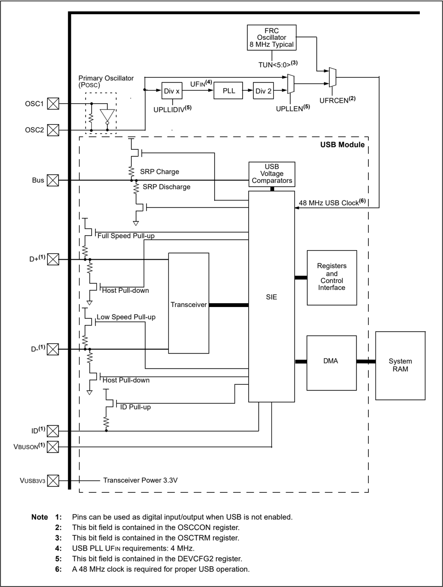

## 10.1 USB Control Registers

## TABLE 10-1: USB REGISTER MAP

| Virtual Address (BF88_#)   | Register Name (1)   |           | Bits   | Bits   | Bits   | Bits   | Bits   | Bits   | Bits   | Bits   | Bits                                    | Bits                                    | Bits                                    | Bits                                    | Bits                                    | Bits         | Bits         | Bits            |            |
|----------------------------|---------------------|-----------|--------|--------|--------|--------|--------|--------|--------|--------|-----------------------------------------|-----------------------------------------|-----------------------------------------|-----------------------------------------|-----------------------------------------|--------------|--------------|-----------------|------------|
| Virtual Address (BF88_#)   | Register Name (1)   | Bit Range | 31/15  | 30/14  | 29/13  | 28/12  | 27/11  | 26/10  | 25/9   | 24/8   | 23/7                                    | 22/6                                    | 21/5                                    | 20/4                                    | 19/3                                    | 18/2         | 17/1         | 16/0            | All Resets |
| 5040                       | U1OTGIR (2)         | 31:16     | -      | -      | -      | -      | -      | -      | -      | -      | -                                       | -                                       | -                                       | -                                       | -                                       | -            | -            | -               | 0000       |
|                            |                     | 15:0      | -      | -      | -      | -      | -      | -      | -      | -      | IDIF                                    | T1MSECIF                                | LSTATEIF                                | ACTVIF                                  | SESVDIF                                 | SESENDIF     | -            | VBUSVDIF        | 0000       |
| 5050                       | U1OTGIE             | 31:16     | -      | -      | -      | -      | -      | -      | -      | -      | -                                       | -                                       | -                                       | -                                       | -                                       | -            | -            | -               | 0000       |
| 5050                       | U1OTGIE             | 15:0      | -      | -      | -      | -      | -      | -      | -      | -      | IDIE                                    | T1MSECIE                                | LSTATEIE                                | ACTVIE                                  | SESVDIE                                 | SESENDIE     | -            | VBUSVDIE        | 0000       |
|                            | (3)                 | 31:16     | -      | -      | -      | -      | -      | -      | -      | -      | -                                       | -                                       | -                                       | -                                       | -                                       | -            | -            | -               | 0000       |
| 5060                       | U1OTGSTAT           | 15:0      | -      | -      | -      | -      | -      | -      | -      | -      | ID                                      | -                                       | LSTATE                                  | -                                       | SESVD                                   | SESEND       | -            | VBUSVD          | 0000       |
| 5070                       | U1OTGCON            | 31:16     | -      | -      | -      | -      | -      | -      | -      | -      | -                                       | -                                       | -                                       | -                                       | -                                       | -            | -            | -               | 0000       |
| 5070                       |                     | 15:0      | -      | -      | -      | -      | -      | -      | -      | -      | DPPULUP DMPULUP DPPULDWNDMPULDWN VBUSON | DPPULUP DMPULUP DPPULDWNDMPULDWN VBUSON | DPPULUP DMPULUP DPPULDWNDMPULDWN VBUSON | DPPULUP DMPULUP DPPULDWNDMPULDWN VBUSON | DPPULUP DMPULUP DPPULDWNDMPULDWN VBUSON | OTGEN        | VBUSCHG      | VBUSDIS         | 0000       |
| 5080                       | U1PWRC              | 31:16     | -      | -      | -      | -      | -      | -      | -      | -      | -                                       | -                                       | -                                       | -                                       | -                                       | -            | -            | -               | 0000       |
| 5200                       | (2)                 | 15:0      | -      | -      | -      | -      | -      | -      | -      | -      | UACTPND (4)                             | -                                       | -                                       | USLPGRD                                 | USBBUSY                                 | -            | USUSPEND     | USBPWR          | 0000       |
|                            | U1IR                | 31:16     | -      | -      | -      | -      | -      | -      | -      | -      | -                                       | -                                       | -                                       | -                                       | -                                       | -            | -            | -               | 0000       |
|                            | U1IR                | 15:0      | -      | -      | -      | -      | -      | -      | -      | -      | STALLIF                                 | ATTACHIF                                | RESUMEIF                                | IDLEIF                                  | TRNIF                                   | SOFIF        | UERRIF       | URSTIF DETACHIF | 0000 0000  |
| 5210                       | U1IE                | 31:16     | -      | -      | -      | -      | -      | -      | -      | -      | -                                       | -                                       | -                                       | -                                       | -                                       | -            | -            | -               | 0000       |
| 5210                       | U1IE                | 15:0      | -      | -      | -      | -      | -      | -      | -      | -      | STALLIE                                 | ATTACHIE                                | RESUMEIE                                | IDLEIE                                  | TRNIE                                   | SOFIE        | UERRIE       | URSTIE DETACHIE | 0000       |
| 5220                       | U1EIR (2)           | 31:16     | -      | -      | -      | -      | -      | -      | -      | -      | -                                       | -                                       | -                                       | -                                       | -                                       | -            | -            | -               | 0000 0000  |
| 5220                       | U1EIR (2)           | 15:0      | -      | -      | -      | -      | -      | -      | -      | -      | BTSEF                                   | BMXEF                                   | DMAEF                                   | BTOEF                                   | DFN8EF                                  | CRC16EF      | CRC5EF EOFEF | PIDEF           | 0000 0000  |
| 5230                       | U1EIE               | 31:16     | -      | -      | -      | -      | -      | -      | -      | -      | -                                       | -                                       | -                                       | -                                       | -                                       | -            | -            | -               | 0000       |
| 5230                       | U1EIE               | 15:0      | -      | -      | -      | -      | -      | -      | -      | -      | BTSEE                                   | BMXEE                                   | DMAEE                                   | BTOEE                                   | DFN8EE                                  | CRC16EE      | CRC5EE EOFEE | PIDEE           | 0000 0000  |
| 5240                       | U1STAT (3)          | 31:16     | -      | -      | -      | -      | -      | -      | -      | -      | -                                       | -                                       | -                                       | -                                       | -                                       | -            | -            | -               | 0000       |
| 5240                       | U1STAT (3)          | 15:0      | -      | -      | -      | -      | -      | -      | -      | -      |                                         | ENDPT<3:0>                              | ENDPT<3:0>                              |                                         | DIR                                     | PPBI         | -            | -               | 0000       |
| 5250                       | U1CON               | 31:16     | -      | -      | -      | -      | -      | -      | -      | -      | -                                       | -                                       | -                                       | -                                       | -                                       | -            | -            | -               | 0000       |
| 5250                       | U1CON               | 15:0      | -      | -      | -      | -      | -      | -      | -      | -      | JSTATE                                  | SE0                                     | PKTDIS TOKBUSY                          | USBRST                                  | HOSTEN                                  | RESUME       | PPBRST       | USBEN SOFEN     | 0000 0000  |
| 5260                       | U1ADDR              | 31:16     | -      | -      | -      | -      | -      | -      | -      | -      | -                                       | -                                       | -                                       | -                                       | -                                       | -            | -            | -               | 0000       |
| 5260                       | U1ADDR              | 15:0      | -      | -      | -      | -      | -      | -      | -      | -      | LSPDEN                                  |                                         | DEVADDR<6:0>                            | DEVADDR<6:0>                            | DEVADDR<6:0>                            | DEVADDR<6:0> | DEVADDR<6:0> | DEVADDR<6:0>    | 0000       |
|                            |                     | 31:16     | -      | -      | -      | -      | -      | -      | -      | -      | -                                       | -                                       | -                                       | -                                       | -                                       | -            | -            | -               | 0000       |
|                            |                     | 15:0      | -      |        | -      | -      | -      | -      | -      | -      |                                         |                                         |                                         | BDTPTRL<15:9>                           |                                         |              |              |                 |            |
| 5270                       | U1BDTP1             |           |        |        |        |        |        |        |        |        |                                         |                                         |                                         |                                         |                                         |              |              |                 | 0000       |
|                            |                     |           |        | -      |        |        |        |        |        |        |                                         |                                         |                                         |                                         |                                         |              |              | -               |            |

Legend:

## Note 1:

x = unknown value on Reset; - = unimplemented, read as ' 0 '. Reset values are shown in hexadecimal.

With the exception of those noted, all registers in this table (except as noted) have corresponding CLR, SET and INV registers at their virtual address, plus an offset of 0x4, 0x8, and 0xC respectively. See Section 11.2 'CLR, SET and INV Registers' for more information.

2: This register does not have associated SET and INV registers.

3: This register does not have associated CLR, SET and INV registers.

4: Reset value for this bit is undefined.

## TABLE 10-1: USB REGISTER MAP (CONTINUED)

| Virtual Address (BF88_#)   | Register Name (1)   |            |       |       |       |       |       |       |      |           |           |          |          |                 |              |         |           |          |            |
|----------------------------|---------------------|------------|-------|-------|-------|-------|-------|-------|------|-----------|-----------|----------|----------|-----------------|--------------|---------|-----------|----------|------------|
|                            |                     | Bit Range  | 31/15 | 30/14 | 29/13 | 28/12 | 27/11 | 26/10 | 25/9 | 24/8 23/7 | Bits 22/6 |          | 21/5     | 20/4            | 19/3         | 18/2    | 17/1      | 16/0     | All Resets |
| 5280                       | U1FRML (3)          | 31:16      | -     | -     | -     | -     | -     | -     | -    | - -       | -         | -        |          | -               | - -          |         | -         | -        | 0000       |
| 5280                       | U1FRML (3)          | 15:0       | -     | -     | -     | -     | -     | -     | -    | -         |           |          |          | FRML<7:0>       | FRML<7:0>    |         |           |          | 0000       |
| 5290                       | U1FRMH (3)          | 31:16      | -     | -     | -     | -     | -     | -     | -    | -         | -         | -        | -        | -               | - -          | -       |           | -        | 0000       |
| 5290                       | U1FRMH (3)          | 15:0       | -     | -     | -     | -     | -     | -     | -    | -         | -         | -        | -        | -               | -            |         | FRMH<2:0> |          | 0000       |
| 52A0                       | U1TOK               | 31:16      | -     | -     | -     | -     | -     | -     | -    | - -       |           | -        | -        | -               | -            | -       | -         | -        | 0000       |
| 52A0                       | U1TOK               | 15:0       | -     | -     | -     | -     | -     | -     | -    | -         |           | PID<3:0> | PID<3:0> |                 | EP<3:0>      | EP<3:0> |           |          | 0000       |
| 52B0                       | U1SOF               | 31:16      | -     | -     | -     | -     | -     | -     | -    | -         | -         | -        | -        | -               | -            | -       | -         | -        | 0000       |
| 52B0                       | U1SOF               | 15:0       | -     | -     | -     | -     | -     | -     | -    | -         |           |          |          | CNT<7:0>        | CNT<7:0>     |         |           |          | 0000       |
| 52C0                       | U1BDTP2             | 31:16      | -     | -     | -     | -     | -     | -     | -    | -         | -         | -        | -        | -               | -            | -       | -         | -        | 0000       |
| 52C0                       | U1BDTP2             | 15:0       | -     | -     | -     | -     | -     | -     | -    | -         |           |          |          | BDTPTRH<7:0>    | BDTPTRH<7:0> |         |           |          | 0000       |
| 52D0                       | U1BDTP3             | 31:16      | -     | -     | -     | -     | -     | -     | -    | -         | -         | -        | -        | -               | -            | -       | -         | -        | 0000       |
| 52D0                       | U1BDTP3             | 15:0       | -     | -     | -     | -     | -     | -     | -    | -         |           |          |          | BDTPTRU<7:0>    | BDTPTRU<7:0> |         |           |          | 0000       |
|                            | U1CNFG1             | 31:16      | -     | -     | -     | -     | -     | -     | -    | -         | -         | -        | -        | -               | -            | -       | -         | -        | 0000       |
| 52E0                       | U1CNFG1             | 15:0       | -     | -     | -     | -     | -     | -     | -    | -         | UTEYE     | UOEMON   | -        | USBSIDL         | -            | -       | -         | UASUSPND | 0001       |
| 5300                       | U1EP0               | 31:16      | -     | -     | -     | -     | -     | -     | -    | -         | -         | -        | -        | -               | -            | -       | -         | -        | 0000       |
| 5300                       | U1EP0               | 15:0       | -     | -     | -     | -     | -     | -     | -    | -         | LSPD      | RETRYDIS | -        | EPCONDIS        | EPRXEN       | EPTXEN  | EPSTALL   | EPHSHK   | 0000       |
| 5310                       | U1EP1               | 31:16      | -     | -     | -     | -     | -     | -     | -    | -         | -         | -        | -        | -               | -            | -       | -         | -        | 0000       |
| 5310                       | U1EP1               | 15:0       | -     | -     | -     | -     | -     | -     | -    | -         | -         | -        | -        | EPCONDIS        | EPRXEN       | EPTXEN  | EPSTALL   | EPHSHK   | 0000       |
| 5320                       | U1EP2               | 31:16      | -     | -     | -     | -     | -     | -     | -    | -         | -         | -        | -        | -               | -            | -       | -         | -        | 0000       |
| 5320                       | U1EP2               | 15:0       | -     | -     | -     | -     | -     | -     | -    | -         | -         | -        | -        | EPCONDIS        | EPRXEN       | EPTXEN  | EPSTALL   | EPHSHK   | 0000       |
| 5330                       | U1EP3               | 31:16      | -     | -     | -     |       | -     |       |      |           | -         | -        | -        | -               | -            | -       | -         | -        |            |
| 5330                       | U1EP3               |            |       |       |       | -     |       | -     | -    | -         |           |          |          |                 |              |         |           |          | 0000       |
| 5340                       | U1EP4               | 15:0       | -     | -     | -     | -     | -     | -     | -    | -         | -         | -        | -        | EPCONDIS        | EPRXEN       | EPTXEN  | EPSTALL   | EPHSHK   | 0000       |
| 5340                       | U1EP4               | 31:16      | -     | -     | -     | -     | -     | -     | -    | -         | -         | -        | -        | -               | -            | -       | -         | -        | 0000       |
| 5350                       | U1EP5               | 15:0       | -     | -     | -     | -     | -     | -     | -    | -         | -         | -        | -        | EPCONDIS        | EPRXEN       | EPTXEN  | EPSTALL   | EPHSHK   | 0000       |
| 5350                       | U1EP5               | 31:16 15:0 | - -   | - -   | -     | -     | -     | -     | - -  | - -       | - -       | - -      | - -      | -               | -            | -       | -         | -        | 0000       |
| 5360                       | U1EP6               |            |       |       | -     | -     | -     | -     |      |           |           |          |          | EPCONDIS        | EPRXEN       | EPTXEN  | EPSTALL   | EPHSHK   | 0000       |
| 5360                       | U1EP6               | 31:16      | -     | -     | -     | -     | -     | -     | -    | -         | -         | -        | -        | -               | -            | -       | -         | -        | 0000       |
| 5370                       | U1EP7               | 15:0       | -     | -     | -     | -     | -     | -     | -    | -         | -         | -        | -        | EPCONDIS        |              | EPTXEN  | EPSTALL   | EPHSHK   | 0000       |
| 5370                       | U1EP7               | 31:16      | -     | -     | -     | -     | -     | -     | -    | -         | -         | -        | -        | -               | EPRXEN -     | -       | -         | -        | 0000       |
| 5380                       | U1EP8               | 15:0       | - -   | -     | -     | -     | -     | -     | -    | -         | -         | -        | -        | EPCONDIS        | EPRXEN       | EPTXEN  | EPSTALL - | EPHSHK   | 0000 0000  |
| 5380                       | U1EP8               | 31:16      |       | -     | -     | -     | -     | -     | -    | -         | -         | -        | -        | -               | -            | -       |           | -        | 0000       |
|                            |                     | 15:0       | -     | -     | -     | -     | -     | -     | -    | -         | -         | -        | -        | EPCONDIS EPRXEN | EPTXEN       |         | EPSTALL   | EPHSHK   |            |

## Legend:

## Note

1:

x = unknown value on Reset; - = unimplemented, read as ' 0 '. Reset values are shown in hexadecimal.

With the exception of those noted, all registers in this table (except as noted) have corresponding CLR, SET and INV registers at their virtual address, plus an offset of 0x4, 0x8, and 0xC respectively. See Section 11.2 'CLR, SET and INV Registers' for more information.

- 2: This register does not have associated SET and INV registers.

3: This register does not have associated CLR, SET and INV registers.

4: Reset value for this bit is undefined.

## TABLE 10-1: USB REGISTER MAP (CONTINUED)

|      |        |           | Bits   | Bits   | Bits   | Bits   | Bits   | Bits       | Bits   | Bits   | Bits   | Bits   | Bits   | Bits     | Bits   | Bits   | Bits    | Bits   |            |
|------|--------|-----------|--------|--------|--------|--------|--------|------------|--------|--------|--------|--------|--------|----------|--------|--------|---------|--------|------------|
|      |        | Bit Range | 31/15  | 30/14  | 29/13  | 28/12  | 27/11  | 26/10 25/9 |        | 24/8   | 23/7   | 22/6   | 21/5   | 20/4     | 19/3   | 18/2   | 17/1    | 16/0   | All Resets |
|      |        | 31:16     | -      | -      | -      | -      | -      | -          | -      | -      | -      | -      | -      | -        | -      | -      | -       | -      | 0000       |
|      |        | 15:0      | -      | -      | -      | -      | -      | -          | -      | -      | -      | -      | -      | EPCONDIS | EPRXEN | EPTXEN | EPSTALL | EPHSHK | 0000       |
|      |        | 31:16     | -      | -      | -      | -      | -      | -          | -      | -      | -      | -      | -      | -        | -      | -      | -       | -      | 0000       |
|      |        | 15:0      | -      | -      | -      | -      | -      | -          | -      | -      | -      | -      | -      | EPCONDIS | EPRXEN | EPTXEN | EPSTALL | EPHSHK | 0000       |
|      | U1EP11 | 31:16     | -      | -      | -      | -      | -      | -          | -      | -      | -      | -      | -      | -        | -      | -      | -       | -      | 0000       |
|      | U1EP11 | 15:0      | -      | -      | -      | -      | -      | -          | -      | -      | -      | -      | -      | EPCONDIS | EPRXEN | EPTXEN | EPSTALL | EPHSHK | 0000       |
|      |        | 31:16     | -      | -      | -      | -      | -      | -          | -      | -      | -      | -      | -      | -        | -      | -      | -       | -      | 0000       |
|      |        | 15:0      | -      | -      | -      | -      | -      | -          | -      | -      | -      | -      | -      | EPCONDIS | EPRXEN | EPTXEN | EPSTALL | EPHSHK | 0000       |
|      |        | 31:16     | -      | -      | -      | -      | -      | -          | -      | -      | -      | -      | -      | -        | -      | -      | -       | -      | 0000       |
|      |        | 15:0      | -      | -      | -      | -      | -      | -          | -      | -      | -      | -      | -      | EPCONDIS | EPRXEN | EPTXEN | EPSTALL | EPHSHK | 0000       |
|      |        | 31:16     | -      | -      | -      | -      | -      | -          | -      | -      | -      | -      | -      | -        | -      | -      | -       | -      | 0000       |
|      |        | 15:0      | -      | -      | -      | -      | -      | -          | -      | -      | -      | -      | -      | EPCONDIS | EPRXEN | EPTXEN | EPSTALL | EPHSHK | 0000       |
| 53F0 |        | 31:16     | -      | -      | -      | -      | -      | -          | -      | -      | -      | -      | -      | -        | -      | -      | -       | -      | 0000       |
| 53F0 |        | 15:0      | -      | -      | -      | -      | -      | -          | -      | -      | -      | -      | -      | EPCONDIS | EPRXEN | EPTXEN | EPSTALL | EPHSHK | 0000       |

Legend:

x = unknown value on Reset; - = unimplemented, read as ' 0 '. Reset values are shown in hexadecimal.

Note 1: With the exception of those noted, all registers in this table (except as noted) have corresponding CLR, SET and INV registers at their virtual address, plus an offset of 0x4, 0x8, and 0xC respectively. See Section 11.2 'CLR, SET and INV Registers' for more information.

- 2: This register does not have associated SET and INV registers.
- 3: This register does not have associated CLR, SET and INV registers.
- 4: Reset value for this bit is undefined.

## PIC32MX1XX/2XX 28/36/44-PIN FAMILY

## REGISTER 10-1: U1OTGIR: USB OTG INTERRUPT STATUS REGISTER

| Bit Range   | Bit 31/23/15/7   | Bit 30/22/14/6   | Bit 29/21/13/5   | Bit 28/20/12/4   | Bit 27/19/11/3   | Bit 26/18/10/2   | Bit 25/17/9/1   | Bit 24/16/8/0   |
|-------------|------------------|------------------|------------------|------------------|------------------|------------------|-----------------|-----------------|
| 31:24       | U-0              | U-0              | U-0              | U-0              | U-0              | U-0              | U-0             | U-0             |
| 31:24       | -                | -                | -                | -                | -                | -                | -               | -               |
| 23:16       | U-0              | U-0              | U-0              | U-0              | U-0              | U-0              | U-0             | U-0             |
| 23:16       | -                | -                | -                | -                | -                | -                | -               | -               |
| 15:8        | U-0              | U-0              | U-0              | U-0              | U-0              | U-0              | U-0             | U-0             |
| 15:8        | -                | -                | -                | -                | -                | -                | -               | -               |
| 7:0         | R/WC-0, HS       | R/WC-0, HS       | R/WC-0, HS       | R/WC-0, HS       | R/WC-0, HS       | R/WC-0, HS       | U-0             | R/WC-0, HS      |
| 7:0         | IDIF             | T1MSECIF         | LSTATEIF         | ACTVIF           | SESVDIF          | SESENDIF         | -               | VBUSVDIF        |

## Legend:

WC = Write '1' to clear

HS = Hardware Settable bit

R = Readable bit

W = Writable bit

U = Unimplemented bit, read as '0'

-n = Value at POR

'1' = Bit is set

'0' = Bit is cleared

x = Bit is unknown

bit 31-8

## Unimplemented: Read as ' 0 '

bit 7 IDIF:

ID State Change Indicator bit

1 = A change in the ID state was detected

0 = No change in the ID state was detected

bit 6 T1MSECIF: 1 Millisecond Timer bit

1 = 1 millisecond timer has expired

0 = 1 millisecond timer has not expired

bit 5 LSTATEIF: Line State Stable Indicator bit

1 = USB line state has been stable for 1 ms, but different from last time

0 = USB line state has not been stable for 1 ms

bit 4 ACTVIF: Bus Activity Indicator bit

1 = Activity on the D+, D-, ID or VBUS pins has caused the device to wake-up

0 = Activity has not been detected

## bit 3 SESVDIF: Session Valid Change Indicator bit

1 = VBUS voltage has dropped below the session end level

0 = VBUS voltage has not dropped below the session end level

bit 2 SESENDIF: B-Device VBUS Change Indicator bit

1 = A change on the session end input was detected

0 = No change on the session end input was detected

## bit 1 Unimplemented: Read as ' 0 '

bit 0 VBUSVDIF: A-Device VBUS Change Indicator bit

1 = A change on the session valid input was detected

0 = No change on the session valid input was detected

## PIC32MX1XX/2XX 28/36/44-PIN FAMILY

## REGISTER 10-2: U1OTGIE: USB OTG INTERRUPT ENABLE REGISTER

| Bit Range   | Bit 31/23/15/7   | Bit 30/22/14/6   | Bit 29/21/13/5   | Bit 28/20/12/4   | Bit 27/19/11/3   | Bit 26/18/10/2   | Bit 25/17/9/1   | Bit 24/16/8/0   |
|-------------|------------------|------------------|------------------|------------------|------------------|------------------|-----------------|-----------------|
| 31:24       | U-0              | U-0              | U-0              | U-0              | U-0              | U-0              | U-0             | U-0             |
| 31:24       | -                | -                | -                | -                | -                | -                | -               | -               |
| 23:16       | U-0              | U-0              | U-0              | U-0              | U-0              | U-0              | U-0             | U-0             |
| 23:16       | -                | -                | -                | -                | -                | -                | -               | -               |
| 15:8        | U-0              | U-0              | U-0              | U-0              | U-0              | U-0              | U-0             | U-0             |
| 15:8        | -                | -                | -                | -                | -                | -                | -               | -               |
| 7:0         | R/W-0            | R/W-0            | R/W-0            | R/W-0            | R/W-0            | R/W-0            | U-0             | R/W-0           |
| 7:0         | IDIE             | T1MSECIE         | LSTATEIE         | ACTVIE           | SESVDIE          | SESENDIE         | -               | VBUSVDIE        |

## Legend:

R = Readable bit

W = Writable bit

U = Unimplemented bit, read as '0'

-n = Value at POR

'1' = Bit is set

'0' = Bit is cleared

x = Bit is unknown

bit 31-8

Unimplemented: Read as ' 0 '

bit 7

IDIE:

ID Interrupt Enable bit

1 = ID interrupt is enabled

0 = ID interrupt is disabled

bit 6

T1MSECIE: 1 Millisecond Timer Interrupt Enable bit

1 = 1 millisecond timer interrupt is enabled

0 = 1 millisecond timer interrupt is disabled

bit 5

LSTATEIE: Line State Interrupt Enable bit

1 = Line state interrupt is enabled

0 = Line state interrupt is disabled

## bit 4 ACTVIE: Bus Activity Interrupt Enable bit

1 = Activity interrupt is enabled

0 = Activity interrupt is disabled

bit 3

SESVDIE: Session Valid Interrupt Enable bit

1 = Session valid interrupt is enabled

0 = Session valid interrupt is disabled

bit 2

SESENDIE: B-Device Session End Interrupt Enable bit

1 = B-Device session end interrupt is enabled

0 = B-Device session end interrupt is disabled

bit 1 Unimplemented: Read as ' 0 '

bit 0 VBUSVDIE: A-Device VBUS Valid Interrupt Enable bit

1 = A-Device VBUS valid interrupt is enabled

0 = A-Device VBUS valid interrupt is disabled

## PIC32MX1XX/2XX 28/36/44-PIN FAMILY

## REGISTER 10-3: U1OTGSTAT: USB OTG STATUS REGISTER

| Bit Range   | Bit 31/23/15/7   | Bit 30/22/14/6   | Bit 29/21/13/5   | Bit 28/20/12/4   | Bit 27/19/11/3   | Bit 26/18/10/2   | Bit 25/17/9/1   | Bit 24/16/8/0   |
|-------------|------------------|------------------|------------------|------------------|------------------|------------------|-----------------|-----------------|
| 31:24       | U-0              | U-0              | U-0              | U-0              | U-0              | U-0              | U-0             | U-0             |
| 31:24       | -                | -                | -                | -                | -                | -                | -               | -               |
| 23:16       | U-0              | U-0              | U-0              | U-0              | U-0              | U-0              | U-0             | U-0             |
| 23:16       | -                | -                | -                | -                | -                | -                | -               | -               |
| 15:8        | U-0              | U-0              | U-0              | U-0              | U-0              | U-0              | U-0             | U-0             |
| 15:8        | -                | -                | -                | -                | -                | -                | -               | -               |
| 7:0         | R-0              | U-0              | R-0              | U-0              | R-0              | R-0              | U-0             | R-0             |
| 7:0         | ID               | -                | LSTATE           | -                | SESVD            | SESEND           | -               | VBUSVD          |

## Legend:

R = Readable bit

W = Writable bit

U = Unimplemented bit, read as '0'

-n = Value at POR

'1' = Bit is set

'0' = Bit is cleared

x = Bit is unknown

## bit 31-8 Unimplemented: Read as ' 0 '

bit 7 ID: ID Pin State Indicator bit

- 1 = No cable is attached or a 'type B' cable has been inserted into the USB receptacle

- 0 = A 'type A' OTG cable has been inserted into the USB receptacle

bit 6 Unimplemented: Read as ' 0 '

bit 5 LSTATE: Line State Stable Indicator bit

- 1 = USB line state (SE0 (U1CON&lt;6&gt;) bit and JSTATE (U1CON&lt;7&gt;)) bit has been stable for previous 1 ms

- 0 = USB line state (SE0 and JSTATE) has not been stable for previous 1 ms

bit 4 Unimplemented: Read as ' 0 '

bit 3 SESVD: Session Valid Indicator bit

- 1 = VBUS voltage is above Session Valid on the A or B device

- 0 = VBUS voltage is below Session Valid on the A or B device

bit 2 SESEND: B-Device Session End Indicator bit

1 = VBUS voltage is below Session Valid on the B device

0 = VBUS voltage is above Session Valid on the B device

bit 1 Unimplemented: Read as ' 0 '

bit 0 VBUSVD: A-Device VBUS Valid Indicator bit

- 1 = VBUS voltage is above Session Valid on the A device

- 0 = VBUS voltage is below Session Valid on the A device

## PIC32MX1XX/2XX 28/36/44-PIN FAMILY

## REGISTER 10-4: U1OTGCON: USB OTG CONTROL REGISTER

| Bit Range   | Bit 31/23/15/7   | Bit 30/22/14/6   | Bit 29/21/13/5   | Bit 28/20/12/4   | Bit 27/19/11/3   | Bit 26/18/10/2   | Bit 25/17/9/1   | Bit 24/16/8/0   |
|-------------|------------------|------------------|------------------|------------------|------------------|------------------|-----------------|-----------------|
| 31:24       | U-0              | U-0              | U-0              | U-0              | U-0              | U-0              | U-0             | U-0             |
| 31:24       | -                | -                | -                | -                | -                | -                | -               | -               |
| 23:16       | U-0              | U-0              | U-0              | U-0              | U-0              | U-0              | U-0             | U-0             |
| 23:16       | -                | -                | -                | -                | -                | -                | -               | -               |
| 15:8        | U-0              | U-0              | U-0              | U-0              | U-0              | U-0              | U-0             | U-0             |
| 15:8        | -                | -                | -                | -                | -                | -                | -               | -               |
| 7:0         | R/W-0            | R/W-0            | R/W-0            | R/W-0            | R/W-0            | R/W-0            | R/W-0           | R/W-0           |
| 7:0         | DPPULUP          | DMPULUP          | DPPULDWN         | DMPULDWN         | VBUSON           | OTGEN            | VBUSCHG         | VBUSDIS         |

## Legend:

R = Readable bit

W = Writable bit

U = Unimplemented bit, read as '0'

-n = Value at POR

'1' = Bit is set

'0' = Bit is cleared

x = Bit is unknown

## bit 31-8 Unimplemented: Read as ' 0 '

bit 7

DPPULUP: D+ Pull-Up Enable bit

1 = D+ data line pull-up resistor is enabled

0 = D+ data line pull-up resistor is disabled

bit 6

DMPULUP: D- Pull-Up Enable bit

1 = D- data line pull-up resistor is enabled

0 = D- data line pull-up resistor is disabled

bit 5 DPPULDWN: D+ Pull-Down Enable bit

1 = D+ data line pull-down resistor is enabled

0 = D+ data line pull-down resistor is disabled

bit 4 DMPULDWN: D- Pull-Down Enable bit

1 = D- data line pull-down resistor is enabled

0 = D- data line pull-down resistor is disabled

## bit 3 VBUSON: VBUS Power-on bit

1 = VBUS line is powered

0 = VBUS line is not powered

bit 2

OTGEN: OTG Functionality Enable bit

1 = DPPULUP, DMPULUP, DPPULDWN and DMPULDWN bits are under software control

0 = DPPULUP, DMPULUP, DPPULDWN and DMPULDWN bits are under USB hardware control

## bit 1 VBUSCHG: VBUS Charge Enable bit

1 = VBUS line is charged through a pull-up resistor

0 = VBUS line is not charged through a resistor

## bit 0

VBUSDIS: VBUS Discharge Enable bit

1 = VBUS line is discharged through a pull-down resistor

0 = VBUS line is not discharged through a resistor

## PIC32MX1XX/2XX 28/36/44-PIN FAMILY

## REGISTER 10-5: U1PWRC: USB POWER CONTROL REGISTER

| Bit Range   | Bit 31/23/15/7   | Bit 30/22/14/6   | Bit 29/21/13/5   | Bit 28/20/12/4   | Bit 27/19/11/3   | Bit 26/18/10/2   | Bit 25/17/9/1   | Bit 24/16/8/0   |
|-------------|------------------|------------------|------------------|------------------|------------------|------------------|-----------------|-----------------|
| 31:24       | U-0              | U-0              | U-0              | U-0              | U-0              | U-0              | U-0             | U-0             |
| 31:24       | -                | -                | -                | -                | -                | -                | -               | -               |
| 23:16       | U-0              | U-0              | U-0              | U-0              | U-0              | U-0              | U-0             | U-0             |
| 23:16       | -                | -                | -                | -                | -                | -                | -               | -               |
| 15:8        | U-0              | U-0              | U-0              | U-0              | U-0              | U-0              | U-0             | U-0             |
| 15:8        | -                | -                | -                | -                | -                | -                | -               | -               |
| 7:0         | R-0              | U-0              | U-0              | R/W-0            | R/W-0            | U-0              | R/W-0           | R/W-0           |
| 7:0         | UACTPND          | -                | -                | USLPGRD          | USBBUSY (1)      | -                | USUSPEND        | USBPWR          |

## Legend:

R = Readable bit

W = Writable bit

U = Unimplemented bit, read as '0'

-n = Value at POR

'1' = Bit is set

'0' = Bit is cleared

x = Bit is unknown

bit 31-8 Unimplemented:

Read as ' 0 '

bit 7 UACTPND:

USB Activity Pending bit

- 1 = USB bus activity has been detected; however, an interrupt is pending, which has yet to be generated

- 0 = An interrupt is not pending

bit 6-5 Unimplemented: Read as ' 0

'

bit 4 USLPGRD:

USB Sleep Entry Guard bit

- 1 = Sleep entry is blocked if USB bus activity is detected or if a notification is pending

- 0 = USB module does not block Sleep entry

bit 3 USBBUSY: USB Module Busy bit

(1)

1 = USB module is active or disabled, but not ready to be enabled

- 0 = USB module is not active and is ready to be enabled

bit 2 Unimplemented: Read as ' 0

'

bit 1 USUSPEND:

USB Suspend Mode bit

- 1 = USB module is placed in Suspend mode

(The 48 MHz USB clock will be gated off. The transceiver is placed in a low-power state.)

- 0 = USB module operates normally

bit 0 USBPWR: USB Operation Enable bit

- 1 = USB module is turned on

0 = USB module is disabled

(Outputs held inactive, device pins not used by USB, analog features are shut down to reduce power consumption.)

Note 1: When USBPWR = 0 and USBBUSY = 1 , status from all other registers is invalid and writes to all USB module registers produce undefined results.

## PIC32MX1XX/2XX 28/36/44-PIN FAMILY

## REGISTER 10-6: U1IR: USB INTERRUPT REGISTER

| Bit Range   | Bit 31/23/15/7   | Bit 30/22/14/6   | Bit 29/21/13/5   | Bit 28/20/12/4   | Bit 27/19/11/3   | Bit 26/18/10/2   | Bit 25/17/9/1   | Bit 24/16/8/0   |
|-------------|------------------|------------------|------------------|------------------|------------------|------------------|-----------------|-----------------|
| 31:24       | U-0              | U-0              | U-0              | U-0              | U-0              | U-0              | U-0             | U-0             |
| 31:24       | -                | -                | -                | -                | -                | -                | -               | -               |
| 23:16       | U-0              | U-0              | U-0              | U-0              | U-0              | U-0              | U-0             | U-0             |
| 23:16       | -                | -                | -                | -                | -                | -                | -               | -               |
| 15:8        | U-0              | U-0              | U-0              | U-0              | U-0              | U-0              | U-0             | U-0             |
| 15:8        | -                | -                | -                | -                | -                | -                | -               | -               |
| 7:0         | R/WC-0, HS       | R/WC-0, HS       | R/WC-0, HS       | R/WC-0, HS       | R/WC-0, HS       | R/WC-0, HS       | R-0             | R/WC-0, HS      |
| 7:0         | STALLIF          | ATTACHIF (1)     | RESUMEIF (2)     | IDLEIF           | TRNIF (3)        | SOFIF            | UERRIF (4)      | URSTIF (5)      |
| 7:0         | STALLIF          | ATTACHIF (1)     | RESUMEIF (2)     | IDLEIF           | TRNIF (3)        | SOFIF            | UERRIF (4)      | DETACHIF (6)    |

| Legend:           | WC = Write '1' to clear   | HS = Hardware Settable bit         | HS = Hardware Settable bit         |
|-------------------|---------------------------|------------------------------------|------------------------------------|
| R = Readable bit  | W = Writable bit          | U = Unimplemented bit, read as '0' | U = Unimplemented bit, read as '0' |
| -n = Value at POR | '1' = Bit is set          | '0' = Bit is cleared               | x = Bit is unknown                 |

bit 31-8 Unimplemented: Read as ' 0 '

bit 7

STALLIF: STALL Handshake Interrupt bit

1 = In Host mode a STALL handshake was received during the handshake phase of the transaction

In Device mode a STALL handshake was transmitted during the handshake phase of the transaction

0 = STALL handshake has not been sent

bit 6 ATTACHIF: Peripheral Attach Interrupt bit (1)

1 = Peripheral attachment was detected by the USB module

0 = Peripheral attachment was not detected

bit 5 RESUMEIF: Resume Interrupt bit (2)

1 = K-State is observed on the D+ or D- pin for 2.5 µs

0 = K-State is not observed

bit 4

IDLEIF: Idle Detect Interrupt bit

1 = Idle condition detected (constant Idle state of 3 ms or more)

0 = No Idle condition detected

bit 3

TRNIF: Token Processing Complete Interrupt bit (3)

1

=

Processing of current token is complete; a read of the U1STAT register will provide endpoint information

0 = Processing of current token not complete

bit 2 SOFIF: SOF Token Interrupt bit

1 = SOF token received by the peripheral or the SOF threshold reached by the host

0 = SOF token was not received nor threshold reached

bit 1 UERRIF : USB Error Condition Interrupt bit (4)

1 = Unmasked error condition has occurred

0 = Unmasked error condition has not occurred

bit 0

URSTIF: USB Reset Interrupt bit (Device mode) (5)

1 = Valid USB Reset has occurred

0 = No USB Reset has occurred

DETACHIF: USB Detach Interrupt bit (Host mode) (6)

- 1 = Peripheral detachment was detected by the USB module

0 = Peripheral detachment was not detected

- Note 1: This bit is valid only if the HOSTEN bit is set (see Register 10-11), there is no activity on the USB for 2.5 µs, and the current bus state is not SE0.
- 2: When not in Suspend mode, this interrupt should be disabled.
- 3: Clearing this bit will cause the STAT FIFO to advance.
- 4: Only error conditions enabled through the U1EIE register will set this bit.
- 5: Device mode.
- 6: Host mode.

## PIC32MX1XX/2XX 28/36/44-PIN FAMILY

## REGISTER 10-7: U1IE: USB INTERRUPT ENABLE REGISTER

| Bit Range   | Bit 31/23/15/7   | Bit 30/22/14/6   | Bit 29/21/13/5   | Bit 28/20/12/4   | Bit 27/19/11/3   | Bit 26/18/10/2   | Bit 25/17/9/1   | Bit 24/16/8/0   |
|-------------|------------------|------------------|------------------|------------------|------------------|------------------|-----------------|-----------------|
| 31:24       | U-0              | U-0              | U-0              | U-0              | U-0              | U-0              | U-0             | U-0             |
| 31:24       | -                | -                | -                | -                | -                | -                | -               | -               |
| 23:16       | U-0              | U-0              | U-0              | U-0              | U-0              | U-0              | U-0             | U-0             |
| 23:16       | -                | -                | -                | -                | -                | -                | -               | -               |
| 15:8        | U-0              | U-0              | U-0              | U-0              | U-0              | U-0              | U-0             | U-0             |
| 15:8        | -                | -                | -                | -                | -                | -                | -               | -               |
| 7:0         | R/W-0            | R/W-0            | R/W-0            | R/W-0            | R/W-0            | R/W-0            | R/W-0           | R/W-0           |
| 7:0         | STALLIE          | ATTACHIE         | RESUMEIE         | IDLEIE           | TRNIE            | SOFIE            | UERRIE (1)      | URSTIE (2)      |
| 7:0         | STALLIE          | ATTACHIE         | RESUMEIE         | IDLEIE           | TRNIE            | SOFIE            | UERRIE (1)      | DETACHIE (3)    |

## Legend:

R = Readable bit

W = Writable bit

U = Unimplemented bit, read as '0'

-n = Value at POR

'1' = Bit is set

'0' = Bit is cleared

x = Bit is unknown

## bit 31-8 Unimplemented: Read as ' 0 '

## bit 7

STALLIE: STALL Handshake Interrupt Enable bit

1 = STALL interrupt is enabled

0 = STALL interrupt is disabled

## bit 6 ATTACHIE: ATTACH Interrupt Enable bit

1 = ATTACH interrupt is enabled

0 = ATTACH interrupt is disabled

bit 5 RESUMEIE:

RESUME Interrupt Enable bit

1 = RESUME interrupt is enabled

0

= RESUME interrupt is disabled

## bit 4 IDLEIE:

Idle Detect Interrupt Enable bit

1 = Idle interrupt is enabled

0 = Idle interrupt is disabled

- bit 3 TRNIE: Token Processing Complete Interrupt Enable bit

1 = TRNIF interrupt is enabled

0 = TRNIF interrupt is disabled

bit 2 SOFIE: SOF Token Interrupt Enable bit

1 = SOFIF interrupt is enabled

0 = SOFIF interrupt is disabled

bit 1 UERRIE: USB Error Interrupt Enable bit (1)

1 = USB Error interrupt is enabled

0 = USB Error interrupt is disabled

bit 0 URSTIE: USB Reset Interrupt Enable bit (2)

1 = URSTIF interrupt is enabled

0 = URSTIF interrupt is disabled

DETACHIE: USB Detach Interrupt Enable bit (3)

1 = DATTCHIF interrupt is enabled

0 = DATTCHIF interrupt is disabled

Note 1: For an interrupt to propagate USBIF, the UERRIE (U1IE&lt;1&gt;) bit must be set.

2: Device mode.

3: Host mode.

## PIC32MX1XX/2XX 28/36/44-PIN FAMILY

## REGISTER 10-8: U1EIR: USB ERROR INTERRUPT STATUS REGISTER

| Bit Range   | Bit 31/23/15/7   | Bit 30/22/14/6   | Bit 29/21/13/5   | Bit 28/20/12/4   | Bit 27/19/11/3   | Bit 26/18/10/2   | Bit 25/17/9/1   | Bit 24/16/8/0   |
|-------------|------------------|------------------|------------------|------------------|------------------|------------------|-----------------|-----------------|
| 31:24       | U-0              | U-0              | U-0              | U-0              | U-0              | U-0              | U-0             | U-0             |
| 31:24       | -                | -                | -                | -                | -                | -                | -               | -               |
| 23:16       | U-0              | U-0              | U-0              | U-0              | U-0              | U-0              | U-0             | U-0             |
| 23:16       | -                | -                | -                | -                | -                | -                | -               | -               |
| 15:8        | U-0              | U-0              | U-0              | U-0              | U-0              | U-0              | U-0             | U-0             |
| 15:8        | -                | -                | -                | -                | -                | -                | -               | -               |
| 7:0         | R/WC-0, HS       | R/WC-0, HS       | R/WC-0, HS       | R/WC-0, HS       | R/WC-0, HS       | R/WC-0, HS       | R/WC-0, HS      | R/WC-0, HS      |
| 7:0         | BTSEF            | BMXEF            | DMAEF (1)        | BTOEF (2)        | DFN8EF           | CRC16EF          | CRC5EF (4)      | PIDEF           |
| 7:0         | BTSEF            | BMXEF            | DMAEF (1)        | BTOEF (2)        | DFN8EF           | CRC16EF          | EOFEF (3,5)     | PIDEF           |

| Legend:           | WC = Write '1' to clear   | HS = Hardware Settable bit         | HS = Hardware Settable bit         |
|-------------------|---------------------------|------------------------------------|------------------------------------|
| R = Readable bit  | W = Writable bit          | U = Unimplemented bit, read as '0' | U = Unimplemented bit, read as '0' |
| -n = Value at POR | '1' = Bit is set          | '0' = Bit is cleared               | x = Bit is unknown                 |

'

bit 31-8

## Unimplemented: Read as ' 0

## bit 7 BTSEF: Bit Stuff Error Flag bit

1 = Packet rejected due to bit stuff error

0 = Packet accepted

bit 6

BMXEF:

Bus Matrix Error Flag bit

- 1 = The base address, of the Buffer Descriptor Table, or the address of an individual buffer pointed to by a Buffer Descriptor Table entry, is invalid.

- 0 = No address error

## bit 5 DMAEF: DMA Error Flag bit (1)

1 = USB DMA error condition detected

0 = No DMA error

bit 4

BTOEF: Bus Turnaround Time-Out Error Flag bit (2)

1 = Bus turnaround time-out has occurred

0 = No bus turnaround time-out

## bit 3 DFN8EF: Data Field Size Error Flag bit

1 = Data field received is not an integral number of bytes

0 = Data field received is an integral number of bytes

## bit 2 CRC16EF: CRC16 Failure Flag bit

- 1 = Data packet rejected due to CRC16 error

- 0 = Data packet accepted

- Note 1: This type of error occurs when the module's request for the DMA bus is not granted in time to service the module's demand for memory, resulting in an overflow or underflow condition, and/or the allocated buffer size is not sufficient to store the received data packet causing it to be truncated.
- 2: This type of error occurs when more than 16-bit-times of Idle from the previous End-of-Packet (EOP) has elapsed.
- 3: This type of error occurs when the module is transmitting or receiving data and the SOF counter has reached zero.
- 4: Device mode.
- 5: Host mode.

## PIC32MX1XX/2XX 28/36/44-PIN FAMILY

## REGISTER 10-8: U1EIR: USB ERROR INTERRUPT STATUS REGISTER (CONTINUED)

(4)

bit 1

CRC5EF:

CRC5 Host Error Flag bit

- 1 = Token packet rejected due to CRC5 error

- 0 = Token packet accepted

EOFEF: EOF Error Flag bit (3,5)

- 1 = An EOF error condition was detected

- 0 = No EOF error condition was detected

bit 0

PIDEF:

PID Check Failure Flag bit

- 1 = PID check failed

- 0 = PID check passed

- Note 1: This type of error occurs when the module's request for the DMA bus is not granted in time to service the module's demand for memory, resulting in an overflow or underflow condition, and/or the allocated buffer size is not sufficient to store the received data packet causing it to be truncated.
- 2: This type of error occurs when more than 16-bit-times of Idle from the previous End-of-Packet (EOP) has elapsed.
- 3: This type of error occurs when the module is transmitting or receiving data and the SOF counter has reached zero.
- 4: Device mode.
- 5: Host mode.

## PIC32MX1XX/2XX 28/36/44-PIN FAMILY

## REGISTER 10-9: U1EIE: USB ERROR INTERRUPT ENABLE REGISTER

| Bit Range   | Bit 31/23/15/7   | Bit 30/22/14/6   | Bit 29/21/13/5   | Bit 28/20/12/4   | Bit 27/19/11/3   | Bit 26/18/10/2   | Bit 25/17/9/1   | Bit 24/16/8/0   |
|-------------|------------------|------------------|------------------|------------------|------------------|------------------|-----------------|-----------------|
| 31:24       | U-0              | U-0              | U-0              | U-0              | U-0              | U-0              | U-0             | U-0             |
| 31:24       | -                | -                | -                | -                | -                | -                | -               | -               |
| 23:16       | U-0              | U-0              | U-0              | U-0              | U-0              | U-0              | U-0             | U-0             |
| 23:16       | -                | -                | -                | -                | -                | -                | -               | -               |
| 15:8        | U-0              | U-0              | U-0              | U-0              | U-0              | U-0              | U-0             | U-0             |
| 15:8        | -                | -                | -                | -                | -                | -                | -               | -               |
| 7:0         | R/W-0            | R/W-0            | R/W-0            | R/W-0            | R/W-0            | R/W-0            | R/W-0           | R/W-0           |
| 7:0         | BTSEE            | BMXEE            | DMAEE            | BTOEE            | DFN8EE           | CRC16EE          | CRC5EE (1)      | PIDEE           |
| 7:0         | BTSEE            | BMXEE            | DMAEE            | BTOEE            | DFN8EE           | CRC16EE          | EOFEE (2)       | PIDEE           |

## Legend:

R = Readable bit

W = Writable bit

U = Unimplemented bit, read as '0'

-n = Value at POR

'1' = Bit is set

'0' = Bit is cleared

x = Bit is unknown

## bit 31-8 Unimplemented: Read as ' 0 '

bit 7

BTSEE: Bit Stuff Error Interrupt Enable bit

1 = BTSEF interrupt is enabled

0 = BTSEF interrupt is disabled

bit 6

BMXEE:

Bus Matrix Error Interrupt Enable bit

1 = BMXEF interrupt is enabled

0 = BMXEF interrupt is disabled

bit 5 DMAEE:

DMA Error Interrupt Enable bit

1 = DMAEF interrupt is enabled

0 = DMAEF interrupt is disabled

bit 4 BTOEE: Bus Turnaround Time-out Error Interrupt Enable bit

1 = BTOEF interrupt is enabled

0 = BTOEF interrupt is disabled

bit 3

DFN8EE: Data Field Size Error Interrupt Enable bit

1 = DFN8EF interrupt is enabled

0 = DFN8EF interrupt is disabled

bit 2

CRC16EE: CRC16 Failure Interrupt Enable bit

1 = CRC16EF interrupt is enabled

0 = CRC16EF interrupt is disabled

bit 1

CRC5EE: CRC5 Host Error Interrupt Enable bit (1)

1 = CRC5EF interrupt is enabled

0 = CRC5EF interrupt is disabled

EOFEE: EOF Error Interrupt Enable bit

(2)

1 = EOF interrupt is enabled

0 = EOF interrupt is disabled

bit 0

PIDEE: PID Check Failure Interrupt Enable bit

1 = PIDEF interrupt is enabled

0 = PIDEF interrupt is disabled

## Note 1: Device mode.

2: Host mode.

Note:

For an interrupt to propagate the USBIF register, the UERRIE (U1IE&lt;1&gt;) bit must be set.

## PIC32MX1XX/2XX 28/36/44-PIN FAMILY

## REGISTER 10-10: U1STAT: USB STATUS REGISTER

| Bit Range   | Bit 31/23/15/7   | Bit 30/22/14/6   | Bit 29/21/13/5   | Bit 28/20/12/4   | Bit 27/19/11/3   | Bit 26/18/10/2   | Bit 25/17/9/1   | Bit 24/16/8/0   |
|-------------|------------------|------------------|------------------|------------------|------------------|------------------|-----------------|-----------------|
| 31:24       | U-0              | U-0              | U-0              | U-0              | U-0              | U-0              | U-0             | U-0             |
| 31:24       | -                | -                | -                | -                | -                | -                | -               | -               |
| 23:16       | U-0              | U-0              | U-0              | U-0              | U-0              | U-0              | U-0             | U-0             |
| 23:16       | -                | -                | -                | -                | -                | -                | -               | -               |
| 15:8        | U-0              | U-0              | U-0              | U-0              | U-0              | U-0              | U-0             | U-0             |
| 15:8        | -                | -                | -                | -                | -                | -                | -               | -               |
| 7:0         | R-x              | R-x              | R-x              | R-x              | R-x              | R-x              | U-0             | U-0             |
| 7:0         | ENDPT<3:0>       | ENDPT<3:0>       | ENDPT<3:0>       | ENDPT<3:0>       | DIR              | PPBI             | -               | -               |

## Legend:

R = Readable bit

W = Writable bit

U = Unimplemented bit, read as '0'

-n = Value at POR

'1' = Bit is set

'0' = Bit is cleared

x = Bit is unknown

bit 31-8 Unimplemented: Read as ' 0 '

bit 7-4 ENDPT&lt;3:0&gt;: Encoded Number of Last Endpoint Activity bits (Represents the number of the Buffer Descriptor Table, updated by the last USB transfer.) 1111 = Endpoint 15 1110 = Endpoint 14 • • • 0001 = Endpoint 1 0000 = Endpoint 0 bit 3 DIR: Last Buffer Descriptor Direction Indicator bit 1 = Last transaction was a transmit (TX) transfer 0 = Last transaction was a receive (RX) transfer bit 2 PPBI: Ping-Pong Buffer Descriptor Pointer Indicator bit 1 = The last transaction was to the ODD Buffer Descriptor bank 0 = The last transaction was to the EVEN Buffer Descriptor bank bit 1-0 Unimplemented: Read as ' 0 '

Note:

The U1STAT register is a window into a 4-byte FIFO maintained by the USB module. U1STAT value is only valid when the TRNIF (U1IR&lt;3&gt;) bit is active. Clearing the TRNIF bit advances the FIFO. Data in register is invalid when the TRNIF bit = 0 .

## PIC32MX1XX/2XX 28/36/44-PIN FAMILY

## REGISTER 10-11: U1CON: USB CONTROL REGISTER

| Bit Range   | Bit 31/23/15/7   | Bit 30/22/14/6   | Bit 29/21/13/5   | Bit 28/20/12/4   | Bit 27/19/11/3   | Bit 26/18/10/2   | Bit 25/17/9/1   | Bit 24/16/8/0   |
|-------------|------------------|------------------|------------------|------------------|------------------|------------------|-----------------|-----------------|
| 31:24       | U-0              | U-0              | U-0              | U-0              | U-0              | U-0              | U-0             | U-0             |
| 31:24       | -                | -                | -                | -                | -                | -                | -               | -               |
| 23:16       | U-0              | U-0              | U-0              | U-0              | U-0              | U-0              | U-0             | U-0             |
| 23:16       | -                | -                | -                | -                | -                | -                | -               | -               |
| 15:8        | U-0              | U-0              | U-0              | U-0              | U-0              | U-0              | U-0             | U-0             |
| 15:8        | -                | -                | -                | -                | -                | -                | -               | -               |
| 7:0         | R-x              | R-x              | R/W-0            | R/W-0            | R/W-0            | R/W-0            | R/W-0           | R/W-0           |
| 7:0         | JSTATE           | SE0              | PKTDIS (4)       | USBRST           | HOSTEN (2)       | RESUME (3)       | PPBRST          | USBEN (4)       |
| 7:0         | JSTATE           | SE0              | TOKBUSY (1,5)    | USBRST           | HOSTEN (2)       | RESUME (3)       | PPBRST          | SOFEN (5)       |

## Legend:

R = Readable bit

W = Writable bit

U = Unimplemented bit, read as '0'

-n = Value at POR

'1' = Bit is set

'0' = Bit is cleared

x = Bit is unknown

## bit 31-8 Unimplemented: Read as ' 0 '

## bit 7 JSTATE: Live Differential Receiver JSTATE flag bit

1 = JSTATE was detected on the USB

0 = No JSTATE was detected

bit 6

SE0:

Live Single-Ended Zero flag bit

1 = Single-Ended Zero was detected on the USB

0 = No Single-Ended Zero was detected

bit 5 PKTDIS: Packet Transfer Disable bit

(4)

- 1 = Token and packet processing is disabled (set upon SETUP token received)

0 = Token and packet processing is enabled

TOKBUSY: Token Busy Indicator bit (1,5)

1 = Token is being executed by the USB module

0 = No token is being executed

## bit 4 USBRST: Module Reset bit (5)

1 = USB reset generated

0 = USB reset terminated

bit 3 HOSTEN: Host Mode Enable bit

(2)

1 = USB host capability is enabled

0 = USB host capability is disabled

bit 2 RESUME: RESUME Signaling Enable bit (3)

- 1 = RESUME signaling is activated

0 = RESUME signaling is disabled

- Note 1: Software is required to check this bit before issuing another token command to the U1TOK register (see Register 10-15).
- 2: All host control logic is reset any time that the value of this bit is toggled.
- 3: Software must set RESUME for 10 ms if the part is a function, or for 25 ms if the part is a host, and then clear it to enable remote wake-up. In Host mode, the USB module will append a Low-Speed EOP to the RESUME signaling when this bit is cleared.
- 4: Device mode.
- 5: Host mode.

## PIC32MX1XX/2XX 28/36/44-PIN FAMILY

## REGISTER 10-11: U1CON: USB CONTROL REGISTER (CONTINUED)

- bit 1 PPBRST: Ping-Pong Buffers Reset bit
- 1 = Reset all Even/Odd buffer pointers to the EVEN Buffer Descriptor banks
- 0 = Even/Odd buffer pointers are not Reset
- bit 0 USBEN: USB Module Enable bit (4)
- 1 = USB module and supporting circuitry is enabled
- 0 = USB module and supporting circuitry is disabled

SOFEN: SOF Enable bit (5)

- 1 = SOF token is sent every 1 ms
- 0 = SOF token is disabled
- Note 1: Software is required to check this bit before issuing another token command to the U1TOK register (see Register 10-15).
- 2: All host control logic is reset any time that the value of this bit is toggled.
- 3: Software must set RESUME for 10 ms if the part is a function, or for 25 ms if the part is a host, and then clear it to enable remote wake-up. In Host mode, the USB module will append a Low-Speed EOP to the RESUME signaling when this bit is cleared.
- 4: Device mode.
- 5: Host mode.

## PIC32MX1XX/2XX 28/36/44-PIN FAMILY

## REGISTER 10-12: U1ADDR: USB ADDRESS REGISTER

| Bit Range   | Bit 31/23/15/7   | Bit 30/22/14/6   | Bit 29/21/13/5   | Bit 28/20/12/4   | Bit 27/19/11/3   | Bit 26/18/10/2   | Bit 25/17/9/1   | Bit 24/16/8/0   |
|-------------|------------------|------------------|------------------|------------------|------------------|------------------|-----------------|-----------------|
| 31:24       | U-0              | U-0              | U-0              | U-0              | U-0              | U-0              | U-0             | U-0             |
| 31:24       | -                | -                | -                | -                | -                | -                | -               | -               |
| 23:16       | U-0              | U-0              | U-0              | U-0              | U-0              | U-0              | U-0             | U-0             |
| 23:16       | -                | -                | -                | -                | -                | -                | -               | -               |
| 15:8        | U-0              | U-0              | U-0              | U-0              | U-0              | U-0              | U-0             | U-0             |
| 15:8        | -                | -                | -                | -                | -                | -                | -               | -               |
| 7:0         | R/W-0            | R/W-0            | R/W-0            | R/W-0            | R/W-0            | R/W-0            | R/W-0           | R/W-0           |
| 7:0         | LSPDEN           | DEVADDR<6:0>     | DEVADDR<6:0>     | DEVADDR<6:0>     | DEVADDR<6:0>     | DEVADDR<6:0>     | DEVADDR<6:0>    | DEVADDR<6:0>    |

## Legend:

R = Readable bit

W = Writable bit

U = Unimplemented bit, read as '0'

-n = Value at POR

'1' = Bit is set

'0' = Bit is cleared

x = Bit is unknown

bit 31-8 Unimplemented: Read as ' 0 '

bit 7 LSPDEN: Low-Speed Enable Indicator bit

1 = Next token command to be executed at Low-Speed

0 =  Next token command to be executed at Full-Speed

bit 6-0 DEVADDR&lt;6:0&gt;: 7-bit USB Device Address bits

## REGISTER 10-13: U1FRML: USB FRAME NUMBER LOW REGISTER

| Bit Range   | Bit 31/23/15/7   | Bit 30/22/14/6   | Bit 29/21/13/5   | Bit 28/20/12/4   | Bit 27/19/11/3   | Bit 26/18/10/2   | Bit 25/17/9/1   | Bit 24/16/8/0   |
|-------------|------------------|------------------|------------------|------------------|------------------|------------------|-----------------|-----------------|
| 31:24       | U-0              | U-0              | U-0              | U-0              | U-0              | U-0              | U-0             | U-0             |
| 31:24       | -                | -                | -                | -                | -                | -                | -               | -               |
| 23:16       | U-0              | U-0              | U-0              | U-0              | U-0              | U-0              | U-0             | U-0             |
| 23:16       | -                | -                | -                | -                | -                | -                | -               | -               |
| 15:8        | U-0              | U-0              | U-0              | U-0              | U-0              | U-0              | U-0             | U-0             |
| 15:8        | -                | -                | -                | -                | -                | -                | -               | -               |
| 7:0         | R-0              | R-0              | R-0              | R-0              | R-0              | R-0              | R-0             | R-0             |
| 7:0         | FRML<7:0>        | FRML<7:0>        | FRML<7:0>        | FRML<7:0>        | FRML<7:0>        | FRML<7:0>        | FRML<7:0>       | FRML<7:0>       |

## Legend:

R = Readable bit

W = Writable bit

U = Unimplemented bit, read as '0'

-n = Value at POR

'1' = Bit is set

'0' = Bit is cleared

x = Bit is unknown

bit 31-8

Unimplemented: Read as ' 0 '

bit 7-0 FRML&lt;7:0&gt;: The 11-bit Frame Number Lower bits

The register bits are updated with the current frame number whenever a SOF TOKEN is received.

## PIC32MX1XX/2XX 28/36/44-PIN FAMILY

## REGISTER 10-14: U1FRMH: USB FRAME NUMBER HIGH REGISTER

| Bit Range   | Bit 31/23/15/7   | Bit 30/22/14/6   | Bit 29/21/13/5   | Bit 28/20/12/4   | Bit 27/19/11/3   | Bit 26/18/10/2   | Bit 25/17/9/1   | Bit 24/16/8/0   |
|-------------|------------------|------------------|------------------|------------------|------------------|------------------|-----------------|-----------------|
| 31:24       | U-0              | U-0              | U-0              | U-0              | U-0              | U-0              | U-0             | U-0             |
| 31:24       | -                | -                | -                | -                | -                | -                | -               | -               |
| 23:16       | U-0              | U-0              | U-0              | U-0              | U-0              | U-0              | U-0             | U-0             |
| 23:16       | -                | -                | -                | -                | -                | -                | -               | -               |
| 15:8        | U-0              | U-0              | U-0              | U-0              | U-0              | U-0              | U-0             | U-0             |
| 15:8        | -                | -                | -                | -                | -                | -                | -               | -               |
| 7:0         | U-0              | U-0              | U-0              | U-0              | U-0              | R-0              | R-0             | R-0             |
| 7:0         | -                | -                | -                | -                | -                | FRMH<2:0>        | FRMH<2:0>       | FRMH<2:0>       |

## Legend:

R = Readable bit

W = Writable bit

U = Unimplemented bit, read as '0'

-n = Value at POR

'1' = Bit is set

'0' = Bit is cleared

x = Bit is unknown

bit 31-3

Unimplemented: Read as ' 0 '

bit 2-0 FRMH&lt;2:0&gt;: The Upper 3 bits of the Frame Numbers bits

The register bits are updated with the current frame number whenever a SOF TOKEN is received.

## REGISTER 10-15: U1TOK: USB TOKEN REGISTER

| Bit Range   | Bit 31/23/15/7   | Bit 30/22/14/6   | Bit 29/21/13/5   | Bit 28/20/12/4   | Bit 27/19/11/3   | Bit 26/18/10/2   | Bit 25/17/9/1   | Bit 24/16/8/0   |
|-------------|------------------|------------------|------------------|------------------|------------------|------------------|-----------------|-----------------|
| 31:24       | U-0              | U-0              | U-0              | U-0              | U-0              | U-0              | U-0             | U-0             |
| 31:24       | -                | -                | -                | -                | -                | -                | -               | -               |
| 23:16       | U-0              | U-0              | U-0              | U-0              | U-0              | U-0              | U-0             | U-0             |
| 23:16       | -                | -                | -                | -                | -                | -                | -               | -               |
| 15:8        | U-0              | U-0              | U-0              | U-0              | U-0              | U-0              | U-0             | U-0             |
| 15:8        | -                | -                | -                | -                | -                | -                | -               | -               |
| 7:0         | R/W-0            | R/W-0            | R/W-0            | R/W-0            | R/W-0            | R/W-0            | R/W-0           | R/W-0           |
| 7:0         | PID<3:0> (1)     | PID<3:0> (1)     | PID<3:0> (1)     | PID<3:0> (1)     | EP<3:0>          | EP<3:0>          | EP<3:0>         | EP<3:0>         |

## Legend:

R = Readable bit

W = Writable bit

U = Unimplemented bit, read as '0'

-n = Value at POR

'1' = Bit is set

'0' = Bit is cleared

x = Bit is unknown

bit 31-8 Unimplemented: Read as ' 0 '

bit 7-4

PID&lt;3:0&gt;: Token Type Indicator bits (1)

1101 = SETUP (TX) token type transaction

1001 = IN (RX) token type transaction

0001 = OUT (TX) token type transaction

Note: All other values are reserved and must not be used.

bit 3-0 EP&lt;3:0&gt;: Token Command Endpoint Address bits

The four bit value must specify a valid endpoint.

Note 1: All other values are reserved and must not be used.

## PIC32MX1XX/2XX 28/36/44-PIN FAMILY

## REGISTER 10-16: U1SOF: USB SOF THRESHOLD REGISTER

| Bit Range   | Bit 31/23/15/7   | Bit 30/22/14/6   | Bit 29/21/13/5   | Bit 28/20/12/4   | Bit 27/19/11/3   | Bit 26/18/10/2   | Bit 25/17/9/1   | Bit 24/16/8/0   |
|-------------|------------------|------------------|------------------|------------------|------------------|------------------|-----------------|-----------------|
| 31:24       | U-0              | U-0              | U-0              | U-0              | U-0              | U-0              | U-0             | U-0             |
| 31:24       | -                | -                | -                | -                | -                | -                | -               | -               |
| 23:16       | U-0              | U-0              | U-0              | U-0              | U-0              | U-0              | U-0             | U-0             |
| 23:16       | -                | -                | -                | -                | -                | -                | -               | -               |
| 15:8        | U-0              | U-0              | U-0              | U-0              | U-0              | U-0              | U-0             | U-0             |
| 15:8        | -                | -                | -                | -                | -                | -                | -               | -               |
| 7:0         | R/W-0            | R/W-0            | R/W-0            | R/W-0            | R/W-0            | R/W-0            | R/W-0           | R/W-0           |
| 7:0         | CNT<7:0>         | CNT<7:0>         | CNT<7:0>         | CNT<7:0>         | CNT<7:0>         | CNT<7:0>         | CNT<7:0>        | CNT<7:0>        |

## Legend:

R = Readable bit

W = Writable bit

U = Unimplemented bit, read as '0'

-n = Value at POR

'1' = Bit is set

'0' = Bit is cleared

x = Bit is unknown

## bit 31-8 Unimplemented: Read as ' 0 '

bit 7-0 CNT&lt;7:0&gt;:

SOF Threshold Value bits

Typical values of the threshold are:

01001010 = 64-byte packet

00101010 = 32-byte packet

00011010 = 16-byte packet

00010010 = 8-byte packet

## REGISTER 10-17: U1BDTP1: USB BUFFER DESCRIPTOR TABLE PAGE 1 REGISTER

| Bit Range   | Bit 31/23/15/7   | Bit 30/22/14/6   | Bit 29/21/13/5   | Bit 28/20/12/4   | Bit 27/19/11/3   | Bit 26/18/10/2   | Bit 25/17/9/1   | Bit 24/16/8/0   |
|-------------|------------------|------------------|------------------|------------------|------------------|------------------|-----------------|-----------------|
| 31:24       | U-0              | U-0              | U-0              | U-0              | U-0              | U-0              | U-0             | U-0             |
| 31:24       | -                | -                | -                | -                | -                | -                | -               | -               |
| 23:16       | U-0              | U-0              | U-0              | U-0              | U-0              | U-0              | U-0             | U-0             |
| 23:16       | -                | -                | -                | -                | -                | -                | -               | -               |
| 15:8        | U-0              | U-0              | U-0              | U-0              | U-0              | U-0              | U-0             | U-0             |
| 15:8        | -                | -                | -                | -                | -                | -                | -               | -               |
| 7:0         | R/W-0            | R/W-0            | R/W-0            | R/W-0            | R/W-0            | R/W-0            | R/W-0           | U-0             |
| 7:0         | BDTPTRL<15:9>    | BDTPTRL<15:9>    | BDTPTRL<15:9>    | BDTPTRL<15:9>    | BDTPTRL<15:9>    | BDTPTRL<15:9>    | BDTPTRL<15:9>   | -               |

## Legend:

R = Readable bit

W = Writable bit

U = Unimplemented bit, read as '0'

-n = Value at POR

'1' = Bit is set

'0' = Bit is cleared

x = Bit is unknown

## bit 31-8 Unimplemented: Read as ' 0 '

## bit 7-1 BDTPTRL&lt;15:9&gt;:

Buffer Descriptor Table Base Address bits

This 7-bit value  provides address  bits  15 through  9  of  the Buffer Descriptor Table base  address, which defines the starting location of the Buffer Descriptor Table in system memory.

The 32-bit Buffer Descriptor Table base address is 512-byte aligned.

bit 0 Unimplemented: Read as ' 0 '

## PIC32MX1XX/2XX 28/36/44-PIN FAMILY

## REGISTER 10-18: U1BDTP2: USB BUFFER DESCRIPTOR TABLE PAGE 2 REGISTER

| Bit Range   | Bit 31/23/15/7   | Bit 30/22/14/6   | Bit 29/21/13/5   | Bit 28/20/12/4   | Bit 27/19/11/3   | Bit 26/18/10/2   | Bit 25/17/9/1   | Bit 24/16/8/0   |
|-------------|------------------|------------------|------------------|------------------|------------------|------------------|-----------------|-----------------|
| 31:24       | U-0              | U-0              | U-0              | U-0              | U-0              | U-0              | U-0             | U-0             |
| 31:24       | -                | -                | -                | -                | -                | -                | -               | -               |
| 23:16       | U-0              | U-0              | U-0              | U-0              | U-0              | U-0              | U-0             | U-0             |
| 23:16       | -                | -                | -                | -                | -                | -                | -               | -               |
| 15:8        | U-0              | U-0              | U-0              | U-0              | U-0              | U-0              | U-0             | U-0             |
| 15:8        | -                | -                | -                | -                | -                | -                | -               | -               |
| 7:0         | R/W-0            | R/W-0            | R/W-0            | R/W-0            | R/W-0            | R/W-0            | R/W-0           | R/W-0           |
| 7:0         | BDTPTRH<23:16>   | BDTPTRH<23:16>   | BDTPTRH<23:16>   | BDTPTRH<23:16>   | BDTPTRH<23:16>   | BDTPTRH<23:16>   | BDTPTRH<23:16>  | BDTPTRH<23:16>  |

## Legend:

R = Readable bit

W = Writable bit

U = Unimplemented bit, read as '0'

-n = Value at POR

'1' = Bit is set

'0' = Bit is cleared

x = Bit is unknown

bit 31-8 Unimplemented:

## Read as ' 0 '

## bit 7-0 BDTPTRH&lt;23:16&gt;: Buffer Descriptor Table Base Address bits

This 8-bit value provides address bits 23 through 16 of the Buffer Descriptor Table base address, which defines the starting location of the Buffer Descriptor Table in system memory.

The 32-bit Buffer Descriptor Table base address is 512-byte aligned.

## REGISTER 10-19: U1BDTP3: USB BUFFER DESCRIPTOR TABLE PAGE 3 REGISTER

| Bit Range   | Bit 31/23/15/7   | Bit 30/22/14/6   | Bit 29/21/13/5   | Bit 28/20/12/4   | Bit 27/19/11/3   | Bit 26/18/10/2   | Bit 25/17/9/1   | Bit 24/16/8/0   |
|-------------|------------------|------------------|------------------|------------------|------------------|------------------|-----------------|-----------------|
| 31:24       | U-0              | U-0              | U-0              | U-0              | U-0              | U-0              | U-0             | U-0             |
| 31:24       | -                | -                | -                | -                | -                | -                | -               | -               |
| 23:16       | U-0              | U-0              | U-0              | U-0              | U-0              | U-0              | U-0             | U-0             |
| 23:16       | -                | -                | -                | -                | -                | -                | -               | -               |
| 15:8        | U-0              | U-0              | U-0              | U-0              | U-0              | U-0              | U-0             | U-0             |
| 15:8        | -                | -                | -                | -                | -                | -                | -               | -               |
| 7:0         | R/W-0            | R/W-0            | R/W-0            | R/W-0            | R/W-0            | R/W-0            | R/W-0           | R/W-0           |
| 7:0         | BDTPTRU<31:24>   | BDTPTRU<31:24>   | BDTPTRU<31:24>   | BDTPTRU<31:24>   | BDTPTRU<31:24>   | BDTPTRU<31:24>   | BDTPTRU<31:24>  | BDTPTRU<31:24>  |

## Legend:

R = Readable bit

W = Writable bit

U = Unimplemented bit, read as '0'

-n = Value at POR

'1' = Bit is set

'0' = Bit is cleared

x = Bit is unknown

## bit 31-8 Unimplemented: Read as ' 0 '

bit 7-0

BDTPTRU&lt;31:24&gt;:

Buffer Descriptor Table Base Address bits

This 8-bit value provides address bits 31 through 24 of the Buffer Descriptor Table base address, defines the starting location of the Buffer Descriptor Table in system memory.

The 32-bit Buffer Descriptor Table base address is 512-byte aligned.

## PIC32MX1XX/2XX 28/36/44-PIN FAMILY

## REGISTER 10-20: U1CNFG1: USB CONFIGURATION 1 REGISTER

| Bit Range   | Bit 31/23/15/7   | Bit 30/22/14/6   | Bit 29/21/13/5   | Bit 28/20/12/4   | Bit 27/19/11/3   | Bit 26/18/10/2   | Bit 25/17/9/1   | Bit 24/16/8/0   |
|-------------|------------------|------------------|------------------|------------------|------------------|------------------|-----------------|-----------------|
| 31:24       | U-0              | U-0              | U-0              | U-0              | U-0              | U-0              | U-0             | U-0             |
| 31:24       | -                | -                | -                | -                | -                | -                | -               | -               |
| 23:16       | U-0              | U-0              | U-0              | U-0              | U-0              | U-0              | U-0             | U-0             |
| 23:16       | -                | -                | -                | -                | -                | -                | -               | -               |
| 15:8        | U-0              | U-0              | U-0              | U-0              | U-0              | U-0              | U-0             | U-0             |
| 15:8        | -                | -                | -                | -                | -                | -                | -               | -               |
| 7:0         | R/W-0            | R/W-0            | U-0              | R/W-0            | U-0              | U-0              | U-0             | R/W-0           |
| 7:0         | UTEYE            | UOEMON           | -                | USBSIDL          | -                | -                | -               | UASUSPND        |

## Legend:

R = Readable bit

W = Writable bit

U = Unimplemented bit, read as '0'

-n = Value at POR

'1' = Bit is set

'0' = Bit is cleared

x = Bit is unknown

## bit 31-8 Unimplemented: Read as ' 0 '

bit 7

UTEYE:

USB Eye-Pattern Test Enable bit

1 = Eye-Pattern Test is enabled

0 = Eye-Pattern Test is disabled

bit 6

UOEMON:

USB OE Monitor Enable bit

1 = OE signal is active; it indicates intervals during which the D+/D- lines are driving

0 = OE signal is inactive

bit 5 Unimplemented: Read as ' 0 '

## bit 4 USBSIDL: Stop in Idle Mode bit

1 = Discontinue module operation when the device enters Idle mode

- 0 = Continue module operation when the device enters Idle mode

## bit 3-1 Unimplemented: Read as ' 0 '

## bit 0 UASUSPND: Automatic Suspend Enable bit

- 1 = USB  module  automatically  suspends  upon  entry  to  Sleep  mode.  See  the  USUSPEND  bit (U1PWRC&lt;1&gt;) in Register 10-5.

- 0 = USB  module  does  not  automatically  suspend  upon  entry  to  Sleep  mode.  Software  must  use  the USUSPEND bit (U1PWRC&lt;1&gt;) to suspend the module, including the USB 48 MHz clock.

## PIC32MX1XX/2XX 28/36/44-PIN FAMILY

## REGISTER 10-21: U1EP0-U1EP15: USB ENDPOINT CONTROL REGISTER

| Bit Range   | Bit 31/23/15/7   | Bit 30/22/14/6   | Bit 29/21/13/5   | Bit 28/20/12/4   | Bit 27/19/11/3   | Bit 26/18/10/2   | Bit 25/17/9/1   | Bit 24/16/8/0   |
|-------------|------------------|------------------|------------------|------------------|------------------|------------------|-----------------|-----------------|
| 31:24       | U-0              | U-0              | U-0              | U-0              | U-0              | U-0              | U-0             | U-0             |
| 31:24       | -                | -                | -                | -                | -                | -                | -               | -               |
| 23:16       | U-0              | U-0              | U-0              | U-0              | U-0              | U-0              | U-0             | U-0             |
| 23:16       | -                | -                | -                | -                | -                | -                | -               | -               |
| 15:8        | U-0              | U-0              | U-0              | U-0              | U-0              | U-0              | U-0             | U-0             |
| 15:8        | -                | -                | -                | -                | -                | -                | -               | -               |
| 7:0         | R/W-0            | R/W-0            | U-0              | R/W-0            | R/W-0            | R/W-0            | R/W-0           | R/W-0           |
| 7:0         | LSPD             | RETRYDIS         | -                | EPCONDIS         | EPRXEN           | EPTXEN           | EPSTALL         | EPHSHK          |

## Legend:

R = Readable bit

W = Writable bit

U = Unimplemented bit, read as '0'

-n = Value at POR

'1' = Bit is set

'0' = Bit is cleared

x = Bit is unknown

## bit 31-8 Unimplemented: Read as ' 0 '

bit 7

LSPD: Low-Speed Direct Connection Enable bit (Host mode and U1EP0 only)

1 = Direct connection to a Low-Speed device enabled

0 = Direct connection to a Low-Speed device disabled; hub required with PRE\_PID

bit 6 RETRYDIS: Retry Disable bit (Host mode and U1EP0 only)

1 = Retry NAKed transactions disabled

0 = Retry NAKed transactions enabled; retry done in hardware

bit 5 Unimplemented: Read as ' 0 '

bit 4 EPCONDIS: Bidirectional Endpoint Control bit

If EPTXEN = 1 and EPRXEN = 1 :

1 = Disable Endpoint n from Control transfers; only TX and RX transfers allowed

0 = Enable Endpoint n for Control (SETUP) transfers; TX and RX transfers also allowed

Otherwise, this bit is ignored.

bit 3 EPRXEN: Endpoint Receive Enable bit

1 = Endpoint n receive is enabled

0 = Endpoint n receive is disabled

## bit 2 EPTXEN: Endpoint Transmit Enable bit

1 = Endpoint n transmit is enabled

0 = Endpoint n transmit is disabled

## bit 1 EPSTALL: Endpoint Stall Status bit

1 = Endpoint n was stalled

0 = Endpoint n was not stalled

## bit 0 EPHSHK: Endpoint Handshake Enable bit

1 = Endpoint Handshake is enabled

0 = Endpoint Handshake is disabled (typically used for isochronous endpoints)

## 11.0 I/O PORTS

Note: This data sheet summarizes the features of  the  PIC32MX1XX/2XX  28/36/44-pin Family of devices. It is not intended to be a  comprehensive  reference  source.  To complement  the  information  in  this  data sheet,  refer  to Section  12.  'I/O  Ports' (DS60001120), which is available from the Documentation &gt; Reference Manual section  of  the  Microchip  PIC32  web  site (www.microchip.com/pic32).

General purpose I/O pins are the simplest of peripherals. They allow the PIC ®  MCU to monitor and control other devices. To add flexibility and functionality, some pins are multiplexed with alternate functions.

## PIC32MX1XX/2XX 28/36/44-PIN FAMILY

These functions depend on which peripheral features are on the device. In general, when a peripheral is functioning, that pin may not be used as a general purpose I/O pin.

Key features of this module include:

- Individual output pin open-drain enable/disable
- Individual input pin weak pull-up and pull-down
- Monitor selective inputs and generate interrupt when change in pin state is detected
- Operation during Sleep and Idle modes
- Fast bit manipulation using CLR, SET, and INV registers

Figure 11-1  illustrates  a  block  diagram  of  a  typical multiplexed I/O port.

FIGURE 11-1: BLOCK DIAGRAM OF A TYPICAL MULTIPLEXED PORT STRUCTURE

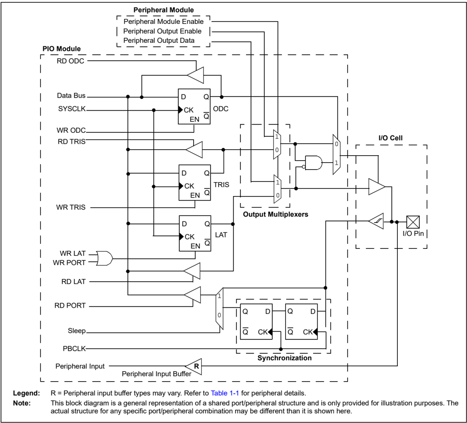

## 11.1 Parallel I/O (PIO) Ports

All port pins have 10 registers directly associated with their operation as digital I/O. The data direction register (TRISx) determines whether the pin is an input or an output. If the data direction bit is a ' 1 ', then the pin is an input. All port pins are defined as inputs after a Reset. Reads from the latch (LATx) read the latch. Writes to the latch write the latch. Reads from the port (PORTx) read the port pins, while writes to the port pins write the latch.

## 11.1.1 OPEN-DRAIN CONFIGURATION

In addition to the PORTx, LATx, and TRISx registers for data control, some port pins can also be individually configured for either digital or open-drain output. This is controlled by the Open-Drain Control register, ODCx, associated with each port. Setting any of the bits configures the corresponding pin to act as an open-drain output.

The  open-drain feature allows the generation of outputs higher than VDD (e.g., 5V) on any desired 5Vtolerant  pins  by  using  external  pull-up  resistors.  The maximum open-drain voltage allowed is the same as the maximum VIH specification.

See the 'Pin Diagrams' section for the available pins and their functionality.

## 11.1.2 CONFIGURING ANALOG AND DIGITAL PORT PINS

The  ANSELx  register  controls  the  operation  of  the analog port pins. The port pins that are to function as analog inputs must have their corresponding ANSEL and  TRIS  bits  set.  In  order  to  use  port  pins  for  I/O functionality  with  digital  modules,  such  as  Timers, UARTs, etc., the corresponding ANSELx bit must  be cleared.

The ANSELx register has a default value of 0xFFFF; therefore,  all  pins  that  share  analog  functions  are analog (not digital) by default.

If the TRIS bit is cleared (output) while the ANSELx bit is set, the digital output level (VOH or VOL) is converted by an analog peripheral, such as the ADC module or Comparator module.

When the PORT register is read, all pins configured as analog input channels are read as cleared (a low level).

Pins  configured  as  digital  inputs  do  not  convert  an analog  input. Analog  levels  on  any  pin  defined  as  a digital  input  (including  the ANx  pins)  can  cause  the input  buffer  to  consume  current  that  exceeds  the device specifications.

## 11.1.3 I/O PORT WRITE/READ TIMING

One  instruction  cycle  is  required  between  a  port direction  change  or  port  write  operation  and  a  read operation  of  the  same  port.  Typically  this  instruction would be a NOP .

## 11.1.4 INPUT CHANGE NOTIFICATION

The input change notification function of the I/O ports allows  the  PIC32MX1XX/2XX  28/36/44-pin  Family devices to generate interrupt requests to the processor in response to a change-of-state on selected input pins. This feature can detect input change-of-states even in Sleep mode, when the clocks are disabled. Every I/O port  pin  can  be selected  (enabled) for  generating an interrupt request on a change-of-state.

Five control registers are associated with the CN functionality of each I/O port. The CNENx registers contain the CN interrupt enable control bits for each of the input pins. Setting any of these bits enables a CN interrupt for the corresponding pins.

The  CNSTATx  register  indicates  whether  a  change occurred on the corresponding pin since the last read of the PORTx bit.

Each  I/O  pin  also  has  a  weak  pull-up  and  a  weak pull-down  connected  to  it.  The  pull-ups  act  as  a current  source  or  sink  source  connected  to  the  pin, and  eliminate  the  need  for  external  resistors  when push-button  or  keypad  devices  are  connected.  The pull-ups and pull-downs are enabled separately using the  CNPUx and the CNPDx registers,  which contain the  control  bits  for  each  of  the  pins.  Setting  any  of the  control  bits  enables  the  weak  pull-ups  and/or pull-downs for the corresponding pins.

Note: Pull-ups and pull-downs on change notification  pins  should  always  be  disabled when the port pin is configured as a digital output.

An additional  control  register  (CNCONx) is shown  in Register 11-3.

## 11.2 CLR, SET and INV Registers

Every  I/O  module  register  has  a  corresponding  CLR (clear), SET (set) and INV (invert) register designed to provide fast atomic bit manipulations. As the name of the register implies, a value written to a SET, CLR or INV register effectively performs the implied operation, but only on the corresponding base register and only bits specified as ' 1 '  are modified. Bits specified as ' 0 ' are not modified.

Reading SET, CLR and INV registers returns undefined values. To see the affects of a write operation to a SET, CLR, or INV register, the base register must be read.

## PIC32MX1XX/2XX 28/36/44-PIN FAMILY

## 11.3 Peripheral Pin Select

A major challenge in general purpose devices is providing the largest possible set of peripheral features while minimizing the conflict of features on I/O pins. The challenge is even greater on low pin-count devices. In an application where more than one peripheral needs to be assigned to a single pin, inconvenient workarounds in application code or a complete redesign may be the only option.

The Peripheral Pin Select (PPS) configuration provides an alternative to these choices by enabling peripheral set selection and their placement on a wide range of I/O pins. By increasing the pinout options available on a particular device, users can better tailor the device to their entire application, rather than trimming the application to fit the device.

The PPS configuration feature operates over a fixed subset  of  digital  I/O  pins.  Users  may  independently map the input and/or output of most digital peripherals to  these  I/O  pins.  PPS  is  performed  in  software  and generally  does  not  require  the  device  to  be  reprogrammed. Hardware safeguards are included that prevent accidental or spurious changes to the peripheral mapping once it has been established.

## 11.3.1 AVAILABLE PINS

The  number  of  available  pins  is  dependent  on  the particular device and its pin count. Pins that support the PPS feature include the designation 'RPn' in their full pin designation, where 'RP' designates a remappable peripheral and 'n' is the remappable port number.

## 11.3.2 AVAILABLE PERIPHERALS

The peripherals managed by the PPS are all digitalonly peripherals. These include general serial communications (UART and SPI), general purpose timer clock inputs, timer-related peripherals (input capture and output compare) and interrupt-on-change inputs.

In  comparison,  some  digital-only  peripheral  modules are never included in the PPS feature. This is because the peripheral's function requires special I/O circuitry on a specific port and cannot be easily connected to multiple pins. These modules include I 2 C among others. A  similar  requirement  excludes  all  modules  with analog inputs, such as the Analog-to-Digital Converter (ADC).

A key difference between remappable and non-remappable peripherals  is  that  remappable  peripherals  are not  associated  with  a  default  I/O  pin.  The  peripheral must always be assigned to a specific I/O pin before it can be used. In contrast, non-remappable peripherals are always available on a default pin, assuming that the peripheral  is  active  and  not  conflicting  with  another peripheral.

When a remappable peripheral is active on a given I/O pin, it takes priority over all other digital I/O and digital communication  peripherals  associated  with  the  pin.

Priority is given regardless of the type of peripheral that is mapped. Remappable peripherals never take priority over any analog functions associated with the pin.

## 11.3.3 CONTROLLING PERIPHERAL PIN SELECT

PPS features are controlled through two sets of SFRs: one to map peripheral inputs, and one to map outputs. Because  they  are  separately  controlled,  a  particular peripheral's input and output (if the peripheral has both) can be placed on any selectable function pin without constraint.

The association of a peripheral to a peripheral-selectable pin is handled in two different ways, depending on whether an input or output is being mapped.

## 11.3.4 INPUT MAPPING

The inputs of the PPS options are mapped on the basis of the peripheral. That is, a control register associated with a peripheral dictates the pin it will be mapped to. The [ pin name ] R registers, where [ pin name ] refers to the peripheral pins listed in Table 11-1, are used to configure peripheral input mapping (see Register 11-1). Each register contains sets of 4 bit fields. Programming these bit fields with an appropriate value maps the RPn pin with the corresponding value to that peripheral. For any given device, the valid range of values for any bit field is shown in Table 11-1.

For  example,  Figure 11-2  illustrates  the  remappable pin selection for the U1RX input.

## FIGURE 11-2: REMAPPABLE INPUT EXAMPLE FOR U1RX

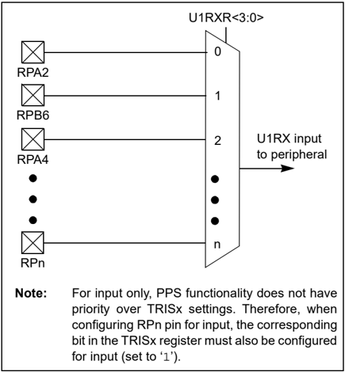

## PIC32MX1XX/2XX 28/36/44-PIN FAMILY

TABLE 11-1: INPUT PIN SELECTION

| Peripheral Pin   | [ pin name ]R SFR   | [ pin name ]R bits   | [ pin name ]R Value to RPn Pin Selection        |
|------------------|---------------------|----------------------|-------------------------------------------------|
| INT4             | INT4R               | INT4R<3:0>           | 0000 = RPA0 0001 = RPB3                         |
| T2CK             | T2CKR               | T2CKR<3:0>           | 0010 = RPB4 0011 = RPB15 0100 = RPB7            |
| IC4              | IC4R                | IC4R<3:0>            | 0101 = RPC7 (2) 0110 = RPC0 (1) = RPC5 (2)      |
| SS1              | SS1R                | SS1R<3:0>            | 0111 1000 = Reserved •                          |
| REFCLKI          | REFCLKIR            | REFCLKIR<3:0>        | • • 1111 = Reserved                             |
| INT3             | INT3R               | INT3R<3:0>           | 0000 = RPA1 0001 = RPB5                         |
| T3CK             | T3CKR               | T3CKR<3:0>           | 0010 = RPB1 0011 = RPB11                        |
| IC3              | IC3R                | IC3R<3:0>            | 0100 = RPB8 0101 = RPA8 (2) (2)                 |
| U1CTS            | U1CTSR              | U1CTSR<3:0>          | 0110 = RPC8 0111 = RPA9 (2)                     |
| U2RX             | U2RXR               | U2RXR<3:0>           | 1000 = Reserved • •                             |
| SDI1             | SDI1R               | SDI1R<3:0>           | • 1111 = Reserved                               |
| INT2             | INT2R               | INT2R<3:0>           | 0000 = RPA2                                     |
| T4CK             | T4CKR               | T4CKR<3:0>           | 0001 = RPB6 0010 = RPA4                         |
| IC1              | IC1R                | IC1R<3:0>            | 0011 = RPB13 0100 = RPB2                        |
| IC5              | IC5R                | IC5R<3:0>            | 0101 = RPC6 (2) (1)                             |
| U1RX             | U1RXR               | U1RXR<3:0>           | 0110 = RPC1 0111 = RPC3 (1)                     |
| U2CTS            | U2CTSR              | U2CTSR<3:0>          | 1000 = Reserved                                 |
| SDI2             | SDI2R               | SDI2R<3:0>           | • •                                             |
| OCFB             | OCFBR               | OCFBR<3:0>           | • 1111 = Reserved                               |
| INT1             | INT1R               | INT1R<3:0>           | 0000 = RPA3 0001 = RPB14                        |
| T5CK             | T5CKR               | T5CKR<3:0>           | 0010 = RPB0 0011 = RPB10 0100 = RPB9            |
| IC2              | IC2R                | IC2R<3:0>            | 0101 = RPC9 (1) 0110 = RPC2 (2) 0111 = RPC4 (2) |
| SS2              | SS2R                | SS2R<3:0>            | 1000 = Reserved •                               |
| OCFA             | OCFAR               | OCFAR<3:0>           | • • 1111 = Reserved                             |

Note

1: This pin is not available on 28-pin devices.

2: This pin is only available on 44-pin devices.

## PIC32MX1XX/2XX 28/36/44-PIN FAMILY

## 11.3.5 OUTPUT MAPPING

In  contrast  to  inputs,  the  outputs  of  the  PPS  options are  mapped  on  the  basis  of  the  pin.  In  this  case,  a control register associated with a particular pin dictates  the  peripheral  output  to  be  mapped.  The RPnR  registers  (Register 11-2)  are  used  to  control output  mapping. Like the  [ pin name ]R  registers,  each register contains sets of 4 bit fields. The value of the bit  field  corresponds  to  one  of  the  peripherals,  and that  peripheral's  output  is  mapped  to  the  pin  (see Table 11-2 and Figure 11-3).

A null output is associated with the output register reset value  of  ' 0 '.  This  is  done  to  ensure  that  remappable outputs  remain  disconnected  from  all  output  pins  by default.

## MULTIPLEXING OF REMAPPABLE OUTPUT

FIGURE 11-3: EXAMPLE OF FOR RPA0

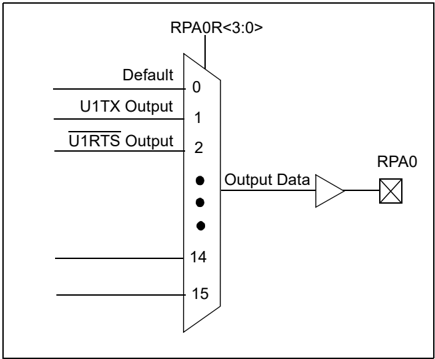

## 11.3.6 CONTROLLING CONFIGURATION CHANGES

Because peripheral remapping can be changed during run  time,  some  restrictions  on  peripheral  remapping are needed to prevent accidental configuration changes. PIC32  devices include two features to prevent alterations to the peripheral map:

- Control register lock sequence
- Configuration bit select lock

## 11.3.6.1 Control Register Lock Sequence

Under normal operation, writes to the RPnR and [ pin name ]R  registers  are  not  allowed.  Attempted  writes appear  to  execute  normally,  but  the  contents  of  the registers  remain  unchanged. To  change  these  registers,  they  must  be  unlocked  in  hardware.  The  register lock is controlled by the Configuration bit, IOLOCK  (CFGCON&lt;13&gt;).  Setting  IOLOCK  prevents writes to the control registers; clearing  IOLOCK allows writes.

To set or clear the IOLOCK bit, an unlock sequence must  be  executed.  Refer  to Section  6.  'Oscillator' (DS60001112) in the 'PIC32 Family Reference Manual' for details.

## 11.3.6.2 Configuration Bit Select Lock

As  an  additional  level  of  safety,  the  device  can  be configured to prevent more than one write session to the RPnR and [ pin name ]R registers. The Configuration bit, IOL1WAY (DEVCFG3&lt;29&gt;), blocks the IOLOCK bit from  being  cleared  after  it  has  been  set  once.  If IOLOCK  remains  set,  the  register  unlock  procedure does not execute, and the PPS control registers cannot be  written  to.  The  only  way  to  clear  the  bit  and  reenable  peripheral  remapping  is  to  perform  a  device Reset.

In the default (unprogrammed) state, IOL1WAY is set, restricting users to one write session.

## PIC32MX1XX/2XX 28/36/44-PIN FAMILY

## TABLE 11-2: OUTPUT PIN SELECTION

| RPn Port Pin   | RPnR SFR   | RPnR bits   | RPnR Value to Peripheral Selection                                                               |
|----------------|------------|-------------|--------------------------------------------------------------------------------------------------|
| RPA0           | RPA0R      | RPA0R<3:0>  | 0000 = No Connect 0001 = U1TX 0010 = U2RTS 0011 = SS1 0100 = Reserved 0101 = OC1 0110 = Reserved |
| RPB3           | RPB3R      | RPB3R<3:0>  |                                                                                                  |
| RPB4           | RPB4R      | RPB4R<3:0>  |                                                                                                  |
| RPB15          | RPB15R     | RPB15R<3:0> |                                                                                                  |
| RPB7           | RPB7R      | RPB7R<3:0>  | = C2OUT                                                                                          |
| RPC7           | RPC7R      | RPC7R<3:0>  | 0111 1000 = Reserved                                                                             |
| RPC0           | RPC0R      | RPC0R<3:0>  | • •                                                                                              |
| RPC5           | RPC5R      | RPC5R<3:0>  | • 1111 = Reserved                                                                                |
| RPA1           | RPA1R      | RPA1R<3:0>  | 0000 = No Connect                                                                                |
| RPB5           | RPB5R      | RPB5R<3:0>  | 0001 = Reserved 0010 = Reserved                                                                  |
| RPB1           | RPB1R      | RPB1R<3:0>  | 0011 = SDO1                                                                                      |
| RPB11          | RPB11R     | RPB11R<3:0> | 0100 = SDO2 0101 = OC2                                                                           |
| RPB8           | RPB8R      | RPB8R<3:0>  | 0110 = Reserved                                                                                  |
| RPA8           | RPA8R      | RPA8R<3:0>  | 0111 = C3OUT •                                                                                   |
| RPC8           | RPC8R      | RPC8R<3:0>  | • •                                                                                              |
| RPA9           | RPA9R      | RPA9R<3:0>  | 1111 = Reserved                                                                                  |
| RPA2           | RPA2R      | RPA2R<3:0>  | 0000 = No Connect = Reserved                                                                     |
| RPB6           | RPB6R      | RPB6R<3:0>  | 0001 0010 = Reserved                                                                             |
| RPA4           | RPA4R      | RPA4R<3:0>  | 0011 = SDO1 0100 = SDO2                                                                          |
| RPB13          | RPB13R     | RPB13R<3:0> | 0101 = OC4                                                                                       |
| RPB2           | RPB2R      | RPB2R<3:0>  | 0110 = OC5 0111 = REFCLKO                                                                        |
| RPC6           | RPC6R      | RPC6R<3:0>  | 1000 = Reserved •                                                                                |
| RPC1           | RPC1R      | RPC1R<3:0>  | • •                                                                                              |
| RPC3           | RPC3R      | RPC3R<3:0>  | 1111 = Reserved                                                                                  |
| RPA3           | RPA3R      | RPA3R<3:0>  | 0000 = No Connect = U1RTS                                                                        |
| RPB14          | RPB14R     | RPB14R<3:0> | 0001 0010 = U2TX                                                                                 |
| RPB0           | RPB0R      | RPB0R<3:0>  | 0011 = Reserved 0100 = SS2                                                                       |
| RPB10          | RPB10R     | RPB10R<3:0> | 0101 = OC3                                                                                       |
| RPB9           | RPB9R      | RPB9R<3:0>  | 0110 = Reserved 0111 = C1OUT                                                                     |
| RPC9           | RPC9R      | RPC9R<3:0>  | 1000 = Reserved •                                                                                |
| RPC2           | RPC2R      | RPC2R<3:0>  | • •                                                                                              |
| RPC4           | RPC4R      | RPC4R<3:0>  | 1111 = Reserved                                                                                  |

## 11.4 Ports Control Registers

## TABLE 11-3: PORTA REGISTER MAP

| Range       | Address   | Address   | Address   | Address   | Address   | Address                                          | Address                                          | Address                                          | Address                                          | Address   | Address                                        | Address                                        | Address                                        | Address                                        | Address                                        | Address                                        |            |
|-------------|-----------|-----------|-----------|-----------|-----------|--------------------------------------------------|--------------------------------------------------|--------------------------------------------------|--------------------------------------------------|-----------|------------------------------------------------|------------------------------------------------|------------------------------------------------|------------------------------------------------|------------------------------------------------|------------------------------------------------|------------|
| Range       | 31/15     | 30/14     | 29/13     | 28/12     | 27/11     | 26/10                                            | 25/9                                             | 24/8                                             | 23/7                                             | 22/6      | 21/5                                           | 20/4                                           | 19/3                                           | 18/2                                           | 17/1                                           | 16/0                                           | All Resets |
| 31:16       | -         | -         | -         | -         | -         | -                                                | -                                                | -                                                | -                                                | -         | -                                              | -                                              | -                                              | -                                              | -                                              | -                                              | 0000       |
| ANSELA 15:0 | -         | -         | -         | -         | -         | -                                                | -                                                | -                                                | -                                                | -         | -                                              | -                                              | -                                              | -                                              | ANSA1                                          | ANSA0                                          | 0003       |
| 31:16       | -         | -         | -         | -         | -         | -                                                | -                                                | -                                                | -                                                | -         | -                                              | -                                              | -                                              | -                                              | -                                              | -                                              | 0000       |
| 15:0        | -         | -         | -         | -         | -         | TRISA10 (2)                                      | TRISA9 (2)                                       | TRISA8 (2)                                       | TRISA7 (2)                                       | -         | -                                              | TRISA4                                         | TRISA3                                         | TRISA2                                         | TRISA1                                         | TRISA0                                         | 079F       |
| 31:16       | -         | -         | -         | -         | -         | -                                                | -                                                | -                                                | -                                                | -         | -                                              |                                                |                                                |                                                |                                                |                                                | 0000       |
| 15:0        | -         | -         | -         | -         | -         | RA10 (2)                                         | RA9 (2)                                          | RA8 (2)                                          | RA7 (2)                                          | -         | -                                              | RA4                                            | RA3                                            | RA2                                            | RA1                                            | RA0                                            | xxxx       |
| 31:16       | -         | -         | -         | -         | -         | -                                                | -                                                | -                                                | -                                                | -         | -                                              | -                                              | -                                              | -                                              | -                                              | -                                              | 0000       |
| 15:0        | -         | -         | -         | -         | -         | LATA10 (2)                                       | LATA9 (2)                                        | LATA8 (2)                                        | LATA7 (2)                                        | -         | -                                              | LATA4                                          | LATA3                                          | LATA2                                          | LATA1                                          | LATA0                                          | xxxx       |
| 31:16       | -         | -         | -         | -         | -         | -                                                | -                                                | -                                                | -                                                | -         | -                                              | -                                              | -                                              | -                                              | -                                              | -                                              | 0000       |
| 15:0        | -         | -         | -         | -         | -         | ODCA10 (2)                                       | ODCA9 (2)                                        | ODCA8 (2)                                        | ODCA7 (2)                                        | -         | -                                              | ODCA4                                          | ODCA3                                          | ODCA2                                          | ODCA1                                          | ODCA0                                          | 0000       |
| 31:16       | -         | -         | -         | -         | -         | -                                                | -                                                | -                                                | -                                                | -         | -                                              | -                                              | -                                              | -                                              | -                                              | -                                              | 0000       |
| 15:0        | -         | -         | -         | -         | -         | CNPUA10 (2)                                      | CNPUA9 (2)                                       | CNPUA8 (2)                                       | CNPUA7 (2)                                       | -         | -                                              | CNPUA4                                         | CNPUA3                                         | CNPUA2                                         | CNPUA1                                         | CNPUA0                                         | 0000       |
| 31:16       | -         | -         | -         | -         | -         | -                                                | -                                                | -                                                | -                                                | -         | -                                              | -                                              | -                                              | -                                              | -                                              | -                                              | 0000       |
| 15:0        | -         | -         | -         | -         | -         | CNPDA10 (2)                                      | CNPDA9 (2)                                       | CNPDA8 (2)                                       | CNPDA7 (2)                                       | -         | -                                              | CNPDA4                                         | CNPDA3                                         | CNPDA2                                         | CNPDA1                                         | CNPDA0                                         | 0000       |
| 31:16       | -         | -         | -         | -         | -         | -                                                | -                                                | -                                                | -                                                | -         | -                                              | -                                              | -                                              | -                                              | -                                              | -                                              | 0000       |
| CNCONA 15:0 | ON        | -         | SIDL      | -         | -         | -                                                | -                                                | -                                                | -                                                | -         | -                                              | -                                              | -                                              | -                                              | -                                              | -                                              | 0000       |
| 31:16       | -         | -         | -         | -         | -         | -                                                | -                                                | -                                                | -                                                | -         | -                                              | -                                              | -                                              | -                                              | -                                              | -                                              | 0000       |
| 15:0        | -         | -         | -         | -         | -         | CNIEA10 (2)                                      | CNIEA9 (2)                                       | CNIEA8 (2)                                       | CNIEA7 (2)                                       | -         | -                                              | CNIEA4                                         | CNIEA3                                         | CNIEA2                                         | CNIEA1                                         | CNIEA0                                         | 0000       |
| 31:16       | -         | -         | -         | -         | -         | -                                                | -                                                | -                                                | -                                                | -         | -                                              | -                                              | -                                              | -                                              | -                                              | -                                              | 0000       |
| CNSTATA     |           |           |           |           |           |                                                  |                                                  |                                                  |                                                  |           |                                                |                                                |                                                |                                                |                                                |                                                |            |
| 15:0        | -         | -         | -         | -         | -         | CNSTATA10 (2) CNSTATA9 (2) CNSTATA8 (2) CNSTATA7 | CNSTATA10 (2) CNSTATA9 (2) CNSTATA8 (2) CNSTATA7 | CNSTATA10 (2) CNSTATA9 (2) CNSTATA8 (2) CNSTATA7 | CNSTATA10 (2) CNSTATA9 (2) CNSTATA8 (2) CNSTATA7 | (2) -     | - CNSTATA4 CNSTATA3 CNSTATA2 CNSTATA1 CNSTATA0 | - CNSTATA4 CNSTATA3 CNSTATA2 CNSTATA1 CNSTATA0 | - CNSTATA4 CNSTATA3 CNSTATA2 CNSTATA1 CNSTATA0 | - CNSTATA4 CNSTATA3 CNSTATA2 CNSTATA1 CNSTATA0 | - CNSTATA4 CNSTATA3 CNSTATA2 CNSTATA1 CNSTATA0 | - CNSTATA4 CNSTATA3 CNSTATA2 CNSTATA1 CNSTATA0 | 0000       |

Legend:

x = unknown value on Reset; - = unimplemented, read as ' 0 '. Reset values are shown in hexadecimal.

Note 1: All registers in this table have corresponding CLR, SET and INV registers at their virtual addresses, plus offsets of 0x4, 0x8 and 0xC, respectively. See Section 11.2 'CLR, SET and INV Registers' for more information.

2: This bit is only available on 44-pin devices.

## TABLE 11-4: PORTB REGISTER MAP

| Bit Range    | Bits                                                                                                                               | Bits                                                                                                                               | Bits                                                                                                                               | Bits                                                                                                                               | Bits                                                                                                                               | Bits                                                                                                                               | Bits                                                                                                                               | Bits                                                                                                                               | Bits                                                                                                                               | Bits                                                                                                                               | Bits                                                                                                                               | Bits                                                                                                                               | Bits                                                                                                                               | Bits                                                                                                                               | Bits                                                                                                                               | Bits                                                                                                                               | All Resets                                                                                                                         |
|--------------|------------------------------------------------------------------------------------------------------------------------------------|------------------------------------------------------------------------------------------------------------------------------------|------------------------------------------------------------------------------------------------------------------------------------|------------------------------------------------------------------------------------------------------------------------------------|------------------------------------------------------------------------------------------------------------------------------------|------------------------------------------------------------------------------------------------------------------------------------|------------------------------------------------------------------------------------------------------------------------------------|------------------------------------------------------------------------------------------------------------------------------------|------------------------------------------------------------------------------------------------------------------------------------|------------------------------------------------------------------------------------------------------------------------------------|------------------------------------------------------------------------------------------------------------------------------------|------------------------------------------------------------------------------------------------------------------------------------|------------------------------------------------------------------------------------------------------------------------------------|------------------------------------------------------------------------------------------------------------------------------------|------------------------------------------------------------------------------------------------------------------------------------|------------------------------------------------------------------------------------------------------------------------------------|------------------------------------------------------------------------------------------------------------------------------------|
| Bit Range    | 31/15                                                                                                                              | 30/14                                                                                                                              | 29/13                                                                                                                              | 28/12                                                                                                                              | 27/11                                                                                                                              | 26/10                                                                                                                              | 25/9                                                                                                                               | 24/8                                                                                                                               | 23/7                                                                                                                               | 22/6                                                                                                                               | 21/5                                                                                                                               | 20/4                                                                                                                               | 19/3                                                                                                                               | 18/2                                                                                                                               | 17/1                                                                                                                               | 16/0                                                                                                                               | All Resets                                                                                                                         |
| 31:16        | -                                                                                                                                  | -                                                                                                                                  | -                                                                                                                                  | -                                                                                                                                  | -                                                                                                                                  | -                                                                                                                                  | -                                                                                                                                  | -                                                                                                                                  | -                                                                                                                                  | -                                                                                                                                  | -                                                                                                                                  | -                                                                                                                                  | -                                                                                                                                  | -                                                                                                                                  | -                                                                                                                                  | -                                                                                                                                  | 0000                                                                                                                               |
| ANSELB 15:0  | ANSB15                                                                                                                             | ANSB14                                                                                                                             | ANSB13                                                                                                                             | ANSB12 (2)                                                                                                                         | -                                                                                                                                  | -                                                                                                                                  | -                                                                                                                                  | -                                                                                                                                  | -                                                                                                                                  | -                                                                                                                                  | -                                                                                                                                  | -                                                                                                                                  | ANSB3                                                                                                                              | ANSB2                                                                                                                              | ANSB1                                                                                                                              | ANSB0                                                                                                                              | E00F                                                                                                                               |
| 31:16        | -                                                                                                                                  | -                                                                                                                                  | -                                                                                                                                  | -                                                                                                                                  | -                                                                                                                                  | -                                                                                                                                  | -                                                                                                                                  | -                                                                                                                                  | -                                                                                                                                  | -                                                                                                                                  | -                                                                                                                                  | -                                                                                                                                  | -                                                                                                                                  | -                                                                                                                                  | -                                                                                                                                  | -                                                                                                                                  | 0000                                                                                                                               |
| TRISB 15:0   | TRISB15                                                                                                                            | TRISB14                                                                                                                            | TRISB13                                                                                                                            | TRISB12 (2)                                                                                                                        | TRISB11                                                                                                                            | TRISB10                                                                                                                            | TRISB9                                                                                                                             | TRISB8                                                                                                                             | TRISB7                                                                                                                             | TRISB6 (2)                                                                                                                         | TRISB5                                                                                                                             | TRISB4                                                                                                                             | TRISB3                                                                                                                             | TRISB2                                                                                                                             | TRISB1                                                                                                                             | TRISB0                                                                                                                             | FFFF                                                                                                                               |
| PORTB 31:16  | -                                                                                                                                  | -                                                                                                                                  | -                                                                                                                                  | -                                                                                                                                  | -                                                                                                                                  | -                                                                                                                                  | -                                                                                                                                  | -                                                                                                                                  | -                                                                                                                                  | -                                                                                                                                  | -                                                                                                                                  |                                                                                                                                    |                                                                                                                                    |                                                                                                                                    |                                                                                                                                    |                                                                                                                                    | 0000                                                                                                                               |
| 15:0         | RB15                                                                                                                               | RB14                                                                                                                               | RB13                                                                                                                               | RB12 (2)                                                                                                                           | RB11                                                                                                                               | RB10                                                                                                                               | RB9                                                                                                                                | RB8                                                                                                                                | RB7                                                                                                                                | RC6 (2)                                                                                                                            | RB5                                                                                                                                | RB4                                                                                                                                | RB3                                                                                                                                | RB2                                                                                                                                | RB1                                                                                                                                | RB0 -                                                                                                                              | xxxx                                                                                                                               |
| 31:16 15:0   | - LATB15                                                                                                                           | - LATB14                                                                                                                           | - LATB13                                                                                                                           | - LATB12 (2)                                                                                                                       | - LATB11                                                                                                                           | - LATB10                                                                                                                           | - LATB9                                                                                                                            | - LATB8                                                                                                                            | - LATB7                                                                                                                            | - LATB6 (2)                                                                                                                        | - LATB5                                                                                                                            | - LATB4                                                                                                                            | - LATB3                                                                                                                            | - LATB2                                                                                                                            | - LATB1                                                                                                                            | LATB0                                                                                                                              | 0000 xxxx                                                                                                                          |
| 31:16        | -                                                                                                                                  | -                                                                                                                                  | -                                                                                                                                  | -                                                                                                                                  | -                                                                                                                                  | -                                                                                                                                  | -                                                                                                                                  | -                                                                                                                                  | -                                                                                                                                  | -                                                                                                                                  | -                                                                                                                                  | -                                                                                                                                  | -                                                                                                                                  | -                                                                                                                                  | -                                                                                                                                  | -                                                                                                                                  | 0000                                                                                                                               |
| ODCB 15:0    | ODCB15                                                                                                                             | ODCB14                                                                                                                             | ODCB13                                                                                                                             | ODCB12 (2)                                                                                                                         | ODCB11                                                                                                                             | ODCB10                                                                                                                             | ODCB9                                                                                                                              | ODCB8                                                                                                                              | ODCB7                                                                                                                              | ODCB6                                                                                                                              | ODCB5                                                                                                                              | ODCB4                                                                                                                              | ODCB3                                                                                                                              | ODCB2                                                                                                                              | ODCB1                                                                                                                              | ODCB0                                                                                                                              | 0000                                                                                                                               |
| 31:16        | -                                                                                                                                  | -                                                                                                                                  | -                                                                                                                                  | -                                                                                                                                  | -                                                                                                                                  | -                                                                                                                                  | -                                                                                                                                  | -                                                                                                                                  | -                                                                                                                                  | -                                                                                                                                  | -                                                                                                                                  | -                                                                                                                                  | -                                                                                                                                  | -                                                                                                                                  | -                                                                                                                                  | -                                                                                                                                  | 0000                                                                                                                               |
| CNPUB 15:0   | CNPUB15 CNPUB14 CNPUB13 CNPUB12 (2) CNPUB11 CNPUB10 CNPUB9 CNPUB8 CNPUB7 CNPUB6 (2) CNPUB5 CNPUB4 CNPUB3 CNPUB2 CNPUB1 CNPUB0 0000 | CNPUB15 CNPUB14 CNPUB13 CNPUB12 (2) CNPUB11 CNPUB10 CNPUB9 CNPUB8 CNPUB7 CNPUB6 (2) CNPUB5 CNPUB4 CNPUB3 CNPUB2 CNPUB1 CNPUB0 0000 | CNPUB15 CNPUB14 CNPUB13 CNPUB12 (2) CNPUB11 CNPUB10 CNPUB9 CNPUB8 CNPUB7 CNPUB6 (2) CNPUB5 CNPUB4 CNPUB3 CNPUB2 CNPUB1 CNPUB0 0000 | CNPUB15 CNPUB14 CNPUB13 CNPUB12 (2) CNPUB11 CNPUB10 CNPUB9 CNPUB8 CNPUB7 CNPUB6 (2) CNPUB5 CNPUB4 CNPUB3 CNPUB2 CNPUB1 CNPUB0 0000 | CNPUB15 CNPUB14 CNPUB13 CNPUB12 (2) CNPUB11 CNPUB10 CNPUB9 CNPUB8 CNPUB7 CNPUB6 (2) CNPUB5 CNPUB4 CNPUB3 CNPUB2 CNPUB1 CNPUB0 0000 | CNPUB15 CNPUB14 CNPUB13 CNPUB12 (2) CNPUB11 CNPUB10 CNPUB9 CNPUB8 CNPUB7 CNPUB6 (2) CNPUB5 CNPUB4 CNPUB3 CNPUB2 CNPUB1 CNPUB0 0000 | CNPUB15 CNPUB14 CNPUB13 CNPUB12 (2) CNPUB11 CNPUB10 CNPUB9 CNPUB8 CNPUB7 CNPUB6 (2) CNPUB5 CNPUB4 CNPUB3 CNPUB2 CNPUB1 CNPUB0 0000 | CNPUB15 CNPUB14 CNPUB13 CNPUB12 (2) CNPUB11 CNPUB10 CNPUB9 CNPUB8 CNPUB7 CNPUB6 (2) CNPUB5 CNPUB4 CNPUB3 CNPUB2 CNPUB1 CNPUB0 0000 | CNPUB15 CNPUB14 CNPUB13 CNPUB12 (2) CNPUB11 CNPUB10 CNPUB9 CNPUB8 CNPUB7 CNPUB6 (2) CNPUB5 CNPUB4 CNPUB3 CNPUB2 CNPUB1 CNPUB0 0000 | CNPUB15 CNPUB14 CNPUB13 CNPUB12 (2) CNPUB11 CNPUB10 CNPUB9 CNPUB8 CNPUB7 CNPUB6 (2) CNPUB5 CNPUB4 CNPUB3 CNPUB2 CNPUB1 CNPUB0 0000 | CNPUB15 CNPUB14 CNPUB13 CNPUB12 (2) CNPUB11 CNPUB10 CNPUB9 CNPUB8 CNPUB7 CNPUB6 (2) CNPUB5 CNPUB4 CNPUB3 CNPUB2 CNPUB1 CNPUB0 0000 | CNPUB15 CNPUB14 CNPUB13 CNPUB12 (2) CNPUB11 CNPUB10 CNPUB9 CNPUB8 CNPUB7 CNPUB6 (2) CNPUB5 CNPUB4 CNPUB3 CNPUB2 CNPUB1 CNPUB0 0000 | CNPUB15 CNPUB14 CNPUB13 CNPUB12 (2) CNPUB11 CNPUB10 CNPUB9 CNPUB8 CNPUB7 CNPUB6 (2) CNPUB5 CNPUB4 CNPUB3 CNPUB2 CNPUB1 CNPUB0 0000 | CNPUB15 CNPUB14 CNPUB13 CNPUB12 (2) CNPUB11 CNPUB10 CNPUB9 CNPUB8 CNPUB7 CNPUB6 (2) CNPUB5 CNPUB4 CNPUB3 CNPUB2 CNPUB1 CNPUB0 0000 | CNPUB15 CNPUB14 CNPUB13 CNPUB12 (2) CNPUB11 CNPUB10 CNPUB9 CNPUB8 CNPUB7 CNPUB6 (2) CNPUB5 CNPUB4 CNPUB3 CNPUB2 CNPUB1 CNPUB0 0000 | CNPUB15 CNPUB14 CNPUB13 CNPUB12 (2) CNPUB11 CNPUB10 CNPUB9 CNPUB8 CNPUB7 CNPUB6 (2) CNPUB5 CNPUB4 CNPUB3 CNPUB2 CNPUB1 CNPUB0 0000 | CNPUB15 CNPUB14 CNPUB13 CNPUB12 (2) CNPUB11 CNPUB10 CNPUB9 CNPUB8 CNPUB7 CNPUB6 (2) CNPUB5 CNPUB4 CNPUB3 CNPUB2 CNPUB1 CNPUB0 0000 |
| 31:16        | -                                                                                                                                  | -                                                                                                                                  | -                                                                                                                                  | -                                                                                                                                  | -                                                                                                                                  | -                                                                                                                                  | -                                                                                                                                  | -                                                                                                                                  | -                                                                                                                                  | -                                                                                                                                  | -                                                                                                                                  | -                                                                                                                                  | -                                                                                                                                  | -                                                                                                                                  | -                                                                                                                                  | -                                                                                                                                  | 0000                                                                                                                               |
| CNPDB 15:0   | CNPDB15 CNPDB14 CNPDB13 CNPDB12 (2) CNPDB11 CNPDB10 CNPDB9 CNPDB8 CNPDB7 CNPDB6 (2) CNPDB5 CNPDB4 CNPDB3 CNPDB2 CNPDB1 CNPDB0 0000 | CNPDB15 CNPDB14 CNPDB13 CNPDB12 (2) CNPDB11 CNPDB10 CNPDB9 CNPDB8 CNPDB7 CNPDB6 (2) CNPDB5 CNPDB4 CNPDB3 CNPDB2 CNPDB1 CNPDB0 0000 | CNPDB15 CNPDB14 CNPDB13 CNPDB12 (2) CNPDB11 CNPDB10 CNPDB9 CNPDB8 CNPDB7 CNPDB6 (2) CNPDB5 CNPDB4 CNPDB3 CNPDB2 CNPDB1 CNPDB0 0000 | CNPDB15 CNPDB14 CNPDB13 CNPDB12 (2) CNPDB11 CNPDB10 CNPDB9 CNPDB8 CNPDB7 CNPDB6 (2) CNPDB5 CNPDB4 CNPDB3 CNPDB2 CNPDB1 CNPDB0 0000 | CNPDB15 CNPDB14 CNPDB13 CNPDB12 (2) CNPDB11 CNPDB10 CNPDB9 CNPDB8 CNPDB7 CNPDB6 (2) CNPDB5 CNPDB4 CNPDB3 CNPDB2 CNPDB1 CNPDB0 0000 | CNPDB15 CNPDB14 CNPDB13 CNPDB12 (2) CNPDB11 CNPDB10 CNPDB9 CNPDB8 CNPDB7 CNPDB6 (2) CNPDB5 CNPDB4 CNPDB3 CNPDB2 CNPDB1 CNPDB0 0000 | CNPDB15 CNPDB14 CNPDB13 CNPDB12 (2) CNPDB11 CNPDB10 CNPDB9 CNPDB8 CNPDB7 CNPDB6 (2) CNPDB5 CNPDB4 CNPDB3 CNPDB2 CNPDB1 CNPDB0 0000 | CNPDB15 CNPDB14 CNPDB13 CNPDB12 (2) CNPDB11 CNPDB10 CNPDB9 CNPDB8 CNPDB7 CNPDB6 (2) CNPDB5 CNPDB4 CNPDB3 CNPDB2 CNPDB1 CNPDB0 0000 | CNPDB15 CNPDB14 CNPDB13 CNPDB12 (2) CNPDB11 CNPDB10 CNPDB9 CNPDB8 CNPDB7 CNPDB6 (2) CNPDB5 CNPDB4 CNPDB3 CNPDB2 CNPDB1 CNPDB0 0000 | CNPDB15 CNPDB14 CNPDB13 CNPDB12 (2) CNPDB11 CNPDB10 CNPDB9 CNPDB8 CNPDB7 CNPDB6 (2) CNPDB5 CNPDB4 CNPDB3 CNPDB2 CNPDB1 CNPDB0 0000 | CNPDB15 CNPDB14 CNPDB13 CNPDB12 (2) CNPDB11 CNPDB10 CNPDB9 CNPDB8 CNPDB7 CNPDB6 (2) CNPDB5 CNPDB4 CNPDB3 CNPDB2 CNPDB1 CNPDB0 0000 | CNPDB15 CNPDB14 CNPDB13 CNPDB12 (2) CNPDB11 CNPDB10 CNPDB9 CNPDB8 CNPDB7 CNPDB6 (2) CNPDB5 CNPDB4 CNPDB3 CNPDB2 CNPDB1 CNPDB0 0000 | CNPDB15 CNPDB14 CNPDB13 CNPDB12 (2) CNPDB11 CNPDB10 CNPDB9 CNPDB8 CNPDB7 CNPDB6 (2) CNPDB5 CNPDB4 CNPDB3 CNPDB2 CNPDB1 CNPDB0 0000 | CNPDB15 CNPDB14 CNPDB13 CNPDB12 (2) CNPDB11 CNPDB10 CNPDB9 CNPDB8 CNPDB7 CNPDB6 (2) CNPDB5 CNPDB4 CNPDB3 CNPDB2 CNPDB1 CNPDB0 0000 | CNPDB15 CNPDB14 CNPDB13 CNPDB12 (2) CNPDB11 CNPDB10 CNPDB9 CNPDB8 CNPDB7 CNPDB6 (2) CNPDB5 CNPDB4 CNPDB3 CNPDB2 CNPDB1 CNPDB0 0000 | CNPDB15 CNPDB14 CNPDB13 CNPDB12 (2) CNPDB11 CNPDB10 CNPDB9 CNPDB8 CNPDB7 CNPDB6 (2) CNPDB5 CNPDB4 CNPDB3 CNPDB2 CNPDB1 CNPDB0 0000 | CNPDB15 CNPDB14 CNPDB13 CNPDB12 (2) CNPDB11 CNPDB10 CNPDB9 CNPDB8 CNPDB7 CNPDB6 (2) CNPDB5 CNPDB4 CNPDB3 CNPDB2 CNPDB1 CNPDB0 0000 |
| 31:16        | -                                                                                                                                  | -                                                                                                                                  | -                                                                                                                                  | -                                                                                                                                  | -                                                                                                                                  | -                                                                                                                                  | -                                                                                                                                  | -                                                                                                                                  | -                                                                                                                                  | -                                                                                                                                  | -                                                                                                                                  | -                                                                                                                                  | -                                                                                                                                  | -                                                                                                                                  | -                                                                                                                                  | -                                                                                                                                  | 0000                                                                                                                               |
| CNCONB 15:0  | ON                                                                                                                                 | -                                                                                                                                  | SIDL                                                                                                                               | -                                                                                                                                  | -                                                                                                                                  | -                                                                                                                                  | -                                                                                                                                  | -                                                                                                                                  | -                                                                                                                                  | -                                                                                                                                  | -                                                                                                                                  | -                                                                                                                                  | -                                                                                                                                  | -                                                                                                                                  | -                                                                                                                                  | -                                                                                                                                  | 0000                                                                                                                               |
| 31:16        | -                                                                                                                                  | -                                                                                                                                  | -                                                                                                                                  | -                                                                                                                                  | -                                                                                                                                  | -                                                                                                                                  | -                                                                                                                                  | -                                                                                                                                  | -                                                                                                                                  | -                                                                                                                                  | -                                                                                                                                  | -                                                                                                                                  | -                                                                                                                                  | -                                                                                                                                  | -                                                                                                                                  | -                                                                                                                                  | 0000                                                                                                                               |
| CNENB 15:0   | CNIEB15                                                                                                                            | CNIEB14 -                                                                                                                          | CNIEB13 -                                                                                                                          | CNIEB11 (2)                                                                                                                        | CNIEB11                                                                                                                            | CNIEB10                                                                                                                            | CNIEB9                                                                                                                             | CNIEB8                                                                                                                             | CNIEB7                                                                                                                             | CNIEB6 (2)                                                                                                                         | CNIEB5                                                                                                                             | CNIEB4                                                                                                                             | CNIEB3                                                                                                                             | CNIEB2                                                                                                                             | CNIEB1                                                                                                                             | CNIEB0                                                                                                                             | 0000                                                                                                                               |
| 31:16        | -                                                                                                                                  | CN                                                                                                                                 |                                                                                                                                    | -                                                                                                                                  | -                                                                                                                                  | -                                                                                                                                  | -                                                                                                                                  | -                                                                                                                                  | -                                                                                                                                  | -                                                                                                                                  | -                                                                                                                                  | -                                                                                                                                  | -                                                                                                                                  | -                                                                                                                                  | -                                                                                                                                  | -                                                                                                                                  | 0000                                                                                                                               |
| CNSTATB 15:0 | CN STATB15                                                                                                                         | STATB14                                                                                                                            | CN STATB13                                                                                                                         | CN STATB12 (2)                                                                                                                     | CN STATB11                                                                                                                         | CN STATB10                                                                                                                         | CN STATB9                                                                                                                          | CN STATB8                                                                                                                          | CN STATB7                                                                                                                          | CN STATB6 (2)                                                                                                                      | CN STATB5                                                                                                                          | CN STATB4                                                                                                                          | CN STATB3                                                                                                                          | CN STATB2                                                                                                                          | CN STATB1                                                                                                                          | CN STATB0                                                                                                                          | 0000                                                                                                                               |

Legend:

Note 1:

x = unknown value on Reset; - = unimplemented, read as ' 0 '. Reset values are shown in hexadecimal.

All registers in this table have corresponding CLR, SET and INV registers at their virtual addresses, plus offsets of 0x4, 0x8 and 0xC, respectively. See Section 11.2 'CLR, SET and INV Registers' for more information.

2: This bit is not available on PIC32MX2XX devices. The reset value for the TRISB register when this bit is not available is 0x0000EFBF.

## TABLE 11-5: PORTC REGISTER MAP

| Register Name (1,2)   | Range      |       | Bits   | Bits   | Bits   | Bits   | Bits   | Bits     | Bits         | Bits         | Bits         | Bits         | Bits         | Bits      | Bits         | Bits     | Bits     | Bits       |
|-----------------------|------------|-------|--------|--------|--------|--------|--------|----------|--------------|--------------|--------------|--------------|--------------|-----------|--------------|----------|----------|------------|
| Register Name (1,2)   | Range      | 31/15 | 30/14  | 29/13  | 28/12  | 27/11  | 26/10  | 25/9     | 24/8         | 23/7         | 22/6         | 21/5         | 20/4         | 19/3      | 18/2         | 17/1     | 16/0     | All Resets |
| ANSELC                | 31:16 15:0 | -     | - -    | -      |        | -      | -      | -        | -            | -            | -            | -            | -            | -         | -            | -        | -        | 0000       |
| ANSELC                | 31:16 15:0 | -     | -      | -      | -      | -      | -      | -        | -            | -            | -            | -            | -            | ANSC3 (4) | ANSC2 (3)    | ANSC1    | ANSC0    | 000F       |
| TRISC                 | 31:16 15:0 | -     | - -    |        | -      | -      | -      | -        | -            | -            | -            | -            | -            | -         | -            | -        | -        | 0000       |
| TRISC                 | 31:16 15:0 | -     | -      | -      | -      | -      | -      | TRISC9   | TRISC8 (3)   | TRISC7 (3)   | TRISC6 (3)   | TRISC5 (3)   | TRISC4 (3)   | TRISC3    | TRISC2 (3)   | TRISC1   | TRISC0   | 03FF       |
| PORTC                 | 31:16 15:0 | -     | -      | -      | -      | -      | -      | -        | -            | -            | -            | -            |              |           |              |          |          | 0000       |
| PORTC                 | 31:16 15:0 | -     | -      | -      | -      | -      | -      | RC9      | RC8 (3)      | RC7 (3)      | RC6 (3)      | RC5 (3)      | RC4 (3)      | RC3       | RC2 (3)      | RC1      | RC0      | xxxx       |
| LATC                  | 31:16 15:0 | -     | -      | -      | -      | -      | -      | -        | -            | -            | -            | -            | -            | -         | -            | -        | -        | 0000       |
| LATC                  | 31:16 15:0 | -     | -      | -      | -      | -      | -      | LATC9    | LATC8 (3)    | LATC7 (3)    | LATC6 (3)    | LATC5 (3)    | LATC4 (3)    | LATC3     | LATC2 (3)    | LATC1    | LATC0    | xxxx       |
| ODCC                  | 31:16 15:0 | -     | -      |        | -      | -      | -      | -        | -            | -            | -            | -            | -            | -         | -            | -        | -        | 0000       |
| ODCC                  | 31:16 15:0 | -     | - -    | -      | -      | -      | -      | ODCC9    | ODCC8 (3)    | ODCC7 (3)    | ODCC6 (3)    | ODCC5 (3)    | ODCC4 (3)    | ODCC3     | ODCC2 (3)    | ODCC1    | ODCC0    | 0000       |
| CNPUC                 | 31:16      | -     | -      | -      | -      | -      | -      | -        | -            | -            | -            | -            | -            | -         | -            | -        | -        | 0000       |
| CNPUC                 | 15:0       | -     | -      | -      | -      | -      | -      | CNPUC9   | CNPUC8 (3)   | CNPUC7 (3)   | CNPUC6 (3)   | CNPUC5 (3)   | CNPUC4 (3)   | CNPUC3    | CNPUC2 (3)   | CNPUC1   | CNPUC0   | 0000       |
| CNPDC                 | 31:16      | -     | -      | -      | -      | -      | -      | -        | -            | -            | -            | -            | -            | -         | -            | -        | -        | 0000       |
| CNPDC                 | 15:0       | -     | -      | -      | -      | -      | -      | CNPDC9   | CNPDC8 (3)   | CNPDC7 (3)   | CNPDC6 (3)   | CNPDC5 (3)   | CNPDC4 (3)   | CNPDC3    | CNPDC2 (3)   | CNPDC1   | CNPDC0   | 0000       |
| CNCONC                | 31:16      | -     | -      | -      | -      | -      | -      | -        | -            | -            | -            | -            | -            | -         | -            | -        | -        | 0000       |
| CNCONC                | 15:0       | ON    | -      | SIDL   | -      | -      | -      | -        | -            | -            | -            | -            | -            | -         | -            | -        | -        | 0000       |
| CNENC                 | 31:16 15:0 | -     | -      | -      | -      | -      | -      | -        | -            | -            | -            | -            | -            | -         | -            | -        | -        | 0000       |
| CNENC                 | 31:16 15:0 | -     | -      | -      | -      | -      | -      | CNIEC9   | CNIEC8 (3)   | CNIEC7 (3)   | CNIEC6 (3)   | CNIEC5 (3)   | CNIEC4 (3)   | CNIEC3    | CNIEC2 (3)   | CNIEC1   | CNIEC0   | 0000       |
| CNSTATC               | 31:16      | -     |        | -      | -      | -      | -      | -        | -            | -            | -            | -            | -            | -         | -            | -        | -        | 0000       |
| CNSTATC               |            |       | -      |        |        |        |        |          |              |              |              |              |              |           |              |          |          |            |
|                       | 15:0       | -     | -      | -      | -      | -      | -      | CNSTATC9 | CNSTATC8 (3) | CNSTATC7 (3) | CNSTATC6 (3) | CNSTATC5 (3) | CNSTATC4 (3) | CNSTATC3  | CNSTATC2 (3) | CNSTATC1 | CNSTATC0 | 0000       |

## Legend:

x = unknown value on Reset; - = unimplemented, read as ' 0 '. Reset values are shown in hexadecimal.

- Note 1: All registers in this table have corresponding CLR, SET and INV registers at their virtual addresses, plus offsets of 0x4, 0x8 and 0xC, respectively. See Section 11.2 'CLR, SET and INV Registers' more information.
- 2: PORTC is not available on 28-pin devices.
- 3: This bit is only available on 44-pin devices.
- 4: This bit is only available on USB-enabled devices with 36 or 44 pins.

for

TABLE 11-6: PERIPHERAL PIN SELECT INPUT REGISTER MAP

| Register Name   |            | Bits   | Bits        | Bits   | Bits   | Bits   | Bits   | Bits   | Bits   | Bits   | Bits   | Bits   | Bits   | Bits   | Bits       | Bits       | Bits   |            |            |            |            |            |            |            |            |
|-----------------|------------|--------|-------------|--------|--------|--------|--------|--------|--------|--------|--------|--------|--------|--------|------------|------------|--------|------------|------------|------------|------------|------------|------------|------------|------------|
| Register Name   | Bit Range  | 31/15  | 30/14 29/13 |        | 28/12  | 27/11  | 26/10  | 25/9   | 24/8   | 23/7   | 22/6   | 21/5   | 20/4   | 19/3   | 18/2       | 17/1       | 16/0   | All Resets | All Resets | All Resets | All Resets | All Resets | All Resets | All Resets | All Resets |
| INT1R           | 31:16      | -      | -           | - -    | -      | -      | -      |        | -      | -      | -      | -      | -      | -      | -          | -          | -      | 0000       | 0000       | 0000       | 0000       | 0000       | 0000       | 0000       | 0000       |
| INT1R           | 15:0       | -      | -           | -      | - -    | -      | -      |        | -      | -      | -      | -      | -      |        | INT1R<3:0> |            |        | 0000       | 0000       | 0000       | 0000       | 0000       | 0000       | 0000       | 0000       |
|                 | 31:16      | -      | -           | -      | - -    | -      |        | -      | -      | -      | -      | -      | -      | -      | -          | -          | -      | 0000       | 0000       | 0000       | 0000       | 0000       | 0000       | 0000       | 0000       |
| INT2R           | 15:0       | -      | -           | -      | -      | -      | -      | -      | -      | -      | -      | -      | -      |        |            | INT2R<3:0> |        | 0000       | 0000       | 0000       | 0000       | 0000       | 0000       | 0000       | 0000       |
| INT3R           | 31:16      | -      | -           | -      | -      | - -    |        | -      | -      | -      | -      | -      | -      | -      | -          | -          | -      | 0000       | 0000       | 0000       | 0000       | 0000       | 0000       | 0000       | 0000       |
| INT3R           | 15:0       | -      | -           | -      | -      | -      | -      | -      | -      | -      | -      | -      | -      |        | INT3R<3:0> |            |        | 0000       | 0000       | 0000       | 0000       | 0000       | 0000       | 0000       | 0000       |
| INT4R           | 31:16      | -      | -           | -      | -      | -      | -      | -      | -      | -      | -      | -      | -      | -      | -          | -          | -      | 0000       | 0000       | 0000       | 0000       | 0000       | 0000       | 0000       | 0000       |
|                 | 15:0       | -      | -           | -      | -      | -      | -      | -      | -      | -      | -      | -      | -      |        |            | INT4R<3:0> |        | 0000       | 0000       | 0000       | 0000       | 0000       | 0000       | 0000       | 0000       |
| T2CKR           | 31:16      | -      | -           | -      | -      | -      | -      | -      | -      | -      | -      | -      | -      | -      | -          | -          | -      | 0000       | 0000       | 0000       | 0000       | 0000       | 0000       | 0000       | 0000       |
| T2CKR           | 15:0       | -      | -           | -      | -      | -      | -      | -      | -      | -      | -      | -      | -      |        | T2CKR<3:0> |            |        | 0000       | 0000       | 0000       | 0000       | 0000       | 0000       | 0000       | 0000       |
| T3CKR           | 31:16      | -      | -           | -      | -      | -      | -      | -      | -      | -      | -      | -      | -      | -      | -          | -          | -      | 0000       | 0000       | 0000       | 0000       | 0000       | 0000       | 0000       | 0000       |
| T3CKR           | 15:0       | -      | -           | -      | -      | - -    | - -    | -      | -      | -      | -      | -      | -      |        |            | T3CKR<3:0> |        | 0000       | 0000       | 0000       | 0000       | 0000       | 0000       | 0000       | 0000       |
| T4CKR           | 31:16      | -      | -           | -      | -      |        |        | -      | -      | -      | -      | -      | -      | -      | -          | -          | -      | 0000       | 0000       | 0000       | 0000       | 0000       | 0000       | 0000       | 0000       |
| T4CKR           | 15:0       | -      | -           | -      | -      | -      | -      | -      | -      | -      | -      | -      | -      |        | T4CKR<3:0> | -          |        | 0000       | 0000       | 0000       | 0000       | 0000       | 0000       | 0000       | 0000       |
| T5CKR           | 31:16      | -      | -           | -      | -      | -      | -      | -      | -      | -      | -      | -      | -      | -      | -          |            | -      | 0000       | 0000       | 0000       | 0000       | 0000       | 0000       | 0000       | 0000       |
| T5CKR           | 15:0       | -      | -           | -      | -      | -      | -      | -      | -      | -      | -      | -      | -      |        | T5CKR<3:0> |            |        | 0000       | 0000       | 0000       | 0000       | 0000       | 0000       | 0000       | 0000       |
| IC1R            | 31:16      | -      | -           | -      | -      | -      | -      | -      | -      | -      | -      | -      | -      | -      | -          | -          | -      | 0000       | 0000       | 0000       | 0000       | 0000       | 0000       | 0000       | 0000       |
| IC1R            | 15:0       | -      | -           | -      | - -    | - -    | - -    | - -    | -      | -      | -      | -      | -      |        | IC1R<3:0>  |            | -      | 0000       | 0000       | 0000       | 0000       | 0000       | 0000       | 0000       | 0000       |
| IC2R            | 31:16      | -      | -           | -      |        |        |        | -      | -      | -      | -      | -      | -      | -      | -          | -          |        | 0000       | 0000       | 0000       | 0000       | 0000       | 0000       | 0000       | 0000       |
| IC2R            | 15:0       | -      | -           | -      | -      | -      | -      |        | -      | -      | -      | -      | -      |        |            | IC2R<3:0>  |        | 0000       | 0000       | 0000       | 0000       | 0000       | 0000       | 0000       | 0000       |
| IC3R            | 31:16      | -      | -           | -      | -      | -      | -      | -      | -      | -      | -      | -      | -      | -      | -          | -          | -      | 0000       | 0000       | 0000       | 0000       | 0000       | 0000       | 0000       | 0000       |
| IC3R            | 15:0       | -      | -           | -      | -      | -      | -      | -      | -      | -      | -      | -      | -      |        |            | IC3R<3:0>  |        | 0000       | 0000       | 0000       | 0000       | 0000       | 0000       | 0000       | 0000       |
| IC4R            | 31:16      | -      | -           | -      | -      | -      | -      | -      | -      | -      | -      | -      | -      | -      | -          | -          | -      | 0000       | 0000       | 0000       | 0000       | 0000       | 0000       | 0000       | 0000       |
| IC4R            | 15:0       | -      | -           | -      | -      | -      | -      | -      | -      | -      | -      | -      | -      |        |            | IC4R<3:0>  |        | 0000       | 0000       | 0000       | 0000       | 0000       | 0000       | 0000       | 0000       |
| IC5R            | 31:16      | -      | -           | -      | -      | -      | -      | -      | -      |        | -      | -      | -      | -      | -          | -          | -      | 0000       | 0000       | 0000       | 0000       | 0000       | 0000       | 0000       | 0000       |
| IC5R            | 15:0       | -      | -           | -      |        | -      | -      | -      | -      | -      | -      | -      | -      |        |            | IC5R<3:0>  |        | 0000       | 0000       | 0000       | 0000       | 0000       | 0000       | 0000       | 0000       |
| OCFAR           | 31:16      |        |             |        | -      | -      | -      | -      |        | -      | -      | -      |        |        | -          | -          | -      |            |            |            |            |            |            |            |            |
| OCFAR           |            |        |             | -      | -      |        |        |        |        | -      |        |        | -      |        |            |            |        |            |            |            |            |            |            |            |            |
|                 |            | -      | -           |        |        |        |        |        | -      |        |        |        |        | -      |            |            |        | 0000       | 0000       | 0000       | 0000       | 0000       | 0000       | 0000       | 0000       |
|                 | 15:0       | -      | -           | -      | -      | -      | -      | -      | -      | -      | -      | -      | -      |        |            | OCFAR<3:0> |        | 0000       | 0000       | 0000       | 0000       | 0000       | 0000       | 0000       | 0000       |
| OCFBR           | 31:16      | -      | -           | -      | -      | -      | -      | -      | -      | -      | -      | -      | -      | -      | -          | -          | -      | 0000       | 0000       | 0000       | 0000       | 0000       | 0000       | 0000       | 0000       |
| OCFBR           | 15:0       | -      | -           | -      | -      | -      | -      | -      | -      | -      | -      | -      | - -    |        | OCFBR<3:0> |            | -      | 0000       | 0000       | 0000       | 0000       | 0000       | 0000       | 0000       | 0000       |
| U1RXR           | 31:16 15:0 | - -    | - -         | - -    | - -    | - -    | - -    | - -    | - -    | - -    | - -    | -      |        | -      | -          | -          |        | -          | -          | U1RXR<3:0> | 0000 0000  |            |            |            |            |

## TABLE 11-6: PERIPHERAL PIN SELECT INPUT REGISTER MAP (CONTINUED)

| Address (BF80_#)   | Register Name   |           | Bits   | Bits   | Bits   | Bits   | Bits   | Bits       | Bits   | Bits   | Bits   | Bits   | Bits   | Bits          | Bits          | Bits          | Bits          | Bits          |            |
|--------------------|-----------------|-----------|--------|--------|--------|--------|--------|------------|--------|--------|--------|--------|--------|---------------|---------------|---------------|---------------|---------------|------------|
| Virtual            |                 | Bit Range | 31/15  | 30/14  | 29/13  | 28/12  | 27/11  | 26/10 25/9 |        | 24/8   | 23/7   | 22/6   | 21/5   | 20/4          | 19/3          | 18/2          | 17/1          | 16/0          | All Resets |
| FA54               | U1CTSR          | 31:16     | -      | -      | -      | -      | -      | -          | -      | -      | -      | -      | -      | -             | -             | -             | -             | -             | 0000       |
| FA54               | U1CTSR          | 15:0      | -      | -      | -      | -      | -      | -          | -      | -      | -      | -      | -      | - U1CTSR<3:0> | - U1CTSR<3:0> | - U1CTSR<3:0> | - U1CTSR<3:0> | - U1CTSR<3:0> | 0000       |
| FA58               | U2RXR           | 31:16     | -      | -      | -      | -      | -      | -          | -      | -      | -      | -      | -      | -             | -             | -             | -             | -             | 0000       |
| FA58               |                 | 15:0      | -      | -      | -      | -      | -      | -          | -      | -      | -      | -      | -      | -             | U2RXR<3:0>    | U2RXR<3:0>    | U2RXR<3:0>    | U2RXR<3:0>    | 0000       |
| FA5C               | U2CTSR          | 31:16     | -      | -      | -      | -      | -      | -          | -      | -      | -      | -      | -      | -             | -             | - -           |               | -             | 0000       |
| FA5C               | U2CTSR          | 15:0      | -      | -      | -      | -      | -      | -          | -      | -      | -      | -      | -      | -             | U2CTSR<3:0>   | U2CTSR<3:0>   | U2CTSR<3:0>   | U2CTSR<3:0>   | 0000       |
| FA84               | SDI1R           | 31:16     | -      | -      | -      | -      | -      | -          | -      | -      | -      | -      | -      | -             | -             | -             | -             | -             | 0000       |
| FA84               | SDI1R           | 15:0      | -      | -      | -      | -      | -      | -          | -      | -      | -      | -      | -      | -             | SDI1R<3:0>    | SDI1R<3:0>    | SDI1R<3:0>    | SDI1R<3:0>    | 0000       |
| FA88               | SS1R            | 31:16     | -      | -      | -      | -      | -      | -          | -      | -      | -      | -      | -      | -             | -             | -             | -             | -             | 0000       |
| FA88               | SS1R            | 15:0      | -      | -      | -      | -      | -      | -          | -      | -      | -      | -      | -      | -             | SS1R<3:0>     | SS1R<3:0>     | SS1R<3:0>     | SS1R<3:0>     | 0000       |
| FA90               | SDI2R           | 31:16     | -      | -      | -      | -      | -      | -          | -      | -      | -      | -      | -      | -             | -             | - -           |               | -             | 0000       |
| FA90               | SDI2R           | 15:0      | -      | -      | -      | -      | -      | -          | -      | -      | -      | -      | -      | - SDI2R<3:0>  | - SDI2R<3:0>  | - SDI2R<3:0>  | - SDI2R<3:0>  | - SDI2R<3:0>  | 0000       |
| FA94               | SS2R            | 31:16     | -      | -      | -      | -      | -      | -          | -      | -      | -      | -      | -      | -             | -             | - -           |               | -             | 0000       |
| FA94               | SS2R            | 15:0      | -      | -      | -      | -      | -      | -          | -      | -      | -      | -      | -      | - SS2R<3:0>   | - SS2R<3:0>   | - SS2R<3:0>   | - SS2R<3:0>   | - SS2R<3:0>   | 0000       |
| FAB8               | REFCLKIR        | 31:16     | -      | -      | -      | -      | -      | -          | -      | -      | -      | -      | -      | -             | -             | -             | -             | -             | 0000       |
| FAB8               | REFCLKIR        | 15:0      | -      | -      | -      | -      | -      | -          | -      | -      | -      | -      | -      | -             | REFCLKIR<3:0> | REFCLKIR<3:0> | REFCLKIR<3:0> | REFCLKIR<3:0> | 0000       |

TABLE 11-7: PERIPHERAL PIN SELECT OUTPUT REGISTER MAP

| Address (BF80_#)   | Name      |           |       |       |       |       |       |       |      |      |      |      |      |      |      |           |           |      |            |
|--------------------|-----------|-----------|-------|-------|-------|-------|-------|-------|------|------|------|------|------|------|------|-----------|-----------|------|------------|
| Virtual            | Register  | Bit Range | 31/15 | 30/14 | 29/13 | 28/12 | 27/11 | 26/10 | 25/9 | 24/8 | 23/7 | 22/6 | 21/5 | 20/4 | 19/3 | 18/2      | 17/1      | 16/0 | All Resets |
| FB00               | RPA0R     | 31:16     | -     | -     | -     | - -   | -     | -     | -    | -    |      | -    | -    | -    | - -  |           | -         | -    | 0000       |
| FB00               | RPA0R     | 15:0      | -     | -     | -     | -     | -     | -     | -    | -    | -    | -    | -    | -    |      | RPA0<3:0> |           |      | 0000       |
| FB04               | RPA1R     | 31:16     | -     | -     | -     | -     | - -   | -     |      | -    | -    | -    | -    | -    | -    | -         | - -       |      | 0000       |
| FB04               | RPA1R     | 15:0      | -     | -     | -     | -     | -     | -     | -    | -    | -    | -    | -    | -    |      |           | RPA1<3:0> |      | 0000       |
| FB08               | RPA2R     | 31:16     | -     | -     | -     | -     | -     | -     | -    | -    | -    | -    | -    | -    | -    | -         | -         | -    | 0000       |
| FB08               | RPA2R     | 15:0      | -     | -     | -     | -     | -     | -     | -    | -    | -    | -    | -    | -    |      | RPA2<3:0> |           |      | 0000       |
| FB0C               | RPA3R     | 31:16     | -     | -     | -     | -     | -     | -     | -    | -    | -    | -    | -    | -    | -    | -         | -         | -    | 0000       |
| FB0C               | RPA3R     | 15:0      | -     | -     | -     | -     | -     | -     | -    | -    | -    | -    | -    | -    |      |           | RPA3<3:0> |      | 0000       |
| FB10               | RPA4R     | 31:16     | -     | -     | -     | -     | -     | -     | -    | -    | -    | -    | -    | -    | -    | -         | -         | -    | 0000       |
| FB10               | RPA4R     | 15:0      | -     | -     | -     | -     | -     | -     | -    | -    | -    | -    | -    | -    |      | RPA4<3:0> |           |      | 0000       |
| FB20               | RPA8R (1) | 31:16     | -     | -     | -     | -     | -     | -     | -    | -    | -    | -    | -    | -    | -    | -         | -         | -    | 0000       |
| FB20               | RPA8R (1) | 15:0      | -     | -     | -     | -     | -     | -     | -    | -    | -    | -    | -    | -    |      |           | RPA8<3:0> |      | 0000       |
| FB24               | RPA9R (1) | 31:16     | -     | -     | -     | -     | -     | -     | -    | -    | -    | -    | -    | -    | -    | -         | -         | -    | 0000       |
| FB24               | RPA9R (1) | 15:0      | -     | -     | -     | -     | -     | -     | -    | -    | -    | -    | -    | -    |      | RPA9<3:0> |           |      | 0000       |
| FB2C               | RPB0R     | 31:16     | -     | -     | -     | -     | -     | -     | -    | -    | -    | -    | -    | -    | -    | -         | -         | -    | 0000       |
| FB2C               | RPB0R     | 15:0      | -     | -     | -     | -     | -     | -     | -    | -    | -    | -    | -    | -    |      | RPB0<3:0> |           |      | 0000       |
| FB30               | RPB1R     | 31:16     | -     | -     | -     | -     | -     | -     | -    | -    | -    | -    | -    | -    | -    | -         | -         | -    | 0000       |
| FB30               | RPB1R     | 15:0      | -     | -     | -     | -     | -     | -     | -    | -    | -    | -    | -    | -    |      | RPB1<3:0> |           |      | 0000       |
| FB34               | RPB2R     | 31:16     | -     | -     | -     | -     | -     | -     | -    | -    | -    | -    | -    | -    | -    | -         | -         | -    | 0000       |
| FB34               | RPB2R     | 15:0      | -     | -     | -     | -     | -     | -     | -    | -    | -    | -    | -    | -    |      | RPB2<3:0> |           |      | 0000       |
| FB38               | RPB3R     | 31:16     | -     | -     | -     | -     | -     | -     | -    | -    | -    | -    | -    | -    | -    | -         | -         | -    | 0000       |
| FB38               | RPB3R     | 15:0      | -     | -     | -     | -     | -     | -     | -    | -    | -    | -    | -    | -    |      | RPB3<3:0> |           |      | 0000       |
| FB3C               | RPB4R     | 31:16     | -     | -     | -     | -     | -     | -     | -    | -    | -    | -    | -    | -    | -    | -         | -         | -    | 0000       |
| FB3C               | RPB4R     | 15:0      | -     | -     | -     | -     | -     | -     | -    | -    | -    | -    | -    | -    |      | RPB4<3:0> |           |      | 0000       |
| FB40               | RPB5R     | 31:16     | -     | -     | -     | -     | -     | -     | -    | -    | -    | -    | -    | -    | -    | -         | -         | -    | 0000       |
| FB40               | RPB5R     | 15:0      | -     | -     | -     | -     | -     | -     | -    | -    | -    | -    | -    | -    |      | RPB5<3:0> |           |      | 0000       |
| FB44               | RPB6R (2) |           | -     | -     |       |       |       |       |      |      |      |      |      | -    | -    |           |           |      |            |
| FB44               | RPB6R (2) | 31:16     |       |       | -     | -     | -     | -     | -    | -    | -    | -    | -    |      |      | -         | -         |      | 0000       |
| FB48               |           |           | -     | -     | -     | -     | -     | -     | -    | -    |      | -    | -    | - -  | -    |           |           | -    | 0000       |
| FB48               |           | 15:0      |       |       |       |       | -     |       |      |      | -    |      |      |      |      | RPB6<3:0> |           |      |            |
|                    | RPB7R     | 31:16     | -     | -     | -     | -     |       | -     | -    | -    | -    | -    | -    |      |      | -         | -         | -    | 0000       |
|                    | RPB7R     | 15:0      | -     | -     | -     | -     | -     | -     | -    | -    | -    | -    | -    | -    |      | RPB7<3:0> |           |      | 0000       |

Legend:

Note x = unknown value on Reset; - = unimplemented, read as ' 0 '. Reset values are shown in hexadecimal.

- 1: This register is only available on 44-pin devices.
- 2: This register is only available on PIC32MX1XX devices.

3: This register is only available on 36-pin and 44-pin devices.

## TABLE 11-7: PERIPHERAL PIN SELECT OUTPUT REGISTER MAP (CONTINUED)

| Virtual Address (BF80_#)   | Register Name   |            |       |       |       |       |       |       |      |      |      |      |      |      |      |            |            |      |            |
|----------------------------|-----------------|------------|-------|-------|-------|-------|-------|-------|------|------|------|------|------|------|------|------------|------------|------|------------|
|                            |                 | Bit Range  | 31/15 | 30/14 | 29/13 | 28/12 | 27/11 | 26/10 | 25/9 | 24/8 | 23/7 | 22/6 | 21/5 | 20/4 | 19/3 | 18/2       | 17/1       | 16/0 | All Resets |
| FB4C                       | RPB8R           | 31:16      | -     | - -   | -     | -     | -     | -     | -    | -    | -    |      | -    | -    | - -  | -          |            | -    | 0000       |
| FB4C                       | RPB8R           | 15:0       | -     | -     | -     | -     | -     | -     | -    | -    | -    | -    | -    | -    |      |            | RPB8<3:0>  |      | 0000       |
| FB50                       | RPB9R           | 31:16      | -     | -     | -     | - -   | -     | -     |      | -    | -    | -    | -    | -    | -    | -          | - -        |      | 0000       |
| FB50                       | RPB9R           | 15:0       | -     | -     | -     | -     | -     | -     | -    | -    | -    | -    | -    | -    |      |            | RPB9<3:0>  |      | 0000       |
| FB54                       | RPB10R          | 31:16      | -     | -     | -     | - -   | -     |       | -    | -    | -    | -    | -    | -    | -    | -          | -          | -    | 0000       |
| FB54                       | RPB10R          | 15:0       | -     | -     | -     | -     | -     | -     | -    | -    | -    | -    | -    | -    |      | RPB10<3:0> |            |      | 0000       |
| FB58                       | RPB11R          | 31:16      | -     | -     | -     | -     | - -   |       | -    | -    | -    | -    | -    | -    | -    | -          | -          | -    | 0000       |
| FB58                       | RPB11R          | 15:0       | -     | -     | -     | -     | -     | -     | -    | -    | -    | -    | -    | -    |      |            | RPB11<3:0> |      | 0000       |
| FB60                       | RPB13R          | 31:16      | -     | -     | -     | - -   | -     |       | -    | -    | -    | -    | -    | -    | -    | -          | -          | -    | 0000       |
| FB60                       | RPB13R          | 15:0       | -     | -     | -     | -     | -     | -     | -    | -    | -    | -    | -    | -    |      | RPB13<3:0> |            |      | 0000       |
| FB64                       | RPB14R          | 31:16      | -     | -     | -     | -     | -     | -     | -    | -    | -    | -    | -    | -    | -    | -          | -          | -    | 0000       |
| FB64                       | RPB14R          | 15:0       | -     | -     | -     | -     | -     | -     | -    | -    | -    | -    | -    | -    |      |            | RPB14<3:0> |      | 0000       |
| FB68                       | RPB15R          | 31:16      | -     | -     | -     | -     | -     | -     | -    | -    | -    | -    | -    | -    | -    | -          | -          | -    | 0000       |
| FB68                       | RPB15R          | 15:0       | -     | -     | -     | -     | -     | -     | -    | -    | -    | -    | -    | -    |      | RPB15<3:0> |            |      | 0000       |
| FB6C                       | RPC0R (3)       | 31:16      | -     | -     | -     | -     | -     | -     | -    | -    | -    | -    | -    | -    | -    | -          | -          | -    | 0000       |
| FB6C                       | RPC0R (3)       | 15:0       | -     | -     | -     | -     | -     | -     | -    | -    | -    | -    | -    | -    |      | RPC0<3:0>  |            |      | 0000       |
| FB70                       | RPC1R (3)       | 31:16      | -     | -     | -     | -     | -     | -     | -    | -    | -    | -    | -    | -    | -    | -          | -          | -    | 0000       |
| FB70                       | RPC1R (3)       | 15:0       | -     | -     | -     | -     | -     | -     | -    | -    | -    | -    | -    | -    |      | RPC1<3:0>  |            |      | 0000       |
| FB74                       | RPC2R (1)       | 31:16      | -     | -     | -     | -     | -     | -     | -    | -    | -    | -    | -    | -    | -    | -          | -          | -    | 0000       |
| FB74                       | RPC2R (1)       | 15:0       | -     | -     | -     | -     | -     | -     | -    | -    | -    | -    | -    | -    |      |            | RPC2<3:0>  |      | 0000       |
| FB78                       | RPC3R (3)       | 31:16      | -     | -     | -     | -     | -     | -     | -    | -    | -    | -    | -    | -    | -    | -          | -          | -    | 0000       |
| FB78                       | RPC3R (3)       | 15:0       | -     | -     | -     | -     | -     | -     | -    | -    | -    | -    | -    | -    |      |            | RPC3<3:0>  |      | 0000       |
| FB7C                       | RPC4R (1)       | 31:16      | -     | -     | -     | -     | -     | -     | -    | -    | -    | -    | -    | -    | -    | -          | -          | -    | 0000       |
| FB7C                       | RPC4R (1)       | 15:0       | -     | -     | -     | -     | -     | -     | -    | -    | -    | -    | -    | -    |      |            | RPC4<3:0>  |      | 0000       |
| FB80                       | RPC5R (1)       | 31:16      | -     | -     | -     | -     | -     | -     | -    | -    | -    | -    | -    | -    | -    | -          | -          | -    | 0000       |
| FB80                       | RPC5R (1)       | 15:0       | -     | -     | -     | -     | -     | -     | -    | -    | -    | -    | -    | -    |      | RPC5<3:0>  |            |      | 0000       |
| FB84                       | RPC6R (1)       |            |       |       |       |       |       |       |      |      |      |      |      | -    | -    |            |            |      |            |
| FB84                       | RPC6R (1)       | 31:16 15:0 | -     | -     | -     | -     | -     | -     | -    | -    | -    | -    | -    |      |      | -          | -          | -    | 0000 0000  |
| FB88                       |                 |            | -     | -     | - -   | -     | - -   | -     | -    | -    | -    | -    | -    | - -  | -    | -          | -          |      |            |
| FB88                       |                 | 31:16      | -     |       |       |       | -     |       |      |      |      |      |      | -    |      |            | RPC6<3:0>  |      | 0000       |
|                            | RPC7R (1)       |            |       | -     |       | -     |       | -     | -    | -    | -    | -    | -    |      |      |            |            | -    | 0000       |
|                            | RPC7R (1)       | 15:0       | -     | -     | -     | -     |       | -     | -    | -    | -    | -    | -    |      |      |            | RPC7<3:0>  |      |            |

## Legend:

## Note

x = unknown value on Reset; - = unimplemented, read as ' 0 '. Reset values are shown in hexadecimal.

1: This register is only available on 44-pin devices.

2: This register is only available on PIC32MX1XX devices.

3: This register is only available on 36-pin and 44-pin devices.

TABLE 11-7: PERIPHERAL PIN SELECT OUTPUT REGISTER MAP (CONTINUED)

|      |           |           | Bits        | Bits   | Bits   | Bits   | Bits   | Bits   | Bits   | Bits   | Bits   | Bits   | Bits   | Bits   | Bits      | Bits      | Bits      | Bits      |            |
|------|-----------|-----------|-------------|--------|--------|--------|--------|--------|--------|--------|--------|--------|--------|--------|-----------|-----------|-----------|-----------|------------|
|      |           | Bit Range | 31/15 30/14 | 29/13  | 28/12  | 27/11  | 26/10  |        | 25/9   | 24/8   | 23/7   | 22/6   | 21/5   | 20/4   | 19/3      | 18/2      | 17/1      | 16/0      | All Resets |
|      |           | 31:16     | -           | -      | -      | -      | -      | -      | -      | -      | -      | -      | -      | -      | -         | -         | -         | -         | 0000       |
|      |           | 15:0      | -           | -      | -      | -      | -      | -      | -      | -      | -      | -      | -      | -      | RPC8<3:0> | RPC8<3:0> | RPC8<3:0> | RPC8<3:0> | 0000       |
| FB90 | RPC9R (3) | 31:16     | -           | -      | -      | -      | -      | -      | -      | -      | -      | -      | -      | -      | -         | -         | -         | -         | 0000       |
| FB90 | RPC9R (3) | 15:0      | -           | -      | -      | -      | -      | -      | -      | -      | -      | -      | -      | -      | RPC9<3:0> | RPC9<3:0> | RPC9<3:0> | RPC9<3:0> | 0000       |

## Legend:

x = unknown value on Reset; - = unimplemented, read as ' 0 '. Reset values are shown in hexadecimal.

Note

1: This register is only available on 44-pin devices.

2: This register is only available on PIC32MX1XX devices.

3: This register is only available on 36-pin and 44-pin devices.

## PIC32MX1XX/2XX 28/36/44-PIN FAMILY

## REGISTER 11-1: [ pin name ]R: PERIPHERAL PIN SELECT INPUT REGISTER

| Bit Range   | Bit 31/23/15/7   | Bit 30/22/14/6   | Bit 29/21/13/5   | Bit 28/20/12/4   | Bit 27/19/11/3     | Bit 26/18/10/2     | Bit 25/17/9/1      | Bit 24/16/8/0      |
|-------------|------------------|------------------|------------------|------------------|--------------------|--------------------|--------------------|--------------------|
| 31:24       | U-0              | U-0              | U-0              | U-0              | U-0                | U-0                | U-0                | U-0                |
| 31:24       | -                | -                | -                | -                | -                  | -                  | -                  | -                  |
| 23:16       | U-0              | U-0              | U-0              | U-0              | U-0                | U-0                | U-0                | U-0                |
| 23:16       | -                | -                | -                | -                | -                  | -                  | -                  | -                  |
| 15:8        | U-0              | U-0              | U-0              | U-0              | U-0                | U-0                | U-0                | U-0                |
| 15:8        | -                | -                | -                | -                | -                  | -                  | -                  | -                  |
| 7:0         | U-0              | U-0              | U-0              | U-0              | R/W-0              | R/W-0              | R/W-0              | R/W-0              |
| 7:0         | -                | -                | -                | -                | [ pin name ]R<3:0> | [ pin name ]R<3:0> | [ pin name ]R<3:0> | [ pin name ]R<3:0> |

## Legend:

R = Readable bit

W = Writable bit

U = Unimplemented bit, read as '0'

-n = Value at POR

'1' = Bit is set

'0' = Bit is cleared

x = Bit is unknown

bit 31-4 Unimplemented:

Read as ' 0 '

bit 3-0

[ pin name ]R&lt;3:0&gt;: Peripheral Pin Select Input bits

Where [ pin name ] refers to the pins that are used to configure peripheral input mapping. See Table 11-1 for input pin selection values.

Note: Register values can only be changed if the Configuration bit, IOLOCK (CFGCON&lt;13&gt;), =

0 .

## REGISTER 11-2: RPnR: PERIPHERAL PIN SELECT OUTPUT REGISTER

| Bit Range   | Bit 31/23/15/7   | Bit 30/22/14/6   | Bit 29/21/13/5   | Bit 28/20/12/4   | Bit 27/19/11/3   | Bit 26/18/10/2   | Bit 25/17/9/1   | Bit 24/16/8/0   |
|-------------|------------------|------------------|------------------|------------------|------------------|------------------|-----------------|-----------------|
| 31:24       | U-0              | U-0              | U-0              | U-0              | U-0              | U-0              | U-0             | U-0             |
| 31:24       | -                | -                | -                | -                | -                | -                | -               | -               |
| 23:16       | U-0              | U-0              | U-0              | U-0              | U-0              | U-0              | U-0             | U-0             |
| 23:16       | -                | -                | -                | -                | -                | -                | -               | -               |
| 15:8        | U-0              | U-0              | U-0              | U-0              | U-0              | U-0              | U-0             | U-0             |
| 15:8        | -                | -                | -                | -                | -                | -                | -               | -               |
| 7:0         | U-0              | U-0              | U-0              | U-0              | R/W-0            | R/W-0            | R/W-0           | R/W-0           |
| 7:0         | -                | -                | -                | -                | RPnR<3:0>        | RPnR<3:0>        | RPnR<3:0>       | RPnR<3:0>       |

## Legend:

R = Readable bit

W = Writable bit

U = Unimplemented bit, read as '0'

-n = Value at POR

'1' = Bit is set

'0' = Bit is cleared

x = Bit is unknown

bit 31-4 Unimplemented:

Read as ' 0 '

bit 3-0

RPnR&lt;3:0&gt;:

Peripheral Pin Select Output bits

See Table 11-2 for output pin selection values.

Note:

Register values can only be changed if the Configuration bit, IOLOCK (CFGCON&lt;13&gt;), = 0 .

## PIC32MX1XX/2XX 28/36/44-PIN FAMILY

## REGISTER 11-3: CNCONx: CHANGE NOTICE CONTROL FOR PORTx REGISTER (x = A, B, C)

| Bit Range   | Bit 31/23/15/7   | Bit 30/22/14/6   | Bit 29/21/13/5   | Bit 28/20/12/4   | Bit 27/19/11/3   | Bit 26/18/10/2   | Bit 25/17/9/1   | Bit 24/16/8/0   |
|-------------|------------------|------------------|------------------|------------------|------------------|------------------|-----------------|-----------------|
| 31:24       | U-0              | U-0              | U-0              | U-0              | U-0              | U-0              | U-0             | U-0             |
| 31:24       | -                | -                | -                | -                | -                | -                | -               | -               |
| 23:16       | U-0              | U-0              | U-0              | U-0              | U-0              | U-0              | U-0             | U-0             |
| 23:16       | -                | -                | -                | -                | -                | -                | -               | -               |
| 15:8        | R/W-0            | U-0              | R/W-0            | U-0              | U-0              | U-0              | U-0             | U-0             |
| 15:8        | ON               | -                | SIDL             | -                | -                | -                | -               | -               |
| 7:0         | U-0              | U-0              | U-0              | U-0              | U-0              | U-0              | U-0             | U-0             |
| 7:0         | -                | -                | -                | -                | -                | -                | -               | -               |

## Legend:

R = Readable bit

W = Writable bit

U = Unimplemented bit, read as '0'

-n = Value at POR

'1' = Bit is set

'0' = Bit is cleared

x = Bit is unknown

bit 31-16 Unimplemented: Read as ' 0 '

bit 15

ON:

Change Notice (CN) Control ON bit

1 = CN is enabled

0 = CN is disabled

bit 14

Unimplemented: Read as ' 0 '

bit 13

SIDL: Stop in Idle Control bit

1 = Idle mode halts CN operation

0 = Idle does not affect CN operation

bit 12-0 Unimplemented: Read as ' 0 '

## 12.0 TIMER1

Note: This data sheet summarizes the features of  the  PIC32MX1XX/2XX  28/36/44-pin Family of devices. It is not intended to be a  comprehensive  reference  source.  To complement  the  information  in  this  data sheet, refer to Section  14.  'Timers' (DS60001105), which is available from the Documentation &gt; Reference Manual section  of  the  Microchip  PIC32  web  site (www.microchip.com/pic32).

This family of PIC32 devices features one synchronous/asynchronous 16-bit timer that can operate as a free-running interval timer for various timing applications and counting external events. This timer can also be  used  with  the  Low-Power  Secondary  Oscillator (SOSC) for Real-Time Clock (RTC) applications.

FIGURE 12-1: TIMER1 BLOCK DIAGRAM

## PIC32MX1XX/2XX 28/36/44-PIN FAMILY

The following modes are supported:

- Synchronous Internal Timer
- Synchronous Internal Gated Timer
- Synchronous External Timer
- Asynchronous External Timer

## 12.1 Additional Supported Features

- Selectable clock prescaler
- Timer operation during CPU Idle and Sleep mode
- Fast bit manipulation using CLR, SET and INV registers
- Asynchronous mode can be used with the SOSC to function as a Real-Time Clock (RTC)

Figure 12-1  illustrates  a  general  block  diagram  of Timer1.

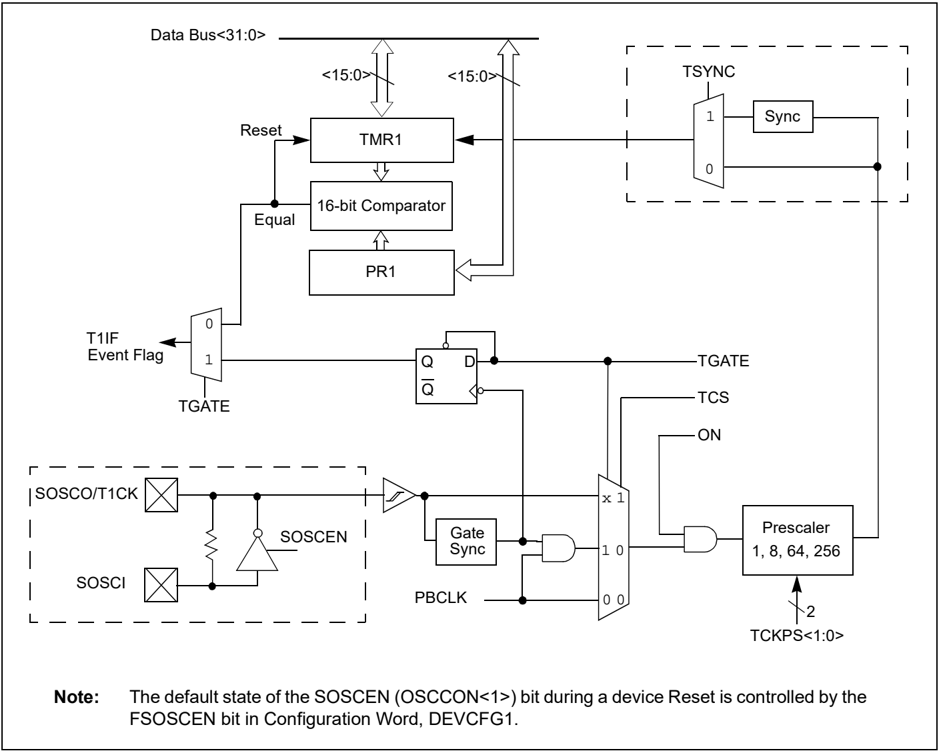

## 12.2 Timer1 Control Registers

## TABLE 12-1: TIMER1 REGISTER MAP

| Virtual Address (BF80_#)   |                   | Range   | Bits       | Bits        | Bits       | Bits       | Bits       | Bits       | Bits       | Bits       | Bits       | Bits       | Bits       | Bits       | Bits       | Bits       | Bits       | Bits       |            |
|----------------------------|-------------------|---------|------------|-------------|------------|------------|------------|------------|------------|------------|------------|------------|------------|------------|------------|------------|------------|------------|------------|
| Virtual Address (BF80_#)   | Register Name (1) | Range   | 31/15      | 30/14 29/13 | 28/12      | 27/11      | 26/10      |            | 25/9       | 24/8       | 23/7       | 22/6       | 21/5       | 20/4       | 19/3       | 18/2       | 17/1       | 16/0       | All Resets |
|                            | T1CON             | 31:16   | -          | -           | -          | -          | -          | -          | -          | -          | -          | -          | -          | -          | -          | -          | -          | -          | 0000       |
|                            |                   | 15:0    | ON         | -           | SIDL       | TWDIS      | TWIP       | -          | -          | -          | TGATE      | -          | TCKPS<1:0> | TCKPS<1:0> | -          | TSYNC      | TCS        | -          | 0000       |
|                            | TMR1              | 31:16   | -          | -           | -          | -          | -          | -          | -          | -          | -          | -          | -          | -          | -          | -          | -          | -          | 0000       |
|                            |                   | 15:0    | TMR1<15:0> | TMR1<15:0>  | TMR1<15:0> | TMR1<15:0> | TMR1<15:0> | TMR1<15:0> | TMR1<15:0> | TMR1<15:0> | TMR1<15:0> | TMR1<15:0> | TMR1<15:0> | TMR1<15:0> | TMR1<15:0> | TMR1<15:0> | TMR1<15:0> | TMR1<15:0> | 0000       |
| 0620                       | PR1               | 31:16   | -          | -           | -          | -          | -          | -          | -          | -          | -          | -          | -          | -          | -          | -          | -          | -          | 0000       |
| 0620                       |                   | 15:0    | PR1<15:0>  | PR1<15:0>   | PR1<15:0>  | PR1<15:0>  | PR1<15:0>  | PR1<15:0>  | PR1<15:0>  | PR1<15:0>  | PR1<15:0>  | PR1<15:0>  | PR1<15:0>  | PR1<15:0>  | PR1<15:0>  | PR1<15:0>  | PR1<15:0>  | PR1<15:0>  | FFFF       |

Legend:

x = unknown value on Reset; - = unimplemented, read as ' 0 '. Reset values are shown in hexadecimal.

Note 1: All registers in this table have corresponding CLR, SET and INV registers at their virtual addresses, plus offsets of 0x4, 0x8 and 0xC, respectively. See Section 11.2 'CLR, SET and INV Registers' for more information.

## PIC32MX1XX/2XX 28/36/44-PIN FAMILY

## REGISTER 12-1: T1CON: TYPE A TIMER CONTROL REGISTER

| Bit Range   | Bit 31/23/15/7   | Bit 30/22/14/6   | Bit 29/21/13/5   | Bit 28/20/12/4   | Bit 27/19/11/3   | Bit 26/18/10/2   | Bit 25/17/9/1   | Bit 24/16/8/0   |
|-------------|------------------|------------------|------------------|------------------|------------------|------------------|-----------------|-----------------|
| 31:24       | U-0              | U-0              | U-0              | U-0              | U-0              | U-0              | U-0             | U-0             |
| 31:24       | -                | -                | -                | -                | -                | -                | -               | -               |
| 23:16       | U-0              | U-0              | U-0              | U-0              | U-0              | U-0              | U-0             | U-0             |
| 23:16       | -                | -                | -                | -                | -                | -                | -               | -               |
| 15:8        | R/W-0            | U-0              | R/W-0            | R/W-0            | R-0              | U-0              | U-0             | U-0             |
| 15:8        | ON (1)           | -                | SIDL             | TWDIS            | TWIP             | -                | -               | -               |
| 7:0         | R/W-0            | U-0              | R/W-0            | R/W-0            | U-0              | R/W-0            | R/W-0           | U-0             |
| 7:0         | TGATE            | -                | TCKPS<1:0>       | TCKPS<1:0>       | -                | TSYNC            | TCS             | -               |

## Legend:

R = Readable bit

W = Writable bit

U = Unimplemented bit, read as '0'

-n = Value at POR

'1' = Bit is set

'0' = Bit is cleared

x = Bit is unknown

bit 31-16

## Unimplemented: Read as ' 0 '

bit 15

ON:

Timer On bit (1)

1 = Timer is enabled

0 = Timer is disabled

bit 14

Unimplemented: Read as '

0 '

bit 13 SIDL: Stop in Idle Mode bit

1 = Discontinue module operation when the device enters Idle mode

0 = Continue module operation when the device enters Idle mode

bit 12 TWDIS: Asynchronous Timer Write Disable bit

1 = Writes to Timer1 are ignored until pending write operation completes

0 = Back-to-back writes are enabled (Legacy Asynchronous Timer functionality)

## bit 11 TWIP: Asynchronous Timer Write in Progress bit

In Asynchronous Timer mode:

1 = Asynchronous write to the Timer1 register in progress

0 = Asynchronous write to Timer1 register is complete

In Synchronous Timer mode:

This bit is read as ' 0 '.

## bit 10-8 Unimplemented: Read as ' 0 '

bit 7

TGATE:

Timer Gated Time Accumulation Enable bit

When TCS = 1 :

This bit is ignored.

When TCS = 0 :

1 = Gated time accumulation is enabled

0 = Gated time accumulation is disabled

bit 6

Unimplemented:

Read as ' 0 '

## bit 5-4 TCKPS&lt;1:0&gt;: Timer Input Clock Prescale Select bits

11 = 1:256 prescale value

10 = 1:64 prescale value

01 = 1:8 prescale value

00 = 1:1 prescale value

Note 1: When using 1:1 PBCmLK divisor, the user's software should not read/write the peripheral SFRs in the SYSCLK cycle immediately following the instruction that clears the module's ON bit.

## PIC32MX1XX/2XX 28/36/44-PIN FAMILY

## REGISTER 12-1: T1CON: TYPE A TIMER CONTROL REGISTER (CONTINUED)

bit 3 Unimplemented:

Read as ' 0 '

bit 2 TSYNC:

Timer External Clock Input Synchronization Selection bit

When TCS = 1 :

- 1 = External clock input is synchronized

0 = External clock input is not synchronized

When TCS = 0 : This bit is ignored.

bit 1

TCS: Timer Clock Source Select bit

1 = External clock from TxCKI pin

0 = Internal peripheral clock

bit 0 Unimplemented:

Read as ' 0 '

Note 1: When using 1:1 PBCmLK divisor, the user's software should not read/write the peripheral SFRs in the SYSCLK cycle immediately following the instruction that clears the module's ON bit.

## PIC32MX1XX/2XX 28/36/44-PIN FAMILY

## 13.0 TIMER2/3, TIMER4/5

Note:

This data sheet summarizes the features of  the  PIC32MX1XX/2XX  28/36/44-pin Family of devices. It is not intended to be a  comprehensive  reference  source.  To complement  the  information  in  this  data sheet,  refer to Section  14.  'Timers' (DS60001105), which is available from the Documentation &gt; Reference Manual section  of  the  Microchip  PIC32  web  site (www.microchip.com/pic32).

This family of PIC32 devices features four synchronous 16-bit  timers  (default)  that  can  operate  as  a  freerunning  interval  timer  for  various  timing  applications and counting external events. The following modes are supported:

- Synchronous internal 16-bit timer
- Synchronous internal 16-bit gated timer
- Synchronous external 16-bit timer
- Synchronous internal 32-bit timer
- Synchronous internal 32-bit gated timer
- Synchronous external 32-bit timer

Note:

In  this  chapter,  references  to  registers, TxCON,  TMRx  and PRx, use 'x' to represent Timer2 through Timer5 in 16-bit modes.  In  32-bit  modes,  'x'  represents Timer2 or Timer4 and 'y' represents Timer3 or Timer5.

## 13.1 Additional Supported Features

- Selectable clock prescaler
- Timers operational during CPU idle
- Time base for Input Capture and Output Compare modules (Timer2 and Timer3 only)
- ADC event trigger (Timer3 in 16-bit mode, Timer2/3 in 32-bit mode)
- Fast bit manipulation using CLR, SET and INV registers

Two 32-bit synchronous timers are available by combining Timer2 with Timer3 and Timer4 with Timer5. The 32-bit timers can operate in three modes:

Figure 13-1 and Figure 13-2 illustrate block diagrams of Timer2/3 and Timer4/5.

FIGURE 13-1: TIMER2-TIMER5 BLOCK DIAGRAM (16-BIT)

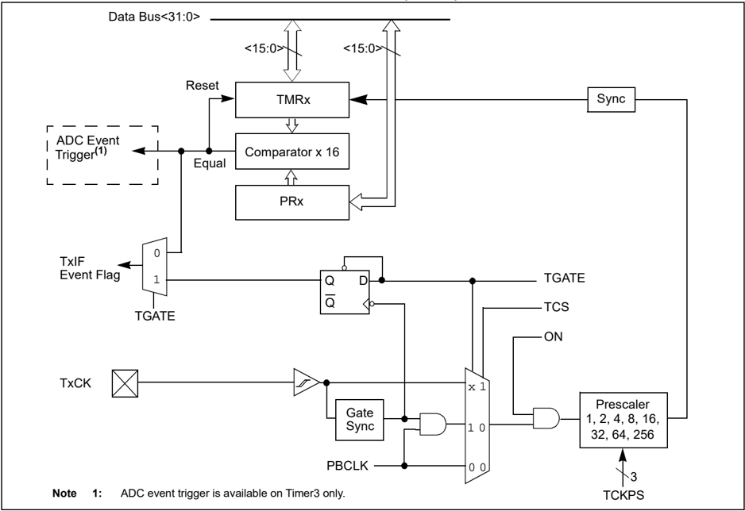

## PIC32MX1XX/2XX 28/36/44-PIN FAMILY

## FIGURE 13-2: TIMER2/3, TIMER4/5 BLOCK DIAGRAM (32-BIT)

Note 1: In this diagram, the use of 'x' in registers, TxCON, TMRx, PRx and TxCK, refers to either Timer2 or Timer4; the use of 'y' in registers, TyCON, TMRy, PRy, TyIF, refers to either Timer3 or Timer5.

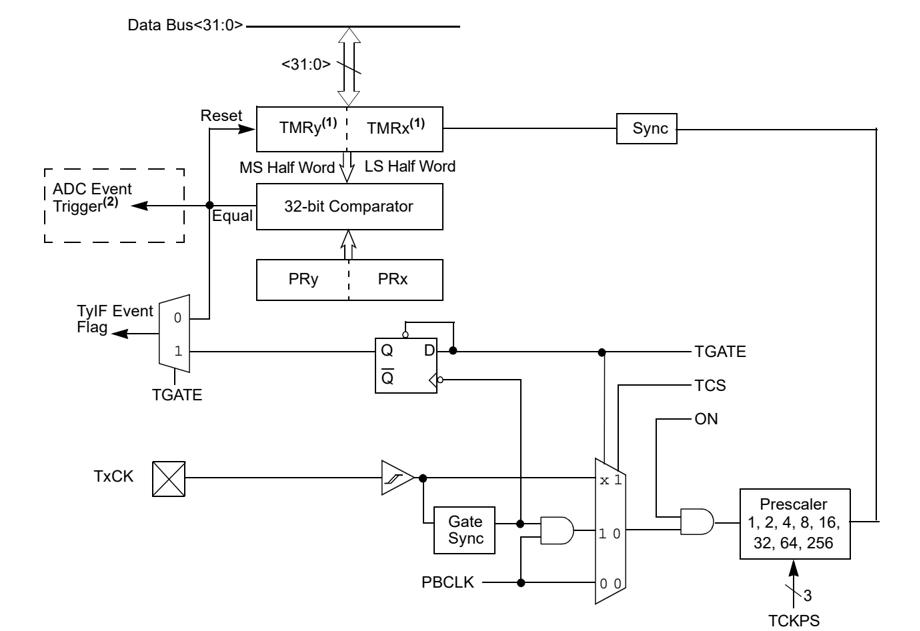

- 2: ADC event trigger is available only on the Timer2/3 pair.

## 13.2 Timer Control Registers

## TABLE 13-1: TIMER2-TIMER5 REGISTER MAP

| Virtual Address (BF80_#)   | Register Name (1)   |                 |                 |                 |                 |                 |                 |                 |                 |                 |                 |                 |                 |                 |                 |                 |                 |                 |            |
|----------------------------|---------------------|-----------------|-----------------|-----------------|-----------------|-----------------|-----------------|-----------------|-----------------|-----------------|-----------------|-----------------|-----------------|-----------------|-----------------|-----------------|-----------------|-----------------|------------|
| Virtual Address (BF80_#)   | Register Name (1)   | Bit Range       | 31/15           | 30/14           | 29/13           | 28/12           | 27/11           | 26/10           | 25/9            | 24/8            | 23/7            | 22/6            | 21/5            | 20/4            | 19/3            | 18/2            | 17/1            | 16/0            | All Resets |
|                            |                     | 31:16           | -               | -               | -               | -               | -               | -               | -               | -               | -               | -               | -               | -               | -               | -               | -               | -               | 0000       |
| 0800                       | T2CON               | 15:0            | ON              | -               | SIDL            | -               | -               | -               | -               | -               | TGATE           |                 | TCKPS<2:0>      | TCKPS<2:0>      | T32             | -               | TCS             | -               | 0000       |
| 0810                       | TMR2                | 31:16 15:0      | -               | -               | -               | -               | -               | -               | -               | -               | -               | -               | -               | -               | -               | -               | -               | -               | 0000       |
|                            |                     | TMR2<15:0>      | TMR2<15:0>      | TMR2<15:0>      | TMR2<15:0>      | TMR2<15:0>      | TMR2<15:0>      | TMR2<15:0>      | TMR2<15:0>      | TMR2<15:0>      | TMR2<15:0>      | TMR2<15:0>      | TMR2<15:0>      | TMR2<15:0>      | TMR2<15:0>      | TMR2<15:0>      | TMR2<15:0>      | TMR2<15:0>      | 0000       |
|                            |                     | 31:16           | -               | -               | -               | -               | -               | -               | -               | -               | -               | -               | -               | -               | -               | -               | -               | -               | 0000       |
| 0820                       | PR2                 | 15:0 PR2<15:0>  | 15:0 PR2<15:0>  | 15:0 PR2<15:0>  | 15:0 PR2<15:0>  | 15:0 PR2<15:0>  | 15:0 PR2<15:0>  | 15:0 PR2<15:0>  | 15:0 PR2<15:0>  | 15:0 PR2<15:0>  | 15:0 PR2<15:0>  | 15:0 PR2<15:0>  | 15:0 PR2<15:0>  | 15:0 PR2<15:0>  | 15:0 PR2<15:0>  | 15:0 PR2<15:0>  | 15:0 PR2<15:0>  | 15:0 PR2<15:0>  | FFFF       |
| 0A00                       |                     | 31:16           | -               | -               | -               | -               | -               | -               | -               | -               | -               | -               | -               | -               | -               | -               | -               | -               | 0000       |
|                            | T3CON               | 15:0            | ON              | -               | SIDL            | -               | -               | -               | -               | -               | TGATE           |                 | TCKPS<2:0>      | TCKPS<2:0>      | -               | -               | TCS             | -               | 0000       |
| 0A10                       | TMR3                | 31:16           | -               | -               | -               | -               | -               | -               | -               | -               | -               | -               | -               | -               | -               | -               | -               | -               | 0000       |
|                            |                     | 15:0 TMR3<15:0> | 15:0 TMR3<15:0> | 15:0 TMR3<15:0> | 15:0 TMR3<15:0> | 15:0 TMR3<15:0> | 15:0 TMR3<15:0> | 15:0 TMR3<15:0> | 15:0 TMR3<15:0> | 15:0 TMR3<15:0> | 15:0 TMR3<15:0> | 15:0 TMR3<15:0> | 15:0 TMR3<15:0> | 15:0 TMR3<15:0> | 15:0 TMR3<15:0> | 15:0 TMR3<15:0> | 15:0 TMR3<15:0> | 15:0 TMR3<15:0> | 0000       |
| 0A20                       |                     | 31:16 15:0      | -               | -               | -               | -               | -               | -               | -               | -               | -               | -               | -               | -               | -               | -               | -               | -               | 0000       |
|                            | PR3                 | PR3<15:0>       | PR3<15:0>       | PR3<15:0>       | PR3<15:0>       | PR3<15:0>       | PR3<15:0>       | PR3<15:0>       | PR3<15:0>       | PR3<15:0>       | PR3<15:0>       | PR3<15:0>       | PR3<15:0>       | PR3<15:0>       | PR3<15:0>       | PR3<15:0>       | PR3<15:0>       | PR3<15:0>       | FFFF       |
| 0C00                       | T4CON               | 31:16           | -               | -               | -               | -               | -               | -               | -               | -               | -               | -               | -               | -               | -               | - -             |                 | -               | 0000       |
| 0C00                       | T4CON               | 15:0            | ON              | -               | SIDL            | -               | -               | -               | -               | -               | TGATE           | TCKPS<2:0>      | TCKPS<2:0>      | TCKPS<2:0>      | T32             | -               | TCS             | -               | 0000       |
| 0C10                       | TMR4                | 31:16           | -               | -               | -               | -               | -               | -               | -               | -               | -               | -               | -               | -               | -               | -               | -               | -               | 0000       |
| 0C10                       | TMR4                | 15:0 TMR4<15:0> | 15:0 TMR4<15:0> | 15:0 TMR4<15:0> | 15:0 TMR4<15:0> | 15:0 TMR4<15:0> | 15:0 TMR4<15:0> | 15:0 TMR4<15:0> | 15:0 TMR4<15:0> | 15:0 TMR4<15:0> | 15:0 TMR4<15:0> | 15:0 TMR4<15:0> | 15:0 TMR4<15:0> | 15:0 TMR4<15:0> | 15:0 TMR4<15:0> | 15:0 TMR4<15:0> | 15:0 TMR4<15:0> | 15:0 TMR4<15:0> | 0000       |
| 0C20                       | PR4                 | 31:16 15:0      | -               | -               | -               | -               | -               | -               | -               | -               | -               | -               | -               | -               | -               | -               | -               | -               | 0000       |
| 0C20                       |                     | PR4<15:0>       | PR4<15:0>       | PR4<15:0>       | PR4<15:0>       | PR4<15:0>       | PR4<15:0>       | PR4<15:0>       | PR4<15:0>       | PR4<15:0>       | PR4<15:0>       | PR4<15:0>       | PR4<15:0>       | PR4<15:0>       | PR4<15:0>       | PR4<15:0>       | PR4<15:0>       | PR4<15:0>       | FFFF       |
| 0E00                       | T5CON               | 31:16           | -               | -               | -               | -               | -               | -               | -               | -               | -               | -               | -               | -               | -               | -               | -               | -               | 0000       |
|                            |                     | 15:0            | ON              | -               | SIDL            | -               | -               | -               | -               | -               | TGATE           |                 | TCKPS<2:0>      | TCKPS<2:0>      | -               | -               | TCS             | -               | 0000       |
| 0E10                       | TMR5                | 31:16           | -               | -               | -               | -               | -               | -               | -               | -               | -               | -               | -               | -               | -               | -               | -               | -               | 0000       |
|                            |                     | 15:0 TMR5<15:0> | 15:0 TMR5<15:0> | 15:0 TMR5<15:0> | 15:0 TMR5<15:0> | 15:0 TMR5<15:0> | 15:0 TMR5<15:0> | 15:0 TMR5<15:0> | 15:0 TMR5<15:0> | 15:0 TMR5<15:0> | 15:0 TMR5<15:0> | 15:0 TMR5<15:0> | 15:0 TMR5<15:0> | 15:0 TMR5<15:0> | 15:0 TMR5<15:0> | 15:0 TMR5<15:0> | 15:0 TMR5<15:0> | 15:0 TMR5<15:0> | 0000       |
| 0E20                       | PR5                 | 31:16           | -               | -               | -               | -               | -               | -               | -               | -               | -               | -               | -               | -               | -               | -               | -               | -               | 0000       |
|                            |                     | 15:0 PR5<15:0>  | 15:0 PR5<15:0>  | 15:0 PR5<15:0>  | 15:0 PR5<15:0>  | 15:0 PR5<15:0>  | 15:0 PR5<15:0>  | 15:0 PR5<15:0>  | 15:0 PR5<15:0>  | 15:0 PR5<15:0>  | 15:0 PR5<15:0>  | 15:0 PR5<15:0>  | 15:0 PR5<15:0>  | 15:0 PR5<15:0>  | 15:0 PR5<15:0>  | 15:0 PR5<15:0>  | 15:0 PR5<15:0>  | 15:0 PR5<15:0>  | FFFF       |

Legend:

x = unknown value on Reset; - = unimplemented, read as ' 0 '. Reset values are shown in hexadecimal.

Note 1: All registers in this table have corresponding CLR, SET and INV registers at their virtual addresses, plus offsets of 0x4, 0x8 and 0xC, respectively. See Section 11.2 'CLR, SET and INV Registers' for more information.

## PIC32MX1XX/2XX 28/36/44-PIN FAMILY

## REGISTER 13-1: TXCON: TYPE B TIMER CONTROL REGISTER

| Bit Range   | Bit 31/23/15/7   | Bit 30/22/14/6   | Bit 29/21/13/5   | Bit 28/20/12/4   | Bit 27/19/11/3   | Bit 26/18/10/2   | Bit 25/17/9/1   | Bit 24/16/8/0   |
|-------------|------------------|------------------|------------------|------------------|------------------|------------------|-----------------|-----------------|
| 31:24       | U-0              | U-0              | U-0              | U-0              | U-0              | U-0              | U-0             | U-0             |
| 31:24       | -                | -                | -                | -                | -                | -                | -               | -               |
| 23:16       | U-0              | U-0              | U-0              | U-0              | U-0              | U-0              | U-0             | U-0             |
| 23:16       | -                | -                | -                | -                | -                | -                | -               | -               |
| 15:8        | R/W-0            | U-0              | R/W-0            | U-0              | U-0              | U-0              | U-0             | U-0             |
| 15:8        | ON (1,3)         | -                | SIDL (4)         | -                | -                | -                | -               | -               |
| 7:0         | R/W-0            | R/W-0            | R/W-0            | R/W-0            | R/W-0            | U-0              | R/W-0           | U-0             |
| 7:0         | TGATE (3)        | TCKPS<2:0> (3)   | TCKPS<2:0> (3)   | TCKPS<2:0> (3)   | T32 (2)          | -                | TCS (3)         | -               |

## Legend:

R = Readable bit

W = Writable bit

U = Unimplemented bit, read as '0'

-n = Value at POR

'1' = Bit is set

'0' = Bit is cleared

x = Bit is unknown

bit 31-16

## Unimplemented: Read as ' 0 '

bit 15

ON:

Timer On bit (1,3)

1 = Module is enabled

0 = Module is disabled

bit 14 Unimplemented: Read as ' 0

'

bit 13

SIDL: Stop in Idle Mode bit

(4)

1 = Discontinue module operation when the device enters Idle mode

0 = Continue module operation when the device enters Idle mode

bit 12-8 Unimplemented:

Read as ' 0 '

bit 7

TGATE:

Timer Gated Time Accumulation Enable bit (3)

When TCS = 1 :

This bit is ignored and is read as ' 0 '.

When TCS = 0 :

1 = Gated time accumulation is enabled

0 = Gated time accumulation is disabled

bit 6-4 TCKPS&lt;2:0&gt;: Timer Input Clock Prescale Select bits (3)

111 = 1:256 prescale value

110 = 1:64 prescale value

101 = 1:32 prescale value

100 = 1:16 prescale value

011 = 1:8 prescale value

010 = 1:4 prescale value

001 = 1:2 prescale value

000 = 1:1 prescale value

- Note 1: When using 1:1 PBCLK divisor, the user's software should not read/write the peripheral SFRs in the SYSCLK cycle immediately following the instruction that clears the module's ON bit.
- 2: This bit is available only on even numbered timers (Timer2 and Timer4).
- 3: While operating in 32-bit mode, this bit has no effect for odd numbered timers (Timer3, and Timer5). All timer functions are set through the even numbered timers.
- 4: While operating in 32-bit mode, this bit must be cleared on odd numbered timers to enable the 32-bit timer in Idle mode.

## PIC32MX1XX/2XX 28/36/44-PIN FAMILY

## REGISTER 13-1: TXCON: TYPE B TIMER CONTROL REGISTER (CONTINUED)

bit 3 T32:

32-Bit Timer Mode Select bit (2)

- 1 = Odd numbered and even numbered timers form a 32-bit timer

- 0 = Odd numbered and even numbered timers form a separate 16-bit timer

bit 2

Unimplemented:

Read as ' 0 '

- bit 1 TCS: Timer Clock Source Select bit (3)

- 1 = External clock from TxCK pin

- 0 = Internal peripheral clock

bit 0 Unimplemented:

Read as ' 0 '

- Note 1: When using 1:1 PBCLK divisor, the user's software should not read/write the peripheral SFRs in the SYSCLK cycle immediately following the instruction that clears the module's ON bit.
- 2: This bit is available only on even numbered timers (Timer2 and Timer4).
- 3: While operating in 32-bit mode, this bit has no effect for odd numbered timers (Timer3, and Timer5). All timer functions are set through the even numbered timers.
- 4: While operating in 32-bit mode, this bit must be cleared on odd numbered timers to enable the 32-bit timer in Idle mode.

## NOTES:

## PIC32MX1XX/2XX 28/36/44-PIN FAMILY

## 14.0 WATCHDOG TIMER (WDT)

Note: This data sheet summarizes the features of  the  PIC32MX1XX/2XX  28/36/44-pin Family of devices. It is not intended to be a  comprehensive  reference  source.  To complement  the  information  in  this  data sheet,  refer  to Section  9.  'Watchdog, Deadman, and Power-up Timers' (DS60001114),  which  are  available  from the Documentation  &gt;  Reference  Manual section  of  the  Microchip  PIC32  web  site (www.microchip.com/pic32).

The WDT, when enabled, operates from the internal Low-Power Oscillator (LPRC) clock source and can be used to detect system software malfunctions by resetting the device if the WDT is not cleared periodically in software. Various WDT  time-out periods can  be selected using the WDT postscaler. The WDT can also be used to wake the device from Sleep or Idle mode.

The following are some of the key features of the WDT module:

- Configuration or software controlled
- User-configurable time-out period
- Can wake the device from Sleep or Idle mode Figure 14-1 illustrates a block diagram of the WDT and Power-up timer.

FIGURE 14-1: WATCHDOG TIMER AND POWER-UP TIMER BLOCK DIAGRAM

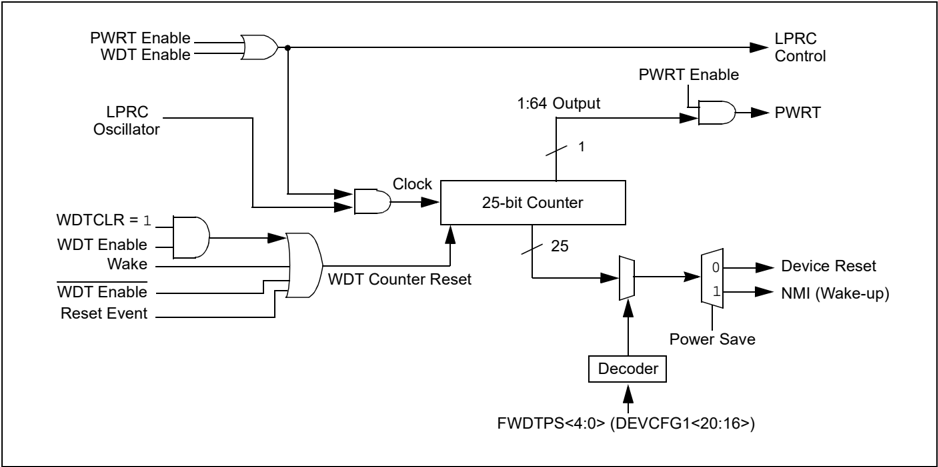

## 14.1 Watchdog Timer Control Registers

## TABLE 14-1: WATCHDOG TIMER CONTROL REGISTER MAP

| Virtual Address (BF80_#)   |           | Bits        | Bits   | Bits   | Bits        | Bits   | Bits   | Bits   | Bits   | Bits   | Bits        | Bits        | Bits        | Bits        | Bits        | Bits     | Bits   |            |
|----------------------------|-----------|-------------|--------|--------|-------------|--------|--------|--------|--------|--------|-------------|-------------|-------------|-------------|-------------|----------|--------|------------|
| Virtual Address (BF80_#)   | Bit Range | 31/15 30/14 |        | 29/13  | 28/12 27/11 | 26/10  |        | 25/9   | 24/8   | 23/7   | 22/6        | 21/5        | 20/4        | 19/3        | 18/2        | 17/1     | 16/0   | All Resets |
|                            | 31:16     | -           | -      | -      | -           | -      | -      | -      | -      | -      | -           | -           | -           | -           | -           | -        | -      | 0000       |
|                            | 15:0      | ON          | -      | -      | -           | -      | -      | -      | -      | -      | SWDTPS<4:0> | SWDTPS<4:0> | SWDTPS<4:0> | SWDTPS<4:0> | SWDTPS<4:0> | WDTWINEN | WDTCLR | 0000       |

Legend:

x = unknown value on Reset; - = unimplemented, read as ' 0 '. Reset values are shown in hexadecimal.

Note 1: All registers in this table have corresponding CLR, SET and INV registers at their virtual addresses, plus offsets of 0x4, 0x8 and 0xC, respectively. See Section 11.2 'CLR, SET and INV Registers' for

more information.

## PIC32MX1XX/2XX 28/36/44-PIN FAMILY

## REGISTER 14-1: WDTCON: WATCHDOG TIMER CONTROL REGISTER

| Bit Range   | Bit 31/23/15/7   | Bit 30/22/14/6   | Bit 29/21/13/5   | Bit 28/20/12/4   | Bit 27/19/11/3   | Bit 26/18/10/2   | Bit 25/17/9/1   | Bit 24/16/8/0   |
|-------------|------------------|------------------|------------------|------------------|------------------|------------------|-----------------|-----------------|
| 31:24       | U-0              | U-0              | U-0              | U-0              | U-0              | U-0              | U-0             | U-0             |
| 31:24       | -                | -                | -                | -                | -                | -                | -               | -               |
| 23:16       | U-0              | U-0              | U-0              | U-0              | U-0              | U-0              | U-0             | U-0             |
| 23:16       | -                | -                | -                | -                | -                | -                | -               | -               |
| 15:8        | R/W-0            | U-0              | U-0              | U-0              | U-0              | U-0              | U-0             | U-0             |
| 15:8        | ON (1,2)         | -                | -                | -                | -                | -                | -               | -               |
| 7:0         | U-0              | R-y              | R-y              | R-y              | R-y              | R-y              | R/W-0           | R/W-0           |
| 7:0         | -                | SWDTPS<4:0>      | SWDTPS<4:0>      | SWDTPS<4:0>      | SWDTPS<4:0>      | SWDTPS<4:0>      | WDTWINEN        | WDTCLR          |

## Legend:

y = Values set from Configuration bits on POR

R = Readable bit

W = Writable bit

U = Unimplemented bit, read as '0'

-n = Value at POR

'1' = Bit is set

'0' = Bit is cleared

x = Bit is unknown

bit 31-16 Unimplemented: Read as ' 0

'

bit 15 ON: Watchdog Timer Enable bit (1,2)

1 = Enables the WDT if it is not enabled by the device configuration

0 = Disable the WDT if it was enabled in software

bit 14-7 Unimplemented: Read as ' 0 '

bit 6-2 SWDTPS&lt;4:0&gt;: Shadow Copy of Watchdog Timer Postscaler Value from Device Configuration bits On reset, these bits are set to the values of the WDTPS &lt;4:0&gt; of Configuration bits.

bit 1 WDTWINEN: Watchdog Timer Window Enable bit

1 = Enable windowed Watchdog Timer

0 = Disable windowed Watchdog Timer

bit 0 WDTCLR: Watchdog Timer Reset bit

1 = Writing a ' 1 ' will clear the WDT

0 = Software cannot force this bit to a ' 0 '

Note 1: A read of this bit results in a ' 1 ' if the Watchdog Timer is enabled by the device configuration or software.

- 2: When using the 1:1 PBCLK divisor, the user's software should not read or write the peripheral's SFRs in the SYSCLK cycle immediately following the instruction that clears the module's ON bit.

## NOTES:

## PIC32MX1XX/2XX 28/36/44-PIN FAMILY

## 15.0 INPUT CAPTURE

Note:

This data sheet summarizes the features of  the  PIC32MX1XX/2XX  28/36/44-pin Family of devices. It is not intended to be a  comprehensive  reference  source.  To complement  the  information  in  this  data sheet,  refer  to Section  15.  'Input  Capture' (DS60001122),  which  is  available from the Documentation  &gt;  Reference Manual section  of  the  Microchip  PIC32 web site (www.microchip.com/pic32).

The  Input  Capture  module  is  useful  in  applications requiring frequency (period) and pulse measurement.

The Input Capture module captures the 16-bit or 32-bit value  of  the  selected  Time  Base  registers  when  an event occurs at the ICx pin. The following events cause capture events:

- Simple capture event modes:
- -Capture timer value on every rising and falling edge of input at ICx pin
- -Capture timer value on every edge (rising and falling)
- Prescaler capture event modes:
- -Capture timer value on every 4th rising edge of input at ICx pin
- -Capture timer value on every 16th rising edge of input at ICx pin

Each input capture channel can select between one of two 16-bit timers (Timer2 or Timer3) for the time base, or  two  16-bit  timers  (Timer2  and Timer3)  together to form a 32-bit timer. The selected timer can use either an internal or external clock.

Other operational features include:

- Device wake-up from capture pin during Sleep and Idle modes
- Interrupt on input capture event
- 4-word FIFO buffer for capture values (interrupt optionally generated after 1, 2, 3, or 4 buffer locations are filled)
- Input capture can also be used to provide additional sources of external interrupts

Figure 15-1 illustrates a general block diagram of the Input Capture module.

- -Capture timer value on every edge (rising and falling), specified edge first.

## FIGURE 15-1: INPUT CAPTURE BLOCK DIAGRAM

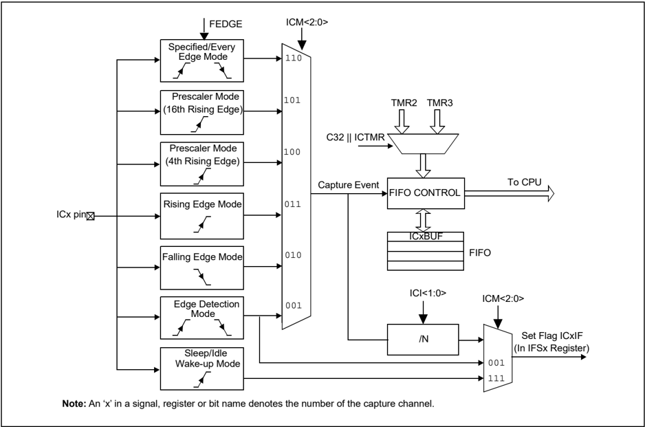

## 15.1 Input Capture Control Registers

TABLE 15-1: INPUT CAPTURE 1-INPUT CAPTURE 5 REGISTER MAP

|   Virtual Address (BF80_#) | Register Name   |            | Bits         | Bits         | Bits         | Bits         | Bits         | Bits         | Bits         | Bits         | Bits         | Bits         | Bits         | Bits         | Bits         | Bits         | Bits         | Bits         |            |
|----------------------------|-----------------|------------|--------------|--------------|--------------|--------------|--------------|--------------|--------------|--------------|--------------|--------------|--------------|--------------|--------------|--------------|--------------|--------------|------------|
|                            |                 | Bit Range  | 31/15        | 30/14        | 29/13        | 28/12        | 27/11        | 26/10        | 25/9         | 24/8         | 23/7         | 22/6         | 21/5         | 20/4         | 19/3         | 18/2         | 17/1         | 16/0         | All Resets |
|                       2000 | IC1CON (1)      | 31:16      | -            | -            | -            | -            | -            | -            | -            | -            | - -          | -            | -            | -            | -            | -            |              | -            | 0000       |
|                       2000 | IC1CON (1)      | 15:0       | ON           | -            | SIDL         | -            | -            | -            | FEDGE        | C32          | ICTMR        | ICI<1:0>     | ICI<1:0>     | ICOV         | ICBNE        |              | ICM<2:0>     |              | 0000       |
|                       2010 | IC1BUF          | 31:16 15:0 | IC1BUF<31:0> | IC1BUF<31:0> | IC1BUF<31:0> | IC1BUF<31:0> | IC1BUF<31:0> | IC1BUF<31:0> | IC1BUF<31:0> | IC1BUF<31:0> | IC1BUF<31:0> | IC1BUF<31:0> | IC1BUF<31:0> | IC1BUF<31:0> | IC1BUF<31:0> | IC1BUF<31:0> | IC1BUF<31:0> | IC1BUF<31:0> | xxxx xxxx  |
|                       2200 | IC2CON (1)      | 31:16      | -            | -            | -            | -            | -            | -            | -            | -            | -            | -            | -            | -            | -            | -            | -            | -            | 0000       |
|                       2200 | IC2CON (1)      | 15:0       | ON           | -            | SIDL         | -            | -            | -            | FEDGE        | C32          | ICTMR        | ICI<1:0>     | ICI<1:0>     | ICOV         | ICBNE        |              | ICM<2:0>     |              | 0000       |
|                       2210 | IC2BUF          | 31:16 15:0 | IC2BUF<31:0> | IC2BUF<31:0> | IC2BUF<31:0> | IC2BUF<31:0> | IC2BUF<31:0> | IC2BUF<31:0> | IC2BUF<31:0> | IC2BUF<31:0> | IC2BUF<31:0> | IC2BUF<31:0> | IC2BUF<31:0> | IC2BUF<31:0> | IC2BUF<31:0> | IC2BUF<31:0> | IC2BUF<31:0> | IC2BUF<31:0> | xxxx xxxx  |
|                       2400 | IC3CON (1)      | 31:16      | -            | -            | -            | -            | -            | -            | -            | -            | -            | -            | -            | -            | -            | -            | -            | -            | 0000       |
|                       2400 | IC3CON (1)      | 15:0       | ON           | -            | SIDL         | -            | -            | -            | FEDGE        | C32          | ICTMR        | ICI<1:0>     | ICI<1:0>     | ICOV         | ICBNE        |              | ICM<2:0>     |              | 0000       |
|                       2410 | IC3BUF          | 31:16 15:0 | IC3BUF<31:0> | IC3BUF<31:0> | IC3BUF<31:0> | IC3BUF<31:0> | IC3BUF<31:0> | IC3BUF<31:0> | IC3BUF<31:0> | IC3BUF<31:0> | IC3BUF<31:0> | IC3BUF<31:0> | IC3BUF<31:0> | IC3BUF<31:0> | IC3BUF<31:0> | IC3BUF<31:0> | IC3BUF<31:0> | IC3BUF<31:0> | xxxx xxxx  |
|                       2600 | IC4CON (1)      | 31:16      | -            | -            | -            | -            | -            | -            | -            | -            | -            | -            | -            | -            | -            | -            | -            | -            | 0000       |
|                       2600 | IC4CON (1)      | 15:0       | ON           | -            | SIDL         | -            | -            | -            | FEDGE        | C32          | ICTMR        | ICI<1:0>     | ICI<1:0>     | ICOV         | ICBNE        |              | ICM<2:0>     |              | 0000       |
|                       2610 | IC4BUF          | 31:16 15:0 | IC4BUF<31:0> | IC4BUF<31:0> | IC4BUF<31:0> | IC4BUF<31:0> | IC4BUF<31:0> | IC4BUF<31:0> | IC4BUF<31:0> | IC4BUF<31:0> | IC4BUF<31:0> | IC4BUF<31:0> | IC4BUF<31:0> | IC4BUF<31:0> | IC4BUF<31:0> | IC4BUF<31:0> | IC4BUF<31:0> | IC4BUF<31:0> | xxxx xxxx  |
|                       2800 | IC5CON (1)      | 31:16      | -            | -            | -            | -            | -            | -            | -            | -            | -            | -            | -            | -            | -            | -            | -            | -            | 0000       |
|                       2800 | IC5CON (1)      | 15:0       | ON           | -            | SIDL         | -            | -            | -            | FEDGE        | C32          | ICTMR        | ICI<1:0>     | ICI<1:0>     | ICOV         | ICBNE        |              | ICM<2:0>     |              | 0000       |
|                       2810 | IC5BUF          | 31:16      | IC5BUF<31:0> | IC5BUF<31:0> | IC5BUF<31:0> | IC5BUF<31:0> | IC5BUF<31:0> | IC5BUF<31:0> | IC5BUF<31:0> | IC5BUF<31:0> | IC5BUF<31:0> | IC5BUF<31:0> | IC5BUF<31:0> | IC5BUF<31:0> | IC5BUF<31:0> | IC5BUF<31:0> | IC5BUF<31:0> | IC5BUF<31:0> | xxxx       |
|                       2810 | IC5BUF          | 15:0       |              |              |              |              |              |              |              |              |              |              |              |              |              |              |              |              | xxxx       |

Legend:

x = unknown value on Reset; - = unimplemented, read as ' 0 '. Reset values are shown in hexadecimal.

Note 1: This register has corresponding CLR, SET and INV registers at its virtual address, plus an offset of 0x4, 0x8 and 0xC, respectively. See Section 11.2 'CLR, SET and INV Registers' for more information.

## PIC32MX1XX/2XX 28/36/44-PIN FAMILY

## REGISTER 15-1:

ICXCON: INPUT CAPTURE 'x' CONTROL REGISTER

| Bit Range   | Bit 31/23/15/7   | Bit 30/22/14/6   | Bit 29/21/13/5   | Bit 28/20/12/4   | Bit 27/19/11/3   | Bit 26/18/10/2   | Bit 25/17/9/1   | Bit 24/16/8/0   |
|-------------|------------------|------------------|------------------|------------------|------------------|------------------|-----------------|-----------------|
| 31:24       | U-0              | U-0              | U-0              | U-0              | U-0              | U-0              | U-0             | U-0             |
| 31:24       | -                | -                | -                | -                | -                | -                | -               | -               |
| 23:16       | U-0              | U-0              | U-0              | U-0              | U-0              | U-0              | U-0             | U-0             |
| 23:16       | -                | -                | -                | -                | -                | -                | -               | -               |
| 15:8        | R/W-0            | U-0              | R/W-0            | U-0              | U-0              | U-0              | R/W-0           | R/W-0           |
| 15:8        | ON (1)           | -                | SIDL             | -                | -                | -                | FEDGE           | C32             |
| 7:0         | R/W-0            | R/W-0            | R/W-0            | R-0              | R-0              | R/W-0            | R/W-0           | R/W-0           |
| 7:0         | ICTMR            | ICI<1:0>         | ICI<1:0>         | ICOV             | ICBNE            | ICM<2:0>         | ICM<2:0>        | ICM<2:0>        |

## Legend:

R = Readable bit

W = Writable bit

U = Unimplemented bit

-n = Bit Value at POR: ('0', '1', x = unknown)

P = Programmable bit

r = Reserved bit

bit 31-16

Unimplemented: Read as ' 0 '

bit 15

ON: Input Capture Module Enable bit (1)

1 = Module is enabled

0 = Disable and reset module, disable clocks, disable interrupt generation and allow SFR modifications

bit 14 Unimplemented: Read as ' 0 '

bit 13

SIDL: Stop in Idle Control bit

1 = Halt in Idle mode

0 = Continue to operate in Idle mode

bit 12-10 Unimplemented:

Read as ' 0 '

bit 9

FEDGE:

First Capture Edge Select bit (only used in mode 6, ICM&lt;2:0&gt; = 110 )

1 = Capture rising edge first

0 = Capture falling edge first

bit 8

C32: 32-bit Capture Select bit

1 = 32-bit timer resource capture

0 = 16-bit timer resource capture

bit 7

ICTMR: Timer Select bit (Does not affect timer selection when C32 (ICxCON&lt;8&gt;) is ' 1 ')

0 = Timer3 is the counter source for capture

1 = Timer2 is the counter source for capture

bit 6-5 ICI&lt;1:0&gt;: Interrupt Control bits

11 =  Interrupt on every fourth capture event

10 =  Interrupt on every third capture event

01 =  Interrupt on every second capture event

00 =  Interrupt on every capture event

bit 4

ICOV: Input Capture Overflow Status Flag bit (read-only)

1 = Input capture overflow has occurred

0 = No input capture overflow has occurred

bit 3

ICBNE:

Input Capture Buffer Not Empty Status bit (read-only)

1 = Input capture buffer is not empty; at least one more capture value can be read

0 = Input capture buffer is empty

Note 1: When using 1:1 PBCLK divisor, the user's software should not read/write the peripheral's SFRs in the SYSCLK cycle immediately following the instruction that clears the module's ON bit.

## PIC32MX1XX/2XX 28/36/44-PIN FAMILY

## REGISTER 15-1: ICXCON: INPUT CAPTURE 'x' CONTROL REGISTER (CONTINUED)

bit 2-0 ICM&lt;2:0&gt;: Input Capture Mode Select bits

- 111 =  Interrupt-Only mode (only supported while in Sleep mode or Idle mode)
- 110 =  Simple Capture Event mode - every edge, specified edge first and every edge thereafter
- 101 =  Prescaled Capture Event mode - every sixteenth rising edge

100 =  Prescaled Capture Event mode - every fourth rising edge

- 011 =  Simple Capture Event mode - every rising edge
- 010 =  Simple Capture Event mode - every falling edge
- 001 =  Edge Detect mode - every edge (rising and falling)

000 =  Input Capture module is disabled

Note 1: When using 1:1 PBCLK divisor, the user's software should not read/write the peripheral's SFRs in the SYSCLK cycle immediately following the instruction that clears the module's ON bit.

## PIC32MX1XX/2XX 28/36/44-PIN FAMILY

## 16.0 OUTPUT COMPARE

Note: This data sheet summarizes the features of  the  PIC32MX1XX/2XX  28/36/44-pin Family of devices. It is not intended to be a  comprehensive  reference  source.  To complement  the  information  in  this  data sheet, refer to Section 16. 'Output Compare' (DS60001111),  which  is  available from the Documentation  &gt;  Reference Manual section  of  the  Microchip  PIC32 web site (www.microchip.com/pic32).

The Output Compare module is used to generate a single pulse or a train of pulses in response to selected time base events. For all modes of operation, the Output  Compare  module  compares  the values stored  in the OCxR and/or the OCxRS registers to the value in the selected timer. When a match occurs, the Output Compare  module  generates  an  event  based  on  the selected mode of operation.

FIGURE 16-1: OUTPUT COMPARE MODULE BLOCK DIAGRAM

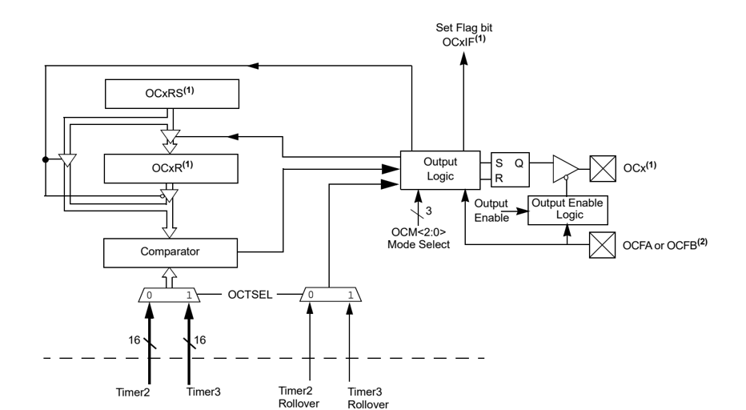

Note 1: Where 'x' is shown, reference is made to the registers associated with the respective output compare channels,

1 through 5.

- 2: The OCFA pin controls the OC1-OC4 channels. The OCFB pin controls the OC5 channel.

The following are some of the key features:

- Multiple Output Compare Modules in a device
- Programmable interrupt generation on compare event
- Single and Dual Compare modes
- Single and continuous output pulse generation
- Pulse-Width Modulation (PWM) mode
- Hardware-based PWM Fault detection and automatic output disable
- Can operate from either of two available 16-bit time bases or a single 32-bit time base

## 16.1 Output Compare Control Registers

## TABLE 16-1: OUTPUT COMPARE 1-OUTPUT COMPARE 5 REGISTER MAP

| Bits   |
|--------|

Legend:

x = unknown value on Reset; - = unimplemented, read as ' 0 '. Reset values are shown in hexadecimal.

Note 1: All registers in this table have corresponding CLR, SET and INV registers at their virtual addresses, plus offsets of 0x4, 0x8 and 0xC, respectively. See Section 11.2 'CLR, SET and INV Registers' for more information.

## REGISTER 16-1:

## PIC32MX1XX/2XX 28/36/44-PIN FAMILY

OCxCON: OUTPUT COMPARE 'x' CONTROL REGISTER

| Bit Range   | Bit 31/23/15/7   | Bit 30/22/14/6   | Bit 29/21/13/5   | Bit 28/20/12/4   | Bit 27/19/11/3   | Bit 26/18/10/2   | Bit 25/17/9/1   | Bit 24/16/8/0   |
|-------------|------------------|------------------|------------------|------------------|------------------|------------------|-----------------|-----------------|
| 31:24       | U-0              | U-0              | U-0              | U-0              | U-0              | U-0              | U-0             | U-0             |
| 31:24       | -                | -                | -                | -                | -                | -                | -               | -               |
| 23:16       | U-0              | U-0              | U-0              | U-0              | U-0              | U-0              | U-0             | U-0             |
| 23:16       | -                | -                | -                | -                | -                | -                | -               | -               |
| 15:8        | R/W-0            | U-0              | R/W-0            | U-0              | U-0              | U-0              | U-0             | U-0             |
| 15:8        | ON (1)           | -                | SIDL             | -                | -                | -                | -               | -               |
| 7:0         | U-0              | U-0              | R/W-0            | R-0              | R/W-0            | R/W-0            | R/W-0           | R/W-0           |
| 7:0         | -                | -                | OC32             | OCFLT (2)        | OCTSEL           | OCM<2:0>         | OCM<2:0>        | OCM<2:0>        |

## Legend:

R = Readable bit

W = Writable bit

U = Unimplemented bit, read as '0'

-n = Value at POR

'1' = Bit is set

'0' = Bit is cleared

x = Bit is unknown

bit 31-16

Unimplemented: Read as ' 0 '

bit 15 ON:

Output Compare Peripheral On bit (1)

1 = Output Compare peripheral is enabled

0 = Output Compare peripheral is disabled

bit 14 Unimplemented: Read as ' 0 '

bit 13

SIDL: Stop in Idle Mode bit

1 = Discontinue module operation when the device enters Idle mode

0 = Continue module operation when the device enters Idle mode

bit 12-6

Unimplemented: Read as ' 0 '

bit 5 OC32:

32-bit Compare Mode bit

1 = OCxR&lt;31:0&gt; and/or OCxRS&lt;31:0&gt; are used for comparisons to the 32-bit timer source

0 = OCxR&lt;15:0&gt; and OCxRS&lt;15:0&gt; are used for comparisons to the 16-bit timer source

bit 4 OCFLT: PWM Fault Condition Status bit (2)

1 = PWM Fault condition has occurred (cleared in hardware only)

0 = No PWM Fault condition has occurred

bit 3 OCTSEL: Output Compare Timer Select bit

1 = Timer3 is the clock source for this Output Compare module

0 = Timer2 is the clock source for this Output Compare module

bit 2-0 OCM&lt;2:0&gt;: Output Compare Mode Select bits

111 =  PWM mode on OCx; Fault pin enabled

110 =  PWM mode on OCx; Fault pin disabled

101 =  Initialize OCx pin low; generate continuous output pulses on OCx pin

100 =  Initialize OCx pin low; generate single output pulse on OCx pin

011 =  Compare event toggles OCx pin

010 =  Initialize OCx pin high; compare event forces OCx pin low

001 =  Initialize OCx pin low; compare event forces OCx pin high

000 =  Output compare peripheral is disabled but continues to draw current

- Note 1: When using 1:1 PBCLK divisor, the user's software should not read/write the peripheral's SFRs in the SYSCLK cycle immediately following the instruction that clears the module's ON bit.
- 2: This bit is only used when OCM&lt;2:0&gt; = ' 111 '. It is read as ' 0 ' in all other modes.

## NOTES:

## PIC32MX1XX/2XX 28/36/44-PIN FAMILY

## 17.0 SERIAL PERIPHERAL INTERFACE (SPI)

Note: This data sheet summarizes the features of  the  PIC32MX1XX/2XX  28/36/44-pin Family of devices. It is not intended to be a  comprehensive  reference  source.  To complement  the  information  in  this  data sheet, refer to Section 23. 'Serial Peripheral Interface (SPI)' (DS60001106), which is available from the Documentation &gt; Reference Manual section  of  the  Microchip  PIC32  web  site (www.microchip.com/pic32).

The SPI module is a synchronous serial interface that is  useful for  communicating with external peripherals and other microcontrollers. These  peripheral  devices may be Serial EEPROMs, Shift registers, display drivers,  Analog-to-Digital Converters (ADC), etc.  The PIC32 SPI module is compatible with Motorola ®  SPI and SIOP interfaces.

FIGURE 17-1: SPI MODULE BLOCK DIAGRAM

Some of the key features of the SPI module are:

- Master mode and Slave mode support
- Four clock formats
- Enhanced Framed SPI protocol support
- User-configurable 8-bit, 16-bit and 32-bit data width
- Separate SPI FIFO buffers for receive and transmit
- -FIFO buffers act as 4/8/16-level deep FIFOs based on 32/16/8-bit data width
- Programmable interrupt event on every 8-bit, 16-bit and 32-bit data transfer
- Operation during Sleep and Idle modes
- Audio Codec Support:
- -I 2 S protocol
- -Left-justified
- -Right-justified
- PCM

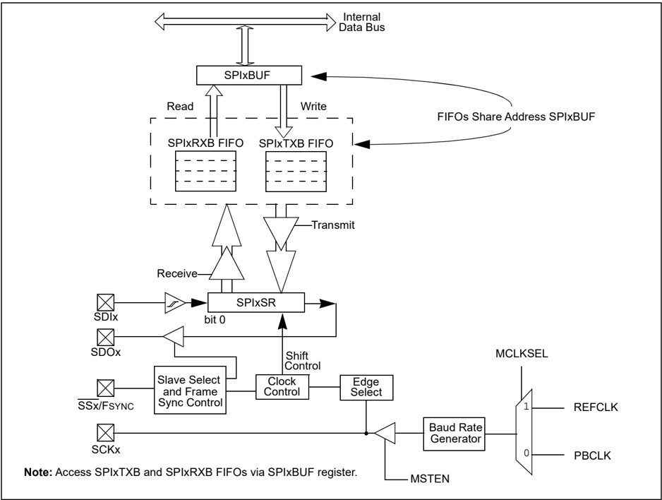

## 17.1 SPI Control Registers

## TABLE 17-1: SPI1 AND SPI2 REGISTER MAP

| Virtual Address (BF80_#)   | Register Name (1)   | Range      | Bits          | Bits           | Bits           | Bits          | Bits                | Bits                | Bits                | Bits                | Bits       | Bits       | Bits       | Bits          | Bits          | Bits          | Bits          | Bits       |
|----------------------------|---------------------|------------|---------------|----------------|----------------|---------------|---------------------|---------------------|---------------------|---------------------|------------|------------|------------|---------------|---------------|---------------|---------------|------------|
| Virtual Address (BF80_#)   | Register Name (1)   | Range      | 31/15         | 30/14          | 29/13          | 28/12         | 27/11               | 26/10               | 25/9                | 24/8                | 23/7       | 22/6       | 21/5       | 20/4          | 19/3 18/2     | 17/1          | 16/0          | All Resets |
| 5800                       | SPI1CON             | 31:16      | FRMEN FRMSYNC | FRMPOL         | FRMPOL         | MSSEN         | FRMSYPW FRMCNT<2:0> | FRMSYPW FRMCNT<2:0> | FRMSYPW FRMCNT<2:0> | FRMSYPW FRMCNT<2:0> | MCLKSEL    | -          | -          | -             | - -           | SPIFE         | ENHBUF        | 0000       |
| 5800                       |                     | 15:0       | ON            | -              | SIDL           | DISSDO        | MODE32              | MODE16              | SMP                 | CKE                 | SSEN       | CKP        | MSTEN      | DISSDI        | STXISEL<1:0>  | SRXISEL<1:0>  |               | 0000       |
| 5810                       | SPI1STAT            | 31:16      | -             | -              | -              | RXBUFELM<4:0> | RXBUFELM<4:0>       | RXBUFELM<4:0>       | RXBUFELM<4:0>       | RXBUFELM<4:0>       | -          | -          | -          | TXBUFELM<4:0> | TXBUFELM<4:0> | TXBUFELM<4:0> | TXBUFELM<4:0> | 0000       |
| 5810                       |                     | 15:0       | -             | -              | -              | FRMERR        | SPIBUSY             | -                   | -                   | SPITUR              | SRMT       | SPIROV     | SPIRBE     | -             | SPITBE -      | SPITBF        | SPIRBF        | 0008       |
| 5820                       | SPI1BUF             | 31:16 15:0 | DATA<31:0>    | DATA<31:0>     | DATA<31:0>     | DATA<31:0>    | DATA<31:0>          | DATA<31:0>          | DATA<31:0>          | DATA<31:0>          | DATA<31:0> | DATA<31:0> | DATA<31:0> | DATA<31:0>    | DATA<31:0>    | DATA<31:0>    | DATA<31:0>    | 0000 0000  |
| 5830                       |                     | 31:16      | -             | -              | -              | -             | -                   | -                   | -                   | -                   | -          | -          | -          | -             | - -           | -             | -             | 0000       |
| 5830                       | SPI1BRG             | 15:0       | -             | -              | -              | BRG<12:0>     | BRG<12:0>           | BRG<12:0>           | BRG<12:0>           | BRG<12:0>           | BRG<12:0>  | BRG<12:0>  | BRG<12:0>  | BRG<12:0>     | BRG<12:0>     | BRG<12:0>     | BRG<12:0>     | 0000       |
| 5840                       |                     | 31:16      | -             | -              | -              | -             | -                   | -                   | -                   | -                   | -          | -          | -          | -             | - -           | -             | -             | 0000       |
| 5840                       | SPI1CON2            | 15:0       | SPI SGNEXT    | -              | -              | FRM ERREN     | SPI ROVEN           | SPI TUREN           | IGNROV              | IGNTUR              | AUDEN      | -          | -          | -             | AUD MONO -    | AUDMOD<1:0>   | AUDMOD<1:0>   | 0000       |
| 5A00                       |                     | 31:16      | FRMEN         | FRMSYNC FRMPOL | FRMSYNC FRMPOL | MSSEN         | FRMSYPW FRMCNT<2:0> | FRMSYPW FRMCNT<2:0> | FRMSYPW FRMCNT<2:0> | FRMSYPW FRMCNT<2:0> | MCLKSEL    | -          | -          | -             | - -           | SPIFE         | ENHBUF        | 0000       |
| 5A00                       | SPI2CON             | 15:0       | ON            | -              | SIDL           | DISSDO        | MODE32              | MODE16              | SMP                 | CKE                 | SSEN       | CKP        | MSTEN      | DISSDI        | STXISEL<1:0>  | SRXISEL<1:0>  |               | 0000       |
| 5A10                       |                     | 31:16      | -             | -              | -              | RXBUFELM<4:0> | RXBUFELM<4:0>       | RXBUFELM<4:0>       | RXBUFELM<4:0>       | RXBUFELM<4:0>       | -          | -          | -          | TXBUFELM<4:0> | TXBUFELM<4:0> | TXBUFELM<4:0> | TXBUFELM<4:0> | 0000       |
|                            | SPI2STAT            | 15:0       | -             | -              | -              | FRMERR        | SPIBUSY             | -                   | -                   | SPITUR              | SRMT       | SPIROV     | SPIRBE     | - SPITBE      | -             | SPITBF        | SPIRBF        | 0008       |
| 5A20                       | SPI2BUF             | 31:16 15:0 | DATA<31:0>    | DATA<31:0>     | DATA<31:0>     | DATA<31:0>    | DATA<31:0>          | DATA<31:0>          | DATA<31:0>          | DATA<31:0>          | DATA<31:0> | DATA<31:0> | DATA<31:0> | DATA<31:0>    | DATA<31:0>    | DATA<31:0>    | DATA<31:0>    | 0000 0000  |
| 5A30                       |                     | 31:16      | -             | -              | -              | -             | -                   | -                   | -                   | -                   | -          | -          | -          | -             | - -           | -             | -             | 0000       |
|                            | SPI2BRG             | 15:0       | -             | -              | -              | BRG<12:0>     | BRG<12:0>           | BRG<12:0>           | BRG<12:0>           | BRG<12:0>           | BRG<12:0>  | BRG<12:0>  | BRG<12:0>  | BRG<12:0>     | BRG<12:0>     | BRG<12:0>     | BRG<12:0>     | 0000       |
| 5A40                       |                     | 31:16      | -             | -              | -              | -             | -                   | -                   | -                   | -                   | -          | -          | -          | -             | - -           | -             | -             | 0000       |
| 5A40                       | SPI2CON2            | 15:0       | SPI SGNEXT    | -              | -              | FRM ERREN     | SPI ROVEN           | SPI TUREN           | IGNROV              | IGNTUR              | AUDEN      | -          | -          | -             | AUD MONO -    | AUDMOD<1:0>   | AUDMOD<1:0>   | 0000       |

Legend:

Note 1:

x = unknown value on Reset; - = unimplemented, read as ' 0 '. Reset values are shown in hexadecimal.

All registers in this table except SPIxBUF have corresponding CLR, SET and INV registers at their virtual addresses, plus offsets of 0x4, 0x8 and 0xC, respectively. See Section 11.2 'CLR, SET and INV Registers' for more information.

## PIC32MX1XX/2XX 28/36/44-PIN FAMILY

## REGISTER 17-1: SPIxCON: SPI CONTROL REGISTER

| Bit Range   | Bit 31/23/15/7   | Bit 30/22/14/6   | Bit 29/21/13/5   | Bit 28/20/12/4   | Bit 27/19/11/3   | Bit 26/18/10/2   | Bit 25/17/9/1   | Bit 24/16/8/0   |
|-------------|------------------|------------------|------------------|------------------|------------------|------------------|-----------------|-----------------|
| 31:24       | R/W-0            | R/W-0            | R/W-0            | R/W-0            | R/W-0            | R/W-0            | R/W-0           | R/W-0           |
| 31:24       | FRMEN            | FRMSYNC          | FRMPOL           | MSSEN            | FRMSYPW          | FRMCNT<2:0>      | FRMCNT<2:0>     | FRMCNT<2:0>     |
| 23:16       | R/W-0            | U-0              | U-0              | U-0              | U-0              | U-0              | R/W-0           | R/W-0           |
| 23:16       | MCLKSEL (2)      | -                | -                | -                | -                | -                | SPIFE           | ENHBUF (2)      |
| 15:8        | R/W-0            | U-0              | R/W-0            | R/W-0            | R/W-0            | R/W-0            | R/W-0           | R/W-0           |
| 15:8        | ON (1)           | -                | SIDL             | DISSDO           | MODE32           | MODE16           | SMP             | CKE (3)         |
| 7:0         | R/W-0            | R/W-0            | R/W-0            | R/W-0            | R/W-0            | R/W-0            | R/W-0           | R/W-0           |
| 7:0         | SSEN             | CKP (4)          | MSTEN            | DISSDI           | STXISEL<1:0>     | STXISEL<1:0>     | SRXISEL<1:0>    | SRXISEL<1:0>    |

| Legend:           | Legend:          | Legend:                            | Legend:                            |
|-------------------|------------------|------------------------------------|------------------------------------|
| R = Readable bit  | W = Writable bit | U = Unimplemented bit, read as '0' | U = Unimplemented bit, read as '0' |
| -n = Value at POR | '1' = Bit is set | '0' = Bit is cleared               | x = Bit is unknown                 |

## bit 31 FRMEN:

Framed SPI Support bit

1 = Framed SPI support is enabled (SSx pin used as FSYNC input/output)

0 = Framed SPI support is disabled

bit 30 FRMSYNC: Frame Sync Pulse Direction Control on SSx pin bit (Framed SPI mode only)

1 = Frame sync pulse input (Slave mode)

0 = Frame sync pulse output (Master mode)

bit 29 FRMPOL: Frame Sync / Slave Select Polarity bit (Framed SPI or Master Transmit modes only)

1 = Frame pulse or SSx pin is active-high

0 = Frame pulse or SSx pin is active-low

bit 28

MSSEN: Master Mode Slave Select Enable bit

- 1 = Slave select SPI support enabled. The SS pin is automatically driven during transmission in Master mode. Polarity is determined by the FRMPOL bit.

- 0 = Slave select SPI support is disabled.

bit 27 FRMSYPW:

Frame Sync Pulse Width bit

1 = Frame sync pulse is one character wide

0 = Frame sync pulse is one clock wide

bit 26-24 FRMCNT&lt;2:0&gt;: Frame Sync Pulse Counter bits. Controls the number of data characters transmitted per pulse. This bit is only valid in FRAMED\_SYNC mode.

- 111 = Reserved; do not use

110 = Reserved; do not use

101 = Generate a frame sync pulse on every 32 data characters

100 = Generate a frame sync pulse on every 16 data characters

011 = Generate a frame sync pulse on every 8 data characters

010 = Generate a frame sync pulse on every 4 data characters

001 = Generate a frame sync pulse on every 2 data characters

000 = Generate a frame sync pulse on every data character

bit 23 MCLKSEL: Master Clock Enable bit (2)

1 = REFCLK is used by the Baud Rate Generator

0 = PBCLK is used by the Baud Rate Generator

bit 22-18 Unimplemented: Read as ' 0 '

- Note 1: When using the 1:1 PBCLK divisor, the user's software should not read or write the peripheral's SFRs in the SYSCLK cycle immediately following the instruction that clears the module's ON bit.
- 2: This bit can only be written when the ON bit = 0 .
- 3: This bit is not used in the Framed SPI mode. The user should program this bit to ' 0 ' for the Framed SPI mode (FRMEN = 1 ).
- 4: When AUDEN = 1 , the SPI module functions as if the CKP bit is equal to ' 1 ', regardless of the actual value of CKP.

## PIC32MX1XX/2XX 28/36/44-PIN FAMILY

## REGISTER 17-1: SPIxCON: SPI CONTROL REGISTER  (CONTINUED)

bit 17

SPIFE: Frame Sync Pulse Edge Select bit (Framed SPI mode only)

1 = Frame synchronization pulse coincides with the first bit clock

0 = Frame synchronization pulse precedes the first bit clock

bit 16

ENHBUF:

Enhanced Buffer Enable bit (2)

1 = Enhanced Buffer mode is enabled

0 = Enhanced Buffer mode is disabled

bit 15 ON: SPI Peripheral On bit (1)

1 = SPI Peripheral is enabled

0 = SPI Peripheral is disabled

bit 14

## Unimplemented: Read as ' 0 '

## bit 13 SIDL: Stop in Idle Mode bit

1 = Discontinue module operation when the device enters Idle mode

0 = Continue module operation when the device enters Idle mode

## bit 12 DISSDO: Disable SDOx pin bit

1 = SDOx pin is not used by the module. Pin is controlled by associated PORT register

0 = SDOx pin is controlled by the module

## bit 11-10 MODE&lt;32,16&gt;: 32/16-Bit Communication Select bits

When AUDEN = 1 :

## MODE32 MODE16

Communication

|   1 |   1 | 24-bit Data, 32-bit FIFO, 32-bit Channel/64-bit Frame   |
|-----|-----|---------------------------------------------------------|
|   1 |   0 | 32-bit Data, 32-bit FIFO, 32-bit Channel/64-bit Frame   |
|   0 |   1 | 16-bit Data, 16-bit FIFO, 32-bit Channel/64-bit Frame   |
|   0 |   0 | 16-bit Data, 16-bit FIFO, 16-bit Channel/32-bit Frame   |

## When AUDEN = 0 :

## MODE32 MODE16

Communication

1

x

32-bit

0

1

16-bit

0

0

8-bit

## bit 9 SMP: SPI Data Input Sample Phase bit

Master mode (MSTEN = 1 ):

- 1 = Input data sampled at end of data output time

0 = Input data sampled at middle of data output time

## Slave mode (MSTEN = 0 ):

SMP value is ignored when SPI is used in Slave mode. The module always uses SMP = 0 .

To write a ' 1 ' to this bit, the MSTEN value = 1 must first be written.

## bit 8 CKE:

SPI Clock Edge Select bit (3)

1 = Serial output data changes on transition from active clock state to Idle clock state (see the CKP bit)

0 = Serial output data changes on transition from Idle clock state to active clock state (see the CKP bit)

bit 7 SSEN: Slave Select Enable (Slave mode) bit

1 = SSx pin used for Slave mode

0 = SSx pin not used for Slave mode, pin controlled by port function.

## bit 6 CKP: Clock Polarity Select bit (4)

- 1 = Idle state for clock is a high level; active state is a low level
- 0 = Idle state for clock is a low level; active state is a high level

Note 1: When using the 1:1 PBCLK divisor, the user's software should not read or write the peripheral's SFRs in the SYSCLK cycle immediately following the instruction that clears the module's ON bit.

- 2: This bit can only be written when the ON bit = 0 .
- 3: This bit is not used in the Framed SPI mode. The user should program this bit to ' 0 ' for the Framed SPI mode (FRMEN = 1 ).
- 4: When AUDEN = 1 , the SPI module functions as if the CKP bit is equal to ' 1 ', regardless of the actual value of CKP.

## PIC32MX1XX/2XX 28/36/44-PIN FAMILY

## REGISTER 17-1: SPIxCON: SPI CONTROL REGISTER  (CONTINUED)

- bit 5 MSTEN: Master Mode Enable bit
- 1 = Master mode
- 0 = Slave mode

bit 4 DISSDI: Disable SDI bit

- 1 = SDI pin is not used by the SPI module (pin is controlled by PORT function)
- 0 = SDI pin is controlled by the SPI module

bit 3-2 STXISEL&lt;1:0&gt;: SPI Transmit Buffer Empty Interrupt Mode bits

- 11 = Interrupt is generated when the buffer is not full (has one or more empty elements)
- 10 = Interrupt is generated when the buffer is empty by one-half or more
- 01 = Interrupt is generated when the buffer is completely empty
- 00 = Interrupt is generated when the last transfer is shifted out of SPISR and transmit operations are complete
- bit 1-0 SRXISEL&lt;1:0&gt;: SPI Receive Buffer Full Interrupt Mode bits
- 11 = Interrupt is generated when the buffer is full
- 10 = Interrupt is generated when the buffer is full by one-half or more
- 01 = Interrupt is generated when the buffer is not empty
- 00 = Interrupt is generated when the last word in the receive buffer is read (i.e., buffer is empty)
- Note 1: When using the 1:1 PBCLK divisor, the user's software should not read or write the peripheral's SFRs in the SYSCLK cycle immediately following the instruction that clears the module's ON bit.
- 2: This bit can only be written when the ON bit = 0 .
- 3: This bit is not used in the Framed SPI mode. The user should program this bit to ' 0 ' for the Framed SPI mode (FRMEN = 1 ).
- 4: When AUDEN = 1 , the SPI module functions as if the CKP bit is equal to ' 1 ', regardless of the actual value of CKP.

## PIC32MX1XX/2XX 28/36/44-PIN FAMILY

| Bit Range   | Bit 31/23/15/7   | Bit 30/22/14/6   | Bit 29/21/13/5   | Bit 28/20/12/4   | Bit 27/19/11/3   | Bit 26/18/10/2   | Bit 25/17/9/1     | Bit 24/16/8/0     |
|-------------|------------------|------------------|------------------|------------------|------------------|------------------|-------------------|-------------------|
| 31:24       | U-0              | U-0              | U-0              | U-0              | U-0              | U-0              | U-0               | U-0               |
| 31:24       | -                | -                | -                | -                | -                | -                | -                 | -                 |
| 23:16       | U-0              | U-0              | U-0              | U-0              | U-0              | U-0              | U-0               | U-0               |
| 23:16       | -                | -                | -                | -                | -                | -                | -                 | -                 |
| 15:8        | R/W-0            | U-0              | U-0              | R/W-0            | R/W-0            | R/W-0            | R/W-0             | R/W-0             |
| 15:8        | SPISGNEXT        | -                | -                | FRMERREN         | SPIROVEN         | SPITUREN         | IGNROV            | IGNTUR            |
| 7:0         | R/W-0            | U-0              | U-0              | U-0              | R/W-0            | U-0              | R/W-0             | R/W-0             |
| 7:0         | AUDEN (1)        | -                | -                | -                | AUDMONO (1,2)    | -                | AUDMOD<1:0> (1,2) | AUDMOD<1:0> (1,2) |

## REGISTER 17-2: SPIxCON2: SPI CONTROL REGISTER 2

## Legend:

R = Readable bit

W = Writable bit

U = Unimplemented bit, read as '0'

-n = Value at POR

'1' = Bit is set

'0' = Bit is cleared

x = Bit is unknown

bit 31-16 Unimplemented: Read as ' 0 '

bit 15

SPISGNEXT:

Sign Extend Read Data from the RX FIFO bit

1 = Data from RX FIFO is sign extended

0 = Data from RX FIFO is not sign extended

bit 14-13 Unimplemented: Read as ' 0 '

bit 12

FRMERREN: Enable Interrupt Events via FRMERR bit

1 = Frame Error overflow generates error events

0 = Frame Error does not generate error events

bit 11

SPIROVEN: Enable Interrupt Events via SPIROV bit

1 = Receive overflow generates error events

0 = Receive overflow does not generate error events

bit 10

SPITUREN: Enable Interrupt Events via SPITUR bit

1 = Transmit underrun generates error events

0 = Transmit underrun does not generate error events

bit 9 IGNROV: Ignore Receive Overflow bit (for Audio Data Transmissions)

1 = A ROV is not a critical error; during ROV data in the FIFO is not overwritten by receive data

0 = A ROV is a critical error that stops SPI operation

bit 8 IGNTUR: Ignore Transmit Underrun bit (for Audio Data Transmissions)

1

= A TUR is not a critical error and zeros are transmitted until the SPIxTXB is not empty

0 = A TUR is a critical error that stops SPI operation

bit 7 AUDEN: Enable Audio CODEC Support bit (1)

1 = Audio protocol enabled

0 = Audio protocol disabled

bit 6-5 Unimplemented: Read as ' 0 '

bit 3

AUDMONO: Transmit Audio Data Format bit (1,2)

1 = Audio data is mono (Each data word is transmitted on both left and right channels)

0 = Audio data is stereo

bit 2 Unimplemented: Read as ' 0 '

bit 1-0 AUDMOD&lt;1:0&gt;: Audio Protocol Mode bit (1,2)

11 = PCM/DSP mode

10 = Right-Justified mode

01 = Left-Justified mode

00 = I 2 S mode

Note 1: This bit can only be written when the ON bit = 0 .

2: This bit is only valid for AUDEN = 1 .

## PIC32MX1XX/2XX 28/36/44-PIN FAMILY

## REGISTER 17-3: SPIxSTAT: SPI STATUS REGISTER

| Bit Range   | Bit 31/23/15/7   | Bit 30/22/14/6   | Bit 29/21/13/5   | Bit 28/20/12/4   | Bit 27/19/11/3   | Bit 26/18/10/2   | Bit 25/17/9/1   | Bit 24/16/8/0   |
|-------------|------------------|------------------|------------------|------------------|------------------|------------------|-----------------|-----------------|
| 31:24       | U-0              | U-0              | U-0              | R-0              | R-0              | R-0              | R-0             | R-0             |
| 31:24       | -                | -                | -                | RXBUFELM<4:0>    | RXBUFELM<4:0>    | RXBUFELM<4:0>    | RXBUFELM<4:0>   | RXBUFELM<4:0>   |
| 23:16       | U-0              | U-0              | U-0              | R-0              | R-0              | R-0              | R-0             | R-0             |
| 23:16       | -                | -                | -                | TXBUFELM<4:0>    | TXBUFELM<4:0>    | TXBUFELM<4:0>    | TXBUFELM<4:0>   | TXBUFELM<4:0>   |
| 15:8        | U-0              | U-0              | U-0              | R/C-0, HS        | R-0              | U-0              | U-0             | R-0             |
| 15:8        | -                | -                | -                | FRMERR           | SPIBUSY          | -                | -               | SPITUR          |
| 7:0         | R-0              | R/W-0            | R-0              | U-0              | R-1              | U-0              | R-0             | R-0             |
| 7:0         | SRMT             | SPIROV           | SPIRBE           | -                | SPITBE           | -                | SPITBF          | SPIRBF          |

## Legend:

C = Clearable bit

HS = Set in hardware

R = Readable bit

W = Writable bit

U = Unimplemented bit, read as '0'

-n = Value at POR

'1' = Bit is set

'0' = Bit is cleared

x = Bit is unknown

bit 31-29

Unimplemented: Read as ' 0 '

bit 28-24 RXBUFELM&lt;4:0&gt;: Receive Buffer Element Count bits (valid only when ENHBUF = 1 )

bit 23-21 Unimplemented: Read as ' 0 '

bit 20-16 TXBUFELM&lt;4:0&gt;: Transmit Buffer Element Count bits (valid only when ENHBUF = 1 )

bit 15-13 Unimplemented: Read as ' 0 '

bit 12

FRMERR:

SPI Frame Error status bit

1 = Frame error detected

0 = No Frame error detected

This bit is only valid when FRMEN = 1 .

bit 11 SPIBUSY: SPI Activity Status bit

1 = SPI peripheral is currently busy with some transactions

0 = SPI peripheral is currently idle

bit 10-9 Unimplemented: Read as ' 0

'

## bit 8 SPITUR: Transmit Under Run bit

1 = Transmit buffer has encountered an underrun condition

0 = Transmit buffer has no underrun condition

This bit is only valid in Framed Sync mode; the underrun condition must be cleared by disabling (ON bit = 0 ) and re-enabling (ON bit = 1 ) the module, or writing a '0' to SPITUR.

bit 7 SRMT: Shift Register Empty bit (valid only when ENHBUF = 1 )

1 = When SPI module shift register is empty

0 = When SPI module shift register is not empty

## bit 6 SPIROV: Receive Overflow Flag bit

- 1 = A new data is completely received and discarded. The user software has not read the previous data  in the SPIxBUF register.

0 = No overflow has occurred

This bit is set in hardware; can bit only be cleared by disabling (ON bit = 0 ) and re-enabling (ON bit = 1 ) the module, or by writing a ' 0 ' to SPIROV.

## bit 5 SPIRBE: RX FIFO Empty bit (valid only when ENHBUF = 1 )

1 = RX FIFO is empty (CRPTR = SWPTR)

0 = RX FIFO is not empty (CRPTR  SWPTR)

bit 4 Unimplemented: Read as ' 0 '

## PIC32MX1XX/2XX 28/36/44-PIN FAMILY

## REGISTER 17-3: SPIxSTAT: SPI STATUS REGISTER

## bit 3 SPITBE:

SPI Transmit Buffer Empty Status bit

- 1 = Transmit buffer, SPIxTXB is empty

- 0 = Transmit buffer, SPIxTXB is not empty

Automatically set in hardware when SPI transfers data from SPIxTXB to SPIxSR.

Automatically cleared in hardware when SPIxBUF is written to, loading SPIxTXB.

bit 2

## Unimplemented: Read as ' 0 '

## bit 1 SPITBF: SPI Transmit Buffer Full Status bit

- 1 = Transmit not yet started, SPITXB is full

- 0 = Transmit buffer is not full

## Standard Buffer Mode:

Automatically set in hardware when the core writes to the SPIBUF location, loading SPITXB. Automatically cleared in hardware when the SPI module transfers data from SPITXB to SPISR.

## Enhanced Buffer Mode:

Set when CWPTR + 1 = SRPTR; cleared otherwise

## bit 0 SPIRBF: SPI Receive Buffer Full Status bit

1 = Receive buffer, SPIxRXB is full

0 = Receive buffer, SPIxRXB is not full

## Standard Buffer Mode:

Automatically set in hardware when the SPI module transfers data from SPIxSR to SPIxRXB. Automatically cleared in hardware when SPIxBUF is read from, reading SPIxRXB.

## Enhanced Buffer Mode:

Set when SWPTR + 1 = CRPTR; cleared otherwise

## PIC32MX1XX/2XX 28/36/44-PIN FAMILY

## 18.0 INTER-INTEGRATED CIRCUIT (I 2 C)

Note: This data sheet summarizes the features of  the  PIC32MX1XX/2XX  28/36/44-pin Family of devices. It is not intended to be a  comprehensive  reference  source.  To complement  the  information  in  this  data sheet, refer to Section 24. 'InterIntegrated Circuit (I 2 C)' (DS60001116), which is available from the Documentation &gt; Reference Manual section of the Microchip PIC32 web site (www.microchip.com/pic32).

The I 2 C module provides complete hardware support for both Slave and Multi-Master modes of the I 2 C serial communication  standard.  Figure 18-1  illustrates  the I 2 C module block diagram.

Each I 2 C module has a 2-pin interface: the SCLx pin is clock and the SDAx pin is data.

Each I 2 C module offers the following key features:

- I 2 C interface supporting both master and slave operation
- I 2 C Slave mode supports 7-bit and 10-bit addressing
- I 2 C Master mode supports 7-bit and 10-bit addressing
- I 2 C port allows bidirectional transfers between master and slaves
- Serial clock synchronization for the I 2 C port can be used as a handshake mechanism to suspend and resume serial transfer (SCLREL control)
- I 2 C supports multi-master operation; detects bus collision and arbitrates accordingly
- Provides support for address bit masking

## PIC32MX1XX/2XX 28/36/44-PIN FAMILY

## FIGURE 18-1: I 2 C BLOCK DIAGRAM

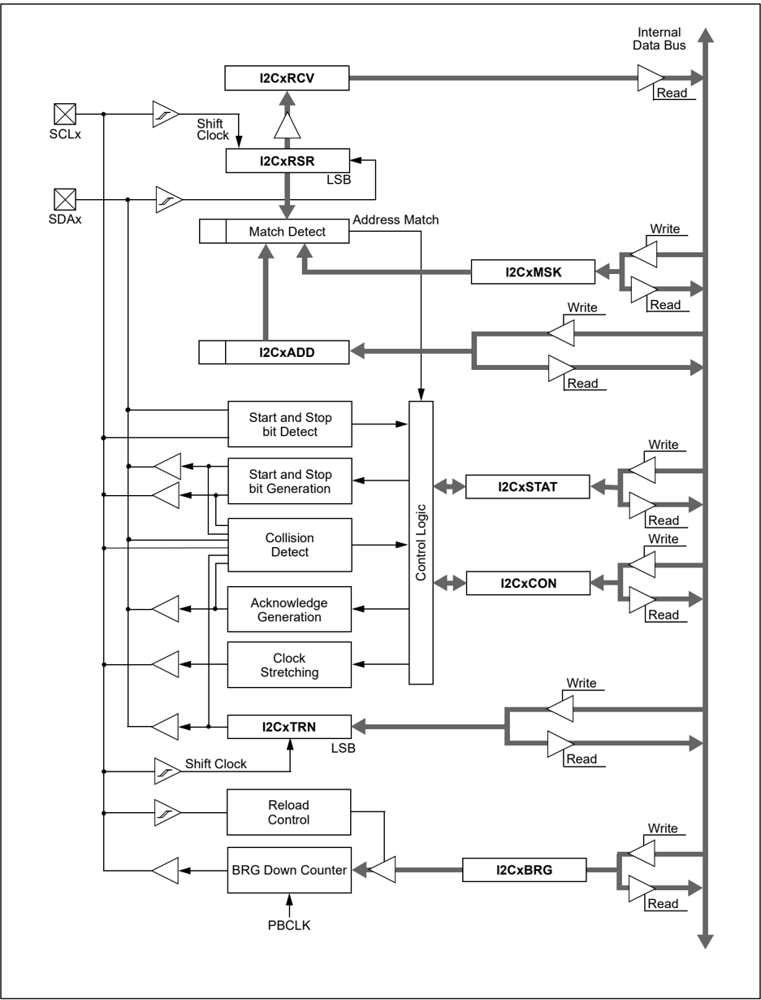

## 18.1 I2C Control Registers

## TABLE 18-1: I2C1 AND I2C2 REGISTER MAP

|   Virtual Address (BF80_#) |          |           |         |        |       |        |                              |                              |                              |                              |                              |                              |                              |                              |                              |                              |      |      |            |
|----------------------------|----------|-----------|---------|--------|-------|--------|------------------------------|------------------------------|------------------------------|------------------------------|------------------------------|------------------------------|------------------------------|------------------------------|------------------------------|------------------------------|------|------|------------|
|                            |          | Bit Range | 31/15   | 30/14  | 29/13 | 28/12  | 27/11                        | 26/10                        | 25/9                         | 24/8                         | 23/7                         | 22/6                         | 21/5                         | 20/4                         | 19/3                         | 18/2                         | 17/1 | 16/0 | All Resets |
|                       5000 | I2C1CON  | 31:16     | -       | -      | -     | -      | -                            | -                            | -                            | -                            | -                            | -                            | -                            | -                            | -                            | -                            | -    | -    | 0000       |
|                       5000 | I2C1CON  | 15:0      | ON      | -      | SIDL  | SCLREL | STRICT                       | A10M                         | DISSLW                       | SMEN                         | GCEN                         | STREN                        | ACKDT                        | ACKEN                        | RCEN                         | PEN                          | RSEN | SEN  | 1000       |
|                       5010 | I2C1STAT | 31:16     | -       | -      | -     | -      | -                            | -                            | -                            | -                            | -                            | -                            | -                            | -                            | -                            | -                            | -    | -    | 0000       |
|                       5010 | I2C1STAT | 15:0      | ACKSTAT | TRSTAT | -     | -      | -                            | BCL                          | GCSTAT                       | ADD10                        | IWCOL                        | I2COV                        | D_A                          | P                            | S                            | R_W                          | RBF  | TBF  | 0000       |
|                       5020 | I2C1ADD  | 31:16     | -       | -      | -     | -      | -                            | -                            | -                            | -                            | -                            | -                            | -                            | -                            | -                            | -                            | -    | -    | 0000       |
|                       5020 | I2C1ADD  | 15:0      | -       | -      | -     | -      | -                            | -                            |                              |                              |                              | Address Register             | Address Register             | Address Register             | Address Register             | Address Register             |      |      | 0000       |
|                       5030 | I2C1MSK  | 31:16     | -       | -      | -     | -      | -                            | -                            | -                            | -                            | -                            | -                            | -                            | -                            | -                            | -                            | -    | -    | 0000       |
|                       5030 | I2C1MSK  | 15:0      | -       | -      | -     | -      | -                            | -                            |                              |                              |                              | Address Mask Register        | Address Mask Register        | Address Mask Register        | Address Mask Register        | Address Mask Register        |      |      | 0000       |
|                       5040 | I2C1BRG  | 31:16     | -       | -      | -     | -      | -                            | -                            | -                            | -                            | -                            | -                            | -                            | -                            | -                            | -                            | -    | -    | 0000       |
|                       5040 | I2C1BRG  | 15:0      | -       | -      | -     | -      |                              |                              |                              |                              | Baud Rate Generator Register | Baud Rate Generator Register | Baud Rate Generator Register | Baud Rate Generator Register | Baud Rate Generator Register | Baud Rate Generator Register |      |      | 0000       |
|                       5050 | I2C1TRN  | 31:16     | -       | -      | -     | -      | -                            | -                            | -                            | -                            | -                            | -                            | -                            | -                            | -                            | -                            | -    | -    | 0000       |
|                       5050 | I2C1TRN  | 15:0      | -       | -      | -     | -      | -                            | -                            | -                            | -                            |                              |                              |                              | Transmit Register            | Transmit Register            | Transmit Register            |      |      | 0000       |
|                       5060 | I2C1RCV  | 31:16     | -       | -      | -     | -      | -                            | -                            | -                            | -                            | -                            | -                            | -                            | -                            | -                            | -                            | -    | -    | 0000       |
|                       5060 | I2C1RCV  | 15:0      | -       | -      | -     | -      | -                            | -                            | -                            | -                            |                              |                              |                              | Receive Register             | Receive Register             | Receive Register             |      |      | 0000       |
|                       5100 | I2C2CON  | 31:16     | -       | -      | -     | -      | -                            | -                            | -                            | -                            | -                            | -                            | -                            | -                            | -                            | -                            | -    | -    | 0000       |
|                       5100 | I2C2CON  | 15:0      | ON      | -      | SIDL  | SCLREL | STRICT                       | A10M                         | DISSLW                       | SMEN                         | GCEN                         | STREN                        | ACKDT                        | ACKEN                        | RCEN                         | PEN                          | RSEN | SEN  | 1000       |
|                       5110 | I2C2STAT | 31:16     | -       | -      | -     | -      | -                            | -                            | -                            | -                            | -                            | -                            | -                            | -                            | -                            | -                            | -    | -    | 0000       |
|                       5110 | I2C2STAT | 15:0      | ACKSTAT | TRSTAT | -     | -      | -                            | BCL                          | GCSTAT                       | ADD10                        | IWCOL                        | I2COV                        | D_A                          | P                            | S                            | R_W                          | RBF  | TBF  | 0000       |
|                       5120 | I2C2ADD  | 31:16     | -       | -      | -     | -      | -                            | -                            | -                            | -                            | -                            | -                            | -                            | -                            | -                            | -                            | -    | -    | 0000       |
|                       5120 | I2C2ADD  | 15:0      | -       | -      | -     | -      | -                            | -                            |                              |                              |                              | Address Register             | Address Register             | Address Register             | Address Register             | Address Register             |      |      | 0000       |
|                       5130 | I2C2MSK  | 31:16     | -       | -      | -     | -      | -                            | -                            | -                            | -                            | -                            | -                            | -                            | -                            | -                            | -                            | -    | -    | 0000       |
|                       5130 | I2C2MSK  | 15:0      | -       | -      | -     | -      | -                            | -                            |                              |                              |                              | Address Mask Register        | Address Mask Register        | Address Mask Register        | Address Mask Register        | Address Mask Register        |      |      | 0000       |
|                       5140 | I2C2BRG  | 31:16     | -       | -      | -     | -      | -                            | -                            | -                            | -                            | -                            | -                            | -                            | -                            | -                            | -                            | -    | -    | 0000       |
|                       5140 | I2C2BRG  | 15:0      | -       | -      | -     | -      | Baud Rate Generator Register | Baud Rate Generator Register | Baud Rate Generator Register | Baud Rate Generator Register | Baud Rate Generator Register | Baud Rate Generator Register | Baud Rate Generator Register | Baud Rate Generator Register | Baud Rate Generator Register | Baud Rate Generator Register |      |      | 0000       |
|                       5150 | I2C2TRN  | 31:16     | -       | -      | -     | -      | -                            | -                            | -                            | -                            | -                            | -                            | -                            | -                            | -                            | -                            | -    | -    | 0000       |
|                       5150 | I2C2TRN  | 15:0      | -       | -      | -     | -      | - - - - Transmit Register    | - - - - Transmit Register    | - - - - Transmit Register    | - - - - Transmit Register    | - - - - Transmit Register    | - - - - Transmit Register    | - - - - Transmit Register    | - - - - Transmit Register    | - - - - Transmit Register    | - - - - Transmit Register    |      |      | 0000       |
|                       5160 |          | 31:16     | -       | -      | -     | -      | -                            | -                            | -                            |                              |                              |                              |                              |                              | -                            | -                            | -    |      | 0000       |
|                       5160 |          |           |         |        |       |        | -                            | -                            |                              |                              |                              | -                            |                              | Receive Register             | Receive Register             | Receive Register             |      | -    | 0000       |
|                            | I2C2RCV  |           |         |        |       |        |                              |                              |                              | -                            | -                            |                              | -                            | -                            |                              |                              |      |      |            |
|                            | I2C2RCV  | 15:0      | -       | -      | -     | -      |                              |                              | -                            | -                            |                              |                              |                              |                              |                              |                              |      |      |            |

Legend:

x = unknown value on Reset; - = unimplemented, read as ' 0 '. Reset values are shown in hexadecimal.

Note 1: All registers in this table except I2CxRCV have corresponding CLR, SET and INV registers at their virtual addresses, plus offsets of 0x4, 0x8 and 0xC, respectively. See Section 11.2 'CLR, SET and INV Registers' for more information.

## PIC32MX1XX/2XX 28/36/44-PIN FAMILY

## REGISTER 18-1: I2CXCON: I 2 C CONTROL REGISTER

| Bit Range   | Bit 31/23/15/7   | Bit 30/22/14/6   | Bit 29/21/13/5   | Bit 28/20/12/4   | Bit 27/19/11/3   | Bit 26/18/10/2   | Bit 25/17/9/1   | Bit 24/16/8/0   |
|-------------|------------------|------------------|------------------|------------------|------------------|------------------|-----------------|-----------------|
| 31:24       | U-0              | U-0              | U-0              | U-0              | U-0              | U-0              | U-0             | U-0             |
| 31:24       | -                | -                | -                | -                | -                | -                | -               | -               |
| 23:16       | U-0              | U-0              | U-0              | U-0              | U-0              | U-0              | U-0             | U-0             |
| 23:16       | -                | -                | -                | -                | -                | -                | -               | -               |
| 15:8        | R/W-0            | U-0              | R/W-0            | R/W-1, HC        | R/W-0            | R/W-0            | R/W-0           | R/W-0           |
| 15:8        | ON (1)           | -                | SIDL             | SCLREL           | STRICT           | A10M             | DISSLW          | SMEN            |
| 7:0         | R/W-0            | R/W-0            | R/W-0            | R/W-0, HC        | R/W-0, HC        | R/W-0, HC        | R/W-0, HC       | R/W-0, HC       |
| 7:0         | GCEN             | STREN            | ACKDT            | ACKEN            | RCEN             | PEN              | RSEN            | SEN             |

## Legend:

HC = Cleared in Hardware

R = Readable bit

W = Writable bit

U = Unimplemented bit, read as '0'

-n = Value at POR

'1' = Bit is set

'0' = Bit is cleared

x = Bit is unknown

bit 31-16 Unimplemented: Read as ' 0 '

bit 15

ON: I 2 C Enable bit (1)

1 = Enables the I 2 C module and configures the SDA and SCL pins as serial port pins

0 = Disables the I 2 C module; all I 2 C pins are controlled by PORT functions

bit 14 Unimplemented: Read as ' 0 '

bit 13 SIDL: Stop in Idle Mode bit

1 = Discontinue module operation when the device enters Idle mode

0 = Continue module operation when the device enters Idle mode

bit 12 SCLREL: SCLx Release Control bit (when operating as I 2 C slave)

1 = Release SCLx clock

0 = Hold SCLx clock low (clock stretch)

If STREN = 1 :

Bit is R/W (i.e., software can write ' 0 ' to initiate stretch and write ' 1 ' to release clock). Hardware clear at beginning of slave transmission. Hardware clear at end of slave reception.

## If STREN = 0 :

Bit is R/S (i.e., software can only write ' 1 ' to release clock). Hardware clear at beginning of slave transmission.

bit 11 STRICT: Strict I 2 C Reserved Address Rule Enable bit

- 1 = Strict reserved addressing is enforced. Device does not respond to reserved address space or generate addresses in reserved address space.

0 = Strict I 2 C Reserved Address Rule not enabled

bit 10 A10M: 10-bit Slave Address bit

1 = I2CxADD is a 10-bit slave address

0 = I2CxADD is a 7-bit slave address

bit 9 DISSLW: Disable Slew Rate Control bit

1 = Slew rate control disabled

0 = Slew rate control enabled

bit 8 SMEN: SMBus Input Levels bit

1 = Enable I/O pin thresholds compliant with SMBus specification

0 = Disable SMBus input thresholds

Note 1: When using 1:1 PBCLK divisor, the user's software should not read/write the peripheral's SFRs in the SYSCLK cycle immediately following the instruction that clears the module's ON bit.

## PIC32MX1XX/2XX 28/36/44-PIN FAMILY

## REGISTER 18-1: I2CXCON: I 2 C CONTROL REGISTER (CONTINUED)

bit 7 GCEN: General Call Enable bit (when operating as I 2 C slave)

- 1 = Enable interrupt when a general call address is received in the I2CxRSR (module is enabled for reception)

- 0 = General call address is disabled

bit 6 STREN: SCLx Clock Stretch Enable bit (when operating as I 2 C slave)

Used in conjunction with SCLREL bit.

- 1 = Enable software or receive clock stretching

- 0 = Disable software or receive clock stretching

bit 5 ACKDT: Acknowledge Data bit (when operating as I 2 C master, applicable during master receive)

Value that is transmitted when the software initiates an Acknowledge sequence.

- 1 = Send a NACK during an Acknowledge sequence

- 0 = Send an ACK during an Acknowledge sequence

bit 4 ACKEN: Acknowledge Sequence Enable bit (when operating as I 2 C master, applicable during master receive)

- 1 = Initiate Acknowledge sequence on SDAx and SCLx pins and transmit ACKDT data bit. Hardware clear at end of master Acknowledge sequence.

- 0 = Acknowledge sequence not in progress

bit 3 RCEN: Receive Enable bit (when operating as I 2 C master)

- 1 = Enables Receive mode for I 2 C. Hardware clear at end of eighth bit of master receive data byte.

- 0 = Receive sequence not in progress

bit 2 PEN: Stop Condition Enable bit (when operating as I 2 C master)

1

= Initiate Stop condition on SDAx and SCLx pins. Hardware clear at end of master Stop sequence.

- 0 = Stop condition not in progress

bit 1 RSEN: Repeated Start Condition Enable bit (when operating as I 2 C master)

- 1 = Initiate Repeated Start condition on SDAx and SCLx pins. Hardware clear at end of master Repeated Start sequence.

- 0 = Repeated Start condition not in progress

bit 0 SEN: Start Condition Enable bit (when operating as I 2 C master)

- 1 = Initiate Start condition on SDAx and SCLx pins. Hardware clear at end of master Start sequence.

- 0 = Start condition not in progress

Note 1: When using 1:1 PBCLK divisor, the user's software should not read/write the peripheral's SFRs in the SYSCLK cycle immediately following the instruction that clears the module's ON bit.

## PIC32MX1XX/2XX 28/36/44-PIN FAMILY

## REGISTER 18-2: I2CXSTAT: I 2 C STATUS REGISTER

| Bit Range   | Bit 31/23/15/7   | Bit 30/22/14/6   | Bit 29/21/13/5   | Bit 28/20/12/4   | Bit 27/19/11/3   | Bit 26/18/10/2   | Bit 25/17/9/1   | Bit 24/16/8/0   |
|-------------|------------------|------------------|------------------|------------------|------------------|------------------|-----------------|-----------------|
| 31:24       | U-0              | U-0              | U-0              | U-0              | U-0              | U-0              | U-0             | U-0             |
| 31:24       | -                | -                | -                | -                | -                | -                | -               | -               |
| 23:16       | U-0              | U-0              | U-0              | U-0              | U-0              | U-0              | U-0             | U-0             |
| 23:16       | -                | -                | -                | -                | -                | -                | -               | -               |
| 15:8        | R-0, HSC         | R-0, HSC         | U-0              | U-0              | U-0              | R/C-0, HS        | R-0, HSC        | R-0, HSC        |
| 15:8        | ACKSTAT          | TRSTAT           | -                | -                | -                | BCL              | GCSTAT          | ADD10           |
| 7:0         | R/C-0, HS        | R/C-0, HS        | R-0, HSC         | R/C-0, HSC       | R/C-0, HSC       | R-0, HSC         | R-0, HSC        | R-0, HSC        |
| 7:0         | IWCOL            | I2COV            | D_A              | P                | S                | R_W              | RBF             | TBF             |

## Legend:

HS = Set in hardware

HSC = Hardware set/cleared

R = Readable bit

W = Writable bit

U = Unimplemented bit, read as '0'

-n = Value at POR

'1' = Bit is set

'0' = Bit is cleared

C = Clearable bit

'

## bit 31-16 Unimplemented: Read as ' 0

bit 15 ACKSTAT: Acknowledge Status bit (when operating as I 2 C master, applicable to master transmit operation)

- 1 = Acknowledge was not received from slave
- 0 = Acknowledge was received from slave

Hardware set or clear at end of slave Acknowledge.

bit 14 TRSTAT: Transmit Status bit (when operating as I 2 C master, applicable to master transmit operation)

- 1 = Master transmit is in progress (8 bits + ACK)
- 0 = Master transmit is not in progress

Hardware set at beginning of master transmission. Hardware clear at end of slave Acknowledge.

## bit 13-11 Unimplemented: Read as ' 0 '

## bit 10 BCL: Master Bus Collision Detect bit

- 1 = A bus collision has been detected during a master operation

0 = No collision

Hardware set at detection of bus collision. This condition can only be cleared by disabling (ON bit = 0) and re-enabling (ON bit = 1 ) the module.

GCSTAT:

General Call Status bit

- 1 = General call address was received
- 0 = General call address was not received

Hardware set when address matches general call address. Hardware clear at Stop detection.

## bit 8 ADD10: 10-bit Address Status bit

- 1 = 10-bit address was matched

0 = 10-bit address was not matched

Hardware set at match of 2nd byte of matched 10-bit address. Hardware clear at Stop detection.

## bit 7 IWCOL: Write Collision Detect bit

- 1 = An attempt to write the I2CxTRN register failed because the I 2 C module is busy

0 = No collision

Hardware set at occurrence of write to I2CxTRN while busy (cleared by software).

## bit 6 I2COV: Receive Overflow Flag bit

- 1 = A byte was received while the I2CxRCV register is still holding the previous byte

0 = No overflow

Hardware set at attempt to transfer I2CxRSR to I2CxRCV (cleared by software).

## bit 5 D\_A: Data/Address bit (when operating as I 2 C slave)

- 1 = Indicates that the last byte received was data
- 0 = Indicates that the last byte received was device address

Hardware clear at device address match. Hardware set by reception of slave byte.

bit 9

## PIC32MX1XX/2XX 28/36/44-PIN FAMILY

## REGISTER 18-2: I2CXSTAT: I 2 C STATUS REGISTER (CONTINUED)

## bit 4 P: Stop bit

- 1 = Indicates that a Stop bit has been detected last
- 0 = Stop bit was not detected last

Hardware set or clear when Start, Repeated Start or Stop detected.

## bit 3 S: Start bit

- 1 = Indicates that a Start (or Repeated Start) bit has been detected last
- 0 = Start bit was not detected last
- Hardware set or clear when Start, Repeated Start or Stop detected.

bit 2 R\_W: Read/Write Information bit (when operating as I 2 C slave)

- 1 = Read - indicates data transfer is output from slave
- 0 = Write - indicates data transfer is input to slave

Hardware set or clear after reception of I 2 C device address byte.

## bit 1 RBF: Receive Buffer Full Status bit

- 1 = Receive complete, I2CxRCV is full
- 0 = Receive not complete, I2CxRCV is empty Hardware set when I2CxRCV is written with received byte. Hardware clear when software

reads I2CxRCV.

## bit 0 TBF: Transmit Buffer Full Status bit

- 1 = Transmit in progress, I2CxTRN is full
- 0 = Transmit complete, I2CxTRN is empty

Hardware set when software writes I2CxTRN. Hardware clear at completion of data transmission.

## NOTES:

## PIC32MX1XX/2XX 28/36/44-PIN FAMILY

## 19.0 UNIVERSAL ASYNCHRONOUS RECEIVER TRANSMITTER (UART)

Note: This data sheet summarizes the features of  the  PIC32MX1XX/2XX  28/36/44-pin Family of devices. It is not intended to be a  comprehensive  reference  source.  To complement  the  information  in  this  data sheet,  refer  to Section  21.  'Universal Asynchronous Receiver Transmitter (UART)' (DS60001107),  which  is  available from the Documentation &gt; Reference Manual section  of  the  Microchip  PIC32 web site (www.microchip.com/pic32).

Key features of the UART module include:

- Full-duplex, 8-bit or 9-bit data transmission
- Even, Odd or No Parity options (for 8-bit data)
- One or two Stop bits
- Hardware auto-baud feature
- Hardware flow control option
- Fully integrated Baud Rate Generator (BRG) with 16-bit prescaler
- Baud rates ranging from 38 bps to 12.5 Mbps at 50 MHz
- 8-level deep First In First Out (FIFO) transmit data buffer
- 8-level deep FIFO receive data buffer
- Parity, framing and buffer overrun error detection

The  UART  module  is  one  of  the  serial  I/O  modules available  in  PIC32MX1XX/2XX  28/36/44-pin  Family devices.  The  UART  is  a  full-duplex,  asynchronous communication channel that communicates with peripheral  devices  and  personal  computers  through protocols, such as RS-232, RS-485, LIN, and IrDA ® . The  UART  module  also  supports  the  hardware  flow control option, with UxCTS and UxRTS pins, and also includes an IrDA encoder and decoder.

- Support for interrupt-only on address detect (9th bit = 1 )
- Separate transmit and receive interrupts
- Loopback mode for diagnostic support
- LIN protocol support
- IrDA encoder and decoder with 16x baud clock output for external IrDA encoder/decoder support

Figure 19-1 illustrates a simplified block diagram of the UART module.

FIGURE 19-1: UART SIMPLIFIED BLOCK DIAGRAM

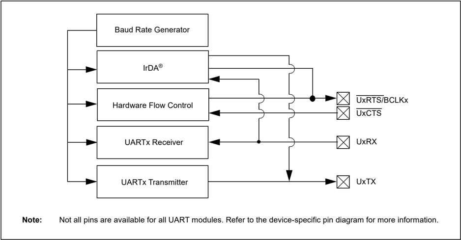

## 19.1 UART Control Registers

## TABLE 19-1: UART1 AND UART2 REGISTER MAP

| Register Name   |                                    | Bits                               | Bits                               | Bits                               | Bits                               | Bits                               | Bits                               | Bits                               | Bits                               | Bits                               | Bits                               | Bits                               | Bits                               | Bits                               | Bits                               | Bits                               | Bits                               |            |
|-----------------|------------------------------------|------------------------------------|------------------------------------|------------------------------------|------------------------------------|------------------------------------|------------------------------------|------------------------------------|------------------------------------|------------------------------------|------------------------------------|------------------------------------|------------------------------------|------------------------------------|------------------------------------|------------------------------------|------------------------------------|------------|
| Register Name   | Bit Range                          | 31/15                              | 30/14                              | 29/13                              | 28/12                              | 27/11                              | 26/10                              | 25/9                               | 24/8                               | 23/7                               | 22/6                               | 21/5                               | 20/4                               | 19/3                               | 18/2                               | 17/1                               | 16/0                               | All Resets |
| U1MODE (1)      | 31:16                              | -                                  | -                                  | -                                  | -                                  | -                                  | -                                  | -                                  | -                                  | -                                  | -                                  | -                                  | -                                  | -                                  | -                                  | -                                  | -                                  | 0000       |
|                 | 15:0                               | ON                                 | -                                  | SIDL                               | IREN                               | RTSMD                              | -                                  | UEN<1:0>                           |                                    | WAKE                               | LPBACK                             | ABAUD                              | RXINV                              | BRGH PDSEL<1:0>                    | BRGH PDSEL<1:0>                    | BRGH PDSEL<1:0>                    | STSEL                              | 0000       |
| U1STA (1)       | 31:16                              | -                                  | -                                  | -                                  | -                                  | -                                  | -                                  | -                                  | ADM_EN                             | ADDR<7:0>                          | ADDR<7:0>                          | ADDR<7:0>                          | ADDR<7:0>                          | ADDR<7:0>                          | ADDR<7:0>                          | ADDR<7:0>                          | ADDR<7:0>                          | 0000       |
|                 | 15:0 UTXISEL<1:0>                  | 15:0 UTXISEL<1:0>                  | 15:0 UTXISEL<1:0>                  | UTXINV                             | URXEN                              | UTXBRK                             | UTXEN                              | UTXBF                              | TRMT                               | URXISEL<1:0>                       | URXISEL<1:0>                       | ADDEN                              | RIDLE                              | PERR                               | FERR                               | OERR                               | URXDA                              | 0110       |
| U1TXREG         | 31:16                              | -                                  | -                                  | -                                  | -                                  | -                                  | -                                  | -                                  | -                                  | -                                  | -                                  | -                                  | -                                  | -                                  | -                                  | -                                  | -                                  | 0000       |
|                 | 15:0                               | -                                  | -                                  | -                                  | -                                  | -                                  | -                                  | -                                  |                                    | Transmit Register                  | Transmit Register                  | Transmit Register                  | Transmit Register                  | Transmit Register                  | Transmit Register                  | Transmit Register                  | Transmit Register                  | 0000       |
| U1RXREG         | 31:16                              | -                                  | -                                  | -                                  | -                                  | -                                  | -                                  | -                                  | -                                  | -                                  | -                                  | -                                  | -                                  | -                                  | -                                  | -                                  | -                                  | 0000       |
|                 | 15:0                               | -                                  | -                                  | -                                  | -                                  | -                                  | -                                  | -                                  | Receive Register                   | Receive Register                   | Receive Register                   | Receive Register                   | Receive Register                   | Receive Register                   | Receive Register                   | Receive Register                   | Receive Register                   | 0000       |
| U1BRG (1)       | 31:16                              | -                                  | -                                  | -                                  | -                                  | -                                  | -                                  | -                                  | -                                  | -                                  | -                                  | -                                  | -                                  | -                                  | -                                  | -                                  | -                                  | 0000       |
|                 | 15:0 Baud Rate Generator Prescaler | 15:0 Baud Rate Generator Prescaler | 15:0 Baud Rate Generator Prescaler | 15:0 Baud Rate Generator Prescaler | 15:0 Baud Rate Generator Prescaler | 15:0 Baud Rate Generator Prescaler | 15:0 Baud Rate Generator Prescaler | 15:0 Baud Rate Generator Prescaler | 15:0 Baud Rate Generator Prescaler | 15:0 Baud Rate Generator Prescaler | 15:0 Baud Rate Generator Prescaler | 15:0 Baud Rate Generator Prescaler | 15:0 Baud Rate Generator Prescaler | 15:0 Baud Rate Generator Prescaler | 15:0 Baud Rate Generator Prescaler | 15:0 Baud Rate Generator Prescaler | 15:0 Baud Rate Generator Prescaler | 0000       |
| U2MODE (1)      | 31:16                              | -                                  | -                                  | -                                  | -                                  | -                                  | -                                  | -                                  | -                                  | -                                  | -                                  | -                                  | -                                  | -                                  | -                                  | -                                  | -                                  | 0000       |
|                 | 15:0                               | ON                                 | -                                  | SIDL                               | IREN                               | RTSMD                              | -                                  | UEN<1:0>                           |                                    | WAKE                               | LPBACK                             | ABAUD                              | RXINV                              | BRGH PDSEL<1:0>                    | BRGH PDSEL<1:0>                    | BRGH PDSEL<1:0>                    | STSEL                              | 0000       |
| U2STA (1)       | 31:16                              | -                                  | -                                  | -                                  | -                                  | -                                  | -                                  | -                                  | ADM_EN ADDR<7:0>                   | ADM_EN ADDR<7:0>                   | ADM_EN ADDR<7:0>                   | ADM_EN ADDR<7:0>                   | ADM_EN ADDR<7:0>                   | ADM_EN ADDR<7:0>                   | ADM_EN ADDR<7:0>                   | ADM_EN ADDR<7:0>                   | ADM_EN ADDR<7:0>                   | 0000       |
|                 | 15:0 UTXISEL<1:0>                  | 15:0 UTXISEL<1:0>                  | 15:0 UTXISEL<1:0>                  | UTXINV                             | URXEN                              | UTXBRK                             | UTXEN                              | UTXBF                              | TRMT                               | URXISEL<1:0>                       | URXISEL<1:0>                       | ADDEN                              | RIDLE                              | PERR                               | FERR                               | OERR                               | URXDA                              | 0110       |
| U2TXREG         | 31:16                              | -                                  | -                                  | -                                  | -                                  | -                                  | -                                  | -                                  | -                                  | -                                  | -                                  | -                                  | -                                  | -                                  | -                                  | -                                  | -                                  | 0000       |
|                 | 15:0 - - - - - - -                 | 15:0 - - - - - - -                 | 15:0 - - - - - - -                 | 15:0 - - - - - - -                 | 15:0 - - - - - - -                 | 15:0 - - - - - - -                 | 15:0 - - - - - - -                 | 15:0 - - - - - - -                 | Transmit Register                  | Transmit Register                  | Transmit Register                  | Transmit Register                  | Transmit Register                  | Transmit Register                  | Transmit Register                  | Transmit Register                  | Transmit Register                  | 0000       |
| U2RXREG         | 31:16                              | -                                  | -                                  | -                                  | -                                  | -                                  | -                                  | -                                  | -                                  | -                                  | -                                  | -                                  | -                                  | -                                  | -                                  | -                                  | -                                  | 0000       |
|                 | 15:0 - - - - - - -                 | 15:0 - - - - - - -                 | 15:0 - - - - - - -                 | 15:0 - - - - - - -                 | 15:0 - - - - - - -                 | 15:0 - - - - - - -                 | 15:0 - - - - - - -                 | 15:0 - - - - - - -                 | Receive Register                   | Receive Register                   | Receive Register                   | Receive Register                   | Receive Register                   | Receive Register                   | Receive Register                   | Receive Register                   | Receive Register                   | 0000       |
| U2BRG (1)       | 31:16                              | -                                  | -                                  | -                                  | -                                  | -                                  | -                                  | -                                  | -                                  | -                                  | -                                  | -                                  | -                                  | -                                  | -                                  | -                                  | -                                  | 0000       |
|                 | 15:0 Baud Rate Generator Prescaler | 15:0 Baud Rate Generator Prescaler | 15:0 Baud Rate Generator Prescaler | 15:0 Baud Rate Generator Prescaler | 15:0 Baud Rate Generator Prescaler | 15:0 Baud Rate Generator Prescaler | 15:0 Baud Rate Generator Prescaler | 15:0 Baud Rate Generator Prescaler | 15:0 Baud Rate Generator Prescaler | 15:0 Baud Rate Generator Prescaler | 15:0 Baud Rate Generator Prescaler | 15:0 Baud Rate Generator Prescaler | 15:0 Baud Rate Generator Prescaler | 15:0 Baud Rate Generator Prescaler | 15:0 Baud Rate Generator Prescaler | 15:0 Baud Rate Generator Prescaler | 15:0 Baud Rate Generator Prescaler | 0000       |

Legend:

x = unknown value on Reset; - = unimplemented, read as ' 0 '. Reset values are shown in hexadecimal.

Note 1: This register has corresponding CLR, SET and INV registers at its virtual address, plus an offset of 0x4, 0x8 and 0xC, respectively. See Section 11.2 'CLR, SET and INV Registers' for more information.

## PIC32MX1XX/2XX 28/36/44-PIN FAMILY

## REGISTER 19-1: UxMODE: UARTx MODE REGISTER

| Bit Range   | Bit 31/23/15/7   | Bit 30/22/14/6   | Bit 29/21/13/5   | Bit 28/20/12/4   | Bit 27/19/11/3   | Bit 26/18/10/2   | Bit 25/17/9/1   | Bit 24/16/8/0   |
|-------------|------------------|------------------|------------------|------------------|------------------|------------------|-----------------|-----------------|
| 31:24       | U-0              | U-0              | U-0              | U-0              | U-0              | U-0              | U-0             | U-0             |
| 31:24       | -                | -                | -                | -                | -                | -                | -               | -               |
| 23:16       | U-0              | U-0              | U-0              | U-0              | U-0              | U-0              | U-0             | U-0             |
| 23:16       | -                | -                | -                | -                | -                | -                | -               | -               |
| 15:8        | R/W-0            | U-0              | R/W-0            | R/W-0            | R/W-0            | U-0              | R/W-0           | R/W-0           |
| 15:8        | ON (1)           | -                | SIDL             | IREN             | RTSMD            | -                | UEN<1:0>        | UEN<1:0>        |
| 7:0         | R/W-0            | R/W-0            | R/W-0            | R/W-0            | R/W-0            | R/W-0            | R/W-0           | R/W-0           |
| 7:0         | WAKE             | LPBACK           | ABAUD            | RXINV            | BRGH             | PDSEL<1:0>       | PDSEL<1:0>      | STSEL           |

## Legend:

R = Readable bit

W = Writable bit

U = Unimplemented bit, read as '0'

-n = Value at POR

'1' = Bit is set

'0' = Bit is cleared

x = Bit is unknown

bit 31-16 Unimplemented: Read as ' 0 '

bit 15 ON: UARTx Enable bit

(1)

- 1 = UARTx is enabled. UARTx pins are controlled by UARTx as defined by the UEN&lt;1:0&gt; and UTXEN control bits.

- 0 = UARTx is disabled. All UARTx pins are controlled by corresponding bits in the PORTx, TRISx and LATx registers; UARTx power consumption is minimal.

bit 14 Unimplemented: Read as ' 0 '

bit 13 SIDL: Stop in Idle Mode bit

- 1 = Discontinue module operation when the device enters Idle mode

- 0 = Continue module operation when the device enters Idle mode

bit 12 IREN: IrDA Encoder and Decoder Enable bit

1 = IrDA is enabled

0 = IrDA is disabled

- bit 11 RTSMD: Mode Selection for UxRTS Pin bit

1 = UxRTS pin is in Simplex mode

0 = UxRTS pin is in Flow Control mode

bit 10 Unimplemented: Read as ' 0 '

bit 9-8 UEN&lt;1:0&gt;: UARTx Enable bits

- 11 = UxTX, UxRX and UxBCLK pins are enabled and used; UxCTS pin is controlled by corresponding bits in the PORTx register

- 10 = UxTX, UxRX, UxCTS and UxRTS pins are enabled and used

- 01 = UxTX, UxRX and UxRTS pins are enabled and used; UxCTS pin is controlled by corresponding bits in the PORTx register

- 00 = UxTX and UxRX pins are enabled and used; UxCTS and UxRTS/UxBCLK pins are controlled by corresponding bits in the PORTx register

bit 7 WAKE: Enable Wake-up on Start bit Detect During Sleep Mode bit

- 1 = Wake-up enabled

0 = Wake-up disabled

bit 6 LPBACK: UARTx Loopback Mode Select bit

1 = Loopback mode is enabled

0 = Loopback mode is disabled

Note 1: When using 1:1 PBCLK divisor, the user software should not read/write the peripheral SFRs in the SYSCLK cycle immediately following the instruction that clears the module's ON bit.

## PIC32MX1XX/2XX 28/36/44-PIN FAMILY

## REGISTER 19-1: UxMODE: UARTx MODE REGISTER (CONTINUED)

bit 5 ABAUD: Auto-Baud Enable bit

- 1 = Enable baud rate measurement on the next character - requires reception of Sync character (0x55); cleared by hardware upon completion

- 0 = Baud rate measurement disabled or completed

bit 4 RXINV: Receive Polarity Inversion bit

1 = UxRX Idle state is ' 0 '

0 = UxRX Idle state is ' 1 '

bit 3 BRGH: High Baud Rate Enable bit

1 = High-Speed mode - 4x baud clock enabled

0 = Standard Speed mode - 16x baud clock enabled

bit 2-1 PDSEL&lt;1:0&gt;: Parity and Data Selection bits

11 = 9-bit data, no parity

10 = 8-bit data, odd parity

01 = 8-bit data, even parity

00 = 8-bit data, no parity

bit 0 STSEL: Stop Selection bit

1 = 2 Stop bits

0 = 1 Stop bit

Note 1: When using 1:1 PBCLK divisor, the user software should not read/write the peripheral SFRs in the SYSCLK cycle immediately following the instruction that clears the module's ON bit.

bit 13

## PIC32MX1XX/2XX 28/36/44-PIN FAMILY

## REGISTER 19-2: UxSTA: UARTx STATUS AND CONTROL REGISTER

| Bit Range   | Bit 31/23/15/7   | Bit 30/22/14/6   | Bit 29/21/13/5   | Bit 28/20/12/4   | Bit 27/19/11/3   | Bit 26/18/10/2   | Bit 25/17/9/1   | Bit 24/16/8/0   |
|-------------|------------------|------------------|------------------|------------------|------------------|------------------|-----------------|-----------------|
| 31:24       | U-0              | U-0              | U-0              | U-0              | U-0              | U-0              | U-0             | R/W-0           |
| 31:24       | -                | -                | -                | -                | -                | -                | -               | ADM_EN          |
| 23:16       | R/W-0            | R/W-0            | R/W-0            | R/W-0            | R/W-0            | R/W-0            | R/W-0           | R/W-0           |
| 23:16       | ADDR<7:0>        | ADDR<7:0>        | ADDR<7:0>        | ADDR<7:0>        | ADDR<7:0>        | ADDR<7:0>        | ADDR<7:0>       | ADDR<7:0>       |
| 15:8        | R/W-0            | R/W-0            | R/W-0            | R/W-0            | R/W-0            | R/W-0            | R-0             | R-1             |
| 15:8        | UTXISEL<1:0>     | UTXISEL<1:0>     | UTXINV           | URXEN            | UTXBRK           | UTXEN            | UTXBF           | TRMT            |
| 7:0         | R/W-0            | R/W-0            | R/W-0            | R-1              | R-0              | R-0              | R/W-0           | R-0             |
| 7:0         | URXISEL<1:0>     | URXISEL<1:0>     | ADDEN            | RIDLE            | PERR             | FERR             | OERR            | URXDA           |

## Legend:

R = Readable bit

W = Writable bit

U = Unimplemented bit, read as '0'

-n = Value at POR

'1' = Bit is set

'0' = Bit is cleared

x = Bit is unknown

bit 31-25

bit 24

## Unimplemented: Read as ' 0 '

ADM\_EN:

Automatic Address Detect Mode Enable bit

- 1 = Automatic Address Detect mode is enabled
- 0 = Automatic Address Detect mode is disabled

## bit 23-16 ADDR&lt;7:0&gt;: Automatic Address Mask bits

When  the ADM\_EN  bit  is  ' 1 ',  this  value  defines  the  address  character  to  use  for  automatic  address detection.

## bit 15-14 UTXISEL&lt;1:0&gt;: TX Interrupt Mode Selection bits

- 11 = Reserved, do not use
- 10 = Interrupt is generated and asserted while the transmit buffer is empty
- 01 = Interrupt is generated and asserted when all characters have been transmitted
- 00 = Interrupt is generated and asserted while the transmit buffer contains at least one empty space

UTXINV:

Transmit Polarity Inversion bit

If IrDA mode is disabled (i.e., IREN (UxMODE&lt;12&gt;) is ' 0 '):

- 1 = UxTX Idle state is ' 0 '

0 = UxTX Idle state is ' 1 '

## If IrDA mode is enabled (i.e., IREN (UxMODE&lt;12&gt;) is ' 1 '):

1 = IrDA encoded UxTX Idle state is ' 1 '

0 = IrDA encoded UxTX Idle state is ' 0 '

## bit 12 URXEN: Receiver Enable bit

- 1 = UARTx receiver is enabled. UxRX pin is controlled by UARTx (if ON = 1 )
- 0 = UARTx receiver is disabled. UxRX pin is ignored by the UARTx module. UxRX pin is controlled by port.

## bit 11 UTXBRK: Transmit Break bit

- 1 = Send Break on next transmission. Start bit followed by twelve ' 0 ' bits, followed by Stop bit; cleared by hardware upon completion
- 0 = Break transmission is disabled or completed

## bit 10 UTXEN: Transmit Enable bit

- 1 = UARTx transmitter is enabled. UxTX pin is controlled by UARTx (if ON = 1 ).
- 0 = UARTx transmitter  is  disabled. Any  pending  transmission  is  aborted  and  buffer  is  reset.  UxTX  pin  is controlled by port.

## bit 9 UTXBF: Transmit Buffer Full Status bit (read-only)

- 1 = Transmit buffer is full
- 0 = Transmit buffer is not full, at least one more character can be written

bit 8 TRMT: Transmit Shift Register is Empty bit (read-only)

- 1 = Transmit shift register is empty and transmit buffer is empty (the last transmission has completed)
- 0 = Transmit shift register is not empty, a transmission is in progress or queued in the transmit buffer

## PIC32MX1XX/2XX 28/36/44-PIN FAMILY

## REGISTER 19-2: UxSTA: UARTx STATUS AND CONTROL REGISTER (CONTINUED)

bit 7-6 URXISEL&lt;1:0&gt;: Receive Interrupt Mode Selection bit

- 11 = Reserved; do not use
- 10 = Interrupt flag bit is asserted while receive buffer is 3/4 or more full (i.e., has 6 or more data characters)
- 01 = Interrupt flag bit is asserted while receive buffer is 1/2 or more full (i.e., has 4 or more data characters)
- 00 = Interrupt flag bit is asserted while receive buffer is not empty (i.e., has at least 1 data character)

bit 5 ADDEN: Address Character Detect bit (bit 8 of received data = 1 )

- 1 = Address Detect mode is enabled. If 9-bit mode is not selected, this control bit has no effect.
- 0 = Address Detect mode is disabled

bit 4 RIDLE: Receiver Idle bit (read-only)

- 1 = Receiver is Idle
- 0 = Data is being received

bit 3 PERR: Parity Error Status bit (read-only)

- 1 = Parity error has been detected for the current character
- 0 = Parity error has not been detected

bit 2 FERR: Framing Error Status bit (read-only)

- 1 = Framing error has been detected for the current character
- 0 = Framing error has not been detected

bit 1 OERR: Receive Buffer Overrun Error Status bit.

This bit is set in hardware and can only be cleared (= 0 ) in software. Clearing a previously set OERR bit resets the receiver buffer and the RSR to an empty state.

- 1 = Receive buffer has overflowed
- 0 = Receive buffer has not overflowed

bit 0 URXDA: Receive Buffer Data Available bit (read-only)

- 1 = Receive buffer has data, at least one more character can be read
- 0 = Receive buffer is empty

## PIC32MX1XX/2XX 28/36/44-PIN FAMILY

Figure 19-2  and  Figure 19-3  illustrate  typical  receive and transmit timing for the UART module.

## FIGURE 19-2: UART RECEPTION

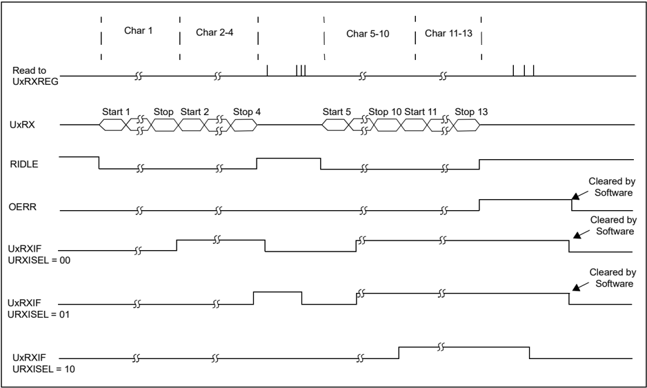

FIGURE 19-3: TRANSMISSION (8-BIT OR 9-BIT DATA)

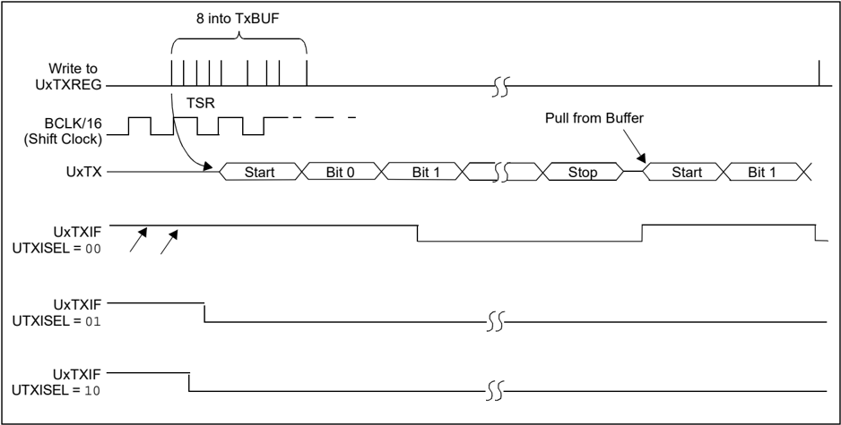

## NOTES:

## PIC32MX1XX/2XX 28/36/44-PIN FAMILY

## 20.0 PARALLEL MASTER PORT (PMP)

Note: This data sheet summarizes the features of  the  PIC32MX1XX/2XX  28/36/44-pin Family of devices. It is not intended to be a  comprehensive  reference  source.  To complement  the  information  in  this  data sheet, refer to Section  13. 'Parallel Master Port (PMP)' (DS60001128), which is available from the Documentation &gt; Reference Manual section of the Microchip PIC32 web site (www.microchip.com/pic32).

The  PMP  is  a  parallel 8-bit input/output  module specifically  designed  to  communicate  with  a  wide variety  of  parallel  devices,  such  as  communications peripherals,  LCDs,  external  memory  devices  and microcontrollers.  Because  the  interface  to  parallel peripherals  varies  significantly,  the  PMP  module  is highly configurable.

Key features of the PMP module include:

- Fully multiplexed address/data mode
- Demultiplexed or partially multiplexed address/ data mode
- -up to 11 address lines with single Chip Select
- -up to 12 address lines without Chip Select
- One Chip Select line
- Programmable strobe options
- -Individual read and write strobes or;
- -Read/write strobe with enable strobe
- Address auto-increment/auto-decrement
- Programmable address/data multiplexing
- Programmable polarity on control signals
- Legacy parallel slave port support
- Enhanced parallel slave support
- -Address support
- -4-byte deep auto-incrementing buffer
- Programmable Wait states
- Selectable input voltage levels

Figure 20-1 illustrates the PMP module block diagram.

FIGURE 20-1: PMP MODULE PINOUT AND CONNECTIONS TO EXTERNAL DEVICES

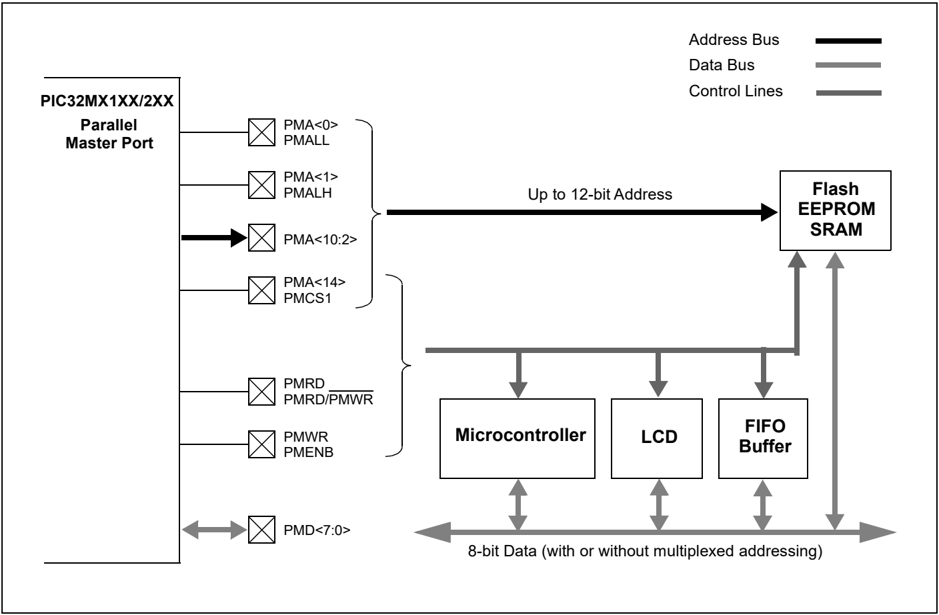

## 20.1 PMP Control Registers

## TABLE 20-1: PARALLEL MASTER PORT REGISTER MAP

|      |        |                             | Bits                   | Bits                   | Bits                   | Bits                   | Bits                   | Bits                   | Bits                   | Bits                   | Bits                   | Bits                   | Bits                   | Bits                   | Bits                   | Bits                   | Bits                   | Bits                   |            |
|------|--------|-----------------------------|------------------------|------------------------|------------------------|------------------------|------------------------|------------------------|------------------------|------------------------|------------------------|------------------------|------------------------|------------------------|------------------------|------------------------|------------------------|------------------------|------------|
|      |        | Register Name (1) Bit Range | 31/15                  | 30/14                  | 29/13                  | 28/12                  | 27/11                  | 26/10                  | 25/9                   | 24/8                   | 23/7                   | 22/6                   | 21/5                   | 20/4                   | 19/3                   | 18/2                   | 17/1                   | 16/0                   | All Resets |
|      | PMCON  | 31:16                       | -                      | -                      | -                      | -                      | -                      | -                      | -                      | -                      | -                      | -                      | -                      | -                      | -                      | -                      | -                      | -                      | 0000       |
|      | PMCON  | 15:0                        | ON                     | -                      | SIDL                   | ADRMUX<1:0>            | ADRMUX<1:0>            | PMPTTL                 | PTWREN                 | PTRDEN                 | CSF<1:0>               |                        | ALP                    | -                      | CS1P                   | -                      | WRSP                   | RDSP                   | 0000       |
|      |        | 31:16                       | -                      | -                      | -                      | -                      | -                      | -                      | -                      | -                      | -                      | -                      | -                      | -                      | -                      | -                      | -                      | -                      | 0000       |
|      |        | PMMODE 15:0                 | BUSY IRQM<1:0>         | BUSY IRQM<1:0>         | BUSY IRQM<1:0>         | INCM<1:0>              | INCM<1:0>              | -                      | MODE<1:0>              | MODE<1:0>              | WAITB<1:0>             | WAITB<1:0>             | WAITM<3:0>             | WAITM<3:0>             | WAITM<3:0>             | WAITM<3:0>             | WAITE<1:0>             | WAITE<1:0>             | 0000       |
|      | PMADDR | 31:16                       | -                      | -                      | -                      | -                      | -                      | -                      | -                      | -                      | -                      | -                      | -                      | -                      | -                      | -                      | -                      | -                      | 0000       |
|      | PMADDR | 15:0                        | -                      | CS1                    | -                      | -                      |                        |                        |                        |                        |                        |                        |                        |                        |                        |                        |                        |                        | 0000       |
|      | PMADDR | 15:0                        | - ADDR<10:0> ADDR14    | - ADDR<10:0> ADDR14    | - ADDR<10:0> ADDR14    | - ADDR<10:0> ADDR14    | - ADDR<10:0> ADDR14    | - ADDR<10:0> ADDR14    | - ADDR<10:0> ADDR14    | - ADDR<10:0> ADDR14    | - ADDR<10:0> ADDR14    | - ADDR<10:0> ADDR14    | - ADDR<10:0> ADDR14    | - ADDR<10:0> ADDR14    | - ADDR<10:0> ADDR14    | - ADDR<10:0> ADDR14    | - ADDR<10:0> ADDR14    | - ADDR<10:0> ADDR14    |            |
| 7030 | PMDOUT | 31:16 15:0                  | DATAOUT<31:0>          | DATAOUT<31:0>          | DATAOUT<31:0>          | DATAOUT<31:0>          | DATAOUT<31:0>          | DATAOUT<31:0>          | DATAOUT<31:0>          | DATAOUT<31:0>          | DATAOUT<31:0>          | DATAOUT<31:0>          | DATAOUT<31:0>          | DATAOUT<31:0>          | DATAOUT<31:0>          | DATAOUT<31:0>          | DATAOUT<31:0>          | DATAOUT<31:0>          | 0000 0000  |
| 7030 | PMDOUT | PMDIN 31:16 15:0            | DATAIN<31:0> 0000 0000 | DATAIN<31:0> 0000 0000 | DATAIN<31:0> 0000 0000 | DATAIN<31:0> 0000 0000 | DATAIN<31:0> 0000 0000 | DATAIN<31:0> 0000 0000 | DATAIN<31:0> 0000 0000 | DATAIN<31:0> 0000 0000 | DATAIN<31:0> 0000 0000 | DATAIN<31:0> 0000 0000 | DATAIN<31:0> 0000 0000 | DATAIN<31:0> 0000 0000 | DATAIN<31:0> 0000 0000 | DATAIN<31:0> 0000 0000 | DATAIN<31:0> 0000 0000 | DATAIN<31:0> 0000 0000 |            |
| 7050 | PMAEN  | 31:16                       | -                      | -                      | -                      | -                      | -                      | -                      | -                      | -                      | -                      | -                      | -                      | -                      | -                      | -                      | -                      | -                      | 0000       |
| 7050 | PMAEN  | 15:0                        | -                      | PTEN14                 | -                      | -                      | - PTEN<10:0>           | - PTEN<10:0>           | - PTEN<10:0>           | - PTEN<10:0>           | - PTEN<10:0>           | - PTEN<10:0>           | - PTEN<10:0>           | - PTEN<10:0>           | - PTEN<10:0>           | - PTEN<10:0>           | - PTEN<10:0>           | - PTEN<10:0>           | 0000       |
| 7060 | PMSTAT | 31:16                       | -                      | -                      | -                      | -                      | -                      | -                      | -                      | -                      | -                      | -                      | -                      | -                      | -                      | -                      | -                      | -                      | 0000       |
| 7060 | PMSTAT | 15:0                        | IBF                    | IBOV                   | -                      | -                      | IB3F                   | IB2F                   | IB1F                   | IB0F                   | OBE                    | OBUF                   | -                      | -                      | OB3E                   | OB2E                   | OB1E                   | OB0E                   | 008F       |

Legend:

Note 1:

x = unknown value on Reset; - = unimplemented, read as ' 0 '. Reset values are shown in hexadecimal.

All registers in this table have corresponding CLR, SET and INV registers at their virtual addresses, plus offsets of 0x4, 0x8 and 0xC, respectively. See Section 11.2 'CLR, SET and INV Registers' for more information.

## PIC32MX1XX/2XX 28/36/44-PIN FAMILY

| Bit Range   | Bit 31/23/15/7   | Bit 30/22/14/6   | Bit 29/21/13/5   | Bit 28/20/12/4   | Bit 27/19/11/3   | Bit 26/18/10/2   | Bit 25/17/9/1   | Bit 24/16/8/0   |
|-------------|------------------|------------------|------------------|------------------|------------------|------------------|-----------------|-----------------|
| 31:24       | U-0              | U-0              | U-0              | U-0              | U-0              | U-0              | U-0             | U-0             |
| 31:24       | -                | -                | -                | -                | -                | -                | -               | -               |
| 23:16       | U-0              | U-0              | U-0              | U-0              | U-0              | U-0              | U-0             | U-0             |
| 23:16       | -                | -                | -                | -                | -                | -                | -               | -               |
| 15:8        | R/W-0            | U-0              | R/W-0            | R/W-0            | R/W-0            | R/W-0            | R/W-0           | R/W-0           |
| 15:8        | ON (1)           | -                | SIDL             | ADRMUX<1:0>      | ADRMUX<1:0>      | PMPTTL           | PTWREN          | PTRDEN          |
| 7:0         | R/W-0            | R/W-0            | R/W-0            | U-0              | R/W-0            | U-0              | R/W-0           | R/W-0           |
| 7:0         | CSF<1:0> (2)     | CSF<1:0> (2)     | ALP (2)          | -                | CS1P (2)         | -                | WRSP            | RDSP            |

## REGISTER 20-1: PMCON: PARALLEL PORT CONTROL REGISTER

## Legend:

R = Readable bit

W = Writable bit

U = Unimplemented bit, read as '0'

-n = Value at POR

'1' = Bit is set

'0' = Bit is cleared

x = Bit is unknown

bit 31-16

'

Unimplemented: Read as ' 0

bit 15 ON: Parallel Master Port Enable bit

(1)

1 = PMP enabled

0 = PMP disabled, no off-chip access performed

bit 14 Unimplemented: Read as ' 0 '

bit 13 SIDL: Stop in Idle Mode bit

- 1 = Discontinue module operation when the device enters Idle mode

- 0 = Continue module operation when the device enters Idle mode

bit 12-11 ADRMUX&lt;1:0&gt;: Address/Data Multiplexing Selection bits

11 = Lower 8 bits of address are multiplexed on PMD&lt;7:0&gt; pins; upper 8 bits are not used

10 = All 16 bits of address are multiplexed on PMD&lt;7:0&gt; pins

01 = Lower  8  bits  of  address  are  multiplexed  on  PMD&lt;7:0&gt;  pins,  upper  bits  are  on  PMA&lt;10:8&gt;  and PMA&lt;14&gt;

00 = Address and data appear on separate pins

bit 10 PMPTTL: PMP Module TTL Input Buffer Select bit

1 = PMP module uses TTL input buffers

0 = PMP module uses Schmitt Trigger input buffer

bit 9 PTWREN: Write Enable Strobe Port Enable bit

1 = PMWR/PMENB port enabled

0 = PMWR/PMENB port disabled

bit 8

PTRDEN: Read/Write Strobe Port Enable bit

1 = PMRD/PMWR port enabled

0 = PMRD/PMWR port disabled

bit 7-6 CSF&lt;1:0&gt;: Chip Select Function bits (2)

11 = Reserved

10 = PMCS1 functions as Chip Select

01 = PMCS1 functions as PMA&lt;14&gt;

00 = PMCS1 functions as PMA&lt;14&gt;

bit 5 ALP: Address Latch Polarity bit (2)

1 = Active-high (PMALL and PMALH)

0 = Active-low (PMALL and PMALH)

- Note 1: When using 1:1 PBCLK divisor, the user's software should not read/write the peripheral's SFRs in the SYSCLK cycle immediately following the instruction that clears the module's ON control bit.

- 2: These bits have no effect when their corresponding pins are used as address lines.

## PIC32MX1XX/2XX 28/36/44-PIN FAMILY

## REGISTER 20-1: PMCON: PARALLEL PORT CONTROL REGISTER (CONTINUED)

bit 4 Unimplemented: Read as ' 0 '

bit 3 CS1P: Chip Select 0 Polarity bit (2)

1 = Active-high (PMCS1)

0 = Active-low (PMCS1)

bit 2 Unimplemented: Read as ' 0 '

bit 1 WRSP: Write Strobe Polarity bit

For Slave Modes and Master mode 2 (MODE&lt;1:0&gt; = 00 , 01 , 10 ):

1 = Write strobe active-high (PMWR)

0 = Write strobe active-low (PMWR)

For Master mode 1 (MODE&lt;1:0&gt; = 11 ):

- 1 = Enable strobe active-high (PMENB)
- 0 = Enable strobe active-low (PMENB)

bit 0 RDSP: Read Strobe Polarity bit

For Slave modes and Master mode 2 (MODE&lt;1:0&gt; = 00 , 01 , 10 ):

- 1 = Read Strobe active-high (PMRD)
- 0 = Read Strobe active-low (PMRD)

For Master mode 1 (MODE&lt;1:0&gt; = 11 ):

- 1 = Read/write strobe active-high (PMRD/PMWR)
- 0 = Read/write strobe active-low (PMRD/PMWR)
- Note 1: When using 1:1 PBCLK divisor, the user's software should not read/write the peripheral's SFRs in the SYSCLK cycle immediately following the instruction that clears the module's ON control bit.
- 2: These bits have no effect when their corresponding pins are used as address lines.

bit 12-11

## PIC32MX1XX/2XX 28/36/44-PIN FAMILY

| Bit Range   | Bit 31/23/15/7   | Bit 30/22/14/6   | Bit 29/21/13/5   | Bit 28/20/12/4   | Bit 27/19/11/3   | Bit 26/18/10/2   | Bit 25/17/9/1   | Bit 24/16/8/0   |
|-------------|------------------|------------------|------------------|------------------|------------------|------------------|-----------------|-----------------|
| 31:24       | U-0              | U-0              | U-0              | U-0              | U-0              | U-0              | U-0             | U-0             |
| 31:24       | -                | -                | -                | -                | -                | -                | -               | -               |
| 23:16       | U-0              | U-0              | U-0              | U-0              | U-0              | U-0              | U-0             | U-0             |
| 23:16       | -                | -                | -                | -                | -                | -                | -               | -               |
| 15:8        | R-0              | R/W-0            | R/W-0            | R/W-0            | R/W-0            | U-0              | R/W-0           | R/W-0           |
| 15:8        | BUSY             | IRQM<1:0>        | IRQM<1:0>        | INCM<1:0>        | INCM<1:0>        | -                | MODE<1:0>       | MODE<1:0>       |
| 7:0         | R/W-0            | R/W-0            | R/W-0            | R/W-0            | R/W-0            | R/W-0            | R/W-0           | R/W-0           |
| 7:0         | WAITB<1:0> (1)   | WAITB<1:0> (1)   | WAITM<3:0> (1)   | WAITM<3:0> (1)   | WAITM<3:0> (1)   | WAITM<3:0> (1)   | WAITE<1:0> (1)  | WAITE<1:0> (1)  |

## REGISTER 20-2: PMMODE: PARALLEL PORT MODE REGISTER

## Legend:

R = Readable bit

W = Writable bit

U = Unimplemented bit, read as '0'

-n = Value at POR

'1' = Bit is set

'0' = Bit is cleared

x = Bit is unknown

bit 31-16

bit 15

'

Unimplemented: Read as ' 0

BUSY:

Busy bit (Master mode only)

- 1 = Port is busy
- 0 = Port is not busy

bit 14-13 IRQM&lt;1:0&gt;: Interrupt Request Mode bits (3)

- 11 = Reserved, do not use
- 10 = Interrupt generated when Read Buffer 3 is read or Write Buffer 3 is written (Buffered PSP mode)

or on a read or write operation when PMA&lt;1:0&gt; = 11 (Addressable Slave mode only)

- 01 = Interrupt generated at the end of the read/write cycle
- 00 = No Interrupt generated

INCM&lt;1:0&gt;:

Increment Mode bits

- 11 = Slave mode read and write buffers auto-increment (MODE&lt;1:0&gt; = 00 only)
- 01 = Increment ADDR&lt;10:2&gt; and ADDR&lt;14&gt; by 1 every read/write cycle (2)
- 10 = Decrement ADDR&lt;10:2&gt; and ADDR&lt;14&gt; by 1 every read/write cycle (2)
- 00 = No increment or decrement of address

bit 10 Unimplemented: Read as ' 0 '

bit 9-8 MODE&lt;1:0&gt;: Parallel Port Mode Select bits

- 11 = Master mode 1 (PMCS1, PMRD/PMWR, PMENB, PMA&lt;x:0&gt;, and PMD&lt;7:0&gt;)
- 10 = Master mode 2 (PMCS1, PMRD, PMWR, PMA&lt;x:0&gt;, and PMD&lt;7:0&gt;)
- 01 = Enhanced Slave mode, control signals (PMRD, PMWR, PMCS1, PMD&lt;7:0&gt;, and PMA&lt;1:0&gt;)
- 00 = Legacy Parallel Slave Port, control signals (PMRD, PMWR, PMCS1, and PMD&lt;7:0&gt;)

bit 7-6 WAITB&lt;1:0&gt;: Data Setup to Read/Write Strobe Wait States bits (1)

- 11 = Data wait of 4 TPB; multiplexed address phase of 4 TPB

10 = Data wait of 3 TPB; multiplexed address phase of 3 TPB

01 = Data wait of 2 TPB; multiplexed address phase of 2 TPB

- 00 = Data wait of 1 TPB; multiplexed address phase of 1 TPB (default)
- Note 1: Whenever WAITM&lt;3:0&gt; = 0000, WAITB and WAITE bits are ignored and forced to 1 TPBCLK cycle for a write operation; WAITB = 1 TPBCLK cycle, WAITE = 0 TPBCLK cycles for a read operation.
- 2: Address bit A14 is not subject to auto-increment/decrement if configured as Chip Select CS1.
- 3: These bits only control generating the Parallel Master Port (PMP) interrupt. The Parallel Master Port Error (PMPE) is always generated.

## PIC32MX1XX/2XX 28/36/44-PIN FAMILY

## REGISTER 20-2: PMMODE: PARALLEL PORT MODE REGISTER (CONTINUED)

```
(1)
```

```
bit 5-2 WAITM<3:0>: Data Read/Write Strobe Wait States bits 1111 = Wait of 16 TPB · · · 0001 = Wait of 2 TPB 0000 = Wait of 1 TPB (default) bit 1-0 WAITE<1:0>: Data Hold After Read/Write Strobe Wait States bits (1) 11 = Wait of 4 TPB 10 = Wait of 3 TPB 01 = Wait of 2 TPB 00 = Wait of 1 TPB (default) For Read operations: 11 = Wait of 3 TPB 10 = Wait of 2 TPB 01 = Wait of 1 TPB 00 = Wait of 0 TPB (default)
```

- Note 1: Whenever WAITM&lt;3:0&gt; = 0000, WAITB and WAITE bits are ignored and forced to 1 TPBCLK cycle for a write operation; WAITB = 1 TPBCLK cycle, WAITE = 0 TPBCLK cycles for a read operation.
- 2: Address bit A14 is not subject to auto-increment/decrement if configured as Chip Select CS1.
- 3: These bits only control generating the Parallel Master Port (PMP) interrupt. The Parallel Master Port Error (PMPE) is always generated.

## PIC32MX1XX/2XX 28/36/44-PIN FAMILY

| Bit Range   | Bit 31/23/15/7   | Bit 30/22/14/6   | Bit 29/21/13/5   | Bit 28/20/12/4   | Bit 27/19/11/3   | Bit 26/18/10/2   | Bit 25/17/9/1   | Bit 24/16/8/0   |
|-------------|------------------|------------------|------------------|------------------|------------------|------------------|-----------------|-----------------|
| 31:24       | U-0              | U-0              | U-0              | U-0              | U-0              | U-0              | U-0             | U-0             |
| 31:24       | -                | -                | -                | -                | -                | -                | -               | -               |
| 23:16       | U-0              | U-0              | U-0              | U-0              | U-0              | U-0              | U-0             | U-0             |
| 23:16       | -                | -                | -                | -                | -                | -                | -               | -               |
| 15:8        | U-0              | R/W-0            | U-0              | U-0              | U-0              | R/W-0            | R/W-0           | R/W-0           |
| 15:8        | -                | CS1 (1)          | -                | -                | -                |                  |                 |                 |
| 15:8        | -                | ADDR14 (2)       | -                | -                | -                | ADDR<10:8>       | ADDR<10:8>      | ADDR<10:8>      |
| 7:0         | R/W-0            | R/W-0            | R/W-0            | R/W-0            | R/W-0            | R/W-0            | R/W-0           | R/W-0           |
| 7:0         | ADDR<7:0>        | ADDR<7:0>        | ADDR<7:0>        | ADDR<7:0>        | ADDR<7:0>        | ADDR<7:0>        | ADDR<7:0>       | ADDR<7:0>       |

## REGISTER 20-3: PMADDR: PARALLEL PORT ADDRESS REGISTER

## Legend:

R = Readable bit

W = Writable bit

U = Unimplemented bit, read as '0'

-n = Value at POR

'1' = Bit is set

'0' = Bit is cleared

x = Bit is unknown

bit 31-15 Unimplemented:

Read as ' 0 '

bit 14

CS1: Chip Select 1 bit (1)

1 = Chip Select 1 is active

0 = Chip Select 1 is inactive

bit 14

ADDR&lt;14&gt;: Destination Address bit 14

(2)

bit 13-11 Unimplemented:

Read as ' 0 '

bit 10-0 ADDR&lt;10:0&gt;: Destination Address bits

Note 1: When the CSF&lt;1:0&gt; bits (PMCON&lt;7:6&gt;) = 10 .

2: When the CSF&lt;1:0&gt; bits (PMCON&lt;7:6&gt;) = 00 or 01 .

## PIC32MX1XX/2XX 28/36/44-PIN FAMILY

## REGISTER 20-4: PMAEN: PARALLEL PORT PIN ENABLE REGISTER

| Bit Range   | Bit 31/23/15/7   | Bit 30/22/14/6   | Bit 29/21/13/5   | Bit 28/20/12/4   | Bit 27/19/11/3   | Bit 26/18/10/2   | Bit 25/17/9/1   | Bit 24/16/8/0   |
|-------------|------------------|------------------|------------------|------------------|------------------|------------------|-----------------|-----------------|
| 31:24       | U-0              | U-0              | U-0              | U-0              | U-0              | U-0              | U-0             | U-0             |
| 31:24       | -                | -                | -                | -                | -                | -                | -               | -               |
| 23:16       | U-0              | U-0              | U-0              | U-0              | U-0              | U-0              | U-0             | U-0             |
| 23:16       | -                | -                | -                | -                | -                | -                | -               | -               |
| 15:8        | U-0              | R/W-0            | U-0              | U-0              | U-0              | R/W-0            | R/W-0           | R/W-0           |
| 15:8        | -                | PTEN14           | -                | -                | -                | PTEN<10:8>       | PTEN<10:8>      | PTEN<10:8>      |
| 7:0         | R/W-0            | R/W-0            | R/W-0            | R/W-0            | R/W-0            | R/W-0            | R/W-0           | R/W-0           |
| 7:0         | PTEN<7:0>        | PTEN<7:0>        | PTEN<7:0>        | PTEN<7:0>        | PTEN<7:0>        | PTEN<7:0>        | PTEN<7:0>       | PTEN<7:0>       |

## Legend:

R = Readable bit

W = Writable bit

U = Unimplemented bit, read as '0'

-n = Value at POR

'1' = Bit is set

'0' = Bit is cleared

x = Bit is unknown

- bit 31-15 Unimplemented: Read as ' 0 ' bit 15-14 PTEN14: PMCS1 Address Port Enable bits 1 = PMA14 functions as either PMA14 or PMCS1 (1) 0 = PMA14 functions as port I/O bit 13-11 Unimplemented: Read as ' 0 ' bit 10-2 PTEN&lt;10:2&gt;: PMP Address Port Enable bits 1 = PMA&lt;10:2&gt; function as PMP address lines 0 = PMA&lt;10:2&gt; function as port I/O bit 1-0 PTEN&lt;1:0&gt;: PMALH/PMALL Address Port Enable bits 1 = PMA1 and PMA0 function as either PMA&lt;1:0&gt; or PMALH and PMALL (2) 0 = PMA1 and PMA0 pads functions as port I/O

Note 1: The use of this pin as PMA14 or CS1 is selected by the CSF&lt;1:0&gt; bits in the PMCON register.

- 2: The use of these pins as PMA1/PMA0 or PMALH/PMALL depends on the Address/Data Multiplex mode selected by bits ADRMUX&lt;1:0&gt; in the PMCON register.

## PIC32MX1XX/2XX 28/36/44-PIN FAMILY

## REGISTER 20-5: PMSTAT: PARALLEL PORT STATUS REGISTER (SLAVE MODES ONLY)

| Bit Range   | Bit 31/23/15/7   | Bit 30/22/14/6   | Bit 29/21/13/5   | Bit 28/20/12/4   | Bit 27/19/11/3   | Bit 26/18/10/2   | Bit 25/17/9/1   | Bit 24/16/8/0   |
|-------------|------------------|------------------|------------------|------------------|------------------|------------------|-----------------|-----------------|
| 31:24       | U-0              | U-0              | U-0              | U-0              | U-0              | U-0              | U-0             | U-0             |
| 31:24       | -                | -                | -                | -                | -                | -                | -               | -               |
| 23:16       | U-0              | U-0              | U-0              | U-0              | U-0              | U-0              | U-0             | U-0             |
| 23:16       | -                | -                | -                | -                | -                | -                | -               | -               |
| 15:8        | R-0              | R/W-0, HS, SC    | U-0              | U-0              | R-0              | R-0              | R-0             | R-0             |
| 15:8        | IBF              | IBOV             | -                | -                | IB3F             | IB2F             | IB1F            | IB0F            |
| 7:0         | R-1              | R/W-0, HS, SC    | U-0              | U-0              | R-1              | R-1              | R-1             | R-1             |
| 7:0         | OBE              | OBUF             | -                | -                | OB3E             | OB2E             | OB1E            | OB0E            |

## Legend:

HS = Hardware Set            SC = Cleared by Software

R = Readable bit

W = Writable bit

U = Unimplemented bit, read as '0'

-n = Value at POR

'1' = Bit is set

'0' = Bit is cleared

x = Bit is unknown

bit 31-16

Unimplemented: Read as ' 0

'

bit 15

IBF:

Input Buffer Full Status bit

1 = All writable input buffer registers are full

0 = Some or all of the writable input buffer registers are empty

bit 14 IBOV: Input Buffer Overflow Status bit (1)

1 = A write attempt to a full input byte buffer occurred (must be cleared in software)

0 = No overflow occurred

bit 13-12 Unimplemented: Read as ' 0

'

bit 11-8 IBxF: Input Buffer 'x' Status Full bits

1 = Input Buffer contains data that has not been read (reading buffer will clear this bit)

0 = Input Buffer does not contain any unread data

bit 7

OBE: Output Buffer Empty Status bit

1 = All readable output buffer registers are empty

0 = Some or all of the readable output buffer registers are full

bit 6

OBUF: Output Buffer Underflow Status bit (1)

1 = A read occurred from an empty output byte buffer (must be cleared in software)

0 = No underflow occurred

bit 5-4

Unimplemented: Read as ' 0 '

bit 3-0 OBxE:

Output Buffer 'x' Status Empty bits

1 = Output buffer is empty (writing data to the buffer will clear this bit)

0 = Output buffer contains data that has not been transmitted

Note 1: This will generate a PMPE - Parallel Master Port Error interrupt.

## NOTES:

## PIC32MX1XX/2XX 28/36/44-PIN FAMILY

## 21.0 REAL-TIME CLOCK AND CALENDAR (RTCC)

Note: This data sheet summarizes the features of  the  PIC32MX1XX/2XX  28/36/44-pin Family of devices. It is not intended to be a  comprehensive  reference  source.  To complement  the  information  in  this  data sheet,  refer  to Section  29.  'Real-Time Clock and Calendar (RTCC)' (DS60001125), which is available from the Documentation &gt; Reference Manual section  of  the  Microchip  PIC32  web  site (www.microchip.com/pic32).

The PIC32 RTCC module is intended for applications in which accurate time must be maintained for extended periods of time with minimal or no CPU intervention. Low-power  optimization  provides  extended  battery lifetime while keeping track of time.

## FIGURE 21-1: RTCC BLOCK DIAGRAM

Following are some of the key features of this module:

- Time: hours, minutes and seconds
- 24-hour format (military time)
- Visibility of one-half second period
- Provides calendar: day, date, month and year
- Alarm intervals are configurable for half of a second, one second, 10 seconds, one minute, 10 minutes, one hour, one day, one week, one month and one year
- Alarm repeat with decrementing counter
- Alarm with indefinite repeat: Chime
- Year range: 2000 to 2099
- Leap year correction
- BCD format for smaller firmware overhead
- Optimized for long-term battery operation
- Fractional second synchronization
- User calibration of the clock crystal frequency with auto-adjust
- Calibration range:  0.66 seconds error per month
- Calibrates up to 260 ppm of crystal error
- Requirements: External 32.768 kHz clock crystal
- Alarm pulse or seconds clock output on RTCC pin

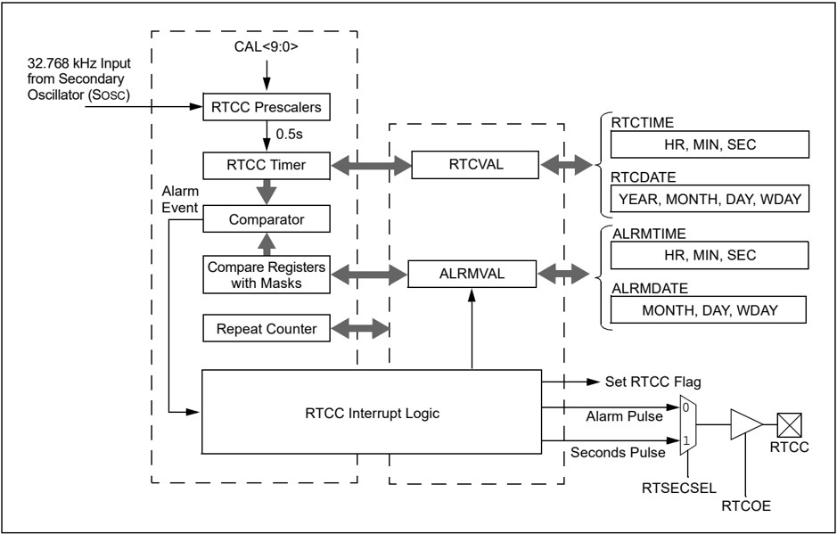

## 21.1 RTCC Control Registers

## TABLE 21-1: RTCC REGISTER MAP

| Register Name (1)   |           | Bits        | Bits        | Bits        | Bits        | Bits        | Bits        | Bits        | Bits        | Bits             | Bits       | Bits       | Bits       | Bits           | Bits          | Bits          | Bits          |            |
|---------------------|-----------|-------------|-------------|-------------|-------------|-------------|-------------|-------------|-------------|------------------|------------|------------|------------|----------------|---------------|---------------|---------------|------------|
| Register Name (1)   | Bit Range | 31/15 30/14 |             | 29/13       | 28/12       | 27/11       | 26/10       | 25/9        | 24/8        | 23/7             | 22/6       | 21/5       | 20/4       | 19/3           | 18/2          | 17/1          | 16/0          | All Resets |
| RTCCON              | 31:16     | -           | -           | -           | -           | -           |             | -           | -           | -                | -          | CAL<9:0>   | -          | -              | -             | -             | -             | 0000       |
| RTCCON              | 15:0      | ON          | -           | SIDL        | -           | -           | -           | -           | -           | RTSECSELRTCCLKON |            | -          | -          | RTCWRENRTCSYNC |               | HALFSEC       | RTCOE         | 0000       |
| RTCALRM             | 31:16     | -           | -           | -           | -           | -           | -           | -           | -           | -                | -          | -          | -          | -              | -             | -             | -             | 0000       |
|                     | 15:0      | ALRMEN      | CHIME       | PIV         | ALRMSYNC    | ALRMSYNC    | AMASK<3:0>  | AMASK<3:0>  | AMASK<3:0>  | ARPT<7:0>        | ARPT<7:0>  | ARPT<7:0>  | ARPT<7:0>  | ARPT<7:0>      | ARPT<7:0>     | ARPT<7:0>     | ARPT<7:0>     | 0000       |
|                     | 31:16     | -           | -           | HR10<1:0>   | HR10<1:0>   | HR01<3:0>   | HR01<3:0>   | HR01<3:0>   | HR01<3:0>   | -                | MIN10<2:0> | MIN10<2:0> | MIN10<2:0> | MIN01<3:0>     | MIN01<3:0>    | MIN01<3:0>    | MIN01<3:0>    | xxxx       |
| RTCTIME             | 15:0      | -           | SEC10<2:0>  | SEC10<2:0>  | SEC10<2:0>  | SEC01<3:0>  | SEC01<3:0>  | SEC01<3:0>  | SEC01<3:0>  | -                | -          | -          | -          | -              | -             | -             | -             | xx00       |
| RTCDATE             | 31:16     | YEAR10<3:0> | YEAR10<3:0> | YEAR10<3:0> | YEAR10<3:0> | YEAR01<3:0> | YEAR01<3:0> | YEAR01<3:0> | YEAR01<3:0> | -                | -          | -          | MONTH10    | MONTH01<3:0>   | MONTH01<3:0>  | MONTH01<3:0>  | MONTH01<3:0>  | xxxx       |
|                     | 15:0      | -           | -           | DAY10<1:0>  | DAY10<1:0>  | DAY01<3:0>  | DAY01<3:0>  | DAY01<3:0>  | DAY01<3:0>  | -                | -          | -          | -          | - WDAY01<2:0>  | - WDAY01<2:0> | - WDAY01<2:0> | - WDAY01<2:0> | xx00       |
|                     | 31:16     | -           | - HR10<1:0> | - HR10<1:0> | - HR10<1:0> | HR01<3:0>   | HR01<3:0>   | HR01<3:0>   | HR01<3:0>   | -                | MIN10<2:0> | MIN10<2:0> | MIN10<2:0> | MIN01<3:0>     | MIN01<3:0>    | MIN01<3:0>    | MIN01<3:0>    | xxxx       |
| ALRMTIME            | 15:0      | -           | SEC10<2:0>  | SEC10<2:0>  | SEC10<2:0>  | SEC01<3:0>  | SEC01<3:0>  | SEC01<3:0>  | SEC01<3:0>  | -                | -          | -          | -          | -              | -             | -             | -             | xx00       |
| ALRMDATE            | 31:16     | -           | -           | -           | -           | -           | -           | -           | -           | -                | -          | -          | MONTH10    | MONTH01<3:0>   | MONTH01<3:0>  | MONTH01<3:0>  | MONTH01<3:0>  | 00xx       |
|                     | 15:0      | DAY10<3:0>  | DAY10<3:0>  | DAY10<3:0>  | DAY10<3:0>  | DAY01<3:0>  | DAY01<3:0>  | DAY01<3:0>  | DAY01<3:0>  | -                | -          | -          | -          | WDAY01<2:0>    | WDAY01<2:0>   | WDAY01<2:0>   | WDAY01<2:0>   | xx0x       |
|                     |           |             |             |             |             |             |             |             |             |                  |            |            | -          |                |               |               |               |            |

Legend:

Note

1:

x = unknown value on Reset; - = unimplemented, read as ' 0 '. Reset values are shown in hexadecimal.

All registers in this table have corresponding CLR, SET and INV registers at its virtual address, plus an offset of 0x4, 0x8 and 0xC, respectively. See Section 11.2 'CLR, SET and INV Registers' for more information.

## PIC32MX1XX/2XX 28/36/44-PIN FAMILY

## REGISTER 21-1: RTCCON: RTC CONTROL REGISTER

| Bit Range   | Bit 31/23/15/7   | Bit 30/22/14/6   | Bit 29/21/13/5   | Bit 28/20/12/4   | Bit 27/19/11/3   | Bit 26/18/10/2   | Bit 25/17/9/1   | Bit 24/16/8/0   |
|-------------|------------------|------------------|------------------|------------------|------------------|------------------|-----------------|-----------------|
| 31:24       | U-0              | U-0              | U-0              | U-0              | U-0              | U-0              | R/W-0           | R/W-0           |
| 31:24       | -                | -                | -                | -                | -                | -                | CAL<9:8>        | CAL<9:8>        |
| 23:16       | R/W-0            | R/W-0            | R/W-0            | R/W-0            | R/W-0            | R/W-0            | R/W-0           | R/W-0           |
| 23:16       | CAL<7:0>         | CAL<7:0>         | CAL<7:0>         | CAL<7:0>         | CAL<7:0>         | CAL<7:0>         | CAL<7:0>        | CAL<7:0>        |
| 15:8        | R/W-0            | U-0              | R/W-0            | U-0              | U-0              | U-0              | U-0             | U-0             |
| 15:8        | ON (1,2)         | -                | SIDL             | -                | -                | -                | -               | -               |
| 7:0         | R/W-0            | R-0              | U-0              | U-0              | R/W-0            | R-0              | R-0             | R/W-0           |
| 7:0         | RTSECSEL (3)     | RTCCLKON         | -                | -                | RTCWREN (4)      | RTCSYNC          | HALFSEC (5)     | RTCOE           |

## Legend:

R = Readable bit

W = Writable bit

U = Unimplemented bit, read as '0'

-n = Value at POR

'1' = Bit is set

'0' = Bit is cleared

x = Bit is unknown

```
bit 31-26 Unimplemented: Read as ' 0 ' bit 25-16 CAL<9:0>: RTC Drift Calibration bits, which contain a signed 10-bit integer value 0111111111 = Maximum positive adjustment, adds 511 RTC clock pulses every one minute · · · 0000000001 = Minimum positive adjustment, adds 1 RTC clock pulse every one minute 0000000000 = No adjustment 1111111111 = Minimum negative adjustment, subtracts 1 RTC clock pulse every one minute · · · 1000000000 = Maximum negative adjustment, subtracts 512 clock pulses every one minute bit 15 ON: RTCC On bit (1,2) 1 = RTCC module is enabled 0 = RTCC module is disabled bit 14 Unimplemented: Read as ' 0 ' bit 13 SIDL: Stop in Idle Mode bit 1 = Disables the PBCLK to the RTCC when the device enters Idle mode 0 = Continue normal operation when the device enters Idle mode bit 12-8 Unimplemented: Read as ' 0 ' bit 7 RTSECSEL: RTCC Seconds Clock Output Select bit (3) 1 = RTCC Seconds Clock is selected for the RTCC pin 0 = RTCC Alarm Pulse is selected for the RTCC pin bit 6 RTCCLKON: RTCC Clock Enable Status bit 1 = RTCC Clock is actively running 0 = RTCC Clock is not running
```

## Note 1: The ON bit is only writable when RTCWREN = 1 .

- 2: When using the 1:1 PBCLK divisor, the user's software should not read/write the peripheral's SFRs in the SYSCLK cycle immediately following the instruction that clears the module's ON bit.
- 3: Requires RTCOE = 1 (RTCCON&lt;0&gt;) for the output to be active.
- 4: The RTCWREN bit can be set only when the write sequence is enabled.
- 5: This bit is read-only. It is cleared to ' 0 ' on a write to the seconds bit fields (RTCTIME&lt;14:8&gt;).

## Note: This register is reset only on a Power-on Reset (POR).

## PIC32MX1XX/2XX 28/36/44-PIN FAMILY

## REGISTER 21-1: RTCCON: RTC CONTROL REGISTER  (CONTINUED)

bit 5-4

Unimplemented: Read as ' 0 '

bit 3

RTCWREN:

RTC Value Registers Write Enable bit (4)

- 1 = RTC Value registers can be written to by the user

- 0 = RTC Value registers are locked out from being written to by the user

bit 2 RTCSYNC: RTCC Value Registers Read Synchronization bit

- 1 = RTC Value registers can change while reading, due to a rollover ripple that results in an invalid data read If the register is read twice and results in the same data, the data can be assumed to be valid

- 0 = RTC Value registers can be read without concern about a rollover ripple

## bit 1 HALFSEC: Half-Second Status bit

(5)

- 1 = Second half period of a second

- 0 = First half period of a second

bit 0 RTCOE: RTCC Output Enable bit

- 1 = RTCC clock output enabled - clock presented onto an I/O

- 0 = RTCC clock output disabled

## Note 1: The ON bit is only writable when RTCWREN = 1 .

- 2: When using the 1:1 PBCLK divisor, the user's software should not read/write the peripheral's SFRs in the SYSCLK cycle immediately following the instruction that clears the module's ON bit.
- 3: Requires RTCOE = 1 (RTCCON&lt;0&gt;) for the output to be active.
- 4: The RTCWREN bit can be set only when the write sequence is enabled.
- 5: This bit is read-only. It is cleared to ' 0 ' on a write to the seconds bit fields (RTCTIME&lt;14:8&gt;).

Note: This register is reset only on a Power-on Reset (POR).

## PIC32MX1XX/2XX 28/36/44-PIN FAMILY

## REGISTER 21-2: RTCALRM: RTC ALARM CONTROL REGISTER

| Bit Range   | Bit 31/23/15/7   | Bit 30/22/14/6   | Bit 29/21/13/5   | Bit 28/20/12/4   | Bit 27/19/11/3   | Bit 26/18/10/2   | Bit 25/17/9/1   | Bit 24/16/8/0   |
|-------------|------------------|------------------|------------------|------------------|------------------|------------------|-----------------|-----------------|
| 31:24       | U-0              | U-0              | U-0              | U-0              | U-0              | U-0              | U-0             | U-0             |
| 31:24       | -                | -                | -                | -                | -                | -                | -               | -               |
| 23:16       | U-0              | U-0              | U-0              | U-0              | U-0              | U-0              | U-0             | U-0             |
| 23:16       | -                | -                | -                | -                | -                | -                | -               | -               |
| 15:8        | R/W-0            | R/W-0            | R/W-0            | R-0              | R/W-0            | R/W-0            | R/W-0           | R/W-0           |
| 15:8        | ALRMEN (1,2)     | CHIME (2)        | PIV (2)          | ALRMSYNC (3)     | AMASK<3:0> (2)   | AMASK<3:0> (2)   | AMASK<3:0> (2)  | AMASK<3:0> (2)  |
| 7:0         | R/W-0            | R/W-0            | R/W-0            | R/W-0            | R/W-0            | R/W-0            | R/W-0           | R/W-0           |
| 7:0         | ARPT<7:0> (2)    | ARPT<7:0> (2)    | ARPT<7:0> (2)    | ARPT<7:0> (2)    | ARPT<7:0> (2)    | ARPT<7:0> (2)    | ARPT<7:0> (2)   | ARPT<7:0> (2)   |

## Legend:

R = Readable bit

W = Writable bit

U = Unimplemented bit, read as '0'

-n = Value at POR

'1' = Bit is set

'0' = Bit is cleared

x = Bit is unknown

## bit 31-16 Unimplemented: Read as ' 0 '

bit 15 ALRMEN: Alarm Enable bit

1 = Alarm is enabled

0 = Alarm is disabled

bit 14 CHIME: Chime Enable bit (2)

1 = Chime is enabled - ARPT&lt;7:0&gt; is allowed to rollover from 0x00 to 0xFF

0 = Chime is disabled - ARPT&lt;7:0&gt; stops once it reaches 0x00

bit 13 PIV: Alarm Pulse Initial Value bit (2)

When ALRMEN = 0 , PIV is writable and determines the initial value of the Alarm Pulse.

When ALRMEN = 1 , PIV is read-only and returns the state of the Alarm Pulse.

## bit 12 ALRMSYNC: Alarm Sync bit (3)

- 1 = ARPT&lt;7:0&gt; and ALRMEN may change as a result of a half second rollover during a read. The ARPT must be read repeatedly until the same value is read twice. This must be done since multiple

bits may be changing, which are then synchronized to the PB clock domain

- 0 = ARPT&lt;7:0&gt; and ALRMEN can be read without concerns of rollover because the prescaler is &gt; 32 RTC clocks away from a half-second rollover

## bit 11-8 AMASK&lt;3:0&gt;: Alarm Mask Configuration bits (2)

0000 = Every half-second

0001 = Every second

0010 = Every 10 seconds

0011 = Every minute

0100 = Every 10 minutes

0101 = Every hour

0110 = Once a day

0111 = Once a week

1000 = Once a month

1001 = Once a year (except when configured for February 29, once every four years)

1010 = Reserved; do not use

1011 = Reserved; do not use

11xx = Reserved; do not use

- Note 1: Hardware clears the ALRMEN bit anytime the alarm event occurs, when ARPT&lt;7:0&gt; = 00 and CHIME = 0 .
- 2: This field should not be written when the RTCC ON bit = ' 1 ' (RTCCON&lt;15&gt;) and ALRMSYNC = 1 .
- 3: This assumes a CPU read will execute in less than 32 PBCLKs.

## Note: This register is reset only on a Power-on Reset (POR).

(1,2)

## PIC32MX1XX/2XX 28/36/44-PIN FAMILY

## REGISTER 21-2: RTCALRM: RTC ALARM CONTROL REGISTER  (CONTINUED)

bit 7-0 ARPT&lt;7:0&gt;: Alarm Repeat Counter Value bits (2) 11111111 = Alarm will trigger 256 times · · · 00000000 = Alarm will trigger one time The counter decrements on any alarm event. The counter only rolls over from 0x00 to 0xFF if CHIME = 1 .

Note 1: Hardware clears the ALRMEN bit anytime the alarm event occurs, when ARPT&lt;7:0&gt; = 00 and CHIME = 0 .

- 2: This field should not be written when the RTCC ON bit = ' 1 ' (RTCCON&lt;15&gt;) and ALRMSYNC = 1 .
- 3: This assumes a CPU read will execute in less than 32 PBCLKs.

Note: This register is reset only on a Power-on Reset (POR).

## PIC32MX1XX/2XX 28/36/44-PIN FAMILY

## REGISTER 21-3: RTCTIME: RTC TIME VALUE REGISTER

| Bit Range   | Bit 31/23/15/7   | Bit 30/22/14/6   | Bit 29/21/13/5   | Bit 28/20/12/4   | Bit 27/19/11/3   | Bit 26/18/10/2   | Bit 25/17/9/1   | Bit 24/16/8/0   |
|-------------|------------------|------------------|------------------|------------------|------------------|------------------|-----------------|-----------------|
| 31:24       | U-0              | U-0              | R/W-x            | R/W-x            | R/W-x            | R/W-x            | R/W-x           | R/W-x           |
| 31:24       | -                | -                | HR10<1:0>        | HR10<1:0>        | HR01<3:0>        | HR01<3:0>        | HR01<3:0>       | HR01<3:0>       |
| 23:16       | U-0              | R/W-x            | R/W-x            | R/W-x            | R/W-x            | R/W-x            | R/W-x           | R/W-x           |
| 23:16       | -                | MIN10<2:0>       | MIN10<2:0>       | MIN10<2:0>       | MIN01<3:0>       | MIN01<3:0>       | MIN01<3:0>      | MIN01<3:0>      |
| 15:8        | U-0              | R/W-x            | R/W-x            | R/W-x            | R/W-x            | R/W-x            | R/W-x           | R/W-x           |
| 15:8        | -                | SEC10<2:0>       | SEC10<2:0>       | SEC10<2:0>       | SEC01<3:0>       | SEC01<3:0>       | SEC01<3:0>      | SEC01<3:0>      |
| 7:0         | U-0              | U-0              | U-0              | U-0              | U-0              | U-0              | U-0             | U-0             |
| 7:0         | -                | -                | -                | -                | -                | -                | -               | -               |

## Legend:

R = Readable bit

W = Writable bit

U = Unimplemented bit, read as '0'

-n = Value at POR

'1' = Bit is set

'0' = Bit is cleared

x = Bit is unknown

bit 31-30

Unimplemented: Read as ' 0 '

bit 29-28 HR10&lt;1:0&gt;: Binary-Coded Decimal Value of Hours bits, 10s place digit; contains a value from 0 to 2

bit 27-24

HR01&lt;3:0&gt;:

Binary-Coded Decimal Value of Hours bits, 1s place digit; contains a value from 0 to 9

bit 23 Unimplemented: Read as ' 0 '

bit 22-20 MIN10&lt;2:0&gt;: Binary-Coded Decimal Value of Minutes bits, 10s place digit; contains a value from 0 to 5

bit 19-16 MIN01&lt;3:0&gt;: Binary-Coded Decimal Value of Minutes bits, 1s place digit; contains a value from 0 to 9

bit 15 Unimplemented: Read as ' 0 '

bit 14-12 SEC10&lt;2:0&gt;: Binary-Coded Decimal Value of Seconds bits, 10s place digit; contains a value from 0 to 5

bit 11-8 SEC01&lt;3:0&gt;: Binary-Coded Decimal Value of Seconds bits, 1s place digit; contains a value from 0 to 9

bit 7-0 Unimplemented: Read as ' 0 '

Note:

This register is only writable when RTCWREN = 1 (RTCCON&lt;3&gt;).

## PIC32MX1XX/2XX 28/36/44-PIN FAMILY

## REGISTER 21-4: RTCDATE: RTC DATE VALUE REGISTER

| Bit Range   | Bit 31/23/15/7   | Bit 30/22/14/6   | Bit 29/21/13/5   | Bit 28/20/12/4   | Bit 27/19/11/3   | Bit 26/18/10/2   | Bit 25/17/9/1   | Bit 24/16/8/0   |
|-------------|------------------|------------------|------------------|------------------|------------------|------------------|-----------------|-----------------|
| 31:24       | R/W-x            | R/W-x            | R/W-x            | R/W-x            | R/W-x            | R/W-x            | R/W-x           | R/W-x           |
| 31:24       | YEAR10<3:0>      | YEAR10<3:0>      | YEAR10<3:0>      | YEAR10<3:0>      | YEAR01<3:0>      | YEAR01<3:0>      | YEAR01<3:0>     | YEAR01<3:0>     |
| 23:16       | U-0              | U-0              | U-0              | R/W-x            | R/W-x            | R/W-x            | R/W-x           | R/W-x           |
| 23:16       | -                | -                | -                | MONTH10          | MONTH01<3:0>     | MONTH01<3:0>     | MONTH01<3:0>    | MONTH01<3:0>    |
| 15:8        | U-0              | U-0              | R/W-x            | R/W-x            | R/W-x            | R/W-x            | R/W-x           | R/W-x           |
| 15:8        | -                | -                | DAY10<1:0>       | DAY10<1:0>       | DAY01<3:0>       | DAY01<3:0>       | DAY01<3:0>      | DAY01<3:0>      |
| 7:0         | U-0              | U-0              | U-0              | U-0              | U-0              | R/W-x            | R/W-x           | R/W-x           |
| 7:0         | -                | -                | -                | -                | -                | WDAY01<2:0>      | WDAY01<2:0>     | WDAY01<2:0>     |

## Legend:

R = Readable bit

W = Writable bit

U = Unimplemented bit, read as '0'

-n = Value at POR

'1' = Bit is set

'0' = Bit is cleared

x = Bit is unknown

bit 31-28 YEAR10&lt;3:0&gt;: Binary-Coded Decimal Value of Years bits, 10s place digit; contains a value from 0 to 9

bit 27-24 YEAR01&lt;3:0&gt;: Binary-Coded Decimal Value of Years bits, 1s place digit; contains a value from 0 to 9

bit 23-21 Unimplemented: Read as ' 0 '

bit 20 MONTH10: Binary-Coded Decimal Value of Months bits, 10s place digit; contains a value of 0 or 1

bit 19-16 MONTH01&lt;3:0&gt;: Binary-Coded Decimal Value of Months bits, 1s place digit; contains a value from 0 to 9

bit 15-14 Unimplemented: Read as ' 0 '

bit 13-12 DAY10&lt;1:0&gt;: Binary-Coded Decimal Value of Days bits, 10s place digit; contains a value of 0 to 3

bit 11-8 DAY01&lt;3:0&gt;: Binary-Coded Decimal Value of Days bits, 1s place digit; contains a value from 0 to 9

bit 7-3 Unimplemented: Read as ' 0 '

bit 2-0

WDAY01&lt;2:0&gt;:

Binary-Coded Decimal Value of Weekdays bits; contains a value from 0 to 6

Note: This register is only writable when RTCWREN = 1 (RTCCON&lt;3&gt;).

## PIC32MX1XX/2XX 28/36/44-PIN FAMILY

## REGISTER 21-5: ALRMTIME: ALARM TIME VALUE REGISTER

| Bit Range   | Bit 31/23/15/7   | Bit 30/22/14/6   | Bit 29/21/13/5   | Bit 28/20/12/4   | Bit 27/19/11/3   | Bit 26/18/10/2   | Bit 25/17/9/1   | Bit 24/16/8/0   |
|-------------|------------------|------------------|------------------|------------------|------------------|------------------|-----------------|-----------------|
| 31:24       | U-0              | U-0              | R/W-x            | R/W-x            | R/W-x            | R/W-x            | R/W-x           | R/W-x           |
| 31:24       | -                | -                | HR10<1:0>        | HR10<1:0>        | HR01<3:0>        | HR01<3:0>        | HR01<3:0>       | HR01<3:0>       |
| 23:16       | U-0              | R/W-x            | R/W-x            | R/W-x            | R/W-x            | R/W-x            | R/W-x           | R/W-x           |
| 23:16       | -                | MIN10<2:0>       | MIN10<2:0>       | MIN10<2:0>       | MIN01<3:0>       | MIN01<3:0>       | MIN01<3:0>      | MIN01<3:0>      |
| 15:8        | U-0              | R/W-x            | R/W-x            | R/W-x            | R/W-x            | R/W-x            | R/W-x           | R/W-x           |
| 15:8        | -                | SEC10<2:0>       | SEC10<2:0>       | SEC10<2:0>       | SEC01<3:0>       | SEC01<3:0>       | SEC01<3:0>      | SEC01<3:0>      |
| 7:0         | U-0              | U-0              | U-0              | U-0              | U-0              | U-0              | U-0             | U-0             |
| 7:0         | -                | -                | -                | -                | -                | -                | -               | -               |

## Legend:

R = Readable bit

W = Writable bit

U = Unimplemented bit, read as '0'

-n = Value at POR

'1' = Bit is set

'0' = Bit is cleared

x = Bit is unknown

bit 31-30 Unimplemented: Read as ' 0 '

bit 29-28 HR10&lt;1:0&gt;: Binary Coded Decimal value of hours bits, 10s place digit; contains a value from 0 to 2

bit 27-24 HR01&lt;3:0&gt;: Binary Coded Decimal value of hours bits, 1s place digit; contains a value from 0 to 9

bit 23 Unimplemented: Read as ' 0 '

bit 22-20 MIN10&lt;2:0&gt;: Binary Coded Decimal value of minutes bits, 10s place digit; contains a value from 0 to 5

bit 19-16 MIN01&lt;3:0&gt;: Binary Coded Decimal value of minutes bits, 1s place digit; contains a value from 0 to 9

bit 15 Unimplemented: Read as ' 0 '

bit 14-12 SEC10&lt;2:0&gt;: Binary Coded Decimal value of seconds bits, 10s place digit; contains a value from 0 to 5

bit 11-8 SEC01&lt;3:0&gt;: Binary Coded Decimal value of seconds bits, 1s place digit; contains a value from 0 to 9

bit 7-0 Unimplemented: Read as ' 0 '

## PIC32MX1XX/2XX 28/36/44-PIN FAMILY

## REGISTER 21-6: ALRMDATE: ALARM DATE VALUE REGISTER

| Bit Range   | Bit 31/23/15/7   | Bit 30/22/14/6   | Bit 29/21/13/5   | Bit 28/20/12/4   | Bit 27/19/11/3   | Bit 26/18/10/2   | Bit 25/17/9/1   | Bit 24/16/8/0   |
|-------------|------------------|------------------|------------------|------------------|------------------|------------------|-----------------|-----------------|
| 31:24       | U-0              | U-0              | U-0              | U-0              | U-0              | U-0              | U-0             | U-0             |
| 31:24       | -                | -                | -                | -                | -                | -                | -               | -               |
| 23:16       | U-0              | U-0              | U-0              | R/W-x            | R/W-x            | R/W-x            | R/W-x           | R/W-x           |
| 23:16       | -                | -                | -                | MONTH10          | MONTH01<3:0>     | MONTH01<3:0>     | MONTH01<3:0>    | MONTH01<3:0>    |
| 15:8        | U-0              | U-0              | R/W-x            | R/W-x            | R/W-x            | R/W-x            | R/W-x           | R/W-x           |
| 15:8        | -                | -                | DAY10<1:0>       | DAY10<1:0>       | DAY01<3:0>       | DAY01<3:0>       | DAY01<3:0>      | DAY01<3:0>      |
| 7:0         | U-0              | U-0              | U-0              | U-0              | U-0              | R/W-x            | R/W-x           | R/W-x           |
| 7:0         | -                | -                | -                | -                | -                | WDAY01<2:0>      | WDAY01<2:0>     | WDAY01<2:0>     |

## Legend:

R = Readable bit

W = Writable bit

U = Unimplemented bit, read as '0'

-n = Value at POR

'1' = Bit is set

'0' = Bit is cleared

x = Bit is unknown

bit 31-21 Unimplemented: Read as ' 0 '

bit 20 MONTH10: Binary Coded Decimal value of months bits, 10s place digit; contains a value of 0 or 1 bit 19-16 MONTH01&lt;3:0&gt;: Binary Coded Decimal value of months bits, 1s place digit; contains a value from 0 to 9 bit 15-14 Unimplemented: Read as ' 0 ' bit 13-12 DAY10&lt;1:0&gt;: Binary Coded Decimal value of days bits, 10s place digit; contains a value from 0 to 3 bit 11-8 DAY01&lt;3:0&gt;: Binary Coded Decimal value of days bits, 1s place digit; contains a value from 0 to 9 bit 7-3 Unimplemented: Read as ' 0 '

bit 2-0 WDAY01&lt;2:0&gt;: Binary Coded Decimal value of weekdays bits; contains a value from 0 to 6

## PIC32MX1XX/2XX 28/36/44-PIN FAMILY

## 22.0 10-BIT ANALOG-TO-DIGITAL CONVERTER (ADC)

Note: This data sheet summarizes the features of  the  PIC32MX1XX/2XX  28/36/44-pin Family of devices. It is not intended to be a  comprehensive  reference  source.  To complement  the  information  in  this  data sheet, refer to Section 17. '10-bit Analog-to-Digital Converter (ADC)' (DS60001104), which is available from the Documentation &gt; Reference Manual section  of  the  Microchip  PIC32  web  site (www.microchip.com/pic32).

The 10-bit Analog-to-Digital Converter (ADC) includes the following features:

- Successive Approximation Register (SAR) conversion
- Up to 1 Msps conversion speed
- Up to 13 analog input pins
- External voltage reference input pins
- One unipolar, differential Sample and Hold Amplifier (SHA)
- Automatic Channel Scan mode
- Selectable conversion trigger source
- 16-word conversion result buffer
- Selectable buffer fill modes
- Eight conversion result format options
- Operation during Sleep and Idle modes

A  block  diagram  of  the  10-bit  ADC  is  illustrated  in Figure 22-1. Figure 22-2 illustrates a block diagram of the ADC conversion clock period. The 10-bit ADC has up to 13 analog input pins, designated AN0-AN12. In addition, there are two analog input pins for external voltage reference connections. These voltage reference inputs may be shared with other analog input pins  and  may  be  common  to  other  analog  module references.

## FIGURE 22-1: ADC1 MODULE BLOCK DIAGRAM

Note 1: VREF+ and VREF- inputs can be multiplexed with other analog inputs.

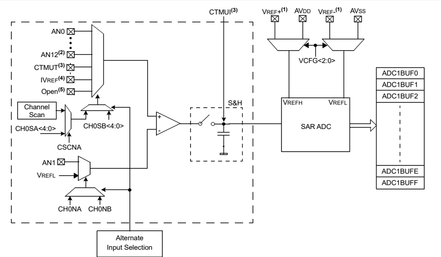

- 2: The AN8 pin is only available on 44-pin devices. The AN6 and AN7pins are not available on 28-pin devices. The AN12 pin is available on all General Purpose Devices as well as 36 and 44 pin USB Devices.
- 3: Connected  to  the  CTMU  module.  See Section 25.0  'Charge  Time  Measurement  Unit  (CTMU)' for  more information.
- 4: Internal precision voltage reference (1.2V).

## PIC32MX1XX/2XX 28/36/44-PIN FAMILY

## FIGURE 22-2: ADC CONVERSION CLOCK PERIOD BLOCK DIAGRAM


## 22.1 ADC Control Registers

| Virtual Address (BF80_#)   |                         |            |           |    |        |        |               |            |                                |                  |                  |                  |           |            |                   |            |
|----------------------------|-------------------------|------------|-----------|----|--------|--------|---------------|------------|--------------------------------|------------------|------------------|------------------|-----------|------------|-------------------|------------|
|                            | Register Name Bit Range | 31/15      | 30/14     |    | 29/13  | 28/12  | 27/11 26/10   | 25/9       | 24/8 23/7                      | 21/5             | 20/4             | 22/6             | 19/3      | 18/2       | 17/1 16/0         | All Resets |
| 9000                       | AD1CON1 (1) 31:16       | -          | -         | -  |        | - -    | -             | -          | - -                            | -                | -                | -                | -         | -          | - -               | 0000       |
|                            | 15:0                    | ON         | -         |    | SIDL   | -      | -             | FORM<2:0>  |                                |                  | SSRC<2:0>        | CLRASAM          | -         | ASAM       | SAMP DONE         | 0000       |
| 9010                       | (1) 31:16               | -          | -         |    | -      | -      | - -           | -          | - -                            | -                |                  | -                | - -       | -          | - -               | 0000       |
|                            | AD1CON2 15:0            |            | VCFG<2:0> |    |        | OFFCAL | - CSCNA       | -          | - BUFS                         | -                |                  |                  | SMPI<3:0> |            | BUFM ALTS         | 0000       |
| 9020                       | AD1CON3 (1) 31:16       | -          | -         | -  |        | -      | - -           | -          | - -                            | -                |                  | -                | -         | - -        | - -               | 0000       |
|                            | 15:0                    | ADRC       | -         |    | -      |        | SAMC<4:0>     |            |                                |                  |                  |                  | ADCS<7:0> |            |                   | 0000       |
|                            | AD1CHS (1) 31:16        | CH0NB      | -         |    | -      | -      |               | CH0SB<3:0> |                                | CH0NA            | -                | -                | -         | CH0SA<3:0> |                   | 0000       |
| 9040                       | 15:0                    | -          |           | -  | -      | -      | - -           | -          | - -                            | -                |                  | -                | -         | -          | - - -             | 0000       |
| 9050                       | AD1CSSL (1) 31:16       | -          | -         |    | -      | -      | - -           | -          | - -                            | -                |                  | -                | -         | -          | - - -             | 0000       |
| 9070                       | 15:0                    | CSSL15     | CSSL14    |    | CSSL13 | CSSL12 | CSSL11 CSSL10 | CSSL9      | CSSL8 CSSL7                    | CSSL6            | CSSL5            | CSSL4            |           | CSSL3      | CSSL2 CSSL1 CSSL0 | 0000       |
|                            | ADC1BUF0 31:16 15:0     |            |           |    |        |        |               | ADC Result | Word 0                         | (ADC1BUF0<31:0>) |                  |                  |           |            |                   | 0000 0000  |
| 9080                       | ADC1BUF1 31:16 15:0     |            |           |    |        |        |               | ADC Result | Word 1                         | (ADC1BUF1<31:0>) |                  |                  |           |            |                   | 0000 0000  |
| 9090                       | ADC1BUF2                | 31:16 15:0 |           |    |        |        |               | ADC        | Result Word 2                  | (ADC1BUF2<31:0>) |                  |                  |           |            |                   | 0000 0000  |
| 90A0                       | ADC1BUF3                | 31:16      |           |    |        |        |               |            |                                |                  |                  |                  |           |            |                   | 0000       |
|                            |                         | 15:0       |           |    |        |        |               | ADC Result | Word 3                         | (ADC1BUF3<31:0>) |                  |                  |           |            |                   | 0000       |
| 90B0                       | ADC1BUF4                | 31:16      |           |    |        |        |               | ADC        | Result Word 4                  |                  |                  |                  |           |            |                   | 0000       |
| 90C0                       | ADC1BUF5 31:16          | 15:0       |           |    |        |        |               |            |                                |                  | (ADC1BUF4<31:0>) |                  |           |            |                   | 0000 0000  |
| 90D0                       |                         | 15:0 31:16 |           |    |        |        |               | ADC        | Result Word 5 (ADC1BUF5<31:0>) |                  |                  |                  |           |            |                   | 0000       |
|                            | ADC1BUF6                | 15:0       |           |    |        |        |               | ADC        | Result Word 6                  | (ADC1BUF6<31:0>) |                  |                  |           |            |                   | 0000       |
| 90E0                       | ADC1BUF7                | 31:16 15:0 |           |    |        |        |               |            | Result Word 7                  | (ADC1BUF7<31:0>) |                  |                  |           |            |                   | 0000 0000  |
| 90F0                       | ADC1BUF8                | 31:16      |           |    |        |        |               | ADC        |                                |                  |                  |                  |           |            |                   | 0000 0000  |
|                            |                         | 15:0       |           |    |        |        |               | ADC Result | Word 8                         |                  | (ADC1BUF8<31:0>) |                  |           |            |                   | 0000       |
| 9100                       | ADC1BUF9 15:0           | 31:16      |           |    |        |        |               | ADC Result | Word 9                         |                  | (ADC1BUF9<31:0>) |                  |           |            |                   | 0000 0000  |
| 9110                       | ADC1BUFA                | 31:16      |           |    |        |        |               | Result     | Word A                         |                  |                  |                  |           | 0000       |                   |            |
|                            |                         | 15:0       |           |    |        |        |               |            |                                |                  |                  |                  |           |            |                   |            |
|                            |                         |            |           |    |        |        |               |            |                                |                  | ADC              | (ADC1BUFA<31:0>) |           | 0000       |                   |            |

## TABLE 22-1:

Legend:

Note ADC REGISTER MAP

x = unknown value on Reset; - = unimplemented, read as ' 0 '. Reset values are shown in hexadecimal.

1: This register has corresponding CLR, SET and INV registers at its virtual address, plus offsets of 0x4, 0x8 and 0xC, respectively. See Section 11.2 'CLR, SET and INV Registers' for details.

## TABLE 22-1: ADC REGISTER MAP (CONTINUED)

| Virtual Address (BF80_#)   | Register Name   |            | Bits                               | Bits                               | Bits                               | Bits                               | Bits                               | Bits                               | Bits                               | Bits                               | Bits                               | Bits                               | Bits                               | Bits                               | Bits                               | Bits                               | Bits                               |            |
|----------------------------|-----------------|------------|------------------------------------|------------------------------------|------------------------------------|------------------------------------|------------------------------------|------------------------------------|------------------------------------|------------------------------------|------------------------------------|------------------------------------|------------------------------------|------------------------------------|------------------------------------|------------------------------------|------------------------------------|------------|
| Virtual Address (BF80_#)   | Register Name   | Bit Range  | 31/15 30/14                        | 29/13                              | 28/12                              | 27/11                              | 26/10                              | 25/9                               | 24/8                               | 23/7                               | 22/6                               | 21/5                               | 20/4                               | 19/3                               | 18/2                               | 17/1                               | 16/0                               | All Resets |
| 9120                       | ADC1BUFB        | 31:16 15:0 | ADC Result Word B (ADC1BUFB<31:0>) | ADC Result Word B (ADC1BUFB<31:0>) | ADC Result Word B (ADC1BUFB<31:0>) | ADC Result Word B (ADC1BUFB<31:0>) | ADC Result Word B (ADC1BUFB<31:0>) | ADC Result Word B (ADC1BUFB<31:0>) | ADC Result Word B (ADC1BUFB<31:0>) | ADC Result Word B (ADC1BUFB<31:0>) | ADC Result Word B (ADC1BUFB<31:0>) | ADC Result Word B (ADC1BUFB<31:0>) | ADC Result Word B (ADC1BUFB<31:0>) | ADC Result Word B (ADC1BUFB<31:0>) | ADC Result Word B (ADC1BUFB<31:0>) | ADC Result Word B (ADC1BUFB<31:0>) | ADC Result Word B (ADC1BUFB<31:0>) | 0000 0000  |
| 9130                       | ADC1BUFC        | 31:16 15:0 | ADC Result Word C (ADC1BUFC<31:0>) | ADC Result Word C (ADC1BUFC<31:0>) | ADC Result Word C (ADC1BUFC<31:0>) | ADC Result Word C (ADC1BUFC<31:0>) | ADC Result Word C (ADC1BUFC<31:0>) | ADC Result Word C (ADC1BUFC<31:0>) | ADC Result Word C (ADC1BUFC<31:0>) | ADC Result Word C (ADC1BUFC<31:0>) | ADC Result Word C (ADC1BUFC<31:0>) | ADC Result Word C (ADC1BUFC<31:0>) | ADC Result Word C (ADC1BUFC<31:0>) | ADC Result Word C (ADC1BUFC<31:0>) | ADC Result Word C (ADC1BUFC<31:0>) | ADC Result Word C (ADC1BUFC<31:0>) | ADC Result Word C (ADC1BUFC<31:0>) | 0000 0000  |
| 9140                       | ADC1BUFD        | 31:16 15:0 | ADC Result Word D (ADC1BUFD<31:0>) | ADC Result Word D (ADC1BUFD<31:0>) | ADC Result Word D (ADC1BUFD<31:0>) | ADC Result Word D (ADC1BUFD<31:0>) | ADC Result Word D (ADC1BUFD<31:0>) | ADC Result Word D (ADC1BUFD<31:0>) | ADC Result Word D (ADC1BUFD<31:0>) | ADC Result Word D (ADC1BUFD<31:0>) | ADC Result Word D (ADC1BUFD<31:0>) | ADC Result Word D (ADC1BUFD<31:0>) | ADC Result Word D (ADC1BUFD<31:0>) | ADC Result Word D (ADC1BUFD<31:0>) | ADC Result Word D (ADC1BUFD<31:0>) | ADC Result Word D (ADC1BUFD<31:0>) | ADC Result Word D (ADC1BUFD<31:0>) | 0000 0000  |
| 9150                       | ADC1BUFE        | 31:16 15:0 | ADC Result Word E (ADC1BUFE<31:0>) | ADC Result Word E (ADC1BUFE<31:0>) | ADC Result Word E (ADC1BUFE<31:0>) | ADC Result Word E (ADC1BUFE<31:0>) | ADC Result Word E (ADC1BUFE<31:0>) | ADC Result Word E (ADC1BUFE<31:0>) | ADC Result Word E (ADC1BUFE<31:0>) | ADC Result Word E (ADC1BUFE<31:0>) | ADC Result Word E (ADC1BUFE<31:0>) | ADC Result Word E (ADC1BUFE<31:0>) | ADC Result Word E (ADC1BUFE<31:0>) | ADC Result Word E (ADC1BUFE<31:0>) | ADC Result Word E (ADC1BUFE<31:0>) | ADC Result Word E (ADC1BUFE<31:0>) | ADC Result Word E (ADC1BUFE<31:0>) | 0000 0000  |
| 9160                       | ADC1BUFF        | 31:16 15:0 | ADC Result Word F (ADC1BUFF<31:0>) | ADC Result Word F (ADC1BUFF<31:0>) | ADC Result Word F (ADC1BUFF<31:0>) | ADC Result Word F (ADC1BUFF<31:0>) | ADC Result Word F (ADC1BUFF<31:0>) | ADC Result Word F (ADC1BUFF<31:0>) | ADC Result Word F (ADC1BUFF<31:0>) | ADC Result Word F (ADC1BUFF<31:0>) | ADC Result Word F (ADC1BUFF<31:0>) | ADC Result Word F (ADC1BUFF<31:0>) | ADC Result Word F (ADC1BUFF<31:0>) | ADC Result Word F (ADC1BUFF<31:0>) | ADC Result Word F (ADC1BUFF<31:0>) | ADC Result Word F (ADC1BUFF<31:0>) | ADC Result Word F (ADC1BUFF<31:0>) | 0000 0000  |

Legend:

x = unknown value on Reset; - = unimplemented, read as ' 0 '. Reset values are shown in hexadecimal.

Note 1:

This register has corresponding CLR, SET and INV registers at its virtual address, plus offsets of 0x4, 0x8 and 0xC, respectively. See Section 11.2 'CLR, SET and INV Registers' for details.

## PIC32MX1XX/2XX 28/36/44-PIN FAMILY

## REGISTER 22-1: AD1CON1: ADC CONTROL REGISTER 1

| Bit Range   | Bit 31/23/15/7   | Bit 30/22/14/6   | Bit 29/21/13/5   | Bit 28/20/12/4   | Bit 27/19/11/3   | Bit 26/18/10/2   | Bit 25/17/9/1   | Bit 24/16/8/0   |
|-------------|------------------|------------------|------------------|------------------|------------------|------------------|-----------------|-----------------|
| 31:24       | U-0              | U-0              | U-0              | U-0              | U-0              | U-0              | U-0             | U-0             |
| 31:24       | -                | -                | -                | -                | -                | -                | -               | -               |
| 23:16       | U-0              | U-0              | U-0              | U-0              | U-0              | U-0              | U-0             | U-0             |
| 23:16       | -                | -                | -                | -                | -                | -                | -               | -               |
| 15:8        | R/W-0            | U-0              | R/W-0            | U-0              | U-0              | R/W-0            | R/W-0           | R/W-0           |
| 15:8        | ON (1)           | -                | SIDL             | -                | -                | FORM<2:0>        | FORM<2:0>       | FORM<2:0>       |
| 7:0         | R/W-0            | R/W-0            | R/W-0            | R/W-0            | U-0              | R/W-0            | R/W-0, HSC      | R/C-0, HSC      |
| 7:0         | SSRC<2:0>        | SSRC<2:0>        | SSRC<2:0>        | CLRASAM          | -                | ASAM             | SAMP (2)        | DONE (3)        |

## Legend:

R = Readable bit

W = Writable bit

U = Unimplemented bit, read as '0'

-n = Value at POR

'1' = Bit is set

'0' = Bit is cleared

x = Bit is unknown

bit 31-16

bit 15

'

## Unimplemented: Read as ' 0

ON: ADC Operating Mode bit (1)

1 = ADC module is operating

0 = ADC module is not operating

bit 14 Unimplemented: Read as ' 0 '

bit 13

SIDL:

Stop in Idle Mode bit

- 1 = Discontinue module operation when device enters Idle mode
- 0 = Continue module operation when the device enters Idle mode

bit 12-11 Unimplemented: Read as ' 0 '

bit 10-8 FORM&lt;2:0&gt;: Data Output Format bits

- 111 = Signed Fractional 32-bit (DOUT = sddd dddd dd00 0000 0000 0000 0000 )
- 110 = Fractional 32-bit (DOUT = dddd dddd dd00 0000 0000 0000 0000 0000 )
- 101 = Signed Integer 32-bit (DOUT = ssss ssss ssss ssss ssss sssd dddd dddd )

100 = Integer 32-bit (DOUT = 0000 0000 0000 0000 0000 00dd dddd dddd )

011 = Signed Fractional 16-bit (DOUT = 0000 0000 0000 0000 sddd dddd dd00 0000 )

010 = Fractional 16-bit (DOUT = 0000 0000 0000 0000 dddd dddd dd00 0000 )

001 = Signed Integer 16-bit (DOUT = 0000 0000 0000 0000 ssss sssd dddd dddd )

000 =Integer 16-bit (DOUT = 0000 0000 0000 0000 0000 00dd dddd dddd )

bit 7-5 SSRC&lt;2:0&gt;: Conversion Trigger Source Select bits

111 = Internal counter ends sampling and starts conversion (auto convert)

110 = Reserved

101 = Reserved

100 = Reserved

011 = CTMU ends sampling and starts conversion

010 = Timer 3 period match ends sampling and starts conversion

001 = Active transition on INT0 pin ends sampling and starts conversion

000 = Clearing SAMP bit ends sampling and starts conversion

- Note 1: When using 1:1 PBCLK divisor, the user's software should not read/write the peripheral's SFRs in the SYSCLK cycle immediately following the instruction that clears the module's ON bit.
- 2: If ASAM = 0 , software can write a ' 1 ' to start sampling. This bit is automatically set by hardware if ASAM = 1 . If SSRC = 0 , software can write a '0' to end sampling and start conversion. If SSRC  ' 0 ', this bit is automatically cleared by hardware to end sampling and start conversion.
- 3: This bit is automatically set by hardware when analog-to-digital conversion is complete. Software can write a ' 0 ' to clear this bit (a write of ' 1 ' is not allowed). Clearing this bit does not affect any operation already in progress. This bit is automatically cleared by hardware at the start of a new conversion.

## PIC32MX1XX/2XX 28/36/44-PIN FAMILY

## REGISTER 22-1: AD1CON1: ADC CONTROL REGISTER 1 (CONTINUED)

- bit 4 CLRASAM: Stop Conversion Sequence bit (when the first ADC interrupt is generated)

- 1 = Stop conversions when the first ADC interrupt is generated. Hardware clears the ASAM bit when the ADC interrupt is generated.

- 0 = Normal operation, buffer contents will be overwritten by the next conversion sequence

bit 3 Unimplemented: Read as ' 0

'

bit 2 ASAM: ADC Sample Auto-Start bit

- 1 = Sampling begins immediately after last conversion completes; SAMP bit is automatically set.

- 0 = Sampling begins when SAMP bit is set

bit 1 SAMP: ADC Sample Enable bit (2)

- 1 = The ADC sample and hold amplifier is sampling

- 0 = The ADC sample/hold amplifier is holding

When ASAM = 0 , writing ' 1 ' to this bit starts sampling.

When SSRC = 000 , writing ' 0 ' to this bit will end sampling and start conversion.

bit 0 DONE: Analog-to-Digital Conversion Status bit (3)

- 1 = Analog-to-digital conversion is done

- 0 = Analog-to-digital conversion is not done or has not started

Clearing this bit will not affect any operation in progress.

- Note 1: When using 1:1 PBCLK divisor, the user's software should not read/write the peripheral's SFRs in the SYSCLK cycle immediately following the instruction that clears the module's ON bit.
- 2: If ASAM = 0 , software can write a ' 1 ' to start sampling. This bit is automatically set by hardware if ASAM = 1 . If SSRC = 0 , software can write a '0' to end sampling and start conversion. If SSRC  ' 0 ', this bit is automatically cleared by hardware to end sampling and start conversion.
- 3: This bit is automatically set by hardware when analog-to-digital conversion is complete. Software can write a ' 0 ' to clear this bit (a write of ' 1 ' is not allowed). Clearing this bit does not affect any operation already in progress. This bit is automatically cleared by hardware at the start of a new conversion.

## PIC32MX1XX/2XX 28/36/44-PIN FAMILY

## REGISTER 22-2: AD1CON2: ADC CONTROL REGISTER 2

| Bit Range   | Bit 31/23/15/7   | Bit 30/22/14/6   | Bit 29/21/13/5   | Bit 28/20/12/4   | Bit 27/19/11/3   | Bit 26/18/10/2   | Bit 25/17/9/1   | Bit 24/16/8/0   |
|-------------|------------------|------------------|------------------|------------------|------------------|------------------|-----------------|-----------------|
| 31:24       | U-0              | U-0              | U-0              | U-0              | U-0              | U-0              | U-0             | U-0             |
| 31:24       | -                | -                | -                | -                | -                | -                | -               | -               |
| 23:16       | U-0              | U-0              | U-0              | U-0              | U-0              | U-0              | U-0             | U-0             |
| 23:16       | -                | -                | -                | -                | -                | -                | -               | -               |
| 15:8        | R/W-0            | R/W-0            | R/W-0            | R/W-0            | U-0              | R/W-0            | U-0             | U-0             |
| 15:8        | VCFG<2:0>        | VCFG<2:0>        | VCFG<2:0>        | OFFCAL           | -                | CSCNA            | -               | -               |
| 7:0         | R-0              | U-0              | R/W-0            | R/W-0            | R/W-0            | R/W-0            | R/W-0           | R/W-0           |
| 7:0         | BUFS             | -                | SMPI<3:0>        | SMPI<3:0>        | SMPI<3:0>        | SMPI<3:0>        | BUFM            | ALTS            |

## Legend:

R = Readable bit

W = Writable bit

U = Unimplemented bit, read as '0'

-n = Value at POR

'1' = Bit is set

'0' = Bit is cleared

x = Bit is unknown

bit 31-16 Unimplemented:

Read as ' 0 '

## bit 15-13 VCFG&lt;2:0&gt;: Voltage Reference Configuration bits

|     | VREFH              | VREFL              |
|-----|--------------------|--------------------|
| 000 | AVDD               | AVss               |
| 001 | External VREF+ pin | AVSS               |
| 010 | AVDD               | External VREF- pin |
| 011 | External VREF+ pin | External VREF- pin |
| 1xx | AVDD               | AVSS               |

## bit 12 OFFCAL: Input Offset Calibration Mode Select bit

- 1 = Enable Offset Calibration mode

Positive and negative inputs of the sample and hold amplifier are connected to VREFL

- 0 = Disable Offset Calibration mode

The inputs to the sample and hold amplifier are controlled by AD1CHS or AD1CSSL

## bit 11 Unimplemented: Read as ' 0 '

bit 10

CSCNA:

Input Scan Select bit

1 = Scan inputs

0 = Do not scan inputs

bit 9-8 Unimplemented:

Read as ' 0 '

## bit 7 BUFS: Buffer Fill Status bit

Only valid when BUFM = 1 .

1 = ADC is currently filling buffer 0x8-0xF, user should access data in 0x0-0x7

0 = ADC is currently filling buffer 0x0-0x7, user should access data in 0x8-0xF

## bit 6 Unimplemented: Read as ' 0 '

## bit 5-2 SMPI&lt;3:0&gt;:

Sample/Convert Sequences Per Interrupt Selection bits

1111 = Interrupts at the completion of conversion for each 16 th  sample/convert sequence 1110 = Interrupts at the completion of conversion for each 15 th  sample/convert sequence

•

•

•

0001 = Interrupts at the completion of conversion for each 2 nd  sample/convert sequence 0000 = Interrupts at the completion of conversion for each sample/convert sequence

## bit 1 BUFM: ADC Result Buffer Mode Select bit

1 = Buffer configured as two 8-word buffers, ADC1BUF7-ADC1BUF0, ADC1BUFF-ADCBUF8

0 = Buffer configured as one 16-word buffer ADC1BUFF-ADC1BUF0

## bit 0 ALTS: Alternate Input Sample Mode Select bit

- 1 = Uses Sample A input multiplexer settings for first sample, then alternates between Sample B and Sample A input multiplexer settings for all subsequent samples

- 0 = Always use Sample A input multiplexer settings

## PIC32MX1XX/2XX 28/36/44-PIN FAMILY

## REGISTER 22-3: AD1CON3: ADC CONTROL REGISTER 3

| Bit Range   | Bit 31/23/15/7   | Bit 30/22/14/6   | Bit 29/21/13/5   | Bit 28/20/12/4   | Bit 27/19/11/3   | Bit 26/18/10/2   | Bit 25/17/9/1   | Bit 24/16/8/0   |
|-------------|------------------|------------------|------------------|------------------|------------------|------------------|-----------------|-----------------|
| 31:24       | U-0              | U-0              | U-0              | U-0              | U-0              | U-0              | U-0             | U-0             |
| 31:24       | -                | -                | -                | -                | -                | -                | -               | -               |
| 23:16       | U-0              | U-0              | U-0              | U-0              | U-0              | U-0              | U-0             | U-0             |
| 23:16       | -                | -                | -                | -                | -                | -                | -               | -               |
| 15:8        | R/W-0            | U-0              | U-0              | R/W-0            | R/W-0            | R/W-0            | R/W-0           | R/W-0           |
| 15:8        | ADRC             | -                | -                | SAMC<4:0> (1)    | SAMC<4:0> (1)    | SAMC<4:0> (1)    | SAMC<4:0> (1)   | SAMC<4:0> (1)   |
| 7:0         | R/W-0            | R/W-0            | R/W-0            | R/W-0            | R/W-0            | R/W-0            | R/W             | R/W-0           |
| 7:0         | ADCS<7:0> (2)    | ADCS<7:0> (2)    | ADCS<7:0> (2)    | ADCS<7:0> (2)    | ADCS<7:0> (2)    | ADCS<7:0> (2)    | ADCS<7:0> (2)   | ADCS<7:0> (2)   |

## Legend:

R = Readable bit

W = Writable bit

U = Unimplemented bit, read as '0'

-n = Value at POR

'1' = Bit is set

'0' = Bit is cleared

x = Bit is unknown

```
bit 31-16 Unimplemented: Read as ' 0 ' bit 15 ADRC: ADC Conversion Clock Source bit 1 = Clock derived from FRC 0 = Clock derived from Peripheral Bus Clock (PBCLK) bit 14-13 Unimplemented: Read as ' 0 ' bit 12-8 SAMC<4:0>: Auto-Sample Time bits (1) 11111 =31 TAD · · · 00001 = 1 TAD 00000 = 0 TAD (Not allowed) bit 7-0 ADCS<7:0>: ADC Conversion Clock Select bits (2) 11111111 =TPB · 2 · (ADCS<7:0> + 1) = 512 · TPB = TAD · · · 00000001 =TPB · 2 · (ADCS<7:0> + 1) = 4 · TPB = TAD 00000000 =TPB · 2 · (ADCS<7:0> + 1) = 2 · TPB = TAD Note 1: This bit is only used if the SSRC<2:0> bits (AD1CON1<7:5>) = 111 . 2: This bit is not used if the ADRC (AD1CON3<15>) bit = 1 .
```

## PIC32MX1XX/2XX 28/36/44-PIN FAMILY

## REGISTER 22-4: AD1CHS: ADC INPUT SELECT REGISTER

| Bit Range   | Bit 31/23/15/7   | Bit 30/22/14/6   | Bit 29/21/13/5   | Bit 28/20/12/4   | Bit 27/19/11/3   | Bit 26/18/10/2   | Bit 25/17/9/1   | Bit 24/16/8/0   |
|-------------|------------------|------------------|------------------|------------------|------------------|------------------|-----------------|-----------------|
| 31:24       | R/W-0            | U-0              | U-0              | U-0              | R/W-0            | R/W-0            | R/W-0           | R/W-0           |
| 31:24       | CH0NB            | -                | -                | -                | CH0SB<3:0>       | CH0SB<3:0>       | CH0SB<3:0>      | CH0SB<3:0>      |
| 23:16       | R/W-0            | U-0              | U-0              | U-0              | R/W-0            | R/W-0            | R/W-0           | R/W-0           |
| 23:16       | CH0NA            | -                | -                | -                | CH0SA<3:0>       | CH0SA<3:0>       | CH0SA<3:0>      | CH0SA<3:0>      |
| 15:8        | U-0              | U-0              | U-0              | U-0              | U-0              | U-0              | U-0             | U-0             |
| 15:8        | -                | -                | -                | -                | -                | -                | -               | -               |
| 7:0         | U-0              | U-0              | U-0              | U-0              | U-0              | U-0              | U-0             | U-0             |
| 7:0         | -                | -                | -                | -                | -                | -                | -               | -               |

## Legend:

R = Readable bit

W = Writable bit

U = Unimplemented bit, read as '0'

-n = Value at POR

'1' = Bit is set

'0' = Bit is cleared

x = Bit is unknown

bit 31 CH0NB: Negative Input Select bit for Sample B

1 = Channel 0 negative input is AN1

0 = Channel 0 negative input is VREFL

bit 30-28 Unimplemented: Read as ' 0 '

bit 27-24 CH0SB&lt;3:0&gt;: Positive Input Select bits for Sample B

1111 = Channel 0 positive input is Open (1)

1110 = Channel 0 positive input is IVREF (2)

1101 = Channel 0 positive input is CTMU temperature sensor (CTMUT) (3)

1100 = Channel 0 positive input is AN12 (4)

•

•

•

0001 = Channel 0 positive input is AN1

0000 = Channel 0 positive input is AN0

bit 23 CH0NA: Negative Input Select bit for Sample A Multiplexer Setting (2)

1 = Channel 0 negative input is AN1

0 = Channel 0 negative input is VREFL

bit 22-20 Unimplemented:

Read as ' 0 '

bit 19-16 CH0SA&lt;3:0&gt;: Positive Input Select bits for Sample A Multiplexer Setting

1111 = Channel 0 positive input is Open (1)

1110 = Channel 0 positive input is IVREF (2)

1101 = Channel 0 positive input is CTMU temperature (CTMUT) (3)

1100 = Channel 0 positive input is AN12 (4)

•

•

•

0001 = Channel 0 positive input is AN1

0000 = Channel 0 positive input is AN0

bit 15-0 Unimplemented: Read as ' 0 '

Note 1: This selection is only used with CTMU capacitive and time measurement.

- 2: See Section 24.0 'Comparator Voltage Reference (CVREF)' for more information.
- 3: See Section 25.0 'Charge Time Measurement Unit (CTMU)' for more information.
- 4: The AN8 pin is only available on the 44-pin devices. The AN6 and AN7 pins are not available on the 28-pin devices. The AN12 pin is available on all General Purpose Devices as well as 36 and 44 pin USB Devices.

## PIC32MX1XX/2XX 28/36/44-PIN FAMILY

## REGISTER 22-5: AD1CSSL: ADC INPUT SCAN SELECT REGISTER

| Bit Range   | Bit 31/23/15/7   | Bit 30/22/14/6   | Bit 29/21/13/5   | Bit 28/20/12/4   | Bit 27/19/11/3   | Bit 26/18/10/2   | Bit 25/17/9/1   | Bit 24/16/8/0   |
|-------------|------------------|------------------|------------------|------------------|------------------|------------------|-----------------|-----------------|
| 31:24       | U-0              | U-0              | U-0              | U-0              | U-0              | U-0              | U-0             | U-0             |
| 31:24       | -                | -                | -                | -                | -                | -                | -               | -               |
| 23:16       | U-0              | U-0              | U-0              | U-0              | U-0              | U-0              | U-0             | U-0             |
| 23:16       | -                | -                | -                | -                | -                | -                | -               | -               |
| 15:8        | R/W-0            | R/W-0            | R/W-0            | R/W-0            | R/W-0            | R/W-0            | R/W-0           | R/W-0           |
| 15:8        | CSSL15           | CSSL14           | CSSL13           | CSSL12           | CSSL11           | CSSL10           | CSSL9           | CSSL8           |
| 7:0         | R/W-0            | R/W-0            | R/W-0            | R/W-0            | R/W-0            | R/W-0            | R/W-0           | R/W-0           |
| 7:0         | CSSL7            | CSSL6            | CSSL5            | CSSL4            | CSSL3            | CSSL2            | CSSL1           | CSSL0           |

## Legend:

R = Readable bit

W = Writable bit

U = Unimplemented bit, read as '0'

-n = Value at POR

'1' = Bit is set

'0' = Bit is cleared

x = Bit is unknown

bit 31-16 Unimplemented: Read as ' 0 '

bit 15-0 CSSL&lt;15:0&gt;: ADC Input Pin Scan Selection bits (1,2)

1 = Select ANx for input scan

0 = Skip ANx for input scan

- Note 1: CSSL = ANx, where 'x' = 0-12; CSSL13 selects CTMU input for scan; CSSL14 selects IVREF for scan; CSSL15 selects VSS for scan.
- 2: On devices with less than 13 analog inputs, all CSSLx bits can be selected; however, inputs selected for scan without a corresponding input on the device will convert to VREFL.

## PIC32MX1XX/2XX 28/36/44-PIN FAMILY

## 23.0 COMPARATOR

Note: This data sheet summarizes the features of  the  PIC32MX1XX/2XX  28/36/44-pin Family of devices. It is not intended to be a  comprehensive  reference  source.  To complement the information in this data sheet, refer to Section 19. 'Comparator' (DS60001110),  which  is available from the Documentation &gt; Reference Manual section of the Microchip PIC32 web site (www.microchip.com/pic32).

The  Analog Comparator module contains three comparators  that  can  be  configured  in  a  variety  of ways.

FIGURE 23-1: COMPARATOR BLOCK DIAGRAM


Following are some of the key features of this module:

- Selectable inputs available include:
- -Analog inputs multiplexed with I/O pins
- -On-chip internal absolute voltage reference (IVREF)
- -Comparator voltage reference (CVREF)
- Outputs can be Inverted
- Selectable interrupt generation

A block diagram of the comparator module is provided in Figure 23-1.

## 23.1 Comparator Control Registers

## TABLE 23-1: COMPARATOR REGISTER MAP

| Virtual Address (BF80_#)   | (1)           |           | Bits        | Bits   | Bits   | Bits   | Bits   | Bits   | Bits   | Bits   | Bits       | Bits       | Bits   | Bits   | Bits   | Bits       | Bits       | Bits   |            |
|----------------------------|---------------|-----------|-------------|--------|--------|--------|--------|--------|--------|--------|------------|------------|--------|--------|--------|------------|------------|--------|------------|
|                            | Register Name | Bit Range | 31/15 30/14 | 29/13  | 28/12  |        | 27/11  | 26/10  | 25/9   | 24/8   | 23/7       | 22/6       | 21/5   | 20/4   | 19/3   | 18/2       | 17/1       | 16/0   | All Resets |
| A000                       | CM1CON        | 31:16     | -           | -      | -      | -      | -      | -      | -      | -      | -          | - -        | -      |        | -      | -          | -          | -      | 0000       |
| A000                       | CM1CON        | 15:0      | ON          | COE    | CPOL   | -      | -      | -      | -      | COUT   | EVPOL<1:0> | EVPOL<1:0> | -      | CREF   | -      | - CCH<1:0> | - CCH<1:0> |        | 00C3       |
| A010                       | CM2CON        | 31:16     | -           | -      | -      | -      | -      | -      | -      | -      | -          | -          | -      | -      | -      | -          | -          | -      | 0000       |
| A010                       | CM2CON        | 15:0      | ON          | COE    | CPOL   | -      | -      | -      | -      | COUT   | EVPOL<1:0> | EVPOL<1:0> | -      | CREF   | -      | - CCH<1:0> | - CCH<1:0> |        | 00C3       |
| A020                       | CM3CON        | 31:16     | -           | -      | -      | -      | -      | -      | -      | -      | -          | -          | -      | -      | -      | - -        |            | -      | 0000       |
| A020                       | CM3CON        | 15:0      | ON          | COE    | CPOL   | -      | -      | -      | -      | COUT   | EVPOL<1:0> | EVPOL<1:0> | -      | CREF   | -      | - CCH<1:0> | - CCH<1:0> |        | 00C3       |
| A060                       | CMSTAT        | 31:16     | -           | -      | -      | -      | -      | -      | -      | -      | -          | -          | -      | -      | -      | -          | -          | -      | 0000       |
| A060                       | CMSTAT        | 15:0      | -           | -      | SIDL   | -      | -      | -      | -      | -      | -          | -          | -      | -      | -      | C3OUT      | C2OUT      | C1OUT  | 0000       |

Legend:

Note 1:

x = unknown value on Reset; - = unimplemented, read as ' 0 '. Reset values are shown in hexadecimal.

All registers in this table have corresponding CLR, SET and INV registers at their virtual addresses, plus offsets of 0x4, 0x8 and 0xC, respectively. See Section 11.2 'CLR, SET and INV Registers' for more information.

## PIC32MX1XX/2XX 28/36/44-PIN FAMILY

## REGISTER 23-1: CMXCON: COMPARATOR CONTROL REGISTER

| Bit Range   | Bit 31/23/15/7   | Bit 30/22/14/6   | Bit 29/21/13/5   | Bit 28/20/12/4   | Bit 27/19/11/3   | Bit 26/18/10/2   | Bit 25/17/9/1   | Bit 24/16/8/0   |
|-------------|------------------|------------------|------------------|------------------|------------------|------------------|-----------------|-----------------|
| 31:24       | U-0              | U-0              | U-0              | U-0              | U-0              | U-0              | U-0             | U-0             |
| 31:24       | -                | -                | -                | -                | -                | -                | -               | -               |
| 23:16       | U-0              | U-0              | U-0              | U-0              | U-0              | U-0              | U-0             | U-0             |
| 23:16       | -                | -                | -                | -                | -                | -                | -               | -               |
| 15:8        | R/W-0            | R/W-0            | R/W-0            | U-0              | U-0              | U-0              | U-0             | R-0             |
| 15:8        | ON (1)           | COE              | CPOL (2)         | -                | -                | -                | -               | COUT            |
| 7:0         | R/W-1            | R/W-1            | U-0              | R/W-0            | U-0              | U-0              | R/W-1           | R/W-1           |
| 7:0         | EVPOL<1:0>       | EVPOL<1:0>       | -                | CREF             | -                | -                | CCH<1:0>        | CCH<1:0>        |

## Legend:

R = Readable bit

W = Writable bit

U = Unimplemented bit, read as '0'

-n = Value at POR

'1' = Bit is set

'0' = Bit is cleared

x = Bit is unknown

## bit 31-16 Unimplemented: Read as ' 0 '

## bit 15 ON: Comparator ON bit (1)

- 1 = Module is enabled. Setting this bit does not affect the other bits in this register
- 0 = Module is disabled and does not consume current. Clearing this bit does not affect the other bits in this register

bit 14 COE: Comparator Output Enable bit

- 1 = Comparator output is driven on the output CxOUT pin
- 0 = Comparator output is not driven on the output CxOUT pin

bit 13 CPOL: Comparator Output Inversion bit (2)

- 1 = Output is inverted
- 0 = Output is not inverted

bit 12-9 Unimplemented: Read as ' 0 '

bit 8 COUT: Comparator Output bit

- 1 = Output of the Comparator is a ' 1 '
- 0 = Output of the Comparator is a ' 0 '

bit 7-6 EVPOL&lt;1:0&gt;: Interrupt Event Polarity Select bits

- 11 = Comparator interrupt is generated on a low-to-high or high-to-low transition of the comparator output
- 10 = Comparator interrupt is generated on a high-to-low transition of the comparator output
- 01 = Comparator interrupt is generated on a low-to-high transition of the comparator output
- 00 = Comparator interrupt generation is disabled

bit 5 Unimplemented: Read as ' 0 '

## bit 4 CREF: Comparator Positive Input Configure bit

- 1 = Comparator non-inverting input is connected to the internal CVREF
- 0 = Comparator non-inverting input is connected to the CXINA pin

bit 3-2 Unimplemented: Read as ' 0 '

bit 1-0 CCH&lt;1:0&gt;: Comparator Negative Input Select bits for Comparator

- 11 = Comparator inverting input is connected to the IVREF
- 10 = Comparator inverting input is connected to the CxIND pin
- 01 = Comparator inverting input is connected to the CxINC pin
- 00 = Comparator inverting input is connected to the CxINB pin
- Note 1: When using the 1:1 PBCLK divisor, the user's software should not read/write the peripheral's SFRs in the SYSCLK cycle immediately following the instruction that clears the module's ON bit.
- 2: Setting this bit will invert the signal to the comparator interrupt generator as well. This will result in an interrupt being generated on the opposite edge from the one selected by EVPOL&lt;1:0&gt;.

## PIC32MX1XX/2XX 28/36/44-PIN FAMILY

## REGISTER 23-2: CMSTAT: COMPARATOR STATUS REGISTER

| Bit Range   | Bit 31/23/15/7   | Bit 30/22/14/6   | Bit 29/21/13/5   | Bit 28/20/12/4   | Bit 27/19/11/3   | Bit 26/18/10/2   | Bit 25/17/9/1   | Bit 24/16/8/0   |
|-------------|------------------|------------------|------------------|------------------|------------------|------------------|-----------------|-----------------|
| 31:24       | U-0              | U-0              | U-0              | U-0              | U-0              | U-0              | U-0             | U-0             |
| 31:24       | -                | -                | -                | -                | -                | -                | -               | -               |
| 23:16       | U-0              | U-0              | U-0              | U-0              | U-0              | U-0              | U-0             | U-0             |
| 23:16       | -                | -                | -                | -                | -                | -                | -               | -               |
| 15:8        | U-0              | U-0              | R/W-0            | U-0              | U-0              | U-0              | U-0             | U-0             |
| 15:8        | -                | -                | SIDL             | -                | -                | -                | -               | -               |
| 7:0         | U-0              | U-0              | U-0              | U-0              | U-0              | R-0              | R-0             | R-0             |
| 7:0         | -                | -                | -                | -                | -                | C3OUT            | C2OUT           | C1OUT           |

## Legend:

R = Readable bit

W = Writable bit

U = Unimplemented bit, read as '0'

-n = Value at POR

'1' = Bit is set

'0' = Bit is cleared

x = Bit is unknown

## bit 31-14 Unimplemented: Read as ' 0 '

bit 13

SIDL: Stop in Idle Control bit

- 1 = All Comparator modules are disabled when the device enters Idle mode

- 0 = All Comparator modules continue to operate when the device enters Idle mode

## bit 12-3 Unimplemented: Read as ' 0 '

bit 2 C3OUT: Comparator Output bit

1 = Output of Comparator 3 is a ' 1 '

0 = Output of Comparator 3 is a ' 0 '

bit 1 C2OUT: Comparator Output bit

1 = Output of Comparator 2 is a ' 1 '

0 = Output of Comparator 2 is a ' 0 '

bit 0 C1OUT: Comparator Output bit

1 = Output of Comparator 1 is a ' 1 '

0 = Output of Comparator 1 is a ' 0 '

## PIC32MX1XX/2XX 28/36/44-PIN FAMILY

## 24.0 COMPARATOR VOLTAGE REFERENCE (CVREF)

Note: This data sheet summarizes the features of  the  PIC32MX1XX/2XX  28/36/44-pin Family of devices. It is not intended to be a  comprehensive  reference  source.  To complement  the  information  in  this  data sheet, refer to Section 20. 'Comparator Voltage Reference (CVREF)' (DS60001109), which is available from the Documentation &gt; Reference Manual section  of  the  Microchip  PIC32  web  site (www.microchip.com/pic32).

The CVREF module is a 16-tap, resistor ladder network that provides a selectable reference voltage. Although its  primary  purpose  is  to  provide  a  reference  for  the analog comparators, it also may be used independently of them.

The resistor ladder is segmented to provide two ranges of  voltage  reference  values  and  has  a  power-down function to conserve power when the reference is not being used. The module's supply reference can be provided  from  either  device  VDD/VSS  or  an  external voltage  reference. The  CVREF  output  is  available  for the comparators and typically available for pin output.

The  comparator  voltage  reference  has  the  following features:

- High and low range selection
- Sixteen output levels available for each range
- Internally connected to comparators to conserve device pins
- Output can be connected to a pin

A block diagram of the module is shown in Figure 24-1.

FIGURE 24-1: COMPARATOR VOLTAGE REFERENCE BLOCK DIAGRAM


## 24.1 Comparator Voltage Reference Control Register

TABLE 24-1: COMPARATOR VOLTAGE REFERENCE REGISTER MAP

| Address (BF80_#)   | Name (1)   |           | Bits        | Bits   | Bits   | Bits   | Bits   | Bits   | Bits   | Bits   | Bits   | Bits   | Bits   | Bits     | Bits     | Bits     | Bits     | Bits       |
|--------------------|------------|-----------|-------------|--------|--------|--------|--------|--------|--------|--------|--------|--------|--------|----------|----------|----------|----------|------------|
| Virtual            | Register   | Bit Range | 31/15 30/14 | 29/13  | 28/12  | 27/11  | 26/10  | 25/9   | 24/8   | 23/7   | 22/6   | 21/5   | 20/4   | 19/3     | 18/2     | 17/1     | 16/0     | All Resets |
| 9800 CVRCON        | 31:16      | -         | -           | -      |        | -      | - -    | -      | -      | -      | -      | -      | -      | -        | -        | -        | -        | 0000       |
| 9800 CVRCON        | 15:0       | ON        | -           | -      | -      |        | - -    | -      | -      | -      | CVROE  | CVRR   | CVRSS  | CVR<3:0> | CVR<3:0> | CVR<3:0> | CVR<3:0> | 0000       |

Legend:

x = unknown value on Reset; - = unimplemented, read as ' 0 '. Reset values are shown in hexadecimal.

Note 1: All registers in this table have corresponding CLR, SET and INV registers at their virtual addresses, plus offsets of 0x4, 0x8 and 0xC, respectively. See Section 11.2 'CLR, SET and INV Registers' for more information.

## PIC32MX1XX/2XX 28/36/44-PIN FAMILY

## REGISTER 24-1: CVRCON: COMPARATOR VOLTAGE REFERENCE CONTROL REGISTER

| Bit Range   | Bit 31/23/15/7   | Bit 30/22/14/6   | Bit 29/21/13/5   | Bit 28/20/12/4   | Bit 27/19/11/3   | Bit 26/18/10/2   | Bit 25/17/9/1   | Bit 24/16/8/0   |
|-------------|------------------|------------------|------------------|------------------|------------------|------------------|-----------------|-----------------|
| 31:24       | U-0              | U-0              | U-0              | U-0              | U-0              | U-0              | U-0             | U-0             |
| 31:24       | -                | -                | -                | -                | -                | -                | -               | -               |
| 23:16       | U-0              | U-0              | U-0              | U-0              | U-0              | U-0              | U-0             | U-0             |
| 23:16       | -                | -                | -                | -                | -                | -                | -               | -               |
| 15:8        | R/W-0            | U-0              | U-0              | U-0              | U-0              | U-0              | U-0             | U-0             |
| 15:8        | ON (1)           | -                | -                | -                | -                | -                | -               | -               |
| 7:0         | U-0              | R/W-0            | R/W-0            | R/W-0            | R/W-0            | R/W-0            | R/W-0           | R/W-0           |
| 7:0         | -                | CVROE            | CVRR             | CVRSS            | CVR<3:0>         | CVR<3:0>         | CVR<3:0>        | CVR<3:0>        |

## Legend:

R = Readable bit

W = Writable bit

U = Unimplemented bit, read as '0'

-n = Value at POR

'1' = Bit is set

'0' = Bit is cleared

x = Bit is unknown

bit 31-16 Unimplemented: Read as ' 0 '

bit 15

ON: Comparator Voltage Reference On bit (1)

- 1 = Module is enabled

Setting this bit does not affect other bits in the register.

- 0 = Module is disabled and does not consume current.

Clearing this bit does not affect the other bits in the register.

bit 14-7 Unimplemented: Read as ' 0 '

bit 6 CVROE:

CVREFOUT Enable bit

1 = Voltage level is output on CVREFOUT pin

0 = Voltage level is disconnected from CVREFOUT pin

bit 5

CVRR: CVREF Range Selection bit

1 = 0 to 0.67 CVRSRC, with CVRSRC/24 step size

0 = 0.25 CVRSRC to 0.75 CVRSRC, with CVRSRC/32 step size

bit 4 CVRSS: CVREF Source Selection bit

1 = Comparator voltage reference source, CVRSRC = (VREF+) - (VREF-)

0 = Comparator voltage reference source, CVRSRC = AVDD - AVSS

bit 3-0 CVR&lt;3:0&gt;: CVREF Value Selection 0  CVR&lt;3:0&gt;  15 bits

When CVRR = 1 :

CVREF = (CVR&lt;3:0&gt;/24)  (CVRSRC)

When CVRR = 0 :

CVREF = 1/4  (CVRSRC) + (CVR&lt;3:0&gt;/32)  (CVRSRC)

Note 1: When using 1:1 PBCLK divisor, the user's software should not read/write the peripheral's SFRs in the SYSCLK cycle immediately following the instruction that clears the module's ON bit.

## NOTES:

## PIC32MX1XX/2XX 28/36/44-PIN FAMILY

## 25.0 CHARGE TIME MEASUREMENT UNIT (CTMU)

Note: This data sheet summarizes the features of  the  PIC32MX1XX/2XX  28/36/44-pin Family of devices. It is not intended to be a  comprehensive  reference  source.  To complement  the  information  in  this  data sheet, refer to Section 37. 'Charge Time Measurement Unit (CTMU)' (DS60001167), which is available from the Documentation &gt; Reference Manual section  of  the  Microchip  PIC32  web  site (www.microchip.com/pic32).

The Charge Time Measurement Unit (CTMU) is a flexible  analog  module  that  has  a  configurable  current source with a digital configuration circuit built around it. The CTMU can be used for differential time measurement between pulse sources and can be used for generating an asynchronous pulse. By working with other on-chip  analog modules, the CTMU can be used for high  resolution  time  measurement,  measure  capacitance,  measure  relative  changes  in  capacitance  or generate output pulses with a specific time delay. The CTMU  is  ideal  for  interfacing  with  capacitive-based sensors.

FIGURE 25-1: CTMU BLOCK DIAGRAM

| Current Control Selection   |   TGEN | EDG1STAT, EDG2STAT   |
|-----------------------------|--------|----------------------|
| CTMUT                       |      0 | EDG1STAT = EDG2STAT  |
| CTMUI                       |      0 | EDG1STAT  EDG2STAT  |
| CTMUP                       |      1 | EDG1STAT  EDG2STAT  |
| No Connect                  |      1 | EDG1STAT = EDG2STAT  |

The CTMU module includes the following key features:

- Up to 13 channels available for capacitive or time measurement input
- On-chip precision current source
- 16-edge input trigger sources
- Selection of edge or level-sensitive inputs
- Polarity control for each edge source
- Control of edge sequence
- Control of response to edges
- High precision time measurement
- Time delay of external or internal signal asynchronous to system clock
- Integrated temperature sensing diode
- Control of current source during auto-sampling
- Four current source ranges
- Time measurement resolution of one nanosecond

A block diagram of the CTMU is shown in Figure 25-1.


## 25.1 CTMU Control Registers

TABLE 25-1: CTMU REGISTER MAP

| Address (BF80_#)   |                   |                       | Bits                  | Bits                  | Bits         | Bits         | Bits         | Bits     | Bits                             | Bits                             | Bits                             | Bits                             | Bits         | Bits         | Bits         | Bits      | Bits      | Bits   |            |
|--------------------|-------------------|-----------------------|-----------------------|-----------------------|--------------|--------------|--------------|----------|----------------------------------|----------------------------------|----------------------------------|----------------------------------|--------------|--------------|--------------|-----------|-----------|--------|------------|
| Virtual            | Register Name (1) | Bit Range 31/15       | 30/14                 | 29/13                 | 28/12        |              | 27/11        | 26/10    | 25/9                             | 24/8                             | 23/7                             | 22/6                             | 21/5         | 20/4         | 19/3         | 18/2      | 17/1      | 16/0   | All Resets |
| A200               | CTMUCON           | 31:16 EDG1MOD EDG1POL | 31:16 EDG1MOD EDG1POL | 31:16 EDG1MOD EDG1POL | EDG1SEL<3:0> | EDG1SEL<3:0> | EDG1SEL<3:0> |          | EDG2STAT EDG1STATEDG2MOD EDG2POL | EDG2STAT EDG1STATEDG2MOD EDG2POL | EDG2STAT EDG1STATEDG2MOD EDG2POL | EDG2STAT EDG1STATEDG2MOD EDG2POL | EDG2SEL<3:0> | EDG2SEL<3:0> | EDG2SEL<3:0> | -         |           | -      | 0000       |
| A200               | 15:0              | ON                    |                       | -                     | CTMUSIDL     | TGEN         | EDGEN        | EDGSEQEN | IDISSEN                          | CTTRIG                           | ITRIM<5:0>                       | ITRIM<5:0>                       | ITRIM<5:0>   | ITRIM<5:0>   | ITRIM<5:0>   | IRNG<1:0> | IRNG<1:0> | 0000   |            |

Legend:

x = unknown value on Reset; - = unimplemented, read as ' 0 '. Reset values are shown in hexadecimal.

Note 1: All registers in this table have corresponding CLR, SET and INV registers at its virtual address, plus an offset of 0x4, 0x8 and 0xC, respectively. See Section 11.2 'CLR, SET and INV Registers' for more information.

## PIC32MX1XX/2XX 28/36/44-PIN FAMILY

## REGISTER 25-1: CTMUCON: CTMU CONTROL REGISTER

| Bit Range   | Bit 31/23/15/7   | Bit 30/22/14/6   | Bit 29/21/13/5   | Bit 28/20/12/4   | Bit 27/19/11/3   | Bit 26/18/10/2   | Bit 25/17/9/1   | Bit 24/16/8/0   |
|-------------|------------------|------------------|------------------|------------------|------------------|------------------|-----------------|-----------------|
| 31:24       | R/W-0            | R/W-0            | R/W-0            | R/W-0            | R/W-0            | R/W-0            | R/W-0           | R/W-0           |
| 31:24       | EDG1MOD          | EDG1POL          | EDG1SEL<3:0>     | EDG1SEL<3:0>     | EDG1SEL<3:0>     | EDG1SEL<3:0>     | EDG2STAT        | EDG1STAT        |
| 23:16       | R/W-0            | R/W-0            | R/W-0            | R/W-0            | R/W-0            | R/W-0            | U-0             | U-0             |
| 23:16       | EDG2MOD          | EDG2POL          | EDG2SEL<3:0>     | EDG2SEL<3:0>     | EDG2SEL<3:0>     | EDG2SEL<3:0>     | -               | -               |
| 15:8        | R/W-0            | U-0              | R/W-0            | R/W-0            | R/W-0            | R/W-0            | R/W-0           | R/W-0           |
| 15:8        | ON               | -                | CTMUSIDL         | TGEN (1)         | EDGEN            | EDGSEQEN         | IDISSEN (2)     | CTTRIG          |
| 7:0         | R/W-0            | R/W-0            | R/W-0            | R/W-0            | R/W-0            | R/W-0            | R/W-0           | R/W-0           |
| 7:0         | ITRIM<5:0>       | ITRIM<5:0>       | ITRIM<5:0>       | ITRIM<5:0>       | ITRIM<5:0>       | ITRIM<5:0>       | IRNG<1:0>       | IRNG<1:0>       |

| Legend:           | Legend:          | Legend:                            | Legend:                            |
|-------------------|------------------|------------------------------------|------------------------------------|
| R = Readable bit  | W = Writable bit | U = Unimplemented bit, read as '0' | U = Unimplemented bit, read as '0' |
| -n = Value at POR | '1' = Bit is set | '0' = Bit is cleared               | x = Bit is unknown                 |

## bit 31 EDG1MOD: Edge1 Edge Sampling Select bit

1 = Input is edge-sensitive

0 = Input is level-sensitive

bit 30 EDG1POL: Edge 1 Polarity Select bit

1 = Edge1 programmed for a positive edge response

0 = Edge1 programmed for a negative edge response

bit 29-26 EDG1SEL&lt;3:0&gt;: Edge 1 Source Select bits

1111 = C3OUT pin is selected

1110 = C2OUT pin is selected

1101 = C1OUT pin is selected

1100 = IC3 Capture Event is selected

1011 = IC2 Capture Event is selected

1010 = IC1 Capture Event is selected

1001 = CTED8 pin is selected

1000 = CTED7 pin is selected

0111 = CTED6 pin is selected

0110 = CTED5 pin is selected

0101 = CTED4 pin is selected

0100 = CTED3 pin is selected

0011 = CTED1 pin is selected

0010 = CTED2 pin is selected

0001 = OC1 Compare Event is selected

0000 = Timer1 Event is selected

## bit 25 EDG2STAT: Edge2 Status bit

Indicates the status of Edge2 and can be written to control edge source

1 = Edge2 has occurred

0 = Edge2 has not occurred

- Note 1: When this bit is set for Pulse Delay Generation, the EDG2SEL&lt;3:0&gt; bits must be set to ' 1110 ' to select C2OUT.
- 2: The ADC module Sample and Hold capacitor is not automatically discharged between sample/conversion cycles. Software using the ADC as part of a capacitive measurement, must discharge the ADC capacitor before conducting the measurement. The IDISSEN bit, when set to ' 1 ', performs this function. The ADC module must be sampling while the IDISSEN bit is active to connect the discharge sink to the capacitor array.
- 3: Refer to the CTMU Current Source Specifications (Table 30-41) in Section 30.0 'Electrical Characteristics' for current values.
- 4: This bit setting is not available for the CTMU temperature diode.

## PIC32MX1XX/2XX 28/36/44-PIN FAMILY

## REGISTER 25-1: CTMUCON: CTMU CONTROL REGISTER (CONTINUED)

## bit 24 EDG1STAT: Edge1 Status bit

Indicates the status of Edge1 and can be written to control edge source

- 1 = Edge1 has occurred
- 0 = Edge1 has not occurred

## bit 23 EDG2MOD: Edge2 Edge Sampling Select bit

- 1 = Input is edge-sensitive
- 0 = Input is level-sensitive

bit 22 EDG2POL: Edge 2 Polarity Select bit

- 1 = Edge2 programmed for a positive edge response
- 0 = Edge2 programmed for a negative edge response

## bit 21-18 EDG2SEL&lt;3:0&gt;: Edge 2 Source Select bits

- 1111 = C3OUT pin is selected
- 1110 = C2OUT pin is selected
- 1101 = C1OUT pin is selected
- 1100 = PBCLK clock is selected
- 1011 = IC3 Capture Event is selected
- 1010 = IC2 Capture Event is selected
- 1001 = IC1 Capture Event is selected
- 1000 = CTED13 pin is selected
- 0111 = CTED12 pin is selected
- 0110 = CTED11 pin is selected
- 0101 = CTED10 pin is selected
- 0100 = CTED9 pin is selected
- 0011 = CTED1 pin is selected
- 0010 = CTED2 pin is selected
- 0001 = OC1 Compare Event is selected
- 0000 = Timer1 Event is selected

## bit 17-16 Unimplemented: Read as ' 0 '

bit 15 ON: ON Enable bit

- 1 = Module is enabled
- 0 = Module is disabled

## bit 14 Unimplemented: Read as ' 0 '

## bit 13 CTMUSIDL: Stop in Idle Mode bit

- 1 = Discontinue module operation when the device enters Idle mode
- 0 = Continue module operation when the device enters Idle mode

bit 12 TGEN: Time Generation Enable bit (1)

- 1 = Enables edge delay generation
- 0 = Disables edge delay generation

bit 11 EDGEN: Edge Enable bit

- 1 = Edges are not blocked
- 0 = Edges are blocked
- Note 1: When this bit is set for Pulse Delay Generation, the EDG2SEL&lt;3:0&gt; bits must be set to ' 1110 ' to select C2OUT.
- 2: The ADC module Sample and Hold capacitor is not automatically discharged between sample/conversion cycles. Software using the ADC as part of a capacitive measurement, must discharge the ADC capacitor before conducting the measurement. The IDISSEN bit, when set to ' 1 ', performs this function. The ADC module must be sampling while the IDISSEN bit is active to connect the discharge sink to the capacitor array.
- 3: Refer to the CTMU Current Source Specifications (Table 30-41) in Section 30.0 'Electrical Characteristics' for current values.
- 4: This bit setting is not available for the CTMU temperature diode.

## PIC32MX1XX/2XX 28/36/44-PIN FAMILY

## REGISTER 25-1: CTMUCON: CTMU CONTROL REGISTER (CONTINUED)

```
bit 10 EDGSEQEN: Edge Sequence Enable bit 1 = Edge1 must occur before Edge2 can occur 0 = No edge sequence is needed bit 9 IDISSEN: Analog Current Source Control bit (2) 1 = Analog current source output is grounded 0 = Analog current source output is not grounded bit 8 CTTRIG: Trigger Control bit 1 = Trigger output is enabled 0 = Trigger output is disabled bit 7-2 ITRIM<5:0>: Current Source Trim bits 011111 = Maximum positive change from nominal current 011110 · · · 000001 = Minimum positive change from nominal current 000000 = Nominal current output specified by IRNG<1:0> 111111 = Minimum negative change from nominal current · · · 100010 100001 = Maximum negative change from nominal current bit 1-0 IRNG<1:0>: Current Range Select bits (3) 11 = 100 times base current 10 = 10 times base current 01 = Base current level 00 = 1000 times base current (4)
```

- Note 1: When this bit is set for Pulse Delay Generation, the EDG2SEL&lt;3:0&gt; bits must be set to ' 1110 ' to select C2OUT.
- 2: The ADC module Sample and Hold capacitor is not automatically discharged between sample/conversion cycles. Software using the ADC as part of a capacitive measurement, must discharge the ADC capacitor before conducting the measurement. The IDISSEN bit, when set to ' 1 ', performs this function. The ADC module must be sampling while the IDISSEN bit is active to connect the discharge sink to the capacitor array.
- 3: Refer to the CTMU Current Source Specifications (Table 30-41) in Section 30.0 'Electrical Characteristics' for current values.
- 4: This bit setting is not available for the CTMU temperature diode.

## NOTES:

## PIC32MX1XX/2XX 28/36/44-PIN FAMILY

## 26.0 POWER-SAVING FEATURES

Note: This data sheet summarizes the features of  the  PIC32MX1XX/2XX  28/36/44-pin Family of devices. It is not intended to be a  comprehensive  reference  source.  To complement the information  in  this  data sheet, refer to Section  10.  'PowerSaving Features' (DS60001130), which is  available  from  the Documentation  &gt; Reference Manual section of the Microchip PIC32 web site (www.microchip.com/pic32).

This  section  describes  power-saving  features  for  the PIC32MX1XX/2XX  28/36/44-pin  Family.  The  PIC32 devices  offer  a  total  of  nine  methods  and  modes, organized  into  two  categories,  that  allow  the  user  to balance power consumption with device performance. In all of the methods and modes described in this section, power-saving is controlled by software.

## 26.1 Power Saving with CPU Running

When the CPU is running, power consumption can be controlled by  reducing the  CPU  clock  frequency, lowering  the  PBCLK  and  by  individually  disabling modules. These methods are grouped into the following categories:

- FRC Run mode: the CPU is clocked from the FRC clock source with or without postscalers
- LPRC Run mode: the CPU is clocked from the LPRC clock source
- SOSC Run mode: the CPU is clocked from the SOSC clock source

In addition, the Peripheral Bus Scaling mode is available where  peripherals  are  clocked  at  the  programmable fraction of the CPU clock (SYSCLK).

## 26.2 CPU Halted Methods

The device supports two power-saving modes, Sleep and Idle, both of which Halt the clock to the CPU. These modes operate with all clock sources, as follows:

- POSC Idle mode: the system clock is derived from the POSC. The system clock source continues to operate. Peripherals continue to operate, but can optionally be individually disabled.
- FRC Idle mode: the system clock is derived from the FRC with or without postscalers. Peripherals continue to operate, but can optionally be individually disabled.
- SOSC Idle mode: the system clock is derived from the SOSC. Peripherals continue to operate, but can optionally be individually disabled.
- LPRC Idle mode: the system clock is derived from the LPRC. Peripherals continue to operate, but can optionally be individually disabled. This is the lowest power mode for the device with a clock running.
- Sleep mode: the CPU, the system clock source and any peripherals that operate from the system clock source are Halted. Some peripherals can operate in Sleep using specific clock sources. This is the lowest power mode for the device.

## 26.3 Power-Saving Operation

Peripherals and the CPU can be Halted or disabled to further reduce power consumption.

## 26.3.1 SLEEP MODE

Sleep mode has the lowest power consumption of the device power-saving operating modes. The CPU and most  peripherals  are  Halted.  Select  peripherals  can continue to operate in Sleep mode and can be used to wake  the  device  from  Sleep.  See  the  individual peripheral module sections for descriptions of behavior in Sleep.

Sleep mode includes the following characteristics:

- The CPU is halted
- The system clock source is typically shutdown. See Section 26.3.3 'Peripheral Bus Scaling Method' for specific information.
- There can be a wake-up delay based on the oscillator selection
- The Fail-Safe Clock Monitor (FSCM) does not operate during Sleep mode
- The BOR circuit remains operative during Sleep mode
- The WDT, if enabled, is not automatically cleared prior to entering Sleep mode
- Some peripherals can continue to operate at limited functionality in Sleep mode. These peripherals include I/O pins that detect a change in the input signal, WDT, ADC, UART and peripherals that use an external clock input or the internal LPRC oscillator (e.g., RTCC, Timer1 and Input Capture).
- I/O pins continue to sink or source current in the same manner as they do when the device is not in Sleep
- The USB module can override the disabling of the Posc or FRC. Refer to the USB section for specific details.
- Modules can be individually disabled by software prior to entering Sleep in order to further reduce consumption

## PIC32MX1XX/2XX 28/36/44-PIN FAMILY

The processor will exit, or 'wake-up', from Sleep on one of the following events:

- On any interrupt from an enabled source that is operating in Sleep. The interrupt priority must be greater than the current CPU priority.
- On any form of device Reset
- On a WDT time-out

If  the  interrupt  priority  is  lower  than  or  equal  to  the current  priority,  the  CPU  will  remain  Halted,  but  the PBCLK will start running and the device will enter into Idle mode.

## 26.3.2 IDLE MODE

In Idle mode, the CPU is Halted but the System Clock (SYSCLK) source is still enabled. This allows peripherals  to  continue  operation  when  the  CPU  is  Halted. Peripherals can be individually configured to Halt when entering  Idle by  setting  their  respective  SIDL  bit. Latency, when exiting Idle mode, is very low due to the CPU oscillator source remaining active.

- Note 1: Changing the PBCLK divider ratio requires  recalculation  of  peripheral  timing.  For  example,  assume  the  UART  is configured for 9600 baud with a PB clock ratio of 1:1 and a POSC of 8 MHz. When the  PB  clock  divisor  of  1:2  is  used,  the input frequency to the baud clock is cut in half; therefore, the baud rate is reduced to  1/2  its  former  value.  Due  to  numeric truncation  in  calculations  (such  as  the baud  rate  divisor),  the  actual  baud  rate may be a tiny percentage different than expected. For this reason, any timing calculation required for a peripheral should be performed with the new PB clock frequency  instead  of  scaling  the  previous value based on a change in the PB divisor ratio.
- 2: Oscillator  start-up  and  PLL  lock  delays are  applied  when  switching  to  a  clock source that was disabled and that uses a crystal  and/or  the  PLL.  For  example, assume the clock source is switched from POSC to LPRC just prior to entering Sleep in order to save power. No oscillator startup delay would be applied when exiting Idle.  However,  when  switching  back  to POSC, the appropriate PLL and/or oscillator  start-up/lock  delays  would  be applied.

The  device  enters  Idle  mode  when  the  SLPEN (OSCCON&lt;4&gt;) bit is clear and a WAIT instruction  is executed.

The processor will wake or exit from Idle mode on the following events:

- On any interrupt event for which the interrupt source is enabled. The priority of the interrupt event must be greater than the current priority of the CPU. If the priority of the interrupt event is lower than or equal to current priority of the CPU, the CPU will remain Halted and the device will remain in Idle mode.
- On any form of device Reset
- On a WDT time-out interrupt

## 26.3.3 PERIPHERAL BUS SCALING METHOD

Most of the peripherals on the device are clocked using the PBCLK. The Peripheral Bus can be scaled relative to the SYSCLK to minimize the dynamic power consumed by the peripherals. The PBCLK divisor is controlled by PBDIV&lt;1:0&gt; (OSCCON&lt;20:19&gt;), allowing SYSCLK to PBCLK ratios of  1:1,  1:2,  1:4  and  1:8. All  peripherals using PBCLK are affected when the divisor is changed. Peripherals such as the USB, Interrupt Controller, DMA, and the bus matrix are clocked directly from SYSCLK. As  a  result,  they  are  not  affected  by  PBCLK  divisor changes.

Changing the PBCLK divisor affects:

- The CPU to peripheral access latency. The CPU has to wait for next PBCLK edge for a read to complete. In 1:8 mode, this results in a latency of one to seven SYSCLKs.
- The power consumption of the peripherals. Power consumption is directly proportional to the frequency at which the peripherals are clocked. The greater the divisor, the lower the power consumed by the peripherals.

To minimize dynamic power, the PB divisor should be chosen to run the peripherals at the lowest frequency that  provides  acceptable  system performance. When selecting  a  PBCLK  divider,  peripheral  clock  requirements, such as baud rate accuracy, should be taken into account. For example, the UART peripheral may not  be  able  to  achieve  all  baud  rate  values  at  some PBCLK divider depending on the SYSCLK value.

## PIC32MX1XX/2XX 28/36/44-PIN FAMILY

## 26.4 Peripheral Module Disable

The Peripheral Module Disable (PMD) registers provide  a  method  to  disable  a  peripheral  module  by stopping  all  clock  sources  supplied  to  that  module. When a peripheral  is  disabled  using  the  appropriate PMD control bit, the peripheral is in a minimum power consumption  state.  The  control  and  status  registers associated  with  the  peripheral  are  also  disabled,  so writes to those registers do not have effect and read values are invalid.

To disable a peripheral, the associated PMDx bit must be  set  to  ' 1 '.  T o  enable  a  peripheral,  the  associated PMDx bit must be cleared (default). See Table 26-1 for more information.

Note:

Disabling  a  peripheral  module  while  it's ON  bit  is  set,  may  result  in  undefined behavior.  The  ON  bit  for  the  associated peripheral module must be cleared prior to disable a module via the PMDx bits.

TABLE 26-1: PERIPHERAL MODULE DISABLE BITS AND LOCATIONS

| Peripheral (1)               | PMDx bit Name (1)   | Register Name and Bit Location   |
|------------------------------|---------------------|----------------------------------|
| ADC1                         | AD1MD               | PMD1<0>                          |
| CTMU                         | CTMUMD              | PMD1<8>                          |
| Comparator Voltage Reference | CVRMD               | PMD1<12>                         |
| Comparator 1                 | CMP1MD              | PMD2<0>                          |
| Comparator 2                 | CMP2MD              | PMD2<1>                          |
| Comparator 3                 | CMP3MD              | PMD2<2>                          |
| Input Capture 1              | IC1MD               | PMD3<0>                          |
| Input Capture 2              | IC2MD               | PMD3<1>                          |
| Input Capture 3              | IC3MD               | PMD3<2>                          |
| Input Capture 4              | IC4MD               | PMD3<3>                          |
| Input Capture 5              | IC5MD               | PMD3<4>                          |
| Output Compare 1             | OC1MD               | PMD3<16>                         |
| Output Compare 2             | OC2MD               | PMD3<17>                         |
| Output Compare 3             | OC3MD               | PMD3<18>                         |
| Output Compare 4             | OC4MD               | PMD3<19>                         |
| Output Compare 5             | OC5MD               | PMD3<20>                         |
| Timer1                       | T1MD                | PMD4<0>                          |
| Timer2                       | T2MD                | PMD4<1>                          |
| Timer3                       | T3MD                | PMD4<2>                          |
| Timer4                       | T4MD                | PMD4<3>                          |
| Timer5                       | T5MD                | PMD4<4>                          |
| UART1                        | U1MD                | PMD5<0>                          |
| UART2                        | U2MD                | PMD5<1>                          |
| SPI1                         | SPI1MD              | PMD5<8>                          |
| SPI2                         | SPI2MD              | PMD5<9>                          |
| I2C1                         | I2C1MD              | PMD5<16>                         |
| I2C2                         | I2C2MD              | PMD5<17>                         |
| USB (2)                      | USBMD               | PMD5<24>                         |
| RTCC                         | RTCCMD              | PMD6<0>                          |
| Reference Clock Output       | REFOMD              | PMD6<1>                          |
| PMP                          | PMPMD               | PMD6<16>                         |

Note 1: Not all modules and associated PMDx bits are available on all devices. See TABLE 1: 'PIC32MX1XX 28/36/44-Pin General Purpose Family Features' and TABLE 2: 'PIC32MX2XX 28/36/44-pin USB Family Features' for the lists of available peripherals.

- 2: The module must not be busy after clearing the associated ON bit and prior to setting the USBMD bit.

## PIC32MX1XX/2XX 28/36/44-PIN FAMILY

## 26.4.1 CONTROLLING CONFIGURATION CHANGES

Because peripherals can be disabled during run time, some restrictions on disabling peripherals are needed to  prevent  accidental  configuration  changes.  PIC32 devices include two features to prevent alterations to enabled or disabled peripherals:

- Control register lock sequence
- Configuration bit select lock

## 26.4.1.1 Control Register Lock

Under normal operation, writes to the PMDx registers are  not  allowed. Attempted  writes  appear  to  execute normally,  but  the  contents  of  the  registers  remain unchanged. To change these registers, they must be unlocked in hardware. The register lock is controlled by the  Configuration  bit,  PMDLOCK  (CFGCON&lt;12&gt;). Setting  PMDLOCK  prevents  writes  to  the  control registers; clearing PMDLOCK allows writes.

To set or clear PMDLOCK, an unlock sequence must be executed. Refer to Section 6. 'Oscillator' (DS60001112) in the 'PIC32 Family Reference Manual' for details.

## 26.4.1.2 Configuration Bit Select Lock

As  an  additional  level  of  safety,  the  device  can  be configured to prevent more than one write session to the PMDx registers. The Configuration bit, PMDL1WAY (DEVCFG3&lt;28&gt;), blocks the PMDLOCK bit from being cleared  after  it  has  been  set  once.  If  PMDLOCK remains  set,  the  register  unlock  procedure  does  not execute, and the peripheral pin select control registers cannot be written to. The only way to clear the bit and re-enable  PMD  functionality  is  to  perform  a  device Reset.

## TABLE 26-2: PERIPHERAL MODULE DISABLE REGISTER MAP

|      |      |           | Bits        | Bits   | Bits   | Bits   | Bits   | Bits   | Bits   | Bits   | Bits   | Bits   | Bits   | Bits   | Bits   | Bits        | Bits   | Bits   |            |
|------|------|-----------|-------------|--------|--------|--------|--------|--------|--------|--------|--------|--------|--------|--------|--------|-------------|--------|--------|------------|
|      |      | Bit Range | 31/15 30/14 | 29/13  | 28/12  |        | 27/11  | 26/10  | 25/9   | 24/8   | 23/7   | 22/6   | 21/5   | 20/4   | 19/3   | 18/2        | 17/1   | 16/0   | All Resets |
|      |      | 31:16     | -           | -      | -      | -      | -      | -      | -      | -      | -      | -      | -      | -      | -      | -           | -      | -      | 0000       |
|      |      | 15:0      | -           | -      | -      | CVRMD  | -      | -      | -      | CTMUMD | -      | -      | -      | -      | -      | -           | -      | AD1MD  | 0000       |
|      |      | 31:16     | -           | -      | -      | -      | -      | -      | -      | -      | -      | -      | -      | -      | -      | -           | -      | -      | 0000       |
|      |      | 15:0      | -           | -      | -      | -      | -      | -      | -      | -      | -      | -      | -      | -      | -      | CMP3MD      | CMP2MD | CMP1MD | 0000       |
|      |      | 31:16     | -           | -      | -      | -      | -      | -      | -      | -      | -      | -      | -      | OC5MD  | OC4MD  | OC3MD OC2MD |        | OC1MD  | 0000       |
|      |      | 15:0      | -           | -      | -      | -      | -      | -      | -      | -      | -      | -      | -      | IC5MD  | IC4MD  | IC3MD       | IC2MD  | IC1MD  | 0000       |
|      |      | 31:16     | -           | -      | -      | -      | -      | -      | -      | -      | -      | -      | -      | -      | -      | -           | -      | -      | 0000       |
|      |      | 15:0      | -           | -      | -      | -      | -      | -      | -      | -      | -      | -      | -      | T5MD   | T4MD   | T3MD        | T2MD   | T1MD   | 0000       |
| F280 |      | 31:16     | -           | -      | -      | -      | -      | -      | -      | USB1MD | -      | -      | -      | -      | -      | -           | I2C1MD | I2C1MD | 0000       |
| F280 |      | 15:0      | -           | -      | -      | -      | -      | -      | SPI2MD | SPI1MD | -      | -      | -      | -      | -      | -           | U2MD   | U1MD   | 0000       |
| F290 | PMD6 | 31:16     | -           | -      | -      | -      | -      | -      | -      | -      | -      | -      | -      | -      | -      | -           | -      | PMPMD  | 0000       |
| F290 | PMD6 | 15:0      | -           | -      | -      | -      | -      | -      | -      | -      | -      | -      | -      | -      | -      | -           | REFOMD | RTCCMD | 0000       |

Legend:

Note x = unknown value on Reset; - = unimplemented, read as ' 0 '. Reset values are shown in hexadecimal.

1: All registers in this table have corresponding CLR, SET and INV registers at their virtual addresses, plus offsets of 0x4, 0x8 and 0xC, respectively. See Section 11.2 'CLR, SET and INV Registers' for more information.

## NOTES:

## PIC32MX1XX/2XX 28/36/44-PIN FAMILY

## 27.0 SPECIAL FEATURES

Note: This data sheet summarizes the features of  the  PIC32MX1XX/2XX  28/36/44-pin Family  of  devices.  However,  it  is  not intended to be a comprehensive reference source. To  complement  the information  in  this  data  sheet,  refer  to Section 32. 'Configuration' (DS60001124) and Section 33. 'Programming and Diagnostics' (DS60001129),  which  are  available  from the Documentation  &gt;  Reference  Manual section  of  the  Microchip  PIC32  web  site (www.microchip.com/pic32).

PIC32MX1XX/2XX 28/36/44-pin Family devices include  the  following  features  intended  to  maximize application flexibility, reliability and minimize cost through elimination of external components.

- Flexible device configuration
- Joint Test Action Group (JTAG) interface
- In-Circuit Serial Programming™ (ICSP™)

## 27.1 Configuration Bits

The Configuration bits can be programmed using the following registers to select various device configurations.

- DEVCFG0: Device Configuration Word 0
- DEVCFG1: Device Configuration Word 1
- DEVCFG2: Device Configuration Word 2
- DEVCFG3: Device Configuration Word 3
- CFGCON: Configuration Control Register

In addition, the DEVID register (Register 27-6) provides device and revision information.

## 27.2 Configuration Registers

## TABLE 27-1: DEVCFG: DEVICE CONFIGURATION WORD SUMMARY

|                         | Bits                                                                 |          |       |             |       |                       |       |      |        |              |         |             |      |               |      |            |      |
|-------------------------|----------------------------------------------------------------------|----------|-------|-------------|-------|-----------------------|-------|------|--------|--------------|---------|-------------|------|---------------|------|------------|------|
| Register Name Bit Range | 31/15 30/14 16/0                                                     | 29/13    | 28/12 |             | 27/11 | 26/10                 | 25/9  | 24/8 | 23/7   | 22/6         | 21/5    | 20/4        | 19/3 | 18/2          | 17/1 | All Resets |      |
| DEVCFG3 31:16 15:0      | FVBUSONIO IOL1WAY PMDL1WAY - - - - - - - - - - - - xxxx USERID<15:0> | FUSBIDIO |       |             |       |                       |       |      |        |              |         |             |      |               |      | xxxx       |      |
| 31:16                   | -                                                                    | -        | -     | -           | -     | -                     | -     | -    | -      | -            | -       | -           | -    | FPLLODIV<2:0> |      | xxxx       |      |
| DEVCFG2 15:0            | UPLLEN (1)                                                           | -        | -     | -           | -     | UPLLIDIV<2:0> (1)     |       |      | -      | FPLLMUL<2:0> |         |             | -    | FPLLIDIV<2:0> |      | xxxx       |      |
| 31:16                   | -                                                                    | -        | -     | -           | -     | - FWDTWINSZ<1:0>      |       |      | FWDTEN | WINDIS       | -       | WDTPS<4:0>  |      |               |      | xxxx       |      |
| DEVCFG1 15:0            | FCKSM<1:0>                                                           |          |       |             | -     |                       |       |      | IESO   | -            | FSOSCEN | -           | -    |               |      |            |      |
|                         |                                                                      | -        |       | FPBDIV<1:0> |       | OSCIOFNC POSCMOD<1:0> |       |      |        |              |         | -           |      | FNOSC<2:0>    |      | xxxx       |      |
| 31:16                   | - -                                                                  |          | CP    |             | -     | -                     | - BWP |      | -      | -            | -       |             | -    | PWP<8:6> (2)  |      | xxxx       |      |
| 15:0                    | PWP<5:0>                                                             |          |       |             |       |                       | -     | -    | -      | -            | -       | ICESEL<1:0> |      | JTAGEN        |      | xxxx       |      |
|                         |                                                                      |          |       |             |       |                       |       |      |        |              |         |             |      |               |      | DEBUG<1:0> |      |
| DEVCFG0                 |                                                                      |          |       |             |       |                       |       |      |        |              |         |             |      |               |      |            |      |
|                         |                                                                      |          |       |             |       |                       |       |      |        |              |         |             |      |               |      |            | 0BFC |

Legend:

Note x = unknown value on Reset; - = unimplemented, read as ' 0 '. Reset values are shown in hexadecimal.

1: This bit is only available on PIC32MX2XX devices.

2: PWP&lt;8:7&gt; are only available on devices with 256 KB of Flash.

## TABLE 27-2: DEVICE ID, REVISION, AND CONFIGURATION SUMMARY

| Register Name   |           | Bits        |       |        |         |       |    |      |      |              |              |      |      |        |      |      |       | (1)        |
|-----------------|-----------|-------------|-------|--------|---------|-------|----|------|------|--------------|--------------|------|------|--------|------|------|-------|------------|
|                 | Bit Range | 31/15 30/14 | 29/13 | 28/12  | 27/11   | 26/10 |    | 25/9 | 24/8 | 23/7         | 22/6         | 21/5 | 20/4 | 19/3   | 18/2 | 17/1 | 16/0  | All Resets |
| DEVID           | 31:16     | VER<3:0>    |       |        |         |       |    |      |      |              | DEVID<27:16> |      |      |        |      |      |       | xxxx (1)   |
|                 | 15:0      | DEVID<15:0> |       |        |         |       |    |      |      |              |              |      |      |        |      |      |       | xxxx (1)   |
| CFGCON          | 31:16     | -           | -     | -      | -       | -     | -  | -    | -    | -            | -            | -    | -    | -      | -    | -    | -     | 0000       |
|                 | 15:0      | -           | -     | IOLOCK | PMDLOCK | -     | -  | -    | -    | -            | -            | -    | -    | JTAGEN | -    | -    | TDOEN | 000B       |
| (3)             | 31:16     |             |       |        |         |       |    |      |      |              |              |      |      |        |      |      |       |            |
| SYSKEY          |           |             |       |        |         |       |    |      |      |              |              |      |      |        |      |      |       | 0000       |
|                 | 15:0      |             |       |        |         |       |    |      |      |              |              |      |      |        |      |      |       | 0000       |
|                 |           |             |       |        |         |       |    |      |      | SYSKEY<31:0> |              |      |      |        |      |      |       |            |

Legend:

x = unknown value on Reset; - = unimplemented, read as ' 0 '. Reset values are shown in hexadecimal.

Note 1: Reset values are dependent on the device variant.

## PIC32MX1XX/2XX 28/36/44-PIN FAMILY

## REGISTER 27-1: DEVCFG0: DEVICE CONFIGURATION WORD 0

| Bit Range   | Bit 31/23/15/7   | Bit 30/22/14/6   | Bit 29/21/13/5   | Bit 28/20/12/4   | Bit 27/19/11/3   | Bit 26/18/10/2   | Bit 25/17/9/1   | Bit 24/16/8/0   |
|-------------|------------------|------------------|------------------|------------------|------------------|------------------|-----------------|-----------------|
| 31:24       | r-0              | r-1              | r-1              | R/P              | r-1              | r-1              | r-1             | R/P             |
| 31:24       | -                | -                | -                | CP               | -                | -                | -               | BWP             |
| 23:16       | r-1              | r-1              | r-1              | r-1              | r-1              | R/P              | R/P             | R/P             |
| 23:16       | -                | -                | -                | -                | -                | PWP<8:6> (3)     | PWP<8:6> (3)    | PWP<8:6> (3)    |
| 15:8        | R/P              | R/P              | R/P              | R/P              | R/P              | R/P              | r-1             | r-1             |
| 15:8        | PWP<5:0>         | PWP<5:0>         | PWP<5:0>         | PWP<5:0>         | PWP<5:0>         | PWP<5:0>         | -               | -               |
| 7:0         | r-1              | r-1              | r-1              | R/P              | R/P              | R/P              | R/P             | R/P             |
| 7:0         | -                | -                | -                | ICESEL<1:0> (2)  | ICESEL<1:0> (2)  | JTAGEN (1)       | DEBUG<1:0>      | DEBUG<1:0>      |

| Legend:           | r = Reserved bit   | P = Programmable bit                    |
|-------------------|--------------------|-----------------------------------------|
| R = Readable bit  | W = Writable bit   | U = Unimplemented bit, read as '0'      |
| -n = Value at POR | '1' = Bit is set   | '0' = Bit is cleared x = Bit is unknown |

bit 31 Reserved: Write '

0 '

bit 30-29 Reserved: Write ' 1 '

bit 28

CP: Code-Protect bit

Prevents boot and program Flash memory from being read or modified by an external programming device.

1 = Protection is disabled

0 = Protection is enabled

bit 27-25 Reserved: Write ' 1 '

bit 24

BWP: Boot Flash Write-Protect bit

Prevents boot Flash memory from being modified during code execution.

1 = Boot Flash is writable

0 = Boot Flash is not writable

bit 23-19 Reserved: Write ' 1 '

- Note 1: This bit sets the value for the JTAGEN bit in the CFGCON register.
- 2: The PGEC4/PGED4 pin pair is not available on all devices. Refer to the 'Pin Diagrams' section for availability.
- 3: The PWP&lt;8:7&gt; bits are only available on devices with 256 KB Flash.

## PIC32MX1XX/2XX 28/36/44-PIN FAMILY

## REGISTER 27-1: DEVCFG0: DEVICE CONFIGURATION WORD 0 (CONTINUED)

```
bit 18-10 PWP<8:0>: Program Flash Write-Protect bits (3) Prevents selected program Flash memory pages from being modified during code execution. 111111111 = Disabled 111111110 = Memory below 0x0400 address is write-protected 111111101 = Memory below 0x0800 address is write-protected 111111100 = Memory below 0x0C00 address is write-protected 111111011 = Memory below 0x1000 (4K) address is write-protected 111111010 = Memory below 0x1400 address is write-protected 111111001 = Memory below 0x1800 address is write-protected 111111000 = Memory below 0x1C00 address is write-protected 111110111 = Memory below 0x2000 (8K) address is write-protected 111110110 = Memory below 0x2400 address is write-protected 111110101 = Memory below 0x2800 address is write-protected 111110100 = Memory below 0x2C00 address is write-protected 111110011 = Memory below 0x3000 address is write-protected 111110010 = Memory below 0x3400 address is write-protected 111110001 = Memory below 0x3800 address is write-protected 111110000 = Memory below 0x3C00 address is write-protected 111101111 = Memory below 0x4000 (16K) address is write-protected · · · 110111111 = Memory below 0x10000 (64K) address is write-protected · · · 101111111 = Memory below 0x20000 (128K) address is write-protected · · · 011111111 = Memory below 0x40000 (256K) address is write-protected · · · 000000000 = All possible memory is write-protected bit 9-5 Reserved: Write ' 1 ' bit 4-3 ICESEL<1:0>: In-Circuit Emulator/Debugger Communication Channel Select bits (2) 11 = PGEC1/PGED1 pair is used 10 = PGEC2/PGED2 pair is used 01 = PGEC3/PGED3 pair is used 00 = PGEC4/PGED4 pair is used (2) bit 2 JTAGEN: JTAG Enable bit (1) 1 = JTAG is enabled 0 = JTAG is disabled bit 1-0 DEBUG<1:0>: Background Debugger Enable bits (forced to ' 11 ' if code-protect is enabled) 11 = Debugger is disabled 0x = Debugger is enabled Note 1: This bit sets the value for the JTAGEN bit in the CFGCON register. 2: The PGEC4/PGED4 pin pair is not available on all devices. Refer to the 'Pin Diagrams' section for availability. 3: The PWP<8:7> bits are only available on devices with 256 KB Flash.
```

## PIC32MX1XX/2XX 28/36/44-PIN FAMILY

## REGISTER 27-2: DEVCFG1: DEVICE CONFIGURATION WORD 1

Note 1: Do not disable the POSC (POSCMOD = 11 ) when using this oscillator source.

| Bit Range   | Bit 31/23/15/7   | Bit 30/22/14/6   | Bit 29/21/13/5   | Bit 28/20/12/4   | Bit 27/19/11/3   | Bit 26/18/10/2   | Bit 25/17/9/1   | Bit 24/16/8/0   |
|-------------|------------------|------------------|------------------|------------------|------------------|------------------|-----------------|-----------------|
| 31:24       | r-1              | r-1              | r-1              | r-1              | r-1              | r-1              | R/P             | R/P             |
| 31:24       | -                | -                | -                | -                | -                | -                | FWDTWINSZ<1:0>  | FWDTWINSZ<1:0>  |
| 23:16       | R/P              | R/P              | r-1              | R/P              | R/P              | R/P              | R/P             | R/P             |
| 23:16       | FWDTEN           | WINDIS           | -                | WDTPS<4:0>       | WDTPS<4:0>       | WDTPS<4:0>       | WDTPS<4:0>      | WDTPS<4:0>      |
| 15:8        | R/P              | R/P              | R/P              | R/P              | r-1              | R/P              | R/P             | R/P             |
| 15:8        | FCKSM<1:0>       | FCKSM<1:0>       | FPBDIV<1:0>      | FPBDIV<1:0>      | -                | OSCIOFNC         | POSCMOD<1:0>    | POSCMOD<1:0>    |
| 7:0         | R/P              | r-1              | R/P              | r-1              | r-1              | R/P              | R/P             | R/P             |
| 7:0         | IESO             | -                | FSOSCEN          | -                | -                | FNOSC<2:0>       | FNOSC<2:0>      | FNOSC<2:0>      |

| Legend:           | r = Reserved bit   | P = Programmable bit               | P = Programmable bit               |
|-------------------|--------------------|------------------------------------|------------------------------------|
| R = Readable bit  | W = Writable bit   | U = Unimplemented bit, read as '0' | U = Unimplemented bit, read as '0' |
| -n = Value at POR | '1' = Bit is set   | '0' = Bit is cleared               | x = Bit is unknown                 |

```
bit 31-26 Reserved: Write ' 1 ' bit 25-24 FWDTWINSZ<1:0>: Watchdog Timer Window Size bits 11 = Window size is 25% 10 = Window size is 37.5% 01 = Window size is 50% 00 = Window size is 75% bit 23 FWDTEN: Watchdog Timer Enable bit 1 = Watchdog Timer is enabled and cannot be disabled by software 0 = Watchdog Timer is not enabled; it can be enabled in software bit 22 WINDIS: Watchdog Timer Window Enable bit 1 = Watchdog Timer is in non-Window mode 0 = Watchdog Timer is in Window mode bit 21 Reserved: Write ' 1 ' bit 20-16 WDTPS<4:0>: Watchdog Timer Postscale Select bits 10100 = 1:1048576 10011 = 1:524288 10010 = 1:262144 10001 = 1:131072 10000 = 1:65536 01111 = 1:32768 01110 = 1:16384 01101 = 1:8192 01100 = 1:4096 01011 = 1:2048 01010 = 1:1024 01001 = 1:512 01000 = 1:256 00111 = 1:128 00110 = 1:64 00101 = 1:32 00100 = 1:16 00011 = 1:8 00010 = 1:4 00001 = 1:2 00000 = 1:1 All other combinations not shown result in operation = 10100
```

## PIC32MX1XX/2XX 28/36/44-PIN FAMILY

## REGISTER 27-2: DEVCFG1: DEVICE CONFIGURATION WORD 1 (CONTINUED)

```
bit 15-14 FCKSM<1:0>: Clock Switching and Monitor Selection Configuration bits 1x = Clock switching is disabled, Fail-Safe Clock Monitor is disabled 01 = Clock switching is enabled, Fail-Safe Clock Monitor is disabled 00 = Clock switching is enabled, Fail-Safe Clock Monitor is enabled bit 13-12 FPBDIV<1:0>: Peripheral Bus Clock Divisor Default Value bits 11 = PBCLK is SYSCLK divided by 8 10 = PBCLK is SYSCLK divided by 4 01 = PBCLK is SYSCLK divided by 2 00 = PBCLK is SYSCLK divided by 1 bit 11 Reserved: Write ' 1 ' bit 10 OSCIOFNC: CLKO Enable Configuration bit 1 = CLKO output disabled 0 = CLKO output signal active on the OSCO pin; Primary Oscillator must be disabled or configured for the External Clock mode (EC) for the CLKO to be active (POSCMOD<1:0> = 11 or 00 ) bit 9-8 POSCMOD<1:0>: Primary Oscillator Configuration bits 11 = Primary Oscillator is disabled 10 = HS Oscillator mode is selected 01 = XT Oscillator mode is selected 00 = External Clock mode is selected bit 7 IESO: Internal External Switchover bit 1 = Internal External Switchover mode is enabled (Two-Speed Start-up is enabled) 0 = Internal External Switchover mode is disabled (Two-Speed Start-up is disabled) bit 6 Reserved: Write ' 1 ' bit 5 FSOSCEN: Secondary Oscillator Enable bit 1 = Enable Secondary Oscillator 0 = Disable Secondary Oscillator bit 4-3 Reserved: Write ' 1 ' bit 2-0 FNOSC<2:0>: Oscillator Selection bits 111 = Fast RC Oscillator with divide-by-N (FRCDIV) 110 = FRCDIV16 Fast RC Oscillator with fixed divide-by-16 postscaler 101 = Low-Power RC Oscillator (LPRC) 100 = Secondary Oscillator (SOSC) 011 = Primary Oscillator (POSC) with PLL module (XT+PLL, HS+PLL, EC+PLL) 010 = Primary Oscillator (XT, HS, EC) (1) 001 = Fast RC Oscillator with divide-by-N with PLL module (FRCDIV+PLL) 000 = Fast RC Oscillator (FRC)
```

Note 1: Do not disable the POSC (POSCMOD = 11 ) when using this oscillator source.

## PIC32MX1XX/2XX 28/36/44-PIN FAMILY

## REGISTER 27-3: DEVCFG2: DEVICE CONFIGURATION WORD 2

| Bit Range   | Bit 31/23/15/7   | Bit 30/22/14/6   | Bit 29/21/13/5   | Bit 28/20/12/4   | Bit 27/19/11/3   | Bit 26/18/10/2    | Bit 25/17/9/1     | Bit 24/16/8/0     |
|-------------|------------------|------------------|------------------|------------------|------------------|-------------------|-------------------|-------------------|
| 31:24       | r-1              | r-1              | r-1              | r-1              | r-1              | r-1               | r-1               | r-1               |
| 31:24       | -                | -                | -                | -                | -                | -                 | -                 | -                 |
| 23:16       | r-1              | r-1              | r-1              | r-1              | r-1              | R/P               | R/P               | R/P               |
| 23:16       | -                | -                | -                | -                | -                | FPLLODIV<2:0>     | FPLLODIV<2:0>     | FPLLODIV<2:0>     |
| 15:8        | R/P              | r-1              | r-1              | r-1              | r-1              | R/P               | R/P               | R/P               |
| 15:8        | UPLLEN (1)       | -                | -                | -                | -                | UPLLIDIV<2:0> (1) | UPLLIDIV<2:0> (1) | UPLLIDIV<2:0> (1) |
| 7:0         | r-1              | R/P-1            | R/P              | R/P-1            | r-1              | R/P               | R/P               | R/P               |
| 7:0         | -                | FPLLMUL<2:0>     | FPLLMUL<2:0>     | FPLLMUL<2:0>     | -                | FPLLIDIV<2:0>     | FPLLIDIV<2:0>     | FPLLIDIV<2:0>     |

## Legend:

r = Reserved bit

P = Programmable bit

R = Readable bit

W = Writable bit

U = Unimplemented bit, read as '0'

-n = Value at POR

'1' = Bit is set

'0' = Bit is cleared

x = Bit is unknown

```
bit 31-19 Reserved: Write ' 1 ' bit 18-16 FPLLODIV<2:0>: Default PLL Output Divisor bits 111 = PLL output divided by 256 110 = PLL output divided by 64 101 = PLL output divided by 32 100 = PLL output divided by 16 011 = PLL output divided by 8 010 = PLL output divided by 4 001 = PLL output divided by 2 000 = PLL output divided by 1 bit 15 UPLLEN: USB PLL Enable bit (1) 1 = Disable and bypass USB PLL 0 = Enable USB PLL bit 14-11 Reserved: Write ' 1 ' bit 10-8 UPLLIDIV<2:0>: USB PLL Input Divider bits (1) 111 = 12x divider 110 = 10x divider 101 = 6x divider 100 = 5x divider 011 = 4x divider 010 = 3x divider 010 = 3x divider 001 = 2x divider 000 = 1x divider bit 7 Reserved: Write ' 1 ' bit 6-4 FPLLMUL<2:0>: PLL Multiplier bits 111 = 24x multiplier 110 = 21x multiplier 101 = 20x multiplier 100 = 19x multiplier 011 = 18x multiplier 010 = 17x multiplier 001 = 16x multiplier 000 = 15x multiplier bit 3 Reserved: Write ' 1 '
```

Note 1: This bit is only available on PIC32MX2XX devices.

## PIC32MX1XX/2XX 28/36/44-PIN FAMILY

## REGISTER 27-3: DEVCFG2: DEVICE CONFIGURATION WORD 2 (CONTINUED)

bit 2-0 FPLLIDIV&lt;2:0&gt;: PLL Input Divider bits 111 = 12x divider 110 = 10x divider 101 = 6x divider 100 = 5x divider 011 = 4x divider 010 = 3x divider 001 = 2x divider 000 = 1x divider

Note 1: This bit is only available on PIC32MX2XX devices.

## PIC32MX1XX/2XX 28/36/44-PIN FAMILY

## REGISTER 27-4: DEVCFG3: DEVICE CONFIGURATION WORD 3

| Bit Range   | Bit 31/23/15/7   | Bit 30/22/14/6   | Bit 29/21/13/5   | Bit 28/20/12/4   | Bit 27/19/11/3   | Bit 26/18/10/2   | Bit 25/17/9/1   | Bit 24/16/8/0   |
|-------------|------------------|------------------|------------------|------------------|------------------|------------------|-----------------|-----------------|
| 31:24       | R/P              | R/P              | R/P              | R/P              | r-1              | r-1              | r-1             | r-1             |
| 31:24       | FVBUSONIO        | FUSBIDIO         | IOL1WAY          | PMDL1WAY         | -                | -                | -               | -               |
| 23:16       | r-1              | r-1              | r-1              | r-1              | r-1              | r-1              | r-1             | r-1             |
| 23:16       | -                | -                | -                | -                | -                | -                | -               | -               |
| 15:8        | R/P              | R/P              | R/P              | R/P              | R/P              | R/P              | R/P             | R/P             |
| 15:8        | USERID<15:8>     | USERID<15:8>     | USERID<15:8>     | USERID<15:8>     | USERID<15:8>     | USERID<15:8>     | USERID<15:8>    | USERID<15:8>    |
| 7:0         | R/P              | R/P              | R/P              | R/P              | R/P              | R/P              | R/P             | R/P             |
| 7:0         | USERID<7:0>      | USERID<7:0>      | USERID<7:0>      | USERID<7:0>      | USERID<7:0>      | USERID<7:0>      | USERID<7:0>     | USERID<7:0>     |

| Legend:           | r = Reserved bit   | P = Programmable bit                    |
|-------------------|--------------------|-----------------------------------------|
| R = Readable bit  | W = Writable bit   | U = Unimplemented bit, read as '0'      |
| -n = Value at POR | '1' = Bit is set   | '0' = Bit is cleared x = Bit is unknown |

## bit 31 FVBUSONIO: USB VBUSON Selection bit

1 = VBUSON pin is controlled by the USB module

0 = VBUSON pin is controlled by the port function

bit 30 FUSBIDIO: USB USBID Selection bit

1 = USBID pin is controlled by the USB module

0 = USBID pin is controlled by the port function

bit 29 IOL1WAY: Peripheral Pin Select Configuration bit

1 = Allow only one reconfiguration

0 = Allow multiple reconfigurations

## bit 28 PMDl1WAY: Peripheral Module Disable Configuration bit

1 = Allow only one reconfiguration

0 = Allow multiple reconfigurations

bit 27-16 Reserved: Write ' 1 '

## bit 15-0 USERID&lt;15:0&gt;: User ID bits

This is a 16-bit value that is user-defined and is readable via ICSP™ and JTAG.

## PIC32MX1XX/2XX 28/36/44-PIN FAMILY

## REGISTER 27-5: CFGCON: CONFIGURATION CONTROL REGISTER

| Bit Range   | Bit 31/23/15/7   | Bit 30/22/14/6   | Bit 29/21/13/5   | Bit 28/20/12/4   | Bit 27/19/11/3   | Bit 26/18/10/2   | Bit 25/17/9/1   | Bit 24/16/8/0   |
|-------------|------------------|------------------|------------------|------------------|------------------|------------------|-----------------|-----------------|
| 31:24       | U-0              | U-0              | U-0              | U-0              | U-0              | U-0              | U-0             | U-0             |
| 31:24       | -                | -                | -                | -                | -                | -                | -               | -               |
| 23:16       | U-0              | U-0              | U-0              | U-0              | U-0              | U-0              | U-0             | U-0             |
| 23:16       | -                | -                | -                | -                | -                | -                | -               | -               |
| 15:8        | U-0              | U-0              | R/W-0            | R/W-0            | U-0              | U-0              | U-0             | U-0             |
| 15:8        | -                | -                | IOLOCK (1)       | PMDLOCK (1)      | -                | -                | -               | -               |
| 7:0         | U-0              | U-0              | U-0              | U-0              | R/W-1            | U-0              | U-1             | R/W-1           |
| 7:0         | -                | -                | -                | -                | JTAGEN           | -                | -               | TDOEN           |

## Legend:

R = Readable bit

W = Writable bit

U = Unimplemented bit, read as '0'

-n = Value at POR

'1' = Bit is set

'0' = Bit is cleared

x = Bit is unknown

## bit 31-14 Unimplemented: Read as ' 0 '

bit 13 IOLOCK: Peripheral Pin Select Lock bit (1) 1 = Peripheral Pin Select is locked. Writes to PPS registers is not allowed. 0 = Peripheral Pin Select is not locked. Writes to PPS registers is allowed. bit 12 PMDLOCK: Peripheral Module Disable bit (1) 1 = Peripheral module is locked. Writes to PMD registers is not allowed. 0 = Peripheral module is not locked. Writes to PMD registers is allowed. bit 11-4 Unimplemented: Read as ' 0 ' bit 3 JTAGEN: JTAG Port Enable bit 1 = Enable the JTAG port 0 = Disable the JTAG port bit 2-1 Unimplemented: Read as ' 1 ' bit 0 TDOEN: TDO Enable for 2-Wire JTAG bit 1 = 2-wire JTAG protocol uses TDO 0 = 2-wire JTAG protocol does not use TDO

Note 1: To change this bit, the unlock sequence must be performed. Refer to Section 6. 'Oscillator' (DS60001112) in the 'PIC32 Family Reference Manual' for details.

## PIC32MX1XX/2XX 28/36/44-PIN FAMILY

## REGISTER 27-6: DEVID: DEVICE AND REVISION ID REGISTER

| Bit Range   | Bit 31/23/15/7   | Bit 30/22/14/6   | Bit 29/21/13/5   | Bit 28/20/12/4   | Bit 27/19/11/3   | Bit 26/18/10/2   | Bit 25/17/9/1    | Bit 24/16/8/0    |
|-------------|------------------|------------------|------------------|------------------|------------------|------------------|------------------|------------------|
| 31:24       | R                | R                | R                | R                | R                | R                | R                | R                |
| 31:24       | VER<3:0> (1)     | VER<3:0> (1)     | VER<3:0> (1)     | VER<3:0> (1)     | DEVID<27:24> (1) | DEVID<27:24> (1) | DEVID<27:24> (1) | DEVID<27:24> (1) |
| 23:16       | R                | R                | R                | R                | R                | R                | R                | R                |
| 23:16       | DEVID<23:16> (1) | DEVID<23:16> (1) | DEVID<23:16> (1) | DEVID<23:16> (1) | DEVID<23:16> (1) | DEVID<23:16> (1) | DEVID<23:16> (1) | DEVID<23:16> (1) |
| 15:8        | R                | R                | R                | R                | R                | R                | R                | R                |
| 15:8        | DEVID<15:8> (1)  | DEVID<15:8> (1)  | DEVID<15:8> (1)  | DEVID<15:8> (1)  | DEVID<15:8> (1)  | DEVID<15:8> (1)  | DEVID<15:8> (1)  | DEVID<15:8> (1)  |
| 7:0         | R                | R                | R                | R                | R                | R                | R                | R                |
| 7:0         | DEVID<7:0> (1)   | DEVID<7:0> (1)   | DEVID<7:0> (1)   | DEVID<7:0> (1)   | DEVID<7:0> (1)   | DEVID<7:0> (1)   | DEVID<7:0> (1)   | DEVID<7:0> (1)   |

## Legend:

R = Readable bit

W = Writable bit

U = Unimplemented bit, read as '0'

-n = Value at POR

'1' = Bit is set

'0' = Bit is cleared

x = Bit is unknown

bit 31-28 VER&lt;3:0&gt;:

Revision Identifier bits (1)

bit 27-0

DEVID&lt;27:0&gt;: Device ID bits

(1)

Note 1: See the 'PIC32 Flash Programming Specification' (DS60001145) for a list of Revision and Device ID values.

## PIC32MX1XX/2XX 28/36/44-PIN FAMILY

## 27.3 On-Chip Voltage Regulator

All  PIC32MX1XX/2XX  28/36/44-pin  Family  devices' core and digital logic are designed to operate at a nominal 1.8V. To simplify system designs, most devices in the PIC32MX1XX/2XX  28/36/44-pin Family family incorporate an on-chip regulator providing the required core logic voltage from VDD.

A  low-ESR  capacitor  (such  as  tantalum)  must  be connected  to  the  VCAP  pin  (see  Figure 27-1).  This helps  to  maintain  the  stability  of  the  regulator.  The recommended value for the filter capacitor is provided in Section 30.1 'DC Characteristics' .

Note:

It is important that the low-ESR capacitor is placed as close as possible to the VCAP pin.

## 27.3.1 ON-CHIP REGULATOR AND POR

It takes a fixed delay for the on-chip regulator to generate  an  output.  During  this  time,  designated  as  TPU, code execution is disabled. TPU is applied every time the device resumes operation after any power-down, including Sleep mode.

## 27.3.2 ON-CHIP REGULATOR AND BOR

PIC32MX1XX/2XX  28/36/44-pin  Family  devices  also have  a  simple  brown-out  capability.  If  the  voltage supplied to the regulator is inadequate to maintain a regulated level, the regulator Reset circuitry will generate a Brown-out Reset. This event is captured by the BOR flag bit (RCON&lt;1&gt;). The brown-out voltage levels are specific in Section 30.1 'DC Characteristics' .

## FIGURE 27-1: CONNECTIONS FOR THE ON-CHIP REGULATOR

Note 1: These are typical operating voltages. Refer to Section 30.1 'DC Characteristics' for the full operating ranges of VDD.


- 2: It is important that the low-ESR capacitor is placed as close as possible to the VCAP pin.
- 3: The typical voltage on the VCAP pin is 1.8V.

## 27.4 Programming and Diagnostics

PIC32MX1XX/2XX  28/36/44-pin  Family  devices  provide a complete range of programming and diagnostic features that can increase the flexibility of any application using them. These features allow system designers to include:

- Simplified field programmability using two-wire In-Circuit Serial Programming™ (ICSP™) interfaces
- Debugging using ICSP
- Programming and debugging capabilities using the EJTAG extension of JTAG
- JTAG boundary scan testing for device and board diagnostics

PIC32 devices incorporate two programming and diagnostic modules, and a trace controller, that provide a range of functions to the application developer.

Figure 27-2 illustrates a block diagram of the programming, debugging, and trace ports.

FIGURE 27-2: BLOCK DIAGRAM OF PROGRAMMING, DEBUGGING AND TRACE PORTS


## PIC32MX1XX/2XX 28/36/44-PIN FAMILY

## 28.0 INSTRUCTION SET

The PIC32MX1XX/2XX family instruction set complies with the MIPS32 ®  Release 2 instruction set architecture. The PIC32 device family does not support the following features:

- Core extend instructions
- Coprocessor 1 instructions
- Coprocessor 2 instructions

Note:

Refer to 'MIPS32 ® Architecture for Programmers  Volume  II:  The  MIPS32 ® Instruction  Set' at  www.imgtec.com  for more information.

## NOTES:

## PIC32MX1XX/2XX 28/36/44-PIN FAMILY

## 29.0 DEVELOPMENT SUPPORT

The PIC ®   microcontrollers  (MCU)  and  dsPIC ®   digital signal controllers (DSC) are supported with a full range of software and hardware development tools:

- Integrated Development Environment
- -MPLAB ®  X IDE Software
- Compilers/Assemblers/Linkers
- -MPLAB XC Compiler
- -MPASM TM  Assembler
- -MPLINK TM  Object Linker/ MPLIB TM  Object Librarian
- -MPLAB Assembler/Linker/Librarian for Various Device Families
- Simulators
- -MPLAB X SIM Software Simulator
- Emulators
- -MPLAB REAL ICE™ In-Circuit Emulator
- In-Circuit Debuggers/Programmers
- -MPLAB ICD 3
- -PICkit™ 3
- Device Programmers
- -MPLAB PM3 Device Programmer
- Low-Cost Demonstration/Development Boards, Evaluation Kits and Starter Kits
- Third-party development tools

## 29.1 MPLAB X Integrated Development Environment Software

The MPLAB X IDE is a single, unified graphical user interface  for  Microchip  and  third-party  software,  and hardware  development  tool  that  runs  on  Windows ® , Linux and Mac OS ®  X. Based on the NetBeans IDE, MPLAB X IDE is an entirely new IDE with a host of free software components and plug-ins for highperformance application development and debugging. Moving  between  tools  and  upgrading  from  software simulators  to  hardware  debugging  and  programming tools is simple with the seamless user interface.

With complete project management, visual call graphs, a configurable watch window and a feature-rich editor that  includes  code  completion  and  context  menus, MPLAB X IDE is flexible and friendly enough for new users.  With  the  ability  to  support  multiple  tools  on multiple projects with simultaneous debugging, MPLAB X  IDE  is  also  suitable  for  the  needs  of  experienced users.

Feature-Rich Editor:

- Color syntax highlighting
- Smart code completion makes suggestions and provides hints as you type
- Automatic code formatting based on user-defined rules
- Live parsing

User-Friendly, Customizable Interface:

- Fully customizable interface: toolbars, toolbar buttons, windows, window placement, etc.
- Call graph window

Project-Based Workspaces:

- Multiple projects
- Multiple tools
- Multiple configurations
- Simultaneous debugging sessions

File History and Bug Tracking:

- Local file history feature
- Built-in support for Bugzilla issue tracker

## PIC32MX1XX/2XX 28/36/44-PIN FAMILY

## 29.2 MPLAB XC Compilers

The  MPLAB  XC  Compilers  are  complete  ANSI  C compilers for all of Microchip's 8, 16, and 32-bit MCU and DSC devices. These compilers provide powerful integration capabilities, superior code optimization and ease of use. MPLAB XC Compilers run on Windows, Linux or MAC OS X.

For easy source level debugging, the compilers provide debug information that is optimized to the MPLAB X IDE.

The  free  MPLAB  XC  Compiler  editions  support  all devices  and  commands,  with  no  time  or  memory restrictions,  and  offer  sufficient  code  optimization  for most applications.

MPLAB XC Compilers include an assembler, linker and utilities.  The  assembler  generates  relocatable  object files that can then be archived or linked with other relocatable object files and archives to create an executable file. MPLAB XC Compiler uses the assembler to produce its object file. Notable features of the assembler include:

- Support for the entire device instruction set
- Support for fixed-point and floating-point data
- Command-line interface
- Rich directive set
- Flexible macro language
- MPLAB X IDE compatibility

## 29.3 MPASM Assembler

The  MPASM Assembler  is  a  full-featured,  universal macro assembler for PIC10/12/16/18 MCUs.

The MPASM Assembler generates relocatable object files for the MPLINK Object Linker, Intel ®  standard HEX files,  MAP  files  to  detail  memory  usage  and  symbol reference, absolute LST files that contain source lines and  generated  machine  code,  and  COFF  files  for debugging.

The MPASM Assembler features include:

- Integration into MPLAB X IDE projects
- User-defined macros to streamline assembly code
- Conditional assembly for multipurpose source files
- Directives that allow complete control over the assembly process

## 29.4 MPLINK Object Linker/ MPLIB Object Librarian

The  MPLINK  Object  Linker  combines  relocatable objects created by the MPASM Assembler. It can link relocatable  objects  from  precompiled  libraries,  using directives from a linker script.

The MPLIB Object Librarian manages the creation and modification of library files of precompiled code. When a routine from a library is called from a source file, only the modules that contain that routine will be linked in with  the  application. This  allows  large  libraries  to  be used efficiently in many different applications.

The object linker/library features include:

- Efficient linking of single libraries instead of many smaller files
- Enhanced code maintainability by grouping related modules together
- Flexible creation of libraries with easy module listing, replacement, deletion and extraction

## 29.5 MPLAB Assembler, Linker and Librarian for Various Device Families

MPLAB  Assembler produces relocatable machine code  from  symbolic  assembly  language  for  PIC24, PIC32 and dsPIC DSC devices. MPLAB XC Compiler uses  the  assembler  to  produce  its  object  file.  The assembler generates relocatable object files that can then be archived or linked with other relocatable object files and archives to create an executable file. Notable features of the assembler include:

- Support for the entire device instruction set
- Support for fixed-point and floating-point data
- Command-line interface
- Rich directive set
- Flexible macro language
- MPLAB X IDE compatibility

## PIC32MX1XX/2XX 28/36/44-PIN FAMILY

## 29.6 MPLAB X SIM Software Simulator

The  MPLAB  X  SIM  Software  Simulator  allows  code development in a PC-hosted environment by simulating the PIC MCUs and dsPIC DSCs on an instruction level. On any given instruction, the data areas can be examined or modified and stimuli can be applied from a comprehensive stimulus controller. Registers can be logged to files for further run-time analysis. The trace buffer and logic analyzer display extend the power of the simulator to record and track program execution, actions on I/O, most peripherals and internal registers.

The MPLAB X SIM Software Simulator fully supports symbolic debugging using the MPLAB XC Compilers, and  the  MPASM  and  MPLAB Assemblers. The  software  simulator  offers  the  flexibility  to  develop  and debug code outside of the hardware laboratory environment, making it an excellent, economical software development tool.

## 29.7 MPLAB REAL ICE In-Circuit Emulator System

The MPLAB REAL ICE In-Circuit Emulator System is Microchip's  next  generation  high-speed  emulator  for Microchip Flash DSC and MCU devices. It debugs and programs all 8, 16 and 32-bit MCU, and DSC devices with the easy-to-use, powerful graphical user interface of the MPLAB X IDE.

The emulator is connected to the design engineer's PC  using  a  high-speed  USB  2.0  interface  and  is connected  to  the  target  with  either  a  connector compatible with in-circuit debugger systems (RJ-11) or  with  the  new  high-speed,  noise  tolerant,  LowVoltage  Differential  Signal  (LVDS)  interconnection (CAT5).

The emulator is field upgradable through future firmware downloads in MPLAB X IDE. MPLAB REAL ICE offers significant advantages over competitive emulators including full-speed emulation, run-time variable watches,  trace  analysis,  complex  breakpoints,  logic probes,  a  ruggedized  probe  interface  and  long  (up  to three meters) interconnection cables.

## 29.8 MPLAB ICD 3 In-Circuit Debugger System

The  MPLAB  ICD  3  In-Circuit  Debugger  System  is Microchip's most cost-effective, high-speed hardware debugger/programmer  for  Microchip  Flash  DSC  and MCU  devices.  It  debugs  and  programs  PIC  Flash microcontrollers  and  dsPIC  DSCs  with  the  powerful, yet easy-to-use graphical user interface of the MPLAB IDE.

The  MPLAB  ICD  3  In-Circuit  Debugger  probe  is connected to the design engineer's PC using a highspeed USB 2.0 interface and is connected to the target with a connector compatible with the MPLAB ICD 2 or MPLAB  REAL  ICE  systems  (RJ-11).  MPLAB  ICD  3 supports all MPLAB ICD 2 headers.

## 29.9 PICkit 3 In-Circuit Debugger/ Programmer

The MPLAB PICkit 3 allows debugging and programming of PIC and dsPIC Flash microcontrollers at a most affordable price point using the powerful graphical user interface of the MPLAB IDE. The MPLAB PICkit 3 is connected  to  the  design  engineer's  PC  using  a  fullspeed USB interface and can be connected to the target via a Microchip debug (RJ-11) connector (compatible with MPLAB ICD 3 and MPLAB REAL ICE). The connector uses two device I/O pins and the Reset line to implement in-circuit debugging and In-Circuit Serial Programming™ (ICSP™).

## 29.10 MPLAB PM3 Device Programmer

The MPLAB PM3 Device Programmer is a universal, CE compliant device programmer with programmable voltage verification at VDDMIN and VDDMAX for maximum  reliability.  It  features  a  large  LCD  display (128 x 64) for menus and error messages, and a modular,  detachable  socket  assembly  to  support  various package types. The ICSP cable assembly is included as a standard item. In Stand-Alone mode, the MPLAB PM3 Device Programmer can read, verify and program PIC devices without a PC connection. It can also set code  protection  in  this  mode.  The  MPLAB  PM3 connects to the host PC via an RS-232 or USB cable. The MPLAB PM3 has high-speed communications and optimized  algorithms  for  quick  programming  of  large memory devices, and incorporates an MMC card for file storage and data applications.

## PIC32MX1XX/2XX 28/36/44-PIN FAMILY

## 29.11 Demonstration/Development Boards, Evaluation Kits, and Starter Kits

A  wide  variety  of  demonstration,  development  and evaluation  boards  for  various  PIC  MCUs  and  dsPIC DSCs  allows  quick  application  development  on  fully functional  systems.  Most  boards  include  prototyping areas for adding custom circuitry and provide application  firmware  and  source  code  for  examination  and modification.

The boards support a variety of features, including LEDs, temperature sensors, switches, speakers, RS-232 interfaces, LCD displays, potentiometers and additional EEPROM memory.

The  demonstration  and  development  boards  can  be used in teaching environments, for prototyping custom circuits and for learning about various microcontroller applications.

In addition to  the  PICDEM™  and  dsPICDEM™ demonstration/development  board  series  of  circuits, Microchip has a line of evaluation kits and demonstration software for analog filter design, KEELOQ ®  security ICs,  CAN,  IrDA ® ,  PowerSmart  battery  management, SEEVAL ®   evaluation  system,  Sigma-Delta ADC,  flow rate sensing, plus many more.

Also available are starter kits that contain everything needed to experience the specified device. This usually includes a single application and debug capability, all on one board.

Check the Microchip web page (www.microchip.com) for  the  complete  list  of  demonstration,  development and evaluation kits.

## 29.12 Third-Party Development Tools

Microchip  also  offers  a  great  collection  of  tools  from third-party vendors. These tools are carefully selected to offer good value and unique functionality.

- Device Programmers and Gang Programmers from companies, such as SoftLog and CCS
- Software Tools from companies, such as Gimpel and Trace Systems
- Protocol Analyzers from companies, such as Saleae and Total Phase
- Demonstration Boards from companies, such as MikroElektronika, Digilent ®  and Olimex
- Embedded Ethernet Solutions from companies, such as EZ Web Lynx, WIZnet and IPLogika ®

## PIC32MX1XX/2XX 28/36/44-PIN FAMILY

## 30.0 ELECTRICAL CHARACTERISTICS

This  section  provides  an  overview  of  the  PIC32MX1XX/2XX  28/36/44-pin  Family  electrical  characteristics  for devices  that  operate  at  40 MHz.  Refer  to Section 31.0  '50  MHz  Electrical  Characteristics' for  additional specifications  for  operations  at  higher  frequency. Additional  information  will  be  provided  in  future  revisions  of  this document as it becomes available.

Absolute maximum ratings for the PIC32MX1XX/2XX 28/36/44-pin Family devices are listed below. Exposure to these maximum rating conditions for extended periods may affect device reliability. Functional operation of the device at these or any other conditions, above the parameters indicated in the operation listings of this specification, is not implied.

## Absolute Maximum Ratings

(See Note 1)

| Ambient temperature under bias.............................................................................................................-40°C             | to +105°C         |
|--------------------------------------------------------------------------------------------------------------------------------------------------------------|-------------------|
| Storage temperature ..............................................................................................................................           | -65°C to +150°C   |
| Voltage on VDD with respect to VSS .........................................................................................................                 | -0.3V to +4.0V    |
| Voltage on any pin that is not 5V tolerant, with respect to VSS (Note 3) ......................................... -0.3V                                     | to (VDD + 0.3V)   |
| Voltage on any 5V tolerant pin with respect to VSS when VDD  2.3V (Note 3) ........................................                                         | -0.3V to +5.5V    |
| Voltage on any 5V tolerant pin with respect to VSS when VDD < 2.3V (Note 3) ........................................                                         | -0.3V to +3.6V    |
| Voltage on D+ or D- pin with respect to VUSB3V3 .................................................................... -0.3V to                                | (V USB3V3 + 0.3V) |
| Voltage on VBUS with respect to VSS .......................................................................................................                  | -0.3V to +5.5V    |
| Maximum current out of VSS pin(s) .......................................................................................................................300 | mA                |
| Maximum current into VDD pin(s) (Note 2) ............................................................................................................300     | mA                |
| Maximum output current sunk by any I/O pin..........................................................................................................15       | mA                |
| Maximum output current sourced by any I/O pin ....................................................................................................15         | mA                |
| Maximum current sunk by all ports .......................................................................................................................200 | mA                |
| Maximum current sourced by all ports (Note 2) ....................................................................................................200        | mA                |

- Note 1: Stresses above those listed under 'Absolute Maximum Ratings' may cause permanent damage to the device. This is a stress rating only and functional operation of the device at those or any other conditions, above those indicated in the operation listings of this specification, is not implied. Exposure to maximum rating conditions for extended periods may affect device reliability.
- 2: Maximum allowable current is a function of device maximum power dissipation (see Table 30-2).
- 3: See the 'Pin Diagrams' section for the 5V tolerant pins.

## PIC32MX1XX/2XX 28/36/44-PIN FAMILY

## 30.1 DC Characteristics

## TABLE 30-1: OPERATING MIPS VS. VOLTAGE

| Characteristic   | VDD Range (in Volts) (1)   | Temp. Range (in °C)   | Max. Frequency PIC32MX1XX/2XX 28/36/44-pin Family   |
|------------------|----------------------------|-----------------------|-----------------------------------------------------|
| DC5              | 2.3-3.6V                   | -40°C to +85°C        | 40 MHz                                              |
| DC5b             | 2.3-3.6V                   | -40°C to +105°C       | 40 MHz                                              |

## TABLE 30-2: THERMAL OPERATING CONDITIONS

| Rating                                                               | Symbol   | Min.             | Typical          | Max.             | Unit   |
|----------------------------------------------------------------------|----------|------------------|------------------|------------------|--------|
| Industrial Temperature Devices                                       |          |                  |                  |                  |        |
| Operating Junction Temperature Range                                 | TJ       | -40              | -                | +125             | °C     |
| Operating Ambient Temperature Range                                  | TA       | -40              | -                | +85              | °C     |
| V-temp Temperature Devices                                           |          |                  |                  |                  |        |
| Operating Junction Temperature Range                                 | TJ       | -40              | -                | +140             | °C     |
| Operating Ambient Temperature Range                                  | TA       | -40              | -                | +105             | °C     |
| Power Dissipation:                                                   |          |                  |                  |                  |        |
| Internal Chip Power Dissipation: PINT = VDD x (IDD - S I OH)         | PD       | PINT + PI /O     | PINT + PI /O     | PINT + PI /O     | W      |
| I/O Pin Power Dissipation: I/O = S (({VDD - VOH} x I OH) + S (V OL x |          |                  |                  |                  |        |
| Maximum Allowed Power Dissipation                                    | PDMAX    | (T J - TA)/  JA | (T J - TA)/  JA | (T J - TA)/  JA | W      |

## TABLE 30-3: THERMAL PACKAGING CHARACTERISTICS

| Characteristics                          | Symbol   |   Typical | Max.   | Unit   |   Notes |
|------------------------------------------|----------|-----------|--------|--------|---------|
| Package Thermal Resistance, 28-pin SSOP  |  JA     |        71 | -      | °C/W   |       1 |
| Package Thermal Resistance, 28-pin SOIC  |  JA     |        50 | -      | °C/W   |       1 |
| Package Thermal Resistance, 28-pin SPDIP |  JA     |        42 | -      | °C/W   |       1 |
| Package Thermal Resistance, 28-pin QFN   |  JA     |        35 | -      | °C/W   |       1 |
| Package Thermal Resistance, 36-pin VTLA  |  JA     |        31 | -      | °C/W   |       1 |
| Package Thermal Resistance, 44-pin QFN   |  JA     |        32 | -      | °C/W   |       1 |
| Package Thermal Resistance, 44-pin TQFP  |  JA     |        45 | -      | °C/W   |       1 |
| Package Thermal Resistance, 44-pin VTLA  |  JA     |        30 | -      | °C/W   |       1 |

## PIC32MX1XX/2XX 28/36/44-PIN FAMILY

## TABLE 30-4: DC TEMPERATURE AND VOLTAGE SPECIFICATIONS

| DC CHARACTERISTICS   | DC CHARACTERISTICS   | DC CHARACTERISTICS                                         | Standard Operating Conditions: 2.3V to 3.6V (unless otherwise stated) Operating temperature -40°C  TA  +85°C for Industrial -40°C  TA  +105°C for V-temp   | Standard Operating Conditions: 2.3V to 3.6V (unless otherwise stated) Operating temperature -40°C  TA  +85°C for Industrial -40°C  TA  +105°C for V-temp   | Standard Operating Conditions: 2.3V to 3.6V (unless otherwise stated) Operating temperature -40°C  TA  +85°C for Industrial -40°C  TA  +105°C for V-temp   | Standard Operating Conditions: 2.3V to 3.6V (unless otherwise stated) Operating temperature -40°C  TA  +85°C for Industrial -40°C  TA  +105°C for V-temp   | Standard Operating Conditions: 2.3V to 3.6V (unless otherwise stated) Operating temperature -40°C  TA  +85°C for Industrial -40°C  TA  +105°C for V-temp   |
|----------------------|----------------------|------------------------------------------------------------|----------------------------------------------------------------------------------------------------------------------------------------------------------------|----------------------------------------------------------------------------------------------------------------------------------------------------------------|----------------------------------------------------------------------------------------------------------------------------------------------------------------|----------------------------------------------------------------------------------------------------------------------------------------------------------------|----------------------------------------------------------------------------------------------------------------------------------------------------------------|
| Param. No.           | Symbol               | Characteristics                                            | Min.                                                                                                                                                           | Typ.                                                                                                                                                           | Max.                                                                                                                                                           | Units                                                                                                                                                          | Conditions                                                                                                                                                     |
| Operating Voltage    | Operating Voltage    | Operating Voltage                                          | Operating Voltage                                                                                                                                              | Operating Voltage                                                                                                                                              | Operating Voltage                                                                                                                                              | Operating Voltage                                                                                                                                              | Operating Voltage                                                                                                                                              |
| DC10                 | VDD                  | Supply Voltage (Note 2)                                    | 2.3                                                                                                                                                            | -                                                                                                                                                              | 3.6                                                                                                                                                            | V                                                                                                                                                              | -                                                                                                                                                              |
| DC12                 | VDR                  | RAM Data Retention Voltage (Note 1)                        | 1.75                                                                                                                                                           | -                                                                                                                                                              | -                                                                                                                                                              | V                                                                                                                                                              | -                                                                                                                                                              |
| DC16                 | VPOR                 | VDD Start Voltage to Ensure Internal Power-on Reset Signal | 1.75                                                                                                                                                           | -                                                                                                                                                              | 2.1                                                                                                                                                            | V                                                                                                                                                              | -                                                                                                                                                              |
| DC17                 | SVDD                 | VDD Rise Rate to Ensure Internal Power-on Reset Signal     | 0.00005                                                                                                                                                        | -                                                                                                                                                              | 0.115                                                                                                                                                          | V/  s                                                                                                                                                         | -                                                                                                                                                              |

## PIC32MX1XX/2XX 28/36/44-PIN FAMILY

## TABLE 30-5: DC CHARACTERISTICS: OPERATING CURRENT (IDD)

| DC CHARACTERISTICS                       | DC CHARACTERISTICS                       | DC CHARACTERISTICS                       | Standard Operating Conditions: 2.3V to 3.6V (unless otherwise stated) Operating temperature -40°C  TA  +85°C for Industrial -40°C  TA  +105°C for V-temp   | Standard Operating Conditions: 2.3V to 3.6V (unless otherwise stated) Operating temperature -40°C  TA  +85°C for Industrial -40°C  TA  +105°C for V-temp   | Standard Operating Conditions: 2.3V to 3.6V (unless otherwise stated) Operating temperature -40°C  TA  +85°C for Industrial -40°C  TA  +105°C for V-temp   |
|------------------------------------------|------------------------------------------|------------------------------------------|----------------------------------------------------------------------------------------------------------------------------------------------------------------|----------------------------------------------------------------------------------------------------------------------------------------------------------------|----------------------------------------------------------------------------------------------------------------------------------------------------------------|
| Parameter No.                            | Typical (3)                              | Max.                                     | Units                                                                                                                                                          | Conditions                                                                                                                                                     | Conditions                                                                                                                                                     |
| Operating Current (I DD) (Notes 1, 2, 5) | Operating Current (I DD) (Notes 1, 2, 5) | Operating Current (I DD) (Notes 1, 2, 5) | Operating Current (I DD) (Notes 1, 2, 5)                                                                                                                       | Operating Current (I DD) (Notes 1, 2, 5)                                                                                                                       | Operating Current (I DD) (Notes 1, 2, 5)                                                                                                                       |
| DC20                                     | 2                                        | 3                                        | mA                                                                                                                                                             | 4 MHz (Note 4)                                                                                                                                                 | 4 MHz (Note 4)                                                                                                                                                 |
| DC21                                     | 7                                        | 10.5                                     | mA                                                                                                                                                             | 10 MHz                                                                                                                                                         | 10 MHz                                                                                                                                                         |
| DC22                                     | 10                                       | 15                                       | mA                                                                                                                                                             | 20 MHz (Note 4)                                                                                                                                                | 20 MHz (Note 4)                                                                                                                                                |
| DC23                                     | 15                                       | 23                                       | mA                                                                                                                                                             | 30 MHz (Note 4)                                                                                                                                                | 30 MHz (Note 4)                                                                                                                                                |
| DC24                                     | 20                                       | 30                                       | mA                                                                                                                                                             | 40 MHz                                                                                                                                                         | 40 MHz                                                                                                                                                         |
| DC25                                     | 100                                      | 150                                      | µA                                                                                                                                                             | +25ºC, 3.3V                                                                                                                                                    | LPRC (31 kHz) (Note 4)                                                                                                                                         |

Note 1: A device's IDD supply current is mainly a function of the operating voltage and frequency. Other factors, such as PBCLK (Peripheral Bus Clock) frequency, number of peripheral modules enabled, internal code execution pattern, execution from Program Flash memory vs. SRAM, I/O pin loading and switching rate, oscillator type, as well as temperature, can have an impact on the current consumption.

- 2: The test conditions for IDD measurements are as follows:
- Oscillator mode is EC (for 8 MHz and below) and EC+PLL (for above 8 MHz) with OSC1 driven by external square wave from rail-to-rail, (OSC1 input clock input over/undershoot &lt; 100 mV required)
- OSC2/CLKO is configured as an I/O input pin
- USB PLL oscillator is disabled if the USB module is implemented, PBCLK divisor = 1:8
- CPU, Program Flash, and SRAM data memory are operational, SRAM data memory Wait states = 1
- No peripheral modules are operating, (ON bit = 0 ), but the associated PMD bit is cleared
- WDT, Clock Switching, Fail-Safe Clock Monitor, and Secondary Oscillator are disabled
- All I/O pins are configured as inputs and pulled to VSS
- MCLR = VDD
- CPU executing while(1) statement from Flash
- RTCC and JTAG are disabled
- 3: Data in 'Typical' column is at 3.3V, 25°C at specified operating frequency unless otherwise stated. Parameters are for design guidance only and are not tested.
- 4: This parameter is characterized, but not tested in manufacturing.
- 5: IPD electrical characteristics for devices with 256 KB Flash are only provided as Preliminary information.

## PIC32MX1XX/2XX 28/36/44-PIN FAMILY

## TABLE 30-6: DC CHARACTERISTICS: IDLE CURRENT (IIDLE)

Note 1: The test conditions for IIDLE current measurements are as follows:

| DC CHARACTERISTICS                                                   | DC CHARACTERISTICS                                                   | DC CHARACTERISTICS                                                   | Standard Operating Conditions: 2.3V to 3.6V (unless otherwise stated) Operating temperature -40°C  TA  +85°C for Industrial -40°C  TA  +105°C for V-temp   | Standard Operating Conditions: 2.3V to 3.6V (unless otherwise stated) Operating temperature -40°C  TA  +85°C for Industrial -40°C  TA  +105°C for V-temp   | Standard Operating Conditions: 2.3V to 3.6V (unless otherwise stated) Operating temperature -40°C  TA  +85°C for Industrial -40°C  TA  +105°C for V-temp   | Standard Operating Conditions: 2.3V to 3.6V (unless otherwise stated) Operating temperature -40°C  TA  +85°C for Industrial -40°C  TA  +105°C for V-temp   |
|----------------------------------------------------------------------|----------------------------------------------------------------------|----------------------------------------------------------------------|----------------------------------------------------------------------------------------------------------------------------------------------------------------|----------------------------------------------------------------------------------------------------------------------------------------------------------------|----------------------------------------------------------------------------------------------------------------------------------------------------------------|----------------------------------------------------------------------------------------------------------------------------------------------------------------|
| Parameter No.                                                        | Typical (2)                                                          | Max.                                                                 | Units                                                                                                                                                          | Conditions                                                                                                                                                     | Conditions                                                                                                                                                     | Conditions                                                                                                                                                     |
| Idle Current (I IDLE ): Core Off, Clock on Base Current (Notes 1, 4) | Idle Current (I IDLE ): Core Off, Clock on Base Current (Notes 1, 4) | Idle Current (I IDLE ): Core Off, Clock on Base Current (Notes 1, 4) | Idle Current (I IDLE ): Core Off, Clock on Base Current (Notes 1, 4)                                                                                           | Idle Current (I IDLE ): Core Off, Clock on Base Current (Notes 1, 4)                                                                                           | Idle Current (I IDLE ): Core Off, Clock on Base Current (Notes 1, 4)                                                                                           | Idle Current (I IDLE ): Core Off, Clock on Base Current (Notes 1, 4)                                                                                           |
| DC30a                                                                | 1                                                                    | 1.5                                                                  | mA                                                                                                                                                             | 4 MHz (Note 3)                                                                                                                                                 | 4 MHz (Note 3)                                                                                                                                                 | 4 MHz (Note 3)                                                                                                                                                 |
| DC31a                                                                | 2                                                                    | 3                                                                    | mA                                                                                                                                                             | 10 MHz                                                                                                                                                         | 10 MHz                                                                                                                                                         | 10 MHz                                                                                                                                                         |
| DC32a                                                                | 4                                                                    | 6                                                                    | mA                                                                                                                                                             | 20 MHz (Note 3)                                                                                                                                                | 20 MHz (Note 3)                                                                                                                                                | 20 MHz (Note 3)                                                                                                                                                |
| DC33a                                                                | 5.5                                                                  | 8                                                                    | mA                                                                                                                                                             | 30 MHz (Note 3)                                                                                                                                                | 30 MHz (Note 3)                                                                                                                                                | 30 MHz (Note 3)                                                                                                                                                |
| DC34a                                                                | 7.5                                                                  | 11                                                                   | mA                                                                                                                                                             | 40 MHz                                                                                                                                                         | 40 MHz                                                                                                                                                         | 40 MHz                                                                                                                                                         |
| DC37a                                                                | 100                                                                  | -                                                                    | µA                                                                                                                                                             | -40°C                                                                                                                                                          | 3.3V                                                                                                                                                           | LPRC (31 kHz) (Note 3)                                                                                                                                         |
| DC37b                                                                | 250                                                                  | -                                                                    | µA                                                                                                                                                             | +25°C                                                                                                                                                          | 3.3V                                                                                                                                                           | LPRC (31 kHz) (Note 3)                                                                                                                                         |
| DC37c                                                                | 380                                                                  | -                                                                    | µA                                                                                                                                                             | +85°C                                                                                                                                                          | 3.3V                                                                                                                                                           | LPRC (31 kHz) (Note 3)                                                                                                                                         |

- Oscillator mode is EC (for 8 MHz and below) and EC+PLL (for above 8 MHz) with OSC1 driven by external square wave from rail-to-rail, (OSC1 input clock input over/undershoot &lt; 100 mV required)
- OSC2/CLKO is configured as an I/O input pin
- USB PLL oscillator is disabled if the USB module is implemented, PBCLK divisor = 1:8
- CPU is in Idle mode (CPU core Halted), and SRAM data memory Wait states = 1
- No peripheral modules are operating, (ON bit = 0 ), but the associated PMD bit is cleared
- WDT, Clock Switching, Fail-Safe Clock Monitor, and Secondary Oscillator are disabled
- All I/O pins are configured as inputs and pulled to VSS
- MCLR = VDD
- RTCC and JTAG are disabled
- 2: Data in the 'Typical' column is at 3.3V, 25°C unless otherwise stated. Parameters are for design guidance only and are not tested.
- 3: This parameter is characterized, but not tested in manufacturing.
- 4: IIDLE electrical characteristics for devices with 256 KB Flash are only provided as Preliminary information.

## PIC32MX1XX/2XX 28/36/44-PIN FAMILY

## TABLE 30-7: DC CHARACTERISTICS: POWER-DOWN CURRENT (IPD)

Note 1: The test conditions for IPD current measurements are as follows:

| DC CHARACTERISTICS                     | DC CHARACTERISTICS                     | DC CHARACTERISTICS                     | Standard Operating Conditions: 2.3V to 3.6V (unless otherwise stated) Operating temperature -40°C  TA  +85°C for Industrial -40°C  TA  +105°C for V-temp   | Standard Operating Conditions: 2.3V to 3.6V (unless otherwise stated) Operating temperature -40°C  TA  +85°C for Industrial -40°C  TA  +105°C for V-temp   | Standard Operating Conditions: 2.3V to 3.6V (unless otherwise stated) Operating temperature -40°C  TA  +85°C for Industrial -40°C  TA  +105°C for V-temp   |
|----------------------------------------|----------------------------------------|----------------------------------------|----------------------------------------------------------------------------------------------------------------------------------------------------------------|----------------------------------------------------------------------------------------------------------------------------------------------------------------|----------------------------------------------------------------------------------------------------------------------------------------------------------------|
| Param. No.                             | Typical (2)                            | Max.                                   | Units                                                                                                                                                          | Conditions                                                                                                                                                     | Conditions                                                                                                                                                     |
| Power-Down Current (I PD) (Notes 1, 5) | Power-Down Current (I PD) (Notes 1, 5) | Power-Down Current (I PD) (Notes 1, 5) | Power-Down Current (I PD) (Notes 1, 5)                                                                                                                         | Power-Down Current (I PD) (Notes 1, 5)                                                                                                                         | Power-Down Current (I PD) (Notes 1, 5)                                                                                                                         |
| DC40k                                  | 44                                     | 70                                     |  A                                                                                                                                                            | -40°C                                                                                                                                                          | Base Power-Down Current                                                                                                                                        |
| DC40l                                  | 44                                     | 70                                     |  A                                                                                                                                                            | +25°C                                                                                                                                                          | Base Power-Down Current                                                                                                                                        |
| DC40n                                  | 168                                    | 259                                    |  A                                                                                                                                                            | +85°C                                                                                                                                                          | Base Power-Down Current                                                                                                                                        |
| DC40m                                  | 335                                    | 536                                    | µA                                                                                                                                                             | +105ºC                                                                                                                                                         | Base Power-Down Current                                                                                                                                        |
| Module Differential Current            | Module Differential Current            | Module Differential Current            | Module Differential Current                                                                                                                                    | Module Differential Current                                                                                                                                    | Module Differential Current                                                                                                                                    |
| DC41e                                  | 5                                      | 20                                     |  A                                                                                                                                                            | 3.6V                                                                                                                                                           | Watchdog Timer Current:  IWDT (Note 3)                                                                                                                        |
| DC42e                                  | 23                                     | 50                                     |  A                                                                                                                                                            | 3.6V                                                                                                                                                           | RTCC + Timer1 w/32 kHz Crystal:  IRTCC (Note 3)                                                                                                               |
| DC43d                                  | 1000                                   | 1100                                   |  A                                                                                                                                                            | 3.6V                                                                                                                                                           | ADC:  IADC (Notes 3,4)                                                                                                                                        |

- Oscillator mode is EC (for 8 MHz and below) and EC+PLL (for above 8 MHz) with OSC1 driven by external square wave from rail-to-rail, (OSC1 input clock input over/undershoot &lt; 100 mV required)
- OSC2/CLKO is configured as an I/O input pin
- USB PLL oscillator is disabled if the USB module is implemented, PBCLK divisor = 1:8
- CPU is in Sleep mode, and SRAM data memory Wait states = 1
- No peripheral modules are operating, (ON bit = 0 ), but the associated PMD bit is set
- WDT, Clock Switching, Fail-Safe Clock Monitor, and Secondary Oscillator are disabled
- All I/O pins are configured as inputs and pulled to VSS
- MCLR = VDD
- RTCC and JTAG are disabled
- 2: Data in the 'Typical' column is at 3.3V, 25°C unless otherwise stated. Parameters are for design guidance only and are not tested.
- 3: The  current is the additional current consumed when the module is enabled. This current should be added to the base IPD current.
- 4: Test conditions for ADC module differential current are as follows: Internal ADC RC oscillator enabled.
- 5: IPD electrical characteristics for devices with 256 KB Flash are only provided as Preliminary information.

## PIC32MX1XX/2XX 28/36/44-PIN FAMILY

## TABLE 30-8: DC CHARACTERISTICS: I/O PIN INPUT SPECIFICATIONS

| DC CHARACTERISTICS   | DC CHARACTERISTICS   | DC CHARACTERISTICS                                                                | Standard Operating Conditions: 2.3V to 3.6V (unless otherwise stated) Operating temperature -40°C  TA  +85°C for Industrial -40°C  TA  +105°C for V-temp   | Standard Operating Conditions: 2.3V to 3.6V (unless otherwise stated) Operating temperature -40°C  TA  +85°C for Industrial -40°C  TA  +105°C for V-temp   | Standard Operating Conditions: 2.3V to 3.6V (unless otherwise stated) Operating temperature -40°C  TA  +85°C for Industrial -40°C  TA  +105°C for V-temp   | Standard Operating Conditions: 2.3V to 3.6V (unless otherwise stated) Operating temperature -40°C  TA  +85°C for Industrial -40°C  TA  +105°C for V-temp   | Standard Operating Conditions: 2.3V to 3.6V (unless otherwise stated) Operating temperature -40°C  TA  +85°C for Industrial -40°C  TA  +105°C for V-temp   |
|----------------------|----------------------|-----------------------------------------------------------------------------------|----------------------------------------------------------------------------------------------------------------------------------------------------------------|----------------------------------------------------------------------------------------------------------------------------------------------------------------|----------------------------------------------------------------------------------------------------------------------------------------------------------------|----------------------------------------------------------------------------------------------------------------------------------------------------------------|----------------------------------------------------------------------------------------------------------------------------------------------------------------|
| Param. No.           | Symbol               | Characteristics                                                                   | Min.                                                                                                                                                           | Typical (1)                                                                                                                                                    | Max.                                                                                                                                                           | Units                                                                                                                                                          | Conditions                                                                                                                                                     |
| DI10                 | VIL                  | Input Low Voltage I/O Pins with PMP I/O Pins                                      | VSS VSS VSS                                                                                                                                                    | - -                                                                                                                                                            | 0.15 VDD 0.2 VDD                                                                                                                                               | V V V                                                                                                                                                          |                                                                                                                                                                |
| DI18                 |                      | SDAx, SCLx                                                                        |                                                                                                                                                                | -                                                                                                                                                              | 0.3 VDD                                                                                                                                                        |                                                                                                                                                                | SMBus disabled (Note 4)                                                                                                                                        |
| DI19                 |                      | SDAx, SCLx                                                                        | VSS                                                                                                                                                            | -                                                                                                                                                              | 0.8                                                                                                                                                            | V                                                                                                                                                              | SMBus enabled (Note 4)                                                                                                                                         |
| DI20                 | VIH                  | Input High Voltage I/O Pins not 5V-tolerant (5) I/O Pins 5V-tolerant with PMP (5) | 0.65 VDD 0.25 VDD + 0.8V                                                                                                                                       | - -                                                                                                                                                            | VDD 5.5                                                                                                                                                        | V V                                                                                                                                                            | (Note 4,6) (Note 4,6)                                                                                                                                          |
| DI28                 |                      | I/O Pins 5V-tolerant (5)                                                          | 0.65 VDD                                                                                                                                                       | -                                                                                                                                                              | 5.5                                                                                                                                                            | V                                                                                                                                                              |                                                                                                                                                                |
|                      |                      | SDAx, SCLx                                                                        | 0.65 VDD                                                                                                                                                       | -                                                                                                                                                              | 5.5                                                                                                                                                            | V                                                                                                                                                              | SMBus disabled (Note 4,6)                                                                                                                                      |
| DI29                 |                      | SDAx, SCLx                                                                        | 2.1                                                                                                                                                            | -                                                                                                                                                              | 5.5                                                                                                                                                            | V                                                                                                                                                              | SMBus enabled, 2.3V  VPIN  5.5 (Note 4,6)                                                                                                                    |
| DI30                 | ICNPU                | Change Notification Pull-up Current                                               | -                                                                                                                                                              | -                                                                                                                                                              | -50                                                                                                                                                            |  A                                                                                                                                                            | VDD = 3.3V, VPIN = VSS (Note 3,6)                                                                                                                              |
| DI31                 | ICNPD                | Change Notification Pull-down Current (4)                                         | -                                                                                                                                                              | -                                                                                                                                                              | -50                                                                                                                                                            | µA                                                                                                                                                             | VDD = 3.3V, VPIN = VDD                                                                                                                                         |
|                      | I IL                 | Input Leakage Current (Note 3)                                                    |                                                                                                                                                                |                                                                                                                                                                |                                                                                                                                                                |                                                                                                                                                                |                                                                                                                                                                |
| DI50                 |                      | I/O Ports                                                                         | -                                                                                                                                                              | -                                                                                                                                                              | +1                                                                                                                                                             |  A                                                                                                                                                            | VSS  VPIN  VDD, Pin at high-impedance                                                                                                                        |
| DI51                 |                      | Analog Input Pins                                                                 | -                                                                                                                                                              | -                                                                                                                                                              | +1                                                                                                                                                             |  A                                                                                                                                                            | VSS  VPIN  VDD, Pin at high-impedance                                                                                                                        |
| DI55                 |                      | MCLR (2)                                                                          | -                                                                                                                                                              | -                                                                                                                                                              | +1                                                                                                                                                             |  A                                                                                                                                                            | VSS  VPIN  VDD                                                                                                                                             |
| DI56                 |                      | OSC1                                                                              | -                                                                                                                                                              | -                                                                                                                                                              | +1                                                                                                                                                             |  A                                                                                                                                                            | VSS  VPIN  VDD, XT and HS modes                                                                                                                            |

- 2: The leakage current on the MCLR pin is strongly dependent on the applied voltage level. The specified levels represent normal operating conditions. Higher leakage current may be measured at different input voltages.
- 3: Negative current is defined as current sourced by the pin.
- 4: This parameter is characterized, but not tested in manufacturing.
- 5: See the 'Pin Diagrams' section for the 5V-tolerant pins.
- 6: The VIH specifications are only in relation to externally applied inputs, and not with respect to the userselectable internal pull-ups. External open drain input signals utilizing the internal pull-ups of the PIC32 device are guaranteed to be recognized only as a logic 'high' internally to the PIC32 device, provided that the external load does not exceed the minimum value of ICNPU. For External 'input' logic inputs that require a pull-up source, to guarantee the minimum VIH of those components, it is recommended to use an external pull-up resistor rather than the internal pull-ups of the PIC32 device.

## PIC32MX1XX/2XX 28/36/44-PIN FAMILY

## TABLE 30-9: DC CHARACTERISTICS: I/O PIN INPUT INJECTION CURRENT SPECIFICATIONS

| DC CHARACTERISTICS   | DC CHARACTERISTICS   | DC CHARACTERISTICS                                              | Standard Operating Conditions: 2.3V to 3.6V (unless otherwise stated) Operating temperature -40°C  TA  +85°C for Industrial -40°C  TA  +105°C for V-temp   | Standard Operating Conditions: 2.3V to 3.6V (unless otherwise stated) Operating temperature -40°C  TA  +85°C for Industrial -40°C  TA  +105°C for V-temp   | Standard Operating Conditions: 2.3V to 3.6V (unless otherwise stated) Operating temperature -40°C  TA  +85°C for Industrial -40°C  TA  +105°C for V-temp   | Standard Operating Conditions: 2.3V to 3.6V (unless otherwise stated) Operating temperature -40°C  TA  +85°C for Industrial -40°C  TA  +105°C for V-temp   | Standard Operating Conditions: 2.3V to 3.6V (unless otherwise stated) Operating temperature -40°C  TA  +85°C for Industrial -40°C  TA  +105°C for V-temp   |
|----------------------|----------------------|-----------------------------------------------------------------|----------------------------------------------------------------------------------------------------------------------------------------------------------------|----------------------------------------------------------------------------------------------------------------------------------------------------------------|----------------------------------------------------------------------------------------------------------------------------------------------------------------|----------------------------------------------------------------------------------------------------------------------------------------------------------------|----------------------------------------------------------------------------------------------------------------------------------------------------------------|
| Param. No.           | Symbol               | Characteristics                                                 | Min.                                                                                                                                                           | Typ. (1)                                                                                                                                                       | Max.                                                                                                                                                           | Units                                                                                                                                                          | Conditions                                                                                                                                                     |
| DI60a                | I ICL                | Input Low Injection Current                                     | 0                                                                                                                                                              | -                                                                                                                                                              | -5 (2,5)                                                                                                                                                       | mA                                                                                                                                                             | This parameter applies to all pins, with the exception of the power pins.                                                                                      |
| DI60b                | I ICH                | Input High Injection Current                                    | 0                                                                                                                                                              | -                                                                                                                                                              | +5 (3,4,5)                                                                                                                                                     | mA                                                                                                                                                             | This parameter applies to all pins, with the exception of all 5V tolerant pins, and the SOSCI, SOSCO, OSC1, D+, and D- pins.                                   |
| DI60c                |  I ICT              | Total Input Injection Current (sum of all I/O and Control pins) | -20 (6)                                                                                                                                                        | -                                                                                                                                                              | +20 (6)                                                                                                                                                        | mA                                                                                                                                                             | Absolute instantaneous sum of all ± input injection currents from all I/O pins ( &#124; I ICL + &#124; I ICH &#124; )   I ICT )                              |

- 2: VIL source &lt; (VSS - 0.3). Characterized but not tested.
- 3: VIH source &gt; (VDD + 0.3) for non-5V tolerant pins only.
- 4: Digital 5V tolerant pins do not have an internal high side diode to VDD, and therefore, cannot tolerate any 'positive' input injection current.
- 5: Injection currents &gt; | 0 | can affect the ADC results by approximately 4 to 6 counts (i.e., VIH Source &gt; (VDD + 0.3) or VIL source &lt; (VSS - 0.3)).
- 6: Any number and/or combination of I/O pins not excluded under IICL or IICH conditions are permitted provided the 'absolute instantaneous' sum of the input injection currents from all pins do not exceed the specified limit. If Note 2 , IICL = (((Vss - 0.3) - VIL source) / Rs). If Note 3 , IICH = ((IICH source - (VDD + 0.3)) / RS). RS = Resistance between input source voltage and device pin. If (VSS - 0.3)  VSOURCE  (VDD + 0.3), injection current = 0 .

## PIC32MX1XX/2XX 28/36/44-PIN FAMILY

## TABLE 30-10: DC CHARACTERISTICS: I/O PIN OUTPUT SPECIFICATIONS

Note 1: Parameters are characterized, but not tested.

| DC CHARACTERISTICS   | DC CHARACTERISTICS   | DC CHARACTERISTICS          | Standard Operating Conditions: 2.3V to 3.6V (unless otherwise stated) Operating temperature -40°C  TA  +85°C for Industrial   | Standard Operating Conditions: 2.3V to 3.6V (unless otherwise stated) Operating temperature -40°C  TA  +85°C for Industrial   | Standard Operating Conditions: 2.3V to 3.6V (unless otherwise stated) Operating temperature -40°C  TA  +85°C for Industrial   | Standard Operating Conditions: 2.3V to 3.6V (unless otherwise stated) Operating temperature -40°C  TA  +85°C for Industrial   | Standard Operating Conditions: 2.3V to 3.6V (unless otherwise stated) Operating temperature -40°C  TA  +85°C for Industrial   |
|----------------------|----------------------|-----------------------------|---------------------------------------------------------------------------------------------------------------------------------|---------------------------------------------------------------------------------------------------------------------------------|---------------------------------------------------------------------------------------------------------------------------------|---------------------------------------------------------------------------------------------------------------------------------|---------------------------------------------------------------------------------------------------------------------------------|
| Param.               | Symbol               | Characteristic              | Min.                                                                                                                            | Typ.                                                                                                                            | Max.                                                                                                                            | Units                                                                                                                           | Conditions                                                                                                                      |
| DO10                 | VOL                  | Output Low Voltage I/O Pins | -                                                                                                                               | -                                                                                                                               | 0.4                                                                                                                             | V                                                                                                                               | I OL  10 mA, VDD = 3.3V                                                                                                        |
| DO20                 | VOH                  | Output High Voltage         | 1.5 (1)                                                                                                                         | -                                                                                                                               | -                                                                                                                               | V                                                                                                                               | IOH  -14 mA, VDD = 3.3V                                                                                                        |
| DO20                 | VOH                  | I/O Pins                    | 2.0 (1)                                                                                                                         | -                                                                                                                               | -                                                                                                                               | V                                                                                                                               | IOH  -12 mA, VDD = 3.3V                                                                                                        |
| DO20                 | VOH                  |                             | 2.4                                                                                                                             | -                                                                                                                               | -                                                                                                                               | V                                                                                                                               | IOH  -10 mA, VDD = 3.3V                                                                                                        |
| DO20                 | VOH                  |                             | 3.0 (1)                                                                                                                         | -                                                                                                                               | -                                                                                                                               | V                                                                                                                               | IOH  -7 mA, VDD = 3.3V                                                                                                         |

## TABLE 30-11: ELECTRICAL CHARACTERISTICS: BOR

| DC CHARACTERISTICS   | DC CHARACTERISTICS   | DC CHARACTERISTICS                          | Standard Operating Conditions: 2.3V to 3.6V (unless otherwise stated) Operating temperature -40°C  TA  +85°C for Industrial -40°C  TA  +105°C for V-temp   | Standard Operating Conditions: 2.3V to 3.6V (unless otherwise stated) Operating temperature -40°C  TA  +85°C for Industrial -40°C  TA  +105°C for V-temp   | Standard Operating Conditions: 2.3V to 3.6V (unless otherwise stated) Operating temperature -40°C  TA  +85°C for Industrial -40°C  TA  +105°C for V-temp   | Standard Operating Conditions: 2.3V to 3.6V (unless otherwise stated) Operating temperature -40°C  TA  +85°C for Industrial -40°C  TA  +105°C for V-temp   | Standard Operating Conditions: 2.3V to 3.6V (unless otherwise stated) Operating temperature -40°C  TA  +85°C for Industrial -40°C  TA  +105°C for V-temp   |
|----------------------|----------------------|---------------------------------------------|----------------------------------------------------------------------------------------------------------------------------------------------------------------|----------------------------------------------------------------------------------------------------------------------------------------------------------------|----------------------------------------------------------------------------------------------------------------------------------------------------------------|----------------------------------------------------------------------------------------------------------------------------------------------------------------|----------------------------------------------------------------------------------------------------------------------------------------------------------------|
| Param. No.           | Symbol               | Characteristics                             | Min. (1)                                                                                                                                                       | Typical                                                                                                                                                        | Max.                                                                                                                                                           | Units                                                                                                                                                          | Conditions                                                                                                                                                     |
| BO10                 | VBOR                 | BOR Event on VDD transition high-to-low (2) | 2.0                                                                                                                                                            | -                                                                                                                                                              | 2.3                                                                                                                                                            | V                                                                                                                                                              | -                                                                                                                                                              |

## PIC32MX1XX/2XX 28/36/44-PIN FAMILY

## TABLE 30-12: DC CHARACTERISTICS: PROGRAM MEMORY

| DC CHARACTERISTICS   | DC CHARACTERISTICS   | DC CHARACTERISTICS                      | Standard Operating Conditions: 2.3V to 3.6V (unless otherwise stated) Operating temperature -40°C  TA  +85°C for Industrial -40°C  TA  +105°C for V-temp   | Standard Operating Conditions: 2.3V to 3.6V (unless otherwise stated) Operating temperature -40°C  TA  +85°C for Industrial -40°C  TA  +105°C for V-temp   | Standard Operating Conditions: 2.3V to 3.6V (unless otherwise stated) Operating temperature -40°C  TA  +85°C for Industrial -40°C  TA  +105°C for V-temp   | Standard Operating Conditions: 2.3V to 3.6V (unless otherwise stated) Operating temperature -40°C  TA  +85°C for Industrial -40°C  TA  +105°C for V-temp   | Standard Operating Conditions: 2.3V to 3.6V (unless otherwise stated) Operating temperature -40°C  TA  +85°C for Industrial -40°C  TA  +105°C for V-temp   |
|----------------------|----------------------|-----------------------------------------|----------------------------------------------------------------------------------------------------------------------------------------------------------------|----------------------------------------------------------------------------------------------------------------------------------------------------------------|----------------------------------------------------------------------------------------------------------------------------------------------------------------|----------------------------------------------------------------------------------------------------------------------------------------------------------------|----------------------------------------------------------------------------------------------------------------------------------------------------------------|
| Param. No.           | Symbol               | Characteristics                         | Min.                                                                                                                                                           | Typical (1)                                                                                                                                                    | Max.                                                                                                                                                           | Units                                                                                                                                                          | Conditions                                                                                                                                                     |
| D130                 | EP                   | Program Flash Memory (3) Cell Endurance | 20,000                                                                                                                                                         | -                                                                                                                                                              | -                                                                                                                                                              | E/W                                                                                                                                                            | -                                                                                                                                                              |
| D131                 | VPR                  | VDD for Read                            | 2.3                                                                                                                                                            | -                                                                                                                                                              | 3.6                                                                                                                                                            | V                                                                                                                                                              | -                                                                                                                                                              |
| D132                 | VPEW                 | VDD for Erase or Write                  | 2.3                                                                                                                                                            | -                                                                                                                                                              | 3.6                                                                                                                                                            | V                                                                                                                                                              | -                                                                                                                                                              |
| D134                 | TRETD                | Characteristic Retention                | 20                                                                                                                                                             | -                                                                                                                                                              | -                                                                                                                                                              | Year                                                                                                                                                           | Provided no other specifications are violated                                                                                                                  |
| D135                 | IDDP                 | Supply Current during Programming       | -                                                                                                                                                              | 10                                                                                                                                                             | -                                                                                                                                                              | mA                                                                                                                                                             | -                                                                                                                                                              |
|                      | TWW                  | Word Write Cycle Time                   | -                                                                                                                                                              | 411                                                                                                                                                            | -                                                                                                                                                              |                                                                                                                                                                | See Note 4                                                                                                                                                     |
| D136                 | TRW                  | Row Write Cycle Time                    | -                                                                                                                                                              | 6675                                                                                                                                                           | -                                                                                                                                                              | Cycles                                                                                                                                                         | See Note 2,4                                                                                                                                                   |
| D137                 | TPE                  | Page Erase Cycle Time                   | -                                                                                                                                                              | 20011                                                                                                                                                          | -                                                                                                                                                              |                                                                                                                                                                | See Note 4                                                                                                                                                     |
|                      | TCE                  | Chip Erase Cycle Time                   | -                                                                                                                                                              | 80180                                                                                                                                                          | -                                                                                                                                                              | FRC                                                                                                                                                            | See Note 4                                                                                                                                                     |

Note 1: Data in 'Typical' column is at 3.3V, 25°C unless otherwise stated.

- 2: The minimum SYSCLK for row programming is 4 MHz. Care should be taken to minimize bus activities during row programming, such as suspending any memory-to-memory DMA operations. If heavy bus loads are expected, selecting Bus Matrix Arbitration mode 2 (rotating priority) may be necessary. The default Arbitration mode is mode 1 (CPU has lowest priority).
- 3: Refer to the 'PIC32 Flash Programming Specification' (DS60001145) for operating conditions during programming and erase cycles.
- 4: Translating this value to seconds depends on the FRC accuracy (See Table 30-19) and FRC tuning values (See Register 8-2).

## PIC32MX1XX/2XX 28/36/44-PIN FAMILY

## TABLE 30-13: COMPARATOR SPECIFICATIONS

| DC CHARACTERISTICS   | DC CHARACTERISTICS   | DC CHARACTERISTICS                                     | Standard Operating Conditions (see Note 4): 2.3V to 3.6V (unless otherwise stated) Operating temperature -40°C  TA  +85°C for Industrial -40°C  TA  +105°C for V-temp   | Standard Operating Conditions (see Note 4): 2.3V to 3.6V (unless otherwise stated) Operating temperature -40°C  TA  +85°C for Industrial -40°C  TA  +105°C for V-temp   | Standard Operating Conditions (see Note 4): 2.3V to 3.6V (unless otherwise stated) Operating temperature -40°C  TA  +85°C for Industrial -40°C  TA  +105°C for V-temp   | Standard Operating Conditions (see Note 4): 2.3V to 3.6V (unless otherwise stated) Operating temperature -40°C  TA  +85°C for Industrial -40°C  TA  +105°C for V-temp   | Standard Operating Conditions (see Note 4): 2.3V to 3.6V (unless otherwise stated) Operating temperature -40°C  TA  +85°C for Industrial -40°C  TA  +105°C for V-temp   |
|----------------------|----------------------|--------------------------------------------------------|-----------------------------------------------------------------------------------------------------------------------------------------------------------------------------|-----------------------------------------------------------------------------------------------------------------------------------------------------------------------------|-----------------------------------------------------------------------------------------------------------------------------------------------------------------------------|-----------------------------------------------------------------------------------------------------------------------------------------------------------------------------|-----------------------------------------------------------------------------------------------------------------------------------------------------------------------------|
| Param. No.           | Symbol               | Characteristics                                        | Min.                                                                                                                                                                        | Typical                                                                                                                                                                     | Max.                                                                                                                                                                        | Units                                                                                                                                                                       | Comments                                                                                                                                                                    |
| D300                 | VIOFF                | Input Offset Voltage                                   | -                                                                                                                                                                           | ±7.5                                                                                                                                                                        | ±25                                                                                                                                                                         | mV                                                                                                                                                                          | AVDD = VDD, AVSS = VSS                                                                                                                                                      |
| D301                 | VICM                 | Input Common Mode Voltage                              | 0                                                                                                                                                                           | -                                                                                                                                                                           | VDD                                                                                                                                                                         | V                                                                                                                                                                           | AVDD = VDD, AVSS = VSS (Note 2)                                                                                                                                             |
| D302                 | CMRR                 | Common Mode Rejection Ratio                            | 55                                                                                                                                                                          | -                                                                                                                                                                           | -                                                                                                                                                                           | dB                                                                                                                                                                          | Max VICM = (VDD - 1)V (Note 2)                                                                                                                                              |
| D303A                | TRESP                | Large Signal Response Time                             | -                                                                                                                                                                           | 150                                                                                                                                                                         | 400                                                                                                                                                                         | ns                                                                                                                                                                          | AVDD = VDD, AVSS = VSS (Note 1,2)                                                                                                                                           |
| D303B                | TSRESP               | Small Signal Response Time                             | -                                                                                                                                                                           | 1                                                                                                                                                                           | -                                                                                                                                                                           |  s                                                                                                                                                                         | This is defined as an input step of 50 mV with 15 mV of overdrive (Note 2)                                                                                                  |
| D304                 | ON2OV                | Comparator Enabled to Output Valid                     | -                                                                                                                                                                           | -                                                                                                                                                                           | 10                                                                                                                                                                          |  s                                                                                                                                                                         | Comparator module is configured before setting the comparator ON bit (Note 2)                                                                                               |
| D305                 | IV REF               | Internal Voltage Reference                             | 1.14                                                                                                                                                                        | 1.2                                                                                                                                                                         | 1.26                                                                                                                                                                        | V                                                                                                                                                                           | -                                                                                                                                                                           |
| D312                 | TSET                 | Internal Comparator Voltage DRC Reference Setting time | -                                                                                                                                                                           | -                                                                                                                                                                           | 10                                                                                                                                                                          | µs                                                                                                                                                                          | (Note 3)                                                                                                                                                                    |

- 2: These parameters are characterized but not tested.
- 3: Settling time measured while CVRR = 1 and CVR&lt;3:0&gt; transitions from ' 0000 ' to ' 1111 '. This parameter is characterized, but not tested in manufacturing.
- 4: The Comparator module is functional at VBORMIN &lt; VDD &lt; VDDMIN, but with degraded performance. Unless otherwise stated, module functionality is tested, but not characterized.

## PIC32MX1XX/2XX 28/36/44-PIN FAMILY

## TABLE 30-14: COMPARATOR VOLTAGE REFERENCE SPECIFICATIONS

| DC CHARACTERISTICS   | DC CHARACTERISTICS   | DC CHARACTERISTICS                                    | Standard Operating Conditions: 2.3V to 3.6V (unless otherwise stated) Operating temperature -40°C  TA  +85°C for Industrial -40°C  TA  +105°C for V-temp   | Standard Operating Conditions: 2.3V to 3.6V (unless otherwise stated) Operating temperature -40°C  TA  +85°C for Industrial -40°C  TA  +105°C for V-temp   | Standard Operating Conditions: 2.3V to 3.6V (unless otherwise stated) Operating temperature -40°C  TA  +85°C for Industrial -40°C  TA  +105°C for V-temp   | Standard Operating Conditions: 2.3V to 3.6V (unless otherwise stated) Operating temperature -40°C  TA  +85°C for Industrial -40°C  TA  +105°C for V-temp   | Standard Operating Conditions: 2.3V to 3.6V (unless otherwise stated) Operating temperature -40°C  TA  +85°C for Industrial -40°C  TA  +105°C for V-temp   |
|----------------------|----------------------|-------------------------------------------------------|----------------------------------------------------------------------------------------------------------------------------------------------------------------|----------------------------------------------------------------------------------------------------------------------------------------------------------------|----------------------------------------------------------------------------------------------------------------------------------------------------------------|----------------------------------------------------------------------------------------------------------------------------------------------------------------|----------------------------------------------------------------------------------------------------------------------------------------------------------------|
| Param. No.           | Symbol               | Characteristics                                       | Min.                                                                                                                                                           | Typ.                                                                                                                                                           | Max.                                                                                                                                                           | Units                                                                                                                                                          | Comments                                                                                                                                                       |
| D312                 | TSET                 | Internal 4-bit DAC Comparator Reference Settling time | -                                                                                                                                                              | -                                                                                                                                                              | 10                                                                                                                                                             | µs                                                                                                                                                             | See Note 1                                                                                                                                                     |
| D313                 | DACREFH              | CVREF Input Voltage Reference Range                   | AVSS                                                                                                                                                           | -                                                                                                                                                              | AVDD                                                                                                                                                           | V                                                                                                                                                              | CVRSRC with CVRSS = 0                                                                                                                                          |
| D313                 | DACREFH              | CVREF Input Voltage Reference Range                   | VREF-                                                                                                                                                          | -                                                                                                                                                              | VREF+                                                                                                                                                          | V                                                                                                                                                              | CVRSRC with CVRSS = 1                                                                                                                                          |
| D314                 | DVREF                | CVREF Programmable Output Range                       | 0                                                                                                                                                              | -                                                                                                                                                              | 0.625 x DACREFH                                                                                                                                                | V                                                                                                                                                              | 0 to 0.625 DACREFH with DACREFH/24 step size                                                                                                                   |
| D314                 | DVREF                | CVREF Programmable Output Range                       | 0.25 x DACREFH                                                                                                                                                 | -                                                                                                                                                              | 0.719 x DACREFH                                                                                                                                                | V                                                                                                                                                              | 0.25 x DACREFH to 0.719 DACREFH with DACREFH/32 step size                                                                                                      |
| D315                 | DACRES               | Resolution                                            | -                                                                                                                                                              | -                                                                                                                                                              | DACREFH/24                                                                                                                                                     | -                                                                                                                                                              | CVRCON<CVRR> = 1                                                                                                                                               |
| D315                 | DACRES               | Resolution                                            | -                                                                                                                                                              | -                                                                                                                                                              | DACREFH/32                                                                                                                                                     | -                                                                                                                                                              | CVRCON<CVRR> = 0                                                                                                                                               |
| D316                 | DACACC               | Absolute Accuracy (2)                                 | -                                                                                                                                                              | -                                                                                                                                                              | 1/4                                                                                                                                                            | LSB                                                                                                                                                            | DACREFH/24, CVRCON<CVRR> = 1                                                                                                                                   |
| D316                 | DACACC               | Absolute Accuracy (2)                                 | -                                                                                                                                                              | -                                                                                                                                                              | 1/2                                                                                                                                                            | LSB                                                                                                                                                            | DACREFH/32, CVRCON<CVRR> = 0                                                                                                                                   |

## TABLE 30-15: INTERNAL VOLTAGE REGULATOR SPECIFICATIONS

| DC CHARACTERISTICS   | DC CHARACTERISTICS   | DC CHARACTERISTICS              | Standard Operating Conditions: 2.3V to 3.6V (unless otherwise stated) Operating temperature -40°C  TA  +85°C for Industrial -40°C  TA  +105°C for V-temp   | Standard Operating Conditions: 2.3V to 3.6V (unless otherwise stated) Operating temperature -40°C  TA  +85°C for Industrial -40°C  TA  +105°C for V-temp   | Standard Operating Conditions: 2.3V to 3.6V (unless otherwise stated) Operating temperature -40°C  TA  +85°C for Industrial -40°C  TA  +105°C for V-temp   | Standard Operating Conditions: 2.3V to 3.6V (unless otherwise stated) Operating temperature -40°C  TA  +85°C for Industrial -40°C  TA  +105°C for V-temp   | Standard Operating Conditions: 2.3V to 3.6V (unless otherwise stated) Operating temperature -40°C  TA  +85°C for Industrial -40°C  TA  +105°C for V-temp   |
|----------------------|----------------------|---------------------------------|----------------------------------------------------------------------------------------------------------------------------------------------------------------|----------------------------------------------------------------------------------------------------------------------------------------------------------------|----------------------------------------------------------------------------------------------------------------------------------------------------------------|----------------------------------------------------------------------------------------------------------------------------------------------------------------|----------------------------------------------------------------------------------------------------------------------------------------------------------------|
| Param. No.           | Symbol               | Characteristics                 | Min.                                                                                                                                                           | Typical                                                                                                                                                        | Max.                                                                                                                                                           | Units                                                                                                                                                          | Comments                                                                                                                                                       |
| D321                 | CEFC                 | External Filter Capacitor Value | 8                                                                                                                                                              | 10                                                                                                                                                             | -                                                                                                                                                              |  F                                                                                                                                                            | Capacitor must be low series resistance (1 ohm). Typical voltage on the VCAP pin is 1.8V.                                                                      |

## PIC32MX1XX/2XX 28/36/44-PIN FAMILY

## 30.2 AC Characteristics and Timing Parameters

The  information  contained  in  this  section  defines PIC32MX1XX/2XX 28/36/44-pin Family AC characteristics and timing parameters.

FIGURE 30-1: LOAD CONDITIONS FOR DEVICE TIMING SPECIFICATIONS


TABLE 30-16: CAPACITIVE LOADING REQUIREMENTS ON OUTPUT PINS

| AC CHARACTERISTICS   | AC CHARACTERISTICS   | AC CHARACTERISTICS    | Standard Operating Conditions: 2.3V to 3.6V (unless otherwise stated) Operating temperature -40°C  TA  +85°C for Industrial -40°C  TA  +105°C for V-temp   | Standard Operating Conditions: 2.3V to 3.6V (unless otherwise stated) Operating temperature -40°C  TA  +85°C for Industrial -40°C  TA  +105°C for V-temp   | Standard Operating Conditions: 2.3V to 3.6V (unless otherwise stated) Operating temperature -40°C  TA  +85°C for Industrial -40°C  TA  +105°C for V-temp   | Standard Operating Conditions: 2.3V to 3.6V (unless otherwise stated) Operating temperature -40°C  TA  +85°C for Industrial -40°C  TA  +105°C for V-temp   | Standard Operating Conditions: 2.3V to 3.6V (unless otherwise stated) Operating temperature -40°C  TA  +85°C for Industrial -40°C  TA  +105°C for V-temp   |
|----------------------|----------------------|-----------------------|----------------------------------------------------------------------------------------------------------------------------------------------------------------|----------------------------------------------------------------------------------------------------------------------------------------------------------------|----------------------------------------------------------------------------------------------------------------------------------------------------------------|----------------------------------------------------------------------------------------------------------------------------------------------------------------|----------------------------------------------------------------------------------------------------------------------------------------------------------------|
| Param. No.           | Symbol               | Characteristics       | Min.                                                                                                                                                           | Typical (1)                                                                                                                                                    | Max.                                                                                                                                                           | Units                                                                                                                                                          | Conditions                                                                                                                                                     |
| DO50                 | Cosco                | OSC2 Pin              | -                                                                                                                                                              | -                                                                                                                                                              | 15                                                                                                                                                             | pF                                                                                                                                                             | In XT ans HS modes, when exter- nal crystal is used to drive OSC1                                                                                              |
| DO56                 | CIO                  | All I/O pins and OSC2 | -                                                                                                                                                              | -                                                                                                                                                              | 50                                                                                                                                                             | pF                                                                                                                                                             | EC mode                                                                                                                                                        |
| DO58                 | CB                   | SCLx, SDAx            | -                                                                                                                                                              | -                                                                                                                                                              | 400                                                                                                                                                            | pF                                                                                                                                                             | In I 2 C mode                                                                                                                                                  |

Note 1: Data in 'Typical' column is at 3.3V, 25°C unless otherwise stated. Parameters are for design guidance only and are not tested.

FIGURE 30-2: EXTERNAL CLOCK TIMING


## PIC32MX1XX/2XX 28/36/44-PIN FAMILY

## TABLE 30-17: EXTERNAL CLOCK TIMING REQUIREMENTS

| AC CHARACTERISTICS   | AC CHARACTERISTICS   | AC CHARACTERISTICS                                                                                      | Standard Operating Conditions: 2.3V to 3.6V (unless otherwise stated) Operating temperature -40°C  TA  +85°C for Industrial -40°C  TA  +105°C for V-temp   | Standard Operating Conditions: 2.3V to 3.6V (unless otherwise stated) Operating temperature -40°C  TA  +85°C for Industrial -40°C  TA  +105°C for V-temp   | Standard Operating Conditions: 2.3V to 3.6V (unless otherwise stated) Operating temperature -40°C  TA  +85°C for Industrial -40°C  TA  +105°C for V-temp   | Standard Operating Conditions: 2.3V to 3.6V (unless otherwise stated) Operating temperature -40°C  TA  +85°C for Industrial -40°C  TA  +105°C for V-temp   | Standard Operating Conditions: 2.3V to 3.6V (unless otherwise stated) Operating temperature -40°C  TA  +85°C for Industrial -40°C  TA  +105°C for V-temp   |
|----------------------|----------------------|---------------------------------------------------------------------------------------------------------|----------------------------------------------------------------------------------------------------------------------------------------------------------------|----------------------------------------------------------------------------------------------------------------------------------------------------------------|----------------------------------------------------------------------------------------------------------------------------------------------------------------|----------------------------------------------------------------------------------------------------------------------------------------------------------------|----------------------------------------------------------------------------------------------------------------------------------------------------------------|
| Param. No.           | Symbol               | Characteristics                                                                                         | Min.                                                                                                                                                           | Typical (1)                                                                                                                                                    | Max.                                                                                                                                                           | Units                                                                                                                                                          | Conditions                                                                                                                                                     |
| OS10                 | FOSC                 | External CLKI Frequency (External clocks allowed only in EC and ECPLL modes)                            | DC 4                                                                                                                                                           | - -                                                                                                                                                            | 40 40                                                                                                                                                          | MHz MHz                                                                                                                                                        | EC (Note 4) ECPLL (Note 3)                                                                                                                                     |
| OS11                 | FOSC                 | Oscillator Crystal Frequency                                                                            | 3                                                                                                                                                              | -                                                                                                                                                              | 10                                                                                                                                                             | MHz                                                                                                                                                            | XT (Note 4)                                                                                                                                                    |
| OS12                 | FOSC                 | Oscillator Crystal Frequency                                                                            | 4                                                                                                                                                              | -                                                                                                                                                              | 10                                                                                                                                                             | MHz                                                                                                                                                            | XTPLL (Notes 3,4)                                                                                                                                              |
| OS13                 | FOSC                 | Oscillator Crystal Frequency                                                                            | 10                                                                                                                                                             | -                                                                                                                                                              | 25                                                                                                                                                             | MHz                                                                                                                                                            | HS (Note 5)                                                                                                                                                    |
| OS14                 | FOSC                 | Oscillator Crystal Frequency                                                                            | 10                                                                                                                                                             | -                                                                                                                                                              | 25                                                                                                                                                             | MHz                                                                                                                                                            | HSPLL (Notes 3,4)                                                                                                                                              |
| OS15                 | FOSC                 | Oscillator Crystal Frequency                                                                            | 32                                                                                                                                                             | 32.768                                                                                                                                                         | 100                                                                                                                                                            | kHz                                                                                                                                                            | SOSC (Note 4)                                                                                                                                                  |
| OS20                 | TOSC                 | TOSC = 1/FOSC = TCY (Note 2)                                                                            | -                                                                                                                                                              | -                                                                                                                                                              | -                                                                                                                                                              | -                                                                                                                                                              | See parameter OS10 for FOSC value                                                                                                                              |
| OS30                 | TOSL, TOSH           | External Clock In (OSC1) High or Low Time                                                               | 0.45 x TOSC                                                                                                                                                    | -                                                                                                                                                              | -                                                                                                                                                              | ns                                                                                                                                                             | EC (Note 4)                                                                                                                                                    |
| OS31                 | TOSR, TOSF           | External Clock In (OSC1) Rise or Fall Time                                                              | -                                                                                                                                                              | -                                                                                                                                                              | 0.05 x TOSC                                                                                                                                                    | ns                                                                                                                                                             | EC (Note 4)                                                                                                                                                    |
| OS40                 | TOST                 | Oscillator Start-up Timer Period (Only applies to HS, HSPLL, XT, XTPLL and SOSC Clock Oscillator modes) | -                                                                                                                                                              | 1024                                                                                                                                                           | -                                                                                                                                                              | TOSC                                                                                                                                                           | (Note 4)                                                                                                                                                       |
| OS41                 | TFSCM                | Primary Clock Fail Safe Time-out Period                                                                 | -                                                                                                                                                              | 2                                                                                                                                                              | -                                                                                                                                                              | ms                                                                                                                                                             | (Note 4)                                                                                                                                                       |
| OS42                 | GM                   | External Oscillator Transconductance (Primary Oscillator only)                                          | -                                                                                                                                                              | 12                                                                                                                                                             | -                                                                                                                                                              | mA/V                                                                                                                                                           | VDD = 3.3V, TA = +25°C (Note 4)                                                                                                                                |

Note 1: Data in 'Typical' column is at 3.3V, 25°C unless otherwise stated. Parameters are characterized but are not tested.

- 2: Instruction cycle period (TCY) equals the input oscillator time base period. All specified values are based on characterization data for that particular oscillator type under standard operating conditions with the device executing code. Exceeding these specified limits may result in an unstable oscillator operation and/or higher than expected current consumption. All devices are tested to operate at 'min.' values with an external clock applied to the OSC1/CLKI pin.
- 3: PLL input requirements: 4 MHZ  FPLLIN  5 MHZ (use PLL prescaler to reduce FOSC). This parameter is characterized, but tested at 10 MHz only at manufacturing.
- 4: This parameter is characterized, but not tested in manufacturing.

## PIC32MX1XX/2XX 28/36/44-PIN FAMILY

## TABLE 30-18: PLL CLOCK TIMING SPECIFICATIONS

Note 1: These parameters are characterized, but not tested in manufacturing.

| AC CHARACTERISTICS   | AC CHARACTERISTICS   | AC CHARACTERISTICS                               | Standard Operating Conditions: 2.3V to 3.6V (unless otherwise stated) Operating temperature -40°C  TA  +85°C for Industrial -40°C  TA  +105°C for V-temp   | Standard Operating Conditions: 2.3V to 3.6V (unless otherwise stated) Operating temperature -40°C  TA  +85°C for Industrial -40°C  TA  +105°C for V-temp   | Standard Operating Conditions: 2.3V to 3.6V (unless otherwise stated) Operating temperature -40°C  TA  +85°C for Industrial -40°C  TA  +105°C for V-temp   | Standard Operating Conditions: 2.3V to 3.6V (unless otherwise stated) Operating temperature -40°C  TA  +85°C for Industrial -40°C  TA  +105°C for V-temp   | Standard Operating Conditions: 2.3V to 3.6V (unless otherwise stated) Operating temperature -40°C  TA  +85°C for Industrial -40°C  TA  +105°C for V-temp   |
|----------------------|----------------------|--------------------------------------------------|----------------------------------------------------------------------------------------------------------------------------------------------------------------|----------------------------------------------------------------------------------------------------------------------------------------------------------------|----------------------------------------------------------------------------------------------------------------------------------------------------------------|----------------------------------------------------------------------------------------------------------------------------------------------------------------|----------------------------------------------------------------------------------------------------------------------------------------------------------------|
| Param. No.           | Symbol               | Characteristics (1)                              | Characteristics (1)                                                                                                                                            | Min.                                                                                                                                                           | Typical                                                                                                                                                        | Max. Units                                                                                                                                                     | Conditions                                                                                                                                                     |
| OS50                 | FPLLI                | PLL Voltage Controlled Oscillator (VCO) Input    | PLL Voltage Controlled Oscillator (VCO) Input                                                                                                                  | 3.92                                                                                                                                                           | -                                                                                                                                                              | 5 MHz                                                                                                                                                          | ECPLL, HSPLL, XTPLL, FRCPLL modes                                                                                                                              |
| OS51                 | FSYS                 | On-Chip VCO System Frequency                     | On-Chip VCO System Frequency                                                                                                                                   | 60                                                                                                                                                             | -                                                                                                                                                              | 120 MHz                                                                                                                                                        | -                                                                                                                                                              |
| OS52                 | TLOCK                | PLL Start-up Time (Lock Time)                    | PLL Start-up Time (Lock Time)                                                                                                                                  | -                                                                                                                                                              | -                                                                                                                                                              | 2 ms                                                                                                                                                           | -                                                                                                                                                              |
| OS53                 | DCLK                 | CLKO Stability (2) (Period Jitter or Cumulative) | CLKO Stability (2) (Period Jitter or Cumulative)                                                                                                               | -0.25                                                                                                                                                          | -                                                                                                                                                              | +0.25 %                                                                                                                                                        | Measured over 100 ms period                                                                                                                                    |

- 2: This jitter specification is based on clock-cycle by clock-cycle measurements. To get the effective jitter for individual time-bases on communication clocks, use the following formula:

<!-- formula-not-decoded -->

For example, if SYSCLK = 40 MHz and SPI bit rate = 20 MHz, the effective jitter is as follows:

<!-- formula-not-decoded -->

## TABLE 30-19: INTERNAL FRC ACCURACY

Note 1: Frequency calibrated at 25°C and 3.3V. The TUN bits can be used to compensate for temperature drift.

| AC CHARACTERISTICS                   |                                      | Standard Operating Conditions: 2.3V to 3.6V (unless otherwise stated)   | Standard Operating Conditions: 2.3V to 3.6V (unless otherwise stated)   | Standard Operating Conditions: 2.3V to 3.6V (unless otherwise stated)   | Standard Operating Conditions: 2.3V to 3.6V (unless otherwise stated)   | Standard Operating Conditions: 2.3V to 3.6V (unless otherwise stated)   |
|--------------------------------------|--------------------------------------|-------------------------------------------------------------------------|-------------------------------------------------------------------------|-------------------------------------------------------------------------|-------------------------------------------------------------------------|-------------------------------------------------------------------------|
| Param. No.                           | Characteristics                      | Min.                                                                    | Typical                                                                 | Max.                                                                    | Units                                                                   | Conditions                                                              |
| Internal FRC Accuracy @ 8.00 MHz (1) | Internal FRC Accuracy @ 8.00 MHz (1) | Internal FRC Accuracy @ 8.00 MHz (1)                                    | Internal FRC Accuracy @ 8.00 MHz (1)                                    | Internal FRC Accuracy @ 8.00 MHz (1)                                    | Internal FRC Accuracy @ 8.00 MHz (1)                                    | Internal FRC Accuracy @ 8.00 MHz (1)                                    |
| F20b                                 | FRC                                  | -0.9                                                                    | -                                                                       | +0.9                                                                    | %                                                                       | -                                                                       |

## TABLE 30-20: INTERNAL LPRC ACCURACY

Note 1: Change of LPRC frequency as VDD changes.

|                      |                      | Standard Operating Conditions: 2.3V to 3.6V (unless otherwise stated) Operating temperature -40°C  TA  +85°C for Industrial -40°C  TA  +105°C for V-temp   | Standard Operating Conditions: 2.3V to 3.6V (unless otherwise stated) Operating temperature -40°C  TA  +85°C for Industrial -40°C  TA  +105°C for V-temp   | Standard Operating Conditions: 2.3V to 3.6V (unless otherwise stated) Operating temperature -40°C  TA  +85°C for Industrial -40°C  TA  +105°C for V-temp   | Standard Operating Conditions: 2.3V to 3.6V (unless otherwise stated) Operating temperature -40°C  TA  +85°C for Industrial -40°C  TA  +105°C for V-temp   | Standard Operating Conditions: 2.3V to 3.6V (unless otherwise stated) Operating temperature -40°C  TA  +85°C for Industrial -40°C  TA  +105°C for V-temp   |
|----------------------|----------------------|----------------------------------------------------------------------------------------------------------------------------------------------------------------|----------------------------------------------------------------------------------------------------------------------------------------------------------------|----------------------------------------------------------------------------------------------------------------------------------------------------------------|----------------------------------------------------------------------------------------------------------------------------------------------------------------|----------------------------------------------------------------------------------------------------------------------------------------------------------------|
| Param. No.           | Characteristics      | Min.                                                                                                                                                           | Typical                                                                                                                                                        | Max.                                                                                                                                                           | Units                                                                                                                                                          | Conditions                                                                                                                                                     |
| LPRC @ 31.25 kHz (1) | LPRC @ 31.25 kHz (1) | LPRC @ 31.25 kHz (1)                                                                                                                                           | LPRC @ 31.25 kHz (1)                                                                                                                                           | LPRC @ 31.25 kHz (1)                                                                                                                                           | LPRC @ 31.25 kHz (1)                                                                                                                                           | LPRC @ 31.25 kHz (1)                                                                                                                                           |
| F21                  | LPRC                 | -15                                                                                                                                                            | -                                                                                                                                                              | +15                                                                                                                                                            | %                                                                                                                                                              | -                                                                                                                                                              |

## PIC32MX1XX/2XX 28/36/44-PIN FAMILY

## FIGURE 30-3: I/O TIMING CHARACTERISTICS

Note: Refer to Figure 30-1 for load conditions.


## TABLE 30-21: I/O TIMING REQUIREMENTS

Note 1: Data in 'Typical' column is at 3.3V, 25°C unless otherwise stated.

| AC CHARACTERISTICS   | AC CHARACTERISTICS   | AC CHARACTERISTICS           | Standard Operating Conditions: 2.3V to 3.6V (unless otherwise stated) Operating temperature -40°C  TA  +85°C for Industrial -40°C  TA  +105°C for V-temp   | Standard Operating Conditions: 2.3V to 3.6V (unless otherwise stated) Operating temperature -40°C  TA  +85°C for Industrial -40°C  TA  +105°C for V-temp   | Standard Operating Conditions: 2.3V to 3.6V (unless otherwise stated) Operating temperature -40°C  TA  +85°C for Industrial -40°C  TA  +105°C for V-temp   | Standard Operating Conditions: 2.3V to 3.6V (unless otherwise stated) Operating temperature -40°C  TA  +85°C for Industrial -40°C  TA  +105°C for V-temp   | Standard Operating Conditions: 2.3V to 3.6V (unless otherwise stated) Operating temperature -40°C  TA  +85°C for Industrial -40°C  TA  +105°C for V-temp   |
|----------------------|----------------------|------------------------------|----------------------------------------------------------------------------------------------------------------------------------------------------------------|----------------------------------------------------------------------------------------------------------------------------------------------------------------|----------------------------------------------------------------------------------------------------------------------------------------------------------------|----------------------------------------------------------------------------------------------------------------------------------------------------------------|----------------------------------------------------------------------------------------------------------------------------------------------------------------|
| Param. No.           | Symbol               | Characteristics (2)          | Characteristics (2)                                                                                                                                            | Min.                                                                                                                                                           | Typical (1)                                                                                                                                                    | Max. Units                                                                                                                                                     | Conditions                                                                                                                                                     |
| DO31                 | TIOR                 | Port Output Rise Time        | Port Output Rise Time                                                                                                                                          | -                                                                                                                                                              | 5                                                                                                                                                              | 15 ns                                                                                                                                                          | VDD < 2.5V                                                                                                                                                     |
|                      |                      |                              |                                                                                                                                                                | -                                                                                                                                                              | 5                                                                                                                                                              | 10 ns                                                                                                                                                          | VDD > 2.5V                                                                                                                                                     |
| DO32                 | TIOF                 | Port Output Fall Time        | Port Output Fall Time                                                                                                                                          | -                                                                                                                                                              | 5                                                                                                                                                              | 15 ns                                                                                                                                                          | VDD < 2.5V                                                                                                                                                     |
|                      |                      |                              |                                                                                                                                                                | -                                                                                                                                                              | 5                                                                                                                                                              | 10 ns                                                                                                                                                          | VDD > 2.5V                                                                                                                                                     |
| DI35                 | TINP                 | INTx Pin High or Low Time    | INTx Pin High or Low Time                                                                                                                                      | 10                                                                                                                                                             | -                                                                                                                                                              | - ns                                                                                                                                                           | -                                                                                                                                                              |
| DI40                 | TRBP                 | CNx High or Low Time (input) | CNx High or Low Time (input)                                                                                                                                   | 2                                                                                                                                                              | -                                                                                                                                                              | - TSYSCLK                                                                                                                                                      | -                                                                                                                                                              |

2: This parameter is characterized, but not tested in manufacturing.

## PIC32MX1XX/2XX 28/36/44-PIN FAMILY

## FIGURE 30-4: POWER-ON RESET TIMING CHARACTERISTICS

## Internal Voltage Regulator Enabled

Clock Sources = (FRC, FRCDIV, FRCDIV16, FRCPLL, EC, ECPLL and LPRC)


## Internal Voltage Regulator Enabled Clock Sources = (HS, HSPLL, XT, XTPLL and SOSC)

Note 1: The power-up period will be extended if the power-up sequence completes before the device exits from BOR (VDD &lt; VDDMIN).


- 2: Includes interval voltage regulator stabilization delay.

## PIC32MX1XX/2XX 28/36/44-PIN FAMILY

## FIGURE 30-5: EXTERNAL RESET TIMING CHARACTERISTICS

TABLE 30-22: RESETS TIMING


Note 1: These parameters are characterized, but not tested in manufacturing.

| AC CHARACTERISTICS   | AC CHARACTERISTICS   | AC CHARACTERISTICS                                                                                                             | Standard Operating Conditions: 2.3V to 3.6V (unless otherwise stated) Operating temperature -40°C  TA  +85°C for Industrial -40°C  TA  +105°C for V-temp   | Standard Operating Conditions: 2.3V to 3.6V (unless otherwise stated) Operating temperature -40°C  TA  +85°C for Industrial -40°C  TA  +105°C for V-temp   | Standard Operating Conditions: 2.3V to 3.6V (unless otherwise stated) Operating temperature -40°C  TA  +85°C for Industrial -40°C  TA  +105°C for V-temp   | Standard Operating Conditions: 2.3V to 3.6V (unless otherwise stated) Operating temperature -40°C  TA  +85°C for Industrial -40°C  TA  +105°C for V-temp   | Standard Operating Conditions: 2.3V to 3.6V (unless otherwise stated) Operating temperature -40°C  TA  +85°C for Industrial -40°C  TA  +105°C for V-temp   |
|----------------------|----------------------|--------------------------------------------------------------------------------------------------------------------------------|----------------------------------------------------------------------------------------------------------------------------------------------------------------|----------------------------------------------------------------------------------------------------------------------------------------------------------------|----------------------------------------------------------------------------------------------------------------------------------------------------------------|----------------------------------------------------------------------------------------------------------------------------------------------------------------|----------------------------------------------------------------------------------------------------------------------------------------------------------------|
| Param. No.           | Symbol               | Characteristics (1)                                                                                                            | Min.                                                                                                                                                           | Typical (2)                                                                                                                                                    | Max.                                                                                                                                                           | Units                                                                                                                                                          | Conditions                                                                                                                                                     |
| SY00                 | TPU                  | Power-up Period Internal Voltage Regulator Enabled                                                                             | -                                                                                                                                                              | 400                                                                                                                                                            | 600                                                                                                                                                            |  s                                                                                                                                                            | -                                                                                                                                                              |
| SY02                 | TSYSDLY              | System Delay Period: Time Required to Reload Device Configuration Fuses plus SYSCLK Delay before First instruction is Fetched. | -                                                                                                                                                              |  s + 8 SYSCLK cycles                                                                                                                                        | -                                                                                                                                                              | -                                                                                                                                                              | -                                                                                                                                                              |
| SY20                 | TMCLR                | MCLR Pulse Width (low)                                                                                                         | 2                                                                                                                                                              | -                                                                                                                                                              | -                                                                                                                                                              |  s                                                                                                                                                            | -                                                                                                                                                              |
| SY30                 | TBOR                 | BOR Pulse Width (low)                                                                                                          | -                                                                                                                                                              | 1                                                                                                                                                              | -                                                                                                                                                              |  s                                                                                                                                                            | -                                                                                                                                                              |

2: Data in 'Typ' column is at 3.3V, 25°C unless otherwise stated. Characterized by design but not tested.

## PIC32MX1XX/2XX 28/36/44-PIN FAMILY

## FIGURE 30-6: TIMER1, 2, 3, 4, 5 EXTERNAL CLOCK TIMING CHARACTERISTICS

Note: Refer to Figure 30-1 for load conditions.

TABLE 30-23: TIMER1 EXTERNAL CLOCK TIMING REQUIREMENTS


Note 1: Timer1 is a Type A timer.

| AC CHARACTERISTICS (1)   | AC CHARACTERISTICS (1)   | AC CHARACTERISTICS (1)                                                                             | AC CHARACTERISTICS (1)                                                                             | Standard Operating Conditions: 2.3V to 3.6V (unless otherwise stated) Operating temperature -40°C  TA  +85°C for Industrial -40°C  TA  +105°C for V-temp   | Standard Operating Conditions: 2.3V to 3.6V (unless otherwise stated) Operating temperature -40°C  TA  +85°C for Industrial -40°C  TA  +105°C for V-temp   | Standard Operating Conditions: 2.3V to 3.6V (unless otherwise stated) Operating temperature -40°C  TA  +85°C for Industrial -40°C  TA  +105°C for V-temp   | Standard Operating Conditions: 2.3V to 3.6V (unless otherwise stated) Operating temperature -40°C  TA  +85°C for Industrial -40°C  TA  +105°C for V-temp   | Standard Operating Conditions: 2.3V to 3.6V (unless otherwise stated) Operating temperature -40°C  TA  +85°C for Industrial -40°C  TA  +105°C for V-temp   |
|--------------------------|--------------------------|----------------------------------------------------------------------------------------------------|----------------------------------------------------------------------------------------------------|----------------------------------------------------------------------------------------------------------------------------------------------------------------|----------------------------------------------------------------------------------------------------------------------------------------------------------------|----------------------------------------------------------------------------------------------------------------------------------------------------------------|----------------------------------------------------------------------------------------------------------------------------------------------------------------|----------------------------------------------------------------------------------------------------------------------------------------------------------------|
| Param. No.               | Symbol                   |                                                                                                    | Characteristics (2)                                                                                | Min.                                                                                                                                                           | Typical                                                                                                                                                        | Max.                                                                                                                                                           | Units                                                                                                                                                          | Conditions                                                                                                                                                     |
| TA10                     | TTXH                     | TxCK High Time                                                                                     | Synchronous, with prescaler                                                                        | [(12.5 ns or 1 TPB)/N] + 25 ns                                                                                                                                 | -                                                                                                                                                              | -                                                                                                                                                              | ns                                                                                                                                                             | Must also meet parameter TA15                                                                                                                                  |
| TA10                     | TTXH                     | TxCK High Time                                                                                     | Asynchronous, with prescaler                                                                       | 10                                                                                                                                                             | -                                                                                                                                                              | -                                                                                                                                                              | ns                                                                                                                                                             | -                                                                                                                                                              |
| TA11                     | TTXL                     | TxCK Low Time                                                                                      | Synchronous, with prescaler                                                                        | [(12.5 ns or 1 TPB)/N] + 25 ns                                                                                                                                 | -                                                                                                                                                              | -                                                                                                                                                              | ns                                                                                                                                                             | Must also meet parameter TA15                                                                                                                                  |
| TA11                     | TTXL                     | TxCK Low Time                                                                                      | Asynchronous, with prescaler                                                                       | 10                                                                                                                                                             | -                                                                                                                                                              | -                                                                                                                                                              | ns                                                                                                                                                             | -                                                                                                                                                              |
| TA15                     | TTXP                     | TxCK Input Period                                                                                  | Synchronous, with prescaler                                                                        | [(Greater of 25 ns or 2 TPB)/N] + 30 ns                                                                                                                        | -                                                                                                                                                              | -                                                                                                                                                              | ns                                                                                                                                                             | VDD > 2.7V                                                                                                                                                     |
| TA15                     | TTXP                     | TxCK Input Period                                                                                  | Synchronous, with prescaler                                                                        | [(Greater of 25 ns or 2 TPB)/N] + 50 ns                                                                                                                        | -                                                                                                                                                              | -                                                                                                                                                              | ns                                                                                                                                                             | VDD < 2.7V                                                                                                                                                     |
| TA15                     | TTXP                     | TxCK Input Period                                                                                  | Asynchronous, with prescaler                                                                       | 20                                                                                                                                                             | -                                                                                                                                                              | -                                                                                                                                                              | ns                                                                                                                                                             | VDD > 2.7V (Note 3)                                                                                                                                            |
| TA15                     | TTXP                     | TxCK Input Period                                                                                  | Asynchronous, with prescaler                                                                       | 50                                                                                                                                                             | -                                                                                                                                                              | -                                                                                                                                                              | ns                                                                                                                                                             | VDD < 2.7V (Note 3)                                                                                                                                            |
| OS60                     | FT1                      | SOSC1/T1CK Oscillator Input Frequency Range (oscillator enabled by setting the TCS (T1CON<1>) bit) | SOSC1/T1CK Oscillator Input Frequency Range (oscillator enabled by setting the TCS (T1CON<1>) bit) | 32                                                                                                                                                             | -                                                                                                                                                              | 100                                                                                                                                                            | kHz                                                                                                                                                            | -                                                                                                                                                              |
| TA20                     | TCKEXTMRL                | Delay from External TxCK Clock Edge to Timer Increment                                             | Delay from External TxCK Clock Edge to Timer Increment                                             | -                                                                                                                                                              | -                                                                                                                                                              | 1                                                                                                                                                              | TPB                                                                                                                                                            | -                                                                                                                                                              |

- 2: This parameter is characterized, but not tested in manufacturing.
- 3: N = Prescale Value (1, 8, 64, 256).

## PIC32MX1XX/2XX 28/36/44-PIN FAMILY

## TABLE 30-24: TIMER2, 3, 4, 5 EXTERNAL CLOCK TIMING REQUIREMENTS

Standard Operating Conditions: 2.3V to 3.6V (unless otherwise stated)

Operating temperature

-40°C  TA  +85°C for Industrial

-40°C  TA  +105°C for V-temp

| Param. No.   | Symbol    | Characteristics (1)                                    | Characteristics (1)                                    | Min.                                       | Max.   | Units   | Conditions                    | Conditions                                       |
|--------------|-----------|--------------------------------------------------------|--------------------------------------------------------|--------------------------------------------|--------|---------|-------------------------------|--------------------------------------------------|
| TB10         | TTXH      | TxCK High Time                                         | Synchronous, with prescaler                            | [(12.5 ns or 1 TPB )/N] + 25 ns            | -      | ns      | Must also meet parameter TB15 | N = prescale value (1, 2, 4, 8, 16, 32, 64, 256) |
| TB11         | TTXL      | TxCK Low Time                                          | Synchronous, with prescaler                            | [(12.5 ns or 1 TPB )/N] + 25 ns            | -      | ns      | Must also meet parameter TB15 | N = prescale value (1, 2, 4, 8, 16, 32, 64, 256) |
| TB15         | TTXP      | TxCK Input Period                                      | Synchronous, with prescaler                            | [(Greater of [(25 ns or 2 TPB )/N] + 30 ns | -      | ns      | VDD > 2.7V                    | N = prescale value (1, 2, 4, 8, 16, 32, 64, 256) |
| TB15         | TTXP      | TxCK Input Period                                      | Synchronous, with prescaler                            | [(Greater of [(25 ns or 2 TPB )/N] + 50 ns | -      | ns      | VDD < 2.7V                    | N = prescale value (1, 2, 4, 8, 16, 32, 64, 256) |
| TB20         | TCKEXTMRL | Delay from External TxCK Clock Edge to Timer Increment | Delay from External TxCK Clock Edge to Timer Increment | -                                          | 1      | TPB     | -                             | -                                                |

Note 1: These parameters are characterized, but not tested in manufacturing.


## FIGURE 30-7: INPUT CAPTURE (CAPx) TIMING CHARACTERISTICS

Note:

Refer to Figure 30-1 for load conditions.


## TABLE 30-25: INPUT CAPTURE MODULE TIMING REQUIREMENTS

AC CHARACTERISTICS

Standard Operating Conditions: 2.3V to 3.6V (unless otherwise stated)

Operating temperature

-40°C  TA  +85°C for Industrial

-40°C  TA  +105°C for V-temp

Note 1: These parameters are characterized, but not tested in manufacturing.

| Param. No.   | Symbol   | Characteristics (1)   | Min.                           | Max.   | Units   | Conditions                     | Conditions                    |
|--------------|----------|-----------------------|--------------------------------|--------|---------|--------------------------------|-------------------------------|
| IC10         | TCCL     | ICx Input Low Time    | [(12.5 ns or 1 TPB)/N] + 25 ns | -      | ns      | Must also meet parameter IC15. | N = prescale value (1, 4, 16) |
| IC11         | TCCH     | ICx Input High Time   | [(12.5 ns or 1 TPB)/N] + 25 ns | -      | ns      | Must also meet parameter IC15. | N = prescale value (1, 4, 16) |
| IC15         | TCCP     | ICx Input Period      | [(25 ns or 2 TPB)/N] + 50 ns   | -      | ns      | -                              | N = prescale value (1, 4, 16) |

## PIC32MX1XX/2XX 28/36/44-PIN FAMILY

## FIGURE 30-8: OUTPUT COMPARE MODULE (OCx) TIMING CHARACTERISTICS

Note:

Refer to Figure 30-1 for load conditions.


## TABLE 30-26: OUTPUT COMPARE MODULE TIMING REQUIREMENTS

Note 1: These parameters are characterized, but not tested in manufacturing.

| AC CHARACTERISTICS   | AC CHARACTERISTICS   | AC CHARACTERISTICS   | Standard Operating Conditions: 2.3V to 3.6V (unless otherwise stated) Operating temperature -40°C  TA  +85°C for Industrial -40°C  TA  +105°C for V-temp   | Standard Operating Conditions: 2.3V to 3.6V (unless otherwise stated) Operating temperature -40°C  TA  +85°C for Industrial -40°C  TA  +105°C for V-temp   | Standard Operating Conditions: 2.3V to 3.6V (unless otherwise stated) Operating temperature -40°C  TA  +85°C for Industrial -40°C  TA  +105°C for V-temp   | Standard Operating Conditions: 2.3V to 3.6V (unless otherwise stated) Operating temperature -40°C  TA  +85°C for Industrial -40°C  TA  +105°C for V-temp   | Standard Operating Conditions: 2.3V to 3.6V (unless otherwise stated) Operating temperature -40°C  TA  +85°C for Industrial -40°C  TA  +105°C for V-temp   |
|----------------------|----------------------|----------------------|----------------------------------------------------------------------------------------------------------------------------------------------------------------|----------------------------------------------------------------------------------------------------------------------------------------------------------------|----------------------------------------------------------------------------------------------------------------------------------------------------------------|----------------------------------------------------------------------------------------------------------------------------------------------------------------|----------------------------------------------------------------------------------------------------------------------------------------------------------------|
| Param. No.           | Symbol               | Characteristics (1)  | Min.                                                                                                                                                           | Typical (2)                                                                                                                                                    | Max.                                                                                                                                                           | Units                                                                                                                                                          | Conditions                                                                                                                                                     |
| OC10                 | TCCF                 | OCx Output Fall Time | -                                                                                                                                                              | -                                                                                                                                                              | -                                                                                                                                                              | ns                                                                                                                                                             | See parameter DO32                                                                                                                                             |
| OC11                 | TCCR                 | OCx Output Rise Time | -                                                                                                                                                              | -                                                                                                                                                              | -                                                                                                                                                              | ns                                                                                                                                                             | See parameter DO31                                                                                                                                             |

2: Data in 'Typical' column is at 3.3V, 25°C unless otherwise stated. Parameters are for design guidance only and are not tested.

## FIGURE 30-9: OCx/PWM MODULE TIMING CHARACTERISTICS

Note:

Refer to Figure 30-1 for load conditions.


## TABLE 30-27: SIMPLE OCx/PWM MODE TIMING REQUIREMENTS

Note 1: These parameters are characterized, but not tested in manufacturing.

| AC CHARACTERISTICS   | AC CHARACTERISTICS   | AC CHARACTERISTICS            | Standard Operating Conditions: 2.3V to 3.6V (unless otherwise stated) Operating temperature -40°C  TA  +85°C for Industrial   | Standard Operating Conditions: 2.3V to 3.6V (unless otherwise stated) Operating temperature -40°C  TA  +85°C for Industrial   | Standard Operating Conditions: 2.3V to 3.6V (unless otherwise stated) Operating temperature -40°C  TA  +85°C for Industrial   | Standard Operating Conditions: 2.3V to 3.6V (unless otherwise stated) Operating temperature -40°C  TA  +85°C for Industrial   | Standard Operating Conditions: 2.3V to 3.6V (unless otherwise stated) Operating temperature -40°C  TA  +85°C for Industrial   |
|----------------------|----------------------|-------------------------------|---------------------------------------------------------------------------------------------------------------------------------|---------------------------------------------------------------------------------------------------------------------------------|---------------------------------------------------------------------------------------------------------------------------------|---------------------------------------------------------------------------------------------------------------------------------|---------------------------------------------------------------------------------------------------------------------------------|
| Param No.            | Symbol               | Characteristics (1)           | Min                                                                                                                             | Typical (2)                                                                                                                     | Max                                                                                                                             | Units                                                                                                                           | Conditions                                                                                                                      |
| OC15                 | TFD                  | Fault Input to PWM I/O Change | -                                                                                                                               | -                                                                                                                               | 50                                                                                                                              | ns                                                                                                                              | -                                                                                                                               |
| OC20                 | TFLT                 | Fault Input Pulse Width       | 50                                                                                                                              | -                                                                                                                               | -                                                                                                                               | ns                                                                                                                              | -                                                                                                                               |

2: Data in 'Typical' column is at 3.3V, 25°C unless otherwise stated. Parameters are for design guidance only and are not tested.

## PIC32MX1XX/2XX 28/36/44-PIN FAMILY

## FIGURE 30-10: SPIx MODULE MASTER MODE (CKE = 0 ) TIMING CHARACTERISTICS

Note:

Refer to Figure 30-1 for load conditions.


## TABLE 30-28: SPIx MASTER MODE (CKE = 0 ) TIMING REQUIREMENTS

Note 1: These parameters are characterized, but not tested in manufacturing.

| AC CHARACTERISTICS   | AC CHARACTERISTICS   | AC CHARACTERISTICS                         | Standard Operating Conditions: 2.3V to 3.6V (unless otherwise stated) Operating temperature -40°C  TA  +85°C for Industrial -40°C  TA  +105°C for V-temp   | Standard Operating Conditions: 2.3V to 3.6V (unless otherwise stated) Operating temperature -40°C  TA  +85°C for Industrial -40°C  TA  +105°C for V-temp   | Standard Operating Conditions: 2.3V to 3.6V (unless otherwise stated) Operating temperature -40°C  TA  +85°C for Industrial -40°C  TA  +105°C for V-temp   | Standard Operating Conditions: 2.3V to 3.6V (unless otherwise stated) Operating temperature -40°C  TA  +85°C for Industrial -40°C  TA  +105°C for V-temp   | Standard Operating Conditions: 2.3V to 3.6V (unless otherwise stated) Operating temperature -40°C  TA  +85°C for Industrial -40°C  TA  +105°C for V-temp   |
|----------------------|----------------------|--------------------------------------------|----------------------------------------------------------------------------------------------------------------------------------------------------------------|----------------------------------------------------------------------------------------------------------------------------------------------------------------|----------------------------------------------------------------------------------------------------------------------------------------------------------------|----------------------------------------------------------------------------------------------------------------------------------------------------------------|----------------------------------------------------------------------------------------------------------------------------------------------------------------|
| Param. No.           | Symbol               | Characteristics (1)                        | Min.                                                                                                                                                           | Typical (2)                                                                                                                                                    | Max.                                                                                                                                                           | Units                                                                                                                                                          | Conditions                                                                                                                                                     |
| SP10                 | TSCL                 | SCKx Output Low Time (Note 3)              | TSCK/2                                                                                                                                                         | -                                                                                                                                                              | -                                                                                                                                                              | ns                                                                                                                                                             | -                                                                                                                                                              |
| SP11                 | TSCH                 | SCKx Output High Time (Note 3)             | TSCK/2                                                                                                                                                         | -                                                                                                                                                              | -                                                                                                                                                              | ns                                                                                                                                                             | -                                                                                                                                                              |
| SP20                 | TSCF                 | SCKx Output Fall Time (Note 4)             | -                                                                                                                                                              | -                                                                                                                                                              | -                                                                                                                                                              | ns                                                                                                                                                             | See parameter DO32                                                                                                                                             |
| SP21                 | TSCR                 | SCKx Output Rise Time (Note 4)             | -                                                                                                                                                              | -                                                                                                                                                              | -                                                                                                                                                              | ns                                                                                                                                                             | See parameter DO31                                                                                                                                             |
| SP30                 | TDOF                 | SDOx Data Output Fall Time (Note 4)        | -                                                                                                                                                              | -                                                                                                                                                              | -                                                                                                                                                              | ns                                                                                                                                                             | See parameter DO32                                                                                                                                             |
| SP31                 | TDOR                 | SDOx Data Output Rise Time (Note 4)        | -                                                                                                                                                              | -                                                                                                                                                              | -                                                                                                                                                              | ns                                                                                                                                                             | See parameter DO31                                                                                                                                             |
| SP35                 | TSCH2DOV, TSCL2DOV   | SDOx Data Output Valid after SCKx Edge     | -                                                                                                                                                              | -                                                                                                                                                              | 15                                                                                                                                                             | ns                                                                                                                                                             | VDD > 2.7V                                                                                                                                                     |
| SP35                 | TSCH2DOV, TSCL2DOV   | SDOx Data Output Valid after SCKx Edge     | -                                                                                                                                                              | -                                                                                                                                                              | 20                                                                                                                                                             | ns                                                                                                                                                             | VDD < 2.7V                                                                                                                                                     |
| SP40                 | TDIV2SCH, TDIV2SCL   | Setup Time of SDIx Data Input to SCKx Edge | 10                                                                                                                                                             | -                                                                                                                                                              | -                                                                                                                                                              | ns                                                                                                                                                             | -                                                                                                                                                              |
| SP41                 | TSCH2DI L, TSCL2DIL  | Hold Time of SDIx Data Input to SCKx Edge  | 10                                                                                                                                                             | -                                                                                                                                                              | -                                                                                                                                                              | ns                                                                                                                                                             | -                                                                                                                                                              |

- 2: Data in 'Typical' column is at 3.3V, 25°C unless otherwise stated. Parameters are for design guidance only and are not tested.
- 3: The minimum clock period for SCKx is 50 ns. Therefore, the clock generated in Master mode must not violate this specification.
- 4: Assumes 50 pF load on all SPIx pins.

## PIC32MX1XX/2XX 28/36/44-PIN FAMILY

## FIGURE 30-11: SPIx MODULE MASTER MODE (CKE = 1 ) TIMING CHARACTERISTICS

Note:

Refer to Figure 30-1 for load conditions.


## TABLE 30-29: SPIx MODULE MASTER MODE (CKE = 1 ) TIMING REQUIREMENTS

Note 1: These parameters are characterized, but not tested in manufacturing.

| AC CHARACTERISTICS   | AC CHARACTERISTICS   | AC CHARACTERISTICS                         | Standard Operating Conditions: 2.3V to 3.6V (unless otherwise stated) Operating temperature -40°C  TA  +85°C for Industrial -40°C  TA  +105°C for V-temp   | Standard Operating Conditions: 2.3V to 3.6V (unless otherwise stated) Operating temperature -40°C  TA  +85°C for Industrial -40°C  TA  +105°C for V-temp   | Standard Operating Conditions: 2.3V to 3.6V (unless otherwise stated) Operating temperature -40°C  TA  +85°C for Industrial -40°C  TA  +105°C for V-temp   | Standard Operating Conditions: 2.3V to 3.6V (unless otherwise stated) Operating temperature -40°C  TA  +85°C for Industrial -40°C  TA  +105°C for V-temp   | Standard Operating Conditions: 2.3V to 3.6V (unless otherwise stated) Operating temperature -40°C  TA  +85°C for Industrial -40°C  TA  +105°C for V-temp   |
|----------------------|----------------------|--------------------------------------------|----------------------------------------------------------------------------------------------------------------------------------------------------------------|----------------------------------------------------------------------------------------------------------------------------------------------------------------|----------------------------------------------------------------------------------------------------------------------------------------------------------------|----------------------------------------------------------------------------------------------------------------------------------------------------------------|----------------------------------------------------------------------------------------------------------------------------------------------------------------|
| Param. No.           | Symbol               | Characteristics (1)                        | Min.                                                                                                                                                           | Typ. (2)                                                                                                                                                       | Max.                                                                                                                                                           | Units                                                                                                                                                          | Conditions                                                                                                                                                     |
| SP10                 | TSCL                 | SCKx Output Low Time (Note 3)              | TSCK/2                                                                                                                                                         | -                                                                                                                                                              | -                                                                                                                                                              | ns                                                                                                                                                             | -                                                                                                                                                              |
| SP11                 | TSCH                 | SCKx Output High Time (Note 3)             | TSCK/2                                                                                                                                                         | -                                                                                                                                                              | -                                                                                                                                                              | ns                                                                                                                                                             | -                                                                                                                                                              |
| SP20                 | TSCF                 | SCKx Output Fall Time (Note 4)             | -                                                                                                                                                              | -                                                                                                                                                              | -                                                                                                                                                              | ns                                                                                                                                                             | See parameter DO32                                                                                                                                             |
| SP21                 | TSCR                 | SCKx Output Rise Time (Note 4)             | -                                                                                                                                                              | -                                                                                                                                                              | -                                                                                                                                                              | ns                                                                                                                                                             | See parameter DO31                                                                                                                                             |
| SP30                 | TDOF                 | SDOx Data Output Fall Time (Note 4)        | -                                                                                                                                                              | -                                                                                                                                                              | -                                                                                                                                                              | ns                                                                                                                                                             | See parameter DO32                                                                                                                                             |
| SP31                 | TDOR                 | SDOx Data Output Rise Time (Note 4)        | -                                                                                                                                                              | -                                                                                                                                                              | -                                                                                                                                                              | ns                                                                                                                                                             | See parameter DO31                                                                                                                                             |
| SP35                 | TSCH2DOV, TSCL2DOV   | SDOx Data Output Valid after SCKx Edge     | -                                                                                                                                                              | -                                                                                                                                                              | 15                                                                                                                                                             | ns                                                                                                                                                             | VDD > 2.7V                                                                                                                                                     |
| SP35                 | TSCH2DOV, TSCL2DOV   | SDOx Data Output Valid after SCKx Edge     | -                                                                                                                                                              | -                                                                                                                                                              | 20                                                                                                                                                             | ns                                                                                                                                                             | VDD < 2.7V                                                                                                                                                     |
| SP36                 | TDOV2SC, TDOV2SCL    | SDOx Data Output Setup to First SCKx Edge  | 15                                                                                                                                                             | -                                                                                                                                                              | -                                                                                                                                                              | ns                                                                                                                                                             | -                                                                                                                                                              |
| SP40                 | TDIV2SCH, TDIV2SCL   | Setup Time of SDIx Data Input to SCKx Edge | 15                                                                                                                                                             | -                                                                                                                                                              | -                                                                                                                                                              | ns                                                                                                                                                             | VDD > 2.7V                                                                                                                                                     |
| SP40                 | TDIV2SCH, TDIV2SCL   | Setup Time of SDIx Data Input to SCKx Edge | 20                                                                                                                                                             | -                                                                                                                                                              | -                                                                                                                                                              | ns                                                                                                                                                             | VDD < 2.7V                                                                                                                                                     |
| SP41                 | TSCH2DI L, TSCL2DIL  | Hold Time of SDIx Data Input to SCKx Edge  | 15                                                                                                                                                             | -                                                                                                                                                              | -                                                                                                                                                              | ns                                                                                                                                                             | VDD > 2.7V                                                                                                                                                     |
| SP41                 | TSCH2DI L, TSCL2DIL  | Hold Time of SDIx Data Input to SCKx Edge  | 20                                                                                                                                                             | -                                                                                                                                                              | -                                                                                                                                                              | ns                                                                                                                                                             | VDD < 2.7V                                                                                                                                                     |

- 2: Data in 'Typical' column is at 3.3V, 25°C unless otherwise stated. Parameters are for design guidance only and are not tested.
- 3: The minimum clock period for SCKx is 50 ns. Therefore, the clock generated in Master mode must not violate this specification.
- 4: Assumes 50 pF load on all SPIx pins.

## PIC32MX1XX/2XX 28/36/44-PIN FAMILY

## FIGURE 30-12: SPIx MODULE SLAVE MODE (CKE = 0 ) TIMING CHARACTERISTICS


## TABLE 30-30: SPIx MODULE SLAVE MODE (CKE = 0 ) TIMING REQUIREMENTS

Note 1: These parameters are characterized, but not tested in manufacturing.

| AC CHARACTERISTICS   | AC CHARACTERISTICS      | AC CHARACTERISTICS                           | Standard Operating Conditions: 2.3V to 3.6V (unless otherwise stated) Operating temperature -40°C  T A  +85°C for Industrial -40°C  T A  +105°C for V-temp   | Standard Operating Conditions: 2.3V to 3.6V (unless otherwise stated) Operating temperature -40°C  T A  +85°C for Industrial -40°C  T A  +105°C for V-temp   | Standard Operating Conditions: 2.3V to 3.6V (unless otherwise stated) Operating temperature -40°C  T A  +85°C for Industrial -40°C  T A  +105°C for V-temp   | Standard Operating Conditions: 2.3V to 3.6V (unless otherwise stated) Operating temperature -40°C  T A  +85°C for Industrial -40°C  T A  +105°C for V-temp   | Standard Operating Conditions: 2.3V to 3.6V (unless otherwise stated) Operating temperature -40°C  T A  +85°C for Industrial -40°C  T A  +105°C for V-temp   |
|----------------------|-------------------------|----------------------------------------------|------------------------------------------------------------------------------------------------------------------------------------------------------------------|------------------------------------------------------------------------------------------------------------------------------------------------------------------|------------------------------------------------------------------------------------------------------------------------------------------------------------------|------------------------------------------------------------------------------------------------------------------------------------------------------------------|------------------------------------------------------------------------------------------------------------------------------------------------------------------|
| Param. No.           | Symbol                  | Characteristics (1)                          | Min.                                                                                                                                                             | Typ. (2)                                                                                                                                                         | Max.                                                                                                                                                             | Units                                                                                                                                                            | Conditions                                                                                                                                                       |
| SP70                 | TSCL                    | SCKx Input Low Time (Note 3)                 | TSCK/2                                                                                                                                                           | -                                                                                                                                                                | -                                                                                                                                                                | ns                                                                                                                                                               | -                                                                                                                                                                |
| SP71                 | TSCH                    | SCKx Input High Time (Note 3)                | TSCK/2                                                                                                                                                           | -                                                                                                                                                                | -                                                                                                                                                                | ns                                                                                                                                                               | -                                                                                                                                                                |
| SP72                 | TSCF                    | SCKx Input Fall Time                         | -                                                                                                                                                                | -                                                                                                                                                                | -                                                                                                                                                                | ns                                                                                                                                                               | See parameter DO32                                                                                                                                               |
| SP73                 | TSCR                    | SCKx Input Rise Time                         | -                                                                                                                                                                | -                                                                                                                                                                | -                                                                                                                                                                | ns                                                                                                                                                               | See parameter DO31                                                                                                                                               |
| SP30                 | TDOF                    | SDOx Data Output Fall Time (Note 4)          | -                                                                                                                                                                | -                                                                                                                                                                | -                                                                                                                                                                | ns                                                                                                                                                               | See parameter DO32                                                                                                                                               |
| SP31                 | TDOR                    | SDOx Data Output Rise Time (Note 4)          | -                                                                                                                                                                | -                                                                                                                                                                | -                                                                                                                                                                | ns                                                                                                                                                               | See parameter DO31                                                                                                                                               |
| SP35                 | TSCH2DOV, TSCL2DOV      | SDOx Data Output Valid after SCKx Edge       | - -                                                                                                                                                              | - -                                                                                                                                                              | 15 20                                                                                                                                                            | ns ns                                                                                                                                                            | VDD > 2.7V VDD < 2.7V                                                                                                                                            |
| SP40                 | TDI V2SCH, TDIV2SCL     | Setup Time of SDIx Data Input to SCKx Edge   | 10                                                                                                                                                               | -                                                                                                                                                                | -                                                                                                                                                                | ns                                                                                                                                                               | -                                                                                                                                                                |
| SP41                 | TSCH2DI L, TSCL2 DIL    | Hold Time of SDIx Data Input to SCKx Edge    | 10                                                                                                                                                               | -                                                                                                                                                                | -                                                                                                                                                                | ns                                                                                                                                                               | -                                                                                                                                                                |
| SP50                 | TSS L2 SC H, TSS L2 SCL | SSx  to SCKx  or SCKx Input                | 175                                                                                                                                                              | -                                                                                                                                                                | -                                                                                                                                                                | ns                                                                                                                                                               | -                                                                                                                                                                |
| SP51                 | TSSH2DOZ                | SSx  to SDOx Output High-Impedance (Note 3) | 5                                                                                                                                                                | -                                                                                                                                                                | 25                                                                                                                                                               | ns                                                                                                                                                               | -                                                                                                                                                                |
| SP52                 | TSCH2SSH TSCL2SSH       | SSx after SCKx Edge                          | TSCK + 20                                                                                                                                                        | -                                                                                                                                                                | -                                                                                                                                                                | ns                                                                                                                                                               | -                                                                                                                                                                |

- 2: Data in 'Typical' column is at 3.3V, 25°C unless otherwise stated. Parameters are for design guidance only and are not tested.
- 3: The minimum clock period for SCKx is 50 ns.
- 4: Assumes 50 pF load on all SPIx pins.

## PIC32MX1XX/2XX 28/36/44-PIN FAMILY

FIGURE 30-13: SPIx MODULE SLAVE MODE (CKE = 1 ) TIMING CHARACTERISTICS


TABLE 30-31: SPIx MODULE SLAVE MODE (CKE = 1 ) TIMING REQUIREMENTS

Note 1: These parameters are characterized, but not tested in manufacturing.

| AC CHARACTERISTICS   | AC CHARACTERISTICS   | AC CHARACTERISTICS                         | Standard Operating Conditions: 2.3V to 3.6V (unless otherwise stated) Operating temperature -40°C  T A  +85°C for Industrial -40°C  T A  +105°C for V-temp   | Standard Operating Conditions: 2.3V to 3.6V (unless otherwise stated) Operating temperature -40°C  T A  +85°C for Industrial -40°C  T A  +105°C for V-temp   | Standard Operating Conditions: 2.3V to 3.6V (unless otherwise stated) Operating temperature -40°C  T A  +85°C for Industrial -40°C  T A  +105°C for V-temp   | Standard Operating Conditions: 2.3V to 3.6V (unless otherwise stated) Operating temperature -40°C  T A  +85°C for Industrial -40°C  T A  +105°C for V-temp   | Standard Operating Conditions: 2.3V to 3.6V (unless otherwise stated) Operating temperature -40°C  T A  +85°C for Industrial -40°C  T A  +105°C for V-temp   |
|----------------------|----------------------|--------------------------------------------|------------------------------------------------------------------------------------------------------------------------------------------------------------------|------------------------------------------------------------------------------------------------------------------------------------------------------------------|------------------------------------------------------------------------------------------------------------------------------------------------------------------|------------------------------------------------------------------------------------------------------------------------------------------------------------------|------------------------------------------------------------------------------------------------------------------------------------------------------------------|
| Param. No.           | Symbol               | Characteristics (1)                        | Min.                                                                                                                                                             | Typical (2)                                                                                                                                                      | Max.                                                                                                                                                             | Units                                                                                                                                                            | Conditions                                                                                                                                                       |
| SP70                 | TSCL                 | SCKx Input Low Time (Note 3)               | TSCK/2                                                                                                                                                           | -                                                                                                                                                                | -                                                                                                                                                                | ns                                                                                                                                                               | -                                                                                                                                                                |
| SP71                 | TSCH                 | SCKx Input High Time (Note 3)              | TSCK/2                                                                                                                                                           | -                                                                                                                                                                | -                                                                                                                                                                | ns                                                                                                                                                               | -                                                                                                                                                                |
| SP72                 | TSCF                 | SCKx Input Fall Time                       | -                                                                                                                                                                | 5                                                                                                                                                                | 10                                                                                                                                                               | ns                                                                                                                                                               | -                                                                                                                                                                |
| SP73                 | TSCR                 | SCKx Input Rise Time                       | -                                                                                                                                                                | 5                                                                                                                                                                | 10                                                                                                                                                               | ns                                                                                                                                                               | -                                                                                                                                                                |
| SP30                 | TDOF                 | SDOx Data Output Fall Time (Note 4)        | -                                                                                                                                                                | -                                                                                                                                                                | -                                                                                                                                                                | ns                                                                                                                                                               | See parameter DO32                                                                                                                                               |
| SP31                 | TDOR                 | SDOx Data Output Rise Time (Note 4)        | -                                                                                                                                                                | -                                                                                                                                                                | -                                                                                                                                                                | ns                                                                                                                                                               | See parameter DO31                                                                                                                                               |
| SP35                 | TSCH2DOV, TSCL2DOV   | SDOx Data Output Valid after SCKx Edge     | -                                                                                                                                                                | -                                                                                                                                                                | 20                                                                                                                                                               | ns                                                                                                                                                               | VDD > 2.7V                                                                                                                                                       |
| SP35                 | TSCH2DOV, TSCL2DOV   | SDOx Data Output Valid after SCKx Edge     | -                                                                                                                                                                | -                                                                                                                                                                | 30                                                                                                                                                               | ns                                                                                                                                                               | VDD < 2.7V                                                                                                                                                       |
| SP40                 | TDIV2SCH, TDIV2SCL   | Setup Time of SDIx Data Input to SCKx Edge | 10                                                                                                                                                               | -                                                                                                                                                                | -                                                                                                                                                                | ns                                                                                                                                                               | -                                                                                                                                                                |
| SP41                 | TSCH2DI L, TSCL2DIL  | Hold Time of SDIx Data Input to SCKx Edge  | 10                                                                                                                                                               | -                                                                                                                                                                | -                                                                                                                                                                | ns                                                                                                                                                               | -                                                                                                                                                                |
| SP50                 | TSSL2SCH, TSSL2SCL   | SSx  to SCKx  or SCKx  Input            | 175                                                                                                                                                              | -                                                                                                                                                                | -                                                                                                                                                                | ns                                                                                                                                                               | -                                                                                                                                                                |

- 2: Data in 'Typical' column is at 3.3V, 25°C unless otherwise stated. Parameters are for design guidance only and are not tested.
- 3: The minimum clock period for SCKx is 50 ns.
- 4: Assumes 50 pF load on all SPIx pins.

## PIC32MX1XX/2XX 28/36/44-PIN FAMILY

## TABLE 30-31: SPIx MODULE SLAVE MODE (CKE = 1 ) TIMING REQUIREMENTS  (CONTINUED)

| AC CHARACTERISTICS   | AC CHARACTERISTICS   | AC CHARACTERISTICS                           | Standard Operating Conditions: 2.3V to 3.6V (unless otherwise stated) Operating temperature -40°C  T A  +85°C for Industrial -40°C  T A  +105°C for V-temp   | Standard Operating Conditions: 2.3V to 3.6V (unless otherwise stated) Operating temperature -40°C  T A  +85°C for Industrial -40°C  T A  +105°C for V-temp   | Standard Operating Conditions: 2.3V to 3.6V (unless otherwise stated) Operating temperature -40°C  T A  +85°C for Industrial -40°C  T A  +105°C for V-temp   | Standard Operating Conditions: 2.3V to 3.6V (unless otherwise stated) Operating temperature -40°C  T A  +85°C for Industrial -40°C  T A  +105°C for V-temp   | Standard Operating Conditions: 2.3V to 3.6V (unless otherwise stated) Operating temperature -40°C  T A  +85°C for Industrial -40°C  T A  +105°C for V-temp   |
|----------------------|----------------------|----------------------------------------------|------------------------------------------------------------------------------------------------------------------------------------------------------------------|------------------------------------------------------------------------------------------------------------------------------------------------------------------|------------------------------------------------------------------------------------------------------------------------------------------------------------------|------------------------------------------------------------------------------------------------------------------------------------------------------------------|------------------------------------------------------------------------------------------------------------------------------------------------------------------|
| Param. No.           | Symbol               | Characteristics (1)                          | Min.                                                                                                                                                             | Typical (2)                                                                                                                                                      | Max.                                                                                                                                                             | Units                                                                                                                                                            | Conditions                                                                                                                                                       |
| SP51                 | TSSH2DOZ             | SSx  to SDOX Output High-Impedance (Note 4) | 5                                                                                                                                                                | -                                                                                                                                                                | 25                                                                                                                                                               | ns                                                                                                                                                               | -                                                                                                                                                                |
| SP52                 | TSCH2SSH TSCL2SSH    | SSx  after SCKx Edge                        | TSCK + 20                                                                                                                                                        | -                                                                                                                                                                | -                                                                                                                                                                | ns                                                                                                                                                               | -                                                                                                                                                                |
| SP60                 | TSSL2DOV             | SDOx Data Output Valid after SSx Edge        | -                                                                                                                                                                | -                                                                                                                                                                | 25                                                                                                                                                               | ns                                                                                                                                                               | -                                                                                                                                                                |

- 2: Data in 'Typical' column is at 3.3V, 25°C unless otherwise stated. Parameters are for design guidance only and are not tested.
- 3: The minimum clock period for SCKx is 50 ns.
- 4: Assumes 50 pF load on all SPIx pins.

## PIC32MX1XX/2XX 28/36/44-PIN FAMILY

Note: Refer to Figure 30-1 for load conditions.

FIGURE 30-15: I2Cx BUS DATA TIMING CHARACTERISTICS (MASTER MODE)


Note: Refer to Figure 30-1 for load conditions.


## PIC32MX1XX/2XX 28/36/44-PIN FAMILY

## TABLE 30-32: I2Cx BUS DATA TIMING REQUIREMENTS (MASTER MODE)

|            |           |                            |                     | Standard Operating Conditions: 2.3V to 3.6V (unless otherwise stated) Operating temperature -40°C  TA  +85°C for Industrial -40°C  TA  +105°C for V-temp   | Standard Operating Conditions: 2.3V to 3.6V (unless otherwise stated) Operating temperature -40°C  TA  +85°C for Industrial -40°C  TA  +105°C for V-temp   | Standard Operating Conditions: 2.3V to 3.6V (unless otherwise stated) Operating temperature -40°C  TA  +85°C for Industrial -40°C  TA  +105°C for V-temp   | Standard Operating Conditions: 2.3V to 3.6V (unless otherwise stated) Operating temperature -40°C  TA  +85°C for Industrial -40°C  TA  +105°C for V-temp   |
|------------|-----------|----------------------------|---------------------|----------------------------------------------------------------------------------------------------------------------------------------------------------------|----------------------------------------------------------------------------------------------------------------------------------------------------------------|----------------------------------------------------------------------------------------------------------------------------------------------------------------|----------------------------------------------------------------------------------------------------------------------------------------------------------------|
| Param. No. | Symbol    |                            | Characteristics     | Min. (1)                                                                                                                                                       | Max.                                                                                                                                                           | Units                                                                                                                                                          | Conditions                                                                                                                                                     |
| IM10       | TLO: SCL  | Clock Low Time             | 100 kHz mode        | TPB * (BRG + 2)                                                                                                                                                | -                                                                                                                                                              |  s                                                                                                                                                            | -                                                                                                                                                              |
| IM10       | TLO: SCL  | Clock Low Time             | 400 kHz mode        | TPB * (BRG + 2)                                                                                                                                                | -                                                                                                                                                              |  s                                                                                                                                                            | -                                                                                                                                                              |
| IM10       | TLO: SCL  | Clock Low Time             | 1 MHz mode (Note 2) | TPB * (BRG + 2)                                                                                                                                                | -                                                                                                                                                              |  s                                                                                                                                                            | -                                                                                                                                                              |
| IM11       | THI : SCL | Clock High Time            | 100 kHz mode        | TPB * (BRG + 2)                                                                                                                                                | -                                                                                                                                                              |  s                                                                                                                                                            | -                                                                                                                                                              |
| IM11       | THI : SCL | Clock High Time            | 400 kHz mode        | TPB * (BRG + 2)                                                                                                                                                | -                                                                                                                                                              |  s                                                                                                                                                            | -                                                                                                                                                              |
| IM11       | THI : SCL | Clock High Time            | 1 MHz mode (Note 2) | TPB * (BRG + 2)                                                                                                                                                | -                                                                                                                                                              |  s                                                                                                                                                            | -                                                                                                                                                              |
| IM20       | TF: SCL   | SDAx and SCLx Fall Time    | 100 kHz mode        | -                                                                                                                                                              | 300                                                                                                                                                            | ns                                                                                                                                                             | CB is specified to be from 10 to 400 pF                                                                                                                        |
| IM20       | TF: SCL   | SDAx and SCLx Fall Time    | 400 kHz mode        | 20 + 0.1 CB                                                                                                                                                    | 300                                                                                                                                                            | ns                                                                                                                                                             | CB is specified to be from 10 to 400 pF                                                                                                                        |
| IM20       | TF: SCL   | SDAx and SCLx Fall Time    | 1 MHz mode (Note 2) | -                                                                                                                                                              | 100                                                                                                                                                            | ns                                                                                                                                                             | CB is specified to be from 10 to 400 pF                                                                                                                        |
| IM21       | TR: SCL   | SDAx and SCLx Rise Time    | 100 kHz mode        | -                                                                                                                                                              | 1000                                                                                                                                                           | ns                                                                                                                                                             | CB is specified to be from 10 to 400 pF                                                                                                                        |
| IM21       | TR: SCL   | SDAx and SCLx Rise Time    | 400 kHz mode        | 20 + 0.1 CB                                                                                                                                                    | 300                                                                                                                                                            | ns                                                                                                                                                             | CB is specified to be from 10 to 400 pF                                                                                                                        |
| IM21       | TR: SCL   | SDAx and SCLx Rise Time    | 1 MHz mode (Note 2) | -                                                                                                                                                              | 300                                                                                                                                                            | ns                                                                                                                                                             | CB is specified to be from 10 to 400 pF                                                                                                                        |
| IM25       | TSU: DAT  | Data Input Setup Time      | 100 kHz mode        | 250                                                                                                                                                            | -                                                                                                                                                              | ns                                                                                                                                                             | -                                                                                                                                                              |
| IM25       | TSU: DAT  | Data Input Setup Time      | 400 kHz mode        | 100                                                                                                                                                            | -                                                                                                                                                              | ns                                                                                                                                                             | -                                                                                                                                                              |
| IM25       | TSU: DAT  | Data Input Setup Time      | 1 MHz mode (Note 2) | 100                                                                                                                                                            | -                                                                                                                                                              | ns                                                                                                                                                             | -                                                                                                                                                              |
| IM26       | THD: DAT  | Data Input Hold Time       | 100 kHz mode        | 0                                                                                                                                                              | -                                                                                                                                                              |  s                                                                                                                                                            | -                                                                                                                                                              |
| IM26       | THD: DAT  | Data Input Hold Time       | 400 kHz mode        | 0                                                                                                                                                              | 0.9                                                                                                                                                            |  s                                                                                                                                                            | -                                                                                                                                                              |
| IM26       | THD: DAT  | Data Input Hold Time       | 1 MHz mode (Note 2) | 0                                                                                                                                                              | 0.3                                                                                                                                                            |  s                                                                                                                                                            | -                                                                                                                                                              |
| IM30       | TSU: STA  | Start Condition Setup Time | 100 kHz mode        | TPB * (BRG + 2)                                                                                                                                                | -                                                                                                                                                              |  s                                                                                                                                                            | Only relevant for Repeated Start condition                                                                                                                     |
| IM30       | TSU: STA  | Start Condition Setup Time | 400 kHz mode        | TPB * (BRG + 2)                                                                                                                                                | -                                                                                                                                                              |  s                                                                                                                                                            | Only relevant for Repeated Start condition                                                                                                                     |
| IM30       | TSU: STA  | Start Condition Setup Time | 1 MHz mode (Note 2) | TPB * (BRG + 2)                                                                                                                                                | -                                                                                                                                                              |  s                                                                                                                                                            | Only relevant for Repeated Start condition                                                                                                                     |
| IM31       | THD: STA  | Start Condition Hold Time  | 100 kHz mode        | TPB * (BRG + 2)                                                                                                                                                | -                                                                                                                                                              |  s                                                                                                                                                            | After this period, the first clock pulse is generated                                                                                                          |
| IM31       | THD: STA  | Start Condition Hold Time  | 400 kHz mode        | TPB * (BRG + 2)                                                                                                                                                | -                                                                                                                                                              |  s                                                                                                                                                            | After this period, the first clock pulse is generated                                                                                                          |
| IM31       | THD: STA  | Start Condition Hold Time  | 1 MHz mode (Note 2) | TPB * (BRG + 2)                                                                                                                                                | -                                                                                                                                                              |  s                                                                                                                                                            | After this period, the first clock pulse is generated                                                                                                          |
| IM33       | TSU: STO  | Stop Condition Setup Time  | 100 kHz mode        | TPB * (BRG + 2)                                                                                                                                                | -                                                                                                                                                              |  s                                                                                                                                                            | -                                                                                                                                                              |
| IM33       | TSU: STO  | Stop Condition Setup Time  | 400 kHz mode        | TPB * (BRG + 2)                                                                                                                                                | -                                                                                                                                                              |  s                                                                                                                                                            | -                                                                                                                                                              |
| IM33       | TSU: STO  | Stop Condition Setup Time  | 1 MHz mode (Note 2) | TPB * (BRG + 2)                                                                                                                                                | -                                                                                                                                                              |  s                                                                                                                                                            | -                                                                                                                                                              |
| IM34       | THD: STO  | Stop Condition Hold Time   | 100 kHz mode        | TPB * (BRG + 2)                                                                                                                                                | -                                                                                                                                                              | ns                                                                                                                                                             | -                                                                                                                                                              |
| IM34       | THD: STO  | Stop Condition Hold Time   | 400 kHz mode        | TPB * (BRG + 2)                                                                                                                                                | -                                                                                                                                                              | ns                                                                                                                                                             | -                                                                                                                                                              |
| IM34       | THD: STO  | Stop Condition Hold Time   | 1 MHz mode (Note 2) | TPB * (BRG + 2)                                                                                                                                                | -                                                                                                                                                              | ns                                                                                                                                                             | -                                                                                                                                                              |

## Note

1: BRG is the value of the I 2 C Baud Rate Generator.

2: Maximum pin capacitance = 10 pF for all I2Cx pins (for 1 MHz mode only).

3: The typical value for this parameter is 104 ns.

## PIC32MX1XX/2XX 28/36/44-PIN FAMILY

## TABLE 30-32: I2Cx BUS DATA TIMING REQUIREMENTS (MASTER MODE) (CONTINUED)

| AC CHARACTERISTICS   | AC CHARACTERISTICS   | AC CHARACTERISTICS      | AC CHARACTERISTICS     | Standard Operating Conditions: 2.3V to 3.6V (unless otherwise stated) Operating temperature -40°C  TA  +85°C for Industrial -40°C  TA  +105°C for V-temp   | Standard Operating Conditions: 2.3V to 3.6V (unless otherwise stated) Operating temperature -40°C  TA  +85°C for Industrial -40°C  TA  +105°C for V-temp   | Standard Operating Conditions: 2.3V to 3.6V (unless otherwise stated) Operating temperature -40°C  TA  +85°C for Industrial -40°C  TA  +105°C for V-temp   | Standard Operating Conditions: 2.3V to 3.6V (unless otherwise stated) Operating temperature -40°C  TA  +85°C for Industrial -40°C  TA  +105°C for V-temp   |
|----------------------|----------------------|-------------------------|------------------------|----------------------------------------------------------------------------------------------------------------------------------------------------------------|----------------------------------------------------------------------------------------------------------------------------------------------------------------|----------------------------------------------------------------------------------------------------------------------------------------------------------------|----------------------------------------------------------------------------------------------------------------------------------------------------------------|
| Param. No.           | Symbol               |                         | Characteristics        | Min. (1)                                                                                                                                                       | Max.                                                                                                                                                           | Units                                                                                                                                                          | Conditions                                                                                                                                                     |
| IM40                 | TAA: SCL             | Output Valid from Clock | 100 kHz mode           | -                                                                                                                                                              | 3500                                                                                                                                                           | ns                                                                                                                                                             | -                                                                                                                                                              |
| IM40                 | TAA: SCL             | Output Valid from Clock | 400 kHz mode           | -                                                                                                                                                              | 1000                                                                                                                                                           | ns                                                                                                                                                             | -                                                                                                                                                              |
| IM40                 | TAA: SCL             | Output Valid from Clock | 1 MHz mode (Note 2)    | -                                                                                                                                                              | 350                                                                                                                                                            | ns                                                                                                                                                             | -                                                                                                                                                              |
| IM45                 | TBF : SDA            | Bus Free Time           | 100 kHz mode           | 4.7                                                                                                                                                            | -                                                                                                                                                              |  s                                                                                                                                                            | The amount of time the bus must be free before a new transmission can start                                                                                    |
| IM45                 | TBF : SDA            | Bus Free Time           | 400 kHz mode           | 1.3                                                                                                                                                            | -                                                                                                                                                              |  s                                                                                                                                                            | The amount of time the bus must be free before a new transmission can start                                                                                    |
| IM45                 | TBF : SDA            | Bus Free Time           | 1 MHz mode (Note 2)    | 0.5                                                                                                                                                            | -                                                                                                                                                              |  s                                                                                                                                                            | The amount of time the bus must be free before a new transmission can start                                                                                    |
| IM50                 | CB                   | Bus Capacitive Loading  | Bus Capacitive Loading | -                                                                                                                                                              | 400                                                                                                                                                            | pF                                                                                                                                                             | -                                                                                                                                                              |
| IM51                 | TPGD                 | Pulse Gobbler Delay     | Pulse Gobbler Delay    | 52                                                                                                                                                             | 312                                                                                                                                                            | ns                                                                                                                                                             | See Note 3                                                                                                                                                     |

- 2: Maximum pin capacitance = 10 pF for all I2Cx pins (for 1 MHz mode only).
- 3: The typical value for this parameter is 104 ns.

## PIC32MX1XX/2XX 28/36/44-PIN FAMILY

FIGURE 30-16: I2Cx BUS START/STOP BITS TIMING CHARACTERISTICS (SLAVE MODE)

Note: Refer to Figure 30-1 for load conditions.

FIGURE 30-17: I2Cx BUS DATA TIMING CHARACTERISTICS (SLAVE MODE)


Note:

Refer to Figure 30-1 for load conditions.


## PIC32MX1XX/2XX 28/36/44-PIN FAMILY

## TABLE 30-33: I2Cx BUS DATA TIMING REQUIREMENTS (SLAVE MODE)

Standard Operating Conditions: 2.3V to 3.6V

Note 1: Maximum pin capacitance = 10 pF for all I2Cx pins (for 1 MHz mode only).

| AC CHARACTERISTICS   | AC CHARACTERISTICS   | AC CHARACTERISTICS         | AC CHARACTERISTICS   | (unless otherwise stated) Operating temperature -40°C  TA  +85°C for Industrial -40°C  TA  +105°C for V-temp   | (unless otherwise stated) Operating temperature -40°C  TA  +85°C for Industrial -40°C  TA  +105°C for V-temp   | (unless otherwise stated) Operating temperature -40°C  TA  +85°C for Industrial -40°C  TA  +105°C for V-temp   | (unless otherwise stated) Operating temperature -40°C  TA  +85°C for Industrial -40°C  TA  +105°C for V-temp   |
|----------------------|----------------------|----------------------------|----------------------|--------------------------------------------------------------------------------------------------------------------|--------------------------------------------------------------------------------------------------------------------|--------------------------------------------------------------------------------------------------------------------|--------------------------------------------------------------------------------------------------------------------|
| Param. No.           | Symbol               |                            | Characteristics      | Min.                                                                                                               | Max.                                                                                                               | Units                                                                                                              | Conditions                                                                                                         |
| IS10                 | TLO: SCL             | Clock Low Time             | 100 kHz mode         | 4.7                                                                                                                | -                                                                                                                  |  s                                                                                                                | PBCLK must operate at a minimum of 800 kHz                                                                         |
| IS10                 | TLO: SCL             | Clock Low Time             | 400 kHz mode         | 1.3                                                                                                                | -                                                                                                                  |  s                                                                                                                | PBCLK must operate at a minimum of 3.2 MHz                                                                         |
| IS10                 | TLO: SCL             | Clock Low Time             | 1 MHz mode (Note 1)  | 0.5                                                                                                                | -                                                                                                                  |  s                                                                                                                | -                                                                                                                  |
| IS11                 | THI : SCL            | Clock High Time            | 100 kHz mode         | 4.0                                                                                                                | -                                                                                                                  |  s                                                                                                                | PBCLK must operate at a minimum of 800 kHz                                                                         |
| IS11                 | THI : SCL            | Clock High Time            | 400 kHz mode         | 0.6                                                                                                                | -                                                                                                                  |  s                                                                                                                | PBCLK must operate at a minimum of 3.2 MHz                                                                         |
| IS11                 | THI : SCL            | Clock High Time            | 1 MHz mode (Note 1)  | 0.5                                                                                                                | -                                                                                                                  |  s                                                                                                                | -                                                                                                                  |
| IS20                 | TF: SCL              | SDAx and SCLx Fall Time    | 100 kHz mode         | -                                                                                                                  | 300                                                                                                                | ns                                                                                                                 | CB is specified to be from 10 to 400 pF                                                                            |
| IS20                 | TF: SCL              | SDAx and SCLx Fall Time    | 400 kHz mode         | 20 + 0.1 CB                                                                                                        | 300                                                                                                                | ns                                                                                                                 | CB is specified to be from 10 to 400 pF                                                                            |
| IS20                 | TF: SCL              | SDAx and SCLx Fall Time    | 1 MHz mode (Note 1)  | -                                                                                                                  | 100                                                                                                                | ns                                                                                                                 | CB is specified to be from 10 to 400 pF                                                                            |
| IS21                 | TR: SCL              | SDAx and SCLx Rise Time    | 100 kHz mode         | -                                                                                                                  | 1000                                                                                                               | ns                                                                                                                 | CB is specified to be from 10 to 400 pF                                                                            |
| IS21                 | TR: SCL              | SDAx and SCLx Rise Time    | 400 kHz mode         | 20 + 0.1 CB                                                                                                        | 300                                                                                                                | ns                                                                                                                 | CB is specified to be from 10 to 400 pF                                                                            |
| IS21                 | TR: SCL              | SDAx and SCLx Rise Time    | 1 MHz mode (Note 1)  | -                                                                                                                  | 300                                                                                                                | ns                                                                                                                 | CB is specified to be from 10 to 400 pF                                                                            |
| IS25                 | TSU: DAT             | Data Input Setup Time      | 100 kHz mode         | 250                                                                                                                | -                                                                                                                  | ns                                                                                                                 | -                                                                                                                  |
| IS25                 | TSU: DAT             | Data Input Setup Time      | 400 kHz mode         | 100                                                                                                                | -                                                                                                                  | ns                                                                                                                 | -                                                                                                                  |
| IS25                 | TSU: DAT             | Data Input Setup Time      | 1 MHz mode (Note 1)  | 100                                                                                                                | -                                                                                                                  | ns                                                                                                                 | -                                                                                                                  |
| IS26                 | THD: DAT             | Data Input Hold Time       | 100 kHz mode         | 0                                                                                                                  | -                                                                                                                  | ns                                                                                                                 | -                                                                                                                  |
| IS26                 | THD: DAT             | Data Input Hold Time       | 400 kHz mode         | 0                                                                                                                  | 0.9                                                                                                                |  s                                                                                                                | -                                                                                                                  |
| IS26                 | THD: DAT             | Data Input Hold Time       | 1 MHz mode (Note 1)  | 0                                                                                                                  | 0.3                                                                                                                |  s                                                                                                                | -                                                                                                                  |
| IS30                 | TSU: STA             | Start Condition Setup Time | 100 kHz mode         | 4700                                                                                                               | -                                                                                                                  | ns                                                                                                                 | Only relevant for Repeated Start condition                                                                         |
| IS30                 | TSU: STA             | Start Condition Setup Time | 400 kHz mode         | 600                                                                                                                | -                                                                                                                  | ns                                                                                                                 | Only relevant for Repeated Start condition                                                                         |
| IS30                 | TSU: STA             | Start Condition Setup Time | 1 MHz mode (Note 1)  | 250                                                                                                                | -                                                                                                                  | ns                                                                                                                 | Only relevant for Repeated Start condition                                                                         |
| IS31                 | THD: STA             | Start Condition Hold Time  | 100 kHz mode         | 4000                                                                                                               | -                                                                                                                  | ns                                                                                                                 | After this period, the first clock pulse is generated                                                              |
| IS31                 | THD: STA             | Start Condition Hold Time  | 400 kHz mode         | 600                                                                                                                | -                                                                                                                  | ns                                                                                                                 | After this period, the first clock pulse is generated                                                              |
| IS31                 | THD: STA             | Start Condition Hold Time  | 1 MHz mode (Note 1)  | 250                                                                                                                | -                                                                                                                  | ns                                                                                                                 | After this period, the first clock pulse is generated                                                              |
| IS33                 | TSU: STO             | Stop Condition Setup Time  | 100 kHz mode         | 4000                                                                                                               | -                                                                                                                  | ns                                                                                                                 | -                                                                                                                  |
| IS33                 | TSU: STO             | Stop Condition Setup Time  | 400 kHz mode         | 600                                                                                                                | -                                                                                                                  | ns                                                                                                                 | -                                                                                                                  |
| IS33                 | TSU: STO             | Stop Condition Setup Time  | 1 MHz mode (Note 1)  | 600                                                                                                                | -                                                                                                                  | ns                                                                                                                 | -                                                                                                                  |

## PIC32MX1XX/2XX 28/36/44-PIN FAMILY

## TABLE 30-33: I2Cx BUS DATA TIMING REQUIREMENTS (SLAVE MODE) (CONTINUED)

Note 1: Maximum pin capacitance = 10 pF for all I2Cx pins (for 1 MHz mode only).

| AC CHARACTERISTICS   | AC CHARACTERISTICS   | AC CHARACTERISTICS       | AC CHARACTERISTICS     | Standard Operating Conditions: 2.3V to 3.6V (unless otherwise stated) Operating temperature -40°C  TA  +85°C for Industrial -40°C  TA  +105°C for V-temp   | Standard Operating Conditions: 2.3V to 3.6V (unless otherwise stated) Operating temperature -40°C  TA  +85°C for Industrial -40°C  TA  +105°C for V-temp   | Standard Operating Conditions: 2.3V to 3.6V (unless otherwise stated) Operating temperature -40°C  TA  +85°C for Industrial -40°C  TA  +105°C for V-temp   | Standard Operating Conditions: 2.3V to 3.6V (unless otherwise stated) Operating temperature -40°C  TA  +85°C for Industrial -40°C  TA  +105°C for V-temp   |
|----------------------|----------------------|--------------------------|------------------------|----------------------------------------------------------------------------------------------------------------------------------------------------------------|----------------------------------------------------------------------------------------------------------------------------------------------------------------|----------------------------------------------------------------------------------------------------------------------------------------------------------------|----------------------------------------------------------------------------------------------------------------------------------------------------------------|
| Param. No.           | Symbol               |                          | Characteristics        | Min.                                                                                                                                                           | Max.                                                                                                                                                           | Units                                                                                                                                                          | Conditions                                                                                                                                                     |
| IS34                 | THD: STO             | Stop Condition Hold Time | 100 kHz mode           | 4000                                                                                                                                                           | -                                                                                                                                                              | ns                                                                                                                                                             | -                                                                                                                                                              |
| IS34                 | THD: STO             | Stop Condition Hold Time | 400 kHz mode           | 600                                                                                                                                                            | -                                                                                                                                                              | ns                                                                                                                                                             | -                                                                                                                                                              |
| IS34                 | THD: STO             | Stop Condition Hold Time | 1 MHz mode (Note 1)    | 250                                                                                                                                                            |                                                                                                                                                                | ns                                                                                                                                                             | -                                                                                                                                                              |
| IS40                 | TAA: SCL             | Output Valid from Clock  | 100 kHz mode           | 0                                                                                                                                                              | 3500                                                                                                                                                           | ns                                                                                                                                                             | -                                                                                                                                                              |
| IS40                 | TAA: SCL             | Output Valid from Clock  | 400 kHz mode           | 0                                                                                                                                                              | 1000                                                                                                                                                           | ns                                                                                                                                                             | -                                                                                                                                                              |
| IS40                 | TAA: SCL             | Output Valid from Clock  | 1 MHz mode (Note 1)    | 0                                                                                                                                                              | 350                                                                                                                                                            | ns                                                                                                                                                             | -                                                                                                                                                              |
| IS45                 | TBF :SDA             | Bus Free Time            | 100 kHz mode           | 4.7                                                                                                                                                            | -                                                                                                                                                              |  s                                                                                                                                                            | The amount of time the bus must be free before a new transmission can start                                                                                    |
| IS45                 | TBF :SDA             | Bus Free Time            | 400 kHz mode           | 1.3                                                                                                                                                            | -                                                                                                                                                              |  s                                                                                                                                                            | The amount of time the bus must be free before a new transmission can start                                                                                    |
| IS45                 | TBF :SDA             | Bus Free Time            | 1 MHz mode (Note 1)    | 0.5                                                                                                                                                            | -                                                                                                                                                              |  s                                                                                                                                                            | The amount of time the bus must be free before a new transmission can start                                                                                    |
| IS50                 | CB                   | Bus Capacitive Loading   | Bus Capacitive Loading | -                                                                                                                                                              | 400                                                                                                                                                            | pF                                                                                                                                                             | -                                                                                                                                                              |

## PIC32MX1XX/2XX 28/36/44-PIN FAMILY

## TABLE 30-34: ADC MODULE SPECIFICATIONS

Note 1: These parameters are not characterized or tested in manufacturing.

| AC CHARACTERISTICS                                      | AC CHARACTERISTICS                                      | AC CHARACTERISTICS                                      | Standard Operating Conditions (see Note 5): 2.5V to 3.6V (unless otherwise stated) Operating temperature -40°C  TA  +85°C for Industrial -40°C  TA  +105°C for V-temp   | Standard Operating Conditions (see Note 5): 2.5V to 3.6V (unless otherwise stated) Operating temperature -40°C  TA  +85°C for Industrial -40°C  TA  +105°C for V-temp   | Standard Operating Conditions (see Note 5): 2.5V to 3.6V (unless otherwise stated) Operating temperature -40°C  TA  +85°C for Industrial -40°C  TA  +105°C for V-temp   | Standard Operating Conditions (see Note 5): 2.5V to 3.6V (unless otherwise stated) Operating temperature -40°C  TA  +85°C for Industrial -40°C  TA  +105°C for V-temp   | Standard Operating Conditions (see Note 5): 2.5V to 3.6V (unless otherwise stated) Operating temperature -40°C  TA  +85°C for Industrial -40°C  TA  +105°C for V-temp   |
|---------------------------------------------------------|---------------------------------------------------------|---------------------------------------------------------|-----------------------------------------------------------------------------------------------------------------------------------------------------------------------------|-----------------------------------------------------------------------------------------------------------------------------------------------------------------------------|-----------------------------------------------------------------------------------------------------------------------------------------------------------------------------|-----------------------------------------------------------------------------------------------------------------------------------------------------------------------------|-----------------------------------------------------------------------------------------------------------------------------------------------------------------------------|
| Param. No.                                              | Symbol                                                  | Characteristics                                         | Min.                                                                                                                                                                        | Typical                                                                                                                                                                     | Max.                                                                                                                                                                        | Units                                                                                                                                                                       | Conditions                                                                                                                                                                  |
| Device Supply                                           | Device Supply                                           | Device Supply                                           | Device Supply                                                                                                                                                               | Device Supply                                                                                                                                                               | Device Supply                                                                                                                                                               | Device Supply                                                                                                                                                               | Device Supply                                                                                                                                                               |
| AD01                                                    | AVDD                                                    | Module VDD Supply                                       | Greater of VDD - 0.3 or 2.5                                                                                                                                                 | -                                                                                                                                                                           | Lesser of VDD + 0.3 or 3.6                                                                                                                                                  | V                                                                                                                                                                           | -                                                                                                                                                                           |
| AD02                                                    | AVSS                                                    | Module VSS Supply                                       | VSS                                                                                                                                                                         | -                                                                                                                                                                           | AVDD                                                                                                                                                                        | V                                                                                                                                                                           | (Note 1)                                                                                                                                                                    |
| Reference Inputs                                        | Reference Inputs                                        | Reference Inputs                                        | Reference Inputs                                                                                                                                                            | Reference Inputs                                                                                                                                                            | Reference Inputs                                                                                                                                                            | Reference Inputs                                                                                                                                                            | Reference Inputs                                                                                                                                                            |
| AD05 AD05a                                              | VREFH                                                   | Reference Voltage High                                  | AVSS + 2.0 2.5                                                                                                                                                              | - -                                                                                                                                                                         | AVDD 3.6                                                                                                                                                                    | V V                                                                                                                                                                         | (Note 1) VREFH = AVDD (Note 3)                                                                                                                                              |
| AD06                                                    | VREFL                                                   | Reference Voltage Low                                   | AVSS                                                                                                                                                                        | -                                                                                                                                                                           | VREFH - 2.0                                                                                                                                                                 | V                                                                                                                                                                           | (Note 1)                                                                                                                                                                    |
| AD07                                                    | VREF                                                    | Absolute Reference Voltage (V REFH - VREFL )            | 2.0                                                                                                                                                                         | -                                                                                                                                                                           | AVDD                                                                                                                                                                        | V                                                                                                                                                                           | (Note 3)                                                                                                                                                                    |
| AD08 AD08a                                              | I REF                                                   | Current Drain                                           | - -                                                                                                                                                                         | 250 -                                                                                                                                                                       | 400 3                                                                                                                                                                       | µA µA                                                                                                                                                                       | ADC operating ADC off                                                                                                                                                       |
| Analog Input                                            | Analog Input                                            | Analog Input                                            | Analog Input                                                                                                                                                                | Analog Input                                                                                                                                                                | Analog Input                                                                                                                                                                | Analog Input                                                                                                                                                                | Analog Input                                                                                                                                                                |
| AD12                                                    | VINH -V INL                                             | Full-Scale Input Span                                   | VREFL                                                                                                                                                                       | -                                                                                                                                                                           | VREFH                                                                                                                                                                       | V                                                                                                                                                                           | -                                                                                                                                                                           |
| AD13                                                    | VINL                                                    | Absolute VINL Input Voltage                             | AVSS - 0.3                                                                                                                                                                  | -                                                                                                                                                                           | AVDD/2                                                                                                                                                                      | V                                                                                                                                                                           | -                                                                                                                                                                           |
| AD14                                                    | VIN                                                     | Absolute Input Voltage                                  | AVSS - 0.3                                                                                                                                                                  | -                                                                                                                                                                           | AVDD + 0.3                                                                                                                                                                  | V                                                                                                                                                                           | -                                                                                                                                                                           |
| AD15                                                    | -                                                       | Leakage Current                                         | -                                                                                                                                                                           | ±0.001                                                                                                                                                                      | ±0.610                                                                                                                                                                      | µA                                                                                                                                                                          | VINL = AVSS = VREFL = 0V, AVDD = VREFH = 3.3V Source Impedance = 10 k                                                                                                      |
| AD17                                                    | RIN                                                     | Recommended Impedance of Analog Voltage Source          | -                                                                                                                                                                           | -                                                                                                                                                                           | 5k                                                                                                                                                                          |                                                                                                                                                                            | (Note 1)                                                                                                                                                                    |
| ADC Accuracy - Measurements with External VREF+/V REF - | ADC Accuracy - Measurements with External VREF+/V REF - | ADC Accuracy - Measurements with External VREF+/V REF - | ADC Accuracy - Measurements with External VREF+/V REF -                                                                                                                     | ADC Accuracy - Measurements with External VREF+/V REF -                                                                                                                     | ADC Accuracy - Measurements with External VREF+/V REF -                                                                                                                     | ADC Accuracy - Measurements with External VREF+/V REF -                                                                                                                     | ADC Accuracy - Measurements with External VREF+/V REF -                                                                                                                     |
| AD20c                                                   | Nr                                                      | Resolution                                              | 10 data bits                                                                                                                                                                |                                                                                                                                                                             |                                                                                                                                                                             | bits                                                                                                                                                                        | -                                                                                                                                                                           |
| AD21c                                                   | INL                                                     | Integral Non-linearity                                  | > -1                                                                                                                                                                        | -                                                                                                                                                                           | < 1                                                                                                                                                                         | LSb                                                                                                                                                                         | VINL = AVSS = VREFL = 0V, AVDD = VREFH = 3.3V                                                                                                                               |
| AD22c                                                   | DNL                                                     | Differential Non-linearity                              | > -1                                                                                                                                                                        | -                                                                                                                                                                           | < 1                                                                                                                                                                         | LSb                                                                                                                                                                         | VINL = AVSS = VREFL = 0V, AVDD = VREFH = 3.3V (Note 2)                                                                                                                      |
| AD23c                                                   | GERR                                                    | Gain Error                                              | > -1                                                                                                                                                                        | -                                                                                                                                                                           | < 1                                                                                                                                                                         | LSb                                                                                                                                                                         | VINL = AVSS = VREFL = 0V, AVDD = VREFH = 3.3V                                                                                                                               |
| AD24c                                                   | EOFF                                                    | Offset Error                                            | > -1                                                                                                                                                                        | -                                                                                                                                                                           | < 1                                                                                                                                                                         | Lsb                                                                                                                                                                         | VINL = AVSS = 0V, AVDD = 3.3V                                                                                                                                               |
| AD25c                                                   | -                                                       | Monotonicity                                            | -                                                                                                                                                                           | -                                                                                                                                                                           | -                                                                                                                                                                           | -                                                                                                                                                                           | Guaranteed                                                                                                                                                                  |

- 2: With no missing codes.
- 3: These parameters are characterized, but not tested in manufacturing.
- 4: Characterized with a 1 kHz sine wave.
- 5: The ADC module is functional at VBORMIN &lt; VDD &lt; 2.5V, but with degraded performance. Unless otherwise stated, module functionality is tested, but not characterized.

## PIC32MX1XX/2XX 28/36/44-PIN FAMILY

## TABLE 30-34: ADC MODULE SPECIFICATIONS

Note 1: These parameters are not characterized or tested in manufacturing.

| AC CHARACTERISTICS                                      | AC CHARACTERISTICS                                      | AC CHARACTERISTICS                                      | Standard Operating Conditions (see Note 5): 2.5V to 3.6V (unless otherwise stated) Operating temperature -40°C  TA  +85°C for Industrial -40°C  TA  +105°C for V-temp   | Standard Operating Conditions (see Note 5): 2.5V to 3.6V (unless otherwise stated) Operating temperature -40°C  TA  +85°C for Industrial -40°C  TA  +105°C for V-temp   | Standard Operating Conditions (see Note 5): 2.5V to 3.6V (unless otherwise stated) Operating temperature -40°C  TA  +85°C for Industrial -40°C  TA  +105°C for V-temp   | Standard Operating Conditions (see Note 5): 2.5V to 3.6V (unless otherwise stated) Operating temperature -40°C  TA  +85°C for Industrial -40°C  TA  +105°C for V-temp   | Standard Operating Conditions (see Note 5): 2.5V to 3.6V (unless otherwise stated) Operating temperature -40°C  TA  +85°C for Industrial -40°C  TA  +105°C for V-temp   |
|---------------------------------------------------------|---------------------------------------------------------|---------------------------------------------------------|-----------------------------------------------------------------------------------------------------------------------------------------------------------------------------|-----------------------------------------------------------------------------------------------------------------------------------------------------------------------------|-----------------------------------------------------------------------------------------------------------------------------------------------------------------------------|-----------------------------------------------------------------------------------------------------------------------------------------------------------------------------|-----------------------------------------------------------------------------------------------------------------------------------------------------------------------------|
| Param. No.                                              | Symbol                                                  | Characteristics                                         | Min.                                                                                                                                                                        | Typical                                                                                                                                                                     | Max.                                                                                                                                                                        | Units                                                                                                                                                                       | Conditions                                                                                                                                                                  |
| ADC Accuracy - Measurements with Internal VREF+/V REF - | ADC Accuracy - Measurements with Internal VREF+/V REF - | ADC Accuracy - Measurements with Internal VREF+/V REF - | ADC Accuracy - Measurements with Internal VREF+/V REF -                                                                                                                     | ADC Accuracy - Measurements with Internal VREF+/V REF -                                                                                                                     | ADC Accuracy - Measurements with Internal VREF+/V REF -                                                                                                                     | ADC Accuracy - Measurements with Internal VREF+/V REF -                                                                                                                     | ADC Accuracy - Measurements with Internal VREF+/V REF -                                                                                                                     |
| AD20d                                                   | Nr                                                      | Resolution                                              |                                                                                                                                                                             | 10 data bits                                                                                                                                                                |                                                                                                                                                                             | bits                                                                                                                                                                        | (Note 3)                                                                                                                                                                    |
| AD21d                                                   | INL                                                     | Integral Non-linearity                                  | > -1                                                                                                                                                                        | -                                                                                                                                                                           | < 1                                                                                                                                                                         | LSb                                                                                                                                                                         | VINL = AVSS = 0V, AVDD = 2.5V to 3.6V (Note 3)                                                                                                                              |
| AD22d                                                   | DNL                                                     | Differential Non-linearity                              | > -1                                                                                                                                                                        | -                                                                                                                                                                           | < 1                                                                                                                                                                         | LSb                                                                                                                                                                         | VINL = AVSS = 0V, AVDD = 2.5V to 3.6V (Notes 2,3)                                                                                                                           |
| AD23d                                                   | GERR                                                    | Gain Error                                              | > -4                                                                                                                                                                        | -                                                                                                                                                                           | < 4                                                                                                                                                                         | LSb                                                                                                                                                                         | VINL = AVSS = 0V, AVDD = 2.5V to 3.6V (Note 3)                                                                                                                              |
| AD24d                                                   | EOFF                                                    | Offset Error                                            | > -2                                                                                                                                                                        | -                                                                                                                                                                           | < 2                                                                                                                                                                         | Lsb                                                                                                                                                                         | VINL = AVSS = 0V, AVDD = 2.5V to 3.6V (Note 3)                                                                                                                              |
| AD25d                                                   | -                                                       | Monotonicity                                            | -                                                                                                                                                                           | -                                                                                                                                                                           | -                                                                                                                                                                           | -                                                                                                                                                                           | Guaranteed                                                                                                                                                                  |
| Dynamic Performance                                     | Dynamic Performance                                     | Dynamic Performance                                     | Dynamic Performance                                                                                                                                                         | Dynamic Performance                                                                                                                                                         | Dynamic Performance                                                                                                                                                         | Dynamic Performance                                                                                                                                                         | Dynamic Performance                                                                                                                                                         |
| AD32b                                                   | SINAD                                                   | Signal to Noise and Distortion                          | 55                                                                                                                                                                          | 58.5                                                                                                                                                                        | -                                                                                                                                                                           | dB                                                                                                                                                                          | (Notes 3,4)                                                                                                                                                                 |
| AD34b                                                   | ENOB                                                    | Effective Number of bits                                | 9.0                                                                                                                                                                         | 9.5                                                                                                                                                                         | -                                                                                                                                                                           | bits                                                                                                                                                                        | (Notes 3,4)                                                                                                                                                                 |

- 2: With no missing codes.
- 3: These parameters are characterized, but not tested in manufacturing.
- 4: Characterized with a 1 kHz sine wave.
- 5: The ADC module is functional at VBORMIN &lt; VDD &lt; 2.5V, but with degraded performance. Unless otherwise stated, module functionality is tested, but not characterized.

## PIC32MX1XX/2XX 28/36/44-PIN FAMILY

| AC CHARACTERISTICS (2)   | AC CHARACTERISTICS (2)   | AC CHARACTERISTICS (2)   | Standard Operating Conditions (see Note 3): 2.5V to 3.6V (unless otherwise stated) Operating temperature -40°C  TA  +85°C for Industrial     | Standard Operating Conditions (see Note 3): 2.5V to 3.6V (unless otherwise stated) Operating temperature -40°C  TA  +85°C for Industrial     | Standard Operating Conditions (see Note 3): 2.5V to 3.6V (unless otherwise stated) Operating temperature -40°C  TA  +85°C for Industrial     |
|--------------------------|--------------------------|--------------------------|--------------------------------------------------------------------------------------------------------------------------------------------------|--------------------------------------------------------------------------------------------------------------------------------------------------|--------------------------------------------------------------------------------------------------------------------------------------------------|
| ADC Speed                | TAD Min.                 | Sampling Time Min.       | RS Max.                                                                                                                                          | VDD                                                                                                                                              | ADC Channels Configuration                                                                                                                       |
| 1 Msps to 400 ksps (1)   | 65 ns                    | 132 ns                   | 500                                                                                                                                             | 3.0V to 3.6V                                                                                                                                     | VREF- VREF+ ADC ANx SHA CHX                                                                                                                      |
| Up to 400 ksps           | 200 ns                   | 200 ns                   | 5.0 k                                                                                                                                           | 2.5V to 3.6V                                                                                                                                     | VREF - VREF+ ADC ANx SHA CHX ANx or VREF- or AVSS or AVDD                                                                                        |

## TABLE 30-35: 10-BIT CONVERSION RATE PARAMETERS

Note 1: External VREF- and VREF+ pins must be used for correct operation.

- 2: These parameters are characterized, but not tested in manufacturing.
- 3: The ADC module is functional at VBORMIN &lt; VDD &lt; 2.5V, but with degraded performance. Unless otherwise stated, module functionality is tested, but not characterized.

## PIC32MX1XX/2XX 28/36/44-PIN FAMILY

## TABLE 30-36: ANALOG-TO-DIGITAL CONVERSION TIMING REQUIREMENTS

| AC CHARACTERISTICS   | AC CHARACTERISTICS   | AC CHARACTERISTICS                                        | Standard Operating Conditions (see Note 4): 2.5V to 3.6V (unless otherwise stated) Operating temperature -40°C  TA  +85°C for Industrial -40°C  TA  +105°C for V-temp   | Standard Operating Conditions (see Note 4): 2.5V to 3.6V (unless otherwise stated) Operating temperature -40°C  TA  +85°C for Industrial -40°C  TA  +105°C for V-temp   | Standard Operating Conditions (see Note 4): 2.5V to 3.6V (unless otherwise stated) Operating temperature -40°C  TA  +85°C for Industrial -40°C  TA  +105°C for V-temp   | Standard Operating Conditions (see Note 4): 2.5V to 3.6V (unless otherwise stated) Operating temperature -40°C  TA  +85°C for Industrial -40°C  TA  +105°C for V-temp   | Standard Operating Conditions (see Note 4): 2.5V to 3.6V (unless otherwise stated) Operating temperature -40°C  TA  +85°C for Industrial -40°C  TA  +105°C for V-temp   |
|----------------------|----------------------|-----------------------------------------------------------|-----------------------------------------------------------------------------------------------------------------------------------------------------------------------------|-----------------------------------------------------------------------------------------------------------------------------------------------------------------------------|-----------------------------------------------------------------------------------------------------------------------------------------------------------------------------|-----------------------------------------------------------------------------------------------------------------------------------------------------------------------------|-----------------------------------------------------------------------------------------------------------------------------------------------------------------------------|
| Param. No.           | Symbol               | Characteristics                                           | Min.                                                                                                                                                                        | Typical (1)                                                                                                                                                                 | Max.                                                                                                                                                                        | Units                                                                                                                                                                       | Conditions                                                                                                                                                                  |
| Clock Parameters     | Clock Parameters     | Clock Parameters                                          | Clock Parameters                                                                                                                                                            | Clock Parameters                                                                                                                                                            | Clock Parameters                                                                                                                                                            | Clock Parameters                                                                                                                                                            | Clock Parameters                                                                                                                                                            |
| AD50                 | TAD                  | ADC Clock Period (2)                                      | 65                                                                                                                                                                          | -                                                                                                                                                                           | -                                                                                                                                                                           | ns                                                                                                                                                                          | See Table 30-35                                                                                                                                                             |
| Conversion Rate      | Conversion Rate      | Conversion Rate                                           | Conversion Rate                                                                                                                                                             | Conversion Rate                                                                                                                                                             | Conversion Rate                                                                                                                                                             | Conversion Rate                                                                                                                                                             | Conversion Rate                                                                                                                                                             |
| AD55                 | TCONV                | Conversion Time                                           | -                                                                                                                                                                           | 12 TAD                                                                                                                                                                      | -                                                                                                                                                                           | -                                                                                                                                                                           | -                                                                                                                                                                           |
| AD56                 | FCNV                 | Throughput Rate (Sampling Speed)                          | -                                                                                                                                                                           | -                                                                                                                                                                           | 1000                                                                                                                                                                        | ksps                                                                                                                                                                        | AVDD = 3.0V to 3.6V                                                                                                                                                         |
| AD57                 | TSAMP                | Sample Time                                               | - 1 TAD                                                                                                                                                                     | - -                                                                                                                                                                         | 400 -                                                                                                                                                                       | ksps -                                                                                                                                                                      | AVDD = 2.5V to 3.6V TSAMP must be  132 ns                                                                                                                                  |
| Timing Parameters    | Timing Parameters    | Timing Parameters                                         | Timing Parameters                                                                                                                                                           | Timing Parameters                                                                                                                                                           | Timing Parameters                                                                                                                                                           | Timing Parameters                                                                                                                                                           | Timing Parameters                                                                                                                                                           |
| AD60                 | TPCS                 | Conversion Start from Sample Trigger (3)                  | -                                                                                                                                                                           | 1.0 TAD                                                                                                                                                                     | -                                                                                                                                                                           | -                                                                                                                                                                           | Auto-Convert Trigger (SSRC<2:0> = 111 ) not selected                                                                                                                        |
| AD61                 | TPSS                 | Sample Start from Setting Sample (SAMP) bit               | 0.5 TAD                                                                                                                                                                     | -                                                                                                                                                                           | 1.5 TAD                                                                                                                                                                     | -                                                                                                                                                                           | -                                                                                                                                                                           |
| AD62                 | TCSS                 | Conversion Completion to Sample Start (ASAM = 1 ) (3)     | -                                                                                                                                                                           | 0.5 TAD                                                                                                                                                                     | -                                                                                                                                                                           | -                                                                                                                                                                           | -                                                                                                                                                                           |
| AD63                 | TDPU                 | Time to Stabilize Analog Stage from ADC Off to ADC On (3) | -                                                                                                                                                                           | -                                                                                                                                                                           | 2                                                                                                                                                                           |  s                                                                                                                                                                         | -                                                                                                                                                                           |

- 2: Because the sample caps will eventually lose charge, clock rates below 10 kHz can affect linearity performance, especially at elevated temperatures.
- 3: Characterized by design but not tested.
- 4: The ADC module is functional at VBORMIN &lt; VDD &lt; 2.5V, but with degraded performance. Unless otherwise stated, module functionality is tested, but not characterized.

## PIC32MX1XX/2XX 28/36/44-PIN FAMILY

FIGURE 30-18: ANALOG-TO-DIGITAL CONVERSION (10-BIT MODE) TIMING CHARACTERISTICS (ASAM = 0 , SSRC&lt;2:0&gt; = 000 )


## PIC32MX1XX/2XX 28/36/44-PIN FAMILY

## FIGURE 30-19: ANALOG-TO-DIGITAL CONVERSION (10-BIT MODE) TIMING CHARACTERISTICS (ASAM = 1 , SSRC&lt;2:0&gt; = 111 , SAMC&lt;4:0&gt; = 00001 )


## PIC32MX1XX/2XX 28/36/44-PIN FAMILY

## FIGURE 30-20: PARALLEL SLAVE PORT TIMING


## PIC32MX1XX/2XX 28/36/44-PIN FAMILY

## TABLE 30-37: PARALLEL SLAVE PORT REQUIREMENTS

Note 1: These parameters are characterized, but not tested in manufacturing.

| AC CHARACTERISTICS   | AC CHARACTERISTICS   | AC CHARACTERISTICS                                  | Standard Operating Conditions: 2.3V to 3.6V (unless otherwise stated) Operating temperature -40°C  TA  +85°C for Industrial -40°C  TA  +105°C for V-temp   | Standard Operating Conditions: 2.3V to 3.6V (unless otherwise stated) Operating temperature -40°C  TA  +85°C for Industrial -40°C  TA  +105°C for V-temp   | Standard Operating Conditions: 2.3V to 3.6V (unless otherwise stated) Operating temperature -40°C  TA  +85°C for Industrial -40°C  TA  +105°C for V-temp   | Standard Operating Conditions: 2.3V to 3.6V (unless otherwise stated) Operating temperature -40°C  TA  +85°C for Industrial -40°C  TA  +105°C for V-temp   | Standard Operating Conditions: 2.3V to 3.6V (unless otherwise stated) Operating temperature -40°C  TA  +85°C for Industrial -40°C  TA  +105°C for V-temp   |
|----------------------|----------------------|-----------------------------------------------------|----------------------------------------------------------------------------------------------------------------------------------------------------------------|----------------------------------------------------------------------------------------------------------------------------------------------------------------|----------------------------------------------------------------------------------------------------------------------------------------------------------------|----------------------------------------------------------------------------------------------------------------------------------------------------------------|----------------------------------------------------------------------------------------------------------------------------------------------------------------|
| Para m.No.           | Symbol               | Characteristics (1)                                 | Min.                                                                                                                                                           | Typ.                                                                                                                                                           | Max.                                                                                                                                                           | Units                                                                                                                                                          | Conditions                                                                                                                                                     |
| PS1                  | TdtV2wr H            | Data In Valid before WR or CS Inactive (setup time) | 20                                                                                                                                                             | -                                                                                                                                                              | -                                                                                                                                                              | ns                                                                                                                                                             | -                                                                                                                                                              |
| PS2                  | TwrH2dt I            | WR or CS Inactive to Data-In Invalid (hold time)    | 40                                                                                                                                                             | -                                                                                                                                                              | -                                                                                                                                                              | ns                                                                                                                                                             | -                                                                                                                                                              |
| PS3                  | TrdL2dt V            | RD and CS Active to Data-Out Valid                  | -                                                                                                                                                              | -                                                                                                                                                              | 60                                                                                                                                                             | ns                                                                                                                                                             | -                                                                                                                                                              |
| PS4                  | TrdH2dtI             | RD Active  or CS Inactive to Data-Out Invalid      | 0                                                                                                                                                              | -                                                                                                                                                              | 10                                                                                                                                                             | ns                                                                                                                                                             | -                                                                                                                                                              |
| PS5                  | Tcs                  | CS Active Time                                      | TPB + 40                                                                                                                                                       | -                                                                                                                                                              | -                                                                                                                                                              | ns                                                                                                                                                             | -                                                                                                                                                              |
| PS6                  | TWR                  | WR Active Time                                      | TPB + 25                                                                                                                                                       | -                                                                                                                                                              | -                                                                                                                                                              | ns                                                                                                                                                             | -                                                                                                                                                              |
| PS7                  | TRD                  | RD Active Time                                      | TPB + 25                                                                                                                                                       | -                                                                                                                                                              | -                                                                                                                                                              | ns                                                                                                                                                             | -                                                                                                                                                              |

## FIGURE 30-21: PARALLEL MASTER PORT READ TIMING DIAGRAM


## PIC32MX1XX/2XX 28/36/44-PIN FAMILY

TABLE 30-38: PARALLEL MASTER PORT READ TIMING REQUIREMENTS

| AC CHARACTERISTICS   | AC CHARACTERISTICS   | AC CHARACTERISTICS                                             | Standard Operating Conditions: 2.3V to 3.6V (unless otherwise stated) Operating temperature -40°C  TA  +85°C for Industrial -40°C  TA  +105°C for V-temp   | Standard Operating Conditions: 2.3V to 3.6V (unless otherwise stated) Operating temperature -40°C  TA  +85°C for Industrial -40°C  TA  +105°C for V-temp   | Standard Operating Conditions: 2.3V to 3.6V (unless otherwise stated) Operating temperature -40°C  TA  +85°C for Industrial -40°C  TA  +105°C for V-temp   | Standard Operating Conditions: 2.3V to 3.6V (unless otherwise stated) Operating temperature -40°C  TA  +85°C for Industrial -40°C  TA  +105°C for V-temp   | Standard Operating Conditions: 2.3V to 3.6V (unless otherwise stated) Operating temperature -40°C  TA  +85°C for Industrial -40°C  TA  +105°C for V-temp   |
|----------------------|----------------------|----------------------------------------------------------------|----------------------------------------------------------------------------------------------------------------------------------------------------------------|----------------------------------------------------------------------------------------------------------------------------------------------------------------|----------------------------------------------------------------------------------------------------------------------------------------------------------------|----------------------------------------------------------------------------------------------------------------------------------------------------------------|----------------------------------------------------------------------------------------------------------------------------------------------------------------|
| Param. No.           | Symbol               | Characteristics (1)                                            | Min.                                                                                                                                                           | Typ.                                                                                                                                                           | Max.                                                                                                                                                           | Units                                                                                                                                                          | Conditions                                                                                                                                                     |
| PM1                  | TLAT                 | PMALL/PMALH Pulse Width                                        | -                                                                                                                                                              | 1 TPB                                                                                                                                                          | -                                                                                                                                                              | -                                                                                                                                                              | -                                                                                                                                                              |
| PM2                  | T ADSU               | Address Out Valid to PMALL/PMALH Invalid (address setup time)  | -                                                                                                                                                              | 2 TPB                                                                                                                                                          | -                                                                                                                                                              | -                                                                                                                                                              | -                                                                                                                                                              |
| PM3                  | T ADHOLD             | PMALL/PMALH Invalid to Address Out Invalid (address hold time) | -                                                                                                                                                              | 1 TPB                                                                                                                                                          | -                                                                                                                                                              | -                                                                                                                                                              | -                                                                                                                                                              |
| PM4                  | T AHOLD              | PMRD Inactive to Address Out Invalid (address hold time)       | 5                                                                                                                                                              | -                                                                                                                                                              | -                                                                                                                                                              | ns                                                                                                                                                             | -                                                                                                                                                              |
| PM5                  | TRD                  | PMRD Pulse Width                                               | -                                                                                                                                                              | 1 TPB                                                                                                                                                          | -                                                                                                                                                              | -                                                                                                                                                              | -                                                                                                                                                              |
| PM6                  | TDSU                 | PMRD or PMENB Active to Data In Valid (data setup time)        | 15                                                                                                                                                             | -                                                                                                                                                              | -                                                                                                                                                              | ns                                                                                                                                                             | -                                                                                                                                                              |
| PM7                  | TDHOLD               | PMRD or PMENB Inactive to Data In Invalid (data hold time)     | 5                                                                                                                                                              | -                                                                                                                                                              | -                                                                                                                                                              | ns                                                                                                                                                             | -                                                                                                                                                              |

Note 1: These parameters are characterized, but not tested in manufacturing.

## FIGURE 30-22: PARALLEL MASTER PORT WRITE TIMING DIAGRAM


## PIC32MX1XX/2XX 28/36/44-PIN FAMILY

## TABLE 30-39: PARALLEL MASTER PORT WRITE TIMING REQUIREMENTS

Note 1: These parameters are characterized, but not tested in manufacturing.

| AC CHARACTERISTICS   | AC CHARACTERISTICS   | AC CHARACTERISTICS                                                  | Standard Operating Conditions: 2.3V to 3.6V (unless otherwise stated) Operating temperature -40°C  TA  +85°C for Industrial -40°C  TA  +105°C for V-temp   | Standard Operating Conditions: 2.3V to 3.6V (unless otherwise stated) Operating temperature -40°C  TA  +85°C for Industrial -40°C  TA  +105°C for V-temp   | Standard Operating Conditions: 2.3V to 3.6V (unless otherwise stated) Operating temperature -40°C  TA  +85°C for Industrial -40°C  TA  +105°C for V-temp   | Standard Operating Conditions: 2.3V to 3.6V (unless otherwise stated) Operating temperature -40°C  TA  +85°C for Industrial -40°C  TA  +105°C for V-temp   | Standard Operating Conditions: 2.3V to 3.6V (unless otherwise stated) Operating temperature -40°C  TA  +85°C for Industrial -40°C  TA  +105°C for V-temp   |
|----------------------|----------------------|---------------------------------------------------------------------|----------------------------------------------------------------------------------------------------------------------------------------------------------------|----------------------------------------------------------------------------------------------------------------------------------------------------------------|----------------------------------------------------------------------------------------------------------------------------------------------------------------|----------------------------------------------------------------------------------------------------------------------------------------------------------------|----------------------------------------------------------------------------------------------------------------------------------------------------------------|
| Param. No.           | Symbol               | Characteristics (1)                                                 | Min.                                                                                                                                                           | Typ.                                                                                                                                                           | Max.                                                                                                                                                           | Units                                                                                                                                                          | Conditions                                                                                                                                                     |
| PM11                 | TWR                  | PMWR Pulse Width                                                    | -                                                                                                                                                              | 1 TPB                                                                                                                                                          | -                                                                                                                                                              | -                                                                                                                                                              | -                                                                                                                                                              |
| PM12                 | TDVSU                | Data Out Valid before PMWR or PMENB goes Inactive (data setup time) | -                                                                                                                                                              | 2 TPB                                                                                                                                                          | -                                                                                                                                                              | -                                                                                                                                                              | -                                                                                                                                                              |
| PM13                 | TDVHOLD              | PMWR or PMEMB Invalid to Data Out Invalid (data hold time)          | -                                                                                                                                                              | 1 TPB                                                                                                                                                          | -                                                                                                                                                              | -                                                                                                                                                              | -                                                                                                                                                              |

## TABLE 30-40: OTG ELECTRICAL SPECIFICATIONS

Note 1: These parameters are characterized, but not tested in manufacturing.

| AC CHARACTERISTICS   | AC CHARACTERISTICS   | AC CHARACTERISTICS                | Standard Operating Conditions: 2.3V to 3.6V (unless otherwise stated) Operating temperature -40°C  TA  +85°C for Industrial -40°C  TA  +105°C for V-temp   | Standard Operating Conditions: 2.3V to 3.6V (unless otherwise stated) Operating temperature -40°C  TA  +85°C for Industrial -40°C  TA  +105°C for V-temp   | Standard Operating Conditions: 2.3V to 3.6V (unless otherwise stated) Operating temperature -40°C  TA  +85°C for Industrial -40°C  TA  +105°C for V-temp   | Standard Operating Conditions: 2.3V to 3.6V (unless otherwise stated) Operating temperature -40°C  TA  +85°C for Industrial -40°C  TA  +105°C for V-temp   | Standard Operating Conditions: 2.3V to 3.6V (unless otherwise stated) Operating temperature -40°C  TA  +85°C for Industrial -40°C  TA  +105°C for V-temp   |
|----------------------|----------------------|-----------------------------------|----------------------------------------------------------------------------------------------------------------------------------------------------------------|----------------------------------------------------------------------------------------------------------------------------------------------------------------|----------------------------------------------------------------------------------------------------------------------------------------------------------------|----------------------------------------------------------------------------------------------------------------------------------------------------------------|----------------------------------------------------------------------------------------------------------------------------------------------------------------|
| Param. No.           | Symbol               | Characteristics (1)               | Min.                                                                                                                                                           | Typ.                                                                                                                                                           | Max.                                                                                                                                                           | Units                                                                                                                                                          | Conditions                                                                                                                                                     |
| USB313               | VUSB3V3              | USB Voltage                       | 3.0                                                                                                                                                            | -                                                                                                                                                              | 3.6                                                                                                                                                            | V                                                                                                                                                              | Voltage on VUSB3V3 must be in this range for proper USB operation                                                                                              |
| USB315               | VILUSB               | Input Low Voltage for USB Buffer  | -                                                                                                                                                              | -                                                                                                                                                              | 0.8                                                                                                                                                            | V                                                                                                                                                              | -                                                                                                                                                              |
| USB316               | VIHUSB               | Input High Voltage for USB Buffer | 2.0                                                                                                                                                            | -                                                                                                                                                              | -                                                                                                                                                              | V                                                                                                                                                              | -                                                                                                                                                              |
| USB318               | VDIFS                | Differential Input Sensitivity    | -                                                                                                                                                              | -                                                                                                                                                              | 0.2                                                                                                                                                            | V                                                                                                                                                              | The difference between D+ and D- must exceed this value while VCM is met                                                                                       |
| USB319               | VCM                  | Differential Common Mode Range    | 0.8                                                                                                                                                            | -                                                                                                                                                              | 2.5                                                                                                                                                            | V                                                                                                                                                              | -                                                                                                                                                              |
| USB320               | ZOUT                 | Driver Output Impedance           | 28.0                                                                                                                                                           | -                                                                                                                                                              | 44.0                                                                                                                                                           |                                                                                                                                                               | -                                                                                                                                                              |
| USB321               | VOL                  | Voltage Output Low                | 0.0                                                                                                                                                            | -                                                                                                                                                              | 0.3                                                                                                                                                            | V                                                                                                                                                              | 1.425 k  load connected to VUSB3V3                                                                                                                            |
| USB322               | VOH                  | Voltage Output High               | 2.8                                                                                                                                                            | -                                                                                                                                                              | 3.6                                                                                                                                                            | V                                                                                                                                                              | 1.425 k  load connected to ground                                                                                                                             |

## PIC32MX1XX/2XX 28/36/44-PIN FAMILY

## TABLE 30-41: CTMU CURRENT SOURCE SPECIFICATIONS

| DC CHARACTERISTICS   | DC CHARACTERISTICS   | DC CHARACTERISTICS                      | Standard Operating Conditions (see Note 3):2.3V to 3.6V (unless otherwise stated) Operating temperature -40°C  TA  +85°C for Industrial -40°C  TA  +105°C for V-temp   | Standard Operating Conditions (see Note 3):2.3V to 3.6V (unless otherwise stated) Operating temperature -40°C  TA  +85°C for Industrial -40°C  TA  +105°C for V-temp   | Standard Operating Conditions (see Note 3):2.3V to 3.6V (unless otherwise stated) Operating temperature -40°C  TA  +85°C for Industrial -40°C  TA  +105°C for V-temp   | Standard Operating Conditions (see Note 3):2.3V to 3.6V (unless otherwise stated) Operating temperature -40°C  TA  +85°C for Industrial -40°C  TA  +105°C for V-temp   | Standard Operating Conditions (see Note 3):2.3V to 3.6V (unless otherwise stated) Operating temperature -40°C  TA  +85°C for Industrial -40°C  TA  +105°C for V-temp   |
|----------------------|----------------------|-----------------------------------------|----------------------------------------------------------------------------------------------------------------------------------------------------------------------------|----------------------------------------------------------------------------------------------------------------------------------------------------------------------------|----------------------------------------------------------------------------------------------------------------------------------------------------------------------------|----------------------------------------------------------------------------------------------------------------------------------------------------------------------------|----------------------------------------------------------------------------------------------------------------------------------------------------------------------------|
| Param No.            | Symbol               | Characteristic                          | Min.                                                                                                                                                                       | Typ.                                                                                                                                                                       | Max.                                                                                                                                                                       | Units                                                                                                                                                                      | Conditions                                                                                                                                                                 |
| CTMU CURRENT SOURCE  | CTMU CURRENT SOURCE  | CTMU CURRENT SOURCE                     | CTMU CURRENT SOURCE                                                                                                                                                        | CTMU CURRENT SOURCE                                                                                                                                                        | CTMU CURRENT SOURCE                                                                                                                                                        | CTMU CURRENT SOURCE                                                                                                                                                        | CTMU CURRENT SOURCE                                                                                                                                                        |
| CTMUI1               | IOUT1                | Base Range (1)                          | -                                                                                                                                                                          | 0.55                                                                                                                                                                       | -                                                                                                                                                                          | µA                                                                                                                                                                         | CTMUCON<9:8> = 01                                                                                                                                                          |
| CTMUI2               | IOUT2                | 10x Range (1)                           | -                                                                                                                                                                          | 5.5                                                                                                                                                                        | -                                                                                                                                                                          | µA                                                                                                                                                                         | CTMUCON<9:8> = 10                                                                                                                                                          |
| CTMUI3               | IOUT3                | 100x Range (1)                          | -                                                                                                                                                                          | 55                                                                                                                                                                         | -                                                                                                                                                                          | µA                                                                                                                                                                         | CTMUCON<9:8> = 11                                                                                                                                                          |
| CTMUI4               | IOUT4                | 1000x Range (1)                         | -                                                                                                                                                                          | 550                                                                                                                                                                        | -                                                                                                                                                                          | µA                                                                                                                                                                         | CTMUCON<9:8> = 00                                                                                                                                                          |
| CTMUFV1              | VF                   | Temperature Diode Forward Voltage (1,2) | -                                                                                                                                                                          | 0.598                                                                                                                                                                      | -                                                                                                                                                                          | V                                                                                                                                                                          | TA = +25ºC, CTMUCON<9:8> = 01                                                                                                                                              |
| CTMUFV1              | VF                   | Temperature Diode Forward Voltage (1,2) | -                                                                                                                                                                          | 0.658                                                                                                                                                                      | -                                                                                                                                                                          | V                                                                                                                                                                          | TA = +25ºC, CTMUCON<9:8> = 10                                                                                                                                              |
| CTMUFV1              | VF                   | Temperature Diode Forward Voltage (1,2) | -                                                                                                                                                                          | 0.721                                                                                                                                                                      | -                                                                                                                                                                          | V                                                                                                                                                                          | TA = +25ºC, CTMUCON<9:8> = 11                                                                                                                                              |
| CTMUFV2              | VFVR                 | Temperature Diode Rate of Change (1,2)  | -                                                                                                                                                                          | -1.92                                                                                                                                                                      | -                                                                                                                                                                          | mV/ºC                                                                                                                                                                      | CTMUCON<9:8> = 01                                                                                                                                                          |
| CTMUFV2              | VFVR                 | Temperature Diode Rate of Change (1,2)  | -                                                                                                                                                                          | -1.74                                                                                                                                                                      | -                                                                                                                                                                          | mV/ºC                                                                                                                                                                      | CTMUCON<9:8> = 10                                                                                                                                                          |
| CTMUFV2              | VFVR                 | Temperature Diode Rate of Change (1,2)  | -                                                                                                                                                                          | -1.56                                                                                                                                                                      | -                                                                                                                                                                          | mV/ºC                                                                                                                                                                      | CTMUCON<9:8> = 11                                                                                                                                                          |

Note 1: Nominal value at center point of current trim range (CTMUCON&lt;15:10&gt; = 000000 ).

- 2: Parameters are characterized but not tested in manufacturing. Measurements taken with the following conditions:
- VREF+ = AVDD = 3.3V
- ADC module configured for conversion speed of 500 ksps
- All PMD bits are cleared (PMDx = 0 )
- Executing a while(1) statement
- Device operating from the FRC with no PLL
- 3: The CTMU module is functional at VBORMIN &lt; VDD &lt; VDDMIN, but with degraded performance. Unless otherwise stated, module functionality is tested, but not characterized.

## PIC32MX1XX/2XX 28/36/44-PIN FAMILY

## FIGURE 30-23: EJTAG TIMING CHARACTERISTICS


## TABLE 30-42: EJTAG TIMING REQUIREMENTS

Note 1: These parameters are characterized, but not tested in manufacturing.

| AC CHARACTERISTICS   | AC CHARACTERISTICS   | AC CHARACTERISTICS                               | Standard Operating Conditions: 2.3V to 3.6V (unless otherwise stated) Operating temperature -40°C  TA  +85°C for Industrial -40°C  TA  +105°C for V-temp   | Standard Operating Conditions: 2.3V to 3.6V (unless otherwise stated) Operating temperature -40°C  TA  +85°C for Industrial -40°C  TA  +105°C for V-temp   | Standard Operating Conditions: 2.3V to 3.6V (unless otherwise stated) Operating temperature -40°C  TA  +85°C for Industrial -40°C  TA  +105°C for V-temp   | Standard Operating Conditions: 2.3V to 3.6V (unless otherwise stated) Operating temperature -40°C  TA  +85°C for Industrial -40°C  TA  +105°C for V-temp   |
|----------------------|----------------------|--------------------------------------------------|----------------------------------------------------------------------------------------------------------------------------------------------------------------|----------------------------------------------------------------------------------------------------------------------------------------------------------------|----------------------------------------------------------------------------------------------------------------------------------------------------------------|----------------------------------------------------------------------------------------------------------------------------------------------------------------|
| Param. No.           | Symbol               | Description (1)                                  | Min.                                                                                                                                                           | Max.                                                                                                                                                           | Units                                                                                                                                                          | Conditions                                                                                                                                                     |
| EJ1                  | TTCKCYC              | TCK Cycle Time                                   | 25                                                                                                                                                             | -                                                                                                                                                              | ns                                                                                                                                                             | -                                                                                                                                                              |
| EJ2                  | TTCKHIGH             | TCK High Time                                    | 10                                                                                                                                                             | -                                                                                                                                                              | ns                                                                                                                                                             | -                                                                                                                                                              |
| EJ3                  | TTCKLOW              | TCK Low Time                                     | 10                                                                                                                                                             | -                                                                                                                                                              | ns                                                                                                                                                             | -                                                                                                                                                              |
| EJ4                  | TTSETUP              | TAP Signals Setup Time Before Rising TCK         | 5                                                                                                                                                              | -                                                                                                                                                              | ns                                                                                                                                                             | -                                                                                                                                                              |
| EJ5                  | TTHOLD               | TAP Signals Hold Time After Rising TCK           | 3                                                                                                                                                              | -                                                                                                                                                              | ns                                                                                                                                                             | -                                                                                                                                                              |
| EJ6                  | TTDOOUT              | TDO Output Delay Time from Falling TCK           | -                                                                                                                                                              | 5                                                                                                                                                              | ns                                                                                                                                                             | -                                                                                                                                                              |
| EJ7                  | TTDOZSTATE           | TDO 3-State Delay Time from Falling TCK          | -                                                                                                                                                              | 5                                                                                                                                                              | ns                                                                                                                                                             | -                                                                                                                                                              |
| EJ8                  | TTRSTLOW             | TRST Low Time                                    | 25                                                                                                                                                             | -                                                                                                                                                              | ns                                                                                                                                                             | -                                                                                                                                                              |
| EJ9                  | TRF                  | TAP Signals Rise/Fall Time, All Input and Output | -                                                                                                                                                              | -                                                                                                                                                              | ns                                                                                                                                                             | -                                                                                                                                                              |

## PIC32MX1XX/2XX 28/36/44-PIN FAMILY

## 31.0 50 MHz ELECTRICAL CHARACTERISTICS

This section provides an overview of the PIC32MX1XX/2XX 28/36/44-pin Family electrical characteristics for devices operating at 50 MHz.

The specifications for 50 MHz are identical to those shown in Section 30.0 'Electrical Characteristics' ,  with  the exception of the parameters listed in this chapter.

Parameters in this chapter begin with the letter 'M', which denotes 50 MHz operation. For example, parameter DC29a in Section 30.0 'Electrical Characteristics' , is the up to 40 MHz operation equivalent for MDC29a.

Absolute maximum ratings for the PIC32MX1XX/2XX 28/36/44-pin Family 50 MHz devices are listed below. Exposure to these maximum rating conditions for extended periods may affect device reliability. Functional operation of the device at these or any other conditions, above the parameters indicated in the operation listings of this specification, is not implied.

## Absolute Maximum Ratings

(See Note 1)

| Ambient temperature under bias...............................................................................................................-40°C           | to +85°C          |
|--------------------------------------------------------------------------------------------------------------------------------------------------------------|-------------------|
| Storage temperature ..............................................................................................................................           | -65°C to +150°C   |
| Voltage on VDD with respect to VSS .........................................................................................................                 | -0.3V to +4.0V    |
| Voltage on any pin that is not 5V tolerant, with respect to VSS (Note 3) ......................................... -0.3V                                     | to (VDD + 0.3V)   |
| Voltage on any 5V tolerant pin with respect to VSS when VDD  2.3V (Note 3) ........................................                                         | -0.3V to +5.5V    |
| Voltage on any 5V tolerant pin with respect to VSS when VDD < 2.3V (Note 3) ........................................                                         | -0.3V to +3.6V    |
| Voltage on D+ or D- pin with respect to VUSB3V3 .................................................................... -0.3V to                                | (V USB3V3 + 0.3V) |
| Voltage on VBUS with respect to VSS .......................................................................................................                  | -0.3V to +5.5V    |
| Maximum current out of VSS pin(s) .......................................................................................................................300 | mA                |
| Maximum current into VDD pin(s) (Note 2) ............................................................................................................300     | mA                |
| Maximum output current sunk by any I/O pin..........................................................................................................15       | mA                |
| Maximum output current sourced by any I/O pin ....................................................................................................15         | mA                |
| Maximum current sunk by all ports .......................................................................................................................200 | mA                |
| Maximum current sourced by all ports (Note 2) ....................................................................................................200        | mA                |

- Note 1: Stresses above those listed under 'Absolute Maximum Ratings' may cause permanent damage to the device. This is a stress rating only and functional operation of the device at those or any other conditions, above those indicated in the operation listings of this specification, is not implied. Exposure to maximum rating conditions for extended periods may affect device reliability.
- 2: Maximum allowable current is a function of device maximum power dissipation (see Table 30-2).
- 3: See the 'Pin Diagrams' section for the 5V tolerant pins.

## PIC32MX1XX/2XX 28/36/44-PIN FAMILY

## 31.1 DC Characteristics

## TABLE 31-1: OPERATING MIPS VS. VOLTAGE

| Characteristic   | VDD Range (in Volts) (1)   | Temp. Range (in °C)   | Max. Frequency PIC32MX1XX/2XX 28/36/44-pin Family   |
|------------------|----------------------------|-----------------------|-----------------------------------------------------|
| MDC5             | 2.3-3.6V                   | -40°C to +85°C        | 50 MHz                                              |

Note 1: Overall functional device operation at VBORMIN &lt; VDD &lt; VDDMIN is tested, but not characterized. All device Analog modules, such as ADC, etc., will function, but with degraded performance below VDDMIN. Refer to parameter BO10 in Table 30-11 for BOR values.

## TABLE 31-2: DC CHARACTERISTICS: OPERATING CURRENT (IDD)

| DC CHARACTERISTICS                   | DC CHARACTERISTICS                   | DC CHARACTERISTICS                   | Standard Operating Conditions: 2.3V to 3.6V (unless otherwise stated) Operating temperature -40°C  TA  +85°C for Industrial   | Standard Operating Conditions: 2.3V to 3.6V (unless otherwise stated) Operating temperature -40°C  TA  +85°C for Industrial   |
|--------------------------------------|--------------------------------------|--------------------------------------|---------------------------------------------------------------------------------------------------------------------------------|---------------------------------------------------------------------------------------------------------------------------------|
| Parameter No.                        | Typical (3)                          | Max.                                 | Units                                                                                                                           | Conditions                                                                                                                      |
| Operating Current (I DD) (Note 1, 2) | Operating Current (I DD) (Note 1, 2) | Operating Current (I DD) (Note 1, 2) | Operating Current (I DD) (Note 1, 2)                                                                                            | Operating Current (I DD) (Note 1, 2)                                                                                            |
| MDC24                                | 25                                   | 37                                   | mA                                                                                                                              | 50 MHz                                                                                                                          |

Note 1: A device's IDD supply current is mainly a function of the operating voltage and frequency. Other factors, such as PBCLK (Peripheral Bus Clock) frequency, number of peripheral modules enabled, internal code execution pattern, execution from Program Flash memory vs. SRAM, I/O pin loading and switching rate, oscillator type, as well as temperature, can have an impact on the current consumption.

- 2: The test conditions for IDD measurements are as follows:
- Oscillator mode is EC (for 8 MHz and below) and EC+PLL (for above 8 MHz) with OSC1 driven by external square wave from rail-to-rail, (OSC1 input clock input over/undershoot &lt; 100 mV required)
- OSC2/CLKO is configured as an I/O input pin
- USB PLL oscillator is disabled if the USB module is implemented, PBCLK divisor = 1:8
- CPU, Program Flash, and SRAM data memory are operational, SRAM data memory Wait states = 1
- No peripheral modules are operating, (ON bit = 0 ), but the associated PMD bit is cleared
- WDT, Clock Switching, Fail-Safe Clock Monitor, and Secondary Oscillator are disabled
- All I/O pins are configured as inputs and pulled to VSS
- MCLR = VDD
- CPU executing while(1) statement from Flash
- 3: RTCC and JTAG are disabled
- 4: Data in 'Typical' column is at 3.3V, 25°C at specified operating frequency unless otherwise stated. Parameters are for design guidance only and are not tested.

## PIC32MX1XX/2XX 28/36/44-PIN FAMILY

TABLE 31-3: DC CHARACTERISTICS: IDLE CURRENT (IIDLE)

| DC CHARACTERISTICS                                               | DC CHARACTERISTICS                                               | DC CHARACTERISTICS                                               | Standard Operating Conditions: 2.3V to 3.6V (unless otherwise stated) Operating temperature -40°C  TA  +85°C for Industrial   | Standard Operating Conditions: 2.3V to 3.6V (unless otherwise stated) Operating temperature -40°C  TA  +85°C for Industrial   |
|------------------------------------------------------------------|------------------------------------------------------------------|------------------------------------------------------------------|---------------------------------------------------------------------------------------------------------------------------------|---------------------------------------------------------------------------------------------------------------------------------|
| Parameter No.                                                    | Typical (2)                                                      | Max.                                                             | Units                                                                                                                           | Conditions                                                                                                                      |
| Idle Current (I IDLE ): Core Off, Clock on Base Current (Note 1) | Idle Current (I IDLE ): Core Off, Clock on Base Current (Note 1) | Idle Current (I IDLE ): Core Off, Clock on Base Current (Note 1) | Idle Current (I IDLE ): Core Off, Clock on Base Current (Note 1)                                                                | Idle Current (I IDLE ): Core Off, Clock on Base Current (Note 1)                                                                |
| MDC34a                                                           | 8                                                                | 13                                                               | mA                                                                                                                              | 50 MHz                                                                                                                          |

- Oscillator mode is EC (for 8 MHz and below) and EC+PLL (for above 8 MHz) with OSC1 driven by external square wave from rail-to-rail, (OSC1 input clock input over/undershoot &lt; 100 mV required)
- OSC2/CLKO is configured as an I/O input pin
- USB PLL oscillator is disabled if the USB module is implemented, PBCLK divisor = 1:8
- CPU is in Idle mode (CPU core Halted), and SRAM data memory Wait states = 1
- No peripheral modules are operating, (ON bit = 0 ), but the associated PMD bit is cleared
- WDT, Clock Switching, Fail-Safe Clock Monitor, and Secondary Oscillator are disabled
- All I/O pins are configured as inputs and pulled to VSS
- MCLR = VDD
- RTCC and JTAG are disabled
- 2: Data in the 'Typical' column is at 3.3V, 25°C unless otherwise stated. Parameters are for design guidance only and are not tested.

TABLE 31-4: DC CHARACTERISTICS: POWER-DOWN CURRENT (IPD)

| DC CHARACTERISTICS                 | DC CHARACTERISTICS                 | DC CHARACTERISTICS                 | Standard Operating Conditions: 2.3V to 3.6V (unless otherwise stated) Operating temperature -40°C  TA  +85°C for Industrial   | Standard Operating Conditions: 2.3V to 3.6V (unless otherwise stated) Operating temperature -40°C  TA  +85°C for Industrial   | Standard Operating Conditions: 2.3V to 3.6V (unless otherwise stated) Operating temperature -40°C  TA  +85°C for Industrial   |
|------------------------------------|------------------------------------|------------------------------------|---------------------------------------------------------------------------------------------------------------------------------|---------------------------------------------------------------------------------------------------------------------------------|---------------------------------------------------------------------------------------------------------------------------------|
| Param. No.                         | Typical (2)                        | Max.                               | Units                                                                                                                           | Conditions                                                                                                                      | Conditions                                                                                                                      |
| Power-Down Current (I PD) (Note 1) | Power-Down Current (I PD) (Note 1) | Power-Down Current (I PD) (Note 1) | Power-Down Current (I PD) (Note 1)                                                                                              | Power-Down Current (I PD) (Note 1)                                                                                              | Power-Down Current (I PD) (Note 1)                                                                                              |
| MDC40k                             | 10                                 | 25                                 |  A                                                                                                                             | -40°C                                                                                                                           | Base Power-Down Current                                                                                                         |
| MDC40n                             | 250                                | 500                                |  A                                                                                                                             | +85°C                                                                                                                           | Base Power-Down Current                                                                                                         |
| Module Differential Current        | Module Differential Current        | Module Differential Current        | Module Differential Current                                                                                                     | Module Differential Current                                                                                                     | Module Differential Current                                                                                                     |
| MDC41e                             | 10                                 | 55                                 |  A                                                                                                                             | 3.6V                                                                                                                            | Watchdog Timer Current:  IWDT (Note 3)                                                                                         |
| MDC42e                             | 23                                 | 55                                 |  A                                                                                                                             | 3.6V                                                                                                                            | RTCC + Timer1 w/32 kHz Crystal:  IRTCC (Note 3)                                                                                |
| MDC43d                             | 1100                               | 1300                               |  A                                                                                                                             | 3.6V                                                                                                                            | ADC:  IADC (Notes 3,4)                                                                                                         |

Note 1: The test conditions for IPD current measurements are as follows:

- Oscillator mode is EC (for 8 MHz and below) and EC+PLL (for above 8 MHz) with OSC1 driven by external square wave from rail-to-rail, (OSC1 input clock input over/undershoot &lt; 100 mV required)
- OSC2/CLKO is configured as an I/O input pin
- USB PLL oscillator is disabled if the USB module is implemented, PBCLK divisor = 1:8
- CPU is in Sleep mode, and SRAM data memory Wait states = 1
- No peripheral modules are operating, (ON bit = 0 ), but the associated PMD bit is set
- WDT, Clock Switching, Fail-Safe Clock Monitor, and Secondary Oscillator are disabled
- All I/O pins are configured as inputs and pulled to VSS
- MCLR = VDD
- RTCC and JTAG are disabled
- 2: Data in the 'Typical' column is at 3.3V, 25°C unless otherwise stated. Parameters are for design guidance only and are not tested.
- 3: The  current is the additional current consumed when the module is enabled. This current should be added to the base IPD current.
- 4: Test conditions for ADC module differential current are as follows: Internal ADC RC oscillator enabled.

## PIC32MX1XX/2XX 28/36/44-PIN FAMILY

## TABLE 31-5: EXTERNAL CLOCK TIMING REQUIREMENTS

| AC CHARACTERISTICS   | AC CHARACTERISTICS   | AC CHARACTERISTICS                                                           | Standard Operating Conditions: 2.3V to 3.6V (unless otherwise stated) Operating temperature -40°C  TA  +85°C for Industrial   | Standard Operating Conditions: 2.3V to 3.6V (unless otherwise stated) Operating temperature -40°C  TA  +85°C for Industrial   | Standard Operating Conditions: 2.3V to 3.6V (unless otherwise stated) Operating temperature -40°C  TA  +85°C for Industrial   | Standard Operating Conditions: 2.3V to 3.6V (unless otherwise stated) Operating temperature -40°C  TA  +85°C for Industrial   | Standard Operating Conditions: 2.3V to 3.6V (unless otherwise stated) Operating temperature -40°C  TA  +85°C for Industrial   |
|----------------------|----------------------|------------------------------------------------------------------------------|---------------------------------------------------------------------------------------------------------------------------------|---------------------------------------------------------------------------------------------------------------------------------|---------------------------------------------------------------------------------------------------------------------------------|---------------------------------------------------------------------------------------------------------------------------------|---------------------------------------------------------------------------------------------------------------------------------|
| Param. No.           | Symbol               | Characteristics                                                              | Min.                                                                                                                            | Typical                                                                                                                         | Max.                                                                                                                            | Units                                                                                                                           | Conditions                                                                                                                      |
| MOS10                | FOSC                 | External CLKI Frequency (External clocks allowed only in EC and ECPLL modes) | DC 4                                                                                                                            | - -                                                                                                                             | 50 50                                                                                                                           | MHz MHz                                                                                                                         | EC (Note 2) ECPLL (Note 1)                                                                                                      |

- 2: This parameter is characterized, but not tested in manufacturing.

## TABLE 31-6: SPIx MASTER MODE (CKE = 0 ) TIMING REQUIREMENTS

| AC CHARACTERISTICS   | AC CHARACTERISTICS   | AC CHARACTERISTICS               | Standard Operating Conditions: 2.3V to 3.6V (unless otherwise stated) Operating temperature -40°C  TA  +85°C for Industrial   | Standard Operating Conditions: 2.3V to 3.6V (unless otherwise stated) Operating temperature -40°C  TA  +85°C for Industrial   | Standard Operating Conditions: 2.3V to 3.6V (unless otherwise stated) Operating temperature -40°C  TA  +85°C for Industrial   | Standard Operating Conditions: 2.3V to 3.6V (unless otherwise stated) Operating temperature -40°C  TA  +85°C for Industrial   | Standard Operating Conditions: 2.3V to 3.6V (unless otherwise stated) Operating temperature -40°C  TA  +85°C for Industrial   |
|----------------------|----------------------|----------------------------------|---------------------------------------------------------------------------------------------------------------------------------|---------------------------------------------------------------------------------------------------------------------------------|---------------------------------------------------------------------------------------------------------------------------------|---------------------------------------------------------------------------------------------------------------------------------|---------------------------------------------------------------------------------------------------------------------------------|
| Param. No.           | Symbol               | Characteristics                  | Min.                                                                                                                            | Typical                                                                                                                         | Max.                                                                                                                            | Units                                                                                                                           | Conditions                                                                                                                      |
| MSP10                | TSCL                 | SCKx Output Low Time (Note 1,2)  | TSCK/2                                                                                                                          | -                                                                                                                               | -                                                                                                                               | ns                                                                                                                              | -                                                                                                                               |
| MSP11                | TSCH                 | SCKx Output High Time (Note 1,2) | TSCK/2                                                                                                                          | -                                                                                                                               | -                                                                                                                               | ns                                                                                                                              | -                                                                                                                               |

## TABLE 31-7: SPIx MODULE MASTER MODE (CKE = 1 ) TIMING REQUIREMENTS

| AC CHARACTERISTICS   | AC CHARACTERISTICS   | AC CHARACTERISTICS               | Standard Operating Conditions: 2.3V to 3.6V (unless otherwise stated) Operating temperature -40°C  TA  +85°C for Industrial   | Standard Operating Conditions: 2.3V to 3.6V (unless otherwise stated) Operating temperature -40°C  TA  +85°C for Industrial   | Standard Operating Conditions: 2.3V to 3.6V (unless otherwise stated) Operating temperature -40°C  TA  +85°C for Industrial   | Standard Operating Conditions: 2.3V to 3.6V (unless otherwise stated) Operating temperature -40°C  TA  +85°C for Industrial   | Standard Operating Conditions: 2.3V to 3.6V (unless otherwise stated) Operating temperature -40°C  TA  +85°C for Industrial   |
|----------------------|----------------------|----------------------------------|---------------------------------------------------------------------------------------------------------------------------------|---------------------------------------------------------------------------------------------------------------------------------|---------------------------------------------------------------------------------------------------------------------------------|---------------------------------------------------------------------------------------------------------------------------------|---------------------------------------------------------------------------------------------------------------------------------|
| Param. No.           | Symbol               | Characteristics (1)              | Min.                                                                                                                            | Typ.                                                                                                                            | Max.                                                                                                                            | Units                                                                                                                           | Conditions                                                                                                                      |
| MSP10                | TSCL                 | SCKx Output Low Time (Note 1,2)  | TSCK/2                                                                                                                          | -                                                                                                                               | -                                                                                                                               | ns                                                                                                                              | -                                                                                                                               |
| MSP11                | TSCH                 | SCKx Output High Time (Note 1,2) | TSCK/2                                                                                                                          | -                                                                                                                               | -                                                                                                                               | ns                                                                                                                              | -                                                                                                                               |

- 2: The minimum clock period for SCKx is 40 ns. Therefore, the clock generated in Master mode must not violate this specification.

## PIC32MX1XX/2XX 28/36/44-PIN FAMILY

TABLE 31-8: SPIx MODULE SLAVE MODE (CKE = 0 ) TIMING REQUIREMENTS

| AC CHARACTERISTICS   | AC CHARACTERISTICS   | AC CHARACTERISTICS                           | Standard Operating Conditions: 2.3V to 3.6V (unless otherwise stated) Operating temperature -40°C  T A  +85°C for Industrial -40°C  T A  +105°C for V-temp   | Standard Operating Conditions: 2.3V to 3.6V (unless otherwise stated) Operating temperature -40°C  T A  +85°C for Industrial -40°C  T A  +105°C for V-temp   | Standard Operating Conditions: 2.3V to 3.6V (unless otherwise stated) Operating temperature -40°C  T A  +85°C for Industrial -40°C  T A  +105°C for V-temp   | Standard Operating Conditions: 2.3V to 3.6V (unless otherwise stated) Operating temperature -40°C  T A  +85°C for Industrial -40°C  T A  +105°C for V-temp   | Standard Operating Conditions: 2.3V to 3.6V (unless otherwise stated) Operating temperature -40°C  T A  +85°C for Industrial -40°C  T A  +105°C for V-temp   |
|----------------------|----------------------|----------------------------------------------|------------------------------------------------------------------------------------------------------------------------------------------------------------------|------------------------------------------------------------------------------------------------------------------------------------------------------------------|------------------------------------------------------------------------------------------------------------------------------------------------------------------|------------------------------------------------------------------------------------------------------------------------------------------------------------------|------------------------------------------------------------------------------------------------------------------------------------------------------------------|
| Param. No.           | Symbol               | Characteristics                              | Min.                                                                                                                                                             | Typ.                                                                                                                                                             | Max.                                                                                                                                                             | Units                                                                                                                                                            | Conditions                                                                                                                                                       |
| MSP70                | TSCL                 | SCKx Input Low Time (Note 1,2)               | TSCK/2                                                                                                                                                           | -                                                                                                                                                                | -                                                                                                                                                                | ns                                                                                                                                                               | -                                                                                                                                                                |
| MSP71                | TSCH                 | SCKx Input High Time (Note 1,2)              | TSCK/2                                                                                                                                                           | -                                                                                                                                                                | -                                                                                                                                                                | ns                                                                                                                                                               | -                                                                                                                                                                |
| MSP51                | TSSH2DOZ             | SSx  to SDOx Output High-Impedance (Note 2) | 5                                                                                                                                                                | -                                                                                                                                                                | 25                                                                                                                                                               | ns                                                                                                                                                               | -                                                                                                                                                                |

TABLE 31-9: SPIx MODULE SLAVE MODE (CKE = 1 ) TIMING REQUIREMENTS

| AC CHARACTERISTICS   | AC CHARACTERISTICS   | AC CHARACTERISTICS              | Standard Operating Conditions: 2.3V to 3.6V (unless otherwise stated) Operating temperature -40°C  T A  +85°C for Industrial   | Standard Operating Conditions: 2.3V to 3.6V (unless otherwise stated) Operating temperature -40°C  T A  +85°C for Industrial   | Standard Operating Conditions: 2.3V to 3.6V (unless otherwise stated) Operating temperature -40°C  T A  +85°C for Industrial   | Standard Operating Conditions: 2.3V to 3.6V (unless otherwise stated) Operating temperature -40°C  T A  +85°C for Industrial   | Standard Operating Conditions: 2.3V to 3.6V (unless otherwise stated) Operating temperature -40°C  T A  +85°C for Industrial   |
|----------------------|----------------------|---------------------------------|----------------------------------------------------------------------------------------------------------------------------------|----------------------------------------------------------------------------------------------------------------------------------|----------------------------------------------------------------------------------------------------------------------------------|----------------------------------------------------------------------------------------------------------------------------------|----------------------------------------------------------------------------------------------------------------------------------|
| Param. No.           | Symbol               | Characteristics                 | Min.                                                                                                                             | Typical                                                                                                                          | Max.                                                                                                                             | Units                                                                                                                            | Conditions                                                                                                                       |
| SP70                 | TSCL                 | SCKx Input Low Time (Note 1,2)  | TSCK/2                                                                                                                           | -                                                                                                                                | -                                                                                                                                | ns                                                                                                                               | -                                                                                                                                |
| SP71                 | TSCH                 | SCKx Input High Time (Note 1,2) | TSCK/2                                                                                                                           | -                                                                                                                                | -                                                                                                                                | ns                                                                                                                               | -                                                                                                                                |

## NOTES:

## 32.0 DC AND AC DEVICE CHARACTERISTICS GRAPHS

Note: The graphs provided following this note are a statistical summary based on a limited number of samples and are provided for design guidance purposes only. The performance characteristics listed herein are not tested or guaranteed. In some graphs, the data presented may be outside the specified operating range (e.g., outside specified power supply range) and therefore, outside the warranted range.

FIGURE 32-1: I/O OUTPUT VOLTAGE HIGH (VOH)


FIGURE 32-2: I/O OUTPUT VOLTAGE LOW (VOL)


FIGURE 32-3: TYPICAL IPD CURRENT @ VDD = 3.3V


FIGURE 32-4: TYPICAL IDD CURRENT @ VDD = 3.3V


FIGURE 32-5: TYPICAL IIDLE CURRENT @ VDD = 3.3V


FIGURE 32-6: TYPICAL FRC FREQUENCY @ VDD = 3.3V


FIGURE 32-7: TYPICAL LPRC FREQUENCY @ VDD = 3.3V


FIGURE 32-8: TYPICAL CTMU TEMPERATURE DIODE FORWARD VOLTAGE


## NOTES:

## PIC32MX1XX/2XX 28/36/44-PIN FAMILY

## 33.0 PACKAGING INFORMATION

## 33.1 Package Marking Information

## 28-Lead SOIC


## 28-Lead SPDIP


## 28-Lead SSOP


28-Lead QFN


## Example


## Example


## Example


## Example


Legend:

XX...X

Customer-specific information

Y

Year code (last digit of calendar year)

YY

Year code (last 2 digits of calendar year)

WW

Week code (week of January 1 is week '01')

NNN

Alphanumeric traceability code

Pb-free JEDEC designator for Matte Tin (Sn)

*

This package is Pb-free. The Pb-free JEDEC designator (      ) can be found on the outer packaging for this package. e3

Note:

If the full Microchip part number cannot be marked on one line, it is carried over to the next line, thus limiting the number of available characters for customer-specific information.

e3

## PIC32MX1XX/2XX 28/36/44-PIN FAMILY

## 33.1 Package Marking Information (Continued)

## 36-Lead VTLA


## 44-Lead VTLA


## 44-Lead QFN


44-Lead TQFP


Legend:


## Example


## Example


## Example


Example


XX...X

Customer-specific information

Y

Year code (last digit of calendar year)

YY

Year code (last 2 digits of calendar year)

WW

Week code (week of January 1 is week '01')

NNN

Alphanumeric traceability code

Pb-free JEDEC designator for Matte Tin (Sn)

*

This package is Pb-free. The Pb-free JEDEC designator (      ) can be found on the outer packaging for this package. e3

e3

Note:

If the full Microchip part number cannot be marked on one line, it is carried over to the next line, thus limiting the number of available characters for customer-specific information.

## PIC32MX1XX/2XX 28/36/44-PIN FAMILY

## 33.2 Package Details

This section provides the technical details of the packages.


## PIC32MX1XX/2XX 28/36/44-PIN FAMILY

28-Lead Plastic Shrink Small Outline (SS) 5.30 mm Body [SSOP]

Note: For the most current package drawings, please see the Microchip Packaging Specification located at http://www.microchip.com/packaging


RECOMMENDED LAND PATTERN

|                          | Units            | MILLIMETERS   | MILLIMETERS   | MILLIMETERS   |
|--------------------------|------------------|---------------|---------------|---------------|
| Dimension Limits         | Dimension Limits | MIN           | NOM           | MAX           |
| Contact Pitch            | E                |               | 0.65 BSC      |               |
| Contact Pad _Spacing     | C                |               | 7.20          |               |
| Contact Pad Width (X28)  |                  |               |               | 0.45          |
| Contact Pad Length (X28) | YI               |               |               | 1.75          |
| Distance Between Pads    | G                | 0.20          |               |               |

BSC: Basic Dimension.  Theoretically exact value shown without tolerances.

Microchip Technology Drawing No. C04-2073A

## Notes:

1. Dimensioning and tolerancing per ASME Y14.5M

## PIC32MX1XX/2XX 28/36/44-PIN FAMILY


## PIC32MX1XX/2XX 28/36/44-PIN FAMILY

## 28-Lead Plastic Small Outline (SO) Wide, 7.50 mm Body [SOIC]

Note: For the most current package drawings, please see the Microchip Packaging Specification located at http://www.microchip.com/packaging


Microchip Technology Drawing C04-052C Sheet of 2

## PIC32MX1XX/2XX 28/36/44-PIN FAMILY

## 28-Lead Plastic Small Outline (SO) Wide, 7.50 mm Body [SOIC]

Note: For the most current package drawings, please see the Microchip Packaging Specification located at http://www.microchip.com/packaging


|                          | Units            | MILLIMETERS   | MILLIMETERS   | MILLIMETERS   |
|--------------------------|------------------|---------------|---------------|---------------|
| Dimension Limits         | Dimension Limits | MIN           | NOM           | MAX           |
| Number of Pins           | N                | 28            | 28            | 28            |
| Pitch                    |                  | 1.27 BSC      | 1.27 BSC      | 1.27 BSC      |
| Overall Height           | A                |               |               | 2.65          |
| Molded Package Thickness | A2               | 2.05          |               |               |
| Standoff 8               | A1               | 0.10          |               | 0.30          |
| Overall Width            | E                | 10.30 BSC     | 10.30 BSC     | 10.30 BSC     |
| Molded Package Width     |                  | 7.50 BSC      | 7.50 BSC      | 7.50 BSC      |
| Overall Length           |                  | 17.90 BSC     | 17.90 BSC     | 17.90 BSC     |
| Chamfer (Optional)       |                  | 0.25          |               | 0.75          |
| Foot Length              |                  | 0.40          |               | 1.27          |
| Footprint                |                  | 1.40 REF      | 1.40 REF      | 1.40 REF      |
| Lead Angle               |                  |               |               |               |
| Foot Angle               |                  |               |               |               |
| Lead Thickness           |                  | 0.18          |               | 0.33          |
| Lead Width               | b                | 0.31          |               | 0.51          |
| Mold Draft Angle Top     | Q                | 5             |               | 15            |
| Mold Draft Angle Bottom  |                  | 5             |               | 15            |

## Notes:

- Pin 1 visual index feature may vary, but must be located within the hatched area\_
- 3 Dimension D does not include mold flash, protrusions or gate burrs, which shall not exceed 0.15 mm per end. Dimension E1 does not include interlead flash or protrusion; which shall not exceed 0.25 mm per side\_
- 2 $ Significant Characteristic
- 4 Dimensioning and tolerancing per ASME Y14.5M

REF: Reference Dimension; usually without tolerance; for information purposes only

BSC: Basic Dimension. Theoretically exact value shown without tolerances

- 5 Datums A &amp; B to be determined at Datum H.

Microchip Technology Drawing C04-052C Sheet 2 of 2

## PIC32MX1XX/2XX 28/36/44-PIN FAMILY

28-Lead Plastic Small Outline (SO) Wide, 7.50 mm Body [SOIC]

Note: For the most current package drawings, please see the Microchip Packaging Specification located at http://www.microchip.com/packaging


RECOMMENDED LAND PATTERN

|                         | Units            | MILLIMETERS   | MILLIMETERS   | MILLIMETERS   |
|-------------------------|------------------|---------------|---------------|---------------|
| Dimension Limits        | Dimension Limits | MIN           | NOM           | MAX           |
| Contact Pitch           | E                |               | 1.27 BSC      |               |
| Contact Pad Spacing     | C                |               | 9.40          |               |
| Contact Pad Width (X28  |                  |               |               | 0.60          |
| Contact Pad Length (X28 |                  |               |               | 2.00          |
| Distance Between Pads   | Gx               | 0.67          |               |               |
| Distance Between Pads   |                  | 7.40          |               |               |

## Notes:

Dimensioning and tolerancing per ASME Y14.5M

BSC: Basic Dimension. Theoretically exact value shown without tolerances\_

Microchip Technology Drawing No. C04-2052A

## PIC32MX1XX/2XX 28/36/44-PIN FAMILY


## PIC32MX1XX/2XX 28/36/44-PIN FAMILY


RECOMMENDED LAND PATTERN

|                            |                  | MILLIMETERS   | MILLIMETERS   | MILLIMETERS   |
|----------------------------|------------------|---------------|---------------|---------------|
| Dimension Limits           | Dimension Limits | MIN           | NOM           | MAX           |
| Contact Pitch              | E                |               | 0.65 BSC      |               |
| Optional Center Pad Width  | W2               |               |               | 4.25          |
| Optional Center Pad Length | T2               |               |               |               |
| Contact Pad Spacing        |                  |               | 5.70          |               |
| Contact Pad Spacing        |                  |               | 5.70          |               |
| Contact Pad Width (X28     |                  |               |               | 0.37          |
| Contact Pad Length (X28    |                  |               |               | 1.00          |
| Distance Between Pads      | G                | 0.20          |               |               |

BSC: Basic Dimension.Theoretically exact value shown without tolerances\_

Microchip Technology Drawing No. C04-2105A

## Notes:

- Dimensioning and tolerancing per ASME Y14.5M

## PIC32MX1XX/2XX 28/36/44-PIN FAMILY

## 36-Terminal Very Thin Thermal Leadless Package (TL) 5x5x0.9 mm Body with Exposed Pad [VTLA] Array

Note: For the most current package drawings; please see the Microchip Packaging Specification located at http:llwww.microchip.comlpackaging


Microchip Technology Drawing C04-187C Sheet of 2

## PIC32MX1XX/2XX 28/36/44-PIN FAMILY

## 36-Terminal Very Thin Thermal Leadless Package (TL) 5x5x0.9 mm Body with Exposed Pad [VTLA] Array

Note: For the most current package drawings; please see the Microchip Packaging Specification located at http:llwww.microchip comlpackaging

DETAIL A


## Notes:

- Pin visual index feature may vary, but must be located within the hatched area
- 3 Dimensioning and tolerancing per ASME Y14.5M.
- 2 Package is saw singulated.

BSC: Basic Dimension.  Theoretically exact value shown without tolerances.

REF: Reference Dimension; usually without tolerance; for information purposes only.

Microchip Technology Drawing C04-187C Sheet 2 of 2


|                         | Units   | MILLIMETERS   | MILLIMETERS   | MILLIMETERS   |
|-------------------------|---------|---------------|---------------|---------------|
| Dimension Limits        |         | MIN           | NOM           | MAX           |
| Number of Pins          | N       | 36            | 36            | 36            |
| Number of Pins per Side | ND      | 10            | 10            | 10            |
| Number of Pins per Side | NE      | 8             | 8             | 8             |
| Pitch                   |         | 0.50 BSC      | 0.50 BSC      | 0.50 BSC      |
| Overall Height          | A       | 0.80          | 0.90          | 1.00          |
| Standoff                | A1      |               |               | 0.075         |
| Overall Width           | E       | 5.00 BSC      | 5.00 BSC      | 5.00 BSC      |
| Exposed Pad Width       |         | 3.60          | 3.75          | 3.90          |
| Overall Length          |         | 5.00 BSC      | 5.00 BSC      | 5.00 BSC      |
| Exposed Pad Length      |         | 3.60          | 3.75          | 3.90          |
| Contact Width           |         | 0.20          | 0.25          | 0.30          |
| Contact Length          | L       | 0.20          | 0.25          | 0.30          |
| Contact-to-Exposed Pad  | K       | 0.20          |               |               |

## PIC32MX1XX/2XX 28/36/44-PIN FAMILY

## 44-Terminal Very Thin Leadless Package (TL) 6x6x0.9 mm Body With Exposed Pad [VTLA] Array

Note: For the most current package drawings, please see the Microchip Packaging Specification located at http:llwww.microchip.comlpackaging


Microchip Technology Drawing C04-157C Sheet 1 of 2

## PIC32MX1XX/2XX 28/36/44-PIN FAMILY

## 44-Terminal Very Thin Leadless Array Package (TL) - 6x6x0.9 mm Body With Exposed Pad [VTLA]

Note: For the most current package drawings, please see the Microchip Packaging Specification located at http:llwww.microchip.comlpackaging

DETAIL A


## Notes:

- Pin visual index feature may vary; but must be located within the hatched area
- 3 Dimensioning and tolerancing per ASME Y14.5M.
2. Package is saw singulated.

BSC: Basic Dimension:  Theoretically exact value shown without tolerances

REF: Reference Dimension; usually without tolerance; for information purposes only


|                         | Units   | MILLIMETERS   | MILLIMETERS   | MILLIMETERS   |
|-------------------------|---------|---------------|---------------|---------------|
| Dimensionl Limits       |         | MIN           | NOM           | MAX           |
| Number of Pins          | N       | 44            | 44            | 44            |
| Number of Pins per Side | ND      | 12            | 12            | 12            |
| Number of Pins per Side | NE      | 10            | 10            | 10            |
| Pitch                   |         | 0.50 BSC      | 0.50 BSC      | 0.50 BSC      |
| Overall Height          | A       | 0.80          | 0.90          | 1.00          |
| Standoff                | A1      | 0.025         |               | 0.075         |
| Overall Width           | E       | 6.00 BSC      | 6.00 BSC      | 6.00 BSC      |
| Exposed Pad Width       | E2      | 4.40          | 4.55          | 4.70          |
| Overall Length          | D       | 6.00 BSC      | 6.00 BSC      | 6.00 BSC      |
| Exposed Pad Length      | D2      | 4.40          | 4.55          | 4.70          |
| Contact Width           | b       | 0.20          | 0.25          | 0.30          |
| Contact Length          | L       | 0.20          | 0.25          | 0.30          |
| Contact-to-Exposed Pad  | K       | 0.20          |               |               |

## PIC32MX1XX/2XX 28/36/44-PIN FAMILY


## PIC32MX1XX/2XX 28/36/44-PIN FAMILY


RECOMMENDED LAND PATTERN

|                            |                  | MILLIMETERS   | MILLIMETERS   | MILLIMETERS   |
|----------------------------|------------------|---------------|---------------|---------------|
| Dimension Limits           | Dimension Limits | MIN           | NOM           | MAX           |
| Contact Pitch              | E                |               | 0.65 BSC      |               |
| Optional Center Pad Width  | W2               |               |               | 6.80          |
| Optional Center Pad Length | T2               |               |               | 6.80          |
| Contact Pad Spacing        | C1               |               | 8.00          |               |
| Contact Pad Spacing        |                  |               | 8.00          |               |
| Contact Pad Width (X44)    |                  |               |               | 0.35          |
| Contact Pad Length (X44)   |                  |               |               | 0.80          |
| Distance Between Pads      | G                | 0.25          |               |               |

## Notes:

1. Dimensioning and tolerancing per ASME Y14.5M

BSC: Basic Dimension: Theoretically exact value shown without tolerances\_

Microchip Technology Drawing No. C04-2103A

## PIC32MX1XX/2XX 28/36/44-PIN FAMILY


## PIC32MX1XX/2XX 28/36/44-PIN FAMILY

44-Lead Plastic Thin Quad Flatpack (PT) 1OXIOX1 mm Body, 2.00 mm Footprint [TQFP]

Note: For the most current package drawings, please see the Microchip Packaging Specification located at http://www.microchip.com/packaging


RECOMMENDED LAND PATTERN

|                          | Units            | MILLIMETERS   | MILLIMETERS   | MILLIMETERS   |
|--------------------------|------------------|---------------|---------------|---------------|
| Dimension Limits         | Dimension Limits | MIN           | NOM           | MAX           |
| Contact Pitch            |                  |               | 0.80 BSC      |               |
| Contact Pad Spacing      | C1               |               | 11.40         |               |
| Contact Pad Spacing      | C2               |               |               |               |
| Contact Pad Width (X44)  | XI               |               |               |               |
| Contact Pad Length (X44) | YI               |               |               | 1.50          |
| Distance Between Pads    | G                | 0.25          |               |               |

BSC: Basic Dimension:. Theoretically exact value shown without tolerances.

Microchip Technology Drawing No. C04-2076B

## Notes:

- Dimensioning and tolerancing per ASME Y14.5M

## PIC32MX1XX/2XX 28/36/44-PIN FAMILY

## APPENDIX A: REVISION HISTORY

## Revision A (May 2011)

This is the initial released version of this document.

## Revision B (October 2011)

The following two global changes are included in this revision:

- All packaging references to VLAP have been changed to VTLA throughout the document
- All references to VCORE have been removed
- All occurrences of the ASCL1, ASCL2, ASDA1, and ASDA2 pins have been removed
- V-temp temperature range (-40ºC to +105ºC) was added to all electrical specification tables

## TABLE A-1: MAJOR SECTION UPDATES

| Section                                                                                                                      | Update Description                                                                                                                                                                                                                                                                                                                                                                                                                  |
|------------------------------------------------------------------------------------------------------------------------------|-------------------------------------------------------------------------------------------------------------------------------------------------------------------------------------------------------------------------------------------------------------------------------------------------------------------------------------------------------------------------------------------------------------------------------------|
| ' 32-bit Microcontrollers (up to 128 KB Flash and 32 KB SRAM) with Audio and Graphics Interfaces, USB, and Advanced Analog ' | Split the existing Features table into two: PIC32MX1XX General Purpose Family Features (Table 1) and PIC32MX2XX USB Family Features (Table 2). Added the SPDIP package reference (see Table 1, Table 2, and 'Pin Diagrams' ). Added the new devices to the applicable pin diagrams. Changed PGED2 to PGED1 on pin 35 of the 36-pin VTLA diagram for PIC32MX220F032C, PIC32MX220F016C, PIC32MX230F064C, and PIC32MX250F128C devices. |
| 1.0 'Device Overview'                                                                                                        | Added the SPDIP package reference and updated the pin number for AN12 for 44-pin QFN devices in the Pinout I/O Descriptions (see Table 1-1). Added the PGEC4/PGED4 pin pair and updated the C1INA-C1IND and C2INA-C2IND pin numbers for 28-pin SSOP/SPDIP/SOIC devices in the Pinout I/O Descriptions (see Table 1-1).                                                                                                              |
| 2.0 'Guidelines for Getting Started with 32-bit Microcontrollers'                                                            | Updated the Recommended Minimum Connection diagram (see Figure 2-1).                                                                                                                                                                                                                                                                                                                                                                |

This  revision  includes  the  addition  of  the  following devices:

- PIC32MX130F064B

- PIC32MX230F064B

- PIC32MX130F064C

- PIC32MX230F064C

- PIC32MX130F064D

- PIC32MX230F064D

- PIC32MX150F128B

- PIC32MX250F128B

- PIC32MX150F128C

- PIC32MX250F128C

- PIC32MX150F128D

- PIC32MX250F128D

Text and formatting changes were incorporated throughout the document.

All other  major  changes  are  referenced  by  their respective section in Table A-1.

## PIC32MX1XX/2XX 28/36/44-PIN FAMILY

TABLE A-1: MAJOR SECTION UPDATES (CONTINUED)

| Section                                         | Update Description                                                                                                                                                                                                                                                                                                                                                                                                                                                                                                                                                                                                                                                                                                                                                                                                                                                                                                                                                                                                                                                                                                                                                                    |
|-------------------------------------------------|---------------------------------------------------------------------------------------------------------------------------------------------------------------------------------------------------------------------------------------------------------------------------------------------------------------------------------------------------------------------------------------------------------------------------------------------------------------------------------------------------------------------------------------------------------------------------------------------------------------------------------------------------------------------------------------------------------------------------------------------------------------------------------------------------------------------------------------------------------------------------------------------------------------------------------------------------------------------------------------------------------------------------------------------------------------------------------------------------------------------------------------------------------------------------------------|
| 4.0 'Memory Organization'                       | Added Memory Maps for the new devices (see Figure 4-3 and Figure 4-4). Removed the BMXCHEDMA bit from the Bus Matrix Register map (see Table 4-1). Added the REFOTRIM register, added the DIVSWEN bit to the REFOCON registers, added Note 4 to the ULOCK and SOSCEN bits and added the PBDIVRDY bit in the OSCCON register in the in the System Control Register map (see Table 4-16). Removed the ALTI2C1 and ALTI2C2 bits from the DEVCFG3 register and added Note 1 to the UPLLEN and UPLLIDIV<2:0> bits of the DEVCFG2 register in the Device Configuration Word Summary (see Table 4-17). Updated Note 1 in the Device and Revision ID Summary (see Table 4-18). Added Note 2 to the PORTA Register map (see Table 4-19). Added the ANSB6 and ANSB12 bits to the ANSELB register in the PORTB Register map (see Table 4-20). Added Notes 2 and 3 to the PORTC Register map (see Table 4-21). Updated all register names in the Peripheral Pin Select Register map (see Table 4-23). Added values in support of new devices (16 KB RAM and 32 KB RAM) in the Data RAM Size register (see Register 4-5). Added values in support of new devices (64 KB Flash and 128 KB Flash) in |
| 8.0 'Oscillator Configuration'                  | Added Note 5 to the PIC32MX1XX/2XX Family Clock Diagram (see Figure 8-1). Added the PBDIVRDY bit and Note 2 to the Oscillator Control register (see Register 8-1). Added the DIVSWEN bit and Note 3 to the Reference Oscillator Control register (see Register 8-3). Added the REFOTRIM register (see Register 8-4).                                                                                                                                                                                                                                                                                                                                                                                                                                                                                                                                                                                                                                                                                                                                                                                                                                                                  |
| 21.0 '10-bit Analog-to-Digital Converter (ADC)' | Updated the ADC1 Module Block Diagram (see Figure 21-1). Updated the Notes in the ADC Input Select register (see Register 21-4).                                                                                                                                                                                                                                                                                                                                                                                                                                                                                                                                                                                                                                                                                                                                                                                                                                                                                                                                                                                                                                                      |
| 24.0 'Charge Time Measurement Unit (CTMU)'      | Updated the CTMU Block Diagram (see Figure 24-1). Added Note 3 to the CTMU Control register (see Register 24-1)                                                                                                                                                                                                                                                                                                                                                                                                                                                                                                                                                                                                                                                                                                                                                                                                                                                                                                                                                                                                                                                                       |
| 26.0 'Special Features'                         | Added Note 1 and the PGEC4/PGED4 pin pair to the ICESEL<1:0> bits in DEVCFG0: Device Configuration Word 0 (see Register 26-1). Removed the ALTI2C1 and ALTI2C2 bits from the Device Configuration Word 3 register (see Register 26-4). Removed 26.3.3 'Power-up Requirements'. Added Note 3 to the Connections for the On-Chip Regulator diagram (see Figure 26-2). Updated the Block Diagram of Programming, Debugging and Trace Ports diagram (see Figure 26-3).                                                                                                                                                                                                                                                                                                                                                                                                                                                                                                                                                                                                                                                                                                                    |

## PIC32MX1XX/2XX 28/36/44-PIN FAMILY

## TABLE A-1: MAJOR SECTION UPDATES (CONTINUED)

| Section                           | Update Description                                                                                                                                                                                                                                                                                                                                                                                                                                                                                                                                                                                                                                                                                                                                                                                                                                                                                                                             |
|-----------------------------------|------------------------------------------------------------------------------------------------------------------------------------------------------------------------------------------------------------------------------------------------------------------------------------------------------------------------------------------------------------------------------------------------------------------------------------------------------------------------------------------------------------------------------------------------------------------------------------------------------------------------------------------------------------------------------------------------------------------------------------------------------------------------------------------------------------------------------------------------------------------------------------------------------------------------------------------------|
| 29.0 'Electrical Characteristics' | Updated the Absolute Maximum Ratings (removed Voltage on VCORE with respect to VSS). Added the SPDIP specification to the Thermal Packaging Characteristics (see Table 29-2). Updated the Typical values for parameters DC20-DC24 in the Operating Current (I DD) specification (see Table 29-5). Updated the Typical values for parameters DC30a-DC34a in the Idle Current (I IDLE ) specification (see Table 29-6). Updated the Typical values for parameters DC40i and DC40n and removed parameter DC40m in the Power-down Current (I PD) specification (see Table 29-7). Removed parameter D320 (V CORE) from the Internal Voltage Regulator Specifications and updated the Comments (see Table 29-13). Updated the Minimum, Typical, and Maximum values for parameter F20b in the Internal FRC Accuracy specification (see Table 29-17). Removed parameter SY01 (T PWRT) and removed all Conditions from Resets Timing (see Table 29-20). |
| 31.0 'Packaging Information'      | Added the 28-lead SPDIP package diagram information (see 31.1 'Package Marking Information' and 31.2 'Package Details' ).                                                                                                                                                                                                                                                                                                                                                                                                                                                                                                                                                                                                                                                                                                                                                                                                                      |
| ' Product Identification System ' | Added the SPDIP (SP) package definition.                                                                                                                                                                                                                                                                                                                                                                                                                                                                                                                                                                                                                                                                                                                                                                                                                                                                                                       |

## Revision C (November 2011)

All  major changes are referenced by their respective section in Table A-2.

TABLE A-2: MAJOR SECTION UPDATES

| Section                                                                                                                      | Update Description                                                                                                                                                             |
|------------------------------------------------------------------------------------------------------------------------------|--------------------------------------------------------------------------------------------------------------------------------------------------------------------------------|
| ' 32-bit Microcontrollers (up to 128 KB Flash and 32 KB SRAM) with Audio and Graphics Interfaces, USB, and Advanced Analog ' | Revised the source/sink on I/O pins (see 'Input/Output' on page 1). Added the SPDIP package to the PIC32MX220F032B device in the PIC32MX2XX USB Family Features (see Table 2). |
| 4.0 'Memory Organization'                                                                                                    | Removed ANSB6 from the ANSELB register and added the ODCB6, ODCB10, and ODCB11 bits in the PORTB Register Map (see Table 4-20).                                                |
| 29.0 'Electrical Characteristics'                                                                                            | Updated the minimum value for parameter OS50 in the PLL Clock Timing Specifications (see Table 29-16).                                                                         |

## PIC32MX1XX/2XX 28/36/44-PIN FAMILY

## Revision D (February 2012)

All occurrences of VUSB were changed to: VUSB3V3. In addition, text and formatting changes were incorporated throughout the document.

All other  major  changes  are  referenced  by  their respective section in Table A-3.

TABLE A-3: MAJOR SECTION UPDATES

| Section                                                                                                                      | Update Description                                                                                                                                                                                                                                                                                                                                                                                                                                                                                                                                                                                |
|------------------------------------------------------------------------------------------------------------------------------|---------------------------------------------------------------------------------------------------------------------------------------------------------------------------------------------------------------------------------------------------------------------------------------------------------------------------------------------------------------------------------------------------------------------------------------------------------------------------------------------------------------------------------------------------------------------------------------------------|
| ' 32-bit Microcontrollers (up to 128 KB Flash and 32 KB SRAM) with Audio and Graphics Interfaces, USB, and Advanced Analog ' | Corrected a part number error in all pin diagrams. Updated the DMA Channels (Programmable/Dedicated) column in the PIC32MX1XX General Purpose Family Features (see Table 1).                                                                                                                                                                                                                                                                                                                                                                                                                      |
| 1.0 'Device Overview'                                                                                                        | Added the TQFP and VTLA packages to the 44-pin column heading and updated the pin numbers for the SCL1, SCL2, SDA1, and SDA2 pins in the Pinout I/O Descriptions (see Table 1-1).                                                                                                                                                                                                                                                                                                                                                                                                                 |
| 7.0 'Interrupt Controller'                                                                                                   | Updated the Note that follows the features. Updated the Interrupt Controller Block Diagram (see Figure 7-1).                                                                                                                                                                                                                                                                                                                                                                                                                                                                                      |
| 29.0 'Electrical Characteristics'                                                                                            | Updated the Maximum values for parameters DC20-DC24, and the Minimum value for parameter DC21 in the Operating Current (I DD) DC Characteristics (see Table 29-5). Updated all Minimum and Maximum values for the Idle Current (I IDLE ) DC Characteristics (see Table 29-6). Updated the Maximum values for parameters DC40k, DC40l, DC40n, and DC40m in the Power-down Current (I PD) DC Characteristics (see Table 29-7). Changed the minimum clock period for SCKx from 40 ns to 50 ns in Note 3 of the SPIx Master and Slave Mode Timing Requirements (see Table 29-26 through Table 29-29). |
| 30.0 'DC and AC Device Characteristics Graphs'                                                                               | Updated the Typical I IDLE Current @ VDD = 3.3V graph (see Figure 30-5).                                                                                                                                                                                                                                                                                                                                                                                                                                                                                                                          |

## PIC32MX1XX/2XX 28/36/44-PIN FAMILY

## Revision E (October 2012)

All  singular  pin  diagram  occurrences  of  CVREF  were changed to: CVREFOUT. In addition, minor text and formatting  changes  were  incorporated  throughout  the document.

All  major changes are referenced by their respective section in Table A-4.

TABLE A-4: MAJOR SECTION UPDATES

| Section                                                                                                                    | Update Description                                                                                                                                                                                                                                                                                                                                                                                                                                                                                                                                                                                                          |
|----------------------------------------------------------------------------------------------------------------------------|-----------------------------------------------------------------------------------------------------------------------------------------------------------------------------------------------------------------------------------------------------------------------------------------------------------------------------------------------------------------------------------------------------------------------------------------------------------------------------------------------------------------------------------------------------------------------------------------------------------------------------|
| '32-bit Microcontrollers (up to 128 KB Flash and 32 KB SRAM) with Audio and Graphics Interfaces, USB, and Advanced Analog' | Updated the following feature sections: • 'Operating Conditions' • 'Communication Interfaces'                                                                                                                                                                                                                                                                                                                                                                                                                                                                                                                               |
| 2.0 'Guidelines for Getting Started with 32-bit MCUs'                                                                      | Removed Section 2.8 'Configuration of Analog and Digital Pins During ICSP Operations'.                                                                                                                                                                                                                                                                                                                                                                                                                                                                                                                                      |
| 3.0 'CPU'                                                                                                                  | Removed references to GPR shadow registers in 3.1 'Features' and 3.2.1 'Execution Unit' .                                                                                                                                                                                                                                                                                                                                                                                                                                                                                                                                   |
| 4.0 'Memory Organization'                                                                                                  | Updated the BRG bit range in the SPI1 and SPI2 Register Map (see Table 4-8). Added the PWP<6> bit to the Device Configuration Word Summary (see Table 4-17).                                                                                                                                                                                                                                                                                                                                                                                                                                                                |
| 5.0 'Flash Program Memory'                                                                                                 | Added a note with Flash page size and row size information.                                                                                                                                                                                                                                                                                                                                                                                                                                                                                                                                                                 |
| 7.0 'Interrupt Controller'                                                                                                 | Updated the TPC<2:0> bit definitions (see Register 7-1). Updated the IPTMR<31:0> bit definition (see Register 7-3).                                                                                                                                                                                                                                                                                                                                                                                                                                                                                                         |
| 8.0 'Oscillator Configuration'                                                                                             | Updated the PIC32MX1XX/2XX Family Clock Diagram (see Figure 8-1). Updated the RODIV<14:0> bit definitions (see Register 8-3).                                                                                                                                                                                                                                                                                                                                                                                                                                                                                               |
| 10.0 'USB On-The-Go (OTG)'                                                                                                 | Updated the Notes in the USB Interface Diagram (see Figure 10-1).                                                                                                                                                                                                                                                                                                                                                                                                                                                                                                                                                           |
| 18.0 'Universal Asynchronous Receiver Transmitter (UART)'                                                                  | Updated the baud rate range in the list of primary features.                                                                                                                                                                                                                                                                                                                                                                                                                                                                                                                                                                |
| 26.0 'Special Features'                                                                                                    | Added the PWP<6> bit to the Device Configuration Word 0 (see Register 26-1).                                                                                                                                                                                                                                                                                                                                                                                                                                                                                                                                                |
| 29.0 'Electrical Characteristics'                                                                                          | Added Note 1 to Operating MIPS vs. Voltage (see Table 29-1). Added Note 2 to DC Temperature and Voltage Specifications (see Table 29-4). Updated the Conditions for parameter DC25 in DC Characteristics: Operating Current (I DD) (see Table 29-5). Added Note 2 to Electrical Characteristics: BOR (see Table 29-10). Added Note 4 to Comparator Specifications (see Table 29-12). Added Note 5 to ADC Module Specifications (see Table 29-32). Updated the 10-bit Conversion Rate Parameters and added Note 3 (see Table 29-33). Added Note 4 to the Analog-to-Digital Conversion Timing Requirements (see Table 29-34). |
| 30.0 '50 MHz Electrical Characteristics'                                                                                   | New chapter with electrical characteristics for 50 MHz devices.                                                                                                                                                                                                                                                                                                                                                                                                                                                                                                                                                             |
| 31.0 'Packaging Information'                                                                                               | The 36-pin and 44-pin VTLA packages have been updated.                                                                                                                                                                                                                                                                                                                                                                                                                                                                                                                                                                      |

## PIC32MX1XX/2XX 28/36/44-PIN FAMILY

## Revision F (February 2014)

This  revision  includes  the  addition  of  the  following devices:

- PIC32MX170F256B

- PIC32MX270F256B

- PIC32MX170F256D

- PIC32MX270F256D

## TABLE A-5: MAJOR SECTION UPDATES

| Section                                                                                                                  | Update Description                                                                                                                                                                                                                                                                                                                                                                                                                                                                                                                                                 |
|--------------------------------------------------------------------------------------------------------------------------|--------------------------------------------------------------------------------------------------------------------------------------------------------------------------------------------------------------------------------------------------------------------------------------------------------------------------------------------------------------------------------------------------------------------------------------------------------------------------------------------------------------------------------------------------------------------|
| 32-bit Microcontrollers (up to 256 KB Flash and 64 KB SRAM) with Audio and Graphics Interfaces, USB, and Advanced Analog | Added new devices to the family features (see Table 1 and Table 2). Updated pin diagrams to include new devices (see 'Pin Diagrams' ).                                                                                                                                                                                                                                                                                                                                                                                                                             |
| 1.0 'Device Overview'                                                                                                    | Added Note 3 reference to the following pin names: VBUS, VUSB3V3 , VBUSON, D+, D-, and USBID.                                                                                                                                                                                                                                                                                                                                                                                                                                                                      |
| 2.0 'Guidelines for Getting Started with 32-bit MCUs'                                                                    | Replaced Figure 2-1: Recommended Minimum Connection. Updated Figure 2-2: MCLR Pin Connections. Added 2.9 'SOSC Design Recommendation' .                                                                                                                                                                                                                                                                                                                                                                                                                            |
| 4.0 'Memory Organization'                                                                                                | Added memory tables for devices with 64 KB RAM (see Table 4-4 through Table 4-5). Changed the Virtual Addresses for all registers and updated the PWP bits in the DEVCFG: Device Configuration Word Summary (see Table 4-17). Updated the ODCA, ODCB, and ODCC port registers (see Table 4-19, Table 4- 20, and Table 4-21). The RTCTIME, RTCDATE, ALRMTIME, and ALRMDATE registers were updated (see Table 4-25). Added Data Ram Size value for 64 KB RAM devices (see Register 4-5). Added Program Flash Size value for 256 KB Flash devices (see Register 4-5). |
| 12.0 'Timer1'                                                                                                            | The Timer1 block diagram was updated to include the 16-bit data bus (see Figure 12-1).                                                                                                                                                                                                                                                                                                                                                                                                                                                                             |
| 13.0 'Timer2/3, Timer4/5'                                                                                                | The Timer2-Timer5 block diagram (16-bit) was updated to include the 16-bit data bus (see Figure 13-1). The Timer2/3, Timer4/5 block diagram (32-bit) was updated to include the 32- bit data bus (see Figure 13-1).                                                                                                                                                                                                                                                                                                                                                |
| 19.0 'Parallel Master Port (PMP)'                                                                                        | The CSF<1:0> bit value definitions for ' 00 ' and ' 01 ' were updated (see Register 19-1). Bit 14 in the Parallel Port Address register (PMADDR) was updated (see Register 19-3).                                                                                                                                                                                                                                                                                                                                                                                  |
| 20.0 'Real-Time Clock and Calendar (RTCC)'                                                                               | The following registers were updated: RTCTIME (see Register 20-3) RTCDATE (see Register 20-4) ALRMTIME (see Register 20-5) ALRMDATE (see Register 20-6)                                                                                                                                                                                                                                                                                                                                                                                                            |
| 26.0 'Special Features'                                                                                                  | Updated the PWP bits (see Register 26-1).                                                                                                                                                                                                                                                                                                                                                                                                                                                                                                                          |
| 29.0 'Electrical Characteristics'                                                                                        | Added parameters DO50 and DO50a to the Capacitive Loading Requirements on Output Pins (see Table 29-14). Added Note 5 to the IDD DC Characteristics (see Table 29-5). Added Note 4 to the I IDLE DC Characteristics (see Table 29-6). Added Note 5 to the IPD DC Characteristics (see Table 29-7). Updated the conditions for parameters USB321 (V OL ) and USB322 (V OH) in the OTG Electrical Specifications (see Table 29-38).                                                                                                                                  |
| Product Identification System                                                                                            | Added 40 MHz speed information.                                                                                                                                                                                                                                                                                                                                                                                                                                                                                                                                    |

In  addition,  this  revision  includes  the  following  major changes as described in Table A-5, as well as minor updates to text and formatting, which were incorporated throughout the document.

## PIC32MX1XX/2XX 28/36/44-PIN FAMILY

## Revision G (April 2015)

This  revision  includes  the  addition  of  the  following devices:

- PIC32MX130F256B

- PIC32MX230F256B

- PIC32MX130F256D

- PIC32MX230F256D

The  title  of  the  document  was  updated  to  avoid confusion with the PIC32MX1XX/2XX/5XX 64/100-pin Family data sheet.

## TABLE A-6: MAJOR SECTION UPDATES

| Section                                                                                                                  | Update Description                                                                                                                                                                            |
|--------------------------------------------------------------------------------------------------------------------------|-----------------------------------------------------------------------------------------------------------------------------------------------------------------------------------------------|
| 32-bit Microcontrollers (up to 256 KB Flash and 64 KB SRAM) with Audio and Graphics Interfaces, USB, and Advanced Analog | Added new devices to the family features (see Table 1 and Table 2). Updated pin diagrams to include new devices (see Pin Diagrams).                                                           |
| 2.0 'Guidelines for Getting Started with 32-bit MCUs'                                                                    | Updated these sections: 2.2 'Decoupling Capacitors' , 2.3 'Capacitor on Internal Voltage Regulator (V CAP)' , 2.4 'Master Clear (MCLR) Pin' , 2.8.1 'Crystal Oscillator Design Consideration' |
| 4.0 'Memory Organization'                                                                                                | Added Memory Map for new devices (see Figure 4-6).                                                                                                                                            |
| 14.0 'Watchdog Timer (WDT)'                                                                                              | New chapter created from content previously located in the Special Features chapter.                                                                                                          |
| 30.0 'Electrical Characteristics'                                                                                        | Removed parameter D312 (T SET ) from the Comparator Specifications (see Table 30-12). Added the Comparator Voltage Reference Specifications (see Table 30-13). Updated Table 30-12.           |

## Revision H (July 2015)

This revision includes the following major changes as described in Table A-7, as well as minor updates to text and  formatting,  which  were  incorporated  throughout the document.

## TABLE A-7: MAJOR SECTION UPDATES

| Section                                               | Update Description                                                                                                                                                                         |
|-------------------------------------------------------|--------------------------------------------------------------------------------------------------------------------------------------------------------------------------------------------|
| 2.0 'Guidelines for Getting Started with 32-bit MCUs' | Section 2.9 'Sosc Design Recommendation' was removed.                                                                                                                                      |
| 8.0 'Oscillator Configuration'                        | The Primary Oscillator (P OSC) logic in the Oscillator diagram was updated (see Figure 8-1).                                                                                               |
| 30.0 'Electrical Characteristics'                     | The Power-Down Current (I PD) DC Characteristics parameter DC40k was updated (see Table 30-7). Table 30-9: 'DC Characteristics: I/O Pin Input Injection current Specifications' was added. |

All peripheral SFR maps have been relocated from the Memory chapter to their respective peripheral chapters.

In  addition,  this  revision  includes  the  following  major changes as described in Table A-6, as well as minor updates to text and formatting, which were incorporated throughout the document.

## PIC32MX1XX/2XX 28/36/44-PIN FAMILY

## Revision J (April 2016)

This revision includes the following major changes as described in Table A-8, as well as minor updates to text and  formatting,  which  were  incorporated  throughout the document.

TABLE A-8: MAJOR SECTION UPDATES

| Section                                                                                                                    | Update Description                                                                                                                 |
|----------------------------------------------------------------------------------------------------------------------------|------------------------------------------------------------------------------------------------------------------------------------|
| '32-bit Microcontrollers (up to 256 KB Flash and 64 KB SRAM) with Audio and Graphics Interfaces, USB, and Advanced Analog' | The PIC32MX270FDB device and Note 4 were added to TABLE 2: 'PIC32MX2XX 28/36/44-pin USB Family Features' .                         |
| 2.0 'Guidelines for Getting Started with 32-bit MCUs'                                                                      | EXAMPLE 2-1: 'Crystal Load Capacitor Calculation' was updated.                                                                     |
| 30.0 'Electrical Characteristics'                                                                                          | Parameter DO50a (C SOSC) was removed from the Capacitive Loading Requirements on Output Pins AC Characteristics (see Table 30-16). |
| 'Product Identification System'                                                                                            | The device mapping was updated to include type B for Software Targeting.                                                           |

## Revision K (May 2018)

This revision includes the following major changes as described in Table A-9, as well as minor updates to text and  formatting,  which  were  incorporated  throughout the document.

TABLE A-9: MAJOR SECTION UPDATES

| Section                                                                                                                    | Update Description                                                                                                      |
|----------------------------------------------------------------------------------------------------------------------------|-------------------------------------------------------------------------------------------------------------------------|
| '32-bit Microcontrollers (up to 256 KB Flash and 64 KB SRAM) with Audio and Graphics Interfaces, USB, and Advanced Analog' | The PIC32MX270F256DB device and Note 4 were removed from the PIC32MX2XX 28/36/44-Pin USB Family Features (see Table 2). |
| 'Product Identification System'                                                                                            | Type B for Software Targeting was removed.                                                                              |
| Section 2.10 'Considerations When Interfacing To Remotely Powered Circuits'                                                | A new section has been added.                                                                                           |

## PIC32MX1XX/2XX 28/36/44-PIN FAMILY

## Revision L (September 2019)

This revision includes the following major changes as described in Table A-10, as well as minor updates to text and formatting, which were incorporated throughout the document.

TABLE A-10: MAJOR SECTION UPDATES

| Section                                               | Update Description                                                                                                                                                                              |
|-------------------------------------------------------|-------------------------------------------------------------------------------------------------------------------------------------------------------------------------------------------------|
| 2.0 'Guidelines for Getting Started with 32-bit MCUs' | Added new section 2.11 'EMI/EMC/EFT (IEC 61000-4-4 and IEC 61000-4-2) Suppression Considerations'                                                                                               |
| 17.0 'Serial Peripheral Interface (SPI)'              | Updated information for the FRMPOL bit for Register 17-1: 'SPIx CON: SPI Control Register'                                                                                                      |
| 20.0 'Parallel Master Port (PMP)'                     | • Updated Register 20-2: 'PMMODE: Parallel Port Mode Register' with a new Note 3 • Updated Register Register 20-5: 'PMSTAT: Parallel Port Status Register (Slave modes only)' with a new Note 1 |
| 22.0 '10-bit Analog-to-Digital Converter (ADC)'       | • Updated Note 2 of FIGURE 22-1: 'ADC1 Module Block Diagram' • Updated Note 4 of Register 22-4: 'AD1CHS: ADC Input Select Register'                                                             |

## NOTES:

INDEX

| Numerics                                                                                                                                | Numerics                                                                                 |
|-----------------------------------------------------------------------------------------------------------------------------------------|------------------------------------------------------------------------------------------|
| 50 MHz Electrical Characteristics                                                                                                       | .....................................305                                                 |
| A                                                                                                                                       |                                                                                          |
| AC Characteristics                                                                                                                      | ............................................................273                          |
| 10-Bit Conversion Rate Parameters                                                                                                       | .........................295                                                             |
| ADC Specifications                                                                                                                      | ...................................................293                                   |
| Analog-to-Digital Conversion Requirements.............296                                                                               |                                                                                          |
| EJTAG Timing Requirements                                                                                                               | ...................................304                                                   |
| Internal FRC Accuracy..............................................275                                                                  |                                                                                          |
| Internal RC Accuracy................................................275                                                                 |                                                                                          |
| OTG Electrical Specifications                                                                                                           | ...................................302                                                   |
| Parallel Master Port Read Requirements                                                                                                  | .................301                                                                     |
| Parallel Master Port                                                                                                                    | Write.........................................302                                        |
| Parallel Master Port Write Requirements..................302                                                                            |                                                                                          |
| Parallel Slave Port Requirements.............................300                                                                        |                                                                                          |
| PLL Clock Timing......................................................275                                                               |                                                                                          |
| Analog-to-Digital Converter                                                                                                             | (ADC)....................................213                                             |
| Assembler                                                                                                                               |                                                                                          |
| B                                                                                                                                       |                                                                                          |
| Block Diagrams                                                                                                                          |                                                                                          |
| ADC                                                                                                                                     | Module..............................................................213                  |
| Comparator I/O Operating Modes.............................223                                                                          |                                                                                          |
| Comparator Voltage Reference ................................227                                                                        |                                                                                          |
| Connections for On-Chip Voltage Regulator.............254                                                                               |                                                                                          |
| Core and Peripheral Modules                                                                                                             | .....................................19                                                  |
| CPU ............................................................................37                                                      |                                                                                          |
| CTMU Configurations                                                                                                                     |                                                                                          |
| Time Measurement...........................................231                                                                          |                                                                                          |
| DMA............................................................................87                                                       |                                                                                          |
| I2C Circuit                                                                                                                             | .................................................................178                     |
| Input Capture                                                                                                                           | ............................................................161                          |
| Interrupt Controller                                                                                                                    | ......................................................67                                 |
| JTAG Programming, Debugging and Trace Ports                                                                                             | ....254                                                                                  |
| Output Compare Module...........................................165                                                                     |                                                                                          |
| PMP Pinout and Connections to External Devices...193                                                                                    |                                                                                          |
| Reset System..............................................................63                                                            |                                                                                          |
| RTCC........................................................................203                                                         |                                                                                          |
| SPI Module                                                                                                                              | ...............................................................169                       |
| Timer1.......................................................................147                                                        |                                                                                          |
| Timer2/3/4/5 (16-Bit).................................................151                                                               |                                                                                          |
| Typical Multiplexed Port Structure                                                                                                      | ............................131                                                          |
| UART........................................................................185                                                         |                                                                                          |
| WDT and Power-up Timer Brown-out Reset (BOR) and On-Chip Voltage                                                                        | ........................................157 Regulator................................254 |
| C                                                                                                                                       |                                                                                          |
| C Compilers                                                                                                                             |                                                                                          |
| MPLAB C18..............................................................258                                                              |                                                                                          |
| Charge Time Measurement Unit. See CTMU. Clock Diagram ....................................................................78 Comparator | 272                                                                                      |
| Specifications....................................................                                                                      | 271, ..........................................................223                       |
| Comparator Module Comparator Voltage Reference (CVref.............................227                                                   |                                                                                          |
| Configuration Bit ...............................................................243                                                    |                                                                                          |
| Configuring Analog Port Pins............................................132                                                             |                                                                                          |
| CPU                                                                                                                                     |                                                                                          |
| Architecture                                                                                                                            | Overview.................................................38                              |
| Coprocessor 0 Registers                                                                                                                 | ............................................39                                           |

## PIC32MX1XX/2XX 28/36/44-PIN FAMILY

Core Exception Types ................................................ 40

EJTAG Debug Support............................................... 40

Power Management ................................................... 40

CPU Module ................................................................. 27, 37

Customer Change Notification Service............................. 347

Customer Notification Service .......................................... 347

Customer Support............................................................. 347

D

DC and AC Characteristics

Graphs and Tables................................................... 311

DC Characteristics............................................................ 262

I/O Pin Input Specifications .............................. 267, 268

I/O Pin Output Specifications.................................... 269

Idle Current (IIDLE) .................................................... 265

Power-Down Current (IPD)........................................ 266

Program Memory...................................................... 270

Temperature and Voltage Specifications.................. 263

DC Characteristics (50 MHz)............................................ 306

Idle Current (IIDLE) .................................................... 307

Power-Down Current (IPD)........................................ 307

Development Support....................................................... 257

Direct Memory Access (DMA) Controller............................ 87

E

Electrical Characteristics .................................................. 261

AC............................................................................. 273

Errata.................................................................................. 17

External Clock

Timer1 Timing Requirements ................................... 279

Timer2, 3, 4, 5 Timing Requirements ....................... 280

Timing Requirements ............................................... 274

External Clock (50 MHz)

Timing Requirements ............................................... 308

F

Flash Program Memory...................................................... 57

RTSP Operation ......................................................... 57

I

I/O Ports ........................................................................... 131

Parallel I/O (PIO) ...................................................... 132

Write/Read Timing.................................................... 132

Input Change Notification ................................................. 132

Instruction Set................................................................... 255

Inter-Integrated Circuit (I2C .............................................. 177

Internal Voltage Reference Specifications........................ 272

Internet Address ............................................................... 347

Interrupt Controller.............................................................. 67

IRG, Vector and Bit Location...................................... 68

M

Memory Maps

PIC32MX110/210 Devices

(4 KB RAM, 16 KB Flash)................................... 42

PIC32MX120/220 Devices

(8 KB RAM, 32 KB Flash)................................... 43

PIC32MX130/230

(16 KB RAM, 256 KB Flash)............................... 47

PIC32MX130/230 Devices

(16 KB RAM, 64 KB Flash)................................. 44

PIC32MX150/250 Devices

(32 KB RAM, 128 KB Flash)............................... 45

PIC32MX170/270

## PIC32MX1XX/2XX 28/36/44-PIN FAMILY

| (64 KB RAM, 256 KB                                                                                                                                 | Flash) ...............................46                                     |
|----------------------------------------------------------------------------------------------------------------------------------------------------|------------------------------------------------------------------------------|
| Memory Organization..........................................................41                                                                    |                                                                              |
| Microchip Internet Web Site                                                                                                                        | ..............................................347                            |
| MPLAB ASM30 Assembler, Linker, Librarian                                                                                                           | ...................258                                                       |
| MPLAB Integrated Development Environment Software MPLAB PM3 Device Programmer.....................................259                              | ..257                                                                        |
| MPLAB REAL ICE In-Circuit Emulator System.................259                                                                                      |                                                                              |
| MPLINK Object Linker/MPLIB Object Librarian                                                                                                        | ................258                                                          |
| O                                                                                                                                                  |                                                                              |
| Oscillator Configuration.......................................................77                                                                  |                                                                              |
| Output Compare................................................................165                                                                  |                                                                              |
| P                                                                                                                                                  |                                                                              |
| Packaging                                                                                                                                          | .........................................................................315 |
| Details                                                                                                                                            | .......................................................................317   |
| Marking                                                                                                                                            | .....................................................................315     |
| Parallel Master Port (PMP) ...............................................193 PIC32 Family USB Interface Diagram...............................108 |                                                                              |
| Pinout I/O Descriptions (table)                                                                                                                    | ............................................20                               |
| Power-on Reset (POR)                                                                                                                               |                                                                              |
| and On-Chip Voltage Regulator................................254                                                                                   |                                                                              |
| Power-Saving Features.....................................................237                                                                      |                                                                              |
| CPU Halted Methods                                                                                                                                 | ................................................237                          |
| Operation                                                                                                                                          | ..................................................................237        |
| with CPU Running.....................................................237                                                                           |                                                                              |
| R                                                                                                                                                  |                                                                              |
| Real-Time Clock and Calendar (RTCC)............................203                                                                                 |                                                                              |
| Register Maps...............................................................49-??                                                                  |                                                                              |
| Registers                                                                                                                                          |                                                                              |
| [ pin name ]R (Peripheral Pin Select                                                                                                               | Input).................145                                                   |
| AD1CHS (ADC Input Select)                                                                                                                          | ....................................221                                      |
| AD1CON1 (ADC Control 1)                                                                                                                            | ......................................217                                    |
| AD1CON2 (ADC Control 2)                                                                                                                            | ......................................219                                    |
| AD1CON3 (ADC Control 3)                                                                                                                            | ......................................220                                    |
| AD1CSSL (ADC Input Scan Select)                                                                                                                    | .........................222                                                 |
| ALRMDATE (Alarm Date Value)...............................212                                                                                      |                                                                              |
| ALRMTIME (Alarm Time Value)                                                                                                                        | ...............................211                                           |
| BMXBOOTSZ (Boot Flash (IFM) Size                                                                                                                   | ........................55                                                   |
| BMXCON (Bus Matrix Configuration) .........................50 BMXDKPBA (Data RAM Kernel Program                                                    |                                                                              |
| Base Address) ....................................................51                                                                               |                                                                              |
| BMXDRMSZ (Data RAM Size Register)                                                                                                                  | .....................54                                                      |
| BMXDUDBA (Data RAM User Data Base Address) BMXDUPBA (Data RAM User Program                                                                         | ...52                                                                        |
| Base Address) ....................................................53                                                                               |                                                                              |
| BMXPFMSZ (Program Flash (PFM) Size) ..................55 BMXPUPBA (Program Flash (PFM) User Program                                                |                                                                              |
| Base Address) ....................................................54                                                                               |                                                                              |
| CFGCON (Configuration Control)                                                                                                                     | .............................252 ............................225             |
| CM1CON (Comparator 1 Control) CMSTAT (Comparator Status Register)                                                                                  | ...................226                                                       |
| CNCONx (Change Notice Control for PORTx)                                                                                                           | .........146                                                                 |
| CTMUCON (CTMU Control)                                                                                                                             | .....................................233                                     |
| CVRCON (Comparator Voltage Reference                                                                                                               | Control).229                                                                 |
| DCHxCON (DMA Channel 'x'                                                                                                                           |                                                                              |
| Control)........................97 DCHxCPTR (DMA Channel 'x' Cell                                                                                  | Pointer).............104                                                     |
| DCHxCSIZ (DMA Channel 'x' Cell-Size)...................104                                                                                         |                                                                              |
| DCHxDAT (DMA Channel 'x' Pattern                                                                                                                   | Data)..............105                                                       |
| DCHxDPTR (Channel 'x' Destination Pointer)                                                                                                         | ..........103                                                                |
| DCHxDSA (DMA Channel 'x' Destination                                                                                                               |                                                                              |
| Start Address)...................................................101                                                                               |                                                                              |
| DCHxDSIZ (DMA Channel 'x' Destination Size) DCHxECON (DMA Channel 'x' Event Control)                                                               | .......102 ...........98                                                     |
| DCHxINT (DMA Channel 'x' Interrupt Control)............99                                                                                          |                                                                              |

DCHxSPTR (DMA Channel 'x' Source Pointer)........ 103

DCHxSSA (DMA Channel 'x' Source Start Address) 101

DCHxSSIZ (DMA Channel 'x' Source Size).............. 102

DCRCCON (DMA CRC Control)................................. 94

DCRCDATA (DMA CRC Data)................................... 96

DCRCXOR (DMA CRCXOR Enable) ......................... 96

DEVCFG0 (Device Configuration Word 0) ............... 245

DEVCFG1 (Device Configuration Word 1) ............... 247

DEVCFG2 (Device Configuration Word 2) ............... 249

DEVCFG3 (Device Configuration Word 3) ............... 251

DEVID (Device and Revision ID).............................. 253

DMAADDR (DMA Address)........................................ 93

DMACON (DMA Controller Control) ........................... 92

DMASTAT (DMA Status)............................................ 93

I2CxCON (I2C Control)............................................. 180

I2CxSTAT (I2C Status)............................................. 182

ICxCON (Input Capture 'x' Control) .......................... 163

IECx (Interrupt Enable Control) .................................. 74

IFSx (Interrupt Flag Status) ........................................ 74

INTCON (Interrupt Control)......................................... 72

INTSTAT (Interrupt Status)......................................... 73

IPCx (Interrupt Priority Control) .................................. 75

IPTMR (Interrupt Proximity Timer).............................. 73

NVMADDR (Flash Address) ....................................... 60

NVMCON (Programming Control).............................. 59

NVMDATA (Flash Program Data)............................... 61

NVMKEY (Programming Unlock)................................ 60

NVMSRCADDR (Source Data Address) .................... 61

OCxCON (Output Compare 'x' Control).................... 167

OSCCON (Oscillator Control)..................................... 80

OSCTUN (FRC Tuning).............................................. 83

PMADDR (Parallel Port Address)............................. 199

PMAEN (Parallel Port Pin Enable)............................ 200

PMCON (Parallel Port Control)................................. 195

PMMODE (Parallel Port Mode)................................. 197

PMSTAT (Parallel Port Status (Slave Modes Only).. 201

REFOCON (Reference Oscillator Control) ................. 84

REFOTRIM (Reference Oscillator Trim)..................... 86

RPnR (Peripheral Pin Select Output) ....................... 145

RSWRST (Software Reset)........................................ 66

RTCALRM (RTC Alarm Control)............................... 207

RTCCON (RTC Control)........................................... 205

RTCDATE (RTC Date Value) ................................... 210

RTCTIME (RTC Time Value).................................... 209

SPIxCON (SPI Control) ............................................ 171

SPIxCON2 (SPI Control 2) ....................................... 174

SPIxSTAT (SPI Status)............................................. 175

T1CON (Type A Timer Control)................................ 149

TxCON (Type B Timer Control) ................................ 154

U1ADDR (USB Address).......................................... 125

U1BDTP1 (USB BDT Page 1).................................. 127

U1BDTP2 (USB BDT Page 2).................................. 128

U1BDTP3 (USB BDT Page 3).................................. 128

U1CNFG1 (USB Configuration 1)............................. 129

U1CON (USB Control).............................................. 123

U1EIE (USB Error Interrupt Enable)......................... 121

U1EIR (USB Error Interrupt Status).......................... 119

U1EP0-U1EP15 (USB Endpoint Control)................. 130

U1FRMH (USB Frame Number High) ...................... 126

U1FRML (USB Frame Number Low)........................ 125

U1IE (USB Interrupt Enable) .................................... 118

U1IR (USB Interrupt) ................................................ 117

U1OTGCON (USB OTG Control)............................. 115

U1OTGIE (USB OTG Interrupt Enable).................... 113

U1OTGIR (USB OTG Interrupt Status)..................... 112

## PIC32MX1XX/2XX 28/36/44-PIN FAMILY

| U1OTGSTAT (USB OTG                                                                            | Status)..............................114                                  |
|-----------------------------------------------------------------------------------------------|---------------------------------------------------------------------------|
| U1PWRC (USB Power Control)................................116                                 |                                                                           |
| U1SOF (USB SOF Threshold)..................................127                                |                                                                           |
| U1STAT (USB Status)                                                                           | ..............................................122                         |
| U1TOK (USB Token)                                                                             | ................................................126                       |
| UxMODE (UARTx Mode)..........................................187                              |                                                                           |
| UxSTA (UARTx Status and Control).........................189                                  |                                                                           |
| WDTCON (Watchdog Timer Control)                                                               | .......................159                                                |
| Resets.................................................................................63     |                                                                           |
| Revision History                                                                              | ................................................................333       |
| RTCALRM (RTC ALARM Control)....................................207                            |                                                                           |
| S                                                                                             |                                                                           |
| Serial Peripheral Interface (SPI)                                                             | .......................................169                                |
| Software Simulator (MPLAB SIM).....................................259                        |                                                                           |
| Special Features                                                                              | ...............................................................243        |
| T                                                                                             |                                                                           |
| Timer1 Module..................................................................147            |                                                                           |
| Timer2/3, Timer4/5 Modules.............................................151                    |                                                                           |
| Timing Diagrams                                                                               |                                                                           |
| 10-Bit Analog-to-Digital Conversion (ASAM = 0, SSRC<2:0> = 000)........................297    |                                                                           |
| 10-Bit Analog-to-Digital Conversion (ASAM = 1, SSRC<2:0> = 111, SAMC<4:0> = 00001)........298 |                                                                           |
| EJTAG                                                                                         | ......................................................................304 |
| External Clock...........................................................273                  |                                                                           |
| I/O Characteristics                                                                           | ....................................................276                   |
| I2Cx Bus Data (Master Mode)                                                                   | ..................................287                                     |
| I2Cx Bus Data (Slave Mode)                                                                    | ....................................290                                   |
| I2Cx Bus Start/Stop Bits (Master Mode)...................287                                  |                                                                           |
| I2Cx Bus Start/Stop Bits (Slave Mode).....................290                                 |                                                                           |
| Input Capture (CAPx)................................................280                       |                                                                           |
| OCx/PWM.................................................................281                   |                                                                           |
| Output Compare (OCx).............................................281                          |                                                                           |
| Parallel Master Port Read.........................................300                         |                                                                           |
| Parallel Master Port Write.........................................301                        |                                                                           |

Parallel Slave Port .................................................... 299

SPIx Master Mode (CKE = 0) ................................... 282

SPIx Master Mode (CKE = 1) ................................... 283

SPIx Slave Mode (CKE = 0) ..................................... 284

SPIx Slave Mode (CKE = 1) ..................................... 285

Timer1, 2, 3, 4, 5 External Clock .............................. 279

UART Reception....................................................... 191

UART Transmission (8-bit or 9-bit Data) .................. 191

Timing Requirements

CLKO and I/O........................................................... 276

Timing Specifications

I2Cx Bus Data Requirements (Master Mode)........... 288

I2Cx Bus Data Requirements (Slave Mode)............. 291

Input Capture Requirements .................................... 280

Output Compare Requirements................................ 281

Simple OCx/PWM Mode Requirements ................... 281

SPIx Master Mode (CKE = 0) Requirements............ 282

SPIx Master Mode (CKE = 1) Requirements............ 283

SPIx Slave Mode (CKE = 1) Requirements.............. 285

SPIx Slave Mode Requirements (CKE = 0).............. 284

Timing Specifications (50 MHz)

SPIx Master Mode (CKE = 0) Requirements............ 308

SPIx Master Mode (CKE = 1) Requirements............ 308

SPIx Slave Mode (CKE = 1) Requirements.............. 309

SPIx Slave Mode Requirements (CKE = 0).............. 309

U

UART................................................................................ 185

USB On-The-Go (OTG).................................................... 107

V

VCAP pin............................................................................ 254

Voltage Regulator (On-Chip) ............................................ 254

W

WWW Address ................................................................. 347

WWW, On-Line Support..................................................... 17

## NOTES:

## PIC32MX1XX/2XX 28/36/44-PIN FAMILY

## [THE MICROCHIP WEB SITE](http://www.microchip.com/)

Microchip provides online support via our WWW site at www.microchip.com. This web site is used as a means to make  files and  information  easily available to customers. Accessible by using your favorite Internet browser, the web site contains the following information:

- Product Support - Data sheets and errata, application notes and sample programs, design resources, user's guides and hardware support documents, latest software releases and archived software
- General Technical Support - Frequently Asked Questions (FAQ), technical support requests, online discussion groups, Microchip consultant program member listing
- Business of Microchip - Product selector and ordering guides, latest Microchip press releases, listing of seminars and events, listings of Microchip sales offices, distributors and factory representatives

## CUSTOMER CHANGE NOTIFICATION SERVICE

Microchip's  customer  notification  service  helps  keep customers current on Microchip products. Subscribers will  receive  e-mail  notification  whenever  there  are changes,  updates,  revisions  or  errata  related  to  a specified product family or development tool of interest.

To register, access the Microchip web site at www.microchip.com. Under 'Support', click on 'Customer Change Notification' and follow the registration instructions.

## CUSTOMER SUPPORT

Users  of  Microchip  products  can  receive  assistance through several channels:

- Distributor or Representative
- Local Sales Office
- Field Application Engineer (FAE)
- Technical Support

Customers should contact their distributor, representative or Field Application Engineer (FAE) for support. Local sales offices are also available to help customers. A  listing  of  sales  offices  and  locations  is included in the back of this document.

Technical support is available through the web site at: http://microchip.com/support

## PIC32MX1XX/2XX 28/36/44-PIN FAMILY

## PRODUCT IDENTIFICATION SYSTEM

To order or obtain information, e.g., on pricing or delivery, refer to the factory or the listed sales office.


## Note the following details of the code protection feature on Microchip devices:

- Microchip products meet the specification contained in their particular Microchip Data Sheet.
- Microchip believes that its family of products is one of the most secure families of its kind on the market today, when used in the intended manner and under normal conditions.
- There are dishonest and possibly illegal methods used to breach the code protection feature. All of these methods, to our knowledge, require using the Microchip products in a manner outside the operating specifications contained in Microchip's Data Sheets. Most likely, the person doing so is engaged in theft of intellectual property.
- Microchip is willing to work with the customer who is concerned about the integrity of their code.
- Neither Microchip nor any other semiconductor manufacturer can guarantee the security of their code. Code protection does not mean that we are guaranteeing the product as 'unbreakable.'

Code protection is constantly evolving. We at Microchip are committed to continuously improving the code protection features of our products. Attempts to break Microchip's code protection feature may be a violation of the Digital Millennium Copyright Act. If such acts allow unauthorized access to your software or other copyrighted work, you may have a right to sue for relief under that Act.

Information  contained  in  this  publication  regarding  device applications and the like is provided only for your convenience and may be superseded by updates. It is your responsibility to ensure  that  your  application  meets  with  your  specifications. MICROCHIP MAKES NO REPRESENTATIONS OR WARRANTIES  OF  ANY  KIND  WHETHER  EXPRESS  OR IMPLIED, WRITTEN OR ORAL, STATUTORY OR OTHERWISE, RELATED TO THE INFORMATION, INCLUDING  BUT  NOT  LIMITED  TO ITS  CONDITION, QUALITY, PERFORMANCE, MERCHANTABILITY OR FITNESS  FOR  PURPOSE . Microchip  disclaims  all  liability arising  from  this  information  and  its  use.  Use  of  Microchip devices in life support and/or safety applications is entirely at the buyer's risk, and the buyer agrees to defend, indemnify and hold  harmless  Microchip  from  any  and  all  damages,  claims, suits,  or  expenses  resulting  from  such  use.  No  licenses  are conveyed, implicitly or otherwise, under any Microchip intellectual property rights unless otherwise stated.

Microchip received ISO/TS-16949:2009 certification for its worldwide headquarters, design and wafer fabrication facilities in Chandler and Tempe, Arizona; Gresham, Oregon and design centers in California and India. The Company's quality system processes and procedures are for its PIC ®  MCUs and dsPIC ®  DSCs, KEELOQ ®  code hopping devices, Serial EEPROMs, microperipherals, nonvolatile memory and analog products. In addition, Microchip's quality system for the design and manufacture of development systems is ISO 9001:2000 certified.

## QUALITY MANAGEMENT  SYSTEM CERTIFIED BY DNV

== ISO/TS 16949 ==

## Trademarks

The Microchip name and logo, the Microchip logo, AnyRate, AVR, AVR logo, AVR Freaks, BitCloud, chipKIT, chipKIT logo, CryptoMemory, CryptoRF, dsPIC, FlashFlex, flexPWR, Heldo, JukeBlox, KeeLoq, Kleer, LANCheck, LINK MD, maXStylus, maXTouch, MediaLB, megaAVR, MOST, MOST logo, MPLAB, OptoLyzer, PIC, picoPower, PICSTART, PIC32 logo, Prochip Designer, QTouch, SAM-BA, SpyNIC, SST, SST Logo, SuperFlash, tinyAVR, UNI/O, and XMEGA are registered trademarks of Microchip Technology Incorporated in the U.S.A. and other countries.

ClockWorks, The Embedded Control Solutions Company, EtherSynch, Hyper Speed Control, HyperLight Load, IntelliMOS, mTouch, Precision Edge, and Quiet-Wire are registered trademarks of Microchip Technology Incorporated in the U.S.A. Adjacent Key Suppression, AKS, Analog-for-the-Digital Age, Any Capacitor, AnyIn, AnyOut, BodyCom, CodeGuard, CryptoAuthentication, CryptoAutomotive, CryptoCompanion, CryptoController, dsPICDEM, dsPICDEM.net, Dynamic Average Matching, DAM, ECAN, EtherGREEN, In-Circuit Serial Programming, ICSP, INICnet, Inter-Chip Connectivity, JitterBlocker, KleerNet, KleerNet logo, memBrain, Mindi, MiWi, motorBench, MPASM, MPF, MPLAB Certified logo, MPLIB, MPLINK, MultiTRAK, NetDetach, Omniscient Code Generation, PICDEM, PICDEM.net, PICkit, PICtail, PowerSmart, PureSilicon, QMatrix, REAL ICE, Ripple Blocker, SAM-ICE, Serial Quad I/O, SMART-I.S., SQI, SuperSwitcher, SuperSwitcher II, Total Endurance, TSHARC, USBCheck, VariSense, ViewSpan, WiperLock, Wireless DNA, and ZENA are trademarks of Microchip Technology Incorporated in the U.S.A. and other countries.

SQTP is a service mark of Microchip Technology Incorporated in the U.S.A.

Silicon Storage Technology is a registered trademark of Microchip Technology Inc. in other countries.

GestIC is a registered trademark of Microchip Technology Germany II GmbH &amp; Co. KG, a subsidiary of Microchip Technology Inc., in other countries.

All other trademarks mentioned herein are property of their respective companies.

© 2018, Microchip Technology Incorporated, All Rights Reserved. ISBN: 978-1-5224-4825-9


## Worldwide Sales and Service

## ASIA/PACIFIC

Australia - Sydney Tel: 61-2-9868-6733

China - Beijing Tel: 86-10-8569-7000

China - Chengdu Tel: 86-28-8665-5511

China - Chongqing Tel: 86-23-8980-9588

China - Dongguan Tel: 86-769-8702-9880

China - Guangzhou Tel: 86-20-8755-8029

China - Hangzhou Tel: 86-571-8792-8115

China - Hong Kong SAR Tel: 852-2943-5100

China - Nanjing Tel: 86-25-8473-2460

China - Qingdao Tel: 86-532-8502-7355

China - Shanghai Tel: 86-21-3326-8000

China - Shenyang Tel: 86-24-2334-2829

China - Shenzhen Tel: 86-755-8864-2200

China - Suzhou Tel: 86-186-6233-1526

China - Wuhan Tel: 86-27-5980-5300

China - Xian Tel: 86-29-8833-7252

China - Xiamen Tel: 86-592-2388138

China - Zhuhai Tel: 86-756-3210040

## ASIA/PACIFIC

India - Bangalore Tel: 91-80-3090-4444

India - New Delhi Tel: 91-11-4160-8631

India - Pune Tel: 91-20-4121-0141

Japan - Osaka Tel: 81-6-6152-7160

Japan - Tokyo Tel: 81-3-6880- 3770

Korea - Daegu Tel: 82-53-744-4301

Korea - Seoul Tel: 82-2-554-7200

Malaysia - Kuala Lumpur Tel: 60-3-7651-7906

Malaysia - Penang Tel: 60-4-227-8870

Philippines - Manila Tel: 63-2-634-9065

Singapore Tel: 65-6334-8870

Taiwan - Hsin Chu Tel: 886-3-577-8366

Taiwan - Kaohsiung Tel: 886-7-213-7830

Taiwan - Taipei Tel: 886-2-2508-8600

Thailand - Bangkok Tel: 66-2-694-1351

Vietnam - Ho Chi Minh Tel: 84-28-5448-2100

## AMERICAS

Corporate Office 2355 West Chandler Blvd. Chandler, AZ 85224-6199 Tel: 480-792-7200 Fax: 480-792-7277 Technical Support:

http://www.microchip.com/ support

Web Address:

www.microchip.com

Atlanta Duluth, GA Tel: 678-957-9614 Fax: 678-957-1455

Austin, TX Tel: 512-257-3370

Boston

Westborough, MA Tel: 774-760-0087 Fax: 774-760-0088

Chicago Itasca, IL Tel: 630-285-0071 Fax: 630-285-0075

Dallas

Addison, TX Tel: 972-818-7423 Fax: 972-818-2924

Detroit Novi, MI Tel: 248-848-4000

Houston, TX Tel: 281-894-5983

Indianapolis Noblesville, IN Tel: 317-773-8323 Fax: 317-773-5453 Tel: 317-536-2380

Los Angeles Mission Viejo, CA Tel: 949-462-9523 Fax: 949-462-9608 Tel: 951-273-7800

Raleigh, NC Tel: 919-844-7510

New York, NY Tel: 631-435-6000

San Jose, CA Tel: 408-735-9110 Tel: 408-436-4270

Canada - Toronto Tel: 905-695-1980 Fax: 905-695-2078

## EUROPE

Austria - Wels Tel: 43-7242-2244-39 Fax: 43-7242-2244-393

Denmark - Copenhagen Tel: 45-4450-2828 Fax: 45-4485-2829

Finland - Espoo Tel: 358-9-4520-820

France - Paris Tel: 33-1-69-53-63-20 Fax: 33-1-69-30-90-79

Germany - Garching Tel: 49-8931-9700

Germany - Haan Tel: 49-2129-3766400

Germany - Heilbronn Tel: 49-7131-72400

Germany - Karlsruhe Tel: 49-721-625370

Germany - Munich Tel: 49-89-627-144-0 Fax: 49-89-627-144-44

Germany - Rosenheim Tel: 49-8031-354-560

Israel - Ra'anana Tel: 972-9-744-7705

Italy - Milan Tel: 39-0331-742611 Fax: 39-0331-466781

Italy - Padova Tel: 39-049-7625286

Netherlands - Drunen Tel: 31-416-690399 Fax: 31-416-690340

Norway - Trondheim Tel: 47-7288-4388

Poland - Warsaw Tel: 48-22-3325737

Romania - Bucharest Tel: 40-21-407-87-50

Spain - Madrid Tel: 34-91-708-08-90 Fax: 34-91-708-08-91

Sweden - Gothenberg Tel: 46-31-704-60-40

Sweden - Stockholm Tel: 46-8-5090-4654

UK - Wokingham Tel: 44-118-921-5800 Fax: 44-118-921-5820