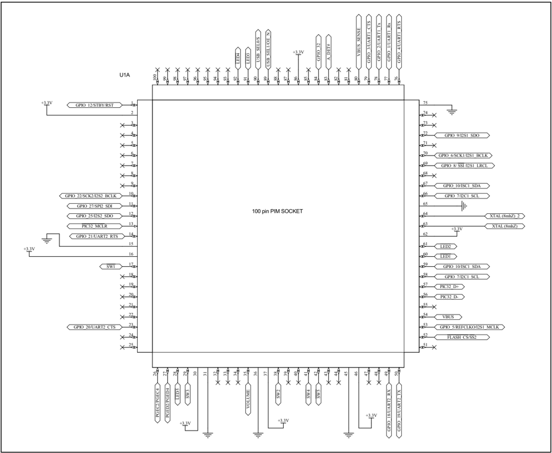
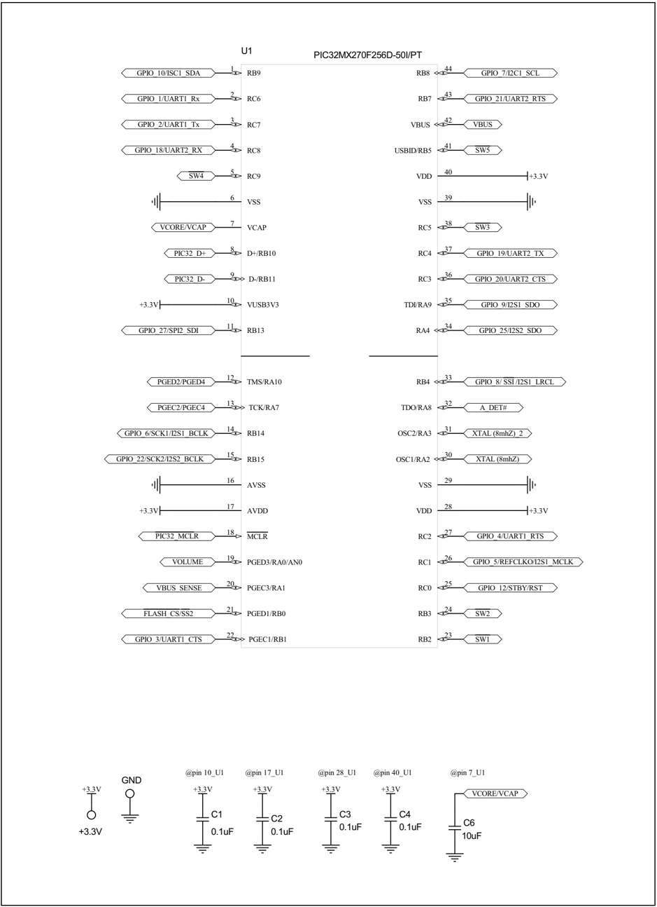
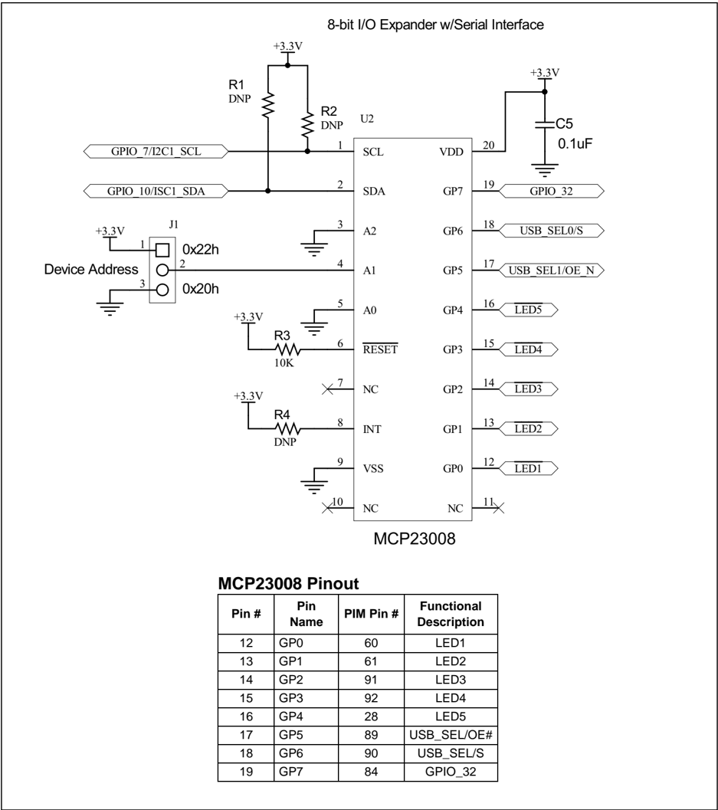

## PIC32MX270F256D

Microchip

## PIC32MX270F256D Bluetooth ® Audio 44-pin to 100-pin TQFP Plug-In Module (PIM) Information Sheet

The PIC32MX270F256D  Bluetooth Audio PIM is designed to demonstrate the capabilities of the PIC32MX1XX/2XX family of devices using the PIC32 Bluetooth Audio Development Kit board.

Note: This  PIM  can  only  be  used  with  the PIC32 Bluetooth Audio Development Board.  To  get  started  with  development, please visit: http://www.microchip.com/ pic32tools and click the PIC32 Bluetooth Audio Development Board product link.

TABLE 1: 44-PIN TO 100-PIN PINOUT

|   Device Pin # | PIC32MX270F256D Pin Name                         | PIM Pin #                 | Functional Description   | I 2 C Expander (MCP23008)   |
|----------------|--------------------------------------------------|---------------------------|--------------------------|-----------------------------|
|              1 | RPB9/SDA1/CTED4/PMD3/RB9                         | 59, 67                    | I2C SDA                  | 2                           |
|              2 | RPC6/PMA1/RC6                                    | 77                        | UART1_RX                 | -                           |
|              3 | RPC7/PMA0/RC7                                    | 78                        | UART_TX                  | -                           |
|              4 | RPC8/PMA5/RC8                                    | 49                        | UART2_RX                 | -                           |
|              5 | RPC9/CTED7/PMA6/RC9                              | 41                        | SW4                      | -                           |
|              6 | VSS                                              | 15, 31, 36, 45, 65, 75    | GND                      | 3, 5, 9                     |
|              7 | VCAP                                             | 2, 16, 30, 37, 46, 62, 86 | 3.3V/VCAP                | -                           |
|              8 | PGED2/RPB10/D+/CTED11/RB10                       | 57                        | USB D+                   | -                           |
|              9 | PGEC2/RPB11/D-/RB11                              | 56                        | USB D-                   | -                           |
|             10 | VBUS3V3                                          |                           | 3.3V                     | 20                          |
|             11 | AN11/RPB13/CTPLS/PMRD/RB13                       | 11                        | SPI2_SDI                 | -                           |
|             12 | PGED/TMS/PMA10/RA10                              | 27                        | PGD4                     | -                           |
|             13 | PGEC/TCK/CTED8/PMA7/RA7                          | 26                        | PGC4                     | -                           |
|             14 | CVREFOUT/AN10/C3INB/RPB14/VBUSON/SCK1/CTED5/RB14 | 70                        | I2S1_BCLK                | -                           |
|             15 | AN9/C3INA/RPB15/SCK2/CTED6/PMCS1/RB15            | 10                        | SCK2                     | -                           |
|             16 | AVSS                                             | 15, 31, 36, 45, 65, 75    | GND                      | 3, 5, 9                     |
|             17 | AVDD                                             | 2, 16, 30, 37, 46, 62, 86 | 3.3V                     | 20                          |
|             18 | MCLR                                             | 13                        | MCLR#                    | -                           |
|             19 | PGED3/VREF+/CVREF+/AN0/C3INC/RPA0/CTED1/PMD7/RA0 | 35                        | VOLUME                   | -                           |
|             20 | PGEC3/VREF-/CVREF-/AN1/RPA1/CTED2/PMD6/RA1       | 80                        | VBUS_SENSE               | -                           |
|             21 | PGED1/AN2/C1IND/C2INB/C3IND/RPB0/PMD0/RB0        | 52                        | SS2                      | -                           |
|             22 | PGEC1/AN3/C1INC/C2INA/RPB1/CTED12/PMD1/RB1       | 79                        | UART1_CTS#               | -                           |
|             23 | AN4/C1INB/C2IND/RPB2/SDA2/CTED13/PMD2/RB2        | 17                        | SW1                      | -                           |
|             24 | AN5/C1INA/C2INC/RTCC/RPB3/SCL2/PMWR/RB3          | 38                        | SW2                      | -                           |
|             25 | AN6/RPC0/RC0                                     | 1                         | STBY/RS#                 | -                           |
|             26 | AN7/RPC1/RC1                                     | 53                        | I2S1_MCLK                | -                           |

The  PIC32MX1XX/2XX  family  of  devices  are  highperformance  32-bit  microcontrollers  in  low-pin  count packages.

Table 1 shows the mapping between the development board functions and the device pins.

The MCP23008 (see Figure 3) is an I 2 C bus expander, which was added to help maintain most of the functionality of the 100-pin device. The I 2 C expander  controls  the  on-board  LEDs  and  charge management logic control lines. For flexibility, the I 2 C expander has a changeable slave address.

TABLE 1: 44-PIN TO 100-PIN PINOUT (CONTINUED)

|   Device Pin # | PIC32MX270F256D Pin Name   | PIM Pin #                 | Functional Description   | I 2 C Expander (MCP23008)   |
|----------------|----------------------------|---------------------------|--------------------------|-----------------------------|
|             27 | AN8/RPC2/PMA2/RC2          | 76                        | UART_RTS#                | -                           |
|             28 | VDD                        | 2, 16, 30, 37, 46, 62, 86 | 3.3V                     | 20                          |
|             29 | VSS                        | 15, 31, 36, 45, 65, 75    | GND                      | 3, 5, 9                     |
|             30 | OSC1/CLKI/RPA2/RA2         | 63                        | OSC1                     | -                           |
|             31 | OSC2/CLKO/RPA3/RA3         | 64                        | OSC2                     | -                           |
|             32 | TDO/RPA8/PMA8/RA8          | 83                        | A_DET#                   | -                           |
|             33 | SOSCI/RPB4/RB4             | 69                        | I2S1_LRCL                | -                           |
|             34 | SOSCO/RPA4/T1CK/CTED9/RA4  | 12                        | SDO2                     | -                           |
|             35 | TDI/RPA9/PMA9/RA9          | 72                        | I2S1_SDO                 | -                           |
|             36 | AN12/RPC3/RC3              | 23                        | UART2_CTS#               | -                           |
|             37 | RPC4/PMA4/RC4              | 50                        | UART2_TX                 | -                           |
|             38 | RPC5/PMA3/RC5              | 29                        | SW3                      | -                           |
|             39 | VSS                        | 15, 31, 36, 45, 65, 75    | GND                      | 3, 5, 9                     |
|             40 | VDD                        | 2, 16, 30, 37, 46, 62, 86 | 3.3V                     | 20                          |
|             41 | RPB5/USBID/RB5             | 42                        | SW5                      | -                           |
|             42 | VBUS                       | 54                        | 3.3V/VBUS                | -                           |
|             43 | RPB7/CTED3/PMD5/INT0/RB7   | 14                        | UART2_RTS#               | -                           |
|             44 | RPB8/SCL1/CTED10/PMD4/RB8  | 58, 66                    | I2C SCL                  | 1                           |

FIGURE 1: 100-PIN HEADER SCHEMATIC

FIGURE 2: 44-PIN DEVICE SCHEMATIC

## FIGURE 3: MCP23008 EXPANDER

|   Pin # | Pin Name   |   PIM Pin # | Functional Description   |
|---------|------------|-------------|--------------------------|
|      12 | GP0        |          60 | LED1                     |
|      13 | GP1        |          61 | LED2                     |
|      14 | GP2        |          91 | LED3                     |
|      15 | GP3        |          92 | LED4                     |
|      16 | GP4        |          28 | LED5                     |
|      17 | GP5        |          89 | USB_SEL/OE#              |
|      18 | GP6        |          90 | USB_SEL/S                |
|      19 | GP7        |          84 | GPIO_32                  |

## REVISION HISTORY

## Revision A (May 2014)

This is the initial released version of this document.

## Note the following details of the code protection feature on Microchip devices:

- Microchip products meet the specification contained in their particular Microchip Data Sheet.
- Microchip believes that its family of products is one of the most secure families of its kind on the market today, when used in the intended manner and under normal conditions.
- There are dishonest and possibly illegal methods used to breach the code protection feature. All of these methods, to our knowledge, require using the Microchip products in a manner outside the operating specifications contained in Microchip's Data Sheets. Most likely, the person doing so is engaged in theft of intellectual property.
- Microchip is willing to work with the customer who is concerned about the integrity of their code.
- Neither Microchip nor any other semiconductor manufacturer can guarantee the security of their code. Code protection does not mean that we are guaranteeing the product as 'unbreakable.'

Code protection is constantly evolving. We at Microchip are committed to continuously improving the code protection features of our products. Attempts to break Microchip's code protection feature may be a violation of the Digital Millennium Copyright Act. If such acts allow unauthorized access to your software or other copyrighted work, you may have a right to sue for relief under that Act.

Information  contained  in  this  publication  regarding  device applications and the like is provided only for your convenience and may be superseded by updates. It is your responsibility to ensure  that  your  application  meets  with  your  specifications. MICROCHIP MAKES NO REPRESENTATIONS OR WARRANTIES  OF  ANY  KIND  WHETHER  EXPRESS  OR IMPLIED, WRITTEN OR ORAL, STATUTORY OR OTHERWISE, RELATED TO THE INFORMATION, INCLUDING  BUT  NOT  LIMITED  TO  ITS  CONDITION, QUALITY, PERFORMANCE, MERCHANTABILITY OR FITNESS  FOR  PURPOSE . Microchip  disclaims  all  liability arising  from  this  information  and  its  use.  Use  of  Microchip devices in life support and/or safety applications is entirely at the buyer's risk, and the buyer agrees to defend, indemnify and hold  harmless  Microchip  from  any  and  all  damages,  claims, suits,  or  expenses  resulting  from  such  use.  No  licenses  are conveyed, implicitly or otherwise, under any Microchip intellectual property rights.

## QUALITY MANAGEMENT  SYSTEM CERTIFIED BY DNV

== ISO/TS 16949 ==

## Trademarks

The Microchip name and logo, the Microchip logo, dsPIC, FlashFlex, KEELOQ, KEELOQ logo, MPLAB, PIC, PICmicro, PICSTART, PIC 32  logo, rfPIC, SST, SST Logo, SuperFlash and UNI/O are registered trademarks of Microchip Technology Incorporated in the U.S.A. and other countries.

FilterLab, Hampshire, HI-TECH C, Linear Active Thermistor, MTP, SEEVAL and The Embedded Control Solutions Company are registered trademarks of Microchip Technology Incorporated in the U.S.A.

Silicon Storage Technology is a registered trademark of Microchip Technology Inc. in other countries.

Analog-for-the-Digital Age, Application Maestro, BodyCom, chipKIT, chipKIT logo, CodeGuard, dsPICDEM, dsPICDEM.net, dsPICworks, dsSPEAK, ECAN, ECONOMONITOR, FanSense, HI-TIDE, In-Circuit Serial Programming, ICSP, Mindi, MiWi, MPASM, MPF, MPLAB Certified logo, MPLIB, MPLINK, mTouch, Omniscient Code Generation, PICC, PICC-18, PICDEM, PICDEM.net, PICkit, PICtail, REAL ICE, rfLAB, Select Mode, SQI, Serial Quad I/O, Total Endurance, TSHARC, UniWinDriver, WiperLock, ZENA and Z-Scale are trademarks of Microchip Technology Incorporated in the U.S.A. and other countries.

SQTP is a service mark of Microchip Technology Incorporated in the U.S.A.

GestIC and ULPP are registered trademarks of Microchip Technology Germany II GmbH &amp; Co. KG, a subsidiary of Microchip Technology Inc., in other countries.

All other trademarks mentioned herein are property of their respective companies.

© 2014, Microchip Technology Incorporated, Printed in the U.S.A., All Rights Reserved.

Printed on recycled paper.

ISBN: 978-1-63276-195-8

Microchip received ISO/TS-16949:2009 certification for its worldwide headquarters, design and wafer fabrication facilities in Chandler and Tempe, Arizona; Gresham, Oregon and design centers in California and India. The Company's quality system processes and procedures are for its PIC ®  MCUs and dsPIC ®  DSCs, KEELOQ ®  code hopping devices, Serial EEPROMs, microperipherals, nonvolatile memory and analog products. In addition, Microchip's quality system for the design and manufacture of development systems is ISO 9001:2000 certified.

## Worldwide Sales and Service

## ASIA/PACIFIC

Asia Pacific Office Suites 3707-14, 37th Floor Tower 6, The Gateway Harbour City, Kowloon Hong Kong Tel: 852-2943-5100 Fax: 852-2401-3431

Australia - Sydney Tel: 61-2-9868-6733 Fax: 61-2-9868-6755

China - Beijing Tel: 86-10-8569-7000 Fax: 86-10-8528-2104

China - Chengdu Tel: 86-28-8665-5511 Fax: 86-28-8665-7889

China - Chongqing Tel: 86-23-8980-9588 Fax: 86-23-8980-9500

China - Hangzhou Tel: 86-571-8792-8115 Fax: 86-571-8792-8116

China - Hong Kong SAR Tel: 852-2943-5100 Fax: 852-2401-3431

China - Nanjing Tel: 86-25-8473-2460 Fax: 86-25-8473-2470

China - Qingdao Tel: 86-532-8502-7355 Fax: 86-532-8502-7205

China - Shanghai Tel: 86-21-5407-5533 Fax: 86-21-5407-5066

China - Shenyang Tel: 86-24-2334-2829 Fax: 86-24-2334-2393

China - Shenzhen Tel: 86-755-8864-2200 Fax: 86-755-8203-1760

China - Wuhan Tel: 86-27-5980-5300 Fax: 86-27-5980-5118

China - Xian Tel: 86-29-8833-7252 Fax: 86-29-8833-7256

China - Xiamen Tel: 86-592-2388138 Fax: 86-592-2388130

China - Zhuhai Tel: 86-756-3210040 Fax: 86-756-3210049

## ASIA/PACIFIC

India - Bangalore Tel: 91-80-3090-4444 Fax: 91-80-3090-4123

India - New Delhi Tel: 91-11-4160-8631 Fax: 91-11-4160-8632

India - Pune Tel: 91-20-3019-1500

Japan - Osaka Tel: 81-6-6152-7160 Fax: 81-6-6152-9310

Japan - Tokyo Tel: 81-3-6880- 3770 Fax: 81-3-6880-3771

Korea - Daegu Tel: 82-53-744-4301 Fax: 82-53-744-4302

Korea - Seoul Tel: 82-2-554-7200 Fax: 82-2-558-5932 or 82-2-558-5934

Malaysia - Kuala Lumpur Tel: 60-3-6201-9857 Fax: 60-3-6201-9859

Malaysia - Penang Tel: 60-4-227-8870 Fax: 60-4-227-4068

Philippines - Manila Tel: 63-2-634-9065 Fax: 63-2-634-9069

Singapore Tel: 65-6334-8870 Fax: 65-6334-8850

Taiwan - Hsin Chu Tel: 886-3-5778-366 Fax: 886-3-5770-955

Taiwan - Kaohsiung Tel: 886-7-213-7830

Taiwan - Taipei Tel: 886-2-2508-8600 Fax: 886-2-2508-0102

Thailand - Bangkok Tel: 66-2-694-1351 Fax: 66-2-694-1350

## AMERICAS

Corporate Office 2355 West Chandler Blvd. Chandler, AZ 85224-6199 Tel: 480-792-7200 Fax: 480-792-7277 Technical Support:

http://www.microchip.com/ support

Web Address:

www.microchip.com

Atlanta Duluth, GA Tel: 678-957-9614 Fax: 678-957-1455

Austin, TX Tel: 512-257-3370

Boston Westborough, MA Tel: 774-760-0087 Fax: 774-760-0088

Chicago Itasca, IL Tel: 630-285-0071 Fax: 630-285-0075

Cleveland Independence, OH Tel: 216-447-0464 Fax: 216-447-0643

Dallas Addison, TX Tel: 972-818-7423 Fax: 972-818-2924

Detroit Novi, MI Tel: 248-848-4000

Houston, TX Tel: 281-894-5983

Indianapolis Noblesville, IN Tel: 317-773-8323 Fax: 317-773-5453

Los Angeles Mission Viejo, CA Tel: 949-462-9523 Fax: 949-462-9608

New York, NY Tel: 631-435-6000

San Jose, CA Tel: 408-735-9110

Canada - Toronto Tel: 905-673-0699 Fax: 905-673-6509

## EUROPE

Austria - Wels Tel: 43-7242-2244-39 Fax: 43-7242-2244-393

Denmark - Copenhagen Tel: 45-4450-2828 Fax: 45-4485-2829

France - Paris Tel: 33-1-69-53-63-20 Fax: 33-1-69-30-90-79

Germany - Dusseldorf Tel: 49-2129-3766400

Germany - Munich Tel: 49-89-627-144-0 Fax: 49-89-627-144-44

Germany - Pforzheim Tel: 49-7231-424750

Italy - Milan Tel: 39-0331-742611 Fax: 39-0331-466781

Italy - Venice Tel: 39-049-7625286

Netherlands - Drunen Tel: 31-416-690399 Fax: 31-416-690340

Poland - Warsaw Tel: 48-22-3325737

Spain - Madrid Tel: 34-91-708-08-90 Fax: 34-91-708-08-91

Sweden - Stockholm Tel: 46-8-5090-4654

UK - Wokingham Tel: 44-118-921-5800 Fax: 44-118-921-5820

03/25/14